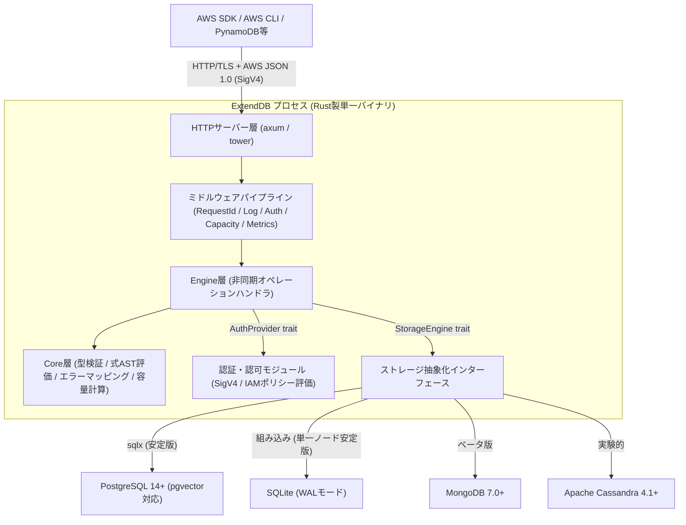

# **ExtendDB 調査レポート**

## **1. 基本情報**

* **ツール名**: ExtendDB
* **ツールの読み方**: エクステンドディービー
* **開発元**: Amazon Web Services (AWS) / ExtendDB Contributors
* **公式サイト**: [https://extenddb.org/](https://extenddb.org/)
* **関連リンク**:
  * GitHub: [https://github.com/ExtendDB/extenddb](https://github.com/ExtendDB/extenddb)
  * ドキュメント: [https://github.com/ExtendDB/extenddb/tree/main/docs](https://github.com/ExtendDB/extenddb/tree/main/docs)
  * Playground (Wasm版): [https://extenddb.org/playground/](https://extenddb.org/playground/)
* **カテゴリ**: データベース/データストレージ
* **概要**: Amazon Web Services（AWS）のエンジニアが開発・メンテナンスする、Rust製のオープンソース（Apache 2.0）Amazon DynamoDB互換APIアダプター。クリーンルーム実装によってDynamoDBのワイヤプロトコル（AWS JSON 1.0）を再現しており、アプリケーション側のAWS SDKやコードを一切変更せずにエンドポイントを切り替えるだけで、PostgreSQL・SQLite・MongoDB・Apache Cassandraなどの任意のデータベース上でDynamoDBワークロードを実行できる。

## **2. 目的と主な利用シーン**

* **解決する課題**:
  * オンプレミス、エッジ拠点、エアギャップ（インターネット非接続）環境など、AWSクラウドのマネージドDynamoDBを利用できない環境でのアプリケーション実行。
  * クラウドへの接続や課金を伴わない、ローカル開発環境およびCI/CDパイプラインでの高速かつ高忠実度な結合テスト。
  * マルチクラウドやハイブリッド環境における、単一コードベース・単一API（DynamoDB API）でのデータアクセス標準化。
* **想定利用者**:
  * AWS SDKを用いたアプリケーションを開発するバックエンド・フルスタック開発者
  * オンプレミスやエッジ環境にシステムを展開するインフラ・DevOpsエンジニア
  * 高速で決定論的なテスト環境を求めるQA・CI/CD担当者
* **利用シーン**:
  * **ローカル開発とCI/CDテスト**: SQLiteバックエンドを内蔵した `@extenddb/dev` や `extenddb/extenddb-dev` コンテナを起動し、外部DB構築なしでミリ秒単位の高速な自動テストを実行。
  * **ハイブリッド・オンプレミス運用**: 本番のAWS環境ではマネージドのDynamoDBを使用し、社内データセンターやプライベートクラウドでは既存のPostgreSQL上にExtendDBを配置して同一アプリケーションを稼働。
  * **エッジ・オフライン拠点**: 工場、小売店舗、車両、航空機などのエッジ環境でローカルにデータを永続化し、ネットワーク遮断時でも業務を継続。

### **2.1 代表的な利用フロー**

```mermaid
swimlane-beta TB
  subgraph App["アプリケーション (AWS SDK)"]
    A["DynamoDB API リクエスト送信"]
    F["レスポンスを受信・処理"]
  end
  subgraph Adapter["ExtendDB (APIアダプター)"]
    B["SigV4認証・IAMポリシー評価"]
    C["DynamoDB式パース・クエリ変換"]
    E["DynamoDB形式でレスポンス生成"]
  end
  subgraph Storage["ストレージバックエンド (PostgreSQL等)"]
    D["SQL/NoSQLクエリ実行・永続化"]
  end
  A --> B
  B --> C
  C --> D
  D --> E
  E --> F
```

* **代表的な流れ**: アプリケーションは通常のAWS SDKを使ってエンドポイントURLのみをExtendDBへ向けてリクエストを送信する。ExtendDBはSigV4署名の検証とリクエストの構文解析を行った後、選択されたストレージバックエンド（PostgreSQL等）のクエリへ変換して実行し、結果をDynamoDB互換のJSON形式でアプリケーションへ返却する。

## **3. 主要機能**

* **DynamoDBワイヤプロトコル完全互換**: `PutItem` / `GetItem` / `UpdateItem` / `DeleteItem` のCRUD操作に加え、`Query`、`Scan`、`BatchGetItem` / `BatchWriteItem`、ACIDトランザクション（`TransactGetItems` / `TransactWriteItems`）をネイティブにサポート。
* **PartiQLサポート**: DynamoDB向けのSQL互換クエリ言語であるPartiQL（`ExecuteStatement`、`BatchExecuteStatement`、`ExecuteTransaction`）を標準機能として提供。
* **DynamoDB StreamsとTTL**: 変更データキャプチャ（CDC）用のStreams API（`GetRecords`、`GetShardIterator`、`ListStreams`、`DescribeStream`）および有効期限切れアイテムの自動削除（TTL）を実装。
* **プラガブルなストレージバックエンド**: 共通の `StorageEngine` トレイトを介して、**PostgreSQL**（リファレンス・安定版）、**SQLite**（単一ノード安定版）、**MongoDB**（ベータ版）、**Apache Cassandra**（実験的）の4種類のバックエンドに対応。
* **ベクトル検索機能**: PostgreSQL（`pgvector`拡張使用時）およびSQLiteバックエンドにおいて、テーブル作成時の `VectorIndexes` 指定および `SearchVectors` オペレーションをサポート。
* **SigV4認証・ビルトインIAM互換機能**: ローカルの認証情報ストアを用いた完全なAWS SigV4署名検証に加え、アカウント・ユーザー・グループ・ロール・IAMポリシー・パーミッションバウンダリの管理機能を搭載。
* **Web管理コンソールとメトリクス**: アカウントやアクセスキーの管理を行うためのWeb UIコンソール（CSRF保護・セッション管理付き）と、CloudWatch互換のJSONメトリクスエンドポイントを提供。
* **データインポート/エクスポート**: S3形式等を想定した `ExportTableToPointInTime`、`ImportTable`、およびバックアップ・リストア関連のAPI群を実装。

## **4. 動作原理・システム構成**



* **アーキテクチャ**: Rust言語で構築されたスタンドアロンの非同期クライアント・サーバー型アーキテクチャ（Cargoワークスペース構成）。1つのバイナリに対してビルド時に1つのストレージバックエンドを選択・組み込む設計となっており、1カタログにつき1台のExtendDBサーバーを稼働させる構成をとる。なお、ブラウザ上で動作するWebAssembly（Wasm）版アダプター（`crates/wasm-adapter`）も存在する。
* **主要コンポーネントとデータフロー**:
  * **Server / Middleware層（`axum` / `tower`）**: TLS終端（必須、自己署名証明書の自動生成対応）、`X-Amz-Target` ヘッダに基づくルーティング、Gzip圧縮、CRC32チェックサム、レート制限を処理。
  * **Core層（同期処理）**: DynamoDBの型システム（`AttributeValue`）、条件式・更新式・射影式のパーサーおよびAST評価器、入力バリデーション（400KBサイズ制限など）、RCU/WCU容量計算を担う。
  * **Engine層（非同期処理）**: Coreの検証ロジックと `StorageEngine` トレイトを接続し、トランザクション制御やStreamsレコードの組み立てを実行。
  * **Storage層**: 各バックエンド固有のクエリ生成とロック制御（PostgreSQLの `REPEATABLE READ` やキー順ロックによるデッドロック防止など）を実装。
* **特筆すべき要素技術**:
  * **クリーンルーム実装**: Amazon DynamoDBのソースコードを一切含まず、公開仕様と実機検証（Parity Suite等）に基づいてRustでゼロから再実装されている。
  * **必須TLSとKEK暗号化**: 本番ビルドではTLS通信が強制され、認証情報の暗号化キーはカタログ外のKEK（Key Encryption Key）でラップして保護される。

## **5. 開始手順・セットアップ**

* **前提条件**:
  * **Dockerで試す場合**: Docker Desktop または Docker Engine（外部DB不要の開発用イメージが利用可能）
  * **ソースからビルドする場合**: Rust 1.91.1+、および利用するバックエンド（PostgreSQL 14+、MongoDB 7.0+、Cassandra 4.1+、または組み込みSQLite）
  * アカウント登録やクレジットカード登録は不要。
* **インストール/導入**:
  ローカル開発・CI向けのSQLiteベース開発用コンテナ（`extenddb-dev`）を起動するコマンドは以下の通り（セキュリティ上の理由から必ずループバック `127.0.0.1` にバインドする）。

  ```bash
  # 開発用コンテナの起動（HTTP・単一コンテナ完結）
  docker run -d -p 127.0.0.1:18080:18080 -v extenddb:/var/lib/extenddb \
    extenddb/extenddb-dev
  ```

  Node.jsプロジェクト向けには `@extenddb/dev` npmパッケージも用意されている。本番構成をソースからビルドする場合は以下を実行する。

  ```bash
  # リポジトリのクローンとリリースビルド（デフォルトはPostgreSQLバックエンド）
  git clone https://github.com/ExtendDB/extenddb.git
  cd extenddb
  cargo build --release
  ```

* **初期設定**:
  本番用バイナリを使用する場合は `extenddb init` を実行して設定ファイル（`extenddb.toml`）、データベーススキーマ、管理者認証情報、および自己署名TLS証明書（`~/.extenddb/tls/cert.pem`）を生成する。

  ```bash
  # 初期化とサーバー起動
  ./target/release/extenddb init
  ./target/release/extenddb serve --config extenddb.toml

  # AWS CLI等から自己署名証明書を信頼させる設定
  export AWS_CA_BUNDLE=~/.extenddb/tls/cert.pem
  ```

  続いて管理者パスワードを環境変数 `EXTENDDB_PASSWORD` に渡し、`extenddb manage` コマンドでユーザーとアクセスキーを作成する。開発用イメージ（`extenddb-dev`）を共有ホストやCIランナーで動かす場合は、`EXTENDDB_DEV_DISABLE_EXAMPLE_CREDENTIAL=1` と独自のキーを指定することが推奨される。

* **クイックスタート**:
  発行した認証情報（または開発用イメージの認証情報）を環境変数に設定し、AWS CLIから `--endpoint-url` を指定してテーブル一覧や作成を実行する。

  ```bash
  export AWS_ACCESS_KEY_ID=<YOUR_ACCESS_KEY_ID>
  export AWS_SECRET_ACCESS_KEY=<YOUR_SECRET_ACCESS_KEY>

  # テーブル一覧の取得（開発用イメージの場合）
  aws dynamodb list-tables \
    --region us-east-1 \
    --endpoint-url http://127.0.0.1:18080
  ```

## **6. 特徴・強み (Pros)**

* **アプリケーションコードの修正が不要**: AWS SDK（JavaScript, Python, Java, Go, Rust等）や高レベルラッパー（PynamoDB, Dynamoose等）のエンドポイント設定を変更するだけでそのまま動作する。
* **公式メンテナンスによる高いAPI・エラー互換性**: AWSエンジニアによって開発されており、式評価、ページネーション、エラーメッセージやHTTPステータスコードまで実機との高いパリティ（一致率）を追求している。
* **用途に応じたバックエンド選択**: 開発・CIでは手軽なSQLite、エンタープライズ本番環境では運用実績の豊富なPostgreSQL、水平スケールが必要な場合はCassandraなど、既存の運用ノウハウを活かしたDB選定が可能。
* **Rust製による軽量・高速な動作**: JVMを必要とする従来の「DynamoDB Local」と比較して起動が高速でメモリフットプリントが小さく、Distroless/Scratchコンテナでの運用や `--foreground` 実行、組み込み `healthcheck` サブコマンドにも対応している。
* **完全オープンソース（Apache 2.0）**: 特許許諾条項を含むApache 2.0ライセンスで公開されており、ベンダーロックインを回避しつつソースコードの監査や独自バックエンドの追加が可能。

## **7. 弱み・注意点 (Cons)**

* **マネージド固有機能への非対応**: Global Tables（マルチリージョンレプリケーション）、DAX（インメモリキャッシュ）、オートスケーリングなどのAWSマネージド基盤に依存する機能は実装されていない（`UnknownOperationException` 等を返す）。
* **バックエンドごとの機能・制約の差異**: 例えばMongoDBバックエンドではキー数値の有効桁数が34桁（DynamoDBは38桁）に制限され、ベクトル検索が非対応となる。また、Cassandraバックエンドはv1.0.0時点で実験的（Experimental）ステータスであり、一部管理操作が非アトミックである。
* **高可用性・スケールアウトの運用責任**: レプリケーション、フェイルオーバー、バックアップなどの運用はユーザー側のバックエンドDBに委ねられる。また、v1.0.0時点では「1カタログにつき1台のExtendDBサーバー」という制約があり、複数サーバーでの同一カタログ共有はサポートされない。
* **日本語対応の状況**: 公式サイト、ドキュメント、Web管理コンソール、エラーメッセージはすべて英語のみであり、日本語の公式サポートや日本語ドキュメントは提供されていない。

## **8. 料金プラン**

| プラン名 | 料金 | 主な特徴 |
|---------|------|---------|
| **オープンソース版 (Apache 2.0)** | 無料 | 全機能（PostgreSQL/SQLite/MongoDB/Cassandraバックエンド、IAM互換認証、管理コンソール、CLI等）を制限なく利用可能。 |
| **有償プラン / エンタープライズ版** | なし | 商用ライセンスや有償SaaSプランは提供されていない。 |

* **課金体系**: ソフトウェア自体は完全無料。セルフホストするインフラ（ローカルPC、オンプレミスサーバー、クラウド上のVMやRDS等のマネージドDB）の運用コストのみが発生する。
* **無料トライアル**: オープンソースのため試用期間の制限はない。ブラウザ上で即座に試せる公式Playgroundも無料で公開されている。

## **9. 導入実績・事例**

* **導入企業**: 2026年5月の公開（v1.0.0は2026年11月公開）から日が浅いため、公式サイト上での具体的な外部企業の商用導入事例は公開されていない。
* **導入事例**: 国内ではクラスメソッド社（DevelopersIO）によるAWS EC2 + Amazon RDS for PostgreSQL構成での動作検証や、実機DynamoDBとのAPIレスポンス比較検証など、技術検証事例が複数報告されている。
* **対象業界**: 製造業・小売・運輸などのエッジ/エアギャップ環境を抱える業界、厳格なデータ主権やオンプレミス要件を持つエンタープライズ企業、およびAWSベースのSaaS開発チームでの導入が見込まれる。

## **10. サポート体制**

* **ドキュメント**: GitHubリポジトリ内の [`docs/`](https://github.com/ExtendDB/extenddb/tree/main/docs) ディレクトリに、導入ガイド（`getting-started.md`）、設計書群（`docs/design/`）、実機との差異一覧（`differences-from-dynamodb.md`）、バージョニングポリシー（`versioning.md`）などが体系的に整備されている。また、`llms.txt` や `manifest.json` などAIエージェント向けのドキュメント配信にも対応している。
* **コミュニティ**: GitHub Issues および Pull Requests を中心に開発・質問対応が行われている。コミュニティによる新規ストレージバックエンドのコントリビューションも歓迎されている。
* **公式サポート**: 商用SLA付きの公式有償サポート窓口（電話・チャット等）は存在せず、GitHub上のメンテナーによるコミュニティベースでの対応となる（対応言語は英語）。

## **11. エコシステムと連携**

### **11.1 API・外部サービス連携**

* **API**: Amazon DynamoDB API（バージョン `2012-08-10` / AWS JSON 1.0 プロトコル）互換のHTTP/HTTPSエンドポイントを提供。加えて、JSON形式の `/health` エンドポイントおよびCloudWatch形式のメトリクスエンドポイントを備える。
* **外部サービス連携**: AWS公式SDK全言語版、AWS CLI、NoSQL Workbench for DynamoDB、PynamoDB、Dynamoose、DynamoDB Toolbox、AWS Data Wrangler（awswrangler）などの既存DynamoDBエコシステムツールがそのまま連携可能。コンテナ基盤（Docker / Kubernetes / ECS）や、バックエンドDB（Amazon RDS / Aurora PostgreSQL、MongoDB Atlas等）とも組み合わせて利用できる。

### **11.2 技術スタックとの相性**

| 技術スタック | 相性 | メリット・推奨理由 | 懸念点・注意点 |
|:---|:---:|:---|:---|
| **Node.js / TypeScript** | ◎ | `@aws-sdk/client-dynamodb` や Dynamoose がそのまま動作。開発用の `@extenddb/dev` npmパッケージも公式提供。 | 特になし |
| **Python (boto3 / PynamoDB)** | ◎ | `boto3` の `endpoint_url` を変更するだけで即座に接続可能。CIテストとの相性が極めて良い。 | 自己署名TLS使用時は `verify` パラメータや `AWS_CA_BUNDLE` の設定が必要 |
| **Go / Java / Rust** | ◎ | `aws-sdk-go-v2`、`software.amazon.awssdk`、`aws-sdk-rust` が公式にサポート対象として明記されている。 | 特になし |
| **Docker / Kubernetes** | ◎ | `--foreground` フラグと組み込み `healthcheck` サブコマンドにより、DistrolessコンテナやSupervisor環境で安定稼働。 | 1カタログ1サーバー制約のため、ExtendDBコンテナ自体の水平スケールには注意が必要 |
| **ブラウザ / Webフロントエンド** | ◯ | `wasm-adapter` によりWebAssemblyとしてブラウザ上で動作可能（公式Playgroundで実証済み）。 | 本番クライアントから直接接続する用途ではなくデモ・検証向け |

## **12. セキュリティとコンプライアンス**

* **認証**: デフォルトでビルトインのIAM互換認証（`auth.provider = "builtin"`）が有効。全リクエストに対してAWS SigV4署名検証を要求し、ユーザー・グループ・ロール・IAMポリシー・パーミッションバウンダリによるきめ細かいアクセス制御を実施する。Web管理コンソールにはログイン試行回数制限（レートリミット）、bcryptによるパスワードハッシュ化、CSRF保護、セキュリティヘッダーが組み込まれている。
* **データ管理**:
  * **通信暗号化**: 本番構成ではTLS通信が必須（TLS無効での起動を拒否）。`extenddb init` で自己署名証明書を自動生成し、本番ではCA署名証明書へ差し替え可能。
  * **鍵管理**: v1.0.0にて、認証情報の暗号化キーをカタログ外のKEK（Key Encryption Key）でラップする仕組みを導入。
  * **永続化データの保護**: データ自体はユーザーが管理するバックエンドDB（PostgreSQL等）に保存されるため、保存時暗号化（Encryption at Rest）やデータの保管場所（データレジデンシー）はインフラ側で完全にコントロールできる。
* **準拠規格**: セルフホスト型のオープンソースソフトウェアであるため、ExtendDBプロジェクトとしてのSOC 2やISO 27001などの第三者認証取得はない（公式サイトで公開されていない）。組織自身のコンプライアンス要件（オンプレミス閉域網、エアギャップ環境等）に適合したインフラ上で運用することで要件を満たす設計となっている。

## **13. 操作性 (UI/UX) と学習コスト**

* **UI/UX**: 主にCLI（`extenddb`）およびAPIサーバーとして動作するため、日々の開発・運用は使い慣れたAWS CLIやNoSQL Workbench、各言語のSDKをそのまま利用できる。加えて、アカウントやIAMユーザー・アクセスキーを管理するためのシンプルなWeb管理コンソールが同梱されている。
* **学習コスト**: DynamoDBのAPIやAWS SDKの知識がある開発者にとっては、エンドポイントURLと証明書パスを設定するだけであるため学習コストは非常に低い。一方、本番環境でPostgreSQL等のバックエンドDBを併用する場合は、バックエンドDBのチューニング・バックアップ・TLS証明書管理といったインフラ運用の知識が求められる。

## **14. ベストプラクティス**

* **効果的な活用法 (Modern Practices)**:
  * **開発・CIと本番の分離**: ローカル開発やCIの単体テストでは外部DB不要の `extenddb/extenddb-dev`（または `@extenddb/dev`）を使い、本番やステージングのオンプレミス環境ではPostgreSQL（14以上）バックエンドの本番イメージを使用する。
  * **コンテナでの適切な起動**: DockerやKubernetes環境では `extenddb serve --foreground` を指定してPID 1としてフォアグラウンド実行し、コンテナの `HEALTHCHECK` には `curl` ではなく組み込みの `extenddb healthcheck` コマンドを使用する。
  * **マイグレーション管理**: バージョンアップ時は `extenddb migrate --yes` を実行し、SQLite等の場合は事前に自動バックアップが作成される挙動を確認しつつ安全にカタログを移行する。
* **陥りやすい罠 (Antipatterns)**:
  * **開発用イメージのネットワーク公開**: `extenddb-dev` は平文HTTPで動作し、認証がオープン（デフォルトの公開サンプル認証情報を受け入れる設定）になっている。`-p 18080:18080` のように全インターフェースへ公開せず、必ず `-p 127.0.0.1:18080:18080` でループバックに限定すること。共有CIランナーでは `EXTENDDB_DEV_DISABLE_EXAMPLE_CREDENTIAL=1` を必ず設定する。
  * **同一カタログへの複数サーバー接続**: 1.0.0時点では1カタログにつき1台のExtendDBサーバーが前提となっている（SQLite以外ではロックで強制されないため、誤って複数台から同一カタログに接続しないよう構成管理で防ぐ必要がある）。
  * **バックエンド固有の制限の見落とし**: MongoDBバックエンドにおける34桁数値制限や複数RANGEキーを持つGSIの制約など、`differences-from-dynamodb.md` に記載された差異を事前に確認せずに移行すると予期せぬバリデーションエラーに遭遇する。

## **15. ユーザーの声（レビュー分析）**

* **調査対象**: Hacker News、Reddit、技術ブログ（クラスメソッド DevelopersIO 等）
  （※商用SaaSではなくオープンソースプロジェクトであるため、G2やCapterraには製品ページが存在しない）
* **総合評価**: 公開レビューサイトでの数値スコアは未集計（GitHubスター数: 約570、2026年11月時点）
* **ポジティブな評価**:
  * 「従来のJavaベースで重かったDynamoDB Localの強力な代替・アップグレードになる」（Hacker Newsコミュニティ）
  * 「AWS公式エンジニアがRustでクリーンルーム実装しており、式評価やエラーコードの再現度（パリティ）が非常に高い」（技術ブログ検証）
  * 「コードを変更せずにオンプレミスやエアギャップ環境へDynamoDBワークロードを持ち出せる点が実用的」（Reddit / 開発者コメント）
* **ネガティブな評価 / 改善要望**:
  * 「テーブル作成直後のステータス遷移や複雑なページネーションなど、一部のエッジケースで実機DynamoDBとの微細な挙動差が見られる」（国内技術検証記事）
  * 「PostgreSQL以外のバックエンド（特にCassandraなど）ではAPIカバレッジやアトミック性に制限が残っている」
  * 「1カタログ1サーバーの制約があるため、ExtendDBプロセス自体の冗長化（Active-Active）には今後の拡張を待つ必要がある」
* **特徴的なユースケース**:
  * 既存のPostgreSQL（Amazon RDS等）をデータストアとして活用しつつ、開発チームが慣れ親しんだDynamoDB API（シングルテーブル設計）のままアプリケーションを構築・テストする構成。
  * ブラウザ上で完結するWebAssembly版を活用した、サーバーレス・ゼロインストールでのDynamoDB学習やデモ環境。

## **16. 直近半年のアップデート情報**

* **2026-11-18**: **v1.0.0 リリース** — セマンティックバージョニングに基づく初のメジャー安定版を公開。認証情報の暗号化キーをカタログ外のKEK（Key Encryption Key）でラップする機能（PR #1003）や、Cassandraバックエンドにおける `LOCAL_QUORUM` での読み書きおよびLWTによる管理ユーザー操作（PR #945, #1010）を実装。
* **2026-11-18**: **v0.1.15 リリース** — 全ストレージバックエンド（SQLite, PostgreSQL, Cassandra, MongoDB）向けの統一カタログマイグレーション台帳（Ledger）を導入。また、ログイン失敗時の送信元IPレート制限・bcrypt検証の強化や、Cassandraバックエンド用コンテナイメージの公開を実施。
* **2026-10-23**: **v0.1.14 リリース** — サーバーソケットへの `TCP_NODELAY` 設定によるレイテンシ改善、PostgreSQLバックエンドにおける `TransactGetItems` の単一スナップショット読み取り修正および `PutItem` 競合順序の修正を実施。
* **2026-10-01**: **v0.1.13 リリース** — PostgreSQLの `COLLATE "C"` キー列対応とインデックスページカーソルの `ScanIndexForward` 修正、エンジン層でのチャンク単位の `Query`/`Scan` 読み取り最適化を実施。
* **2026-09-18**: **v0.1.12 リリース** — MongoDBバックエンドのバックアップメタデータ処理、ドット区切り属性パス、カタログ接続制限の修正、およびSQLiteリストア時のステータス遷移修正を実施。
* **2026-09-10**: **v0.1.11 リリース** — PostgreSQLバックエンドにおけるベクトルインデックスおよび `SearchVectors` オペレーションのサポート（`pgvector`活用）と、`TableThroughputMode` 対応を追加。

（出典: [ExtendDB GitHub Releases](https://github.com/ExtendDB/extenddb/releases)）

## **17. 類似ツールとの比較**

### **17.1 機能比較表 (星取表)**

| 機能カテゴリ | 機能項目 | ExtendDB | Amazon DynamoDB Local | LocalStack | ScyllaDB Alternator |
|:---:|:---|:---:|:---:|:---:|:---:|
| **互換性** | DynamoDB API再現度 | ◎<br><small>式・エラー・PartiQL・Streams対応</small> | ◎<br><small>AWS公式エミュレータ</small> | ◯<br><small>主要API対応（一部制限あり）</small> | ◯<br><small>データ操作中心（管理系は一部差異）</small> |
| **ストレージ** | バックエンド選択性 | ◎<br><small>PostgreSQL/SQLite/MongoDB/Cassandra</small> | ×<br><small>内部SQLite固定</small> | △<br><small>内部エンジン固定</small> | ×<br><small>ScyllaDBエンジン固定</small> |
| **運用・拡張** | 本番・エッジ運用適性 | ◎<br><small>TLS/SigV4/IAM標準・PostgreSQL永続化</small> | ×<br><small>開発・テスト専用（非推奨）</small> | ×<br><small>開発・テスト専用</small> | ◎<br><small>大規模分散本番運用向け</small> |
| **他AWS連携** | S3/Lambda等との統合 | ×<br><small>DynamoDB APIに特化</small> | ×<br><small>DynamoDB単体</small> | ◎<br><small>100以上のAWSサービスを再現</small> | ×<br><small>DynamoDB互換APIに特化</small> |
| **開発体験** | 軽量性・起動速度 | ◎<br><small>Rust製単一バイナリ（JVM不要）</small> | △<br><small>Java (JVM) 依存でやや重い</small> | △<br><small>Python/Dockerベースで中量級</small> | △<br><small>C++製だがクラスタ構成が必要</small> |
| **非機能要件** | 日本語情報・ドキュメント | △<br><small>公式英語のみ（国内検証記事あり）</small> | ◯<br><small>AWS公式日本語ドキュメントあり</small> | ◯<br><small>コミュニティ・解説記事が豊富</small> | △<br><small>公式英語中心</small> |

### **17.2 詳細比較**

| ツール名 | 特徴 | 強み | 弱み | 選択肢となるケース |
|---------|------|------|------|------------------|
| **ExtendDB** | Rust製のプラガブルDynamoDB互換APIアダプター | 既存DB（PostgreSQL等）をバックエンドにでき、ローカルから本番・エッジまで同一APIで運用可能。 | DynamoDB以外のAWSサービスは非対応。 | ローカル・CIに加え、オンプレミスやエッジでPostgreSQL等を使いながらDynamoDB APIで開発・運用したい場合。 |
| **Amazon DynamoDB Local** | AWS公式のローカルテスト用ダウンロード版エミュレータ | AWS公式提供による安心感と日本語ドキュメントの充実。 | JVM依存で重く、本番・オンプレミスでのデータ永続化用途には不向き。プロプライエタリ。 | 既存のJava環境があり、単純なローカル単体テストのみをAWS公式ツールで行いたい場合。 |
| **LocalStack** | AWSクラウド環境全体をローカルでエミュレートする統合基盤 | DynamoDBだけでなくS3、Lambda、SQS、IAM等を連携させたE2Eテストがローカルで完結する。 | DynamoDB単体の本番運用やエッジ配置には使えない。高度な機能（Cloud Pods等）は有償。 | LambdaやS3など複数のAWSサービスを組み合わせた統合テストをローカル・CIで実行したい場合。 |
| **ScyllaDB Alternator** | 高性能分散NoSQL「ScyllaDB」に組み込まれたDynamoDB互換API | 超低レイテンシかつペタバイト級の大規模分散クラスタとしてマルチクラウド本番運用が可能。 | 小規模なローカル開発や既存RDB（PostgreSQL）の流用にはオーバースペック。 | 大規模トラフィックをさばく分散NoSQLクラスタをAWS外で構築し、DynamoDB互換APIでアクセスしたい場合。 |

## **18. 総評**

* **総合的な評価**:
  * ExtendDBは、「DynamoDBの優れた開発者体験とプログラミングモデルを、AWSクラウドの境界を越えてあらゆる環境へ持ち出す」という明確な課題に対して、Rustによる堅牢な実装とプラガブルストレージという洗練された解を提示するツールである。2026年11月のv1.0.0リリースにより、API互換性・セキュリティ（必須TLS、SigV4/IAM、KEKラッピング）・マイグレーション基盤が整備され、単なるローカルテスト用モックを超えた実用的なインフラコンポーネントへと進化している。
* **推奨されるチームやプロジェクト**:
  * **AWSとオンプレミス/エッジのハイブリッド構成**をとるシステム開発チーム。
  * **既存のPostgreSQL運用基盤**を活かしつつ、アプリケーション層はDynamoDB SDKやシングルテーブル設計で統一したいチーム。
  * JVM不要で高速に起動する**軽量なDynamoDB互換テスト環境**をCI/CDに組み込みたい開発チーム。
* **選択時のポイント**:
  * S3やLambdaなど他のAWSサービスとの連携を含めたローカル結合テストが主目的であれば **LocalStack** が適している。一方、DynamoDB互換のデータベース層を軽量・高速に動かしたい場合や、テスト環境にとどまらずオンプレミス・エッジの本番環境でも既存DB（PostgreSQL等）をバックエンドとしてDynamoDB APIを継続利用したい場合には、**ExtendDB** が最有力候補となる。
