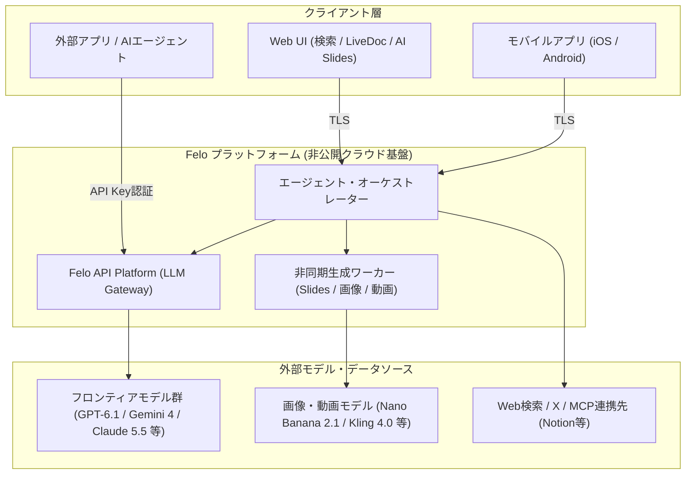

# **Felo 調査レポート**

## **1. 基本情報**

* **ツール名**: Felo
* **ツールの読み方**: フェロー
* **開発元**: Sparticle Inc.（日本発のAIスタートアップ・Sparticle株式会社）
* **公式サイト**: [https://felo.ai](https://felo.ai)
* **関連リンク**:
  * ドキュメント / 公式ブログ: [https://felo.ai/blog](https://felo.ai/blog)
  * アップデート情報: [https://felo.ai/version](https://felo.ai/version)
  * X (Twitter): [https://x.com/felo_ai](https://x.com/felo_ai)
  * レビューサイト: [App Store](https://apps.apple.com/us/app/felo-ai-search/id6598782546) | [Google Play](https://play.google.com/store/apps/details?id=ai.felo.search)
* **カテゴリ**: AI検索/ブラウザ拡張
* **概要**: Feloは、高精度な多言語AI検索エンジンを基盤とし、収集した情報を整理する無限キャンバス「LiveDoc」、プレゼンテーション資料を自動生成する「AI Slides」、タスク特化型の「AIエージェント」、および開発者向け統合LLM Gateway「Felo API Platform」を備えたAIワークスペースです。世界中の情報を母国語で検索・分析し、ドキュメントやスライド、画像・動画などのアウトプットまでを一貫して生成できます。

## **2. 目的と主な利用シーン**

* **解決する課題**: 検索、情報整理、翻訳、資料・クリエイティブ作成といった分断された業務プロセスを統合し、リサーチから最終アウトプットまでのリードタイムを大幅に短縮する。
* **想定利用者**:
  * 市場調査や競合分析を行うマーケター・コンサルタント
  * 海外の論文・ニュース・SNSトレンドを調査する研究者・学生
  * 迅速にプレゼンテーション資料やLP、動画素材を作成したいビジネスパーソン
  * 単一APIキーで複数のフロンティアモデルを使い分けたいAIアプリ開発者
* **利用シーン**:
  * **海外市場・SNSリサーチ**: 日本語のクエリで海外WebやX（Twitter）/Redditの最新情報を検索し、自動翻訳・構造化されたレポートとして取得する。
  * **LiveDocでの情報整理と共同編集**: 検索結果、PDF、YouTube動画、Felo音声ノートなどをキャンバス上に配置し、AIエージェントと対話しながら資料の構成を練る。
  * **資料・メディアの自動生成**: リサーチ結果やキャンバスの内容を基に、「AI Slides」でPowerPoint資料を、あるいは「Video Agent」や「Nano Banana 2.1」で画像・動画アセットを生成する。

### **2.1 代表的な利用フロー**

```mermaid
swimlane-beta TB
  subgraph User["ユーザー"]
    A["検索クエリ・ファイル・指示を入力"]
    E["LiveDocで確認・編集しエクスポート"]
  end
  subgraph Felo_Agent["Felo ワークスペース / エージェント"]
    B["クエリ分解・多言語検索を計画"]
    D["要約・LiveDoc配置・スライド/動画生成"]
  end
  subgraph External_Sources["Web / SNS / MCP連携先"]
    C1["海外Web・X・外部ツールから情報取得"]
  end
  subgraph LLM_Gateway["フロンティアモデル群"]
    C2["GPT-6.1 Sol / Gemini 4 Argon / Claude 5.5等で推論・生成"]
  end
  A --> B
  B --> C1
  C1 --> C2
  C2 --> D
  D --> E
```

* **代表的な流れ**: ユーザーが検索クエリや資料を入力すると、Feloのエージェントが検索計画を立ててWeb・SNS・MCP連携先から多言語情報を収集します。収集データはLLM Gateway経由で最適なモデルにより要約・構造化され、LiveDocやAI Slidesとして出力された後、ユーザーが確認・エクスポートします。

## **3. 主要機能**

* **AI検索 (Search)**: Web上の最新情報をもとに構造化された出典付き回答を生成します。2026年10月のアップデートにより、**GPT-6.1 Sol**、**Gemini 4 Argon**、**Claude Sonnet/Opus 5.5**、**Grok 4.7** などの最新モデルを選択でき、多言語横断検索にも対応しています。
* **LiveDoc (Canvas)**: 無限のキャンバス上で、検索結果、メモ、画像、PDF、YouTube動画、Felo音声ノートなどを自由に配置・整理できる協調型ワークスペースです。生成アセットの「New」自動マーキングと自動フォーカス、匿名ユーザーへの共有、リアルタイム音声記録などに対応しています。
* **AI Slides (AI PowerPoint)**: テキストやURL、PDF、動画リンクからデザイン済みのプレゼンテーション資料（`.pptx`等）を自動生成します。2026年10月の刷新では冗長だった「Storyline」画面を廃止して生成フローを簡素化し、専用の自動生成ページやテンプレートアップロード、PPT翻訳・デザイン強化機能を提供しています。
* **タスク特化型AIエージェント**: 自律型リサーチを行う「Deep Research」、SNSトレンドを分析する「X Research」、ランディングページを構築する「AIランディングページエージェント」、モデル選択・参照動画アップロード・2K解像度対応を備えた「Video Agent」などを利用できます（Research/PPTエージェントはClaude Haiku 5.5、AgentモードはGPT-6 Lunaにも対応）。
* **画像・動画生成統合**: **Nano Banana 2.1**（Agentモードを経由しない直接接続対応、1K〜4K・最大14枚の参照画像対応）、**GPT-Image-2**、**Seedance 2.5**、**Wan 3.0 Prime**、**Kling 4.0** などの最新メディア生成モデルをワークスペース内から直接呼び出せます。
* **Felo API Platform (LLM Gateway) & MCP連携**: 単一のAPIキーと共通クレジット残高で、Model API（OpenAI/Anthropic互換エンドポイント）、Data API、Search APIを利用できます。また、Model Context Protocol (MCP) に対応し、Notionなどの外部ツール連携も可能です。

## **4. 動作原理・システム構成**

* **アーキテクチャ**: クラウド完結型のマルチテナントSaaSおよび統合LLM Gatewayアーキテクチャを採用しています（バックエンドの内部ソースコードやインフラ詳細は非公開）。2026年10月には検索画面のフロントエンド最適化を実施し、初期画面のJavaScriptサイズを約2.59MBから424KBまで削減するなど、軽量・高速なWeb/モバイル配信を実現しています。
* **主要コンポーネントとデータフロー**:
  * **クライアント層**: Webブラウザ（検索画面、LiveDoc、AI Slidesエディタ）およびモバイルアプリ（iOS/Android）からTLS暗号化通信でリクエストを送信します。
  * **オーケストレーション / エージェント層**: ユーザーのプロンプトやキャンバス上のコンテキスト（ドキュメント、表、Webページ等）を保持し、Search/Research/PPT/Videoなどの専用エージェントへタスクを振り分けます。
  * **Felo API Platform (Gateway層)**: Model API（`openapi.felo.ai/api/v1`）、Data API（`openapi.felo.ai/v1/beta`）、Search API（`openapi.felo.ai/v2`）の3つのサーフェスを提供し、トークン単位の課金やリトライ制御、ルーティングを一元管理します。
* **特筆すべき要素技術**:
  * OpenAI互換（`/api/v1/chat/completions`, `/api/v1/responses`）およびAnthropic互換（`/api/v1/messages`）のマルチモデルゲートウェイ。
  * スライド生成や高解像度画像・動画生成における非同期ジョブ実行とステータス管理。
  * 外部ツール・ローカルエージェント（Codex、Claude Code等）と連携するMCPおよびローカルゲートウェイ（Magpie）連携。



## **5. 開始手順・セットアップ**

* **前提条件**:
  * Webブラウザ（Chrome, Safari, Edge等）またはモバイルアプリ（iOS / Android）
  * アカウント登録（Google、Appleアカウント、メールアドレス等で無料登録可能。クレジットカード登録不要で開始可）
* **インストール/導入**:
  * Web版は[公式サイト](https://felo.ai)にアクセスするだけで利用可能です。
  * モバイル版はApp StoreまたはGoogle Playから「Felo」をインストールします。
* **初期設定**:
  * ログイン後すぐに利用できます。表示言語や検索言語は自動判定されますが、設定画面から手動変更も可能です。
  * APIを利用する場合は、Felo API Platformの管理画面でAPIキーを発行し、環境変数に設定します。

  ```bash
  # 環境変数へのAPIキー設定例（OpenAI互換クライアント等で利用）
  export FELO_API_KEY="<YOUR_API_KEY>"
  ```

* **クイックスタート**:
  * Web画面の検索バーに調べたいトピックを入力してAI検索を実行するか、「LiveDoc」を作成してPDFやWebリンクを配置し、スライド生成を試します。

## **6. 特徴・強み (Pros)**

* **検索から資料・動画生成までの一気通貫性**: 検索で得た情報をLiveDocで整理し、そのままPowerPointスライド、LP、画像・動画アセットまで出力できる統合性が高く評価されています。
* **圧倒的な多言語リサーチ能力**: 日本語の質問から英語・中国語など世界中の一次情報を横断検索し、自然な日本語で出典付き要約を提示します。
* **最新モデルへの迅速なキャッチアップ**: GPT-6.1 Sol、Gemini 4 Argon、Claude 5.5、Nano Banana 2.1、Kling 4.0など、各社の最新モデルがリリース直後に統合されるため、常に最先端のモデルを単一環境で比較・利用できます。
* **エンタープライズ水準のセキュリティ対応**: ISO 27001およびSOC 2 Type 1の取得と、顧客データをAI学習に利用しない明確なポリシーにより、法人導入のハードルが下がっています。

## **7. 弱み・注意点 (Cons)**

* **多機能化に伴う学習コスト**: 検索、LiveDoc、AI Slides、各種エージェント、APIプラットフォームと機能領域が非常に広く、初心者が全機能を把握して使いこなすには一定の習熟が必要です。
* **日本語対応と英語先行のギャップ**: UI・検索・翻訳の日本語品質は非常に高く実用十分ですが、APIプラットフォームの最新ドキュメントや一部実験的機能は英語が先行して公開される場合があります。
* **生成物のレビュー必要性**: AI Slidesやディープリサーチの生成物はドラフト作成として極めて優秀ですが、実務利用にあたっては出典リンクの確認や細部のレイアウト・数値の人間によるレビューが不可欠です。
* **クレジット消費の偏り**: 高度な推論モデルや2K動画生成、連続したDeep Researchはクレジット消費が大きいため、軽量モデルとの使い分けが必要です。

## **8. 料金プラン**

| プラン名 | 料金 | 主な特徴 |
|---------|------|---------|
| **Standard (Free)** | 無料 | ・無制限の高速基本検索<br>・1日約3回までのファイル解析<br>・日次ボーナスクレジット付与（一部フラグシップモデル・動画等は制限あり） |
| **Pro Plan** | $14.99/月 | ・月間15,000クレジット＋日次ボーナス<br>・Pro検索 1日300回（基本クレジット消費後）<br>・月約300枚の画像生成、最大500ページのスライド生成、約100回のDeep Research<br>・Video Agent（2K解像度）や主要フロンティアモデルへのアクセス<br>・Felo APIアクセス（※一部Model API/Data API除く） |
| **Enterprise** | 要問い合わせ | ・SSO（シングルサインオン）、詳細なロールベース権限管理<br>・データ学習オプトアウト保証（サードパーティ契約含む）<br>・組織内のクレジット消費・シート管理 |

* **課金体系**: サブスクリプション＋クレジット制。日本円・米ドルのほか、ユーロ（EUR）、中国人民元（CNY）、韓国ウォン（KRW）、タイバーツ（THB）など多通貨決済に対応しています。また、Felo API Platformでは利用トークン・リクエストに応じた従量課金およびトップアップ方式も採用されています。
* **無料トライアル**: Standard（Free）プランが永続的な無料枠として利用可能です。

## **9. 導入実績・事例**

* **導入企業・機関**: 開発元のSparticle株式会社は、Feloシリーズ（Felo / Felo Enterprise / Felo字幕）および関連AIプラットフォーム（GBaseシリーズ）を国内外の多様な組織へ提供しています。
  * **製造業（荏原製作所など）**: 機密技術やノウハウを外部に漏らさないセキュアな生成AI環境（エンタープライズ/オンプレミス連携）として活用。
  * **商業施設・リテール（サッポロファクトリーなど）**: 施設案内やカスタマーサポート業務の自動化にSparticleのAI基盤を導入。
  * **飲食・ブランド（格之進）**: ECサイトや店舗での問い合わせ対応にAIサポートシステムを導入し、24時間対応と品質均一化を実現。
  * **国際会議・公共機関（台湾・国立公共資訊図書館 国際フォーラム等）**: 多言語AI字幕ツール「Felo字幕」を導入し、リアルタイム翻訳・字幕生成を実現。
* **対象業界**: IT・スタートアップ、コンサルティング、マーケティング、学術研究に加え、製造・小売・公共機関など幅広い分野で導入が進んでいます。また、SB C&S等の大手ディストリビューターを通じたエンタープライズ展開も拡大しています。

## **10. サポート体制**

* **ドキュメント**: [公式ブログ](https://felo.ai/blog)および[Felo APIドキュメント](https://openapi.felo.ai/docs)にて、機能解説、プロトコル/SDKガイド、トラブルシューティングが提供されています（APIドキュメントは26言語対応や「Copy for LLM」「View as Markdown」機能を搭載）。
* **コミュニティ**: [Discord](https://discord.gg/PsReJWbThX)コミュニティが活発に運営されており、ユーザー同士の情報交換や開発チームへのフィードバックが行われています。
* **公式サポート**: 公式サイト内のフィードバックフォームおよびメールサポートが利用可能です。Enterpriseプランでは専任のサポート窓口や導入支援が提供されます。

## **11. エコシステムと連携**

### **11.1 API・外部サービス連携**

* **API (Felo API Platform)**: 統合LLM Gatewayとして3つのAPIサーフェスを公開しています。
  * **Model API (`openapi.felo.ai/api/v1`)**: `/api/v1/chat/completions`、`/api/v1/responses`、`/api/v1/messages` などOpenAI/Anthropic互換のエンドポイントを提供。
  * **Data API (`openapi.felo.ai/v1/beta`)**: サードパーティのデータ・検索プロバイダーへの直接アクセスを提供。
  * **Felo APIs / Search API (`openapi.felo.ai/v2`)**: 対話型検索、ドキュメントレンダリング、エージェントツール実行などのネイティブワークフローを提供。
* **外部サービス連携**:
  * **Notion**: MCPツールを通じてNotionデータベースを検索・操作可能。
  * **Canva**: 生成したスライドをCanvaへエクスポートして詳細編集する連携機能。
  * **X (Twitter)**: X Researchによるリアルタイムトレンド取得および検索結果の共有。
  * **外部ゲートウェイ・エージェント**: OpenRouter、LiteLLM、Magpie（ローカルゲートウェイ）や、Codex / Claude Code等の外部エージェントとの接続ガイドを提供。

### **11.2 技術スタックとの相性**

| 技術スタック | 相性 | メリット・推奨理由 | 懸念点・注意点 |
|:---|:---:|:---|:---|
| **OpenAI / Anthropic 互換SDK** | ◎ | Felo Model APIが標準のChat CompletionsおよびMessagesエンドポイントに完全互換しており、ベースURLとキーの差し替えだけで移行可能。 | モデルごとのパラメータ差異やクレジット消費率の確認が必要。 |
| **MCP (Model Context Protocol)** | ◎ | 外部ツールやナレッジベースとの連携を標準サポートしており、カスタムワークフローの拡張が容易。 | MCPサーバー側の権限管理設計は利用者側で考慮が必要。 |
| **OpenRouter / LiteLLM / Magpie** | ◎ | 公式ドキュメントに比較・設定ガイドが整備されており、ローカルゲートウェイやマルチプロバイダー環境へ組み込みやすい。 | 検索固有のネイティブ機能を使う場合はSearch API (`/v2`) の併用が必要。 |
| **汎用Webフレームワーク (Next.js / FastAPI等)** | ◯ | REST APIおよび非同期ジョブパターンがドキュメント化されており、言語を問わず組み込み可能。 | Felo独自のネイティブSDKではなく汎用HTTP/OpenAI SDK経由の利用が中心。 |

## **12. セキュリティとコンプライアンス**

* **認証**: Google / Appleアカウント等による認証に対応。EnterpriseプランではSSO（シングルサインオン）やロールベースアクセス制御（RBAC）による細かな権限管理が利用可能です。
* **データ管理**:
  * すべての通信はTLSにより暗号化されます。
  * エンタープライズ利用を含むユーザーデータ、社内ナレッジ、プロンプト、アップロードファイルは**AIモデルの学習やファインチューニングに一切使用されない**ことが明記されています（OpenAIやAnthropic等のサードパーティプロバイダーとも学習禁止のデータ保護契約を締結）。
  * 定期的な内部・外部ペネトレーションテストを実施しています。
* **準拠規格**: **ISO 27001**（ISMS）認証を取得しているほか、**SOC 2 Type 1** 監査を完了し、**GDPR** にも準拠しています。

## **13. 操作性 (UI/UX) と学習コスト**

* **UI/UX**: 検索インターフェースは直感的でシンプルですが、LiveDocは高機能なビジュアルキャンバスとしてドラッグ＆ドロップや音声ノート取り込みなど多機能な操作性を備えています。2026年10月には検索画面の初期JavaScriptを424KBまで削減して表示速度を大幅に改善し、AI Slidesでも「Storyline」画面を廃止してダイレクトにスライド生成へ進めるようUIが洗練されました。
* **学習コスト**: AI検索や簡単なスライド生成だけであれば学習コストはほぼゼロです。一方、LiveDocでのコンテキスト設計、Video Agentのパラメータ調整、Felo API Platformのゲートウェイ設定などを最大限に活用するには、公式ブログやドキュメントの参照が推奨されます。

## **14. ベストプラクティス**

* **効果的な活用法 (Modern Practices)**:
  * **用途に応じたモデルと検索モードの使い分け**: 簡単な事実確認には高速基本検索や軽量モデル（Claude Haiku 5.5等）を使い、複雑な競合分析や多角的なレポート作成にはDeep Researchと推論モデル（GPT-6.1 Sol / Gemini 4 Argon）を組み合わせる。
  * **LiveDocへのコンテキスト集約**: バラバラに検索したWeb記事、PDF、YouTube要約、音声メモを1つのLiveDocキャンバスに集約してからAI Slidesやエージェントに指示を出すことで、出力の一貫性と精度を高める。
  * **APIドキュメントのLLM活用**: 開発時はFelo Docsの「Copy for LLM」や「View as Markdown」機能を使い、コーディングエージェントへ正確なAPI仕様をそのまま読み込ませる。
* **陥りやすい罠 (Antipatterns)**:
  * **生成スライドの無検証利用**: デザインや構成が整っていても、数値や固有名詞のハルシネーションが混じる可能性があるため、必ず元の出典リンクと照合してから提出する。
  * **高コストモデルの常用**: すべてのタスクで最高峰モデルや2K動画生成を回すとクレジットを急速に消費するため、ドラフト段階と仕上げ段階でモデルを切り替える。

## **15. ユーザーの声（レビュー分析）**

* **調査対象**: Apple App Store, Google Play, X (Twitter), Discordコミュニティ（なお、BtoB向けレビューサイトのG2、Capterra、ITreviewではコンシューマー/プロシューマー向けAI検索ツールの性質上、十分な評価プロファイルが未形成）
* **総合評価**: 3.4〜4.4 / 5.0（App StoreにおけるFelo関連アプリの評価帯）
* **ポジティブな評価**:
  * 「日本語で質問するだけで海外の一次情報やReddit/Xの議論まで正確に要約してくれて、リサーチ時間が劇的に減った」
  * 「検索結果からそのまま編集可能なPowerPointスライドを生成できる点が、他社検索ツールにない圧倒的な強み」
  * 「無料プランでも毎日ボーナスクレジットが付与されるため、日常的な調査からスライド作成の試用まで十分に使える」
* **ネガティブな評価 / 改善要望**:
  * 「多機能で便利な反面、UIが複雑に感じることがあり、単純な検索だけなら他ツールの方が速い場面がある」
  * 「モバイルアプリで検索途中に別アプリへ切り替えると状態がリセットされることがあるなど、UXの細部に改善の余地がある」
  * 「回答がやや冗長になったり、無料プランのファイルアップロード回数制限にすぐ達したりすることがある」
* **特徴的なユースケース**:
  * 海外テックニュースや論文の一次情報収集から、社内勉強会用スライドを10分程度で作成するワークフロー。
  * 多言語Web情報とX上のリアルタイムな評判を突き合わせた、新規事業・マーケティングの競合調査。

## **16. 直近半年のアップデート情報**

* **2026-10-28**: APIドキュメントに「Copy for LLM」「View as Markdown」「Ask about this page」等のLLMアクションを追加。OpenRouter/LiteLLM/OpenAIとのモデル比較ページおよび統合LLM Gatewayドキュメントを公開。
* **2026-10-27**: $0で呼び出し可能なモデル一覧ページおよび26言語対応のFree LLM APIページを公開。
* **2026-10-26**: モデルカタログのソート最適化およびローカルゲートウェイ「Magpie」を通じたCodex/Claude Code連携ガイドを公開。
* **2026-10-25**: ドキュメント・モデルページ・マーケティングページ全体の26言語ローカライズを実施。
* **2026-10-23**: 非同期画像生成・編集のエンドツーエンドガイドと明確化されたトップアップ料金体系を公開。
* **2026-10-16**: **GPT-6.1 Sol** および **Gemini 4 Argon** を統合。Research/PPTエージェントをClaude Haiku 5.5へ更新し、**Nano Banana 2.1**（直接接続対応）を追加。Video Agentでモデル選択・参照動画・2K解像度等に対応し、検索ページの初期JSサイズを約2.59MBから424KBへ大幅軽量化。
* **2026-10-02**: **GPT-6 Sol**、**Claude Sonnet/Opus 5.5**、**Grok 4.7**、およびAgentモード向け **GPT-6 Luna** を統合。AI Slidesの「Storyline」画面を廃止し、専用のAI PowerPoint自動生成ページを刷新。
* **2026-05-14**: ユーロや中国人民元など新しい決済通貨への対応を追加。
* **2026-04-27**: 画像生成モデル「GPT-Image-2」を追加。エンタープライズ版でのCSV一括招待やAI Designerのテンプレートカテゴリを追加。
* **2026-04-20**: AIランディングページエージェントを追加。
* **2026-03-02**: Chat APIを一般公開。LiveDocのホーム画面での検索やCanvas内のアーティファクト検索に対応。
* **2026-02-02**: AI Slidesのテンプレートアップロード対応、LiveDocのバーチャルグループ共有機能の追加。
* **2026-01-21**: Canvas UI刷新、自動イラスト生成機能の追加、AI Slidesの非同期生成対応。

(出典: [Felo Release updates](https://felo.ai/version) / [Felo API Docs Changelog](https://openapi.felo.ai/docs))

## **17. 類似ツールとの比較**

### **17.1 機能比較表 (星取表)**

| 機能カテゴリ | 機能項目 | Felo | Perplexity | Genspark | Google Disco |
|:---:|:---|:---:|:---:|:---:|:---:|
| **検索** | 出典付き多言語検索 | ◎<br><small>多言語・SNS横断に強い</small> | ◎<br><small>検索精度・信頼性が高い</small> | ◯<br><small>自律エージェントが検索</small> | ◯<br><small>開いているタブ依存</small> |
| **生成** | スライド・動画生成 | ◎<br><small>PPTX・2K動画生成対応</small> | △<br><small>テキスト回答が中心</small> | ◎<br><small>Sparkpages・Docs等生成</small> | ◎<br><small>動的UI(GenTabs)生成</small> |
| **整理** | キャンバス / ワークスペース | ◎<br><small>無限キャンバスLiveDoc</small> | △<br><small>コレクション整理機能</small> | ◯<br><small>統合ワークスペース</small> | ◎<br><small>ブラウザ統合動的UI</small> |
| **拡張性** | API / LLM Gateway | ◎<br><small>統合LLM Gateway・MCP対応</small> | ◯<br><small>Sonar / Agent API提供</small> | ◯<small>マルチエージェント連携</small> | △<br><small>実験段階(ウェイトリスト)</small> |
| **セキュリティ** | 企業向け認証・規格 | ◎<br><small>ISO27001・SOC2 Type1取得</small> | ◎<br><small>Enterprise Pro提供</small> | ◯<br><small>企業向けプランあり</small> | ◯<br><small>Google Labs実験提供</small> |

### **17.2 詳細比較**

| ツール名 | 特徴 | 強み | 弱み | 選択肢となるケース |
|---------|------|------|------|------------------|
| **Felo** | 検索＋LiveDoc＋スライド・動画＋LLM Gatewayの統合基盤 | 日本語を含む多言語リサーチ能力、GPT-6.1 SolやGemini 4 Argon等の最新モデル統合、直接PPTX/動画化できる生産性。 | 機能が多く、単純な一問一答の検索だけにはオーバースペックになりやすい。 | リサーチから資料・動画生成までワンストップで完結させたい場合や、単一APIで多モデルを使いたい場合。 |
| **Perplexity** | 高精度な対話型AI検索エンジン | 情報源の信頼性とレスポンスの速さ、洗練されたシンプルな検索体験。 | スライド生成や動画生成などのクリエイティブ出力機能は限定的。 | 正確な出典付きの答えを素早く得たい、純粋な検索・調査用途の場合。 |
| **Genspark** | All-in-One自律型AIワークスペース | AI Sheets/Docs/会議録音(Speakly)などオフィス業務全体の自動化を志向。 | UIが複雑で、エクスポート時のフォーマット崩れなどが指摘される場合がある。 | 検索だけでなくスプレッドシートや会議録音を含む広範な業務自動化を行いたい場合。 |
| **Google Disco** | Google Labsの実験的AIブラウザ | 複数のブラウザタブからタスク特化のインタラクティブUI「GenTabs」を動的生成。 | ウェイトリスト制によるアクセス制限があり、組織的な本格導入には不向き。 | 複数タブを横断比較する次世代のブラウジング体験を試したい場合。 |

## **18. 総評**

* **総合的な評価**:
  Feloは「多言語に強いAI検索エンジン」から出発し、2026年を通じて無限キャンバス「LiveDoc」、刷新された「AI Slides」、高機能な「Video Agent」、そして開発者向けの統合LLM Gateway「Felo API Platform」を統合した総合AIワークスペースへと進化を遂げました。さらにISO 27001およびSOC 2 Type 1の取得や顧客データの学習非利用ポリシーの徹底により、個人利用からエンタープライズ導入まで安心して選べる完成度に達しています。
* **推奨されるチームやプロジェクト**:
  海外の一次情報を継続的に調査・翻訳して資料化するマーケティングチーム、コンサルタント、研究者・企画職に最適です。また、複数のフロンティアモデル（GPT-6.1 Sol、Gemini 4 Argon、Claude 5.5、Nano Banana 2.1等）を単一のAPIキーとクレジットで柔軟に使い分けたいAI開発チームにも強く推奨されます。
* **選択時のポイント**:
  「素早く正確な検索結果だけを得たい」場合はPerplexityがシンプルで高速ですが、「情報を集め、キャンバスで構造化し、そのままプレゼン資料や動画としてアウトプットする」という一連のナレッジワーク全体を効率化したい場合は、Feloが最も費用対効果の高い選択肢となります。
