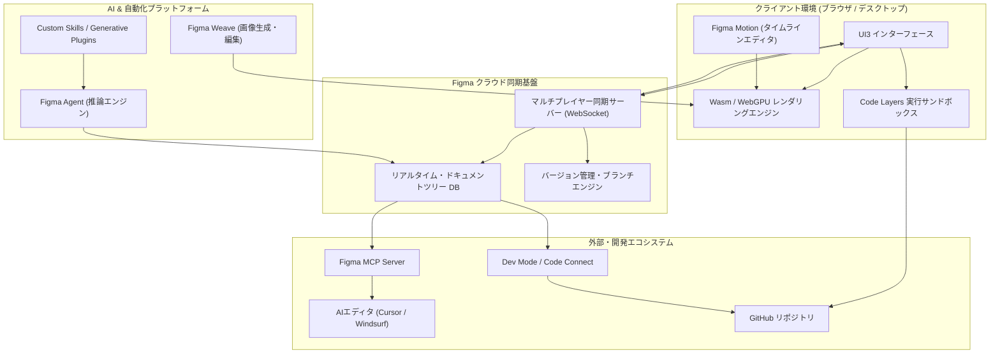

# **Figma 調査レポート**

## **1. 基本情報**

<!--
【ガイドライン】
- 必須: ツール名、開発元、公式サイト、カテゴリ、概要
- 概要は2-3文で簡潔に記述
-->

* **ツール名**: Figma
* **ツールの読み方**: フィグマ
* **開発元**: Figma, Inc.
* **公式サイト**: [https://www.figma.com/](https://www.figma.com/)
* **関連リンク**:
  * ドキュメント: [https://help.figma.com/hc/ja](https://help.figma.com/hc/ja)
  * レビューサイト: [G2](https://www.g2.com/products/figma/reviews) | [Capterra](https://www.capterra.com/p/175027/Figma/) | [ITreview](https://www.itreview.jp/products/figma/reviews)
* **カテゴリ**: UI/UX/作図
* **概要**: Figmaは、ブラウザ上で動作するクラウドベースのデザイン・プロダクト開発プラットフォームです。リアルタイムコラボレーションを核とし、UIデザイン、プロトタイピング、高度なタイムラインアニメーション（Figma Motion）、開発ハンドオフ（Dev Mode）、実コード描画（Code Layers）、Webサイト構築（Figma Sites）までをシームレスに行える統合環境を提供しています。

## **2. 目的と主な利用シーン**

<!--
【ガイドライン】
- 3-5項目を箇条書きで記述
- 想定利用者を具体的に記載
- 末尾に「代表的な利用フロー」をスイムレーンで添付する
-->

* **解決する課題**:
  * デザイン、プロトタイプ、開発仕様書の分断による非効率とコミュニケーションロス。
  * チーム間（デザイナー、エンジニア、PM）のバージョン管理の煩雑さと実装の不整合。
  * コンポーネント肥大化による大規模デザインシステム（Design Tokens, Slots）の保守コスト。
  * 静的デザインと動的コードベース（React/Web/Mobile）の断絶。
* **想定利用者**:
  * UI/UXデザイナー、プロダクトデザイナー、モーションデザイナー
  * フロントエンドエンジニア、モバイルアプリ開発者
  * プロダクトマネージャー（PM）、UXライター、マーケター
* **利用シーン**:
  * WebサイトやモバイルアプリのUI設計、ワイヤーフレーム作成、プロトタイピング。
  * **Figma Motion**を活用した高精度なマイクロインタラクションやタイムラインアニメーションの設計・コード出力。
  * **Code Layers**による実コンポーネントコードの直接プレビューおよびGitHubリポジトリとの双方向同期。
  * **Dev Mode**およびMCP Serverを通じたエンジニア・AIコーディングエディタへの仕様伝達とコード生成。
  * **Figma Sites**を用いたレスポンシブWebサイトのノーコード構築・直接ホスティング。

### **2.1 代表的な利用フロー**

<!--
【ガイドライン】
- ツールを実際に使う際の代表的な流れを、アクター（ユーザー、AIエージェント、ツール、外部サービス等）ごとのスイムレーンで示す
- Mermaidの swimlane-beta を使用し、向きは TB（上から下）に固定する
- subgraph の表示名に記号を含める場合は引用符で囲む。ID自体はASCII識別子にする
- 逆向き矢印の直後にインラインラベルを付ける記法は使用せず、順方向エッジで記述する
- レーンは3〜5個、ステップは4〜8個程度に収め、日本語で簡潔に記述する
-->

```mermaid
swimlane-beta TB
  subgraph Designer["デザイナー / PM"]
    A["要件定義とUIワイヤーフレームの配置"]
    D["タイムライン・レイアウト調整と承認"]
  end
  subgraph FigmaAgent["Figma Agent (AI基盤)"]
    B["デザインシステムに準拠したUI・Motion自動展開"]
  end
  subgraph FigmaCanvas["Figma 統合キャンバス"]
    C["Code Layersで実コードを描画・プレビュー"]
    E["Dev Mode向け仕様・トークン・アセットを同期"]
  end
  subgraph Developer["エンジニア / CI環境"]
    F["MCP連携・VS Codeでコード取得とGitHub同期"]
  end
  A --> B
  B --> C
  C --> D
  D --> E
  E --> F
```

* **代表的な流れ**: デザイナーが画面設計やプロンプトを入力すると、Figma Agentがデザインシステムとスロット（Slots）に沿ったコンポーネントやMotionアニメーションを展開します。統合キャンバス上でCode Layersによって本物のコードが描画・検証された後、Dev ModeやMCP Serverを介してエンジニアの開発環境・GitHubリポジトリへシームレスに同期されます。

## **3. 主要機能**

<!--
【ガイドライン】
- 5-10項目の主要機能を箇条書きで記述
- 各機能は1-2文で概要を説明
-->

* **リアルタイムコラボレーション**: 複数人が同一ファイル上で同時に編集でき、リアルタイムカーソル、音声チャット、コメント同期が利用できる業界標準基盤。
* **Code Layers (オープンベータ)**: キャンバス上に「実際に動作する本物のコード」をネイティブ描画する機能。GitHubリポジトリやChrome拡張と連携し、デザインと実コードの差異をゼロにする。
* **Figma Motion (オープンベータ)**: キャンバス内に統合されたキーフレームタイムラインアニメーションエディタ。イージングカーブ調整、Lottie/CSS/React/動画出力に対応。
* **Figma Agent & Custom Skills**: 共同編集者として動作するマルチプレイヤー対応の専用AIエージェント。自然言語からのUI生成、デザインシステム規約の自動適用、Generative Pluginsによるツール自動構築に対応。
* **ネイティブスロット (Slots)**: コンポーネント内のレイアウト差し替えを可能にする構造機能。無駄なバリアント作成を大幅に抑制し、柔軟なデザインシステム運用を実現。
* **Dev Mode (開発モード) & Code Connect**: エンジニア専用インターフェース。CSS/iOS/Androidコードの抽出、VS Code連携、プロダクションコードとFigmaコンポーネントの直接紐付けが可能。
* **オートレイアウトと変数 (Variables)**: Flexboxライクな自動リサイズと、色・数値・文字列・真偽値のトークン化による高度なマルチテーマ管理。
* **Figma Weave**: 背景除去、オブジェクト消去、ベクター化、アスペクト比拡張などをキャンバスから離れずに実行できるAI画像生成・編集ツールセット。
* **Figma Sites & Figma Make**: デザインファイルからレスポンシブWebサイトを直接公開するホスティング機能と、迅速なプロトタイプ生成・バイブコーディング機能。
* **MCP Server連携**: Model Context Protocol（MCP）を通じてCursorやWindsurfなどのAIエディタへデザイン情報を提供し、正確な実装コードの自律生成を支援。

## **4. 動作原理・システム構成**

<!--
【ガイドライン】
- ツールの動作原理、システム構成（アーキテクチャ）、データの流れ、通信フローなどを記述
- クライアント・サーバー型、ローカルファースト、クラウド完結など、ツールのアーキテクチャ特性を明記
- 可能であればMermaidによる構成図やフロー図を含めること（日本語表記）
-->

* **アーキテクチャ**: クラウド完結型のマルチプレイヤーSaaS。クライアント側はWebAssembly（C++ベースの独自レンダラー）およびWebGPUを活用し、ブラウザ内でデスクトップアプリ並みの描画パフォーマンスを実現。
* **主要コンポーネントとデータフロー**:
  * **クライアント描画エンジン**: WebAssemblyとWebGPU/WebGLパイプラインを用いてベクターツリー、タイムラインアニメーション、Code Layersサンドボックスを高速描画。
  * **マルチプレイヤー同期サーバー**: WebSocketを介して全クライアント間の操作（Operational TransformationおよびCRDT風のツリー同期）をミリ秒単位で一元調停・永続化。
  * **AIオーケストレーション基盤**: Figma Agentがドキュメントツリーのセマンティクスを解釈し、ユーザープロンプトやCustom Skillsに応じた編集操作をツリーへ直接反映。
  * **開発統合パイプライン**: Dev Mode、Code Connect、およびFigma MCP Serverがドキュメント構造を抽出し、外部IDEやGitHubリポジトリと双方向通信。
* **特筆すべき要素技術**:
  * **WebAssembly + WebGPU**: 大規模なレイヤー群やカスタムシェーダーエフェクトをGPU上で直接高速処理。
  * **サンドボックス型Code Layers**: ブラウザ内の安全なiframe/Web Worker環境で本物のReact等のコンポーネントコードを実行・レンダリング。



## **5. 開始手順・セットアップ**

<!--
【ガイドライン】
- アカウント作成から「Hello World」的な最初の動作確認までの手順
- 主要なコマンドや設定項目を記載
-->

* **前提条件**:
  * 最新のWebブラウザ（Google Chrome, Firefox, Safari, Microsoft Edge）またはデスクトップアプリ（macOS, Windows）。
  * Figmaアカウント（Google SSO、SAML SSO対応）。
* **インストール/導入**:
  ブラウザ版はインストール不要でアクセス可能。デスクトップアプリ版は公式サイトからダウンロード可能。ローカルフォントを使用する場合は「Figma Font Installer」のインストールを推奨。

  ```bash
  # デスクトップアプリやフォントインストーラーは公式サイトよりGUI配布
  # 公式サイト: https://www.figma.com/downloads/
  ```

* **初期設定**:
  1. Figmaアカウントを作成し、ワークスペース（またはチーム）をセットアップ。
  2. プロジェクトフォルダを作成し、権限（Full / Dev / Collab / View）をメンバーに付与。
  3. デザインシステム（UIキットやVariables）をチームライブラリとして公開。
* **クイックスタート**:
  1. 「New design file」をクリックしてキャンバスを開く。
  2. ショートカット `F` を押してフレーム（Canvas）を作成。
  3. `T`（テキスト）や `R`（矩形）を配置し、右パネルの「Auto layout」を有効化してレスポンシブなUIを作成。
  4. 画面上部の「Dev Mode」トグルをONにして、生成されたCSS/Reactコードを確認。

## **6. 特徴・強み (Pros)**

<!--
【ガイドライン】
- 3-5項目を箇条書きで記述
- 競合との差別化ポイントを明確に
-->

* **エンドツーエンドのプロダクト開発基盤**: 単なるベクター作図ツールにとどまらず、Figma Motionによるアニメーション制作、Code Layersによる実コード検証、Figma Sitesによるホスティングまでを単一キャンバスで完結。
* **世界標準のコラボレーションエコシステム**: デザイナー、エンジニア、PMが同時に同じキャンバスで協業可能。マルチプレイヤーAI（Figma Agent）も同期され、チーム全体でAI支援を共有できる。
* **エンジニアリングとの高度な親和性**: Dev Mode、Code Connect、MCP Serverにより、CursorやWindsurf等のAIコーディング環境とダイレクトに連携可能。
* **洗練されたデザインシステム運用**: 変数（Variables）、ネイティブスロット（Slots）、コンポーネントバリアントを組み合わせることで、大規模プロダクトでも破綻しない強固なデザイン基盤を構築可能。

## **7. 弱み・注意点 (Cons)**

<!--
【ガイドライン】
- 3-5項目を箇条書きで記述
- 日本語対応の状況は必ず含める
-->

* **シート体系の細分化とコスト増加**: Dev Modeの専用有償シート（Dev Seat）や、Full Seat・Collab Seatの分割により、大規模組織でのシート管理とライセンス費用の最適化が不可欠。
* **機能肥大化に伴う高い学習コスト**: オートレイアウト、Variables、Slots、Code Layers、Figma Motionなど専門的な機能が増加しており、完全な使いこなしには一定の技術理解が要求される。
* **常時オンライン接続の依存**: クラウド完結型アーキテクチャのため、完全なオフライン環境での協業やデータ編集には依然として制約が存在する。
* **日本語対応状況**: 公式UIおよび主要ドキュメントは日本語に完全対応しているが、新機能（ベータ版機能）の最新ドキュメントやコミュニティプラグインの多くは英語圏先行で提供される。

## **8. 料金プラン**

<!--
【ガイドライン】
- 表形式で整理することを推奨
- 最新の料金情報であることを確認
- 価格は通貨を明記
-->

Figmaはプラン（Tier）とユーザーごとの役割（Seat Type）を組み合わせたロールベース課金モデルを採用しています。

| プラン名 | 請求形態 | Full Seat (デザイナー/作成者) | Dev Seat (エンジニア/Dev Mode) | Collab Seat (PM/ライター/マーケ) | View Seat (閲覧者) |
|---|---|---|---|---|---|
| **Starter** | 永続無料 | 無料 (最大3ファイル) | 無料 (基本インスペクト) | 無料 | 無料 |
| **Professional** | 年払い / 月払い | **$16/月** (年払い)<br>$20/月 (月払い) | **$12/月** (年払い)<br>$15/月 (月払い) | **$3/月** (年払い)<br>$5/月 (月払い) | 無料 |
| **Organization** | 年払いのみ | **$55/月** | **$25/月** | **$5/月** | 無料 |
| **Enterprise** | 年払いのみ | **$90/月** | **$35/月** | **$5/月** | 無料 |

* **課金体系のポイント**:
  * **Full Seat**: デザイン、FigJam、スライド、コードレイヤー、Dev Modeを含むすべての作成・編集機能を利用可能。
  * **Dev Seat**: デザイン自体のベクター編集は行わず、Dev Modeでのコードインスペクト、プロパティ取得、VS Code連携を専門に行うエンジニア向けシート。
  * **Collab Seat**: テキスト編集やコメント、FigJam、Slidesへの参加を中心に行うステークホルダー向け低価格シート。
  * **View Seat**: ファイル閲覧やコメント投稿が完全無料で可能。
* **無料トライアル**: Starterプランが永続無料で利用可能（機能制限あり）。

## **9. 導入実績・事例**

<!--
【ガイドライン】
- 具体的な企業名を3-5社挙げる
- 導入事例がない場合は「公開事例なし。ただし、〜の分野での利用が報告されている」等
-->

* **導入企業**: Google, Microsoft, Netflix, Airbnb, Uber, 楽天, LINEヤフー, メルカリ, Notion, Spotify
* **導入事例**:
  * **LINEヤフー**: 多様なWeb/モバイルサービス群のデザインシステムをFigma上に統一し、マルチブランド対応の大規模ライブラリを運用。
  * **Notion**: プロダクトUIのプロトタイピングからマーケティング素材、社内プレゼンテーション資料（Figma Slides）まで幅広く集約。
  * **Netflix**: デザインとエンジニアリングのハンドオフにDev ModeとCode Connectを採用し、本番実装までのリードタイムを大幅短縮。
* **対象業界**: IT/SaaS企業、Web制作会社、ゲーム業界、DXを推進するエンタープライズ全般。

## **10. サポート体制**

<!--
【ガイドライン】
- ドキュメント、コミュニティ、公式サポートの3項目を必ず含める
- URLがあれば記載
-->

* **ドキュメント**: 日本語対応の公式ヘルプセンター（[https://help.figma.com/hc/ja](https://help.figma.com/hc/ja)）、チュートリアル動画、Figma Learnが極めて充実。
* **コミュニティ**: 世界規模のユーザーコミュニティ「Friends of Figma（FoF）」が活動しており、日本国内（Tokyo, Kyoto等）でも勉強会や情報交換が活発に行われている。
* **公式サポート**: メールおよび問い合わせフォームによるサポートを提供。Organization/Enterpriseプランでは専任のカスタマーサクセスマネージャー（CSM）やSLAが付属。

## **11. エコシステムと連携**

<!--
【ガイドライン】
- API、外部連携、技術スタックとの相性を包括的に記述
-->

### **11.1 API・外部サービス連携**

* **API & プラグインエコシステム**: REST API、Plugin API、Widget APIが公開されており、数千を超えるコミュニティプラグイン・ウィジェットが利用可能。
* **主要外部サービス連携**:
  * **開発・コード管理**: GitHub（Code Layers/Code Connect）、VS Code（Figma for VS Code）、Storybook。
  * **AIコーディングエディタ**: Cursor, Windsurf, Claude Code（Figma MCP Server経由でのデザイン仕様参照）。
  * **プロジェクト管理・コラボレーション**: Jira, Asana, Linear, Slack, Microsoft Teams。
  * **プロトタイピング・ノーコード**: Webflow, Framer, ProtoPie。

### **11.2 技術スタックとの相性**

| 技術スタック | 相性 | メリット・推奨理由 | 懸念点・注意点 |
|:---|:---:|:---|:---|
| **React / Next.js** | ◎ | Code LayersやCode Connectにより、本番ReactコンポーネントとFigmaレイヤーを直結・直接描画可能。 | 特になし。業界で最も手厚くサポートされている。 |
| **Tailwind CSS** | ◎ | VariablesとTailwindトークンを自動マッピングするプラグイン・Code Connectが豊富。 | トークン命名規則の事前すり合わせが重要。 |
| **iOS (SwiftUI) / Android (Compose)** | ◯ | Dev Modeによりネイティブ宣言型UIのコードスニペットを取得可能。 | Code Layersの実レンダリングはWeb技術ベースが先行。 |
| **Flutter** | ◯ | 公式およびコミュニティ製プラグインによるWidgetコード生成に対応。 | 複雑なカスタムペイントの完全再現には手動調整が必要。 |

## **12. セキュリティとコンプライアンス**

<!--
【ガイドライン】
- 認証、データ管理、準拠規格の3項目を必ず調査
-->

* **認証**: SAML 2.0 ベースのSSO（シングルサインオン）、2段階認証（2FA）、SCIMによるユーザープロビジョニング、ドメインキャプチャ（Organization/Enterprise）。
* **データ管理**: 通信時のTLS 1.3暗号化、AWS上の保存時AES-256暗号化。ブランチ機能と詳細なバージョン履歴保持。AIモデルのトレーニングに顧客非公開データを使用しないプライバシー制御。
* **準拠規格**: SOC 2 Type II, SOC 3, ISO/IEC 27001, ISO/IEC 27018, GDPR, CCPA, CSA STAR Level 1。

## **13. 操作性 (UI/UX) と学習コスト**

<!--
【ガイドライン】
- 実際の使用感や、類似ツールとの比較を含める
-->

* **UI/UX**: モダン刷新された「UI3」インターフェースを採用。ツールバーが画面下部にフロート配置され、キャンバスの作業領域が最大化されている。
* **学習コスト**: 基本的なベクター描画やワイヤーフレーム作成は直感的で習得が容易。一方で、オートレイアウトの入れ子構造、Variables（変数）のスコープ設計、Slotsの活用、Code Layersの接続にはフロントエンド工学的な思考が必要となり、組織的なトレーニングが推奨される。

## **14. ベストプラクティス**

<!--
【ガイドライン】
- ツールを効果的に活用するための推奨事項や、避けるべきアンチパターンを記述
-->

* **効果的な活用法 (Modern Practices)**:
  * **Design TokensとVariablesの徹底**: 色やスペーシングを変数化し、コードベース側のトークンと同期させて保守性を高める。
  * **Slotsを活用したバリアント整理**: コンポーネントの内部構造をネイティブスロットで共通化し、バリアントの過剰生成を防ぐ。
  * **ロール別シートの最適化**: 開発者はDev Seat、企画者はCollab Seatに適切に割り振り、Full Seatの過剰契約を抑制する。
  * **Code Connect & MCP連携**: AIエディタ（Cursor等）にデザインシステムを読み込ませ、デザイン通りのコード生成を自動化する。
* **陥りやすい罠 (Antipatterns)**:
  * **Frameを使わない無計画なGroup化**: レスポンシブ挙動が破綻するため、レイアウトは原則Auto Layout付きFrameで構築する。
  * **巨大な単一ファイルへの集約**: ページ数やコンポーネント数が過大になるとブラウザのメモリ上限に達するため、機能や画面単位でファイルを適切に分割する。

## **15. ユーザーの声（レビュー分析）**

<!--
【ガイドライン】
- 総合評価スコアがあれば必ず記載
- ポジティブ・ネガティブ各3項目以上
-->

* **調査対象**: G2, Capterra, ITreview, X (Twitter)
* **総合評価**: 4.7 / 5.0 (G2 レビュー基準)
* **ポジティブな評価**:
  * 「Code LayersとDev Modeにより、デザインとフロントエンド実装の乖離がほぼ完全に解消された。」
  * 「Figma Motionのタイムライン機能がキャンバス内に統合され、外部アニメーションツールを行き来する手間がなくなった。」
  * 「Figma AgentやMCP Serverによって、AIエディタからFigmaのデザイン構造を直接取得できる開発体験が革新的。」
* **ネガティブな評価 / 改善要望**:
  * 「Dev Modeや新機能のシート別課金モデルにより、エンジニアの人数が多い組織ではコスト負担が大きい。」
  * 「UI3や新機能の追加ペースが速く、デザインチーム全体のオペレーション標準化が追いつかないことがある。」
  * 「完全なオフライン状態では編集やファイル同期が制限されるため、移動中の作業に不安がある。」

## **16. 直近半年のアップデート情報**

<!--
【ガイドライン】
- 日付の降順（新しいものが上）
- 3-10項目をリストアップ
- 情報源のURLを記載
-->

* **2026-10-15**: **Code Layers (オープンベータ)**: キャンバス上に本物の動作コード（Reactコンポーネント等）を直接レンダリングし、GitHubリポジトリやChrome拡張と双方向同期できる新機能を一般公開。
* **2026-09-18**: **Native Slots (オープンベータ)**: コンポーネント内のレイアウト入れ替えをネイティブにサポートし、バリアント数を劇的に削減するデザインシステム機能を展開。
* **2026-06-24**: **Config 2026 メジャーアップデート発表**:
  * **Figma Motion (オープンベータ)**: キーフレームとイージングカーブを備えたタイムラインアニメーションエディタをキャンバス内に統合。
  * **Figma Agent (オープンベータ)**: 共同編集者全員にチャットや操作がリアルタイム同期されるマルチプレイヤーAIエージェント、およびGenerative Plugins（ノーコードプラグイン生成）を拡充。
  * **Figma Weave**: 背景置換やオブジェクト消去、ベクター化を瞬時に行うAI画像編集ツールセットを提供。
  * **WebGPU Custom Shader Effects**: GPUシェーダー技術を活用したダイナミックなビジュアルエフェクト・フィルの生成に対応。
* **2026-05-22**: **Figma Buzz & Grid 拡張**: キャンペーンアセットの一括編集（Bulk edit）や、Grid配置の自動化・行/列の動的入れ替え機能をリリース。
* **2026-05-20**: **Figma Agent ベータ初期展開**: デザイン環境に常駐する専用AIエージェントの提供を開始。
* **2026-05-11**: **Figma Make Custom Skills**: マークダウンで独自の設計規約やワークフローを定義し、AIプロトタイプ生成をカスタマイズ可能に。

(出典: [Figma Release Notes](https://releases.figma.com/), [Figma Blog Config 2026 Recap](https://www.figma.com/blog/))

## **17. 類似ツールとの比較**

<!--
【ガイドライン】
- 3-5個の類似ツールと比較
- 機能比較表（星取表）と詳細比較の2つの観点で記述する
-->

### **17.1 機能比較表 (星取表)**

| 機能カテゴリ | 機能項目 | 本ツール (Figma) | Penpot | Adobe XD | Sketch | OpenPencil |
|:---:|:---|:---:|:---:|:---:|:---:|:---:|
| **基本機能** | ベクター編集・レイアウト | ◎<br><small>業界デファクト</small> | ◯<br><small>SVG/CSS準拠</small> | ◯<br><small>基本機能</small> | ◎<br><small>高精度</small> | ◯<br><small>Figma互換</small> |
| **コラボレーション** | リアルタイム共同編集 | ◎<br><small>最高水準同期</small> | ◯<br><small>良好</small> | △<br><small>同期遅延あり</small> | △<br><small>Mac限定</small> | △<br><small>ローカル主体</small> |
| **開発連携** | コード描画 / ハンドオフ | ◎<br><small>Code Layers, Dev Mode</small> | ◎<br><small>オープンWeb標準</small> | △<br><small>スペック共有のみ</small> | ◯<br><small>プラグイン依存</small> | ◎<br><small>読書可能MCP連携</small> |
| **アニメーション** | タイムラインモーション | ◎<br><small>Figma Motion</small> | △<br><small>基本遷移のみ</small> | △<br><small>自動アニメのみ</small> | △<br><small>外部連携必要</small> | △<br><small>限定的</small> |
| **AI・エージェント** | 統合AI支援 | ◎<br><small>Figma Agent, Weave</small> | ×<br><small>未統合</small> | ×<br><small>開発終了</small> | △<br><small>外部拡張のみ</small> | ◎<br><small>AIネイティブ</small> |
| **コスト・自由度** | ライセンス / セルフホスト | △<br><small>有償・シート別</small> | ◎<br><small>完全無料・OSS</small> | ◯<br><small>Adobe CC付属</small> | ◯<br><small>買い切り/年額</small> | ◎<br><small>完全無料・OSS</small> |

### **17.2 詳細比較**

| ツール名 | 特徴 | 強み | 弱み | 選択肢となるケース |
|---|---|---|---|---|
| **Figma** | クラウドネイティブ統合プラットフォーム | Code Layers、Figma Motion、Figma Agent、圧倒的なエコシステム | シート別課金によるコスト増、オフライン制約 | 高い生産性と最先端のAI協業・開発連携を求めるモダンプロダクトチーム |
| **OpenPencil** | AIネイティブ、ローカルファースト、OSS | Figmaファイル互換、制約のないMCP連携、完全無料・ローカル完結 | クラウド協業機能やプラグイン資産が発展途上 | 開発とデザインを自律型AIでシームレスに直結させたいエンジニア・開発チーム |
| **Penpot** | オープンソース、オープン標準準拠 | 完全無料でセルフホスト可能、SVG/CSS標準に準拠した設計 | プラグインやコミュニティ規模でFigmaに追従中 | コストを最小化したい組織、オンプレミス要件のあるエンタープライズ |
| **Sketch** | macOSネイティブデザインツール | Mac上での軽量高速動作、ローカルファイル管理 | Windows/ブラウザ非対応、リアルタイム協業機能の制約 | チーム全員がMac環境でローカルファイル管理を好む場合 |
| **Adobe XD** | Adobe CC連携プロトタイピング | Adobe製品（Illustrator/Photoshop）との親和性 | **開発終了・メンテナンスモード**（新規開発停止） | 過去のデザイン資産保守のみ（新規プロジェクト採用は非推奨） |

## **18. 総評**

<!--
【ガイドライン】
- 総合評価、推奨チーム、選択ポイントの3項目を必ず含める
-->

* **総合的な評価**:
  Figmaは、単なるUIデザインツールの領域を完全に脱却し、「Figma Motion（タイムラインアニメーション）」「Code Layers（実コード描画）」「Figma Agent（自律型マルチプレイヤーAI）」を融合したプロダクト開発の統合キャンバスへと進化を遂げました。Dev Mode等のシート細分化に伴うコスト管理の必要性はあるものの、デザインからフロントエンド実装、さらにはWebサイト公開（Figma Sites）までを一気通貫で加速させる価値は圧倒的です。
* **推奨されるチームやプロジェクト**:
  * デザイナーとエンジニアが密接に連携するアジャイル/スクラム開発チーム。
  * トークンやスロット（Slots）を活用した高度なデザインシステムを運用・標準化したい中大規模組織。
  * CursorやWindsurfなどのAIコーディング環境を積極的に活用し、開発スピードを極大化したいプロダクトチーム。
* **選択時のポイント**:
  モダンなソフトウェア開発において、最も手堅く最大の生産性を得られる**第一選択肢**です。ただし、完全無料・オンプレミス運用が必須要件となる場合はPenpot、ローカルファーストかつAIエージェント重視の場合はOpenPencilが検討対象となります。また、導入時にはエンジニアをDev Seat、PMをCollab Seatに割り振るなど、適切なシート管理を行うことがコスト最適化の鍵となります。
