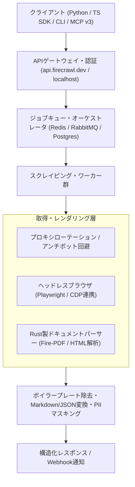

# **Firecrawl 調査レポート**

## **1. 基本情報**

* **ツール名**: Firecrawl
* **ツールの読み方**: ファイヤークロール / ファイアクロール
* **開発元**: Firecrawl (Mendable) — Y Combinator (S22) 出身の創業チーム（Caleb Peffer, Eric Ciarla, Nicolas Silberstein Camara）が開発・運営
* **公式サイト**: [https://www.firecrawl.dev/](https://www.firecrawl.dev/)
* **関連リンク**:
  * GitHub: [https://github.com/firecrawl/firecrawl](https://github.com/firecrawl/firecrawl)
  * DeepWiki: [https://deepwiki.com/firecrawl/firecrawl](https://deepwiki.com/firecrawl/firecrawl)
  * ドキュメント: [https://docs.firecrawl.dev/](https://docs.firecrawl.dev/)
  * レビューサイト: [G2](https://www.g2.com/products/firecrawl/reviews)
* **カテゴリ**: データ抽出/変換
* **概要**: Firecrawlは、任意のWebサイトやドキュメントをクロール・スクレイピングし、大規模言語モデル（LLM）やAIエージェントが直接扱えるクリーンなMarkdown・構造化JSON・スクリーンショット等へ変換するWebデータインフラです。プロキシローテーションやJavaScriptレンダリング、アンチボット回避を自動化し、単一のAPI・SDK・MCPサーバー・ローカルバイナリとして提供されます。

## **2. 目的と主な利用シーン**

* **解決する課題**:
  * HTMLのナビゲーション・広告・フッターなどのノイズによるLLMのトークン浪費と精度低下。
  * SPA（Single Page Application）などJavaScriptで動的に描画されるサイトのスクレイピングの難しさ。
  * プロキシ管理、レート制限、CAPTCHAやアンチボット対策の自前実装・保守コスト。
* **想定利用者**: AIアプリケーション開発者、AIエージェントビルダー、データエンジニア、リサーチ・競合調査担当者。
* **利用シーン**:
  * **RAG（検索拡張生成）のデータパイプライン構築**: 企業のドキュメントサイトやWebナレッジを一括クロールし、Markdown化してベクトルDBへ格納する。
  * **AIエージェントへのリアルタイムWebアクセス提供**: MCPサーバーや`/search`・`/interact`エンドポイントを通じ、自律型エージェントにWeb検索や画面操作を行わせる。
  * **構造化データの自動抽出**: ECサイトの商品情報やニュース記事、SEC提出書類などからJSONスキーマに沿ったデータを抽出する。

### **2.1 代表的な利用フロー**

```mermaid
swimlane-beta TB
  subgraph User["ユーザー / AIエージェント"]
    A["対象URL・抽出スキーマを指定してリクエスト"]
    E["クリーンなMarkdown / JSONを受領しLLM処理へ活用"]
  end
  subgraph FirecrawlAPI["Firecrawl API / オーケストレータ"]
    B["リクエスト受付・ジョブ種別判定 (Scrape / Crawl / Search)"]
    D["HTML解析・ノイズ除去・Markdown/JSON変換"]
  end
  subgraph BrowserEngine["レンダリング・プロキシ層"]
    C["ヘッドレスブラウザ実行・プロキシローテーション・JS描画"]
  end
  A --> B
  B --> C
  C --> D
  D --> E
```

* **代表的な流れ**: ユーザーまたはAIエージェントがURLや検索クエリ、抽出スキーマをFirecrawl APIへ送信すると、オーケストレータがプロキシとヘッドレスブラウザを制御して動的ページを含むWebコンテンツを取得し、不要なボイラープレートを除去したMarkdownや構造化JSONとして返却します。

## **3. 主要機能**

* **Scrape (`/scrape`)**: 単一URLからボイラープレート（ヘッダー・フッター・広告等）を除去し、LLMに最適化されたMarkdown、HTML、スクリーンショット、またはスキーマ準拠の構造化JSONを抽出します。
* **Crawl (`/crawl`)**: サイトマップやリンクを辿ってWebサイト全体を非同期で巡回し、配下の全ページを一括でMarkdown/JSONデータセットとして収集します。
* **Map (`/map`)**: 指定したWebサイト内に存在するすべてのURLを高速にリストアップし、クロール対象の事前把握やURLフィルタリングに活用できます。
* **Search (`/search` / UltraSearch)**: ライブWeb検索を実行し、検索結果のURL一覧だけでなく各ページの全文コンテンツや構造化ハイライトを1回のAPIコールで取得します。
* **Interact (`/interact`)**: ライブブラウザセッション上でクリック、スクロール、テキスト入力、待機などの操作をAIプロンプトまたはコードで実行し、ログイン後や動的UIの背後のデータを取得します。
* **Parse (`/parse` / Fire-PDF)**: Rustベースの高速パーシングエンジンにより、PDFやDOCX、スプレッドシートなどのドキュメントをクリーンなMarkdownやJSONへ変換します。
* **Batch Scrape・Web監視（Monitor）**: 大量URLの並列非同期スクレイピングや、LLMによる差分判定を用いたWebページ変更監視・アラート通知に対応しています。
* **Alexandria・専門データインデックス**: 7,500万社以上の企業データ、300万件以上のarXiv論文・GitHubコード、SEC提出書類など、エージェント向けの専門インデックスへ高速アクセスできます。

## **4. 動作原理・システム構成**

* **アーキテクチャ**: 用途に応じて3つの動作モデルを選択可能です。
  1. **Firecrawl Cloud（マネージドSaaS）**: `api.firecrawl.dev` 上で大規模分散ワーカー、プロキシネットワーク、検索エンジンを統合運用するクラウド構成。
  2. **Self-Hosting（フルサーバー構成）**: Docker Compose等でAPIサーバー（`apps/api`）、キュー、ワーカー、データベースを自前インフラ上に構築する分散構成。
  3. **Firecrawl Local（単一Rustバイナリ）**: データベース・キュー・コンテナを一切必要とせず、ローカルのChrome/ChromiumとRust製パーサーを用いて `localhost` 上で完結動作する軽量構成（Web検索など拡張機能時のみCloud連携）。



* **主要コンポーネントとデータフロー**:
  * クライアントからのリクエストはAPIゲートウェイで認証・レート制御された後、非同期クロールやバッチ処理の場合はRedis/RabbitMQとPostgreSQL（`nuq-postgres`）を用いたキューへ投入されます。
  * ワーカーがプロキシやPlaywrightベースのヘッドレスブラウザを用いてJS描画後のDOMを取得し、Rust製の高速パーサーおよびコンテンツ抽出エンジンでMarkdownやJSONへ変換して返却します。
  * Zero Data Retention（ZDR）有効時はページコンテンツがメモリ内のみで処理され、リクエスト完了後に破棄されます。
* **特筆すべき要素技術**:
  * **Rust製パーサー（Fire-PDF）**: PDFやHTMLの高速変換を実現するネイティブバイナリ基盤。
  * **Deterministic JSON (`deterministicJson`)**: サイトごとの抽出ロジックをキャッシュし、毎回LLMを呼び出さずに構造化JSONを安定出力する仕組み。
  * **MCP v3 & CDP WebSocket (`cdpUrl`)**: Model Context Protocol（v3）によるエージェント統合や、外部Playwright/Puppeteerからのライブセッション接続をサポート。

## **5. 開始手順・セットアップ**

* **前提条件**:
  * **Cloud利用時**: FirecrawlアカウントおよびAPIキー（CLIやMCPではキーレスの試験利用枠も提供）。
  * **SDK利用時**: Python 3.8+ または Node.js 18+。
  * **セルフホスト時**: Docker / Docker Compose、Git。
* **インストール/導入**:

  ```bash
  # Python SDK
  pip install firecrawl-py

  # Node.js / TypeScript SDK
  npm install @mendable/firecrawl-js

  # CLI（グローバルインストール）
  npm install -g firecrawl-cli
  ```

* **初期設定**:
  * [Firecrawl公式サイト](https://www.firecrawl.dev/)でアカウントを作成し、ダッシュボードからAPIキーを取得して環境変数に設定します。

  ```bash
  export FIRECRAWL_API_KEY="<YOUR_API_KEY>"
  ```

* **クイックスタート**:

  ```python
  from firecrawl import Firecrawl

  app = Firecrawl(api_key="<YOUR_API_KEY>")

  # 単一ページをMarkdownとしてスクレイピング
  doc = app.scrape("https://firecrawl.dev", formats=["markdown"])
  print(doc.markdown)
  ```

  MCPクライアント（Claude DesktopやCursor等）から利用する場合は、設定ファイルに `https://mcp.firecrawl.dev/v2/mcp-oauth`（OAuth認証）またはAPIキー付きエンドポイントを指定します。

## **6. 特徴・強み (Pros)**

* **LLM・AIエージェント特化のクリーンな出力**: 広告やナビゲーション等を自動除去し、トークン効率の高いMarkdownやスキーマ準拠JSONを直接生成できるため、RAGの検索精度向上とLLMコスト削減に直結します。
* **クラウド・セルフホスト・ローカルの柔軟な展開形態**: 手軽なSaaS（Firecrawl Cloud）から、Docker Composeによる完全セルフホスト、さらにはDB不要の単一バイナリ「Firecrawl Local」まで用途に応じて使い分けられます。
* **オールインワンのWebデータツールキット**: 単なるスクレイピングに留まらず、サイトマップ発見（`/map`）、サイト全体クロール（`/crawl`）、ライブ検索（`/search`）、ブラウザ操作（`/interact`）、PDF解析（`/parse`）が統一APIで完結します。
* **圧倒的なエコシステム連携と開発スピード**: MCP v3、LangChain、LlamaIndex、CrewAI、n8n、Zapierなど主要AIフレームワークと標準連携しており、新機能のリリース頻度も極めて高い水準です。

## **7. 弱み・注意点 (Cons)**

* **日本語対応の状況**: 公式サイト、ドキュメント、管理ダッシュボードおよび公式サポートはすべて英語で提供されており、日本語の公式ドキュメントや日本語サポート窓口は用意されていません。
* **大規模クロール時のクレジット消費**: ページ数や動的レンダリング、エージェント抽出（`/agent`）を多用するとクレジット消費が急速に増え、コストが想定以上に膨らむ場合があります。適切なURLフィルタリング（`/map`での事前絞り込み等）が重要です。
* **AGPL-3.0ライセンスの制約**: コアサーバーはAGPL-3.0で公開されているため、ソースコードを改変してSaaSや外部向けネットワークサービスとして再配布・提供する場合は、改変部分のソースコード公開義務が生じます（クライアントSDKはMITライセンス）。

## **8. 料金プラン**

| プラン名 | 料金（月額 / 年額払い時） | クレジット上限・主な特徴 |
|---------|------|---------|
| **Free** | 無料 ($0/月) | 月間1,000クレジット。初期検証・個人開発向け |
| **Hobby** | $19/月 ($16/月相当) | 月間5,000クレジット。小規模プロジェクト向け |
| **Standard** | $99/月 ($83/月相当) | 月間100,000クレジット。本番アプリ・中規模運用向け |
| **Growth** | $399/月 ($333/月相当) | 月間500,000クレジット。高並列・成長期プロダクト向け |
| **Scale** | $749/月 ($599/月相当) | 月間1,000,000クレジット。大規模データパイプライン向け |
| **Enterprise** | カスタム見積 | カスタムクレジット・並列数上限、ZDR、SAML SSO、SCIM、PIIマスキング、AWS/GCP Marketplace調達対応 |

* **課金体系**: クレジット従量制（基本は1ページスクレイプ/クロールあたり1クレジット。高度な抽出や検索等の機能により消費量が変動）。OSSセルフホストおよびFirecrawl Localの基本機能は無料で利用可能。
* **無料トライアル**: Freeプラン（月1,000クレジット）によりクレジットカード登録不要で試用可能。

## **9. 導入実績・事例**

* **導入企業**: Zapier、Canva、Replit、DoorDash、Botpress、11x、Answer HQ ほか、150,000社以上の企業と120万人以上の開発者が利用。
* **導入事例**:
  * **Zapier**: Zapier Chatbots機能において、ユーザーが指定した公開Webサイトやヘルプセンターから最新データを取得・学習させる基盤としてFirecrawlを採用。
  * **Answer HQ**: 中小企業向けAIカスタマーサポートエージェントにおいて、脆いカスタムスクレイパーを書くことなくWebサイトからの自動知識取り込みを実現。
* **対象業界**: AI・SaaSスタートアップ、開発者ツール、カスタマーサポート自動化、金融・リサーチ、マーケティング領域など幅広く導入されています。

## **10. サポート体制**

* **ドキュメント**: 公式ドキュメント（[docs.firecrawl.dev](https://docs.firecrawl.dev/)）にQuickstart、APIリファレンス、SDKガイド、セルフホスト手順、MCP導入ガイドが体系的に整備されています（英語）。
* **コミュニティ**: GitHub（20万スター超のコミュニティ、Issues/Discussions）および公式Discordコミュニティが非常に活発です。
* **公式サポート**: ダッシュボードからのチケット/メールサポートに加え、Enterpriseプランでは専任サポートやセキュリティレビュー、カスタムSLAが提供されます（英語対応）。

## **11. エコシステムと連携**

### **11.1 API・外部サービス連携**

* **API**: REST API（OpenAPI準拠、`https://api.firecrawl.dev/`）を公開。同期・非同期ジョブ、Webhook通知、カーソルベースのアクティビティ取得に対応。
* **外部サービス連携**:
  * **AIコーディング・エージェント環境**: Claude Code, Cursor, Windsurf, ChatGPT / Codex, xAI Grok Build, Sourcegraph Amp（MCPサーバー経由）
  * **AIフレームワーク**: LangChain, LlamaIndex, CrewAI, Vercel AI SDK, Mastra, CAMEL-AI
  * **ノーコード・自動化**: Zapier, Make, n8n, Dify, Lovable, Replit Agent

### **11.2 技術スタックとの相性**

| 技術スタック | 相性 | メリット・推奨理由 | 懸念点・注意点 |
|:---|:---:|:---|:---|
| **Python (LangChain / LlamaIndex)** | ◎ | 公式SDK（`firecrawl-py`）と公式ローダーが完備され、RAGパイプラインへ数行で統合可能 | 非同期大量処理時はレート制限・並列数管理が必要 |
| **TypeScript / Node.js (Next.js / Vercel AI)** | ◎ | 公式JS/TS SDKおよびVercel Marketplace連携・AI SDKアダプタが充実 | サーバーレス関数のタイムアウト対策として非同期ジョブ設計が推奨 |
| **MCP対応エージェント (Claude / Cursor等)** | ◎ | 公式MCPサーバー（v2/v3）によりOAuthやキーレス設定で即座にWebツールを付与可能 | エージェントの自律クロールによるクレジット過剰消費に注意 |
| **Java / その他言語** | ◯ | 公式Java SDKやGo/Rustコミュニティライブラリ、および標準REST APIが利用可能 | Python/TSに比べると最新エンドポイントの追従に若干の時間差がある場合がある |

## **12. セキュリティとコンプライアンス**

* **認証**: APIキー認証（エンドポイント・出力形式ごとの細かなスコープ制限およびIP/CIDR制限に対応）、MCP向けOAuth認証。EnterpriseプランではSAML/OIDCによるSSO（Okta, Microsoft Entra ID, Google Workspace等）およびSCIMディレクトリ同期に対応。
* **データ管理**: Zero Data Retention（ZDR）オプションを有効化すると、取得したページデータや抽出結果はメモリ上のみで処理され永続保存されません。また、個人情報を自動除去するPIIマスキング（`redactPII`）やキャッシュ限定モード（`lockdown: true`）も提供されています。
* **準拠規格**: **SOC 2 Type II** 準拠（Trust Centerよりペネトレーションテスト報告書やセキュリティポリシーの開示請求が可能）。EnterpriseプランではカスタムDPA（データ処理契約）やMSA締結に対応。

## **13. 操作性 (UI/UX) と学習コスト**

* **UI/UX**: Webダッシュボード上の「Playground」から、URLを入力するだけで即座にスクレイプ・クロール・JSON抽出のプレビューとコードスニペット生成が可能であり、開発者体験（DX）に優れています。
* **学習コスト**: 基本的な`/scrape`や`/crawl`の概念は直感的で、数分で最初の動作確認が可能です。一方で、大規模サイトでのクロール制御、プロキシ/インタラクション設定、Docker Composeを用いたセルフホスト運用を行う場合は相応のWebインフラ知識が求められます。

## **14. ベストプラクティス**

* **効果的な活用法 (Modern Practices)**:
  * **Map → Filter → Batch Scrapeパターン**: いきなりサイト全体に`/crawl`を実行するのではなく、まず`/map`でURL一覧を取得して不要なパスを除外した上で`/batch/scrape`を実行することで、クレジット消費と処理時間を大幅に削減できます。
  * **Deterministic JSONの活用**: 同一構造のページを繰り返し抽出する場合は`deterministicJson`オプションを利用し、毎回LLM推論を走らせず高速・低コストに構造化データを取得します。
  * **Firecrawl Localの使い分け**: 開発中のテストや外部SaaSへデータを出したくないローカル処理には`Firecrawl Local`を活用し、プロキシや検索インデックスが必要な本番処理のみCloudを利用します。
* **陥りやすい罠 (Antipatterns)**:
  * **無制限な`/crawl`の実行**: クロール深度（`maxDepth`）や上限ページ数（`limit`）を設定せずに大規模サイトをクロールし、無料枠や月額クレジットを一瞬で使い切るケース。
  * **タイムアウト考慮の欠如**: `/crawl`や大規模バッチ処理を同期的に待機し続け、アプリケーション側のHTTPタイムアウトを引き起こすケース（WebhookやジョブIDによるポーリング設計が推奨）。

## **15. ユーザーの声（レビュー分析）**

* **調査対象**: G2、Reddit（r/LocalLLaMA, r/webscraping 等）、技術コミュニティ
* **総合評価**: **4.6〜4.7 / 5.0 (G2)**
* **ポジティブな評価**:
  * 「雑多なHTMLから広告やヘッダーを綺麗に落とし、そのままRAGに投入できるクリーンなMarkdownが得られる点が圧倒的に便利」（G2レビュー要約）
  * 「JavaScriptを多用したSPAや動的ページでも追加設定なしで動作し、自作スクレイパーの保守から解放された」（Reddit・G2より引用要約）
  * 「Search・Scrape・Map・Parseが1つのAPIで完結し、LangChainやMCPとの親和性が非常に高い」（技術コミュニティ評）
* **ネガティブな評価 / 改善要望**:
  * 「大規模なクロールを回すとクレジット消費が非常に速く、プロキシ系ツールと比較してコストが高く感じることがある」（Redditより引用要約）
  * 「小規模なディレクトリ確認や静的サイトの大量取得にはオーバースペックで、1リクエストあたりの単価が割高になる場合がある」（G2レビュー要約）
  * 「非常に強固なアンチボット対策が施された一部エンタープライズサイトでは、専用の商用プロキシサービス（Bright Data等）に軍配が上がるケースがある」（比較レビュー要約）
* **特徴的なユースケース**:
  * 自律型コーディングエージェント（Claude CodeやCursor）にMCP経由で接続し、最新のライブラリドキュメントやGitHub Issueをリアルタイムに読み込ませて実装精度を高める「バイブコーディング」用途で広く活用されています。

## **16. 直近半年のアップデート情報**

* **2026-11-19**: Grok Bot向けの公式Firecrawlプラグインを発表。
* **2026-11-18**: データベースやコンテナ不要の単一Rustバイナリでローカル完結動作する「Firecrawl Local」をリリース。
* **2026-11-17**: AIエージェント向けに最適化された高速検索機能「UltraSearch」を発表。
* **2026-11-13**: 「Firecrawl Alexandria」の企業データカバレッジを7,500万社以上に拡大。
* **2026-11-12**: 3,000以上のツール連携・自動プロバイダウォーターフォール・60倍のレート制限向上を備えた「Firecrawl MCP v3」をリリース。
* **2026-08-20**: コーディングエージェント向けに7,000万件以上のソフトウェア成果物（README、Issue、OpenAPI仕様等）を検索できる「Firecrawl Developer Index」を公開。
* **2026-06-19**: GitHub上で「Firecrawl v2.11.0」をリリース（AI/MLリサーチインデックス拡張、キーレスアクセス、自動PIIマスキング`redactPII`、`deterministicJson`、CDP WebSocket連携`cdpUrl`等を追加）。

(出典: [Firecrawl Changelog](https://www.firecrawl.dev/changelog) / [GitHub Releases](https://github.com/firecrawl/firecrawl/releases))

## **17. 類似ツールとの比較**

### **17.1 機能比較表 (星取表)**

| 機能カテゴリ | 機能項目 | Firecrawl | Scrapling | ScraperAPI | Browserbase | MarkItDown |
|:---:|:---|:---:|:---:|:---:|:---:|:---:|
| **基本機能** | LLM向けMarkdown変換 | ◎<br><small>ノイズ除去・標準対応</small> | ◯<br><small>HTML/テキスト抽出</small> | ◯<br><small>HTML/構造化JSON</small> | △<br><small>ブラウザ基盤のため要実装</small> | ◎<br><small>Office/PDF等の変換に特化</small> |
| **収集・操作** | サイト全体クロール・Map | ◎<br><small>/crawl, /map標準搭載</small> | ◎<br><small>Spiderフレームワーク</small> | △<br><small>非同期バッチ中心</small> | ×<br><small>単体クロール機能なし</small> | ×<br><small>ローカルファイル変換専用</small> |
| **動的対応** | アンチボット回避・プロキシ | ◯<br><small>Cloud版で自動管理</small> | ◎<br><small>StealthyFetcher搭載</small> | ◎<br><small>4,000万超IPプール</small> | ◎<br><small>CAPTCHA回避・永続セッション</small> | -<br><small>Web取得機能なし</small> |
| **エージェント** | MCP連携・ブラウザ操作 | ◎<br><small>MCP v3・/interact</small> | ◎<br><small>MCPサーバー標準搭載</small> | ◯<br><small>MCPサーバー対応</small> | ◎<br><small>Stagehand・WebMCP対応</small> | △<br><small>プラグイン/別構成</small> |
| **運用・展開** | OSSセルフホスト可否 | ◎<br><small>AGPL-3.0 / Localバイナリ</small> | ◎<br><small>完全OSS（Python）</small> | ×<br><small>SaaS専用</small> | △<br><small>一部OSS（Stagehand）</small> | ◎<br><small>MIT（完全ローカル）</small> |
| **非機能要件** | 日本語ドキュメント・UI | ×<br><small>英語中心</small> | ×<br><small>英語中心</small> | ×<br><small>英語中心</small> | ×<br><small>英語中心</small> | ×<br><small>英語中心</small> |

### **17.2 詳細比較**

| ツール名 | 特徴 | 強み | 弱み | 選択肢となるケース |
|---------|------|------|------|------------------|
| **Firecrawl** | AI/RAG向けにWeb全体をMarkdown/JSON化する統合インフラ | 変換品質、MCP/検索/PDF解析までの一貫性、SaaSとOSSの両立 | 大規模クロール時のクレジット消費、AGPL-3.0の制約 | - |
| **Scrapling** | 構造変化に適応するPython製OSSスクレイピングフレームワーク | 完全無料OSSでCloudflare回避やSpiderクローリングが可能 | マネージドクラウドや外部プロキシは自前調達が必要 | Python環境でコストを抑えつつ柔軟なスクレイパーを自前運用したい場合 |
| **ScraperAPI** | 4,000万以上のIPプールを持つプロキシ・スクレイピングAPI | 極めて高いブロック回避率とEC・SERP向け構造化API | セルフホスト不可、LLM向けMarkdown整形はFirecrawlほど特化していない | 大規模なEC価格監視やSERPデータ収集でブロック回避を最優先したい場合 |
| **Browserbase** | AIエージェント向けのクラウドヘッドレスブラウザ基盤 | ブラウザセッションの永続化やStagehandによる複雑なUI操作 | Markdown変換やサイト全体クロール等のパイプラインは自前構築が必要 | 認証付きWebアプリ上で複雑なマルチステップ操作を自律実行させたい場合 |
| **MarkItDown** | Microsoft製の多様なファイルをMarkdown化する軽量ライブラリ | Office文書・PDF・音声等のローカル変換が無料で手軽 | Webクローリング・動的JS描画・プロキシ回避機能を持たない | 既に手元にあるPDFやOfficeファイルのMarkdown変換のみを行いたい場合 |

## **18. 総評**

* **総合的な評価**:
  * Firecrawlは、AIアプリケーションやRAGパイプラインにおける「Webデータの前処理・取得」という最大のボトルネックを解消する、現在のデファクトスタンダード候補の一つです。単なるスクレイパーに留まらず、Search、Interact、Parse、MCP v3、さらには企業・研究データインデックス（Alexandria）までを統合し、高い開発速度で進化を続けています。
* **推奨されるチームやプロジェクト**:
  * RAG基盤やAIエージェントを短期間で本番構築したいAI開発チーム、メンテナンス負荷を抑えてクリーンなWebデータを取得したいスタートアップやエンタープライズ企業（SOC 2 Type II・ZDR要件あり）に特におすすめできます。
* **選択時のポイント**:
  * 「Webサイトを丸ごとLLM向けMarkdown/JSONにしたい」「MCP経由でAIエージェントに即座にWeb検索・閲覧能力を持たせたい」場合はFirecrawlが最適です。一方、自前でプロキシを用意してコストゼロでPythonスクレイパーを組みたい場合は **Scrapling**、大規模EC/SERP収集でプロキシ強度を最優先する場合は **ScraperAPI**、複雑なブラウザ操作基盤が必要な場合は **Browserbase** との比較検討を推奨します。
