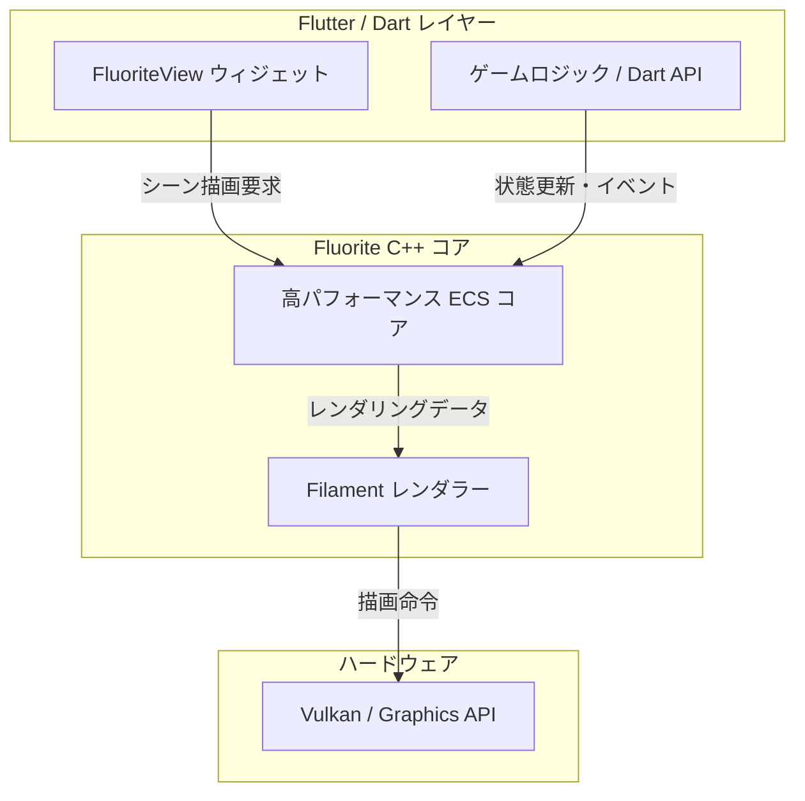

# **Fluorite Game Engine 調査レポート**

## **1. 基本情報**

* **ツール名**: Fluorite Game Engine
* **ツールの読み方**: フローライト
* **開発元**: Toyota Connected North America
* **公式サイト**: [https://fluorite.game/](https://fluorite.game/)
* **関連リンク**:
  * ドキュメント: [https://fluorite.game/](https://fluorite.game/)
* **カテゴリ**: 📱 モバイル開発
* **概要**: Flutterと完全に統合された初のコンソールグレードゲームエンジン。C++で書かれた高性能なECS（Entity-Component-System）コアを持ちながら、Dartでゲームロジックを記述できる。

## **2. 目的と主な利用シーン**

* **解決する課題**: Flutterアプリ内での本格的な3D表現の実現と、ゲームロジックとUI（Flutter Widget）のシームレスな連携。
* **想定利用者**: Flutterエンジニア、モバイルゲーム開発者、組み込み機器（車載など）での3D UI開発者。
* **利用シーン**:
  * モバイル向けの3Dゲーム開発
  * Flutterアプリへのリッチな3Dコンテンツの組み込み
  * 3D空間と2D UIが密接に連携するインタラクティブなアプリケーション開発

## **3. 主要機能**

* **High-performance ECS core**: C++で記述されたデータ指向のECSアーキテクチャにより、低スペックなハードウェアでも高いパフォーマンスを発揮。Dart APIを通じて操作可能。
* **Model-defined touch trigger zones**: Blender等の3Dツールで「クリック可能なゾーン」を定義し、特定のイベントをトリガーできる機能。3D空間内のUI作成を簡素化する。
* **Console-grade 3D Rendering**: GoogleのFilamentレンダラーを搭載。Vulkan対応、物理ベースレンダリング（PBR）、ポストプロセスエフェクト、カスタムシェーダーをサポート。
* **Hot Reload**: Flutter/Dartのホットリロード機能をサポート。シーンの変更を数フレーム以内に反映し、高速なイテレーションが可能。
* **Flutter Integration**: `FluoriteView`ウィジェットを使用して、複数の3DビューをFlutter UI内に配置可能。ゲームエンティティとUIウィジェット間で状態を共有できる。

## **4. 動作原理・システム構成**

* **アーキテクチャ**: C++コアによるECS (Entity-Component-System) パターンとFlutter (Dart) インターフェースのハイブリッド構成。
* **主要コンポーネントとデータフロー**:
  * Flutterアプリケーション内の `FluoriteView` ウィジェットを通じて3D空間が描画される。
  * 開発者はDartでAPIを利用し、ゲームロジック（エンティティやコンポーネント）を記述する。
  * バックエンドのC++による高パフォーマンスECSコアが状態を処理し、Filamentを用いてレンダリングする。
* **特筆すべき要素技術**:
  * **ECS (Entity-Component-System)**: データ指向の設計により、低スペックデバイスでも効率的に動作するアーキテクチャ。
  * **Google Filament**: Vulkan対応、物理ベースレンダリング（PBR）対応の高品質レンダラー。
  * **Flutter Hot Reload統合**: 3Dシーンへの変更を即座に反映可能。



## **5. 開始手順・セットアップ**


* **前提条件**:
  * Flutter開発環境
  * アカウント作成不要（推定）
* **インストール/導入**:

  ```bash
  # pubspec.yamlにパッケージを追加 (予定)
  flutter pub add fluorite
  ```

* **初期設定**:
  * 特に複雑な設定は不要と予想される
* **クイックスタート**:
  * Flutterプロジェクト内で `FluoriteView` を配置し、Blender等で作成したアセットをインポートする

## **6. 特徴・強み (Pros)**

* Flutterとの完全統合により、既存のFlutterエコシステム（Dart言語、DevTools、Widgetシステム）をそのまま活用できる。
* Filament採用により、モバイルでもコンソール級のグラフィックスを実現。
* ホットリロード対応により、試行錯誤のサイクルを高速化できる。
* 3DシーンとFlutter UI（2D）の連携が容易で、複雑なインタラクションを実現しやすい。

## **7. 弱み・注意点 (Cons)**

* 現時点（2026年5月）では詳細なドキュメントやリポジトリが一般公開されていない。
* UnityやGodot、Flameに比べると、登場したばかりでありコミュニティや知見が少ない。
* "More coming soon" のプレビュー段階であり、プロダクション利用には検証が必要。
* 日本語対応状況は不明だが、海外発のOSSであるため公式ドキュメントは英語ベースになると予想される。

## **8. 料金プラン**

| プラン名 | 料金 | 主な特徴 |
|---------|------|---------|
| **無料プラン (予想)** | 無料 | オープンソースパッケージとして公開される可能性が高い |

* **課金体系**: なし (予想)
* **無料トライアル**: なし

## **9. 導入実績・事例**

* **導入企業**: Toyota Connected North America (開発元)
* **導入事例**: 公開事例なし (Coming Soon)
* **対象業界**: ゲーム業界、自動車業界（HMIツールとしての利用の可能性）

## **10. サポート体制**

* **ドキュメント**: 公式サイトにて公開予定（現在はComing Soon）。
* **コミュニティ**: 不明。公開後にGitHub等で形成される見込み。
* **公式サポート**: 不明。

## **11. エコシステムと連携**

### **11.1 API・外部サービス連携**

* **API**: Dart APIを提供し、C++コアと通信。
* **外部サービス連携**: Blender連携（3Dモデル内でのタッチゾーン定義など、DCCツールとの連携機能あり）。

### **11.2 技術スタックとの相性**

| 技術スタック | 相性 | メリット・推奨理由 | 懸念点・注意点 |
|:---|:---:|:---|:---|
| **Flutter** | ◎ | 完全統合されており、Widgetとして利用可能 | 特になし |
| **Dart** | ◎ | ゲームロジックをDartで記述可能 | 特になし |
| **Blender** | ◯ | タッチゾーン定義などで連携機能あり | 独自のワークフローに慣れる必要がある |

## **12. セキュリティとコンプライアンス**

* **認証**: ツール自体は認証機能を持たないと予想される。
* **データ管理**: アプリケーションの実装に依存する。
* **準拠規格**: 公式サイトでは公開されていない。

## **13. 操作性 (UI/UX) と学習コスト**

* **UI/UX**: Flutter開発者にとっては馴染み深いWidgetベースの構築が可能と予想される。
* **学習コスト**: ECS（Entity-Component-System）アーキテクチャの理解が必要だが、Flutter/Dartの知識があれば参入しやすい。

## **14. ベストプラクティス**

* **効果的な活用法 (Modern Practices)**:
  * UIはFlutter Widget、3DロジックはFluoriteのECSで管理し、状態共有機能を活用する。
  * ホットリロードを活用して、シーン構築のトライアンドエラーを高速に行う。
* **陥りやすい罠 (Antipatterns)**:
  * 過度に複雑な3Dモデルを使用し、モバイルデバイスのパフォーマンスを低下させる。
  * Flutter UIと3D空間の連携を密結合にしすぎ、保守性を下げる。

## **15. ユーザーの声（レビュー分析）**

* **調査対象**: 公式サイトおよび一般ウェブ検索
* **総合評価**: 評価なし (未リリース/プレビュー段階のため)
* **ポジティブな評価**:
  * 一般ユーザーによるレビューはまだ存在しない。
* **ネガティブな評価 / 改善要望**:
  * 一般ユーザーによるレビューはまだ存在しない。
* **特徴的なユースケース**:
  * 現時点では報告されていない。

## **16. 直近半年のアップデート情報**

* **2026-10-16**: 公式サイトにて引き続きプレビュー情報が公開されており、開発が進められている。
* **2026-02-10**: 公式サイトにてプレビュー情報公開。"More coming soon..." のステータス。

(出典: [公式サイト](https://fluorite.game/))

## **17. 類似ツールとの比較**

### **17.1 機能比較表 (星取表)**

| 機能カテゴリ | 機能項目 | 本ツール | Flutter | Mobile Next |
|:---:|:---|:---:|:---:|:---:|
| **コア機能** | 3Dゲーム対応 | ◎<br><small>Filament採用で高品質な3D表現</small> | △<br><small>標準では2D主体</small> | ×<br><small>テスト・自動化特化のため非対応</small> |
| **開発環境** | Flutter統合 | ◎<br><small>完全統合</small> | ◎<br><small>本体</small> | ◯<br><small>テスト・操作機能として統合</small> |
| **言語** | Dart対応 | ◎<br><small>Dartでロジック記述</small> | ◎<br><small>標準言語</small> | ◯<br><small>テストケースの記述などで対応</small> |
| **自動化・テスト** | モバイル操作自動化 | ×<br><small>ゲームエンジンに特化</small> | ◯<br><small>標準の結合テスト</small> | ◎<br><small>AIエージェントによる高度な操作とテスト</small> |

### **17.2 詳細比較**

| ツール名 | 特徴 | 強み | 弱み | 選択肢となるケース |
|---------|------|------|------|------------------|
| **本ツール** | Flutter統合の3Dゲームエンジン | Flutter内での高品質3D、Dartで完結 | 実績・情報の少なさ | Flutterアプリで本格的な3D表現が必要な場合 |
| **Flutter** | クロスプラットフォームUIフレームワーク | 豊富なコンポーネント、軽量、実績あり | 3D機能は限定的 | 2Dアプリやシンプルな3D要素の場合 |
| **Mobile Next** | AIモバイルテスト自動化プラットフォーム | AIによるモバイル操作・テスト自動化 | ゲーム描画機能は持たない | モバイルアプリの高度なテストや操作自動化が必要な場合 |

## **18. 総評**

* **総合的な評価**:
  * Flutterエコシステム待望の「本格的な3Dゲームエンジン」として非常に期待度が高い。C++コアによるパフォーマンスとDartによる生産性のバランス、Google Filamentによる描画品質は魅力的である。ただし、現時点では情報が限定的であり、実際の開発体験や安定性は未知数。
* **推奨されるチームやプロジェクト**:
  * Flutterでの開発スキルを持つチーム
  * モバイルアプリの一部として高品質な3D体験を組み込みたいプロジェクト
* **選択時のポイント**:
  * 正式リリースやドキュメントの公開を待ってから検証することを推奨。Flutterで「Unityを使うほどではないが、Flameでは物足りない」という3Dニーズに合致する可能性がある。
