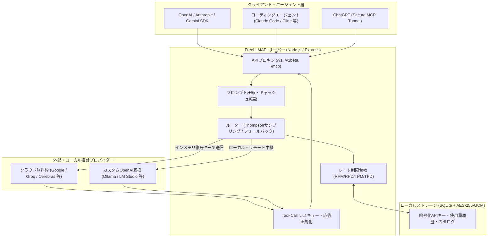

# **FreeLLMAPI 調査レポート**

## **1. 基本情報**

* **ツール名**: FreeLLMAPI
* **ツールの読み方**: フリーエルエルエムエーピーアイ
* **開発元**: Tashfeen Ahmed（個人開発者・OSSプロジェクト）
* **公式サイト**: [https://freellmapi.co/](https://freellmapi.co/)
* **関連リンク**:
  * GitHub: [https://github.com/tashfeenahmed/freellmapi](https://github.com/tashfeenahmed/freellmapi)
  * ドキュメント: [https://github.com/tashfeenahmed/freellmapi/blob/main/docs/en/README.md](https://github.com/tashfeenahmed/freellmapi/blob/main/docs/en/README.md)
* **カテゴリ**: AIゲートウェイ
* **概要**: FreeLLMAPIは、Google、Groq、Cerebras、Mistral、OpenRouter、NVIDIA NIMなど87の無料LLMプロバイダーと1,313以上の無料モデルエンドポイント（およびカスタムOpenAI互換エンドポイント）を、単一のOpenAI互換 `/v1` APIの背後に集約するセルフホスト型AIゲートウェイです。各プロバイダーのAPIキーをローカルのSQLiteデータベースにAES-256-GCMで暗号化保存し、リクエストごとに最適なモデルを自動選択してレート制限（429）やエラー発生時には即座に次のプロバイダーへフェイルオーバーします。

## **2. 目的と主な利用シーン**

* **解決する課題**: 主要AIラボやクラウド事業者が提供する無料枠（Free Tier）は単体ではトークン上限やレート制限が厳しく実用に耐えにくい一方、複数の無料枠を手動で組み合わせようとすると「異なるSDK・エンドポイント」「バラバラなレート制限」「頻繁なモデル廃止やクォータ変更」の管理に多大な手間がかかります。FreeLLMAPIはこの断片化を単一の統合APIキーとエンドポイントに集約し、月間約101億トークン規模の推論キャパシティをシームレスに利用可能にします。
* **想定利用者**: 個人開発者、AIアプリケーションのプロトタイピングを行うエンジニア、AIコーディングエージェント（Claude Code、Codex CLI、Cursor、Cline等）のAPIコストを抑えたい開発者。
* **利用シーン**:
  * **AIコーディングエージェントの無料運用**: Claude Code、Codex CLI、Gemini CLI、Cline、Roo Code、OpenCode、AiderなどのベースURLをローカルのFreeLLMAPIに向け、有料枠を消費せずに日々のコーディング支援やテストループを回す。
  * **プロトタイピングとマルチモデル比較**: 単一のOpenAI SDKコードのまま `auto:smart` / `auto:fast` などのルーティング戦略や `fusion` モードを切り替え、複数モデルの応答品質・速度を検証する。
  * **ローカルLLMとクラウド無料枠のハイブリッド統合**: Ollama、LM Studio、vLLMなどのローカル推論サーバーをカスタムプロバイダーとして登録し、クラウド無料枠と単一のフォールバックチェーンで併用する。

### **2.1 代表的な利用フロー**

```mermaid
swimlane-beta TB
  subgraph User["ユーザー / AIエージェント"]
    A["APIキー登録・チェーン設定"]
    B["/v1/chat/completions へリクエスト"]
    F["統合レスポンスを受信"]
  end
  subgraph Gateway["FreeLLMAPI (ローカルサーバー)"]
    C["認証・プロンプト圧縮・最適モデル選定"]
    E["429/5xx検知時にクールダウン・次候補へ切替"]
  end
  subgraph Providers["外部LLMプロバイダー群"]
    D["選択されたプロバイダーで推論実行"]
  end
  A --> C
  B --> C
  C --> D
  D -->|"正常応答"| F
  D -->|"レート制限・エラー"| E
  E --> D
```

* **代表的な流れ**: ユーザーは最初にダッシュボードやCLIから各プロバイダーのAPIキーを登録（暗号化保存）し、発行された単一の統合キーをAIエージェントやアプリに設定します。リクエスト送信時はFreeLLMAPIがレート制限残量とライブスコアから最適モデルを選定して外部プロバイダーへ中継し、上限到達やエラーが発生した場合は自動的に次のプロバイダーへフォールバックして応答を返却します。

## **3. 主要機能**

* **マルチプロトコル互換エンドポイント**: OpenAI互換（`/v1/chat/completions`、`/v1/responses`、`/v1/completions`、`/v1/embeddings`、`/v1/images/generations`、`/v1/videos/generations`、`/v1/audio/speech`、`/v1/audio/transcriptions`）に加え、Anthropic Messages API（`/v1/messages`）、GeminiネイティブAPI（`/v1beta`）、Ollamaエミュレーションをサポートし、多様なクライアントをそのまま接続できます。
* **6種類のスマートルーティング戦略**: `auto`（アクティブなフォールバックチェーン順）に加え、`auto:smart`、`auto:fast`、`auto:cheap`、`auto:reliable`、`auto:balanced`、さらに用途別の名前付きチェーンを指定する `auto:<profile-name>` により、リクエスト単位で最適なモデル選定が可能です。
* **Thompsonサンプリングによる動的スコアリングと自動フェイルオーバー**: 各モデルの速度・能力・信頼性をリアルタイムでスコア化し、HTTP 429や5xxエラー（およびHTTP 200でエラーボディを返す一部プロバイダーの異常）を検知すると該当キーをクールダウンさせ、ウォールクロック予算内で最大20回まで次のモデルへ自動リトライします。
* **キー単位のレート制限トラッキング**: `(platform, model, key)` の組み合わせごとにRPM/RPD/TPM/TPDカウンターを保持し、プロバイダーが返す上限値を学習して無料枠超過を未然に防ぎます。
* **Fusion（マルチモデル統合推論）**: 仮想モデル `fusion` を指定すると、複数の異なる無料モデルへ並列でプロンプトを送信し、審査役（Judge）モデルが各ドラフトを統合してより高品質な単一回答を生成します。
* **スティッキーセッションとコンテキストハンドオフ**: 同一会話を30分間同じモデルに固定しつつ、日中のクォータ枯渇等で別モデルへ切り替わる際にはコンパクトな引き継ぎメモを自動生成して文脈の破綻を防ぎます。
* **オプトインのプロンプト圧縮パイプライン**: リクエスト単位で有効化でき、プロンプトの重複排除、ツール出力のフィルタリング、反復JSONの圧縮、古いコンテキストのトリミングをキャッシュ参照・ルーティング前に実行します。
* **Tool Callingレスキューと構造化出力**: ツール呼び出しをプレーンテキストで返してしまうモデルから構造化された `tool_calls` を自動復元（レスキュー）し、`response_format` などのサンプリングパラメータも適切に受け渡します。
* **署名付きモデルカタログの自動同期**: `freellmapi.co` から署名付きカタログを1日2回同期し、`git pull` なしで新規無料モデル追加・クォータ変更・互換性修正を取り込みます（無料版は30日遅れの月次スナップショット、プレミアム版は当日同期）。
* **MCPサーバー・60言語対応ダッシュボード・デスクトップアプリ**: `/mcp` エンドポイント経由でChatGPTやコーディングエージェントが推論やルーティング状態を直接操作でき、React製の管理UIは日本語を含む60言語に対応します。

## **4. 動作原理・システム構成**



* **アーキテクチャ**: ローカルファースト・シングルユーザー設計のクライアント・サーバー型ゲートウェイです。サーバー本体はNode.js 20+上のTypeScript/Expressで動作し、管理ダッシュボードはReact + Vite + shadcn/uiで構成されています。アイドル時のメモリ消費量は約40MB RSSと軽量で、Raspberry Piなどの小型ARM SBCやAndroid（Termux）上でも動作します。
* **主要コンポーネントとデータフロー**:
  * **Router (`server/src/services/router.ts`)**: リクエストを受け取ると、健全なキーを持ちレート制限内の最優先モデルを選択します。
  * **Rate-limit ledger (`server/src/services/ratelimit.ts`)**: メモリ上の高速カウンターとSQLite永続化を組み合わせ、429発生時のクールダウンや日次リセット（UTC 0時）を管理します。
  * **Provider adapters (`server/src/providers/*.ts`)**: プロバイダーごとの差異（パラメータ形式やストリーミング仕様）を吸収するアダプター群です。
  * **Storage (`better-sqlite3`)**: 登録されたプロバイダーAPIキーは `ENCRYPTION_KEY` を用いてAES-256-GCMで暗号化保存され、リクエスト処理時のみインメモリで復号されます。プロンプトや応答がFreeLLMAPI開発者のサーバーを経由することはありません。
* **特筆すべき要素技術**:
  * 暗号化バックアップ（`DUMP_FORMAT=1`、SHA-256フィンガープリント付き）や `.env` / JSON / CSV による一括キーインポート・エクスポートに対応しています。
  * インバウンドの `TRUST_PROXY` やアウトバウンドのシステムプロキシ自動検出（`detectSystemProxy()`）、Cloudflare Worker等を中継に使う `Fetch Relay` トランスポートなど、制限されたネットワーク環境向けの機能も備えています。

## **5. 開始手順・セットアップ**

* **前提条件**:
  * **Docker利用時**: Docker および Docker Compose。
  * **ソースビルド / ローカル開発時**: Node.js 20.18.0以上（25.0.0未満）、npm 10以上。
  * **デスクトップアプリ利用時**: macOS 12 Monterey以降（Apple Silicon / Intel）または Windows（Microsoft Store版が署名済みで推奨）。
  * **アカウント登録**: デスクトップアプリはローカル隠しアカウントで自動ログインするためアカウント作成不要。サーバー版は初回起動時にローカルのメール・パスワードを設定します（クレジットカード登録不要）。
* **インストール / 導入**:

  ```bash
  # 方法1: Docker ワンライナー（~/freellmapi にセットアップしコンテナ起動）
  curl -fsSL https://freellmapi.co/install.sh | bash
  ```

  ```bash
  # 方法2: Docker Compose による手動構築
  git clone https://github.com/tashfeenahmed/freellmapi.git
  cd freellmapi
  ENCRYPTION_KEY="$(openssl rand -hex 32)"
  printf "ENCRYPTION_KEY=%s\nPORT=3001\n" "$ENCRYPTION_KEY" > .env
  docker compose up -d
  ```

* **初期設定**:
  1. ブラウザで `http://localhost:3001`（デスクトップアプリは自動割当ポート、例 `http://127.0.0.1:31415`）を開きます。
  2. **Keys** ページで利用したい無料LLMプロバイダー（Google、Groq、Cerebrasなど）のAPIキーを登録し、必要に応じて **Fallback Chain** の優先順位を並べ替えます。
  3. Keys ページ上部に表示される統合APIキー（`freellmapi-...`）をコピーします。
* **クイックスタート**:

  ```bash
  # 統合エンドポイントへの動作確認リクエスト
  curl http://localhost:3001/v1/chat/completions \
    -H "Authorization: Bearer <YOUR_UNIFIED_KEY>" \
    -H "Content-Type: application/json" \
    -d '{
      "model": "auto",
      "messages": [{"role": "user", "content": "Hello!"}]
    }'
  ```

  コーディングエージェントを接続する場合は、CLIのワンコマンドセットアップも利用できます。

  ```bash
  # Claude Code の自動設定例（--dry-run で事前確認も可能）
  npx freellmapi setup-claude --url http://localhost:3001 --api-key <YOUR_UNIFIED_KEY>
  ```

## **6. 特徴・強み (Pros)**

* **圧倒的な無料枠集約規模と自動維持**: 87プロバイダー・1,313以上のエンドポイントを単一インターフェースで扱え、モデル追加や上限変更も署名付きカタログ配信により `git pull` 不要で追従できます。
* **高度なレジリエンス設計**: レート制限（429）やエラー時の自動フェイルオーバー、Thompsonサンプリングによる動的順位付け、30分間のスティッキーセッションと文脈ハンドオフにより、無料枠の不安定さをシステム側で吸収します。
* **ローカルファーストの高い安全性**: APIキーはローカルSQLite内でAES-256-GCM暗号化され、推論トラフィックも利用者のマシンから各プロバイダーへ直接送信されるため、第三者プロキシに機密データやキーを預ける必要がありません。
* **幅広いクライアント・エージェント互換性**: OpenAI互換だけでなくAnthropic `/v1/messages` やGemini `/v1beta`、Ollamaエミュレーション、MCPサーバーを備え、20種類以上のAIコーディングエージェントをワンコマンドで接続できます。
* **マルチプラットフォームと軽量性**: 約40MB RSSの省メモリ設計で、Docker・ローカルNode・macOS/Windowsトレイアプリ・Raspberry Pi・Android（Termux）まで幅広く動作します。

## **7. 弱み・注意点 (Cons)**

* **本番環境・商用利用には非推奨**: 公式ドキュメントでも「個人実験用（Personal experimentation only）」と明記されており、SLAはなく、マルチテナント認証機能も備えていません。公開インターネットへの直接露出は非推奨です。
* **時間帯によるインテリジェンスの低下**: 性能の高い上位モデルほど日次クォータが早く枯渇するため、一日の後半にはフォールバック先の中小モデルへ切り替わり、応答品質が低下する傾向があります（UTC 0時にリセット）。
* **各プロバイダー利用規約（ToS）への配慮が必要**: ツール自体は合法な個人用プロキシですが、Cohereのように個人利用を制限する規約を持つプロバイダーや、評価用途のみ許可するプロバイダー（NVIDIA NIM等）が存在するため、利用者自身の判断で有効化するプロバイダーを選ぶ必要があります。
* **日本語対応の状況**: 管理ダッシュボードは日本語を含む60言語に対応し、`README.ja.md` も用意されていますが、詳細な技術ドキュメント（`docs/en/` 配下）は主に英語と簡体字中国語での提供となっており、最新リリースノートの把握には英語読解が求められます。

## **8. 料金プラン**

| プラン名 | 料金 | 主な特徴 |
|---------|------|---------|
| **OSS / 無料版** | 無料 | MITライセンス。ルーター本体、ダッシュボード、デスクトップ/モバイルアプリ、全プロバイダー連携が利用可能。モデルカタログは30日遅れの月次スナップショット同期。 |
| **Premium Annual（年額）** | $19 / 年 | 署名付きライブモデルカタログを当日中に即時同期。モバイル端末をLAN APIサーバー化する機能なども利用可能。いつでも解約可能。 |
| **Premium Lifetime（買い切り）** | $49（買い切り） | 年額プランと同等のライブカタログ即時同期およびプレミアム機能を永久ライセンスで利用可能。 |

* **課金体系**: コアソフトウェアは完全無料（OSS）で、各LLMプロバイダーの利用料も無料枠範囲内であれば0円です。有料プランは「署名付きモデルカタログの即時配信フィードおよび一部付加機能」に対するライセンス課金です。
* **無料トライアル**: OSS版自体が機能制限なく無料で利用可能です（ライブカタログの即時配信のみ有料）。

## **9. 導入実績・事例**

* **導入企業**: 単一ユーザー・個人実験向けのツールとして設計されているため、公式サイト上で特定の法人導入企業名は公開されていません。
* **導入事例**: 公開企業事例なし。ただし、GitHub上で58,000以上のスターと8,400以上のフォークを獲得しており、世界中の個人開発者、AIエージェント利用者、スタートアップの技術検証環境において広く利用されています。
* **対象業界**: ソフトウェア開発（AIコーディング支援のコスト最適化）、個人のAI研究開発・プロトタイピング、教育・学習用途。

## **10. サポート体制**

* **ドキュメント**: GitHubリポジトリ内の [`docs/en/README.md`](https://github.com/tashfeenahmed/freellmapi/blob/main/docs/en/README.md) に導入、REST API、対応エージェント、プロンプト圧縮、プロキシ転送、アーキテクチャの詳細ガイドが体系的に整備されています。ローカルサーバーの `/v1/docs` ではインタラクティブなOpenAPIビューアも利用可能です。
* **コミュニティ**: GitHub Issues / Pull Requests（`tashfeenahmed/freellmapi`）を中心に活発なやり取りが行われており、セキュリティ報告用のプライベート窓口（GitHub Securityタブ）も用意されています。
* **公式サポート**: 個人メンテナー（Tashfeen Ahmed）によるOSSプロジェクトであるため、24時間SLAのエンタープライズサポートはありません。セキュリティ関連の連絡先として `support@freellmapi.co` が公開されています（英語対応）。

## **11. エコシステムと連携**

### **11.1 API・外部サービス連携**

* **API**: OpenAI互換REST API（`/v1/*`）、Anthropic Messages API（`/v1/messages`）、Gemini API（`/v1beta`）、Ollama互換API、およびMCP（`/mcp`）を提供。`GET /v1/openapi.json` からOpenAPI仕様を取得できます。
* **外部サービス連携**:
  * **AIコーディングエージェント**: Claude Code, Codex CLI, Gemini CLI, Cursor, Cline, Roo Code, OpenCode, Aider, Continue, Goose, Zed, JetBrains AI 等20種以上
  * **チャット・MCPクライアント**: ChatGPT（Private Secure MCP Tunnel経由の `ask_freellmapi` ツール）
  * **クラウドLLMプロバイダー**: Google Gemini, Groq, Cerebras, Mistral, OpenRouter, Cloudflare Workers AI, NVIDIA NIM, Hugging Face, Z.ai, OVH AI Endpoints, AI Horde 等87社以上
  * **ローカルLLM基盤**: Ollama, LM Studio, vLLM, llama.cpp（カスタムOpenAI互換エンドポイント経由）

### **11.2 技術スタックとの相性**

| 技術スタック | 相性 | メリット・推奨理由 | 懸念点・注意点 |
|:---|:---:|:---|:---|
| **Python (OpenAI / Anthropic SDK)** | ◎ | `base_url` と `api_key` を差し替えるだけで即利用可能 | 無料枠の日次上限に達するとモデルが切り替わる |
| **TypeScript / Node.js** | ◎ | 本体と同言語で相性が良く、CLIやSDKからシームレスに連携 | 特になし |
| **AIコーディングエージェント (Claude Code / Cline 等)** | ◎ | `npx freellmapi setup-*` で設定を自動生成でき、Tool-Callレスキューも効く | 無料モデルの出力長制限により長大な編集で途中停止する場合がある |
| **Docker / Raspberry Pi (Linux ARM)** | ◎ | 公式Dockerイメージとワンライナーがあり約40MB RSSで軽量動作 | コンテナからホスト側プロキシを使う場合は `host.docker.internal` 指定が必要 |
| **大規模商用Webバックエンド** | × | 単一ユーザー前提・SLAなし・無料枠依存のため非推奨 | 本番運用にはLiteLLMやPortkey等の有償枠対応ゲートウェイが必要 |

## **12. セキュリティとコンプライアンス**

* **認証**: サーバー版ダッシュボードはメール＋パスワード認証（scryptハッシュ＋セッショントークン）、プロキシAPIは統合ベアラートークン（`freellmapi-...`）および失効可能なURLトークンで保護されます。デスクトップ版はローカル接続時の自動認証を採用しています。エンタープライズ向けのSSO/SAMLには非対応です。
* **データ管理**: すべてのデータ（プロバイダーキー、使用量ログ、設定）はローカルのSQLiteデータベースに保存され、APIキーや機密設定はAES-256-GCMで暗号化されます。開発者サーバーへプロンプトやキーが送信されることはありません（デフォルトで `127.0.0.1` にバインド）。
* **準拠規格**: 個人開発のローカルOSSツールであり、SOC2・ISO27001・ISMAP等の第三者認証は取得していません（公式サイトで認証取得の公開情報なし）。

## **13. 操作性 (UI/UX) と学習コスト**

* **UI/UX**: React + Vite + shadcn/uiで構築された管理ダッシュボードはモダンで視認性が高く、ダーク/ライトテーマや日本語を含む60言語の自動切替に対応しています。Playground画面では画像・テキスト添付のテストやルーティング結果（使用モデル・レイテンシ）の確認が直感的に行え、Analytics画面では24時間〜90日単位のトークン・TTFT統計をグラフで把握できます。
* **学習コスト**: Dockerワンライナーまたはデスクトップアプリ（`.dmg` / Microsoft Store）を使えば数分で起動でき、学習コストは非常に低いです。`npx freellmapi setup-*` によるエージェント自動設定も備わっています。

## **14. ベストプラクティス**

* **効果的な活用法 (Modern Practices)**:
  * **用途別の名前付きチェーン（Profile）の活用**: コーディング用（Tool Calling対応モデル中心）や高速応答用など複数のフォールバックチェーンを作成し、リクエスト時に `auto:coding` のように使い分けることで品質と速度を最適化できます。
  * **プロンプト圧縮の有効化**: コンテキスト長に制限のある無料モデルを多用するコーディングエージェント利用時は、オプトインのプロンプト圧縮パイプラインを有効にしてトークン消費を抑えることが推奨されます。
  * **ローカルLLMのフォールバック組み込み**: クラウド無料枠がすべて枯渇した際の最終フォールバック先として、ローカルのOllamaやLM Studioをカスタムプロバイダーに登録しておくと完全なオフライン耐性が得られます。
* **陥りやすい罠 (Antipatterns)**:
  * **`HOST_BIND=0.0.0.0` での無防備なインターネット公開**: シングルユーザー設計のため、認証を強化せずにグローバルIPへ公開すると第三者にクォータを消費されるリスクがあります。外部アクセスが必要な場合はTLS付きリバースプロキシ配下に限定してください。
  * **`ENCRYPTION_KEY` の未バックアップ・安易な変更**: 暗号化キーを紛失すると保存済みプロバイダーキーが復号できなくなります。本番相当の環境では必ず `.env` に明示設定し安全にバックアップしてください。
  * **無料枠モデルの出力上限・Tool Calling非対応への無配慮**: 無料モデルの一部は `max_tokens` が小さく、エージェント利用時にプラン出力途中で停止することがあります。`execution_status=ready` やツール対応モデルでチェーンを構成することが重要です。

## **15. ユーザーの声（レビュー分析）**

* **調査対象**: GitHub（Stargazers / Issues）、Reddit（`r/coolgithubprojects`、`r/nocode`、`r/LLM`）、Hacker News、技術解説記事（G2・Capterra・ITreviewには現時点で登録ページなし）
* **総合評価**: GitHubスター数 58,800超（2026年11月時点）とコミュニティから極めて高い支持を獲得
* **ポジティブな評価**:
  * 「バラバラだった無料枠のAPIキーとレート制限管理を一つのローカルURLにまとめられ、個人実験やサイドプロジェクトのコストがゼロになる」（GitHub / Redditより要約）
  * 「Claude CodeやCline、Aiderなどのコーディングエージェントを、有料サブスクリプションを消費せずにテストループで回せるのが非常に便利」（技術メディア / YouTubeレビューより要約）
  * 「プロンプトやAPIキーがローカル完結でAES-256-GCM暗号化される点に安心感がある」（コミュニティ議論より要約）
* **ネガティブな評価 / 改善要望**:
  * 「無料枠ベースのため、日中の後半に上位モデルがクォータ切れを起こすと出力品質や応答速度が不安定になる」（解説記事より要約）
  * 「一部無料モデルの出力トークン上限やTool Callingの癖により、エージェントが計画出力後に止まるケースがあり調整が必要」（Reddit `r/nocode` より要約）
  * 「各プロバイダーの規約変更やモデル廃止が頻繁なため、無料版の30日遅れカタログでは追従にタイムラグを感じる」（コミュニティ議論より要約）
* **特徴的なユースケース**:
  * 複数のAIコーディングエージェント（Claude Code、OpenCode、Cursor等）を1台のローカルゲートウェイに集約し、開発フェーズに応じて `auto:smart` と `auto:fast` を使い分ける「ゼロコスト開発環境」の構築。

## **16. 直近半年のアップデート情報**

* **2026-11-26**: **v0.16.46** リリース。OpenCode接続機能（Connect to FreeLLMAPI）において、既存の別設定ファイル（`opencode.jsonc` 等）に残存する古いキーやアドレスを自動削除し「Invalid API key」エラーを解消。
* **2026-11-25**: **v0.16.44** リリース。Nutrient Small/Mediumチャット・ドキュメント判定モデル、およびTanodの無料限定埋め込み・英語分類・専門翻訳に対応。さらにPuterチャットルート（DeepSeek V4 Flash 0731、Qwen3.8 Omni Flash、Kimi K2.6、Gemini 4 Hydrogen）を追加。
* **2026-11-23**: **v0.16.41** リリース。新規プロバイダーとしてカード登録不要の無料プランを持つ「LLM.kiwi」（20 RPM）および「TokenReply」（Nemotron 3.5、GLM 5.3 Flash、Step 5 Preview等）を追加。
* **2026-11-21**: **v0.16.38** リリース。Puterネイティブチャット（モデルID固定・リフューザルフォールバックなし）のほか、AI Horde / xKiro画像生成、Google Live WAV文字起こし、xKiro / Cloudflare翻訳、Clairic Flash抽出を追加。
* **2026-09-05**: ドキュメント構成を言語別（`docs/{en,zh-cn}`）へ再編し、`Idempotency-Key` による安全リトライや `Fetch Relay` プロキシトランスポート仕様を整備。
* **2026-08-25**: 動画生成プラットフォーム（Pollinations / HuggingFace / falキュー）、無料枠予算API（`GET /api/free-tier`）、名前付きフォールバックチェーン（`auto:<name>`）を拡充。

（出典: [FreeLLMAPI GitHub Releases](https://github.com/tashfeenahmed/freellmapi/releases) / [docs/CHANGELOG.md](https://github.com/tashfeenahmed/freellmapi/blob/main/docs/CHANGELOG.md)）

## **17. 類似ツールとの比較**

### **17.1 機能比較表 (星取表)**

| 機能カテゴリ | 機能項目 | FreeLLMAPI | LiteLLM | Portkey | 9router |
|:---:|:---|:---:|:---:|:---:|:---:|
| **基本機能** | 無料枠特化ルーティング | ◎<br><small>87プロバイダー・1,313EPの無料枠を集約</small> | △<br><small>主に有料API・商用プロキシ向け</small> | △<br><small>主に商用運用の統制向け</small> | ◯<br><small>40+プロバイダーのフォールバック対応</small> |
| **基本機能** | 対応APIプロトコル | ◎<br><small>OpenAI / Anthropic / Gemini / Ollama / MCP</small> | ◎<br><small>100+プロバイダーをOpenAI形式で統一</small> | ◎<br><small>250+LLMを単一ゲートウェイで統一</small> | ◯<br><small>OpenAI互換エンドポイント中心</small> |
| **コスト最適化** | プロンプト/トークン節約 | ◯<br><small>オプトイン圧縮パイプライン搭載</small> | ◯<br><small>キャッシュ・予算上限管理</small> | ◯<br><small>セマンティックキャッシュ搭載</small> | ◎<br><small>RTK連携で20〜40%の入力削減</small> |
| **エンタープライズ** | マルチテナント・ガバナンス | ×<br><small>シングルユーザー専用（個人実験向け）</small> | ◎<br><small>仮想キー・予算管理・RBAC完備</small> | ◎<br><small>SOC2/HIPAA・ガードレール・MCP統制</small> | ×<br><small>セルフホスト個人・小規模向け</small> |
| **導入・運用** | 導入形態の多様性 | ◎<br><small>Docker / デスクトップアプリ / CLI / Termux</small> | ◯<br><small>Pythonパッケージ / Docker</small> | ◯<br><small>SaaS / OSSゲートウェイ</small> | ◯<br><small>セルフホストプロキシ</small> |
| **非機能要件** | 日本語対応 | ◎<br><small>UI60言語（日本語含む）・日本語README</small> | △<br><small>ドキュメント・UIともに英語中心</small> | △<br><small>ドキュメント・UIともに英語中心</small> | △<br><small>日本語情報・ドキュメントは限定的</small> |

### **17.2 詳細比較**

| ツール名 | 特徴 | 強み | 弱み | 選択肢となるケース |
|---------|------|------|------|------------------|
| **FreeLLMAPI** | 無料枠LLMをローカルで統合するOSSゲートウェイ | 87社の無料枠集約、署名付きカタログ自動更新、デスクトップアプリ・MCP対応 | 本番・マルチテナント不可、無料枠依存の不安定さ | 個人開発、実験、コーディングエージェントの無料運用 |
| **LiteLLM** | Python/RustコアのデファクトOSS AIゲートウェイ | 100以上のプロバイダー対応、仮想キー、コスト管理、高速ルーティング | 大規模運用時のYAML設定と学習コストが高い | 商用アプリやチーム開発での本格的なLLMゲートウェイ構築 |
| **Portkey** | エンタープライズLLMOps機能を備えたゲートウェイ | プロンプト管理、ガードレール、SOC2/HIPAA準拠、MCP Gateway | 日本語ローカライズが限定的、エンタープライズ機能は有料 | コンプライアンス要件や高度な可観測性が求められる本番環境 |
| **9router** | AIコーディングツール向けの自己ホスト型APIプロキシ | RTK Token Saverによる強力な入力トークン削減とマルチプロバイダ連携 | プロトコル対応範囲やカタログ自動更新機能はFreeLLMAPIに譲る | 入力トークン数の物理的削減を最優先したいコーディング用途 |

## **18. 総評**

* **総合的な評価**:
  * FreeLLMAPIは、「各社が提供するLLM無料枠をすべて束ねて実用的な推論プールに変える」という明確なコンセプトを、極めて高いエンジニアリング品質で実装したOSSゲートウェイです。AES-256-GCMによるローカル鍵暗号化、Thompsonサンプリングを用いた動的ルーティング、Tool-Callレスキュー、さらには60言語対応ダッシュボードとネイティブデスクトップアプリまで備えており、個人開発者やAIエージェント利用者にとって非常に完成度の高いツールに仕上がっています。
* **推奨されるチームやプロジェクト**:
  * 個人開発者、AIアプリケーションのプロトタイピングを行うエンジニア、日々のコーディング支援（Claude Code、Cline、Cursor等）のAPI費用を抑えたい開発者に強く推奨できます。一方で、SLAやマルチテナント認証を要する商用本番バックエンドには適していません。
* **選択時のポイント**:
  * 「商用APIを安定運用・予算統制したい」場合は **LiteLLM** や **Portkey** を選び、「手元の開発環境や個人プロジェクトで、コストをかけずに多様なLLMとコーディングエージェントを最大限活用したい」場合に **FreeLLMAPI** が最有力候補となります。
