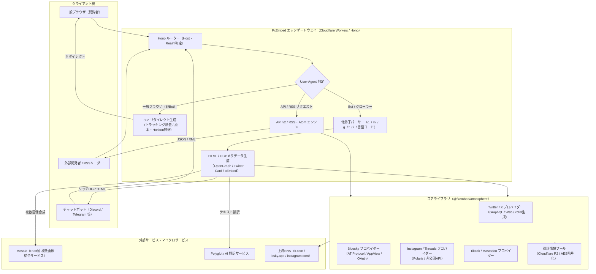

# **FxEmbed 調査レポート**

## **1. 基本情報**

* **ツール名**: FxEmbed
* **ツールの読み方**: エフエックスエンベッド
* **開発元**: dangered wolf and contributors
* **公式サイト**: [https://docs.fxembed.com/](https://docs.fxembed.com/)
* **関連リンク**:
  * GitHub: [https://github.com/FxEmbed/FxEmbed](https://github.com/FxEmbed/FxEmbed)
  * ドキュメント: [https://docs.fxembed.com/](https://docs.fxembed.com/)
* **カテゴリ**: Webサーバー/プロキシ
* **概要**: FxEmbedは、X（旧Twitter）、Bluesky、Instagram、Threads、TikTok、Mastodonなどのソーシャルメディアリンクを、DiscordやTelegram等のチャットツール上でリッチなメディアプレビューとして展開するオープンソースのエッジプロキシ・埋め込み生成エンジンである。URLのドメイン部分に「fx」や「fixup」を付加するだけで、インライン動画再生、複数画像のギャラリー表示、投票結果、引用投稿、自動翻訳などを即座に実現する。

## **2. 目的と主な利用シーン**

* **解決する課題**:
  * **インラインメディア再生の欠落**: 公式のSNSリンクをDiscordやTelegramに貼り付けた際、動画がインラインで直接再生されず、静止画サムネイルのみが表示されたり外部ブラウザへの遷移を強いられる。
  * **複数画像のプレビュー制限**: 2枚〜4枚の画像が含まれる投稿であっても、チャットクライアント上で1枚目しか表示されなかったり、配置が崩れたりする。
  * **リッチコンポーネントの脱落**: 投票（Poll）の選択肢・得票率や、引用投稿（Quote）の本文・添付メディアが埋め込みカードから欠落してしまう。
  * **追跡パラメータの氾濫**: URL末尾に付加されるトラッキングパラメータ（`?s=...&t=...`）によってプライバシーが侵害され、リンク文字列が不要に長くなる。
  * **プラットフォーム側の閲覧規制**: X/Twitterなどの未ログイン閲覧制限や頻繁なフロントエンド仕様変更により、デフォルトのリンクプレビューが日常的に停止する。
* **想定利用者**:
  * **Discordサーバー管理者・コミュニティ参加者**: ゲーム、クリエイター、推し活、技術情報などのコミュニティでSNSクリップや最新情報を日常的にシェアするユーザー。
  * **Telegramチャンネル・グループ運用者**: ニュース速報や会話スレッドをInstant View（インスタントビュー）形式で読者に快適に配信したい運用者。
  * **一般SNSユーザー**: チャット相手に余計なクリックや外部アプリ起動の手間をかけず、共有した動画や画像をその場で見てほしいユーザー。
  * **ボット開発者・自動化エンジニア**: ソーシャルメディアの投稿データ、メディアURL、翻訳済みテキストをクリーンなJSON形式で取得したり、RSSフィード化したいエンジニア。
* **利用シーン**:
  * **ゲームクリップやミーム動画の共有**: Discordのボイスチャットやテキストチャンネルで、XやBlueskyの動画ポストを即座にインライン再生可能な形式で共有。
  * **イラストレーターの連作イラストの閲覧**: 複数枚投稿されたイラストを、Discordのネイティブ複数画像ギャラリーやMosaicコラージュで一覧表示。
  * **長文議論スレッドのTelegram内通読**: TelegramのInstant View機能を用いて、外部リンクを開くことなく会話スレッド全体を通読。
  * **外国語ポストのリアルタイム翻訳共有**: URL末尾に言語コード（`/ja` など）を付加し、原文と日本語翻訳文が併記された埋め込みカードを生成。
  * **REST APIおよびRSSフィードの活用**: 公式APIが有料化・厳格化されたX/Twitterの公開投稿を、自作BotやRSSリーダーへ安定して取り込み。

### **2.1 代表的な利用フロー**

```mermaid
swimlane-beta TB
  subgraph User["ユーザー"]
    A[SNSリンクのドメインにfx/fixupを付加して送信]
    F[チャット上で動画再生や画像ギャラリーを閲覧]
  end
  subgraph ChatApp["チャット基盤（Discord / Telegram）"]
    B[URLプレビュー生成のためエッジへクエリ]
    E[OGP・メタタグを元にリッチ埋め込みを描画]
  end
  subgraph FxEmbed["FxEmbed エッジプロキシ（Hono / Workers）"]
    C[User-Agent判定とURL修飾フラグの解析]
    D[OGPメタタグ・oEmbed HTMLを組み立てて返却]
  end
  subgraph Upstream["対象SNSプラットフォーム（X / Bluesky 等）"]
    G[API / Webから投稿本文・動画・画像データを取得]
  end
  subgraph Mosaic["Mosaic サービス（Rust製画像合成）"]
    H[複数枚の画像を1枚のコラージュ画像に合成]
  end
  A --> B
  B --> C
  C --> G
  G --> C
  C --> H
  H --> C
  C --> D
  D --> E
  E --> F
```

* **代表的な流れ**: ユーザーがチャットアプリへプレフィックス付きURL（`fxtwitter.com` 等）を送信すると、DiscordやTelegramのクローラーがプレビュー生成のためにFxEmbedのエッジサーバーへアクセスする。FxEmbedはUser-Agentからボットであることを識別し、上流プラットフォーム（XやBluesky等）から投稿データを取得してOpenGraph・Twitter Cards・oEmbedメタデータを構築する。複数画像の場合はMosaicサービスで合成画像を生成し、最終的なリッチHTMLをクローラーへ返却することで、チャット画面上に高機能な埋め込みカードが即座にレンダリングされる。

## **3. 主要機能**

* **インライン動画・GIF埋め込み**: X/Twitter、Bluesky、Instagram Reelsなどの動画およびGIFを、DiscordやTelegram等のチャット内で直接再生可能な動画プレイヤー（`og:video`、`twitter:player`）として展開。Discord上でお気に入りGIFとして保存することも可能。
* **複数画像のネイティブギャラリー・Mosaic合成**: 2枚〜4枚の画像が含まれる投稿に対し、Discordのネイティブグリッド表示（複数`og:image`出力）を行うか、Rust製の画像合成マイクロサービス「Mosaic」を用いて単一のコラージュ画像として美しくレイアウト。
* **投票（Poll）および引用投稿（Quote）の完全可視化**: X/Twitterの投票結果（各選択肢のラベル、投票数、パーセンテージ）をインライン表示。また、引用された投稿の本文や添付メディアも埋め込み内に欠落なくレンダリング。
* **URL修飾子による表示スタイルの動的カスタマイズ**: サブドメインやパス拡張子を使い分けることで、メディア直リンク（`d.` または `.mp4`/`.jpg`）、テキストのみ（`t.`）、画像＋作者のみのミニマル表示（`g.`）、レガシー埋め込み（`o.`）、特定写真選択（`/photo/N`）などを用途に合わせて柔軟に制御可能。
* **自動テキスト翻訳（Polyglot / AI連携）**: URL末尾にISO 639-1の言語コード（例: `/ja`, `/en`）を付加するだけで、投稿本文を自動翻訳し、原文と翻訳文の両方を併記した埋め込みカードを生成（Grok翻訳フォールバック機能付き）。
* **Telegram Instant View（インスタントビュー）対応**: Telegram内で長文ポストや会話ツリーを共有した際、ワンタップでスレッド全体を通読できるInstant Viewページを自動生成（`i.` サブドメインで明示的指定も可能）。
* **トラッキングパラメータ除去とリダイレクト先制御**: リンクを一般ブラウザで踏んだ場合、URLに含まれる追跡パラメータ（`?s` や `&t`）を自動的に除去したクリーンなURLへ302リダイレクト。設定によりHorizonやNitterなどの代替フロントエンドへ転送先を変更可能。
* **OpenAPI 3.0準拠のパブリックREST API (v2)**: `api.fxtwitter.com/2/` および `api.fxbsky.app/2/` を通じて、投稿、スレッド会話、プロフィール、検索、トレンドなどの詳細データをJSON形式で取得可能（レートリミット1,000 req/分）。
* **RSS 2.0 / Atomフィード配信**: X/TwitterおよびBlueskyのユーザータイムライン（`/{handle}/feed.xml`）やメディア限定投稿（`/{handle}/media.xml`）をRSS/Atom形式で購読可能。返信を含むフィルタ（`with_replies`）にも対応。
* **マルチプラットフォームプロバイダー統合**: X/Twitter（`fxtwitter.com` / `fixupx.com` / `twittpr.com`）、Bluesky（`fxbsky.app`）、Instagram、Threads、TikTok、Mastodonのプロバイダーロジックを統合パッケージ `@fxembed/atmosphere` として共通化。

## **4. 動作原理・システム構成**

* **アーキテクチャ**: Cloudflare Workersのグローバルエッジネットワーク上で動作するサーバーレス・リバースプロキシアーキテクチャ。エッジWebフレームワーク「Hono」を中核とし、世界数百都市のエッジPOPでミリ秒単位の超高速レスポンスを実現している。また、Cloudflare Workersのランタイム（`workerd`）をDockerコンテナ（`node:24-bookworm-slim`）内でローカル実行するセルフホスト構成にも完全対応している。
* **主要コンポーネントとデータフロー**:
  * **エッジルーティング層 (Router & Realm)**: 送信されてきたリクエストの `Host` ヘッダー（`fxtwitter.com`, `fixupx.com`, `fxbsky.app`, `api.*` 等）を解析し、Twitter/X、Bluesky、APIなどの各レルム（Realm）へディスパッチ。
  * **User-Agent判定層 (Bot vs Browser)**: クライアントの `User-Agent` を正規表現（`BOT_UA_REGEX`）で検査。Discordbot、TelegramBot、Twitterbot、Slackbotなどのボットクローラーである場合は埋め込み生成処理へ進み、一般ブラウザからのアクセスの場合は追跡パラメータを剥離した正規URL（またはHorizon等の指定フロントエンド）へHTTP 302リダイレクトを発行。
  * **コアロジック層 (`@fxembed/atmosphere`)**: プラットフォーム固有の通信抽象化ライブラリ。BlueskyのAT Protocol AppView呼び出しやOAuth認証、X/TwitterのGraphQLエンドポイント通信と動的ハッシュバンドルからのクライアントトランザクションID（xctid）生成、Instagram/Threadsの非公開API通信を一元管理。
  * **認証情報プール (`credentials.json` & R2)**: X/TwitterやInstagramのセッションCookie、BlueskyのアプリパスワードをAESで暗号化してCloudflare R2に保管。リクエストごとにアカウントセッションをシャッフル・ローテーションし、レートリミットや非公開投稿・センシティブ（NSFW）投稿の取得制限を回避。
  * **レンダリング層 (HTML & oEmbed)**: 取得した投稿データを基に、OGP（OpenGraph）、Twitter Card、およびDiscord向けのoEmbedエンドポイント（`/api/v1/statuses/:id`）のHTML/JSONを即座に動的組み立て。
  * **補助マイクロサービス (Mosaic & Polyglot)**: 複数画像結合を行う独立したRust製マイクロサービス「Mosaic」、および翻訳テキストを生成する「Polyglot」サービスと非同期通信。



* **特筆すべき要素技術**:
  * **Hono on Cloudflare Workers**: Web標準（Fetch API, Request, Response）に完全準拠した超軽量ルーターHonoを採用し、エッジでのコールドスタート時間ほぼゼロ、高速ルーティングを実現。
  * **動的xctid抽出アルゴリズム**: X（旧Twitter）が未ログイン訪問者向けスクリプトファイル名をハッシュ化して定期変更する対策に対抗し、Webpack/Rollup形式のチャンク群からクライアントトランザクションID生成コードを動的に追跡・抽出する独自パーサーを搭載。
  * **Mosaic（Rust製画像結合器）**: 複数枚（2〜4枚）の異なるアスペクト比の画像を、Twitter公式とほぼ同等のグリッド配置で高速に1枚のJPEGへ合成するRust製サービス。
  * **Wrangler workerd内蔵Docker環境**: Cloudflare Workersのオープンソースランタイムである `workerd` をglibcベースのDebian Slimコンテナ上で直接稼働させ、クラウド依存なしでの完全オンプレミス実行を実現。

## **5. 開始手順・セットアップ**

* **前提条件**:
  * **一般利用者（公開インスタンス利用時）**: アカウント登録や事前設定は一切不要。
  * **セルフホスト（Cloudflare Workersデプロイ時）**:
    * Node.js LTS (v24.x以上)
    * CloudflareアカウントおよびAccount ID
    * Wrangler CLI（`npm install -g wrangler`）
  * **セルフホスト（Docker実行時）**:
    * Docker EngineおよびDocker Compose

* **インストール/導入**:

  **1. 公開インスタンスを利用する場合（最も手軽な方法）**:
  共有したいURLのドメイン部分を以下のように書き換えて送信する。

  ```text
  # Twitterリンクの場合: 先頭に「fx」を追加
  https://twitter.com/user/status/123456789
  → https://fxtwitter.com/user/status/123456789

  # X.comリンクの場合: 先頭に「fixup」を追加
  https://x.com/user/status/123456789
  → https://fixupx.com/user/status/123456789

  # Discordのsed置換機能を利用する場合（s/e/p）
  https://twitter.com/user/status/123456789 を送信後、「s/e/p」と投稿
  → https://twittpr.com/user/status/123456789 に自動置換

  # Blueskyリンクの場合: 先頭に「fx」を追加
  https://bsky.app/profile/user.bsky.social/post/abc123
  → https://fxbsky.app/profile/user.bsky.social/post/abc123
  ```

  **2. 自身でセルフホストする場合（Docker Compose）**:

  ```bash
  # リポジトリのクローン
  git clone https://github.com/FxEmbed/FxEmbed.git
  cd FxEmbed

  # 設定ファイルの準備
  cp .env.example .env
  cp wrangler.example.toml wrangler.toml
  cp branding.example.json branding.json

  # コンテナのビルドと起動
  docker compose up -d --build
  ```

* **初期設定**:
  * **環境変数 (`.env`)**:
    * `STANDARD_DOMAIN_LIST`: X/Twitter用埋め込みドメイン（例: `fxtwitter.com,fixupx.com`）
    * `STANDARD_BSKY_DOMAIN_LIST`: Bluesky用埋め込みドメイン（例: `fxbsky.app`）
    * `DIRECT_MEDIA_DOMAINS`: 直リンク用サブドメイン（例: `d.fxtwitter.com`）
    * `MOSAIC_DOMAIN_LIST`: 画像結合Mosaicサービスのホスト名
  * **シークレット登録 (Wrangler利用時)**:
    認証情報暗号化キーをCloudflare Workersのシークレットとして設定。

    ```bash
    wrangler secret put CREDENTIAL_KEY
    ```

    > **重要**: 認証情報（APIトークン、Cookie、パスワード等）は絶対に平文でコミットせず、環境変数または暗号化ツール経由で管理すること。

* **クイックスタート**:
  ローカルのDockerコンテナ（ポート8787）で動作確認を行う場合、`Host` ヘッダーとボットの `User-Agent` を指定してリクエストを送信する。

  ```bash
  curl -H "Host: fxtwitter.com" \
       -H "User-Agent: Discordbot/2.0" \
       "http://localhost:8787/jack/status/20"
  ```

  レスポンスとして、`og:title`、`og:description`、`og:video` 等が含まれるHTMLが返却されれば正常に稼働している。

## **6. 特徴・強み (Pros)**

* **ゼロセットアップの圧倒的利便性**: ボットのサーバー導入やアカウント登録が一切不要。ユーザーがURLを数文字書き換えるだけで、DiscordやTelegramの全参加者がその恩恵を享受できる。
* **Cloudflare Workersエッジによる極限の低レイテンシ**: 世界中のエッジPOPから応答するため、チャットにURLが貼られた瞬間にプレビューがロードされる。Honoフレームワークの恩恵によりCPUオーバーヘッドも極小。
* **主要SNSの網羅と一貫した操作性**: X/Twitterだけでなく、急成長するBlueskyやInstagram、Threads、Mastodonまで同一のURL修飾ルール（`d.` や `/ja` など）でシームレスに扱える。
* **多彩なURLモディファイア（修飾子）**: 動画・画像直リンク、モザイク合成、テキストのみ、ギャラリー、レガシー埋め込み、自動翻訳、Telegram Instant Viewなど、ユーザーの好みに応じた表示形態の切り替えが自由自在。
* **充実した開発者向けAPI & RSS**: 埋め込みだけでなく、OpenAPI 3.0準拠のREST API（v2）とRSS/Atomフィード生成エンジンを兼ね備えており、Bot開発やフィードリーダーのバックエンドとしても機能する。

## **7. 弱み・注意点 (Cons)**

* **上流SNS側の仕様変更・スクレイピング対策による影響**: X（旧Twitter）側の難読化バンドル更新やレートリミット強化、Instagram側の未ログインAPI規制により、一時的にリンク展開がエラーになるリスクを常に抱えている（開発チームによる頻繁なパッチ適用が必要）。
* **セルフホスト時のCookie・認証情報維持の手間**: センシティブ投稿（NSFW）やXの詳細データをセルフホスト環境で安定取得するには、正規のTwitter/InstagramアカウントのCookieを抽出し暗号化保管する必要があり、セッション失効時の再取得運用が発生する。
* **Discord側のキャッシュ仕様による誤解**: 一度プレビューが生成された後にメッセージを編集しても、Discord側のキャッシュが優先されプレビューが更新されない場合がある（送信前のURL変更が必須）。
* **日本語対応の状況**: サービス自体のWebUIは存在せず、ドキュメント・設定ファイル・エラーメッセージは英語で提供されている。ただし、日本語ツイート・投稿の展開、日本語への自動翻訳（URL末尾への `/ja` 付与）、日本語を含むOGPの文字化け防止などは完全にサポートされている。

## **8. 料金プラン**

| プラン名 | 料金 | 主な特徴 |
|---|---|---|
| **パブリックインスタンス（公式）** | 無料 | `fxtwitter.com`、`fixupx.com`、`fxbsky.app` を自由に利用可能。APIは1,000 req/分のレート制限あり。 |
| **セルフホスト（Cloudflare Workers無料枠）** | 無料 | 自前のCloudflareアカウントでデプロイ。月間10万リクエストまで完全無料。 |
| **セルフホスト（Workers Paid / Docker）** | $5/月〜（Workers Paid）/ サーバー実費（Docker） | 大規模コミュニティや企業向け。リクエスト無制限、独自ドメイン完全運用。 |

* **課金体系**: 公式インスタンスは完全無料（寄付・スポンサーベース）。セルフホスト時はCloudflare Workersの従量課金または自前VPS/コンテナのホスティング費用のみ。
* **無料トライアル**: 該当なし（最初から制限なく無料利用可能）。

## **9. 導入実績・事例**

* **導入企業・プロジェクト**: 個人開発者・オープンソースコミュニティ主導のプロジェクトであるため、一般企業の公式導入事例は公表されていない。しかし、GitHub Star数は5,800を超え、Discord上の数千万人規模のコミュニティ、ゲーム公式サーバー、クリエイターサーバーで事実上の標準ツールとして愛用されている。
* **導入事例**:
  * **大規模ゲームコミュニティ**: Discordサーバーで海外公式Xのパッチノートやティザー動画をインラインプレビュー共有。
  * **イラストレーター・同人サークル**: XやBlueskyの複数枚イラスト作品をMosaicやギャラリー表示でDiscordチャネルに集約・共有。
  * **海外情報キュレーションチャンネル**: Telegramのニュースチャンネルにて、Instant Viewを活用して長文スレッド記事をアプリ内リーダーで配信。
* **対象業界**: オンラインコミュニティ、インディーゲーム、eスポーツ、エンターテインメント、Web3/クリプト、ソーシャルメディアマーケティング。

## **10. サポート体制**

* **ドキュメント**: [https://docs.fxembed.com/](https://docs.fxembed.com/) にて、Astro/Starlightで構築された包括的なドキュメント（Getting Started、URL Modifiers、API Reference、Self-Hosting、Mosaic構成）が公開されている。
* **コミュニティ**: [GitHub Issues / Discussions](https://github.com/FxEmbed/FxEmbed/issues) にてバグ報告や機能要望が活発に議論されている。また、[Crowdin](https://crowdin.com/project/fxtwitter) を通じたコミュニティ主導の多言語ローカライズも進行している。
* **公式サポート**: 商用のSLA付き個別サポート窓口は存在しない。不具合や上流仕様変更への対応はGitHub上のオープンソースコミュニティによるプルリクエストおよびアップデートによって行われる。

## **11. エコシステムと連携**

### **11.1 API・外部サービス連携**

* **API**:
  * **FxTwitter API (v2)**: `https://api.fxtwitter.com/2/`（OpenAPI 3.0仕様: `/2/openapi.json`）。ポスト単体取得、スレッド会話、引用一覧、リポスト一覧、ユーザープロフィール、タイムライン、検索、トレンド、Typeahead検索などを提供。
  * **FxBluesky API (v2)**: `https://api.fxbsky.app/2/`（OpenAPI 3.0仕様: `/2/openapi.json`）。BlueskyのAT ProtocolデータをFxTwitterと極力統一されたスキーマ構造で提供。
  * **oEmbed API**: `/api/v1/statuses/:id` によるDiscord/Slack互換のoEmbedエンドポイント。
* **外部サービス連携**:
  * **チャットツール**: Discord、Telegram、Slack、WhatsApp、iMessage、Mattermost等（OpenGraph/Twitter Cards対応クライアント全般）。
  * **分散型ソーシャル**: Bluesky (AT Protocol)、Mastodon (ActivityPub)、Threads。
  * **エラー監視・オブザーバビリティ**: Sentry（Toucan-JS統合によるエッジ例外追跡）、Cloudflare Analytics Engine。
  * **Syndication**: RSS 2.0 / Atom（Feedly、Inoreaderなどの各種RSSリーダー）。

### **11.2 技術スタックとの相性**

| 技術スタック | 相性 | メリット・推奨理由 | 懸念点・注意点 |
|:---|:---:|:---|:---|
| **Cloudflare Workers** | ◎ | ネイティブターゲット。Honoとの完全な親和性と超高速エッジ実行。 | 無料枠（1日10万リクエスト）超過時は有料プランが必要。 |
| **Hono** | ◎ | FxEmbedのルーティング・ミドルウェア基盤として採用。型安全なZod OpenAPI統合。 | 特になし。 |
| **Docker / Compose** | ◎ | 公式コンテナ（`node:24-bookworm-slim` + `workerd`）提供によりオンプレミス稼働が可能。 | Alpineコンテナはworkerdのglibc依存のため非推奨。 |
| **Discord Bot (Node.js/Python)** | ◎ | URL置換Botを自作することで、ユーザーの手動URL変更すら自動化可能。 | Botの送信メッセージ制限や権限設定に留意が必要。 |
| **Bluesky PDS / AT Protocol** | ◯ | パブリックAppViewに加えて、PDSのアプリパスワード指定によるフォールバックに対応。 | PDSのダウンタイム時はパブリックAPIへ自動切替される。 |

## **12. セキュリティとコンプライアンス**

* **認証**: パブリック利用時はユーザー認証不要。セルフホスト時における上流アカウント情報（Twitterセッショントークン、Blueskyアプリパスワード、Instagram Cookie）は、Wranglerの環境暗号化シークレット（`CREDENTIAL_KEY`）を用いたAES暗号化によって保護され、Cloudflare R2へ安全に格納される。またBluesky向けにはOAuth + DPoP + PKCE認証フローも完備。
* **データ管理**: プライバシー保護を最重要方針として掲げており、**「誰がリンクを投稿したか」「誰がリンクをクリックしたか」などの個人特定可能情報は一切保存・追跡しない**。収集されるのはエラー診断用の匿名スタックトレースと、Cloudflare Analytics Engineによる集約統計（User-Agent別の成功/失敗比率など）のみ。さらに、リダイレクト時にはURLから不要なトラッキングパラメータ（`?s`、`&t` 等）を自動的に剥離する。
* **準拠規格**: 単機能のオープンソースプロキシプロジェクトであるため、ISO27001やSOC2などの単体認証は取得していない。ただし、稼働基盤であるCloudflare WorkersはISO 27001、SOC 2 Type II、PCI DSS、GDPRに準拠している。

## **13. 操作性 (UI/UX) と学習コスト**

* **UI/UX**: WebUIを一切必要としない「URLそのものがUI」という極限まで研ぎ澄まされたUX。チャット入力欄でURLに2文字〜5文字（`fx` または `fixup`）を挿入するだけで完結する。Discordユーザーであれば、送信後に `s/e/p` と打ち込むだけで自動置換される裏技（`twittpr.com`）も用意されている。
* **学習コスト**: 一般利用者にとっての学習コストはほぼゼロ（「リンクの頭にfxを付ける」と知るだけ）。セルフホスト運用者にとっても、Docker ComposeやWranglerの設定が数コマンドで完了するため、学習コストは極めて低い。

## **14. ベストプラクティス**

* **効果的な活用法 (Modern Practices)**:
  * **Discordでの素早い置換**: `twitter.com` リンクを送信してしまった後、即座に `s/e/p` と投稿して `twittpr.com` へ置換させる（Discordのsed置換機能の活用）。
  * **用途に応じたサブドメイン修飾子の使い分け**: メディアファイルそのものを共有・保存したい場合は `d.fxtwitter.com`、画像を省いて本文だけをコンパクトに伝えたい場合は `t.fxtwitter.com`、Telegramで会話全体を読ませたい場合は `i.fxtwitter.com` を活用する。
  * **自前Discord Botによる自動置換**: サーバー内のボットがユーザーの貼り付けた `x.com` / `bsky.app` リンクを自動検知し、`fixupx.com` / `fxbsky.app` リンクへ再投稿・元のメッセージを自動削除する構成にすることで、全メンバーの手間を完全撤廃する。
* **陥りやすい罠 (Antipatterns)**:
  * **Discord埋め込み抑制記法との衝突**: Discordでリンクの前後に不等号を付けて `<https://fixupx.com/...>` のように投稿すると、Discord側で埋め込み表示自体が抑制されてしまうため注意が必要。
  * **送信済みメッセージの編集によるプレビュー期待**: Discordは一度キャッシュしたURLプレビューをメッセージ編集時に再取得しないことが多いため、プレビューが出ない場合はメッセージを削除してURLを変更した上で新規投稿する必要がある。
  * **セルフホスト環境での認証情報コミット**: `credentials.json` に個人の本アカウントの認証情報を誤って平文でGitコミットしてしまう事故を防ぐため、必ず `.gitignore` を確認し、捨てアカウントのセッションを暗号化ツール（`credentials:encrypt-push`）経由で登録すること。

## **15. ユーザーの声（レビュー分析）**

* **調査対象**: GitHub Discussions、GitHub Issues、Reddit（r/discordapp, r/Telegram, r/Bluesky）、X/Twitter上のユーザーコミュニティ。
* **総合評価**: DiscordおよびTelegramのヘビーユーザーから「一度使うと手放せない神ツール」「Discordライフの必需品」として絶大な支持を獲得している。
* **ポジティブな評価**:
  * **動画の快適性**: 「Discord上で動画が途切れずインライン再生されるようになり、友人とクリップを共有するストレスが完全に消えた。」
  * **Bluesky対応の迅速さ**: 「Blueskyの台頭に合わせてfxbsky.appが提供されたため、複数のSNSリンクが飛び交うサーバーでも統一して快適に閲覧できる。」
  * **多機能性**: 「Mosaicでの4枚画像合成や、海外ポストの日本語翻訳（`/ja`）が本当に便利で重宝している。」
* **ネガティブな評価 / 改善要望**:
  * **上流障害への依存**: 「XがWebバンドルを更新した直後などに、一時的にプレビューが壊れて真っ白になることがある（ただし復旧は非常に早い）。」
  * **Telegramでの遅延**: 「Telegram側がURLの展開リクエストをサボることがあり、プレビューが表示されるまで時間がかかることがある（Webpage Botによるキャッシュクリアが必要）。」
  * **カスタムブランディングの一時停止**: 「独自ドメインで自前の名前・アイコンを表示できるカスタムブランディング機能がキャッシュ問題で一時停止されているのが惜しい。」
* **特徴的なユースケース**:
  * **同人・二次創作Discordサーバー**: クリエイターが投稿したイラストの複数枚プレビューを自動収集し、チャンネル上で高解像度ギャラリーを形成。
  * **国際ニュース監視**: 海外の速報投稿に `/ja` を付けてTelegramチャンネルに流し、自動翻訳＋Instant Viewで即座に日本語で概要をチェック。

## **16. 直近半年のアップデート情報**

* **2026-11-09**: X（旧Twitter）の難読化された動的ハッシュチャンクバンドルから `x-client-transaction-id`（xctid）生成器を特定・追跡する修正をマージ。未ログイン訪問者における引用ポストおよび検索展開が停止していた不具合を解消。
* **2026-10-28**: Discordコンポーネント埋め込み（Component Embeds）の初期サポートをマージし、将来的なリッチコンポーネント展開に向けた基盤を整備。
* **2026-10-28**: XメディアRSSおよびAtomフィードにおいて、返信を含む投稿を取得可能にする `with_replies` クエリパラメータのサポートを追加。
* **2026-10-19**: Instagram Reels（`/reels/`）パスの解析とインライン動画埋め込み処理の最適化。
* **2026-10-12**: 投稿自動翻訳機能において、Grok翻訳が無効または空応答を返した際の自動フォールバック処理を強化。
* **2026-10-04**: API v2の会話スレッドエンドポイント（`/2/conversation`）における次ページカーソル処理および不正カーソル時のエラーハンドリングを改善。
* **2026-09-30**: 引用ポスト（Quote）に含まれる翻訳テキストのレンダリングに対応。あわせてコアパッケージ `@fxembed/atmosphere` 内でInstagramとThreadsの非公開API通信リクエストを共通化。
* **2026-09-17**: Discordメッセージ内でURLを不等号で囲った際のエスケープ挙動を改善。
* **2026-08-11**: InstagramのInstant View表示において、不要な著者情報セクションを非表示にするレイアウト最適化を実施。
* **2026-08-10**: DockerおよびDocker Composeによる公式セルフホスト対応を追加。Wranglerの `workerd` ランタイムを内蔵したコンテナイメージを提供開始。

(出典: [FxEmbed GitHub Commits & Releases](https://github.com/FxEmbed/FxEmbed/commits))

## **17. 類似ツールとの比較**

### **17.1 機能比較表 (星取表)**

| 機能カテゴリ | 機能項目 | FxEmbed | vxTwitter (fixvx) | Cobalt | Nitter |
|:---:|:---|:---:|:---:|:---:|:---:|
| **基本展開** | X/Twitter動画インライン再生 | ◎<br><small>完全インライン再生・GIF保存対応</small> | ◯<br><small>インライン再生対応</small> | △<br><small>DL特化（プレビュー非対象）</small> | △<br><small>Web閲覧用（埋め込み用ではない）</small> |
| **マルチSNS** | Bluesky / Instagram / Threads | ◎<br><small>同一基盤で複数SNSを完全サポート</small> | △<br><small>一部別ブランチ/限定的</small> | ◎<br><small>YouTube/TikTok等幅広く対応</small> | ×<br><small>Twitter専用</small> |
| **画像表現** | Discordネイティブ複数画像展開 | ◎<br><small>グリッド＆Mosaic両対応</small> | △<br><small>Mosaicまたは1枚目のみ</small> | -<br><small>該当なし</small> | ◯<br><small>Web上で一覧表示</small> |
| **高度機能** | 自動多言語翻訳 (`/ja` 等) | ◎<br><small>言語コード指定で原文と併記</small> | ×<br><small>非対応</small> | ×<br><small>非対応</small> | ×<br><small>非対応</small> |
| **外部連携** | Telegram Instant View | ◎<br><small>スレッド全体の自動通読展開</small> | ×<br><small>非対応</small> | ×<br><small>非対応</small> | ×<br><small>非対応</small> |
| **開発者向け** | OpenAPI 3.0準拠 REST API / RSS | ◎<br><small>包括的API v2 & RSS/Atom</small> | △<br><small>簡易JSON APIのみ</small> | ◯<br><small>メディア処理API完備</small> | ◯<br><small>RSSフィード提供</small> |
| **運用形態** | セルフホスト容易性 | ◎<br><small>Cloudflare Workers / Docker公式</small> | ◯<br><small>Python/Workersデプロイ</small> | ◯<br><small>Dockerセルフホスト対応</small> | △<br><small>Guest API停止により構築難化</small> |
| **非機能要件** | 日本語テキスト・文字化け耐性 | ◎<br><small>Unicode/日本語OGP完全対応</small> | ◯<br><small>標準対応</small> | ◯<br><small>標準対応</small> | ◯<br><small>標準対応</small> |

### **17.2 詳細比較**

| ツール名 | 特徴 | 強み | 弱み | 選択肢となるケース |
|---|---|---|---|---|
| **FxEmbed** | Cloudflare WorkersとHonoで構築された次世代SNS埋め込みプロキシ。 | X・Bluesky・Instagramの横断対応、Mosaic合成、多言語翻訳、Telegram Instant View、OpenAPI v2など圧倒的多機能。 | Xの仕様変更に追従する継続的なメンテが必要。 | DiscordやTelegramで快適なSNSプレビュー環境を構築したい全ユーザーおよび開発者。 |
| **vxTwitter (fixvx)** | 古くから愛用されているX/Twitter埋め込みプロキシの先駆的OSS。 | 軽量でシンプルな動作。単一動画や基本ポストの展開実績が豊富。 | Bluesky等の新興SNS対応が弱く、多言語翻訳やTelegram Instant View、Discordネイティブ複数画像に対応していない。 | Twitter/Xリンクの動画展開のみを極めてシンプルに行いたい場合。 |
| **Cobalt** | 各種動画・音声・SNSメディアを広告なしでダウンロードできるWebツール＆API。 | YouTube、TikTok、Twitter、Instagramなど数十のプラットフォームから高画質メディアを直接保存可能。 | チャット上でのインラインプレビューカード生成を目的としたツールではない。 | チャットプレビューではなく、純粋に動画ファイルや音声をローカル保存・抽出したい場合。 |
| **Nitter** | JavaScript不要・広告不要でTwitterを閲覧できる代替Webフロントエンド。 | ブラウザ上での広告なし・トラッキングなしの快適なポスト・タイムライン閲覧。 | X/TwitterのゲストAPI停止に伴い多くのインスタンスが閉鎖。チャットの埋め込みプレビュー用途には向かない。 | チャット共有ではなく、Webブラウザ上でTwitterアカウントなしに通読したい場合。 |

## **18. 総評**

* **総合的な評価**:
  FxEmbedは、ソーシャルメディアの公式リンクが抱える「チャットツールでのプレビュー品質の低さ」という日常的かつ深刻な課題を、URLのわずかな変更のみで鮮やかに解決する極めて洗練されたオープンソースプロジェクトである。単に動画を再生可能にするだけでなく、Mosaicによる複数画像合成、投票結果や引用投稿の復元、多言語翻訳、Telegram Instant View、そして包括的なOpenAPI v2やRSSフィード配信に至るまで、エッジプロキシとしての完成度は競合製品を大きく引き離している。Cloudflare WorkersとHonoをベースとしたモダンな設計により、世界規模のトラフィックを低遅延かつ高可用性で捌き切るアーキテクチャも見事である。
* **推奨チーム・ユーザー**:
  * **Discordサーバーを運用するあらゆる管理者・モデレーター**: サーバー参加者のコミュニケーション体験を劇的に向上させたいコミュニティ。
  * **海外情報やクリエイター情報を日常的にシェアするユーザー**: 言語の壁やメディア形式にとらわれず、共有したコンテンツを確実に相手に届けたい個人。
  * **SNSデータを自作ボットやダッシュボードに取り込みたい開発者**: 高価な公式APIを契約することなく、クリーンなJSONやRSSで公開投稿データを取得したいエンジニア。
* **選択ポイント**:
  * X/TwitterだけでなくBlueskyやInstagramリンクも同一ルールで高品質に埋め込みたい場合は、**FxEmbed** 一択となる。
  * 単純なX動画の展開のみで十分な場合は **vxTwitter** も選択肢に入るが、機能の豊富さ・メンテナンス頻度・エッジパフォーマンスの観点から現在ではFxEmbedの優位性が極めて高い。
  * メディアファイルのダウンロード自体が主目的である場合は **Cobalt**、ブラウザ上での通読が目的であれば **Nitter** 互換フロントエンドを使い分けるのが合理的である。
