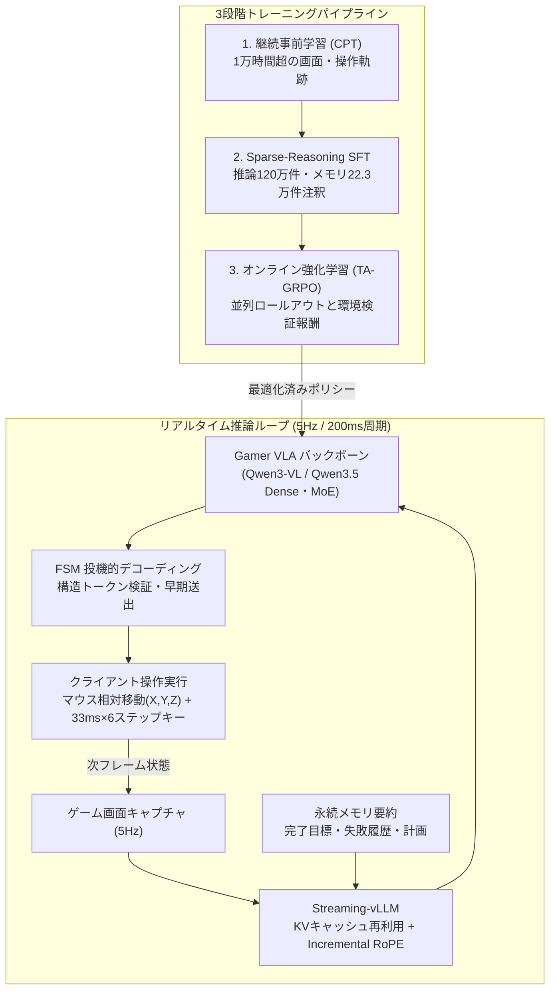

# **Gamer 調査レポート**

## **1. 基本情報**

* **ツール名**: Gamer
* **ツールの読み方**: ゲーマー
* **開発元**: miHoYo Honkai AI R&D Team（シンガポール国立大学、清華大学、中国科学院大学、中国科学技術大学等の研究者が参画）
* **公式サイト**: [https://mihoyo-gamer.github.io/](https://mihoyo-gamer.github.io/)
* **関連リンク**:
  * GitHub: [https://github.com/RainBowLuoCS/Gamer](https://github.com/RainBowLuoCS/Gamer)
  * 関連リポジトリ（CPTモデル群）: [https://github.com/THUSI-Lab/GameScaling](https://github.com/THUSI-Lab/GameScaling)
  * ドキュメント（arXiv論文）: [https://arxiv.org/abs/2611.18397](https://arxiv.org/abs/2611.18397)
  * Hugging Face Daily Paper: [https://huggingface.co/papers/2611.18397](https://huggingface.co/papers/2611.18397)
  * Hugging Face モデルコレクション（GameScaling）: [https://huggingface.co/collections/THUSI-Lab/gamescaling-model](https://huggingface.co/collections/THUSI-Lab/gamescaling-model)
* **カテゴリ**: デスクトップ/GUIエージェント
* **概要**: **Gamer** は、miHoYo Honkai AI R&D Teamが開発した、長期間（Long-Horizon）かつリアルタイムのゲームエージェント向けに設計された汎用Vision-Language-Action（VLA）基盤モデルおよびフレームワークです。ゲーム内部の特権APIやメモリ状態に依存せず、人間と同様にスクリーンショット（視覚入力）とネイティブのキーボード・マウス操作のみで2D GUIから複雑な3Dオープンワールド環境までを自律的に操作します。

## **2. 目的と主な利用シーン**

* **解決する課題**: 従来のゲームAIやGUIエージェントは、ゲーム内部の非公開APIへの依存、フレーム単位の密な推論による高遅延、コンテキストウィンドウの制約による長期間タスクでの記憶喪失・エラー蓄積といった課題を抱えていました。Gamerは統一された視覚・デバイス操作インターフェース、疎推論（Sparse Reasoning）、永続メモリ要約、および低遅延ストリーミング推論エンジンによってこれらの課題を解決します。
* **想定利用者**: 身体性AI（Embodied AI）やマルチモーダルエージェントを研究するAI研究者、ゲームの自動QA・テストの高度化を目指すゲーム開発者、リアルタイムGUI自動化に取り組むエンジニア。
* **利用シーン**:
  * **複雑な3Dゲームでの自律クエスト遂行**: 『崩壊：スターレイル（Honkai: Star Rail）』のような3Dワールドにおいて、移動・会話・戦闘・パズル解読を含む1時間規模のメインストーリーやサブクエストを自律完遂する。
  * **統一アクション空間を用いたクロスゲーム評価**: Minecraft（OpenHA）、ViZDoom、OmniGameArena、GameWorldなどの異なるゲームベンチマークを同一のキーボード・マウス入力フォーマットで制御・評価する。
  * **ゲームの自動プレイテスト・QA研究**: ゲームエンジン側の内部フックなしに、実際のプレイヤーと同じ操作系でバグ検証やバランス調整のシミュレーションを行う。

### **2.1 代表的な利用フロー**

```mermaid
swimlane-beta TB
  subgraph User["開発者・研究者"]
    A[タスク指示・キー定義を設定]
    F[プレイ結果・報酬を検証]
  end
  subgraph GameClient["ゲームクライアント環境"]
    B[5Hzで画面キャプチャを取得]
    E[200ms分のキー・マウス操作を実行]
  end
  subgraph Serving["Streaming-vLLM 推論基盤"]
    C[KVキャッシュ再利用・プロンプト構築]
    D[早期アクション送出・形式検証]
  end
  subgraph Policy["Gamer VLA モデル"]
    P1[状況変化を判定し必要時のみ推論]
    P2[メモリ要約と6ステップ行動を生成]
  end
  A --> B
  B --> C
  C --> P1
  P1 --> P2
  P2 --> D
  D --> E
  E --> F
```

* **代表的な流れ**: 開発者がゲームのルールとキーバインドを設定すると、ゲームクライアントが5Hz（200ms間隔）で画面キャプチャを `Streaming-vLLM` へ送信します。`Streaming-vLLM` は過去のKVキャッシュと永続メモリを再利用して Gamer VLA モデルで推論を行い、状況変化時のみ思考（`<think>`）を生成した上で、33ms×6ステップの行動チャンクを早期送出してゲーム画面上で操作を実行します。

## **3. 主要機能**

* **統一ビジュアル制御インターフェース（Unified Visual Control）**: ゲーム固有のAPIやメモリ読み取りを行わず、5Hzの画面スクリーンショットを入力とし、74種類のキー名トークンとマウス相対移動・スクロールを組み合わせた単一の標準アクション空間で2D/3D環境を操作します。
* **200ms/6ステップの精密アクションチャンク出力**: 1回の推論で約200ms分の操作計画（33ms間隔の6ステップのキー押下状態 `g1`〜`g6` と、チャンク全体に対するマウス相対移動 `X, Y` およびホイール回転 `Z`）を `<|action_start|>...<|action_end|>` 形式で出力します。
* **疎推論（Sparse Reasoning）**: 毎フレーム思考トークンを出力するのではなく、状況が大きく変化した場合や新たな目標が現れた場合のみ `<think>...</think>` による推論を実行し、定常操作時は `<think></think>` として直接行動を出力することで計算コストと遅延を大幅に削減します。
* **永続メモリ要約（Persistent Memory）**: コンテキストウィンドウの上限を超えて長時間タスクを継続できるよう、完了した目標、失敗した試行、残りの計画をタイムスタンプ付きで要約・保持し、後続のターンへ引き継ぎます。
* **3段階の学習パイプライン（CPT / Sparse-Reasoning SFT / TA-GRPO）**: 数万時間規模のデバイス操作軌跡による継続事前学習（CPT）、操作・サブゴール・タスクの3階層データを用いたSFT、さらにメモリ連携型セグメント上で時間的クレジット割り当てを行うオンライン強化学習 **Temporal-Aware GRPO（TA-GRPO）** を統合しています。
* **Streaming-vLLM リアルタイム推論エンジン**: 環境ごとのKVキャッシュ保持、Incremental RoPEリフレッシュによる位置エンコーディング調整、FSM（有限状態機械）を用いた検証済み投機的デコーディング、および最初の行動ブロック確定時点での早期ディスパッチにより低遅延推論を実現します。
* **バックボーン互換性と柔軟なキーマッピング**: Qwen3-VL および Qwen3.5（Dense / MoE）アーキテクチャに対応しており、学習時のランダムキーリマッピングにより特定のキー配置に過学習せず機能ベースでの操作転移を可能にしています。

## **4. 動作原理・システム構成**



* **アーキテクチャ**: クライアント・サーバー型のリアルタイムクラウド・エッジ推論アーキテクチャを採用しています。ゲームクライアント側（エッジ）が画面キャプチャと仮想キーボード・マウス入力の送出を担い、推論サーバー側（`Streaming-vLLM`）がGPUクラスター上でモデル推論と環境ごとのステート管理を並列処理します。
* **主要コンポーネントとデータフロー**:
  * **観測・コンテキスト層**: 5Hzでサンプリングされた最新画面、直近の履歴フレーム（例：過去5ターン）、タスク指示、およびコンテキスト圧縮された永続メモリ要約が入力プロンプトを構成します。
  * **推論エンジン層（Streaming-vLLM）**: 通常のvLLMではターンごとにKVキャッシュの再計算やコンテキスト溢れが発生しますが、Streaming-vLLMではメモリ圧縮時に保持するキーの位置ずれを **Incremental RoPE refresh** で補正しつつKVキャッシュを再利用します。さらに、`<|action_start|>` などの定型構造トークンを有限状態機械（FSM）で提案してBF16で一括検証する投機的デコーディングと、デコード完了を待たずに最初の検証済みアクションを送出する **Early action dispatch** により、NVIDIA H200（TP4）上の `Qwen3.5-35B-A3B MoE` 構成でエンドツーエンド遅延を **1,306.00 ms から 65.12 ms（20.1倍高速化）** まで短縮しています。
  * **強化学習・環境バックエンド層**: オンラインRL（TA-GRPO）の学習時には、ポリシー側が視覚入力のみを受け取る一方、環境バックエンド側ではエンジン内部状態を用いてタスク初期化と報酬検証（Verifiable Rewards）を独立して実行します。
* **特筆すべき要素技術**:
  * **Repeat-aware loss decay**: 移動キーの長押しなど連続する同一キー状態のトークン損失が過大になるのを防ぐため、連続 $n$ 回目の反復に対して $\gamma^{n-1}$ の減衰重みを適用し、キーの押し始め・離し際（状態遷移）の学習精度を高めています。
  * **Random key remapping**: 軌跡ごとにリバインド可能なキー（WASDなど）をプロンプト定義とアクションラベルの両方で一貫してランダム置換し、特定の文字ではなく「操作の役割」を学習させています。

## **5. 開始手順・セットアップ**

現在、`RainBowLuoCS/Gamer` リポジトリ本体では論文・プロンプト仕様・アクションフォーマット仕様が公開されており、推論エンジン `streaming-vllm` ディレクトリは「Coming soon（近日公開予定）」となっています。一方、CPTスケーリング研究のモデルチェックポイント（0.8B / 2B / 9B / 27B）および推論クライアント・評価スイートは、関連リポジトリである `THUSI-Lab/GameScaling` にて公開されており、標準の `vLLM` を用いてすぐに動作検証が可能です。

* **前提条件**:
  * OS: Linux（GPUサーバー向け）
  * Python環境および CUDA 対応 NVIDIA GPU（0.8B〜9BモデルはシングルGPU、27Bモデルはテンソル並列2GPU構成、BF16推論推奨）
  * 依存ライブラリ: `vllm>=0.17`、`huggingface_hub`、`requests`、`Pillow`
  * アカウント登録: GitHubおよびHugging Faceの公開モデル取得にアカウント登録・クレジットカード登録は不要
* **インストール/導入（GameScaling 推論クライアント＆vLLMサーバー例）**:

  ```bash
  # リポジトリのクローン
  git clone https://github.com/THUSI-Lab/GameScaling.git
  cd GameScaling

  # vLLM およびクライアント依存ライブラリのインストール
  pip install "vllm>=0.17"
  pip install -r requirements.txt
  ```

* **初期設定**:
  * **チェックポイントのサーブ**: Hugging Face からモデルを自動取得、または `hf download` でローカル保存して `serve_vllm.sh` を起動します（`--max-model-len 32768`、画像入力上限8枚、bfloat16で起動）。
  * **システムプロンプトの設定**: `prompts/system_prompt_template.txt` 内の3つのプレースホルダー（`{GAME_NAME}`、`{GAME_RULES}`、`{KEY_BINDINGS}`）を対象ゲームに合わせて埋めます。なお、同梱の `chat_template.jinja` を維持し、推論リクエスト時は特殊トークン（`<|action_start|>` / `<|action_end|>`）を保持するため必ず `skip_special_tokens: false` を設定する必要があります。

* **クイックスタート**:

  ```bash
  # 9Bモデルをポート8000でサーブ（シングルGPU）
  bash scripts/serve_vllm.sh THUSI-Lab/GameScaling-9B-S1 8000

  # サーバー疎通確認およびオフラインテストの実行
  curl -s http://127.0.0.1:8000/v1/models
  python tests/test_core.py
  ```

  推論結果は `<think></think><|action_start|>0 0 0 ; W ; W ; W ; W ; W ; W<|action_end|>` のような形式で返却され、最後の `</think>` タグ以降の文字列をパースしてクライアント側の仮想キーボード・マウス入力へ変換します。

## **6. 特徴・強み (Pros)**

* **人間と同一の非侵襲インターフェース**: ゲームのソースコード改変や内部メモリ解析を一切必要とせず、画面画像とキーボード・マウス入力のみで動作するため、あらゆるPCゲームやGUIアプリケーションへ原理的に適用可能です。
* **リアルタイム環境での圧倒的な低遅延と高効率**: `Streaming-vLLM` の各種最適化（KVキャッシュ再利用、Incremental RoPE、FSM投機的デコーディング、早期送出）により、35B MoEモデルであっても **65.12 ms** という200ms制御周期を大幅に下回るリアルタイム応答を達成しています。
* **長期間タスクにおける高い完遂能力と汎用性**: 『崩壊：スターレイル』のホールドアウト評価において、CPT→SFT→TA-GRPO（RL）と段階的に性能が向上し、サブクエスト2種で **80.0% / 83.6%**、7種類のミニゲームベンチマークの平均成功率で **49.7%**（汎用ベースラインの17.1%を大きく上回る）を記録しています。
* **オープンな研究エコシステム**: 論文（arXiv:2611.18397）やプロンプト・アクション仕様がApache-2.0で公開されているほか、CPT済みモデル群（0.8B〜27B）もHugging Faceで無償公開されています。

## **7. 弱み・注意点 (Cons)**

* **本番用コード・主要チェックポイントの一部未公開**: リポジトリの `streaming-vLLM` 実装は2026年11月時点で「Coming soon」であり、また『崩壊：スターレイル』のデータでSFT/RL学習されたモデルチェックポイントはデータセキュリティ上の理由から公開されていません。
* **高いハードウェア要件**: 低遅延・並列ロールアウトの実証は NVIDIA H200 などのハイエンドGPU環境（TP4構成等）で行われており、個人ユーザーの一般的なPC環境で35Bクラスをリアルタイム動作させることは困難です。
* **日本語対応の状況**: リポジトリのドキュメント、論文、システムプロンプトテンプレートはいずれも英語で記述されており、日本語による公式ドキュメントやサポート窓口は提供されていません（視覚入力モデル自体は画面上の日本語UIを認識できる可能性がありますが、公式の日本語ベンチマーク検証は公開されていません）。
* **汎用GUI業務ツールとしての即時利用は不可**: エンドユーザー向けのデスクトップアプリやノーコード自動化ツールではなく、研究・開発者向けのVLA基盤モデルおよびフレームワークであるため、実際のゲーム環境へ接続するクライアントアダプターの実装は利用者側で行う必要があります。

## **8. 料金プラン**

| プラン名 | 料金 | 主な特徴 |
|---------|------|---------|
| **オープンソース（Apache-2.0）** | 無料 | GitHub上のコード・仕様、およびHugging Face上のGameScalingチェックポイント（0.8B〜27B）を無償で利用可能 |
| **商用クラウド・ホスティング利用** | 従量課金（外部GPU費用） | 公式のマネージドSaaSプランは存在せず、AWS/GCP等のGPUインスタンス費用のみ自己負担 |

* **課金体系**: ソフトウェアライセンス料は無料（Apache-2.0 License）。ただし、ゲームスクリーンショット・動画・ロゴ等の第三者アセットの権利は各所有者に帰属します。
* **無料トライアル**: オープンソースのため試用期間の制限はありません。

## **9. 導入実績・事例**

* **導入企業**: miHoYo（開発元内部のAI R&Dチーム）および共同研究機関（シンガポール国立大学、清華大学、中国科学院大学、中国科学技術大学、香港大学、北京大学など）。外部企業での商用導入事例は現時点で公開されていません。
* **導入事例**:
  * **『崩壊：スターレイル（Honkai: Star Rail）』での検証**: メインストーリーやサブクエスト（30〜55マイルストーン）、7種類のパズル・ミニゲームにおける自律プレイ実証。
  * **4大ゲームベンチマークでの評価**: Minecraft（OpenHA）、ViZDoom、OmniGameArena、GameWorld における時間停止（TP）およびリアルタイム（RT）環境での汎化性能評価。
* **対象業界**: ゲーム開発（AIエージェント研究、自動テスト/QA）、身体性AI（Embodied AI）・基盤モデル研究開発。

## **10. サポート体制**

* **ドキュメント**: GitHubの `readme.md`、プロジェクトページ（[mihoyo-gamer.github.io](https://mihoyo-gamer.github.io/)）、arXiv論文（[arXiv:2611.18397](https://arxiv.org/abs/2611.18397)）、および姉妹リポジトリ `THUSI-Lab/GameScaling` のREADME・評価ガイドが整備されています。
* **コミュニティ**: GitHub Issues（[RainBowLuoCS/Gamer/issues](https://github.com/RainBowLuoCS/Gamer/issues)）および Hugging Face Daily Papers のディスカッションスレッドにて研究者・開発者間のやり取りが行われています。
* **公式サポート**: 商用サポート窓口（メール、チャット、電話等）は提供されておらず、OSSコミュニティベースのベストエフォート対応（英語・中国語圏中心）となります。

## **11. エコシステムと連携**

### **11.1 API・外部サービス連携**

* **API**: `Streaming-vLLM` および `GameScaling` の推論サーバーは vLLM ベースの OpenAI 互換 API（`/v1/models`、`/v1/chat/completions` 等）を通じて呼び出し可能です。リクエスト時には `skip_special_tokens: false` の指定と専用の `chat_template.jinja` が必要です。
* **外部サービス連携**:
  * **Hugging Face Hub**: チェックポイントの配布・ダウンロード（`THUSI-Lab/GameScaling-*`）。
  * **vLLM**: 推論サービング基盤（`vllm>=0.17` での動作確認済み）。
  * **ゲーム評価環境**: Minecraft（OpenHA）、ViZDoom、OmniGameArena、GameWorld との接続スイートを提供。

### **11.2 技術スタックとの相性**

| 技術スタック | 相性 | メリット・推奨理由 | 懸念点・注意点 |
|:---|:---:|:---|:---|
| **Python / PyTorch** | ◎ | 推論クライアント・アクションパーサー・評価スイートがPythonで提供 | 特になし |
| **vLLM (CUDA / Linux)** | ◎ | 公式の `serve_vllm.sh` が用意されており、OpenAI互換APIで即座にサーブ可能 | `Streaming-vLLM` 本体の公開待ち、高性能GPUが必須 |
| **Qwen3-VL / Qwen3.5** | ◎ | GamerおよびGameScalingのベースバックボーンとして直接サポート | 専用の `chat_template.jinja` を上書きしないよう注意が必要 |
| **Windows / macOS (クライアント側)** | ◯ | 画面キャプチャと仮想HID入力を送出する軽量クライアントとして接続可能 | 推論サーバー自体はLinux GPU環境でのホストが前提 |
| **ブラウザ / Webゲーム** | ◯ | `keymaps.py` によりキー名とブラウザキーの相互変換をサポート | 5Hzの画面キャプチャ・送信ループを安定させる実装が必要 |

## **12. セキュリティとコンプライアンス**

* **認証**: 公式サイトおよびリポジトリで企業向け認証機能（SSO、2段階認証等）に関する記述は公開されていない。研究用OSSフレームワークであり、推論サーバーの認証制御はデプロイ環境側のネットワークやプロキシに委ねられる。問い合わせが必要。
* **データ管理**: オンプレミスや自社クラウドのGPU環境で完結して推論を実行できるため、ゲーム画面データの外部送信を抑える構成が可能。なお開発元はデータセキュリティ上の理由から『崩壊：スターレイル』の学習データおよび同ゲームでファインチューニングされたモデルの公開を見送っている。
* **準拠規格**: SOC2、ISO27001、GDPR等の商用コンプライアンス認証の取得状況は公式サイトで公開されていない。問い合わせが必要。

## **13. 操作性 (UI/UX) と学習コスト**

* **UI/UX**: エンドユーザー向けのGUI管理画面は備えておらず、CLIおよびPythonコード、OpenAI互換REST APIを通じて操作する開発者・研究者向けツールです。プロジェクトページではインタラクティブな可視化デモやベンチマーク動画が充実しています。
* **学習コスト**: VLM（Vision-Language Model）のサービング、vLLMのパラメータ調整（テンソル並列、KVキャッシュ管理）、および対象ゲームの画面キャプチャ・仮想入力フックの構築知識が求められるため、学習コストは高めです。

## **14. ベストプラクティス**

* **効果的な活用法 (Modern Practices)**:
  * **システムプロンプトの厳格なテンプレート維持**: `**Game Rules**` や `**Output Format**` などの見出しのアスタリスクや改行を含め、指定されたテンプレート構造を崩さずに `{GAME_NAME}` 等のプレースホルダーのみを置換する。
  * **最後の `</think>` タグ以降をパース**: 推論内容（`<think>...</think>`）の中にフォーマット例が含まれる場合があるため、必ず最後の `</think>` より後ろの文字列から `<|action_start|>...<|action_end|>` を抽出する。
  * **Sparse Reasoning の活用**: 毎ターン思考させるのではなく、定常的な移動・操作時は `<think></think>` の即時行動を許容することで実時間制御（5Hz）を維持する。
* **陥りやすい罠 (Antipatterns)**:
  * **`skip_special_tokens: true`（デフォルト）での推論**: 特殊トークンが除去されると `<|action_start|>` 等の区切り文字が失われ、アクションのパースに失敗する。
  * **標準Qwenチャットテンプレートへの置き換え**: チェックポイント同梱の `chat_template.jinja` を上書きすると、過去ターンの `<think>\n\n</think>` 表現が学習時と不一致になり精度が劣化する。
  * **不完全な応答の無理な実行**: タイムアウト等で推論が途切れた場合は、誤操作を防ぐため必ず no-op（無操作）として扱う設計にする。

## **15. ユーザーの声（レビュー分析）**

* **調査対象**: GitHub（`RainBowLuoCS/Gamer` / `THUSI-Lab/GameScaling`）、Hugging Face Daily Papers（`2611.18397`）、海外技術メディア・SNSコミュニティでの議論。なお、研究段階のOSSであるため G2・Capterra・ITreview 等のBtoB SaaSレビューサイトには掲載されていません。
* **総合評価**: GitHubスター数 364（公開数日で急増、関連のGameScalingは529スター）、Hugging Face Daily Papers でも注目を集めるなど、AI研究コミュニティから高い評価を獲得しています。
* **ポジティブな評価**:
  * **人間と同じ入出力での長時間自律プレイ**: 「内部APIやメモリチートを使わず、画面ピクセルとキーボード・マウスだけで3Dオープンワールドの複雑なクエストやパズルをこなせる点が画期的」（Hugging Face / コミュニティの反応より要約）。
  * **Streaming-vLLMによる実用的な低遅延**: 「200ms制御周期に対して65ms台まで遅延を落としたエンジニアリング（KVキャッシュ再利用＋FSM投機デコーディング＋早期送出）が非常に実践的」（技術コミュニティでの評価より要約）。
  * **再現可能なCPTモデル群の先行公開**: 「GameScalingとして0.8Bから27Bまでの重みと評価スイートがApache-2.0で公開されており、研究のベースラインとして活用しやすい」（GitHubコミュニティの反応より要約）。
* **ネガティブな評価 / 改善要望**:
  * **Streaming-vLLMおよびHSRモデルの未公開**: 「論文発表時点で `streaming-vllm` ディレクトリが Coming soon となっており、主論文の全パイプラインをそのまま再現できない」（GitHub上の反応より要約）。
  * **計算資源ハードルの高さ**: 「35B MoEをH200 TP4で動かす前提のベンチマークであり、コンシューマーGPU環境での動作指標や軽量化手法がさらに欲しい」（技術コミュニティの意見より要約）。
  * **ゲーム業界におけるAI活用への議論**: 「ゲーム開発におけるAIエージェント技術自体の完成度は高い一方、自動化技術や生成AIのゲームへの適用に対するユーザー間の賛否両論も存在する」（海外ゲームメディア・コミュニティの議論より要約）。
* **特徴的なユースケース**:
  * Minecraft（OpenHA）やViZDoomなどの既存ベンチマークにおける、リアルタイム制御（RT）と時間停止制御（TP）のギャップを検証する研究基盤としての活用。

## **16. 直近半年のアップデート情報**

* **2026-11-16**: `RainBowLuoCS/Gamer` の `readme.md` を更新し、システムプロンプト詳細、アクションフォーマット（74トークン仕様）、推論効率ベンチマーク（1306.00ms → 65.12ms）を整備。
* **2026-11-14**: `RainBowLuoCS/Gamer` リポジトリを初回公開（Initial release of Gamer、Apache-2.0ライセンス）。プロジェクトページおよびビデオデモを公開。
* **2026-11-13**: arXiv にて論文「Gamer: A Generalist Vision-Language-Action Foundation Model for Long-Horizon Real-Time Game Agent」（`arXiv:2611.18397`）を公開。
* **2026-11-11**: 姉妹リポジトリ `THUSI-Lab/GameScaling` にて、Minecraft（OpenHA）、ViZDoom、OmniGameArena、GameWorld 向けの4ベンチマーク評価スイートを公開。

(出典: [GitHub コミット履歴](https://github.com/RainBowLuoCS/Gamer/commits/main) / [arXiv論文](https://arxiv.org/abs/2611.18397) / [GameScaling リポジトリ](https://github.com/THUSI-Lab/GameScaling))

## **17. 類似ツールとの比較**

### **17.1 機能比較表 (星取表)**

| 機能カテゴリ | 機能項目 | Gamer | UI-TARS Desktop | Computer use（Gemini） | Microsoft Scout | OpenMausBot |
|:---:|:---|:---:|:---:|:---:|:---:|:---:|
| **基本機能** | 視覚ベースGUI操作 | ◎<br><small>5Hz画面入力・2D/3D対応</small> | ◎<br><small>視覚+A11yツリー併用</small> | ◎<br><small>1000×1000正規化座標</small> | ◯<br><small>ブラウザ・ローカル操作</small> | ◯<br><small>VM/ローカル操作</small> |
| **リアルタイム性** | 高頻度・連続アクション制御 | ◎<br><small>200ms/6ステップ・65ms推論</small> | △<br><small>ターン制GUI操作向け</small> | △<br><small>API往復による逐次制御</small> | △<br><small>業務タスク向け自律実行</small> | △<br><small>チャット起点の逐次実行</small> |
| **長期間実行** | 永続メモリ・コンテキスト維持 | ◎<br><small>メモリ要約+KVキャッシュ再利用</small> | ◯<br><small>セッション履歴管理</small> | ◯<br><small>Interactions API対応</small> | ◎<br><small>Heartbeat・WorkIQ連携</small> | ◯<br><small>複数ボット履歴管理</small> |
| **オープン性** | OSS / ローカルセルフホスト | ◯<br><small>Apache-2.0（一部Coming soon）</small> | ◎<br><small>Apache-2.0・Ollama/vLLM対応</small> | ×<br><small>プロプライエタリAPI</small> | ×<br><small>商用エンタープライズ製品</small> | ◎<br><small>OSS・ローカルモデル対応</small> |
| **非機能要件** | 日本語UI・公式サポート | ×<br><small>英語中心・研究向けOSS</small> | △<br><small>OSSコミュニティベース</small> | ◎<br><small>Google公式ドキュメント有</small> | ◎<br><small>Microsoftエンタープライズ対応</small> | △<br><small>英語中心のOSS</small> |

### **17.2 詳細比較**

| ツール名 | 特徴 | 強み | 弱み | 選択肢となるケース |
|---------|------|------|------|------------------|
| **Gamer** | 3Dゲーム等の長時間リアルタイム制御に特化したVLA基盤モデル＆推論基盤 | 5Hz視覚入力と33ms単位の連続キー・マウス操作、65msの超低遅延推論、TA-GRPOによる長期間学習 | 本番用Streaming-vLLMが未公開、H200等大規模GPU前提、一般業務アプリ向けUIなし | ゲームAI研究、3D仮想空間での自律エージェント、リアルタイム連続制御が必要な場合 |
| **UI-TARS Desktop** | ByteDance製のOSS自律型デスクトップGUIエージェント | 視覚情報とアクセシビリティツリーを併用しPC操作が高精度、Ollama/vLLMでローカル実行が容易 | 3Dゲームのようなミリ秒単位の連続入力・カメラ操作には不向き | プライバシーを重視しつつローカル環境でPC上の一般業務GUIを自動化したい場合 |
| **Computer use（Gemini）** | GoogleのGemini API組み込み型GUI操作ツール | ブラウザ・モバイル・デスクトップを横断し、クラウドAPIで環境構築なしにすぐ導入可能 | プロプライエタリでありAPI往復遅延があるためリアルタイムゲーム制御には不向き | インフラ管理なしでWeb・アプリ操作エージェントを迅速にプロダクトへ組み込みたい場合 |
| **Microsoft Scout** | Microsoft 365とローカル環境を統合するエンタープライズAI | WorkIQやEntra/Intuneによる厳格な企業ガバナンスと常時稼働（Heartbeat）機能 | 複数ライセンスとCopilot Creditsが必要で導入コスト・管理要件が高い | M365環境下でセキュリティ・コンプライアンスを担保しつつ業務自動化を進めたい企業 |
| **OpenMausBot** | 複数エージェントとチャットUIで協働できるOSSデスクトップボット | Telegram風の直感的なUIで複数ボットを使い分け、Composio経由で500以上のアプリと連携可能 | 大規模ゲーム環境でのリアルタイム視覚運動制御機能は持たない | 既存のLLM（Claude等）を組み合わせて手元のPCでマルチエージェント環境を構築したい場合 |

## **18. 総評**

* **総合的な評価**:
  * **Gamer** は、従来のターン制GUIエージェントでは困難だった「複雑な3D仮想世界における長時間（1時間超）かつリアルタイムの自律操作」を、人間と同一の画面入力・キーボード・マウス操作のみで実現した画期的なVLA基盤モデルです。特に、定常時は思考をスキップする Sparse Reasoning、コンテキスト圧縮とKVキャッシュ再利用を両立する Streaming-vLLM、そして時間的クレジット割り当てを行う TA-GRPO の組み合わせは、今後のリアルタイムエージェント設計における重要なマイルストーンといえます。
* **推奨されるチームやプロジェクト**:
  * 身体性AI（Embodied AI）やゲームAIの基盤モデルを研究する大学・企業R&Dチーム。
  * ゲームの自動プレイテストや連続的なリアルタイム操作を伴う環境評価ベンチマークを構築するエンジニアリングチーム。
* **選択時のポイント**:
  * 通常のビジネス向けWeb操作やオフィス業務の自動化であれば、導入が容易な **Computer use（Gemini）** や **UI-TARS Desktop**、エンタープライズ向けの **Microsoft Scout** の方が現実的です。一方、3D空間の連続制御や33ms単位の精密なリアルタイムアクション、あるいはゲームスケーリング則の研究に取り組む場合には、**Gamer**（および公開中の **GameScaling** モデル群）が最有力かつ唯一無二の選択肢となります。
