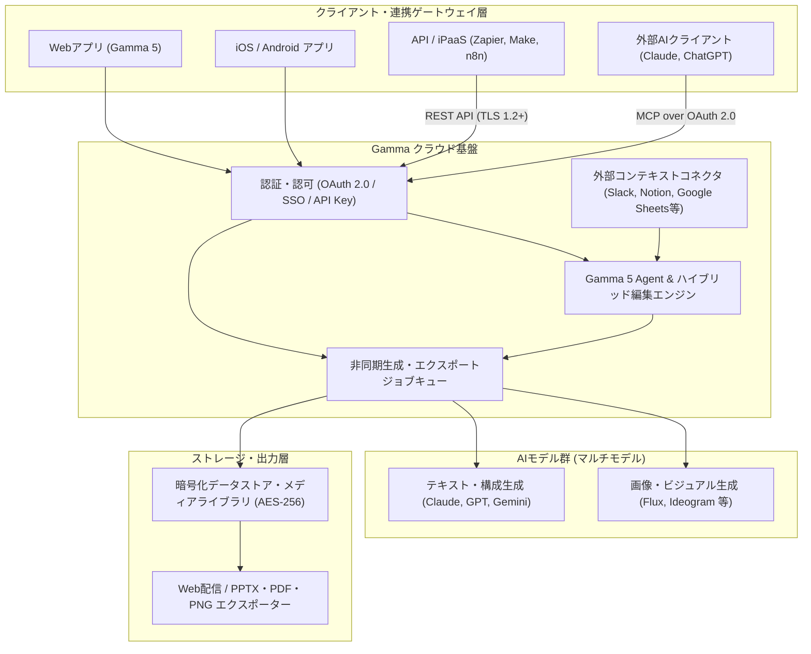

# **Gamma 調査レポート**

## **1. 基本情報**

* **ツール名**: Gamma
* **ツールの読み方**: ガンマ
* **開発元**: Gamma Tech, Inc.
* **公式サイト**: [https://gamma.app/](https://gamma.app/)
* **関連リンク**:
  * ドキュメント: [Gamma Help Center](https://help.gamma.app/) | [Gamma Developer Docs](https://developers.gamma.app/)
  * レビューサイト: [ITreview](https://www.itreview.jp/products/gamma/reviews)
* **カテゴリ**: スライド/プレゼンテーション
* **概要**: Gammaは、AIを活用してプレゼンテーション、ドキュメント、Webページ、SNS投稿素材を生成・編集するクラウドベースのデザインプラットフォーム。2026年秋にリリースされた「Gamma 5」では、対話型AIエージェントによる構成・リサーチ支援と自由配置（フリーフォーム）キャンバスを融合したハイブリッド編集を実現し、世界1億人以上のユーザーに利用される「AIデザインパートナー」へと進化している。

## **2. 目的と主な利用シーン**

* **解決する課題**:
  * スライドの構成案作成やレイアウト調整に費やされる膨大な時間の削減。
  * デザインスキルがないユーザーでも、脱「AIテンプレート感」のある洗練された資料を作成可能にする。
  * SlackやNotionなどの社内コンテキストを取り込み、複数顧客向けの提案書や定型レポートをAPI等で効率的に量産する。
* **想定利用者**:
  * **営業・マーケティング担当**: 提案書、ピッチデック、SNS・マーケティング素材（Gamma Imagine）を短時間で作成。
  * **コンサルタント・企画職**: 会議メモやPDF、Web情報を元に、リサーチから図解・ドラフト作成までを対話で完結。
  * **開発者・自動化推進担当**: Public REST APIや公式MCPサーバーを介して、業務システムやAIエージェントから資料を自動生成。
* **利用シーン**:
  * 営業用ピッチ資料・顧客別提案書の作成
  * 複雑な概念を説明するための図解（Smart Diagrams）やマーケティング用インフォグラフィック作成
  * イベント・ウェビナー後のまとめWebページ作成やモバイルからのクイック共有
  * SlackスレッドやGoogle Sheetsデータと連携した定期レポートの自動生成

### **2.1 代表的な利用フロー**

```mermaid
swimlane-beta TB
  subgraph User["ユーザー"]
    A["トピック・PDF・URL等を入力"]
    D["アウトラインとスタイルを確認・調整"]
    F["ハイブリッド編集で微調整・公開/出力"]
  end
  subgraph GammaAgent["Gamma 5 / AIエージェント"]
    B["リサーチと構成案を対話生成"]
    E["カード構造・図解・画像を自動生成"]
  end
  subgraph External["外部コンテキスト・連携基盤"]
    C["Slack/Notion/Google Sheets等からデータ取得"]
  end
  A --> B
  B --> C
  C --> D
  D --> E
  E --> F
```

* **代表的な流れ**: ユーザーが入力したトピックや既存資料を基に、Gamma 5のAIエージェントがSlackやNotion等の外部コンテキストも参照しながら構成案を提案し、ユーザーが方針を確定した後にカードレイアウト・図解・画像を生成してWeb公開やPPTX/PDF出力を行う。

## **3. 主要機能**

* **Gamma 5 ハイブリッド編集**: 対話型AIエージェントによるプロンプト指示編集と、要素を自由に移動・配置できるフリーフォームキャンバスを組み合わせ、初速と細部調整を両立。
* **進化した Gamma Agent**: 1文のアイデアからPDF、画像、既存スライドまで多様な入力を受け付け、ブレインストーミングや深掘りリサーチ、アウトライン構築を対話形式で実行。
* **外部コンテキスト連携（Connectors）**: Slack、Notion、Granolaなど20以上の外部ツールと連携し、スレッドやドキュメントの文脈を直接資料に取り込むことが可能。Google Sheetsとの単方向同期によるSmart Charts更新にも対応。
* **Gamma Imagine**: テキストプロンプトから単独のマーケティング素材、インフォグラフィック、インタラクティブチャートを生成するグラフィック制作機能。
* **Smart Diagrams & Studio Mode**: テキスト指示からフローチャートやベン図等を自動生成する「Smart Diagrams」と、シネマティックな視覚演出を施す「Studio Mode」を搭載。
* **Public REST API (v1.0) & 公式MCPサーバー**: `https://public-api.gamma.app/v1.0` による非同期バッチ生成に加え、OAuth 2.0対応の公式MCPサーバー（`mcp.gamma.app`）によりClaudeやChatGPT等の外部AIエージェントから直接スライド生成を呼び出し可能。
* **ネイティブモバイルアプリ（iOS / Android）**: 40以上の言語に対応し、外出先での資料閲覧、検索、ページ切り替え、コメント確認、エクスポートに対応。
* **マルチフォーマット出力・埋め込み**: プレゼンテーション、縦型ドキュメント、Webページ、SNS投稿形式への変換や、YouTube、Figma、Miro、Loom等の埋め込みに対応。

## **4. 動作原理・システム構成**

* **アーキテクチャ**: Gammaはクラウド完結型のマルチテナントSaaSとして提供されている。内部ソースコードやモデルルーティングの詳細は非公開だが、Webクライアント、ネイティブモバイルアプリ（iOS/Android）、Public REST API、および公式MCPサーバーをフロントエンド/ゲートウェイ層として備え、非同期ジョブ基盤上で複数の基盤モデルをオーケストレーションする構成をとっている。
* **主要コンポーネントとデータフロー**:
  * **クライアント・連携ゲートウェイ**: Webブラウザ上のReactベース編集画面やモバイルアプリからの操作に加え、外部からのAPIリクエスト（`X-API-KEY` 認証）やMCPクライアント接続（OAuth 2.0 + Dynamic Client Registration）を受け付ける。
  * **AIオーケストレーション・非同期生成エンジン**: ユーザー入力や外部コネクタ（Slack/Notion等）から取得したコンテキストを解析し、テキスト生成・構造化にはAnthropic ClaudeやOpenAI ChatGPT、Google Gemini等を、画像生成にはFluxやIdeogram等を用途に応じて呼び出す。API経由の生成は非同期タスク（`pending` → `completed` / `failed`）としてキュー処理される。
  * **データストア・エクスポート層**: 生成されたカード構造・スタイル定義・メディアライブラリを暗号化ストレージへ保存し、Webページとしての即時配信や、PPTX/PDF/PNG形式へのレンダリング・署名付きURL発行を行う。
* **特筆すべき要素技術**:
  * **Model Context Protocol (MCP)**: `https://mcp.gamma.app/mcp` でホストされる公式MCPサーバーにより、外部LLMクライアントから安全に認証・ツール呼び出しが可能。
  * **ハイブリッド・レイアウトエンジン**: レスポンシブなカード単位の構造化データと自由配置の座標情報を統合管理し、Web表示とPPTX/Google Slides出力の双方でフォントや数式・図表の崩れを抑える変換機構を備える。



## **5. 開始手順・セットアップ**

* **前提条件**:
  * Webブラウザ（Chrome、Safari、Edge等）または iOS / Android アプリ
  * Gammaアカウント（Googleアカウントまたはメールアドレスで無料登録可能、クレジットカード登録不要）
* **インストール/導入**:
  Webブラウザで利用する場合はインストール不要。モバイル端末ではApp StoreまたはGoogle Playから「Gamma」アプリをインストールする。開発者がREST APIを利用する場合はAPIキーを発行して環境変数等に設定する。

  ```bash
  # Webアプリへのアクセス
  https://gamma.app/

  # API利用時のヘルスチェック・生成リクエスト例（環境変数からAPIキーを参照）
  curl -X POST "https://public-api.gamma.app/v1.0/generations" \
    -H "Content-Type: application/json" \
    -H "X-API-KEY: $GAMMA_API_KEY" \
    -d '{"inputText": "2026年のAIプレゼンツール市場動向", "format": "presentation"}'
  ```

* **初期設定**:
  * サインアップ後、ワークスペース（個人用またはチーム用）を作成し、設定画面で表示言語（日本語など）を選択。
  * チーム利用や外部連携を行う場合は、SlackやNotion等のコネクタをOAuth認証で接続する。
* **クイックスタート**:
  * ホーム画面の「新規作成 (Create new)」から「Generate（生成）」または「Agentと作成」を選択。
  * トピックや元となるPDF・URLを入力すると、AIエージェントがアウトラインとデザインスタイルを提案する。
  * 確認後に生成を実行し、完成した資料をハイブリッド編集画面で微調整してWebリンクまたはPPTXで共有する。

## **6. 特徴・強み (Pros)**

* **圧倒的な制作スピードと「脱テンプレ感」**: ゼロからのドラフト作成が数分で完了するだけでなく、Gamma 5では目的やブランドイメージに沿ったカスタムスタイル生成と自由配置編集により、画一的なAIスライドからの脱却を実現している。
* **自然言語による対話的デザイン修正**: デザインの専門知識がなくても、「この段落を図解にして」「トーンをよりプロフェッショナルに」といったチャット指示で全体の構成やビジュアルを更新できる。
* **API・MCPによる高い自動化と拡張性**: Public REST API v1.0、公式MCPサーバー、Zapier/Make/n8n連携、Slack連携を備えており、CRMデータや社内チャットを起点とした資料自動生成ワークフローに組み込みやすい。
* **マルチフォーマットとモバイル対応**: 1つのコンテンツをWebページ・スライド・ドキュメント・SNS投稿として柔軟に展開でき、ネイティブモバイルアプリから外出先でも閲覧・共有が可能。

## **7. 弱み・注意点 (Cons)**

* **エクスポート時の再現性の限界**: Gamma 5でPowerPoint（.pptx）やGoogle Slidesへの変換精度（多言語フォント、数式、表内絵文字など）は向上したものの、複雑なアニメーションや独自インタラクティブ要素を含む場合、完全な再現は難しい。
* **クレジット消費型の料金体系**: 無料プランの400クレジットは初回使い切りであり、有料プランも月間AIクレジット制（画像生成や大規模生成で消費が増える）となっているため、大量生成時は上位プランや追加クレジットのコスト管理が必要。
* **日本語対応とフォント・独自マスターの制約**: UI・プロンプト・出力ともに日本語へ公式対応しているが、標準の欧文ベーステーマでは漢字が中国語寄り（いわゆる中華フォント）で表示される場合があり、「Noto Sans」等への切り替えやPro以上でのカスタムフォント設定が推奨される。また、日本の企業で一般的な「厳密なPowerPointスライドマスター規定」への完全準拠には手動調整が必要となる場合がある。
* **オフライン編集の制約**: クラウド完結型SaaSであるため、新規生成やAI編集には常時インターネット接続が求められる。

## **8. 料金プラン**

| プラン名 | 月払い料金 | 年払い料金 (月あたり) | AIクレジット | 主な特徴 |
|---------|------|---------|---------|---------|
| **Free** | 無料 | 無料 | 400 (初回使い切り) | 最大10カード/プロンプト。基本生成、PDF/PPTXインポート・エクスポート（Gammaロゴ入り）。 |
| **Plus** | $12/席/月 | $9/席/月 | 1,500/月 (最大2倍まで繰越可) | Gammaロゴ削除、生成上限の拡大、標準サポート。個人利用・フリーランス向け。 |
| **Pro** | $25/席/月 | $18/席/月 | 4,000/月 | 上位AIモデル利用、カスタムフォント・ブランド設定、詳細分析、Public APIアクセス。 |
| **Ultra** | $100/月 | $90/月 | 20,000/月 | 最上位テキスト/画像/動画モデル利用、新機能アーリーアクセス、最大100カスタムドメイン。ヘビーユーザー向け。 |
| **Team / Business** | - | ~$20〜$40/席/月 | 6,000〜10,000/席/月 | Teamは2席〜、Businessは10席〜。一括請求、管理機能、AI学習からのデフォルト除外、SSO対応（Business）。 |

* **課金体系**: ユーザー（席）単位のサブスクリプション＋月間AIクレジット制（未使用クレジットは月間付与上限の2倍まで繰り越し可能、追加クレジット購入にも対応）。
* **無料トライアル**: Freeプラン（400クレジット）がトライアルを兼ねる。

## **9. 導入実績・事例**

* **導入企業・利用規模**: Amazon、Google、Stripe、Notion、Airbnbなどの従業員を含む、世界210以上の国・地域で**1億人以上**のユーザーに利用されている（2026年時点）。また、年間経常収益（ARR）は1億ドルを超え、評価額21億ドル（Series B）規模へ成長している。
* **導入事例**: スタートアップの資金調達ピッチデック作成、マーケティングエージェンシーによるクライアント別提案書・SNS素材の量産、教育現場での講義資料作成などで広く活用されている。
* **対象業界**: テクノロジー、コンサルティング、マーケティング、教育、メディアなど幅広い業界。

## **10. サポート体制**

* **ドキュメント**: [Gamma Help Center](https://help.gamma.app/) で機能ガイドやチュートリアルを、[Gamma Developer Docs](https://developers.gamma.app/) でAPI・MCP仕様を公開している。
* **コミュニティ**: 公式ユーザーコミュニティやDiscordサーバー、ソーシャルチャネル上でテンプレート共有や情報交換が活発に行われている。
* **公式サポート**: アプリ内チャットおよびメールによるサポートを提供。Businessプラン等の上位契約では優先サポートや専任対応が用意されている。

## **11. エコシステムと連携**

### **11.1 API・外部サービス連携**

* **API**: Proプラン以上で **Gamma Public REST API (v1.0)**（`https://public-api.gamma.app/v1.0`）を利用可能。`POST /generations` 等で非同期生成ジョブを開始し、`GET /generations/{id}` でステータスをポーリングして `gammaUrl` や `exportUrl`（PDF/PPTX/PNG）を取得する設計となっている。さらに公式MCPサーバー（`https://mcp.gamma.app/mcp`）もホストされており、OAuth 2.0経由で外部AIエージェントと連携できる。
* **外部サービス連携**:
  * **コンテキスト・データ連携**: Slack、Notion、Granola、Google Sheets（Smart Charts単方向同期）など20以上のコネクタ。
  * **自動化・iPaaS**: Zapier、Make.com、n8n 向けの公式モジュール・連携を提供。
  * **インポート・埋め込み**: PDF、PPTX、Google Docs、Word、Notion、Markdownのインポート、およびYouTube、Vimeo、Loom、Figma、Miro、Airtable、Typeform等の埋め込みに対応。

### **11.2 技術スタックとの相性**

| 技術スタック | 相性 | メリット・推奨理由 | 懸念点・注意点 |
|:---|:---:|:---|:---|
| **Python** | ◯ | `requests` や `httpx` を用いてREST API v1.0を容易に呼び出せ、CRMデータのバッチ資料化に最適。 | 公式Python SDKは未提供のため、非同期ポーリング処理を自前実装する必要がある。 |
| **Node.js / TypeScript** | ◯ | Webバックエンドからオンデマンドでプレゼン生成・署名付きダウンロードURL取得を行う用途に適合。 | 生成完了までの待機時間・レートリミットを考慮した非同期ジョブ設計が必要。 |
| **Claude / ChatGPT (MCP)** | ◎ | 公式MCPサーバー（`mcp.gamma.app`）がOAuth 2.0で提供されており、対話から直接Gamma生成を実行可能。 | 接続先のMCPクライアントがOAuth 2.0 / Dynamic Client Registrationに対応している必要がある。 |
| **Zapier / Make / n8n** | ◎ | ノーコードでフォーム回答やスプレッドシート更新をトリガーに提案書を自動生成・送付できる。 | 大量生成時はProプラン以上のAPIクレジット消費量に留意する必要がある。 |

## **12. セキュリティとコンプライアンス**

* **認証**: Googleアカウント認証、メールアドレス認証に加え、Businessプランでは **SSO（シングルサインオン）** に対応。Public APIは `X-API-KEY` ヘッダー認証、公式MCPサーバーは **OAuth 2.0（Dynamic Client Registration対応）** を採用。
* **データ管理**: 保存データは **AES-256**、通信データは **TLS 1.2以上** で暗号化される。年次の第三者ペネトレーションテストや脆弱性監視を実施。なお、個人プランでは匿名化されたデータが機能改善に利用される場合がある（設定でオプトアウト可能）が、**TeamおよびBusinessプランではユーザーデータ・プロンプトがAIモデルの学習からデフォルトで恒久的に除外**される。
* **準拠規格**: **SOC 2 Type II** 認証を取得済みで、詳細なセキュリティ情報・DPA・サブプロセッサ一覧等は **Gamma Trust Center**（`gamma.app/trust-center`）で管理・提供されている。GDPRに準拠（なお、ISO 27001については一部外部評価で認証対象範囲が限定的に言及されており、主要な公式監査証明はSOC 2 Type IIが中心となっている）。

## **13. 操作性 (UI/UX) と学習コスト**

* **UI/UX**: モダンで視認性の高いインターフェースを採用。Gamma 5では右側の対話型AIエージェントパネルと、中央のカード＋自由配置ハイブリッドキャンバスがシームレスに連動し、直感的に編集を進められる。
* **学習コスト**: 非常に低い。プロンプト入力やテンプレート選択だけで即座に形になるため、非デザイナーでも数分で使い始められる。一方、既存のPowerPoint特有の細かな操作体系に慣れたユーザーは、論理見出し（H1〜H6）やカード単位の考え方に慣れるまでわずかな習熟期間が必要。

## **14. ベストプラクティス**

* **効果的な活用法 (Modern Practices)**:
  * **外部コンテキストの事前接続**: ゼロから長文プロンプトを書くのではなく、SlackスレッドやNotionドキュメント、既存PDFをそのままエージェントに読み込ませることで、業務文脈に沿った精度の高い資料が生成できる。
  * **日本語フォントの最適化**: 作成初期段階でテーマ編集から「Noto Sans」等の日本語親和性の高いフォントを指定し、漢字のフォント崩れを防ぐ。
  * **Webファースト共有の活用**: 動きのあるチャートや埋め込みコンテンツを活かす場合は、PPTX変換ではなくWebリンク共有やモバイルアプリ閲覧を基本とする。
* **陥りやすい罠 (Antipatterns)**:
  * **印刷用DTPとしての利用**: 厳密な余白や改ページ制御が求められる印刷物には不向きであり、印刷前提の場合はPDF出力後の微調整を想定する必要がある。
  * **1カードへの情報詰め込み**: 1スライド1メッセージの原則から外れて長文を詰め込むと、レスポンシブ表示や視認性が損なわれる。

## **15. ユーザーの声（レビュー分析）**

* **調査対象**: G2、Capterra、ITreview
* **総合評価**: 3.9/5.0 (G2)、3.8/5.0 (Capterra)
* **ポジティブな評価**:
  * 「数時間かかっていた提案書やホワイトペーパーのたたき台が数分で完成し、圧倒的な時短になる」（G2・ITreviewより要約）
  * 「デザインスキルがなくても、見栄えの良いレイアウトや図解が自動で作れる」（Capterra・ITreviewより要約）
  * 「Webページやドキュメント、SNS素材までマルチに使える柔軟性が便利」（G2より要約）
* **ネガティブな評価 / 改善要望**:
  * 「PowerPoint形式でエクスポートした際、レイアウトの微調整や手直しが必要になるケースがある」（G2より要約）
  * 「独自の企業スライドマスター規定に厳密に合わせる自由度や、日本語長文の細かな組版には物足りなさが残る」（ITreviewより要約）
  * 「無料クレジットが使い切りで、継続利用にはサブスクリプションとクレジット管理が必須」（Capterra・周辺レビューより要約）
* **特徴的なユースケース**:
  * 会議中のメモやSlackの議論をその場でGammaに取り込み、議論終了と同時にサマリーWebページや次回の提案ドラフトとしてチームに共有するリアルタイム活用。

## **16. 直近半年のアップデート情報**

* **2026-09〜10**: **Gamma 5 リリース**
  * **ハイブリッド編集 & 刷新されたAI Agent**: 対話によるリサーチ・ブレスト・アウトライン生成と、要素を自由に配置できるフリーフォームキャンバスを統合。画一的な「AIテンプレート感」を排除したカスタムスタイル生成に対応。
  * **外部コンテキスト連携**: Slack、Notion、Granolaなど20以上のツールを直接接続し、社内コンテキストを資料へ反映可能に。
  * **エクスポート・プレビュー改善**: PowerPoint/Google Slides出力時の多言語カスタムフォント・数式・表内絵文字の再現性向上、アスペクト比に応じた正確なライブラリプレビュー表示を実装。
* **2026-08-28**: **ネイティブモバイルアプリ公開 & 連携機能拡充**
  * **iOS / Android アプリ**: 40以上の言語に対応し、プッシュ通知、クイック検索、エクスポート機能を備えたモバイルアプリを正式リリース。
  * **Slackアプリ & API/Sheets強化**: Slack上でのメンションによる資料生成やコメント返信に対応。Google SheetsからのSmart Charts単方向同期やAPIのエンゲージメント分析取得を追加。
* **2026-05**: **Create with Agent 導入**
  * 様々なソース（PDF, DOC, Web等）を読み込ませてAIエージェントと対話しながら構成・アウトラインを作成し、その後スライドを生成する新しい作成フローを追加。
* **2026-03**: **Gamma Imagine & API/コネクタ拡張**
  * インフォグラフィックやマーケティング素材を生成する「Gamma Imagine」、既存資料を別用途に作り変える「Remix」、Make.com連携等を公開。
* **2025-11-20**: **Gamma API 一般公開 (GA)**
  * Proプラン以上のユーザーがAPIを利用可能に。ZapierやMakeとの連携も正式サポート。
* **2025-09-15**: **Gamma 3.0 リリース**
  * **Gamma Agent**: 対話型AIデザインパートナー機能の実装。
  * **Smart Diagrams**: テキストから図解を生成する機能の強化。
  * **Ultraプラン新設**: クリエイター向けの最上位プラン登場。
* **2025-08-10**: **画像生成モデルの刷新**
  * Fluxなどの最新モデルを統合し、スライド内画像の生成品質が大幅に向上。

(出典: [Gamma Help Center](https://help.gamma.app/) / [Gamma Changelog](https://gamma.app/changelog) / [Gamma Developer Docs](https://developers.gamma.app/))

## **17. 類似ツールとの比較**

### **17.1 機能比較表 (星取表)**

| 機能カテゴリ | 機能項目 | Gamma | Canva | Microsoft 365 Copilot | Presenton |
|:---:|:---|:---:|:---:|:---:|:---:|
| **作成方式** | テキストtoスライド | ◎<br><small>Gamma 5 Agent対話生成</small> | ◯<br><small>Magic Design / ProSuite</small> | ◯<br><small>Word/社内データ変換</small> | ◎<br><small>プロンプト/文書から生成</small> |
| **デザイン** | 自由度・表現力 | ◯<br><small>ハイブリッド自由配置</small> | ◎<br><small>Craft/Brush・Affinity統合</small> | ◎<br><small>PPT完全互換</small> | △<br><small>テンプレート中心</small> |
| **AI連携** | 外部文脈・MCP連携 | ◎<br><small>Slack/Notion・公式MCP</small> | ◯<br><small>各種アプリ連携</small> | ◎<br><small>Microsoft Graph連携</small> | ◯<br><small>ローカルLLM/Ollama対応</small> |
| **自動化** | API・大量生成 | ◎<br><small>REST API v1.0 / iPaaS</small> | ◯<br><small>Autofill API</small> | △<br><small>Graph API中心</small> | ◎<br><small>セルフホストAPI</small> |
| **環境・互換性** | PPT互換 / オフライン | △<br><small>PPT出力対応・クラウド専用</small> | ◯<br><small>PPT出力・素材豊富</small> | ◎<br><small>PPT完全互換</small> | ◯<br><small>PPTX出力・完全ローカル可</small> |

### **17.2 詳細比較**

| ツール名 | 特徴 | 強み | 弱み | 選択肢となるケース |
|---------|------|------|------|------------------|
| **Gamma** | AIネイティブなプレゼン・Web資料作成ツール。 | 対話型Agentとハイブリッド編集による圧倒的初速。REST API・公式MCP・外部コンテキスト連携。 | 厳密なPPTスライドマスター再現やオフライン作業は不得手。 | **「速さ・構成力」と「外部ツール連携」**を重視し、Web共有やAPI自動化を活用したいチーム。 |
| **Canva** | 独自AIモデル（Canva Craft/Brush）とプロ向け環境（Canva ProSuite）を備えた総合デザイン基盤。 | 圧倒的な素材・テンプレート数、Affinity統合による高度なクリエイティブ制作。 | 長文・複数ソースからの構造化スライド生成と対話リサーチはGammaが優位。 | **「デザイン品質の細部」**やSNS・印刷物・動画を含む総合的なブランド制作を行いたいチーム。 |
| **Microsoft 365 Copilot** | Microsoft 365製品群に統合されたAIアシスタント。 | 既存PowerPointファイルをそのまま編集可能。Microsoft Graphによる社内データ活用。 | ライセンスコストが高く、斬新なデザイン構成のゼロベース提案は限定的。 | セキュリティ要件が厳格で、**PowerPointネイティブ環境での編集・納品が必須**な企業。 |
| **Presenton** | ローカルLLM（Ollama等）にも対応するオープンソースのAIプレゼン生成ツール。 | 完全オフライン・セルフホスト実行が可能で、データ外部送信を避けられる。 | SaaS型の洗練されたUIやリアルタイム共同編集・外部SaaS連携はGammaに劣る。 | **機密データを外部クラウドに出せない**環境や、OSSベースで自社環境へ組み込みたい開発者。 |

## **18. 総評**

* **総合的な評価**:
  * 2026年秋の「Gamma 5」リリースにより、Gammaは従来の「カード型制約のあるAIスライド生成ツール」から、**自由配置編集・外部コンテキスト連携・マルチフォーマット出力を兼ね備えた総合AIデザインパートナー**へと大きく飛躍した。Public REST API v1.0や公式MCPサーバー、モバイルアプリの整備も進み、個人利用から業務自動化まで幅広いニーズに応える完成度を備えている。
* **推奨されるチームやプロジェクト**:
  * スタートアップの経営陣、営業・マーケティングチームなど、スピード感を持って企画書・提案書・Webページを量産したい組織。
  * SlackやNotionの情報を基に資料を自動生成したいチームや、API/MCP連携で資料作成をワークフロー化したい開発チーム。
* **選択時のポイント**:
  * 厳格なPowerPointスライドマスターへの完全準拠が必須ならMicrosoft 365 Copilot、高度なグラフィック・印刷・動画制作まで一気通貫で行うならCanva、完全オンプレミス・オフライン要件ならPresentonが適している。一方、**構成立案からデザイン完成・共有までの初速とAIエージェントの対話性を最優先する**場合は、Gammaが第一候補となる。
