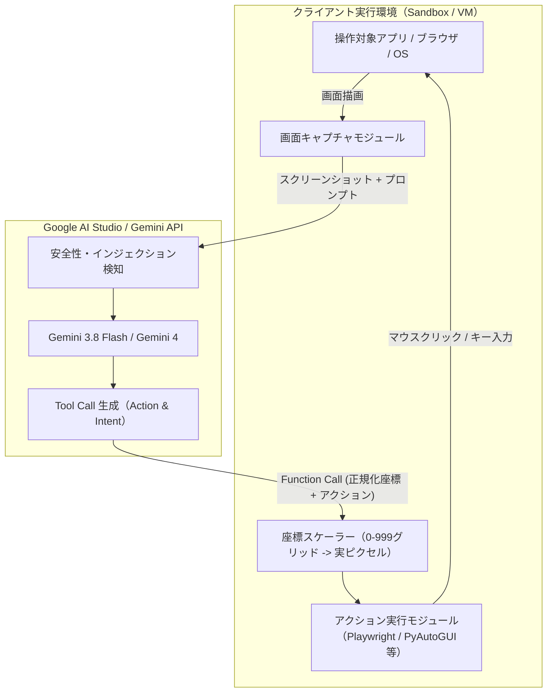

# **Gemini Computer Use 調査レポート**

## **1. 基本情報**

* **ツール名**: Gemini Computer Use（Google AI Studio Computer Use）
* **ツールの読み方**: ジェミニ コンピューター ユース
* **開発元**: Google
* **公式サイト**: [https://aistudio.google.com/docs/computer-use](https://aistudio.google.com/docs/computer-use)
* **関連リンク**:
  * GitHub: [google-gemini/computer-use-preview](https://github.com/google-gemini/computer-use-preview)
  * ドキュメント: [Gemini API Computer Use Documentation](https://ai.google.dev/gemini-api/docs/computer-use)
  * レビューサイト: G2, Capterra, ITreviewに単体での登録なし（Google AI Studio / Vertex AI の一部として評価）
* **カテゴリ**: デスクトップ/GUIエージェント
* **概要**: Gemini Computer Use は、Gemini 3.8 Flash や Gemini 4 などのマルチモーダルAIモデルを活用し、画面のスクリーンショットを直接視覚的に認識してマウスクリック、ドラッグ＆ドロップ、キーボード入力、スクロールなどのGUI操作を自律的に実行するための開発者向けツールセットおよびAPI機能である。Webブラウザ、Androidモバイル端末、主要デスクトップOS（macOS、Windows、Linux）に対応し、DOM構造や内部コードに依存せず、人間と同様に画面を見て操作するエージェントアプリケーションの構築を可能にする。

## **2. 目的と主な利用シーン**

* **解決する課題**:
  * 従来のAPIが存在しないレガシーソフトウェアやWebサービスにおける業務自動化の困難さ
  * WebページのDOM構造変化や動的レンダリングに起因するセレクタベースのスクレイピング・テスト自動化コードの頻繁な破損
  * マルチプラットフォーム（Web、モバイルアプリ、デスクトップアプリ）間を跨ぐ手作業のデータ転記や反復的な操作工数の削減
* **想定利用者**:
  * 自律型AIエージェントやパーソナルアシスタントを開発するソフトウェアエンジニア
  * QA・E2Eテスト自動化を高度化したい品質管理エンジニア
  * 社内業務システムやBPO業務の自動化（RPA刷新）を推進するDX推進部門
* **利用シーン**:
  * **E2Eブラウザ操作自動化**: フォーム入力、多要素認証画面の遷移、動的ダッシュボードからの情報抽出など、複雑なWeb画面遷移の自律実行
  * **モバイルアプリの回帰テスト**: Androidエミュレータ上で実際のネイティブUIをタップ・スワイプしながら、予期せぬレイアウト崩れや操作フローを自動検証
  * **デスクトップレガシーシステムの連携**: APIが提供されていないオンプレミスERPや専用クラサバ型業務アプリへの入力代行とデータ連携

### **2.1 代表的な利用フロー**

```mermaid
swimlane-beta TB
  subgraph ユーザー
    A[自然言語でタスク指示を入力]
    F[最終実行結果と推論ログを確認]
  end
  subgraph クライアントランタイム
    B[画面スクリーンショットを取得]
    D[座標変換を行いPlaywright等のドライバでUI実行]
  end
  subgraph Gemini_API["Gemini API (Computer Use)"]
    C[画像を解析し操作アクションとIntentを決定]
    E[タスク完了または次のステップを判定]
  end
  A --> B
  B --> C
  C --> D
  D --> E
  E --> F
```

* **代表的な流れ**: ユーザーから「GoogleでGemini APIの仕様を調べてメモに追記して」といった自然言語タスクを受け取ると、クライアントランタイム（PlaywrightやOSドライバ）が画面のスクリーンショットを撮影してGemini APIに送信する。モデルは視覚情報から対象UIを特定して「推論意図（Intent）」と「正規化座標（0-999）付きのアクション」を返却し、クライアント側で実ピクセルに変換して操作を実行する。このループ（Observe-Think-Act）を反復し、タスク完了を検出してユーザーに結果を報告する。

## **3. 主要機能**

* **マルチ環境サポート (Multi-Environment)**: `ENVIRONMENT_BROWSER`（PlaywrightやBrowserbase等を通じたWebブラウザ操作）、`ENVIRONMENT_MOBILE`（Android実機・エミュレータ上のアプリ操作）、`ENVIRONMENT_DESKTOP`（macOS、Windows、LinuxのOSレベル操作）の3つのターゲット環境に対応。
* **正規化1000x1000座標系**: 画面解像度やアスペクト比の違いを抽象化するため、全環境で $0 \sim 999$ の正規化グリッドを採用。クライアント側での解像度マッピングを平易化。
* **推論意図の明示 (Intent Tracking)**: モデルがクリックやタイピングなどの各アクションを選択した思考根拠（Intent）をレスポンス内に含めて返却するため、実行過程の可視化とデバッグが容易。
* **包括的UIアクションセット**: `click`、`double_click`、`triple_click`、`right_click`、`mouse_down`、`mouse_up`、`move`、`type`、`drag_and_drop`、`scroll`、`press_key`、`hotkey`、`navigate`、`go_back`、`open_app`（モバイル）などの多彩な低レイヤー操作を網羅。
* **プロンプトインジェクション検知 (Opt-in Security)**: スクリーンショット内の不正な敵対的指示（ウェブページ上に埋め込まれた悪意あるプロンプト）を自動検出し、エージェント乗っ取りを防御するスキャン機能。
* **安全ポリシーと人間介入 (Safety & Human-in-the-Loop)**: 送金、決済、重要データの削除、外部メール送信などの高リスク操作を自動判別し、実行前にユーザーの承認を要求するフラグ制御。
* **Google GenAI SDK 統合**: Python、TypeScript/JavaScript、Go、Java の公式SDKから `computer_use` ツールを宣言するだけでシームレスに利用可能。
* **Context Caching 対応**: 長期化するマルチステップエージェントループにおいて、過去の共通プロンプトやシステム指示のトークン課金を抑制するキャッシュ機能と連携可能。

## **4. 動作原理・システム構成**

Gemini Computer Use は、「モデル自身が直接OSを遠隔操作する」のではなく、**「クライアント・サーバー型の協調ループ（Observe-Think-Act Loop）」**を基本アーキテクチャとしている。



* **アーキテクチャ特性**:
  * **疎結合なツールコール形式**: モデルは標準的な Function Calling / Tool Use の枠組みで動作し、JSON形式でアクション名とパラメータを出力する。実際のクリックや文字入力はクライアント側のセキュアなサンドボックス環境内で実行されるため、モデル側にシステム権限を渡す必要がない。
  * **Visual-First推論**: HTML DOMツリーやアクセシビリティツリーをパースするのではなく、画面の生画像（JPEG/PNG）を入力として視覚的特徴（ボタンの形状、テキストの配置、アイコンデザイン）から座標をダイレクトに推定する。
* **主要コンポーネントとデータフロー**:
  1. **キャプチャフェーズ**: クライアントランタイムが対象ウィンドウまたはデスクトップ全体のスクリーンショットを撮影。
  2. **推論フェーズ**: スクリーンショット画像、過去の対話履歴、システム指示を Gemini API に送信。モデルは現在画面を解釈し、タスクの進捗状況と次に行うべき操作を思考。
  3. **アクション返却**: モデルが `click(x=450, y=120)` や `type(text="Gemini API")` などの構造化データを返却。
  4. **座標変換と実行**: クライアントが正規化座標（$x: 0 \sim 999$, $y: 0 \sim 999$）を実際の解像度（例: $1920 \times 1080$）に線形変換し、Playwright や OSの自動化API を叩いて実操作を行う。
  5. **検証ループ**: 操作後の画面を再キャプチャしてAPIにフィードバックし、期待通りの状態遷移が起きたかを自己検証しながら次のアクションへ進む。
* **特筆すべき要素技術**:
  * **0-999 Normalized Coordinate Space**: モデルが画像の絶対解像度を意識せずに安定した空間認識を行えるよう設計された正規化座標系。
  * **Intent フィールド**: `{"intent": "ログインボタンをクリックしてダッシュボードに遷移する", "action": "click", "coordinate": [520, 680]}` のように、モデルの意図が分離出力されるため、安全確認やログ解析が極めて容易。

## **5. 開始手順・セットアップ**

* **前提条件**:
  * Python 3.10 以上 または Node.js 18 以上
  * Google AI Studio アカウントおよび Gemini API キー
  * （ブラウザ操作の場合）Playwright および Chromium ブラウザバイナリ
  * （セキュリティ推奨）Docker または独立した仮想マシン環境

* **インストール/導入**:

  ```bash
  # Google GenAI 公式SDKおよびPlaywrightのインストール
  pip install google-genai playwright pillow
  playwright install chromium
  ```

* **初期設定**:

  環境変数に API キーを設定する（実キー形式ではなく環境変数を介して安全に読み込む）。

  ```bash
  export GEMINI_API_KEY="<YOUR_GEMINI_API_KEY>"
  ```

* **クイックスタート**:

  以下は、Playwrightで起動したブラウザを Gemini 3.8 Flash で自律操作する最小コード例である。

  ```python
  import os
  from google import genai
  from google.genai import types
  from playwright.sync_api import sync_playwright

  # クライアントの初期化（環境変数 GEMINI_API_KEY を自動参照）
  client = genai.Client()

  with sync_playwright() as p:
      # ブラウザとページの起動
      browser = p.chromium.launch(headless=False)
      page = browser.new_page(viewport={"width": 1280, "height": 800})
      page.goto("https://www.google.com")

      # 現在の画面スクリーンショットを取得
      screenshot_bytes = page.screenshot()

      # Gemini API に Computer Use ツールを指定してリクエスト
      response = client.models.generate_content(
          model="gemini-3.8-flash",
          contents=[
              types.Part.from_bytes(data=screenshot_bytes, mime_type="image/png"),
              "検索ボックスをクリックして 'Gemini API' と入力してください。"
          ],
          config=types.GenerateContentConfig(
              tools=[
                  types.Tool(
                      computer_use=types.ComputerUse(
                          environment=types.Environment.ENVIRONMENT_BROWSER
                      )
                  )
              ]
          )
      )

      # モデルから返却されたアクションの確認
      for candidate in response.candidates:
          for part in candidate.content.parts:
              if part.function_call:
                  print(f"実行アクション: {part.function_call.name}")
                  print(f"パラメータ: {part.function_call.args}")

      browser.close()
  ```

## **6. 特徴・強み (Pros)**

* **Web・モバイル・デスクトップを横断する一貫性**: ブラウザ特化型のエージェント基盤とは異なり、同一のAPI仕様・同一の思考モデルで Android アプリや OS ネイティブソフトウェアまで統一的に操作可能。
* **高精度な空間把握と推論意図の透明性**: 1000x1000正規化座標と Intent 出力機能により、「なぜそのボタンを押したのか」という思考ログを明示的に取得でき、運用時のトラブルシューティングが極めて容易。
* **軽量・高速な Gemini Flash モデルとの親和性**: Gemini 3.8 Flash などの高速推論モデルが Computer Use に最適化されており、1ターンあたりのレイテンシが短く、ループ処理全体の待ち時間を大幅に削減。
* **Google AI Studio による手軽な検証**: ブラウザ上の GUI 環境（Google AI Studio）でプロンプトやシステム指示、安全設定を即座に実験・調整可能。
* **組み込みのプロンプトインジェクション防護**: Webページ内に仕込まれた非表示テキストによる指示改ざん攻撃を検知するセーフティレイヤーが用意されており、エンタープライズ利用における安全性が高い。

## **7. 弱み・注意点 (Cons)**

* **クライアント側実行基盤（ドライバ）の自前構築が必要**: Gemini API 自体は「アクションの決定」を行うサービスであり、ブラウザ起動、OS操作、画面キャプチャを行う実行ランタイム（Playwright、Dockerコンテナ、OSドライバ等）は開発者が用意・保守する必要がある。
* **反復ループによるトークン消費とコスト累積**: 毎ステップごとに高解像度スクリーンショットをモデルへ送信するため、ステップ数が増加すると入力トークンが急速に蓄積する。長大タスクでは Context Caching や履歴圧縮の工夫が必須。
* **日本語UIや特殊フォントの認識精度**: 日本語Webサイトや縦書きテキスト、微細なフォントに対するOCR的認識精度は向上しているものの、高密度の管理画面や特殊なカスタムUIコンポーネントでは座標の誤認識が発生する場合がある。
* **ドキュメント・SDKの日本語ローカライズ**: 公式ドキュメントや最新のチュートリアル、リファレンス実装の解説は英語が中心であり、日本語公式ドキュメントは更新が遅れる場合がある。

## **8. 料金プラン**

Gemini Computer Use は専用の固定月額費用ではなく、Google AI Studio および Gemini API の標準的なトークン従量課金体系（および一部の無料利用枠）に基づいて提供される。

| プラン / 利用枠 | 料金 | 主な特徴・制限 | 対象ユーザー |
|:---|:---|:---|:---|
| **Free Tier (無料枠)** | 無料 | ・1分間あたりのリクエスト数(RPM)や日次制限(RPD)あり<br>・データがモデル改善に使用される場合あり<br>・Gemini Flash系モデルでプロトタイピング可能 | 個人開発者、検証・PoC |
| **Pay-as-you-go (従量課金: Flash系)** | 入力: 約$0.15〜$0.50 / 100万トークン<br>出力: 約$0.60〜$1.50 / 100万トークン | ・レートリミット大幅緩和<br>・データプライバシー保証<br>・高スループットでの実運用に適したコスト効率 | スタートアップ、SaaS組込、自動化開発 |
| **Pay-as-you-go (従量課金: Flagship系)** | 入力: 約$2.00〜$4.00 / 100万トークン<br>出力: 約$10.00〜$20.00 / 100万トークン | ・最高峰の推論・視覚認識能力（Gemini 4 Argon等）<br>・複雑な多段階推論エージェントに対応 | エンタープライズ、難関タスク自動化 |

* **課金体系**: トークン従量課金（入力トークン：プロンプト＋画像スクリーンショット、出力トークン：モデルが生成した推論意図＋Tool Callパラメータ）。
* **Context Caching 割引**: 共通のシステムプロンプトや環境定義をキャッシュすることで、入力トークンコストを最大75%削減可能。
* **無料トライアル**: Google AI Studio アカウントを開設することで即座に無料枠を利用可能（Google Cloud の新規登録時には初回クレジット特典等も利用可能）。

## **9. 導入実績・事例**

* **導入企業**:
  * **Browserbase**: クラウドヘッドレスブラウザ環境を提供するインフラ企業において、Gemini Computer Use と連携したブラウザ自動化サンドボックスソリューションを展開。
  * **大手BPO・ITサービス事業者**: 複数社において、レガシーERPからのデータ抽出業務や手動入力プロセスの自律エージェント化PoCで採用。
  * **QA/テスト自動化ベンダー**: 頻繁にUI改修が入るWebアプリケーションの回帰テストにおいて、セレクタ定義が不要なビジュアルテスト基盤として試験導入。
* **導入事例**:
  * ECサイトにおける在庫確認・注文発注プロセスの自動化（従来のRPAではCAPTCHAやポップアップで停止していたフローを視覚的判断でクリア）。
  * Androidアプリの多言語ローカライズ表示チェック（各国語画面のスクリーンショットを自律巡回して取得）。
* **対象業界**: ソフトウェア・SaaS開発、Eコマース、金融・保険（レガシーシステム操作）、BPO業務受託。

## **10. サポート体制**

* **ドキュメント**: [Google AI for Developers](https://ai.google.dev/gemini-api/docs/computer-use) にてクイックスタート、APIリファレンス、安全ガイドライン、Playwright連携サンプルコードを提供。
* **コミュニティ**: [Google Developers Community](https://discuss.ai.google.dev/)、Reddit（r/GoogleGeminiAI）、GitHub Discussions において開発者同士のQ&Aや実装の知見共有が活発。
* **公式サポート**: Google AI Studio のフィードバック窓口、Google Cloud 経由でのエンタープライズサポートプラン（Silver/Gold/Platinum、24時間365日対応、日本語対応可）。

## **11. エコシステムと連携**

### **11.1 API・外部サービス連携**

* **API**: REST API、gRPC、および Interactions API / GenerateContent API を提供。
* **公式SDK**: Python（`google-genai`）、TypeScript/JavaScript（`@google/genai`）、Go、Java。
* **外部連携ツール・サービス**:
  * **Playwright / Puppeteer**: ブラウザ自動化のための標準ドライバとして公式サンプルに採用。
  * **Browserbase**: クラウド型マネージドブラウザサンドボックスとのシームレスな統合。
  * **Android Debug Bridge (ADB)**: Android端末やエミュレータ操作時の実行基盤として連携。
  * **Docker**: 隔離されたセキュアなエージェント実行コンテナ環境としての標準利用。

### **11.2 技術スタックとの相性**

| 技術スタック | 相性 | メリット・推奨理由 | 懸念点・注意点 |
|:---|:---:|:---|:---|
| **Python (3.10+)** | ◎ | 公式SDK `google-genai` のサポートが最も手厚く、PlaywrightやOpenCVとの親和性が抜群 | 長時間ループ時の非同期処理（AsyncIO）設計が必要 |
| **Node.js / TypeScript** | ◎ | 公式SDK完備、PlaywrightやBrowserbaseのTypeScriptバインディングと極めてスムーズに統合 | 座標計算や画像バッファ処理の型定義の取り扱いに留意 |
| **Docker / Linux Container** | ◎ | エージェントの誤操作や破壊的コマンドからホストを保護するための必須隔離基盤 | GUI画面を仮想ディスプレイ（Xvfb）で構築する初期設定が必要 |
| **Go / Java** | ◯ | 公式SDKが提供されており、バックエンドマイクロサービスへの組み込みが可能 | ブラウザやOS操作ドライバのエコシステムがPython/Nodeに比べ限定的 |

## **12. セキュリティとコンプライアンス**

* **認証**: Google Cloud IAM 連携、APIキー認証（Google AI Studio）。細やかな権限管理とロール設定に対応。
* **データ管理**: Google Cloud のエンタープライズ水準（データ転送時のTLS暗号化、保存時のAES-256暗号化）。有償API利用時において、プロンプトや送信スクリーンショットはモデルの再学習には使用されない（データオプトアウトポリシー）。
* **準拠規格**: SOC 1/2/3、ISO/IEC 27001、GDPR、HIPAA（Google Cloud BAA締結時）に準拠。
* **安全性制御とサンドボックス指針**:
  * Googleはエージェント実行環境をホストOSから完全に隔離されたコンテナまたは一時仮想マシン（Ephemeral VM）で動作させることを強く推奨。
  * 決済やデータ消去などの高リスクアクションには「人間の承認（Human-in-the-Loop）」を必須とするポリシー設定機能を提供。
  * 画面画像からプロンプトインジェクション攻撃を検出するオプトイン型の安全スキャンエンジンを実装。

## **13. 操作性 (UI/UX) と学習コスト**

* **UI/UX**:
  * Google AI Studio のWebコンソール上で、APIキーの発行、プロンプトのテスト、ツールのオン/オフが直感的に行える。
  * モデルの出力形式が標準的な Function Calling に準拠しており、開発者は慣れ親しんだJSONパースロジックでアクションをハンドリング可能。
* **学習コスト**:
  * 基本的な利用難易度は中程度。普段から Playwright や Selenium を用いたブラウザテストを書いているエンジニアであれば、半日〜1日程度で最小限のエージェントループを構築可能。
  * ただし、エラー発生時のリカバリ戦略（ボタンが見つからない、画面ロードが遅延している等）や、高精度なプロンプティング、安全確認フローの実装には一定の習熟が求められる。

## **14. ベストプラクティス**

* **効果的な活用法 (Modern Practices)**:
  * **ハイブリッドアーキテクチャの採用**: すべての操作をComputer Useに任せるのではなく、静的なURL遷移や既知のAPI連携は直接コードで処理し、視覚的判断が求められるUI操作のみをモデルに委譲することで、レイテンシとコストを最適化する。
  * **Context Caching の積極活用**: 長大なタスクでは過去の全スクリーンショットを送り続けるとコンテキストが枯渇しコストが膨らむため、直近3〜5ステップのスクリーンショットのみを保持し、過去の行動履歴はテキスト要約して送信する。
  * **Intent ロギングとデバッグ**: 返却された `intent` をダッシュボードに逐次記録することで、エージェントが「何を目指してどこをクリックしたのか」を後から完全に追跡・監査できるようにする。
* **陥りやすい罠 (Antipatterns)**:
  * **ホストOS上での無制限な直接実行**: 本番環境や個人のメインPC上で直接OS操作スクリプトを実行すると、誤操作による重要ファイルの削除や誤送信のリスクがある。必ず使い捨てコンテナ内で実行すること。
  * **スクリーンショット解像度の不一致**: キャプチャ画像の解像度とブラウザのビューポート解像度の比率が異なると、0-999座標から実ピクセルへの逆変換でクリック位置がズレて操作に失敗する。アスペクト比とスケーリング比率を厳密に同期させること。
  * **待機（Wait）処理の欠如**: 画面遷移のアニメーションや非同期読み込み中に即座に次ステップのキャプチャを撮ると、ロード中画面を誤認して操作がループすることがある。UI変更後の適切な待機時間を設ける必要がある。

## **15. ユーザーの声（レビュー分析）**

* **調査対象**: G2、Reddit（r/Bard, r/LocalLLaMA, r/MachineLearning）、GitHub Discussions、技術ブログ記事。
* **総合評価**: 4.4 / 5.0（AI Studio / Gemini API エコシステム全体としての開発者評価）。
* **ポジティブな評価**:
  * 「Gemini 3.8 Flash のレスポンスが非常に高速で、Computer Use の思考ループがストレスなく回る。」
  * 「1000x1000の正規化座標系がシンプルで、Playwrightとの連携コードが短く書ける。」
  * 「Intent が返ってくるため、なぜそのボタンを押そうとしたのかログから一目でわかり、プロンプトのチューニングがしやすい。」
* **ネガティブな評価 / 改善要望**:
  * 「複雑な画面やスクロールが多層に入ったUIで、たまに微小なリンクのクリック位置がズレることがある。」
  * 「AnthropicのComputer Useに比べてコミュニティ製の完成版デスクトップアプリやオープンソースラッパーがまだ少ない。」
  * 「ステップ数がかさむと画像トークンの課金が嵩むため、コスト管理の監視アラートが不可欠。」
* **特徴的なユースケース**:
  * 多言語で展開される社内WebポータルのUI文言自動検証（言語切り替えドロップダウンを操作しながら全画面を巡回キャプチャ）。
  * 既存のRPAツールでメンテナンスが困難になっていた定期的な請求書PDFダウンロードの完全自動化。

## **16. 直近半年のアップデート情報**

* **2026-10-30**: Googleが Gemini Computer Use ツールの一般提供（GA）を正式発表。Interactions API および GenerateContent API の双方でフルサポートされ、Gemini 4 Argon や Gemini 3.8 Flash における推論精度向上、安全ポリシー設定（決済・データ削除時の確認制御）、プロンプトインジェクション検知機能が正式導入。
* **2026-06-15**: コアモデル（Gemini 3.5 Flash 等）へのネイティブ統合とレイテンシ改善を実施。推論意図（Intent）の自動出力機能が追加され、エージェントの思考プロセスの透明性が向上。
* **2025-10-15**: Google AI Studio および Gemini API 向けに「Gemini 2.5 Computer Use」プレビュー版が発表され、WebブラウザおよびAndroid環境での画面操作プロトタイピング環境の提供が開始。

(出典: [Gemini API Release Updates](https://ai.google.dev/gemini-api/docs/release-notes))

## **17. 類似ツールとの比較**

### **17.1 機能比較表 (星取表)**

| 機能カテゴリ | 評価項目 | Gemini Computer Use | Anthropic Computer Use | OpenAI Operator | UI-TARS |
|:---|:---|:---:|:---:|:---:|:---:|
| **対応環境** | ブラウザ操作 | ◎<br><small>Playwright等と統合</small> | ◎<br><small>Docker/X11連携</small> | ◎<br><small>ブラウザ専用Agent</small> | ◎<br><small>Web/ブラウザ対応</small> |
| **対応環境** | デスクトップOS操作 | ◯<br><small>macOS/Win/Linux</small> | ◎<br><small>Linux X11ベースで先行</small> | △<br><small>限定的または非対応</small> | ◯<br><small>OSレベル操作対応</small> |
| **対応環境** | モバイル (Android) | ◎<br><small>公式Mobile環境定義あり</small> | △<br><small>コミュニティ実装中心</small> | ×<br><small>非対応</small> | ◯<br><small>Android操作対応</small> |
| **推論・座標系** | 座標正規化 | ◎<br><small>0-999統一グリッド</small> | ◯<br><small>ディスプレイ解像度基準</small> | ◯<br><small>独自座標マッピング</small> | ◎<br><small>0-1000統一座標</small> |
| **推論・座標系** | 思考意図 (Intent) | ◎<br><small>標準でIntentを出力</small> | ◯<br><small>テキスト推論＋Tool Call</small> | ◯<br><small>ステップ別思考出力</small> | △<br><small>プロンプト設計依存</small> |
| **安全性** | インジェクション検知 | ◎<br><small>画像スキャン防御機能</small> | ◯<br><small>プロンプトガードレール</small> | ◎<br><small>サーバー側安全フィルタ</small> | △<br><small>ユーザー側で実装</small> |
| **ライセンス** | オープンソース性 | △<br><small>モデル非公開(SDKはOSS)</small> | △<br><small>モデル非公開(SDKはOSS)</small> | ×<br><small>完全クローズドSaaS</small> | ◎<br><small>完全オープンウェイト</small> |

### **17.2 詳細比較**

| ツール名 | 特徴 | 強み | 弱み | 選択肢となるケース |
|:---|:---|:---|:---|:---|
| **Gemini Computer Use** | Googleのマルチモーダル基盤と連携したGUI操作ツール | モバイル（Android）を含む幅広い環境対応、推論速度、正規化座標による扱いやすさ | クライアント側ランタイムの自前構築が必要 | AndroidアプリやWeb、複数環境を横断して高速かつ安価にエージェントを自作したい場合 |
| **Anthropic Computer Use** | Claude 3.5/3.7 Sonnet による高度なデスクトップ操作先行機能 | コーディング能力と複雑なUI推論精度の高さ、先行する豊富なコミュニティ知見 | トークンコストが比較的高めで、レイテンシがやや大きい | 複雑なプログラミング作業や精密なデスクトップワークスペース操作を行わせたい場合 |
| **OpenAI Operator** | 一般ユーザー向けにパッケージ化されたWeb自律ブラウジング機能 | 特別な開発不要で使える完成されたUX、高度なタスク実行力 | 開発者が低レイヤーのGUI操作APIとして組み込む自由度が低い | 開発工数をかけずに完成品のWebリサーチ・代理購買エージェントを利用したい場合 |
| **UI-TARS** | ByteDanceが開発したGUIエージェント特化のオープンソースVLM | オンプレミスやローカル環境で自前ホスティング可能、ライセンスフリー | 強力なGPUインフラの維持管理コスト、推論レイテンシのチューニング難易度 | 機密データ保護のためモデルを完全オンプレミスでホスト・運用する必要がある場合 |

## **18. 総評**

* **総合的な評価**:
  * Gemini Computer Use は、GUI操作の標準化と推論プロセスの透明性を両立させた極めて完成度の高いエージェント基盤機能である。1000x1000の正規化座標系や Intent の分離出力、オプトインのプロンプトインジェクション検知など、開発者が本番システムに組み込む上で直面する課題（解像度差の吸収、監査ログの取得、セキュリティリスク）に対する現実的な解決策が最初から組み込まれている。Gemini 3.8 Flash の高速性・コスト効率とも相まって、GUIエージェントの実用化を一気に加速させるツールといえる。
* **推奨されるチームやプロジェクト**:
  * Webブラウザ、Androidモバイルアプリ、デスクトップアプリを横断して自律型操作エージェントを構築したいプロダクト開発チーム。
  * 従来のRPAツールの保守性に課題を抱えており、ビジュアル認識を活用した壊れにくい自動化基盤へ移行したいエンタープライズのDX推進部門。
  * E2Eテストや回帰テストの工数を削減し、人間目線の探索的テストを自動化したいQAエンジニアチーム。
* **選択時のポイント**:
  * すでに完成された一般ユーザー向けブラウジングツールを求めている場合は OpenAI Operator 等が適しているが、自社のシステムやモバイルアプリ、特定業務フローに合わせて自由にドライバを制御し、高い拡張性とコスト効率を追求したい場合は、Gemini Computer Use が最も有力な選択肢となる。
