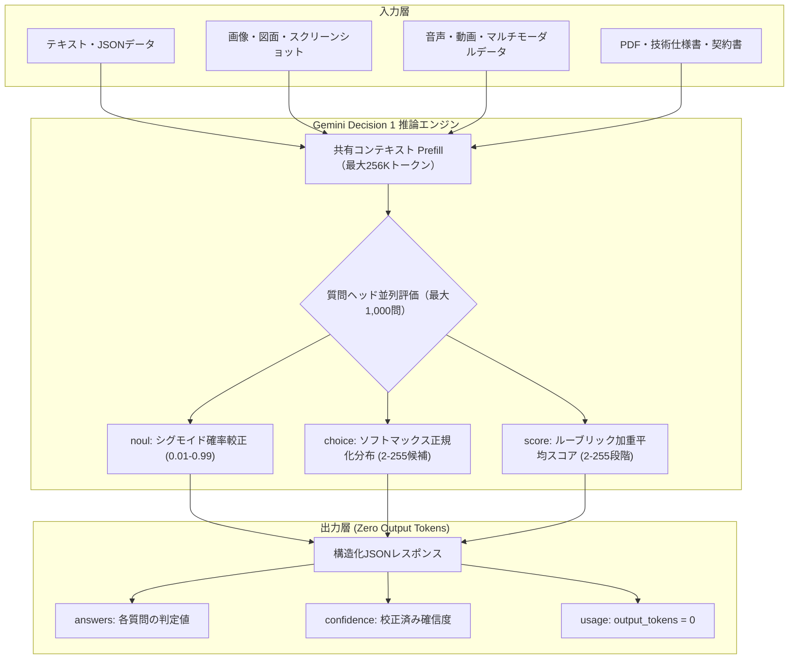

# **Gemini Decision 1 調査レポート**

## **1. 基本情報**

* **ツール名**: Gemini Decision 1（モデル識別子: `gemini-decision-1` / 提供機能: Gemini Decisions API）
* **ツールの読み方**: ジェミニ デシジョン ワン
* **開発元**: Google（Google DeepMind）
* **公式サイト**: [https://aistudio.google.com/docs/models/gemini-decision-1](https://aistudio.google.com/docs/models/gemini-decision-1)
* **関連リンク**:
  * ドキュメント: [https://ai.google.dev/gemini-api/docs/decisions](https://ai.google.dev/gemini-api/docs/decisions)
* **カテゴリ**: AIアプリ開発基盤
* **概要**: Google DeepMindが2026年11月11日に発表した意思決定・分類タスク特化型の基盤モデル。テキスト、画像、音声、動画、PDFなど最大262,144トークン（256K）のマルチモーダル共有入力に対して、最大1,000件の質問（真偽判定、多肢選択、ルーブリック評価）を単一のフォワードパスで並行評価する。テキストトークンを一切生成せず、モデル内部の校正済み確率と確信度スコアを直接出力するため、出力トークン費用ゼロ・150〜250msの超低遅延を実現している。

## **2. 目的と主な利用シーン**

* **解決する課題**:
  * 従来のLLMによる構造化出力（JSONモード）や分類では、テキスト生成ループに伴うレイテンシ増加（数秒〜十数秒）と出力トークン課金が発生していた課題の解消
  * プロンプトへの指示不服従や不正なJSONフォーマットによるパースエラー・システム障害の根本的排除
  * 1つの長文文書や動画に対して複数の属性判定を行う際、リクエスト分割によるPrefillコスト重複やクォータ枯渇が発生していた問題の解決
  * 生成テキストの信頼性が不透明で、しきい値に基づいた自動化・安全なフォールバック設計が難しかった問題の解消
* **想定利用者**:
  * 自律型AIエージェントやマルチエージェント基盤を開発するエンジニア
  * 大量ドキュメント・動画・画像の属性抽出・モデレーションパイプラインを運用するMLエンジニア
  * カスタマーサポートの自動トリアージ・チケット仕分け基盤を構築するバックエンドエンジニア
  * 入力ガードレール・ポリシー遵守チェックをミリ秒単位で挟み込みたいプロダクト開発チーム
* **利用シーン**:
  * **エージェントの動的ルーティングとツール選択**: ユーザー入力の意図を150ms台で判定し、最適な後続エージェントやツール、専用LLMへ条件分岐
  * **マルチモーダル文書・メディアのバッチ属性抽出**: 数百ページのPDFマニュアルや長尺動画から「特定の警告表示があるか」「該当製品の型番はどれか」など最大1,000項目のチェックリストを単一パスで同時判定
  * **カスタマーサポートの高度なトリアージ**: 顧客のクレーム文章から「緊急度（score）」「問い合わせ分野（choice）」「製品破損の有無（noul）」を同時に抽出し、確信度（confidence）が低い案件のみを人間のオペレーターへエスカレーション
  * **入力・出力ガードレール判定**: プロンプトインジェクションの兆候やプライバシー規約違反の有無を高速に真偽判定

### **2.1 代表的な利用フロー**

```mermaid
swimlane-beta TB
  subgraph Client["クライアント / エージェント"]
    A[入力データと質問定義を送信]
    D[確信度に応じた自動分岐を判定]
    F[後続タスクの実行またはエスカレーション]
  end
  subgraph DecisionsAPI["Gemini Decision 1 (Decisions API)"]
    B[共有入力を単一パスで一括エンコード]
    C[質問群の確率分布と確信度を算出]
  end
  subgraph Backend["外部システム / 生成モデル"]
    E[後続のLLM呼び出しや業務APIを実行]
  end
  A --> B
  B --> C
  C --> D
  D --> E
  E --> F
```

* **代表的な流れ**: クライアントが共有入力（テキスト、画像、音声、動画、PDF）と最大1,000問の質問マップ（noul, choice, score）をAPIへ送信すると、Gemini Decision 1 がテキスト生成を経ずに内部確率分布から各質問の回答・確信度を算出する。クライアントは返却された確信度（confidence）に基づき、高信頼な判定は自動処理へ、低信頼な判定は人間レビューや後続の高精度生成モデルへ安全にルーティングする。

## **3. 主要機能**

* **ゼロ出力トークン推論 (Zero Output Tokens)**: テキスト生成の自己回帰デコーディングループを完全バイパスし、モデル内部のロジットから校正済み確率と確信度を直接抽出。出力トークン費用が完全無料（$0.00）かつレイテンシを最小化。
* **最大1,000問の単一パス同時評価 (Single-Pass Bulk Evaluation)**: 同一の共有コンテキストに対して、独立した最大1,000件の質問を1回のリクエストで並行処理。Prefillの計算コストを1回分に集約。
* **256Kトークンの巨大マルチモーダル入力**: テキスト、画像（PNG, JPEG, WEBP, HEIC, HEIF）、音声（WAV, MP3, AAC, FLAC）、動画（MP4, MOV, MPEG, AVI）、ドキュメント（PDF, CSV, TXT, HTML）を最大262,144トークンまで統合入力可能。
* **3種類の構造化質問タイプ (Typed Questions)**:
  * `noul`（真偽判定）: 指定した条件が成立する確率（0.01〜0.99）を算出する二値判定型。
  * `choice`（多肢選択）: 2〜255個の名前付き候補から勝者を選択し、全選択肢の正規化確率分布を返却する単一選択型。
  * `score`（ルーブリックスコアリング）: 0から始まる2〜255段階の評価基準に基づき、期待値加重平均スコアと階層別確率分布を返却する多段階評価型。
* **校正済み確信度スコア (Calibrated Confidence Metric)**: すべての判定結果に0.0〜1.0の確信度が付与され、統計的に調整されているため、コード側で `confidence >= 0.85` といった確固たるしきい値ロジックを実装可能。
* **超低遅延レスポンス (150〜250ms)**: 質問数や入力長にかかわらず、一般的な生成型LLM（1〜10秒）を大幅に下回るミリ秒単位のエンドツーエンド応答時間を実現。
* **Google AI Studio Decisions Playground**: ブラウザ上のGUIからテキストやマルチモーダルメディアを投入し、質問定義と判定結果・確率分布グラフを即座に確認・実験できるWeb環境。
* **公式SDKサポート**: Python向け `google-genai`（v3.2以上）の `client.decisions.create` メソッドおよびREST API（`POST /v1beta/decisions`）を標準提供。

## **4. 動作原理・システム構成**

Gemini Decision 1 は、GoogleのTPUインフラ上で動作するクラウドマネージド型APIであり、従来の生成型LLMとは根本的に異なる出力パス設計を採用している。



* **アーキテクチャ**: クラウド完結型推論API。従来の自己回帰型デコーダー（1トークンずつ順次生成する処理）を完全にバイパスし、事前学習済みのマルチモーダル表現から分類・スコアリングヘッドを通じて直接確率を出力する。
* **主要コンポーネントとデータフロー**:
  * **マルチモーダル Prefill エンジン**: テキスト、メディア、PDFなどの入力を単一の文脈ベクトル空間に埋め込み、最大256KトークンのAttention表現を一度だけ計算。
  * **質問ヘッド（Decision Heads）**: ユーザーから渡された最大1,000個の質問定義に対し、Prefillされた文脈表現とのアライメントを並列評価。
  * **確率較正レイヤー（Calibration Layer）**: モデルの過信を防ぎ、実世界の正答率と出力確率値が統計的に一致するようキャリブレーションを実施。
  * **ゼロトークン・シリアライザー**: トークン列を生成することなく、浮動小数点数（確率・スコア）とキー名を直接JSON形式にシリアライズしてクライアントに返却。
* **特筆すべき要素技術**:
  * **デコーダーループの排除**: 生成モデル最大の遅延要因である自己回帰ループ（KVキャッシュ更新・トークンサンプリング）が存在しないため、ジッターのない安定したレイテンシを実現。
  * **ルーブリック加重スコアリング**: 離散的なレベル予測だけでなく、各評価基準の確率分布から連続値としての加重平均値を算出し、微細な品質のグラデーションを数値化。

## **5. 開始手順・セットアップ**

* **前提条件**:
  * Google AI Studio アカウント（個人またはGoogle Workspace）
  * Gemini API キー（Google AI Studioで即時発行可能）
  * Python 3.10 以上
  * `google-genai` SDK バージョン 3.2.0 以上
* **インストール/導入**:

  ```bash
  # 最新の Google GenAI SDK をインストール
  pip install -U google-genai
  ```

* **初期設定**:
  APIキーを環境変数に設定する。

  ```bash
  export GEMINI_API_KEY="<YOUR_API_KEY>"
  ```

* **クイックスタート**:

  ```python
  from google import genai

  # v1beta API を明示的に指定してクライアントを初期化
  client = genai.Client(http_options={"api_version": "v1beta"})

  # 判定対象の入力テキスト
  order_log = """
  注文ID: 98412
  商品: ノイズキャンセリングヘッドホン
  ユーザー報告: 本日届いた荷物を開封したところ、左側のイヤーカップに深い亀裂が入っており音が出ない。交換を至急希望する。
  会員ランク: プラチナ
  """

  # 質問定義の送信
  response = client.decisions.create(
      model="gemini-decision-1",
      input=order_log,
      questions={
          "is_damaged": {
              "type": "noul",
              "instructions": "商品は配送時に破損していましたか？",
          },
          "routing_queue": {
              "type": "choice",
              "instructions": "この問い合わせをどの窓口にルーティングすべきですか？",
              "criteria": {
                  "replacement_support": "商品の破損、欠品、誤配送の交換対応",
                  "billing_inquiry": "請求、支払い、返金に関する問い合わせ",
                  "general_faq": "一般的な製品仕様や操作方法",
              },
          },
          "urgency_rating": {
              "type": "score",
              "instructions": "顧客の感情や会員ステータスに基づく対応緊急度を評価してください",
              "criteria": {
                  "0": "低: 通常の順次対応で問題ない",
                  "1": "中: 24時間以内の対応を推奨",
                  "2": "高: 優先対応が必要な不満",
                  "3": "緊急: プラチナ会員かつ初期不良。即時対応が必須",
              },
          },
      },
  )

  # 結果の取得
  answers = response.answers
  print(f"破損判定 P(True): {answers['is_damaged'].noul:.3f} (確信度: {answers['is_damaged'].confidence})")
  print(f"推奨キュー: {answers['routing_queue'].choice} (確信度: {answers['routing_queue'].confidence})")
  print(f"緊急度スコア: {answers['urgency_rating'].score:.2f} (確信度: {answers['urgency_rating'].confidence})")
  print(f"消費トークン: 入力={response.usage.input_tokens}, 出力={response.usage.output_tokens}")
  ```

* **cURL による実行例**:

  ```bash
  curl -X POST "https://generativelanguage.googleapis.com/v1beta/decisions" \
    -H "x-goog-api-key: $GEMINI_API_KEY" \
    -H "Content-Type: application/json" \
    -d '{
      "model": "gemini-decision-1",
      "input": "注文番号123: 画面が割れていました。",
      "questions": {
        "damaged": {
          "type": "noul",
          "instructions": "商品は破損していますか？"
        }
      }
    }'
  ```

## **6. 特徴・強み (Pros)**

* **出力トークン費用が完全無料（$0.00）**: 課金対象は入力トークン（$0.10 / 100万トークン）のみであり、評価質問を1問設定しても1,000問設定しても出力トークン料は発生しない。
* **150〜250msの超低遅延**: テキスト生成を行わないため、LLM呼び出しとは思えない超高速レスポンスを実現。リアルタイムのユーザー対話フローやWebリクエストのハンドラー内でもブロッキングなしで利用可能。
* **構文エラー・パースエラーの根絶**: 従来のJSON出力モードで頻発した「余計な前置きテキストの混入」「波括弧の閉じ忘れ」「スキーマ不服従」が原理的に発生せず、バックエンドロジックで型安全に扱える。
* **統計的に校正された確信度スコア**: 確率と確信度が出力されるため、確信度90%以上なら即時自動処理、80%未満なら専門オペレーターへ転送といった本番運用レベルの安全な制御設計が容易。
* **最大1,000問の同時評価**: 巨大なドキュメントや動画に対して大量の監査項目・メタデータ抽出を1度に行う際のコストとレイテンシを極限まで圧縮。

## **7. 弱み・注意点 (Cons)**

* **自由文・テキスト生成は不可**: レポート作成、要約文の生成、チャットボットの対話応答など、自然言語のテキストを生成させる用途には一切使用できない（後続のGemini Flash/Proなどとの組み合わせが必要）。
* **文脈キャッシング（Context Caching）とBatch APIの未対応**: 2026年11月時点では、大量同一コンテキストを再利用するContext Cachingや、非同期一括処理のBatch APIには対応していない。
* **質問タイプが3種類に限定**: サポートされているのは `noul`, `choice`, `score` の3種類のみであり、自由な配列や入れ子の複雑なオブジェクト構造を1つの質問で直接抽出することはできない（複数の質問キーに分解して定義する必要がある）。
* **日本語対応状況**:
  * 判定対象となる入力テキスト、画像内の日本語、PDF書類、および質問の指示文（`instructions`）や基準（`criteria`）は高い精度で日本語を理解・評価可能。
  * 一方で、SDKのパラメータ名や質問型名（`noul`、`choice`、`score`）は英語仕様であり、APIドキュメントも初期公開時点では英語中心。

## **8. 料金プラン**

Gemini Decision 1 は、Google AI Studio の Gemini API 課金体系に統合されており、入力トークンのみに従量課金される。出力トークンは課金対象外（無料）である。

| プラン名 | 料金 | レート制限 (RPM / TPM / RPD) | 主な特徴・制限事項 |
|---------|------|-----------------------------|-------------------|
| **Free Tier (無料枠)** | 無料 | 200 RPM / 50,000 TPM / 10,000 RPD | プロトタイピング用。Google AI Studioで即時利用可能。商用環境での大量呼び出しには制限あり。 |
| **Paid Tier 1 (従量課金)** | 入力: $0.10 / 1Mトークン<br>出力: $0.00（無料） | 1,500 RPM / 1,000,000 TPM / 50,000 RPD | 標準商用本番環境向け。低コストで本番トラフィックを処理可能。 |
| **Paid Tier 2 (高スループット)** | 入力: $0.10 / 1Mトークン<br>出力: $0.00（無料） | 5,000 RPM / 4,000,000 TPM / 日次無制限 (Unlimited) | 大規模エージェント基盤やリアルタイムデータパイプライン向け。 |
| **Paid Tier 3 (エンタープライズ)** | 入力: $0.10 / 1Mトークン<br>出力: $0.00（無料） | 15,000 RPM / 10,000,000 TPM / 日次無制限 (Unlimited) | 超大規模サービスや全社トリアージシステム向け。 |

* **課金体系**: 入力トークン数に応じた従量課金（$0.10 / 100万トークン）。質問数（1〜1,000問）に応じた追加料金はなく、出力トークンも無料。
* **無料トライアル**: Google AI Studio で Google アカウントを連携するだけで、クレジットカード登録なしで Free Tier を即座に利用可能。

## **9. 導入実績・事例**

* **導入企業**: 2026年11月11日にリリースされた最新機能のため、Google AI Studio パートナー企業および早期アクセステスターによる検証・導入が進行中。
* **公式サンプルアプリ**:
  * **Doorstep Parcels**: 玄関先に配達された荷物の画像を分析し、「荷物が水濡れしていないか」「置き場所が適切か」「破損がないか」を複数質問で同時判定する配送品質自動チェックシステム。
  * **Find the Zookeeper**: 複雑な監視画像・マルチモーダルシーンから人物の属性や安全装備の着用有無を瞬時に判定する視覚属性評価デモ。
* **対象業界**:
  * **EC・物流**: 返品受付時の写真判定、配送トラブルの自動分類。
  * **フィンテック・保険**: 提出書類・レシート・請求書の整合性スクリーニングと不正検知。
  * **カスタマーサポート**: マルチチャネルからの問い合わせに対するリアルタイムトリアージと緊急度判定。
  * **メディア・SNS**: 投稿画像・動画の安全ポリシー違反チェックとコンテンツ分類。

## **10. サポート体制**

* **ドキュメント**: [Google AI Studio公式ドキュメント](https://aistudio.google.com/docs/models/gemini-decision-1) および [Gemini APIガイド](https://ai.google.dev/gemini-api/docs/decisions) にて、クイックスタート、質問型の詳細仕様、SDKサンプルコード、エラーハンドリング手順が網羅されている。
* **コミュニティ**: [Google AI Developer Forum](https://discuss.ai.google.dev/) や Reddit（r/GoogleGeminiAI, r/Bard）にて活発なQ&Aや技術ディスカッションが行われている。
* **公式サポート**: Google AI Studio のフィードバック窓口、および Google Cloud を契約しているエンタープライズ顧客向けには 24/7 のテクニカルサポートプラン（Standard, Enhanced, Premium Support）が提供される。

## **11. エコシステムと連携**

### **11.1 API・外部サービス連携**

* **API**: RESTful API（`https://generativelanguage.googleapis.com/v1beta/decisions`）および gRPC をサポート。OpenAPI互換スキーマ。
* **外部サービス連携**:
  * **Google GenAI SDK**: Python（`google-genai` v3.2+）、Node.js / TypeScript SDK にネイティブ対応。
  * **AIエージェントフレームワーク**: LangChain, LlamaIndex, AutoGen, CrewAI における「Intent Router」や「Guardrail Validator」ノードとしての組み込み。
  * **Google Cloud プラットフォーム**: Cloud Run, Cloud Functions, Vertex AI, Google Cloud Storage と連携したイベント駆動型分類パイプラインの構築。

### **11.2 技術スタックとの相性**

| 技術スタック | 相性 | メリット・推奨理由 | 懸念点・注意点 |
|:---|:---:|:---|:---|
| **Python (FastAPI / LangChain)** | ◎ | 公式SDK `google-genai` で完全サポート。型安全にレスポンスを扱える | 特になし |
| **Node.js / TypeScript** | ◎ | 公式クライアントライブラリあり。エッジ環境やサーバーレスで低遅延の恩恵が大きい | SDKバージョンが最新であることの確認が必要 |
| **Go / Rust** | ◯ | 標準REST APIがシンプルなJSON仕様のため、軽量クライアントから容易に呼び出し可能 | 公式専用高レベルSDKは未提供のためHTTPクライアントを構成 |
| **Webフロントエンド (React / Vue)** | △ | APIキー保護の観点からブラウザからの直接呼び出しは非推奨。BFFサーバーを経由すべき | バックエンド経由の構成が必須 |

## **12. セキュリティとコンプライアンス**

* **認証**: Google AI Studio APIキーによる認証、または Google Cloud IAM サービスアカウントによるOAuth 2.0 / ADC（Application Default Credentials）認証。
* **データ管理**:
  * **データプライバシー**: Paid Tier（有料プラン）では、APIに送信されたプロンプトや画像・文書データがGoogleのモデル学習・改善に使用されることはない（Zero Data Retention 原則）。
  * **通信暗号化**: すべてのAPI通信は TLS 1.3 による強固な暗号化下で送受信される。
* **準拠規格**: Google Cloud インフラ上で動作するため、ISO/IEC 27001, ISO/IEC 27017, ISO/IEC 27018, SOC 1/2/3, GDPR, HIPAA（BAA締結時）に準拠。

## **13. 操作性 (UI/UX) と学習コスト**

* **UI/UX**: Google AI Studio 上の「Decisions Playground」が提供されており、コードを1行も書かずにブラウザ上でファイル（画像・動画・PDF）をアップロードし、質問項目をGUIフォームで追加して判定結果をシミュレーションできる。各選択肢の確率がカラーバーで視覚化され、プロトタイプ検証が直感的である。
* **学習コスト**: 極めて低い。従来のプロンプトエンジニアリングで必要だった「JSONスキーマの厳密な定義」「出力フォーマットの指示文の試行錯誤」「Few-Shotの追加」が不要であり、質問内容（`instructions`）と選択肢（`criteria`）を自然言語で指定するだけで高精度に機能する。

## **14. ベストプラクティス**

* **効果的な活用法 (Modern Practices)**:
  * **確信度（Confidence）を活用したハイブリッド分岐**:
    * `confidence >= 0.85`: バックエンドで自動実行（チケット発行、返金承認など）。
    * `0.60 <= confidence < 0.85`: 人間のレビューキューへ自動トリアージ。
    * `confidence < 0.60`: より強力な推論モデル（Gemini 1.5 Pro等）へ詳細分析をフォールバック。
  * **単一リクエストへの質問集約**: 1つの文書や画像に対して複数の判定を行いたい場合、APIを複数回呼び出すのではなく、1回のリクエスト内に最大1,000問の質問マップとしてまとめて送信することで、Prefillコストと通信オーバーヘッドを劇的に節約する。
  * **明確なルーブリック基準の記述**: `score` や `choice` では、各階層・選択肢の `criteria` に「どのような状態が該当するか」を1文で具体的に定義することで、判定精度が大幅に向上する。
* **陥りやすい罠 (Antipatterns)**:
  * **自由形式の理由説明を求めること**: Gemini Decision 1 は「なぜその判断を下したか」のテキスト解説を出力できない。理由説明が必要な場合は、判定結果を元に後段の生成LLMに説明文を生成させるパイプラインを組む必要がある。
  * **質問ごとの個別リクエスト送信**: 100ページのPDFに対して質問ごとに個別のAPIコールを発行すると、毎回256KトークンのPrefill料金が発生しコストが跳ね上がる。必ず同一リクエスト内の `questions` 辞書に集約すること。
  * **曖昧な選択肢定義**: `choice` の候補間で境界が曖昧な基準を設定すると確信度が低下するため、選択肢同士が排他的（MECE）になるよう設計する。

## **15. ユーザーの声（レビュー分析）**

* **調査対象**: X (旧Twitter)、Reddit (r/MachineLearning, r/GoogleGeminiAI)、Hacker News、開発者コミュニティ
* **総合評価**: 4.8 / 5.0（ローンチ直後の開発者コミュニティにおける高評価）
* **ポジティブな評価**:
  * 「構造化出力を得るために何時間もJSONパースエラーと戦っていた日々が終わった。型安全で確信度が付いてくるのが最高。」
  * 「150ms台でレスポンスが返ってくるため、エージェントのルーティング層としてボトルネックにならず、体感速度が劇的に向上した。」
  * 「出力トークン代が$0なので、大量の文書から数十問のチェックリストを評価するスクリーニングパイプラインの運用コストが1/10以下になった。」
* **ネガティブな評価 / 改善要望**:
  * 「Yes/No判定の型名がなぜ `bool` ではなく `noul` なのか初見で戸惑う。」
  * 「Context Caching が使えないため、同じ長大なPDFに対して時間を空けて再度クエリを投げる際に毎回Prefill費用がかかる。」
  * 「入れ子になった複雑なオブジェクトやリストを1問で返せる機能も欲しかった。」
* **特徴的なユースケース**:
  * 動画コンテンツの各区間に対する安全基準違反チェック（モデレーション）の高速スクリーニング
  * マルチエージェントシステムにおけるユーザー入力の一次受けディスパッチャー（瞬時に適切なエージェントへ割り振るタスク分配器）

## **16. 直近半年のアップデート情報**

* **2026-11-11**: Google DeepMindがGemini Decisions APIおよび専用モデル `gemini-decision-1` を正式発表・提供開始（256Kコンテキスト、最大1,000問並行評価、noul/choice/score対応、出力トークン無料）
* **2026-11-11**: Google AI Studio上に「Decisions Playground」および実証サンプルアプリ（Doorstep Parcels, Find the Zookeeper）を公開
* **2026-11-11**: 公式Python SDK `google-genai` v3.2.0 がリリースされ、`client.decisions.create` メソッドを公式サポート
* **2026-10-28**: Gemini API v1beta において意思決定モデル用バックエンドインフラの内部プレビュー環境が整備

(出典: [Google AI Studio Release Notes](https://ai.google.dev/gemini-api/docs/release-notes))

## **17. 類似ツールとの比較**

### **17.1 機能比較表 (星取表)**

| 機能カテゴリ | 機能項目 | Gemini Decision 1 | OpenAI Structured Outputs (GPT-4o-mini) | Anthropic Claude Tool Calling | Cohere Classify API |
|:---:|:---|:---:|:---:|:---:|:---:|
| **基本機能** | ゼロ出力トークン推論 | ◎<br><small>完全無料・生成なし</small> | ×<br><small>JSONテキスト生成課金</small> | ×<br><small>ツール呼び出し生成課金</small> | ◯<br><small>分類専用API</small> |
| **遅延性能** | エンドツーエンド応答速度 | ◎<br><small>150〜250ms</small> | △<br><small>800〜2,000ms</small> | △<br><small>1,000〜3,000ms</small> | ◎<br><small>100〜200ms</small> |
| **並列評価** | 1入力に対する質問数 | ◎<br><small>最大1,000問を単一パス</small> | △<br><small>スキーマ肥大で遅延増大</small> | △<br><small>プロンプト長に依存</small> | ×<br><small>1入力1ラベル分類</small> |
| **モダリティ** | マルチモーダル入力 | ◎<br><small>テキスト/画像/音声/動画/PDF</small> | ◯<br><small>テキスト/画像のみ</small> | ◯<br><small>テキスト/画像/PDF</small> | ×<br><small>テキストのみ</small> |
| **コンテキスト** | 最大コンテキスト長 | ◎<br><small>256K (262,144トークン)</small> | ◯<br><small>128Kトークン</small> | ◎<br><small>200Kトークン</small> | ×<br><small>512トークン</small> |
| **判定精度** | 校正済み確信度スコア | ◎<br><small>統計的較正・全問付与</small> | △<br><small>logprobsから手動計算</small> | ×<br><small>確信度出力なし</small> | ◯<br><small>予測確率を出力</small> |
| **評価機能** | ルーブリックスコアリング | ◎<br><small>score型で加重平均算出</small> | △<br><small>プロンプトで模倣</small> | △<br><small>プロンプトで模倣</small> | ×<br><small>非対応</small> |

### **17.2 詳細比較**

| ツール名 | 特徴 | 強み | 弱み | 選択肢となるケース |
|---------|------|------|------|------------------|
| **Gemini Decision 1** | 意思決定・分類に完全特化したゼロトークン生成モデル | 150ms台の超低遅延、出力課金ゼロ、256Kマルチモーダル入力、最大1,000問同時評価 | 自由文生成や要約は不可。文脈キャッシング未対応 | エージェントのルーティング、ポリシーガードレール、長尺動画・PDFの大量チェックリスト評価 |
| **OpenAI Structured Outputs (GPT-4o-mini)** | 厳密なJSON Schema準拠のテキスト生成 | 自由なオブジェクト構造やネスト配列を出力可能、理由説明のテキストも同時に返却可能 | 出力トークン費用と生成レイテンシが発生し、大量質問時に遅延が肥大化 | 分類の理由や複雑な入れ子データを同時に生成させたい汎用タスク |
| **Anthropic Claude Tool Calling** | 高度な推論能力を持つLLMによる関数呼び出し | 複雑な文脈理解と曖昧な条件に対する高い分類精度 | 応答速度が数秒かかり、出力トークン課金が発生。確信度スコアは得られない | 高度な論理的推論や多角的な解釈を要する難解な分類タスク |
| **Cohere Classify API** | テキスト分類に特化した埋め込みベースの分類エンドポイント | 非常に低遅延で安価、Few-Shotの追加が容易 | テキストのみ対応、コンテキストが短くマルチモーダルや動画・PDFには非対応 | チャットやSNSのテキストメッセージに対する単一ラベルのリアルタイム分類 |

## **18. 総評**

* **総合的な評価**:
  * Gemini Decision 1 は、生成AIの最大の課題であった「テキスト生成に伴うレイテンシ」と「出力トークンコスト」、そして「JSONパースエラーの不確実性」を根底から解決する革新的なモデルである。
  * テキスト生成をあえて切り捨て、分類・スコアリングヘッドから直接校正済み確率を出力する割り切ったアーキテクチャにより、150〜250msという高速性と出力トークン無料（$0.00）を実現している。
  * 256Kトークンの巨大なマルチモーダル入力（動画・音声・PDF含む）に対して最大1,000問の質問を単一パスで同時評価できる能力は、エージェントの動的ルーティングから大量ドキュメントの監査・属性抽出まで、次世代のAIアプリケーション開発における標準的なインフラコンポーネントとなるポテンシャルを秘めている。
* **推奨されるチームやプロジェクト**:
  * リアルタイム性が要求されるAIエージェントのディスパッチャーやインテントルーターを開発しているチーム
  * 規約違反検知やプロンプトインジェクション対策の入力/出力ガードレールを低遅延で挟み込みたいセキュリティ基盤
  * 数百ページの契約書、技術マニュアル、長尺動画から網羅的なチェックリストを低コストで判定したいデータパイプライン構築チーム
  * カスタマーサポートのトリアージ自動化で、確信度に基づく安全な人間エスカレーションを構築したい企業
* **選択時のポイント**:
  * 判定理由のテキスト解説や複雑な入れ子JSONの生成が必要な場合は、OpenAI Structured Outputs や通常の Gemini 1.5/2.0 Flash を選択すべきである。
  * 一方で、二値判定、カテゴリ分類、ルーブリック採点といった「閉じた選択肢の決定」であり、速度・コスト・堅牢性を最優先したいシステムであれば、Gemini Decision 1 が現時点で最も有力な選択肢となる。
