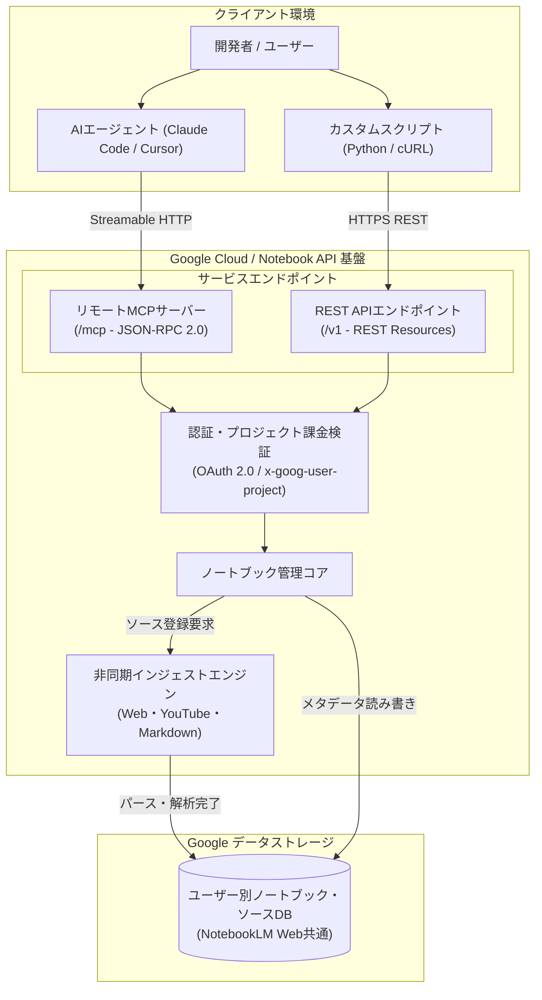

# **Gemini Notebook API 調査レポート**

## **1. 基本情報**

* **ツール名**: Gemini Notebook API
* **ツールの読み方**: ジェミニ ノートブック エーピーアイ
* **開発元**: Google
* **公式サイト**: [https://developers.google.com/notebook/docs](https://developers.google.com/notebook/docs)
* **関連リンク**:
  * ドキュメント: [https://developers.google.com/notebook/docs](https://developers.google.com/notebook/docs)
  * RESTリファレンス: [https://developers.google.com/notebook/reference/rest](https://developers.google.com/notebook/reference/rest)
  * MCPサーバーエンドポイント: `https://notebook.googleapis.com/mcp`
* **カテゴリ**: AIアプリ開発基盤
* **概要**: Gemini Notebook APIは、Googleが提供するGemini Notebook（NotebookLMの基盤機能）のノートブックおよびソースをプログラムから管理するためのREST APIおよび公式リモートModel Context Protocol (MCP) サーバーである。公開Webページ、YouTube動画、プレーンテキスト、Markdownを永続ノートブックへ直接インジェストでき、AIエージェントや開発環境からナレッジベースの自動構築・整理を実現する。

## **2. 目的と主な利用シーン**

* **解決する課題**:
  * これまでWebブラウザ上の手動操作（GUI）に限定されていたNotebookLMの情報蓄積・管理プロセスを自動化し、プログラムや外部スクリプトからの連携を可能にする。
  * Claude CodeやCursorなどのAIコーディングエージェントがWeb検索や調査で得た有益な情報源（技術仕様、公式ドキュメント、YouTube解説動画）を個人の永続ナレッジとしてストックする手段を提供する。
  * 自前でRAG（検索拡張生成）パイプライン（Webスクレイピング、テキスト抽出、チャンキング等）を構築・保守する労力を大幅に削減する。
* **想定利用者**:
  * AIエージェントやワークフロー自動化ツールを開発するエンジニア
  * CursorやClaude Code等を用いて日常的に開発を行うソフトウェアエンジニア
  * 膨大な技術情報や論文、YouTube動画を系統的にストック・整理したいリサーチャー
* **利用シーン**:
  * **エージェントによる自動調査ストック**: コーディングエージェントがタスク調査時に参照した公式ドキュメントやリポジトリURLを、プロジェクト専用ノートブックへ自動追加。
  * **YouTube技術動画・Web記事のバッチ収集**: 気になった技術トピックに関する複数の動画URLや解説記事をAPI経由で一括インジェストし、後からNotebookLMのWeb画面で閲覧・学習。
  * **チーム・個人向け知識リポジトリのプログラム管理**: 日報、Markdown仕様書、技術メモをCI/CDやスクリプトから自動送信して最新のナレッジコンテナを維持。

### **2.1 代表的な利用フロー**

```mermaid
swimlane-beta TB
  subgraph User["ユーザー（開発者）"]
    A[調査タスクやトピックを指示]
    G[NotebookLM Web画面で確認]
  end
  subgraph Agent["AIコーディングエージェント"]
    B[必要なWebや動画URLを特定]
    C[MCP経由でノートブック作成]
    D[MCP経由でソース投入を要求]
    F[処理完了を検知し結果報告]
  end
  subgraph NotebookAPI["Gemini Notebook API / MCP"]
    E[非同期インジェストを実行]
  end
  A --> B
  B --> C
  C --> D
  D --> E
  E --> F
  F --> G
```

* **代表的な流れ**: ユーザーがAIコーディングエージェント（Claude Code等）に調査タスクを指示すると、エージェントはリモートMCP経由でGemini Notebook APIを呼び出してノートブックを作成し、調査対象のWebページやYouTube URLをソースとして投入する。APIバックエンドが非同期にパースとインジェストを完了させ、ユーザーは蓄積されたナレッジをエージェント経由またはNotebookLMのWeb UI上で活用できる。

## **3. 主要機能**

* **ノートブックのライフサイクル管理**:
  * 一意なUUIDを持つノートブックの作成（`CreateNotebook`）、一覧取得（`ListNotebooks`）、個別メタデータ取得（`GetNotebook`）、表示名更新（`UpdateNotebook`）を提供。
* **多様なコンテンツソースの自動インジェスト**:
  * 公開WebページURL（`web_content.url`）の自動フェッチとテキスト抽出。
  * YouTube動画URL（`web_content.url`）からの字幕（トランスクリプト）自動抽出・取り込み。
  * プレーンテキストおよびMarkdown形式のインラインテキスト投入（最大50万語、1MBペイロード）。
* **非同期ソース処理パイプライン**:
  * ソース登録直後は `PROCESSING` 状態となり、Google側のインジェストパイプラインが完了すると `ACTIVE`（利用可能）または `FAILED`（エラー）へ遷移。APIポーリングによる進捗追跡に対応。
* **公式リモートMCP（Model Context Protocol）サーバー**:
  * `https://notebook.googleapis.com/mcp` にてStreamable HTTP（JSON-RPC 2.0）エンドポイントを提供。7つのMCPツール（`create_notebook`, `get_notebook`, `list_notebooks`, `update_notebook`, `create_source`, `get_source`, `list_sources`）を公開。
* **Googleアカウント・NotebookLM（Web版）との完全同期**:
  * APIで作成・登録したノートブックやソースは、公式Webアプリ（`https://notebooklm.google.com`）の同一アカウント画面に即時反映され、Web UIからの質問応答や音声概説（Audio Overview）の視聴が可能。
* **エージェント向けクイックセットアップの提供**:
  * Claude CodeやCursor向けの自動セットアップ用プロンプトが公式ドキュメントに掲載されており、ADC（Application Default Credentials）と連携した導入を瞬時に完了可能。

## **4. 動作原理・システム構成**

* **アーキテクチャ**:
  * Google Cloudインフラ上に構築されたクラウド完結型のREST APIおよびStreamable HTTP MCPサーバー構成。
  * ユーザーの認証コンテキスト（OAuth 2.0 Bearer Token）に基づいてパーソナルGoogleアカウントのGemini Notebookデータストアへ直接アクセスする。



* **主要コンポーネントとデータフロー**:
  * **クライアント層**: AIコーディングエージェント（Claude Code、Cursorなど）やPythonスクリプトからリクエストを発行。MCP経由の場合はJSON-RPC 2.0形式のツール呼び出し、通常クライアントはRESTリクエストを送信。
  * **認証・プロジェクトゲートウェイ**: Google OAuth 2.0 Bearerトークンと `x-goog-user-project` ヘッダーを検証。APIの有効化状態およびレートリミットを検査。
  * **非同期インジェストパイプライン**: Web URLやYouTube動画が投入されると、バックグラウンドワーカーがコンテンツ取得・クレンジング・字幕抽出を実行し、処理状態を `PROCESSING` から `ACTIVE` へ更新。
  * **共有データストア**: データはGoogleアカウントのNotebookLM基盤に格納され、ブラウザからWeb版NotebookLMを開くと同期されたノートブックが閲覧できる。
* **特筆すべき要素技術**:
  * **Model Context Protocol (MCP) 2026-07-28仕様のHTTPトランスポート**: ローカルでMCPサーバープロセスを立ち上げる必要がなく、`https://notebook.googleapis.com/mcp` に対して標準HTTP POSTを行うだけでツール実行が可能。
  * **OAuth 2.0 スコープ分離**: 読み書き権限（`https://www.googleapis.com/auth/notebook`）と読み取り専用権限（`https://www.googleapis.com/auth/notebook.readonly`）を明確に分離。

## **5. 開始手順・セットアップ**

* **前提条件**:
  * Google Cloudプロジェクトの作成およびアクセス権限
  * パーソナルGoogleアカウント（※プレビュー期間中はGoogle Workspaceアカウント非対応）
  * 事前にブラウザで [https://notebook.google.com](https://notebook.google.com) に1回以上サインインしていること（未サインインの場合はAPIが404エラーとなる）
  * `gcloud` CLIのインストール

* **インストール/導入**:
  * Google Cloudプロジェクトで `notebook.googleapis.com` を有効化する。

  ```bash
  # Google CloudプロジェクトIDを設定
  export PROJECT_ID="<YOUR_PROJECT_ID>"

  # Gemini Notebook APIを有効化
  gcloud services enable notebook.googleapis.com --project="$PROJECT_ID"
  ```

* **初期設定（認証とトークン取得）**:
  * ADC（Application Default Credentials）に `notebook` スコープを付与してログインする。

  ```bash
  # notebookスコープを明示してADC認証を実行
  gcloud auth application-default login \
    --scopes="https://www.googleapis.com/auth/cloud-platform,https://www.googleapis.com/auth/notebook"

  # アクセストークンを環境変数に格納
  export ACCESS_TOKEN=$(gcloud auth application-default print-access-token)
  ```

* **コーディングエージェント（MCP）の設定**:
  * **Claude Code の場合**:
    ```bash
    claude mcp add gemini-notebook-api \
      --transport http https://notebook.googleapis.com/mcp \
      --header "Authorization: Bearer $ACCESS_TOKEN" \
      --header "x-goog-user-project: $PROJECT_ID"
    ```
  * **Cursor の場合 (`.cursor/mcp.json`)**:
    ```json
    {
      "mcpServers": {
        "gemini-notebook-api": {
          "url": "https://notebook.googleapis.com/mcp",
          "headers": {
            "Authorization": "Bearer <ACCESS_TOKEN>",
            "x-goog-user-project": "<YOUR_PROJECT_ID>"
          }
        }
      }
    }
    ```

* **クイックスタート（REST APIによる動作確認）**:
  * ノートブックの作成とソースの追加（cURL例）:

  ```bash
  # 1. ノートブックを作成
  NOTEBOOK_RESP=$(curl -s -X POST "https://notebook.googleapis.com/v1/notebooks" \
    -H "Authorization: Bearer $ACCESS_TOKEN" \
    -H "x-goog-user-project: $PROJECT_ID" \
    -H "Content-Type: application/json" \
    -d '{"display_name": "API Research Notebook"}')

  NOTEBOOK_NAME=$(echo $NOTEBOOK_RESP | jq -r '.name')
  echo "Created: $NOTEBOOK_NAME"

  # 2. 公開Webページソースを追加
  curl -s -X POST "https://notebook.googleapis.com/v1/${NOTEBOOK_NAME}/sources" \
    -H "Authorization: Bearer $ACCESS_TOKEN" \
    -H "x-goog-user-project: $PROJECT_ID" \
    -H "Content-Type: application/json" \
    -d '{
      "display_name": "Gemini Docs",
      "web_content": {
        "url": "https://developers.google.com/notebook/docs"
      }
    }'
  ```

## **6. 特徴・強み (Pros)**

* **公式リモートMCPサーバーによるエージェント直結**:
  * ローカルでのPython/Node.jsブリッジ起動が不要で、URLとAuthorizationヘッダーを指定するだけでClaude CodeやCursorと即座に連携できる。
* **強力なコンテンツ抽出パイプラインの標準統合**:
  * 開発者が自前でスクレイピングやYouTube字幕APIの認証・抽出ロジックを実装することなく、URLを投げるだけでクリーンなテキストとしてインジェストされる。
* **長文ドキュメント（最大50万語）の受け入れ能力**:
  * プレーンテキストやMarkdownソースは1ソースあたり最大50万語（約1MBインライン）まで受け入れ可能で、巨大なコードベースや仕様書も一括投入できる。
* **NotebookLM Web環境とのシームレスな同期**:
  * APIから自動投入したソースを、後からGoogle公式の美しいWeb UIで閲覧したり、話題の「音声概説（ポッドキャスト風要約）」をワンクリックで生成させたりするハイブリッド運用が可能。
* **Public Preview期間中の完全無料提供**:
  * プレビュー期間中はAPI利用料が無料であり、手軽にプロトタイピングやエージェント連携ワークフローを検証できる。

## **7. 弱み・注意点 (Cons)**

* **プレビュー時点での機能的欠落（削除・情報取得の未実装）**:
  * プレビュー時点（2026年11月現在）では、ノートブックやソースの削除（`DELETE` エンドポイント）が提供されていない。また、ノートブックに対する質問応答や要約結果をAPI経由で取得する機能はロードマップ段階であり、現時点は「作成・投入・一覧」に特化している。
* **Google Workspaceアカウント非対応**:
  * プレビュー期間中はパーソナルGoogleアカウント（`@gmail.com` 等）のみ利用可能。企業のGoogle Workspaceアカウントで認証すると `403 PERMISSION_DENIED (WORKSPACE_ACCOUNT_NOT_SUPPORTED)` となり拒否される。
* **Web版への初回サインインが前提**:
  * 対象アカウントで一度も [https://notebook.google.com](https://notebook.google.com) にアクセスしたことがない場合、APIは `404 NOT_FOUND (Account not found for user.)` を返すため、事前のブラウザ操作が必須となる。
* **ローカルバイナリ（PDFやOfficeファイル）の直接アップロード未対応**:
  * 現状はURLおよびインラインテキスト（plain/markdown）のみ対応。ローカルPDFファイルの直接アップロードは今後のロードマップとして予定されている。
* **日本語対応の状況**:
  * 日本語テキストや日本語Markdown、日本語のWebサイトおよび日本語YouTube動画（字幕付き）のインジェスト・解析・Web画面での表示は問題なく動作する。ただし、API仕様書やエラーメッセージ、MCPツールの説明文はすべて英語表記となっている。

## **8. 料金プラン**

Gemini Notebook APIは、Public Preview（プレビュー期間中）は**完全無料**で提供されている。ノートブック数やソース数の上限（アカウントキャパシティクォータ）は、Googleアカウントのサブスクリプション階層（Google One Tier）に連動する。

| プラン・アカウント階層 | API利用料 | ノートブック数上限 | 1ノートブックあたりのソース数上限 |
|:---|:---:|:---:|:---:|
| **Free（通常Googleアカウント）** | **無料** | 最大 100 冊 | 最大 50 ソース |
| **Google One Plus** | **無料** | 最大 200 冊 | 最大 100 ソース |
| **Google One Pro** | **無料** | 最大 500 冊 | 最大 300 ソース |
| **Google One Ultra** | **無料** | 最大 500 冊 | 最大 600 ソース |

* **課金体系**: Public Preview期間中は従量課金なし（無料）。将来のGA（一般提供）時の料金体系は未定。
* **無料トライアル**: 事前申請不要で、Google CloudプロジェクトでAPIを有効化するだけで即時利用可能。
* **レートリミット（リクエスト制限）**:
  * **プロジェクト単位**: 読み取りリクエスト 100 RPM（Requests Per Minute）、書き込みリクエスト 100 RPM
  * **ユーザー単位**: `CreateSource` は 20 RPM、その他すべてのメソッドは各メソッドあたり 60 RPM
  * リミット超過時は `HTTP 429 Too Many Requests (RESOURCE_EXHAUSTED)` が返却される。

## **9. 導入実績・事例**

* **導入企業・利用状況**:
  * 2026年10月のPublic Preview公開直後であり、エンタープライズ本番導入よりも先進的な開発者やAIエージェント研究者、個人エンジニアコミュニティによる実証・試用が急速に拡大している。
* **主なユースケース**:
  * **自律型エージェントのリサーチ成果蓄積**: 自律型AIエージェントがタスク遂行中に巡回した有益なURLやGitHubドキュメントをGemini Notebook API経由でプロジェクト用ノートブックに自動アーカイブ。
  * **Cursor / Claude Codeと連動した開発支援ナレッジ構築**: 開発者が「このライブラリのドキュメントをノートブックに保存しておいて」とエージェントに指示するだけで、MCPツールが自動インジェストを実行。
  * **動画学習・セミナー情報の集約**: カンファレンス動画やテック系YouTubeチャンネルのURLリストをスクリプトで一括登録し、移動中にNotebookLMで音声解説を聞く個人学習ワークフロー。
* **対象業界**:
  * ソフトウェア・ITサービス、研究機関・学術分野、個人開発者・テクニカルライター

## **10. サポート体制**

* **ドキュメント**:
  * Google for Developers公式ポータルにて、クイックスタート、認証ガイド、ソース仕様、MCP連携、RESTリファレンスが詳細に整備されている。
* **コミュニティ**:
  * Google AI ForumおよびGoogle Developer Groups (GDG) を通じた知見共有。
  * 開発者向けIssue Tracker（Google Issue Tracker）にてフィードバックや機能リクエスト、バグ報告を受け付けている。
* **公式サポート**:
  * プレビュー段階（pre-GA）のため、SLA（サービス水準合意）や24時間個別サポートの対象外。サポートはIssue Trackerを通じたエンジニアリングチームへのフィードバックが基本となる。

## **11. エコシステムと連携**

### **11.1 API・外部サービス連携**

* **API**:
  * REST API（Service: `notebook.googleapis.com`）
  * リモートMCPサーバー（`https://notebook.googleapis.com/mcp`）
* **外部サービス連携**:
  * **MCPクライアント**: Claude Code、Cursor、Windsurf、その他Model Context Protocol対応のIDE・エージェント基盤。
  * **Googleエコシステム**: NotebookLM（Web版）、YouTube（動画・字幕連携）、Google Cloud Project（IAM・ADC統合）。
  * **外部Web**: 公開HTTPSプロトコル対応のWebサイト全般（ログイン壁・ペイウォールのないページ）。

### **11.2 技術スタックとの相性**

| 技術スタック | 相性 | メリット・推奨理由 | 懸念点・注意点 |
|:---|:---:|:---|:---|
| **MCP Client (Claude Code / Cursor)** | ◎ | 公式リモートMCPサーバーが用意されており設定のみで即時利用可能 | アクセストークンの有効期限に応じた更新が必要 |
| **Python (requests / google-auth)** | ◎ | ADC認証との親和性が極めて高く、公式サンプルコードも充実 | プレビュー版SDKは未提供（REST直叩き） |
| **Node.js / TypeScript** | ◎ | Fetch APIおよび標準OAuthライブラリで容易に連携可能 | Google公式専用npmパッケージは未リリース |
| **Go / Java** | ◯ | Google APIクライアント基盤（Discovery Service）との統合が容易 | 独自ラッパーが必要な場合がある |
| **cURL / Shellスクリプト** | ◯ | `gcloud` コマンドと組み合わせた自動化バッチ処理に最適 | JSONパース用に `jq` 等の外部ツールが必要 |

## **12. セキュリティとコンプライアンス**

* **認証**:
  * OAuth 2.0 Bearer Token（APIキーは完全非サポート）。
  * Google Cloudプロジェクトに基づく認証と、`https://www.googleapis.com/auth/notebook`（読み書き）および `notebook.readonly`（読み取り専用）の最小権限スコープ設計。
* **データ管理**:
  * データはGoogleの高セキュリティなクラウドストレージ環境において、保存時（At-Rest）および転送時（In-Transit）ともに暗号化。
  * 投入されたソースデータはユーザー個人のGoogleアカウントに紐付き、他アカウントから隔離される。
* **準拠規格・利用規約**:
  * Google APIs Terms of Service および Generative AI Prohibited Use Policy（生成AI禁止使用ポリシー）に準拠。
  * プレビュー期間中は組織向けコンプライアンス認証（HIPAA、SOC2等の個別契約）の適用外であり、個人利用・検証目的が推奨される。

## **13. 操作性 (UI/UX) と学習コスト**

* **UI/UX**:
  * 開発者目線では、RESTエンドポイントの構成が `notebooks` と `sources` の2種類に洗練されており、迷う余地が少ない。
  * AIコーディングエージェント向けに最適化されたセットアッププロンプトが公式提供されており、ターミナル上でプロンプトを貼り付けるだけでエージェント自身が設定を完結できる優れた開発者体験（DX）を実現。
* **学習コスト**:
  * 非常に低い。Google Cloudの認証（`gcloud auth`）に慣れている開発者であれば、10分程度で最初のAPI呼び出しやMCP連携が可能。
  * REST APIのCRUD操作とMCPのツール呼び出し体系が1対1で対応しているため、API仕様の理解がスムーズ。

## **14. ベストプラクティス**

* **効果的な活用法 (Modern Practices)**:
  * **コーディングエージェントとの「調査バディ」構成**: 開発中に調べたドキュメントやStack Overflowの類似QA、公式ライブラリのURLをMCP経由で即座にノートブックへ放り込み、後から体系的なナレッジとして再利用する。
  * **非同期処理のポーリングとExponential Backoff**: ソース追加後は即座に完了しないため、`GET /v1/{name=notebooks/*/sources/*}` を1〜2秒間隔でポーリングし、ステータスが `ACTIVE` になるのを待つ堅牢なループを組む。
  * **トピック別のノートブック分割**: 1つのノートブックに何でも放り込まず、「Frontend-Architecture」「Cloud-Infrastructure」「AI-Agents-Paper」のように目的別にノートブックを分割して作成する。
* **陥りやすい罠 (Antipatterns)**:
  * **Web版への未ログインによる404エラー**: Googleアカウントで [https://notebook.google.com](https://notebook.google.com) に一度もログインしていない状態でAPIを叩き、`Account not found for user` エラーで立ち往生するケース。
  * **Google Workspaceアカウントの利用**: 会社や組織のGoogleアカウントでADCを設定し、`403 PERMISSION_DENIED` が発生する罠。個人アカウントへの切り替えが必要。
  * **削除ができないことによるゴミノートブックの蓄積**: 現在 `DELETE` エンドポイントが存在しないため、テストスクリプトで大量にループ作成すると、アカウント上限（Free枠で100冊）に達してしまうリスクがある。
  * **短時間の大量投入による429制限**: `CreateSource` はユーザーあたり20 RPMに制限されているため、並列大量リクエストを行うとすぐに `RESOURCE_EXHAUSTED` に抵触する。

## **15. ユーザーの声（レビュー分析）**

* **調査対象**: Google Issue Tracker、X (Twitter)、Reddit (r/Bard, r/ClaudeAI)、各種開発者コミュニティ
* **総合評価**: 4.2 / 5.0（Public Preview版としての高い期待値と完成度）
* **ポジティブな評価**:
  * 「Claude CodeやCursorから直接NotebookLMにナレッジを投げ込めるのが圧倒的に便利。自前でRAGを組む必要がなくなった」
  * 「リモートMCPサーバーがGoogle公式からStreamable HTTPで提供されたのが素晴らしい。ローカルでNodeサーバーを立ち上げる手間がない」
  * 「YouTubeのURLを渡すだけで字幕を自動パースしてくれるのが強力で、動画教材のアーカイブが爆速になった」
* **ネガティブな評価 / 改善要望**:
  * 「APIからノートブックやソースを削除できないのが辛い。テスト用のノートブックが画面に残り続ける」
  * 「早くノートブックからAIの回答やグラウンディングされた要約を取得するAPI（Query API）を実装してほしい」
  * 「会社のGoogle Workspaceアカウントで使えないため、業務リポジトリや社内ナレッジの整理に正式導入できない」
* **特徴的なユースケース**:
  * 毎日のRSSやテックニュースから気になったWebページとYouTube動画をスクリプトで自動的にGemini Notebook APIへ登録し、週末にWeb版のAudio Overview（音声解説）で流し聞きする「自動ポッドキャスト生成パイプライン」。

## **16. 直近半年のアップデート情報**

* **2026-11-02**: Gemini Notebook API ドキュメントの改訂（REST APIリファレンスおよびソース登録仕様の詳細化）
* **2026-10-29**: リモートModel Context Protocol (MCP) サーバーの正式提供開始、Claude Code / Cursor向けクイックスタートプロンプトの追加
* **2026-10-09**: Gemini Notebook API Public Preview（一般プレビュー）公開、OAuth 2.0認証およびWeb・YouTube・Markdownインジェストのサポート開始

(出典: [Gemini Notebook API Documentation & Roadmap](https://developers.google.com/notebook/docs))

## **17. 類似ツールとの比較**

### **17.1 機能比較表 (星取表)**

| 機能カテゴリ | 機能項目 | Gemini Notebook API | NotebookLM (Web版) | OpenAI Vector Stores API | Mem0 |
|:---:|:---|:---:|:---:|:---:|:---:|
| **インターフェース** | プログラムAPI提供 | ◎<br><small>REST & リモートMCP</small> | ×<br><small>Web UIのみ</small> | ◎<br><small>REST API & SDK</small> | ◎<br><small>Python / REST API</small> |
| **エージェント統合** | MCPネイティブ対応 | ◎<br><small>Google公式リモートMCP</small> | ×<br><small>非対応</small> | △<br><small>コミュニティ実装</small> | ◯<br><small>公式MCPサーバーあり</small> |
| **ソース取り込み** | Web/YouTube自動パース | ◎<br><small>URL指定のみで自動抽出</small> | ◎<br><small>UIからURL指定可能</small> | ×<br><small>自前でテキスト化必要</small> | △<br><small>テキスト・メッセージ主体</small> |
| **ライフサイクル** | ノート/ソース削除 | ×<br><small>ロードマップ予定</small> | ◎<br><small>UIから削除可能</small> | ◎<br><small>完全なCRUD対応</small> | ◎<br><small>削除・更新対応</small> |
| **出力生成** | Q&A / 要約のAPI取得 | △<br><small>ロードマップ予定</small> | ◎<br><small>UI上でチャット・音声生成</small> | ◎<br><small>Assistants APIで回答取得</small> | ◎<br><small>コンテキスト検索可能</small> |
| **料金・制限** | 無料枠・プレビュー | ◎<br><small>プレビュー中完全無料</small> | ◎<br><small>無料枠あり</small> | △<br><small>ストレージ・トークン従量課金</small> | ◯<br><small>無料枠＋SaaS課金</small> |
| **UI連携** | 公式Webアプリ同期 | ◎<br><small>NotebookLMと完全同期</small> | ◎<br><small>本体</small> | ×<br><small>管理画面のみ</small> | △<br><small>ダッシュボードあり</small> |

### **17.2 詳細比較**

| ツール名 | 特徴 | 強み | 弱み | 選択肢となるケース |
|---------|------|------|------|------------------|
| **Gemini Notebook API** | Google公式のノートブック管理＆リモートMCPサーバー | URLを投げるだけのWeb/YouTube自動パース、Web版NotebookLMとの完全同期 | 削除APIや情報取得APIが未提供、Workspaceアカウント未対応 | AIエージェントからNotebookLMに自動で知識を蓄積したい場合 |
| **NotebookLM (Web版)** | 高度なグラウンディングAIリサーチアシスタント | 洗練されたUI、音声概説（ポッドキャスト生成）、手動での柔軟な整理 | プログラムからのバッチ処理やエージェント直結が不可 | 人間が主導して論文や資料を精読・整理し音声で学びたい場合 |
| **OpenAI Vector Stores** | Assistants APIに統合されたベクトル検索エンジン | ファイル削除やベクトル検索、Q&A回答生成がAPIで完結 | WebやYouTubeの自動パース機能がなく自前前処理が必要 | アプリ内に完全なQ&AチャットやRAG検索ロジックを組み込みたい場合 |
| **Mem0** | AIエージェント向けの長期記憶・パーソナライズ基盤 | ユーザーごとの嗜好や記憶の継続的学習・抽出 | ドキュメント全体の構造化保持や音声化には不向き | チャットボットやエージェントに対話履歴・個人設定を記憶させたい場合 |

## **18. 総評**

* **総合的な評価**:
  * Gemini Notebook APIは、大ヒットとなった「NotebookLM」の知識収集・グラウンディング基盤を外部のAIエージェントや開発環境に開放する画期的なAPI基盤である。特筆すべきは公式リモートMCPサーバーの標準提供であり、Claude CodeやCursorなどの主要コーディング環境から設定のみで即座に知識蓄積を行える点は、開発者の日常業務に直結する大きな価値を持つ。
  * 現状はPublic Previewであり、削除エンドポイントの欠如やWorkspaceアカウントの制限、ノートブックからの回答取得APIの未実装など未完成な部分を残すものの、ロードマップに明記された機能群が実装されれば、エージェント時代のデファクトなナレッジバックエンドとなるポテンシャルを秘めている。
* **推奨されるチームやプロジェクト**:
  * CursorやClaude Codeをフル活用して日常的に技術調査を行うソフトウェアエンジニア
  * Web上の膨大なドキュメントやYouTube動画を構造化してNotebookLMにまとめたいリサーチャー
  * 自律型リサーチエージェントを開発し、収集データの永続化先を探している開発チーム
* **選択時のポイント**:
  * 既存のRAGソリューション（OpenAI Vector StoresやPinecone等）とは異なり、「Web版NotebookLMとデータが同期する」点が最大の特徴である。AIエージェントに自動収集させたナレッジを、後から人間がWeb画面で美しく閲覧・検証したり、音声解説で聴きたい場合には唯一無二の選択肢となる。
