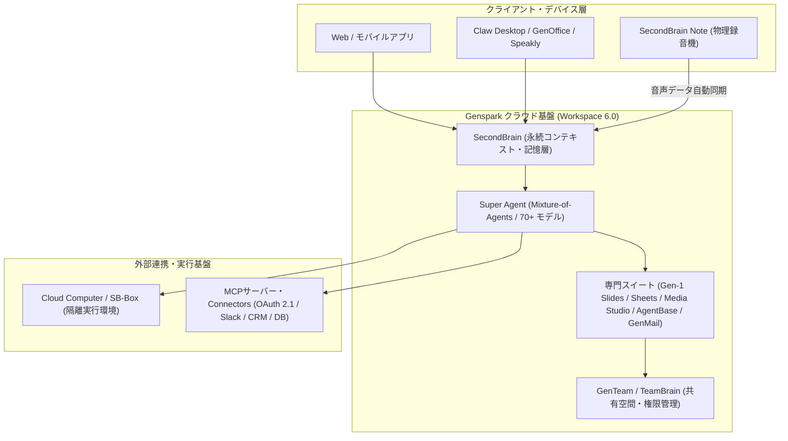

# **Genspark 調査レポート**

## **1. 基本情報**

* **ツール名**: Genspark
* **ツールの読み方**: ジェンスパーク
* **開発元**: MainFunc, Inc. (GENSPARK INC)
* **公式サイト**: [https://www.genspark.ai/](https://www.genspark.ai/)
* **関連リンク**:
  * 公式ブログ: [Genspark Blog](https://www.genspark.ai/blog)
  * アプリストア: [App Store](https://apps.apple.com/us/app/genspark-ai-workspace/id6739554054)
* **カテゴリ**: AI検索/ブラウザ拡張（All-in-One AIワークスペース）
* **概要**: Gensparkは、単なるAI検索やチャットボットを超え、リサーチ、執筆、データ分析、スライド・動画制作、メール対応などの業務タスクを自律的に実行する「All-in-One AI Workspace」です。Workspace 3.0/4.0でのAI従業員（Genspark Claw）の導入に続き、2026年7月のWorkspace 6.0では永続記憶層「SecondBrain」と統合知能エンジン「Super Agent」を中核に据え、さらに内製スライドモデル「Gen-1 Slides」や動画スタジオ「Media Studio」、チーム向け知識基盤「TeamBrain」へとエコシステムを拡大しています。

## **2. 目的と主な利用シーン**

* **解決する課題**: 複数のツール（検索エンジン、AIチャット、Officeソフト、メールクライアント、会議録音ツール、動画編集ソフトなど）を行き来する手間やコンテキスト分断を解消し、単一のプラットフォームで業務を完結させる。
* **想定利用者**:
  * マーケター、コンテンツクリエイター
  * ビジネスアナリスト、リサーチャー
  * スタートアップの経営者、個人事業主、および部門単位でAI導入を進める企業チーム
* **利用シーン**:
  * **包括的な市場調査と資料化**: 競合分析からSparkpagesによるレポート作成、Gen-1 Slidesを用いたプレゼン資料化までを一気通貫で行う。
  * **コンテキストを引き継いだ業務自動化**: SecondBrainに蓄積された過去のメール・会議・ドキュメントの文脈を踏まえ、Super AgentやGenMailが返信案作成や調査レポート作成を自動実行する。
  * **データ分析と社内ツール構築**: 自然言語で指示するだけでAI Sheetsによる集計・可視化や、AgentBaseを用いたカスタムCRM・管理ダッシュボードの構築を行う。
  * **会議の記録とアクション化**: オンライン会議（Meeting Bots）や対面会議（SecondBrain Note）を録音・文字起こしし、自動で議事録作成とタスク抽出を行う。

### **2.1 代表的な利用フロー**

```mermaid
swimlane-beta TB
  subgraph User["ユーザー"]
    A["業務目的や指示を入力"]
    F["生成物・実行結果を確認"]
  end
  subgraph Workspace["Genspark Workspace"]
    B["SecondBrainから文脈を取得"]
    C["Super Agentが計画・モデル選択"]
    E["成果物（Slides/Docs/動画等）を生成"]
  end
  subgraph External["外部ツール・実行環境"]
    D["Web検索・MCP連携・Claw操作を実行"]
  end
  A --> B
  B --> C
  C --> D
  D --> E
  E --> F
```

* **代表的な流れ**: ユーザーが指示を入力すると、まずSecondBrainから過去のメール・会議・ファイル等の継続的な文脈が読み込まれます。その上でSuper AgentがMixture-of-Agents構成で最適なモデルと外部ツール（Web検索、MCPサーバー連携、Clawによるブラウザ・ローカル操作）を呼び出し、最終的な成果物を生成してユーザーに返却します。

## **3. 主要機能**

* **SecondBrain / SecondBrain Note**: メール、チャット、ドキュメント、会議履歴、アプリ利用履歴を横断的に統合し、ユーザー固有の文脈を保持し続ける永続メモリ層です。マグネット装着型の超薄型物理AIボイスレコーダー「SecondBrain Note」を使えば、対面の打ち合わせ内容も自動で要約されSecondBrainへ同期されます。
* **Super Agent (Mixture-of-Agents)**: SecondBrainの文脈上で動作する中核知能エンジンです。70以上のAIモデルをタスクに応じて動的に組み合わせ、コード実行、Webリサーチ、ファイル生成などの複数ステップを自律的に完遂します。
* **Genspark Claw (AI従業員)**: クラウド上の専用環境（Cloud Computer）およびネイティブデスクトップクライアント（Computer Use / Browser Use）を通じて、ローカルファイルの整理やWebブラウザ操作、Slack・Teams・WhatsApp等のメッセージ処理を自律代行します。
* **Gen-1 Slides / AI Sheets / AI Docs**: 2026年9月発表の内製プレゼン特化モデル「Gen-1 Slides」により、Standardモードで低コストかつ高品質なビジネススライドを生成します。また、AI Sheets/Docsによる表計算・文書作成に加え、ローカル動作するオープンソースのデスクトップ版「GenOffice」（Apache 2.0）も提供されています。
* **AgentBase / GenMail / GenTeam**: Workspace 6.0で導入された専門スイート群です。AgentBaseは既存データやスプレッドシートから数分でCRMやトラッカー等の社内ツールを構築し、GenMailはユーザーの文体や人間関係を学習して受信トレイ整理や返信下書きを行います。GenTeamは人間とAIエージェントが同じ空間で協働できるマルチチーム環境です。
* **Genspark Media Studio**: 2026年10月にリリースされたオールインワンAI動画制作スタジオです。プロンプトから脚本、絵コンテ、ビジュアル、音声ナレーション、BGM、編集までを一貫して生成します。
* **Speakly / AI Meeting Notes**: Mac/Windows/iOS/Android対応の高速音声入力機能「Speakly」により、あらゆるアプリの入力欄へ文脈整形済みのテキストを音声で入力できます。会議の自動参加・文字起こし・リアルタイム翻訳機能も備えます。
* **Sparkpages**: リサーチ結果を、画像・動画・引用リンクを含む構造化されたWebページ形式のレポートとして自動生成します。

## **4. 動作原理・システム構成**

* **アーキテクチャ**: クラウド完結型のマルチエージェントSaaSを基本としつつ、ローカルPC操作（Genspark Claw for Desktop）やローカルドキュメント編集（GenOffice）と連携するハイブリッド構成を採用しています。
* **主要コンポーネントとデータフロー**:
  * **4層プラットフォーム構造（Workspace 6.0）**: ①「SecondBrain（永続記憶層）」がユーザーデータをベクトル化・構造化して保持し、②「Super Agent（知能エンジン）」が70以上の外部・内製モデル（Gen-1等）をオーケストレーション、③「Build / Office / Content Suites」が成果物を生成、④「GenTeam」がチーム共有と権限制御を担います。
  * **MCP（Model Context Protocol）双方向統合**: 外部のSaaSやDBへ接続する「MCPホスト（Connectors）」として機能する一方、Genspark自身の検索・Slides・Docs機能を外部エージェントへ公開するリモート「MCPサーバー（`/api/mcp`）」も提供しています。
* **特筆すべき要素技術**:
  * **Mixture-of-Agents & RL最適化モデル**: 汎用フロンティアモデル群に加え、オープンウェイトモデル（MiniMax M3等）を強化学習で後学習した特化型内製モデル（Gen-1 Slides）を併用し、品質と推論コストを最適化しています。
  * **OAuth 2.1 + PKCE / サンドボックス実行**: MCPサーバー連携はOAuth 2.1（PKCE対応）で保護され、コード実行やエージェントのブラウザ操作は隔離されたクラウド環境（Cloud Computer / SB-Box）内で実行されます。



## **5. 開始手順・セットアップ**

* **前提条件**:
  * Webブラウザ、またはmacOS / Windows / iOS / Androidデバイス
  * Googleアカウント、Appleアカウント、またはメールアドレスでの登録（無料プランはクレジットカード不要）
* **インストール/導入**:
  * Web版: [公式サイト](https://www.genspark.ai/)にアクセスしてサインインするのみ。
  * デスクトップ・モバイル版: Mac/Windows向けに「Genspark Claw for Desktop」「Speakly」「GenOffice」を提供。モバイル版はApp StoreまたはGoogle Playから「Genspark AI Workspace」をインストール。
* **初期設定**:
  * ログイン後、必要に応じて「Connectors」からGoogle Workspace、Outlook、Slack、Notion、または外部MCPサーバーを接続し、SecondBrainの文脈連携を有効化する。
* **クイックスタート**:
  * ホーム画面の検索バーに「〇〇の市場動向を調査してスライドを作成して」と入力し、Super AgentによるリサーチとGen-1 Slidesの生成結果を確認する。

## **6. 特徴・強み (Pros)**

* **圧倒的なオールインワン性とワークフロー統合**: リサーチ、Office業務（Sheets/Docs/Slides）、メール（GenMail）、動画制作（Media Studio）、社内アプリ構築（AgentBase）まで単一プラットフォームに統合されており、複数SaaSの契約・切り替えコストを大幅に削減できます。
* **SecondBrainによる「文脈の永続化」**: 従来のチャットAIが抱えていた「毎回前提を説明し直す手間」を、SecondBrainとTeamBrainによる自動コンテキスト蓄積で解消しています。
* **特化型内製モデルとOSSを含む開発力**: 業務特化の内製モデル「Gen-1 Slides」による高コスパな資料生成や、オープンソースの「GenOffice」公開など、極めて速いペース（数日〜数週間単位）で大型アップデートが継続しています。
* **エンタープライズ水準のセキュリティ認証**: SOC 2 Type IIおよびISO 27001:2022を取得し、顧客データをモデル学習に使用しない方針を明確化しているため、法人導入のハードルが大きく下がりました。

## **7. 弱み・注意点 (Cons)**

* **クレジット消費の予測しにくさと課金周りの不満**: 重いエージェント処理や動画生成では月間クレジットが急速に消費されることがあり、失敗・停止したタスクでのクレジット消費や返金対応に関する不満の声がレビューサイト（Trustpilot等）で挙がっています。
* **機能過多によるUIの複雑さと学習コスト**: 機能が急速に拡張されているため、ダッシュボードや各スイート（Claw、AgentBase、Connectors等）の使い分けに一定の習熟が必要です。
* **エクスポート品質と日本語の細部**: 生成したドキュメントやスライドをWord/PDF/PPTX形式で外部エクスポートする際、一部の複雑なレイアウトが崩れるケースが報告されています。また、日本語での利用には十分対応していますが、一部UIや最新機能の案内は英語優先で提供される傾向があります。

## **8. 料金プラン**

| プラン名 | 料金（月額 / 年額払い時） | 主な特徴 |
|---------|------------------------|---------|
| **Free** | 無料 | ・100クレジット/日（日次および通算上限あり）<br>・基本エージェント・Sparkpages<br>・1GB AI Driveストレージ / Speakly 4,000語/週<br>・商用利用権なし |
| **Plus** | $24.99/月<br>（年額: $19.99/月・$239.99/年） | ・10,000クレジット/月 + 週間Free Quota（Standardモード用）<br>・全Workspace機能（Gen-1 Slides, Sheets, Docs, GenMail, Media Studio等）<br>・50GBストレージ / Speakly無制限 / 商用利用可 |
| **Pro** | $249.99/月<br>（年額: $199.99/月・$2,399.99/年） | ・125,000クレジット/月 + Plusの10倍の週間Free Quota<br>・フラッグシップモデル・動画生成の高上限利用<br>・1TBストレージ / 最優先処理 / 商用利用可 |
| **Team** | $40/シート/月<br>（年額: $35/シート/月・$420/年） | ・10,000クレジット/シート/月（2〜150名向け）<br>・60GBストレージ/シート / 一元請求・管理画面<br>・モデル学習からの自動オプトアウト |
| **Enterprise** | カスタム見積り | ・20,000クレジット〜/シート/月（組織内プール可）<br>・SAML SSO・SCIM・監査ログ・データレジデンシ選択<br>・モデルガバナンス・専任CSM |

* **課金体系**: 個人・チーム向けのクレジット制サブスクリプション（年額割引あり）。有料プランでは日常的な標準チャットやStandardモードの作業向けに「週間Free Quota」が別枠で付与され、クレジット消費を緩和する仕組みが導入されています。
* **無料トライアル**: Freeプランが永続的な無料枠として利用可能です（クレジットカード登録不要）。

## **9. 導入実績・事例**

* **事業規模・導入企業**: 開発元のMainFunc社は、提供開始から約11ヶ月で年間経常収益（ARR）2億ドルを突破し、ユニコーン企業として急速に成長しています。2026年11月には日本のKDDI（KDDI Biz Edge）との戦略的提携が発表され、日本国内の中小企業向けにスマートフォン完結型の「Mobile Work AI」を2027年1月より本格展開する計画が示されました。
* **導入事例**: スタートアップやエージェンシーにおける市場調査・提案書（AI Slides）作成の高速化、マーケターによる動画コンテンツ制作、経営層・営業担当者の会議録音（Speakly / SecondBrain Note）とCRM連携による業務自動化などで活用されています。
* **対象業界**: マーケティング、コンサルティング、IT・ソフトウェア開発、教育、メディア、中小企業のバックオフィス業務。

## **10. サポート体制**

* **ドキュメント**: [公式サイト](https://www.genspark.ai/)およびアプリ内のヘルプ機能、ならびに[公式ブログ](https://www.genspark.ai/blog)にて、各機能やConnector設定のガイドが提供されています。
* **コミュニティ**: 公式DiscordコミュニティやSNSを通じたユーザー間の情報交換・ユースケース共有が活発に行われています。
* **公式サポート**: フィードバック・一般問い合わせ窓口（<feedbacks@genspark.ai>）、法人向け窓口（<enterprise@genspark.ai>）、およびアプリ内フィードバック機能で対応。Enterpriseプランでは専任のカスタマーサクセスマネージャー（CSM）が割り当てられます。

## **11. エコシステムと連携**

### **11.1 API・外部サービス連携**

* **API / MCP**: 標準化されたModel Context Protocol（MCP）を全面採用しています。外部エージェントからGensparkのツールを呼び出すホスト型MCPサーバー（`/api/mcp`、OAuth 2.1認証）を提供するほか、サンドボックス実行環境向けの`gsk CLI`やREST API、オープンソースの`genoffice CLI`を提供しています。
* **外部サービス連携**: 「Connectors」機能を通じて、Slack、Microsoft Teams、WhatsApp、Telegram、Discord、Google Workspace（Gmail/カレンダー/ドライブ）、Outlook、GitHub、WordPressなどと連携可能です。さらにCData Connect AI等のリモートMCPブリッジを介することで、Salesforce、Linear、各種SQLデータベースなど数百のエンタープライズアプリと接続できます。

### **11.2 技術スタックとの相性**

| 技術スタック | 相性 | メリット・推奨理由 | 懸念点・注意点 |
|:---|:---:|:---|:---|
| **Office (Word/Excel/PPT)** | ◯ | Gen-1 SlidesやAI Sheets/Docs、ローカル動作のGenOfficeにより高い互換性を確保 | 複雑なレイアウトのWord/PDFエクスポート時に崩れる場合がある |
| **MCP / 外部SaaS連携** | ◎ | MCPホスト・サーバー双方に対応し、OAuth 2.1で安全にCRMやDBと接続可能 | 外部MCPサーバー側の認証・権限設定に一定の知識が必要 |
| **Web開発 (GitHub/CLI)** | ◯ | Genspark CodeやGitHub連携、`gsk CLI`によるプロトタイピングが可能 | 本格的なチーム開発ではCursorやClaude Code等の専用IDEが優位 |
| **モバイル / 音声ワークフロー** | ◎ | SpeaklyやSecondBrain Noteによりスマホ完結の業務指示・録音が可能 | オフライン環境でのエージェント実行には制限がある |

## **12. セキュリティとコンプライアンス**

* **認証**: Google/Apple等のOAuth認証に加え、EnterpriseプランではOkta等に対応した**SAML SSO**、**SCIMプロビジョニング**、および自動ドメインクレームをサポートしています。
* **データ管理**: 顧客のプロンプト、アップロードファイル、生成結果を基盤モデルの学習には一切使用しないことを技術的・契約的に保証しています（Team/Enterpriseはデフォルトでオプトアウト）。データの所有権は顧客に帰属し、管理画面からは個人プロジェクトの生データ閲覧を制限しつつ監査ログやクレジット利用状況を監視できます。Enterpriseプランではデータレジデンシ（US / EU / APAC）の選択も可能です。
* **準拠規格**: **SOC 2 Type II** および **ISO 27001:2022** の認証を取得しています。公式Trust Centerにてセキュリティ統制の概要が公開されており、詳細な監査レポートはNDA締結の上で企業向けに開示されます。

## **13. 操作性 (UI/UX) と学習コスト**

* **UI/UX**: Web、デスクトップ（Claw / GenOffice / Speakly）、モバイルアプリとマルチデバイスに対応した統合ワークスペース型のUIを備えています。音声入力（Speakly）や自然言語プロンプトを中心に直感的に操作できる一方、提供スイート（Build / Office / Content）が多岐にわたるため、画面構成は多機能で情報密度が高めです。
* **学習コスト**: 基本的なAI検索やスライド生成は数分で使い始められますが、SecondBrainの文脈連携、MCP Connectors、Clawのカスタムスキル設定など高度な自動化を使いこなすには一定の学習期間が必要です。

## **14. ベストプラクティス**

* **効果的な活用法 (Modern Practices)**:
  * **SecondBrainへのコンテキスト集約**: Gmail/Outlookやカレンダー、Speakly/SecondBrain Noteを早期に連携し、AIが毎回ゼロから背景を推測しなくて済む状態を作る。
  * **StandardモードとFree Quotaの活用**: 日常的な下書きやスライド初稿はGen-1 Slides等のStandardモード（週間Free Quota対象）で行い、月間クレジットを重いSuper Agent調査やMedia Studioの動画生成に温存する。
  * **機密ファイルのローカル編集にはGenOfficeを併用**: 社外秘のローカルOfficeファイルを直接編集したい場合は、Apache 2.0のデスクトップアプリ「GenOffice」やBYOK構成を活用する。
* **陥りやすい罠 (Antipatterns)**:
  * **曖昧なプロンプトでの長時間エージェント実行**: 目的や出力形式を絞らずにSuper Agentや動画生成を連続実行すると、想定以上にクレジットを消費する原因になる。
  * **完全なレイアウト再現を前提とした最終納品**: エクスポート時の微調整が発生する前提で、Genspark上では構成案・8割の完成度までを作り込み、必要に応じて手元で仕上げるのが安全です。

## **15. ユーザーの声（レビュー分析）**

* **調査対象**: App Store (US)、G2、Trustpilot
* **総合評価**: App Store 4.7/5.0、G2 約4.3/5.0、Trustpilot 1.5〜3.8/5.0（プラットフォームにより評価が二極化）
* **ポジティブな評価**:
  * 「単なるチャットAIとは異なり、リサーチからAI Slidesでの資料作成、ワークスペース統合までが実務レベルで完結し、大幅な時短になる。」（App Store / Trustpilot高評価レビュー）
  * 「Mixture-of-Agentsにより複数の最新モデルを1つの環境で使い分けられ、文章作成やノート整理のワークフローがスムーズ。」（G2）
  * 「無料枠が毎日リフレッシュされるため、ライトユーザーでも実用性を試しやすい。」（App Store）
* **ネガティブな評価 / 改善要望**:
  * 「重いエージェントタスクを実行した際やタスクが途中で失敗した際にクレジットが急速に消費され、課金や返金サポートへの不満がある。」（Trustpilot / Reddit）
  * 「機能が非常に多く、どこに何があるか直感的に分かりにくい場面がある。高度な自動化には慣れが必要。」（G2 / 一般レビュー）
  * 「WordやPDFへエクスポートした際にレイアウトや余白が崩れることがあり、仕上げの調整が必要。」（App Store / ユーザー報告）
* **特徴的なユースケース**:
  * 営業提案資料や社内マニュアルのドラフトをGen-1 SlidesとSparkpagesで高速に作成し、会議中の音声メモ（Speakly）からそのまま次のアクションレポートへ繋げる運用が多く報告されています。

## **16. 直近半年のアップデート情報**

* **2026-11-05**: 組織内のメール・会議議事録・ドキュメントを自動整理して共有知化する「TeamBrain」を発表。あわせてKDDI Biz Edgeとの戦略的提携を発表し、日本の中小企業向けにスマートフォン完結型の「Mobile Work AI」を2027年1月から展開する計画を公表。
* **2026-10-27**: 脚本・絵コンテ・音声・編集を統合処理するオールインワンAI動画制作スタジオ「Genspark Media Studio」をリリース。
* **2026-09-XX**: プレゼンテーション生成に特化した初の内製モデル「Gen-1 Slides」を発表（オープンウェイト基盤＋強化学習により、Standardモードでの高品質・低コストなスライド生成を実現）。
* **2026-08-XX**: オープンソース（Apache 2.0）のデスクトップAIオフィススイート「GenOffice」をGitHub（`genspark-ai/genoffice`）で公開。
* **2026-07-20**: 大型アップデート「Genspark AI Workspace 6.0」をリリース。永続記憶層「SecondBrain」（物理録音デバイスSecondBrain Note含む）、中核知能エンジン「Super Agent」、カスタム業務アプリ構築ツール「AgentBase」、エージェント型メール「GenMail」、協働空間「GenTeam」を導入。
* **2026-04-08**: 「Genspark AI Workspace 4.0」リリース。デスクトップ版Genspark Clawによるローカル操作（Computer Use / Browser Use）を強化。
* **2026-03-12**: 「Genspark AI Workspace 3.0」および「Genspark Claw」リリース。AI従業員が独自のクラウドコンピュータ上で稼働開始。新しいワークフロー、チーム機能、Meeting Bots、モバイル向けSpeakly、Chrome拡張機能を追加。
* **2026-01-28**: 「Genspark AI Workspace 2.0」リリース。タイピング不要で音声のみで作業が完了するよう機能を強化。
* **2026-01-23**: Version 2.7.2 リリース。機能改善とバグ修正。
* **2026-01-14**: Version 2.6.0 リリース。
* **2025-12-XX**: 音声入力機能「Speakly」の導入。
* **2025-11-29**: Version 2.5.0 リリース。

(出典: [Genspark Blog](https://www.genspark.ai/blog) / App Store Version History)

## **17. 類似ツールとの比較**

### **17.1 機能比較表 (星取表)**

| 機能カテゴリ | 機能項目 | Genspark | Perplexity | Felo | Google Disco |
|:---:|:---|:---:|:---:|:---:|:---:|
| **リサーチ** | 検索・情報収集 | ◎<br><small>Super Agent + SecondBrain</small> | ◎<br><small>高精度・高速・出典明記</small> | ◎<br><small>多言語検索・翻訳に強み</small> | ◯<br><small>タブ連携リサーチ</small> |
| **オフィス・制作** | スライド・文書・表計算 | ◎<br><small>Gen-1 Slides / Sheets / GenOffice</small> | △<br><small>簡易出力のみ</small> | ◎<br><small>LiveDoc / AI Slides</small> | △<br><small>GenTabsアプリ生成</small> |
| **マルチモーダル** | 音声・画像・動画 | ◎<br><small>Speakly / Media Studio</small> | ◯<br><small>画像生成・ファイル分析</small> | ◎<br><small>Video Agent / Nano Banana 2.1</small> | △<br><small>限定的</small> |
| **自律性・連携** | タスク完結・API/MCP | ◎<br><small>Claw / MCPホスト&サーバー</small> | ◯<br><small>Agent API (Finance等)</small> | ◎<br><small>Felo API Platform (LLM Gateway)</small> | ◯<br><small>AI-Enabled Pointer</small> |
| **セキュリティ** | エンタープライズ認証 | ◎<br><small>SOC 2 Type II / ISO 27001:2022</small> | ◎<br><small>SOC 2 Type II (Enterprise)</small> | ◎<br><small>ISO 27001 / SOC 2 Type 1</small> | △<br><small>Google Labs実験枠</small> |

### **17.2 詳細比較**

| ツール名 | 特徴 | 強み | 弱み | 選択肢となるケース |
|---------|------|------|------|------------------|
| **Genspark** | 永続記憶×All-in-One AIワークスペース | SecondBrainによる文脈保持、Gen-1 Slides、Media Studio、Claw、GenMailまで業務全体を一元化できる。 | 機能が多くUIが複雑。クレジット消費の透明性に課題が指摘される。 | 検索から資料・動画制作、メール、会議管理まで1つの基盤で自動化したい場合。 |
| **Perplexity** | 対話型AI検索エンジン | 情報源の正確性と検索速度が極めて高く、UIがシンプルで使いやすい。 | Office編集や動画制作、メール連携などのワークスペース機能は薄い。 | 純粋に信頼性の高い情報検索とファクトチェックを素早く行いたい場合。 |
| **Felo** | 多言語AI検索＆制作ワークスペース | 多言語検索・翻訳能力、LiveDoc（無限キャンバス）、Video Agent、統合LLM Gatewayを備える。 | 多機能化に伴う学習コストがやや高い。 | 海外情報の調査からスライド・動画生成、あるいはAPIゲートウェイ活用を重視する場合。 |
| **Google Disco** | 実験的AIブラウザ (Google Labs) | 複数タブを動的な「GenTabs」アプリへ変換する革新的なブラウジング体験。 | ウェイトリスト制でアクセス制限があり、実験段階。 | 複数Webページを横断しながら新しいブラウザ体験を試したい場合。 |

## **18. 総評**

* **総合的な評価**:
  Gensparkは「AI検索エンジン」から完全に脱却し、永続記憶（SecondBrain）と自律エージェント（Super Agent / Claw）を備えた次世代の統合業務スイートへと進化しました。特に2026年後半のWorkspace 6.0、Gen-1 Slides、Media Studio、TeamBrain、そしてSOC 2 Type II・ISO 27001:2022取得によって、個人向けツールからエンタープライズ対応プラットフォームへと完成度を高めています。
* **推奨されるチームやプロジェクト**:
  リサーチから企画書・スライド・動画制作、日々のメール・会議処理まで少人数で幅広くこなす必要があるスタートアップ、マーケター、リサーチャー、および業務AIの一本化を検討する中小・中堅企業（Team/Enterprise）に最適です。
* **選択時のポイント**:
  「検索の速さと出典の明快さ」を最優先するならPerplexity、「多言語調査と無限キャンバス・動画・LLM Gateway」を重視するならFelo、「組織の文脈を記憶させながらOffice業務・制作・メールまで丸ごと自動化したい」場合はGensparkが有力な選択肢となります。導入時は無料プランや週間Free Quotaの挙動を確認し、クレジット消費ペースを見極めた上でプランを選定することを推奨します。
