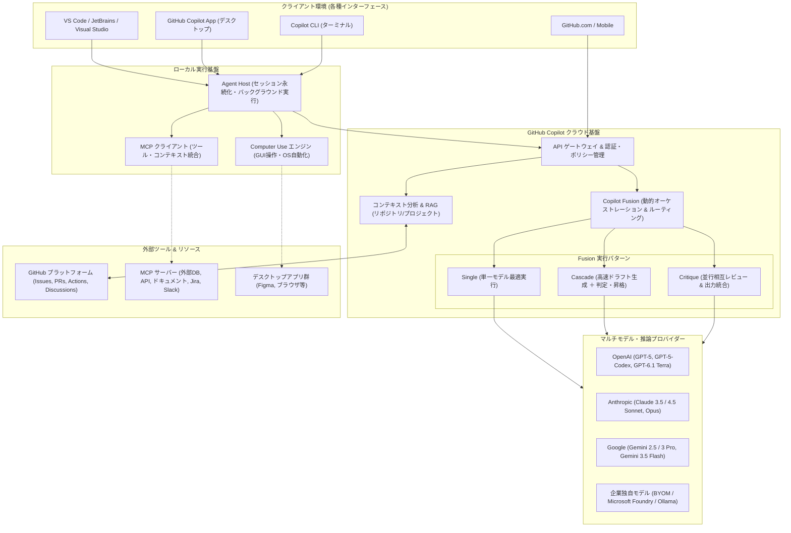

# **GitHub Copilot 調査レポート**

## **1. 基本情報**

* **ツール名**: GitHub Copilot
* **ツールの読み方**: ギットハブ コパイロット
* **開発元**: GitHub (Microsoft)
* **公式サイト**: [https://github.com/features/copilot](https://github.com/features/copilot)
* **関連リンク**:
  * ドキュメント: [https://docs.github.com/en/copilot](https://docs.github.com/en/copilot)
  * 更新履歴 (GitHub Changelog): [https://github.blog/changelog/label/copilot/](https://github.blog/changelog/label/copilot/)
* **カテゴリ**: AIコーディング支援
* **概要**: GitHub Copilotは、GitHubとMicrosoftが提供する世界標準のAIペアプログラマー兼自律エージェントプラットフォームです。最新のモデル群を自動オーケストレーションする「Copilot Fusion」を搭載し、IDE拡張、スタンドアロンのCopilot App、CLI、GitHub.com全体でシームレスなコード生成、プロジェクト自動化、タスク実行を支援します。

## **2. 目的と主な利用シーン**

* **解決する課題**: ボイラープレート作成などの定常作業の削減、複雑なマルチリポジトリ開発における文脈把握、テストやドキュメント作成の自動化、およびエラー修復や脆弱性対策の迅速化。
* **想定利用者**: 個人開発者、スタートアップ、オープンソースコミュニティ、エンタープライズのソフトウェアエンジニアおよびプロジェクトマネージャー。
* **利用シーン**:
  * **日常的なコーディング支援**: エディタ内でのリアルタイムコード補完、関数生成、型定義の自動補完。
  * **マルチファイル編集とリファクタリング**: 「Copilot Edits」を用いた複数ファイルにまたがるコードベースの改修やフレームワーク移行。
  * **プロジェクト全体の自律推進**: スタンドアロンの「Copilot App」と「Copilot Projects」を用い、複数リポジトリや外部ドキュメント（Figma、Slack等）を参照したゴール設定とPull Requestの自動生成。
  * **デスクトップアプリの操作自動化**: 「Computer Use」によるGUI操作を通じた、APIのない外部ツールやテスト環境の自動ナビゲーション。
  * **クロスデバイスでの継続開発**: モバイル（GitHub Mobile）で指示したエージェントセッションをデスクトップIDE（VS Code等）やWebでシームレスに引き継ぎ。
  * **コードレビューと品質改善**: Cloud Agentによるプルリクエストの自動レビューおよび指摘事項のワンクリック適用。

## **3. 主要機能**

* **Copilot Fusion（動的モデルオーケストレーション）**: 単一モデルを手動で選ぶだけでなく、タスクの難易度に応じて複数のLLMを協調動作させるルーティングエンジン。下書きを高速モデルで行い判定モデルが昇格させる「Cascade」や、並行して相互批評し最終出力を合成する「Critique」などのパターンを提供し、Effort level（Standard, High, Max）で推論の深さを調整可能。
* **Copilot App & Copilot Projects**: ワークスペース全体を統括するスタンドアロンアプリケーション。複数のリポジトリや仕様書を束ねたプロジェクト単位で自律エージェントにタスクを指示し、バックグラウンドでプルリクエストを組み立てることが可能。
* **Computer Use（デスクトップ操作自動化）**: macOSおよびWindowsに対応し、エージェントが画面コンテキストを認識してマウスクリックやキーボード入力、アプリ間移動を実行。MCPやAPIが用意されていないネイティブGUIツールの操作を支援。
* **Cross-Client Session Continuity & Agent Host**: モバイル、VS Code、Copilot App、CLI、Webブラウザを横断してエージェントの作業状態を同期。エディタウィンドウを閉じても、独立したAgent Hostによってバックグラウンドで処理が継続。
* **Copilot Edits**: プロジェクト全体の構造と依存関係を認識し、複数ファイルにまたがるコード変更を一度に生成・適用・差分レビューできる高度な編集機能。
* **マルチモデル対応**: OpenAI（GPT-5, GPT-5-Codex, GPT-6.1 Terra等）、Anthropic（Claude 3.5 / 4.5 Sonnet, Claude Opus）、Google（Gemini 2.5 / 3 Pro, Gemini 3.5 Flash）などの主要フロンティアモデルを選択可能。
* **画像生成・編集**: Copilot Chat内で自然言語の指示を与えるだけで、アーキテクチャ図やUIイメージなどの画像を直接生成・編集。
* **Copilot CLI & カスタムエージェント**: ターミナル上で自然言語によるコマンド提案・解説を行うほか、「Plan」「Task」エージェントによるスクリプト生成と実行制御をサポート。
* **Model Context Protocol (MCP) & BYOM**: 業界標準のMCPをネイティブ統合し、社内データベースや外部ツール（Slack, Jira等）との安全なコンテキスト連携を実現。企業固有のモデルを持ち込む「Bring Your Own Model (BYOM)」にも対応。

## **4. 動作原理・システム構成**

* **アーキテクチャ**: ハイブリッド・クライアント/クラウド＆独立エージェントホスト構成。
  開発者が操作する各種フロントエンド（VS Code, JetBrains, Copilot App, CLI, Web/Mobile）と、ローカル常駐の「Agent Host」、およびGitHubのクラウド基盤が連携して動作します。



* **主要コンポーネントとデータフロー**:
  * **インターフェース層**: 各IDE拡張、Copilot App、CLI、Web/Mobileからプロンプトやコーディング操作が送信されます。
  * **Agent Host（ローカル常駐プロセス）**: IDEのウィンドウ状態から独立して動作するローカルプロセスであり、長時間の自律タスク実行やクライアント間でのセッション永続化を担います。
  * **Copilot Fusion（オーケストレーター）**: クラウド側でユーザーの指示内容、プロジェクト構造、指定されたEffort levelを解析し、単一モデル（Single）、下書き・検証（Cascade）、並行批評・合成（Critique）の最適な実行パターンを動的に振り分けます。
  * **コンテキスト収集エンジン**: 開いているファイル、隣接タブ、インポート文、リポジトリ全体のインデックス、GitHub上のIssueやPRを解析し、セキュアにプロンプトへ注入します。
* **特筆すべき要素技術**:
  * **Model Context Protocol (MCP)**: エージェントが外部ツールやデータソースと双方向に対話するためのオープン標準プロトコル。
  * **セーフティ＆パーミッションゲート**: Computer Useやファイルシステムへの破壊的変更の前にユーザーの承認を求めるセーフガード機構。
  * **クラウドエージェントサンドボックス**: リモートコンテナ環境上でActionsの修復やPRのテスト検証を安全に自律実行する隔離環境。

## **5. 開始手順・セットアップ**

* **前提条件**:
  * GitHubアカウント（Free, Pro, Pro+, Business, EnterpriseいずれかのCopilotライセンス）
  * サポートされているIDE（VS Code, Visual Studio, JetBrains IDEs, Xcode, Neovim等）またはスタンドアロンCopilot App
* **インストール/導入**:

  ```bash
  # VS Codeの場合（拡張機能をインストール）
  code --install-extension GitHub.copilot
  code --install-extension GitHub.copilot-chat

  # GitHub CLI Copilot拡張の場合
  gh extension install github/gh-copilot
  ```

* **初期設定**:
  * IDEまたはCopilot Appの初回起動時に、画面の案内に従ってGitHubアカウントでサインインし、Copilotのアクセスを認証します。
  * 必要に応じて、設定画面からモデルピッカー（Copilot Fusion、Claude 4.5 Sonnet、GPT-5など）やMCPサーバーの接続先を設定します。
* **クイックスタート**:
  * **コード補完**: エディタでコードやコメントを入力すると薄いグレーで提案が表示され、`Tab`キーで受け入れます。
  * **Copilot Chat**: `Ctrl + Shift + I`（または `Cmd + Shift + I`）でインラインチャット、サイドバーでチャットパネルを開き、日本語で指示を入力します。
  * **Copilot Fusionの利用**: チャット画面のモデル一覧から「Copilot Fusion」を選択し、Effort level（Standard / High / Max）を指定して複雑な設計やリファクタリングを依頼します。

## **6. 特徴・強み (Pros)**

* **革新的なモデルオーケストレーション（Copilot Fusion）**: 単一モデルへの依存から脱却し、タスクの難易度に応じて複数モデルが検証・批評を行うことで、ハルシネーションを抑えつつ極めて高いコード品質を実現します。
* **比類なきGitHubエコシステムとの親和性**: Issueの割り当てからブランチ作成、コード実装、テスト実行、PR作成、CI/CD障害の自動修復まで、GitHubの開発サイクルに完全に組み込まれています。
* **クロスプラットフォーム＆セッション継続性**: デスクトップIDEだけでなく、スタンドアロンApp、モバイル、ターミナルCLI、ブラウザの間でシームレスにタスクを引き継げる柔軟性があります。
* **無料プラン（Copilot Free）の存在**: 個人開発者や学生でも基本機能を完全無料で体験・利用でき、導入のハードルが非常に低いです。
* **エンタープライズ対応のセキュリティとガバナンス**: 商用コードの学習排除保証、IP（知的財産）補償、モデル利用ポリシーの集中管理、SOC 2 / ISO 27001準拠など、大企業が安心して導入できる管理基盤が整っています。

## **7. 弱み・注意点 (Cons)**

* **上位プラン（Pro+等）の高価格帯**: 最上位モデルの大量実行やGitHub Spark、専用拡張をフル活用できるPro+プランは月額$39であり、個人のホビーユースとしてはコスト負担が大きくなります。
* **機能拡充に伴う認知・学習コスト**: 単純なコード補完から、Edits、Fusion、Projects、Computer Use、MCP、カスタムエージェントへと機能が急拡大したため、全貌を把握して使い分けるための学習が必要です。
* **最新機能における日本語対応の先行度合い**: チャットやコード生成自体は自然な日本語に対応しているものの、最新アップデート情報、詳細ドキュメント、一部の先進的ベータ機能のUIは英語が先行する傾向があります。

## **8. 料金プラン**

| プラン名 | 料金 | 主な特徴 |
|---|---|---|
| **Copilot Free** | 無料 | 月2,000回のコード補完、月50回のチャット/エージェントリクエスト。軽量モデル（GPT-4.1系/Haiku等）を利用可能。 |
| **Copilot Pro** | $10/月 | 無制限のコード補完、無制限のチャット。月300回のプレミアムリクエスト（Fusion、GPT-5、Claude 4.5 Sonnet等）。CLI、Edits対応。 |
| **Copilot Pro+** | $39/月 | Proの全機能に加え、月1,500回のプレミアムリクエスト。全フロンティアモデル（Opus等）へのフルアクセス。GitHub Spark、高度なCopilot App機能。 |
| **Copilot Business** | $19/ユーザー/月 | 組織向けポリシー管理、IP補償、プライベートコードの非学習保証。CLI、Copilot Edits、Fusion利用。シート即時課金。 |
| **Copilot Enterprise** | $39/ユーザー/月 | Businessの全機能に加え、社内コードベース全体のナレッジ検索、カスタムファインチューニング、Enterpriseライセンス連携。 |

* **課金体系**: ユーザー単位（個人向けは月額/年額、組織向けはユーザーごとの月額課金）。
* **無料トライアル**: 個人向け有料プラン（Pro）において30日間の無料トライアルが提供されています。

## **9. 導入実績・事例**

* **導入企業**: Shopify, Duolingo, Stripe, Dell Technologies, Mercado Libre, Accenture, AMD などグローバル大手から成長企業まで多数。
* **導入事例**:
  * **Shopify**: 開発組織全体でGitHub Copilotを標準採用し、コードの採用率が大幅に向上するとともに、開発者の新規プロジェクト立ち上げや反復作業にかかる時間を劇的に削減。
  * **Duolingo**: 内部ツールの開発やテスト自動化においてCopilotを活用し、開発速度とコードレビューのサイクルタイム短縮を実現。
* **対象業界**: ソフトウェア・ITサービス、金融、製造、通信、Eコマース、ヘルスケアなど、自社でソフトウェア開発を行うすべての業界。

## **10. サポート体制**

* **ドキュメント**: [GitHub Docs (Copilot)](https://docs.github.com/en/copilot) にて、アーキテクチャ、セットアップ、ベストプラクティス、MCP連携ガイドが多言語で網羅的に提供されています。
* **コミュニティ**: [GitHub Community Discussions (Copilot)](https://github.com/orgs/community/discussions/categories/copilot) で世界中の開発者や製品チームと活発な質疑応答が行われています。
* **公式サポート**: BusinessおよびEnterprise契約者向けの専任サポート窓口（チケット・SLA付き対応）、および全プラン向けのヘルプデスクが用意されています。

## **11. エコシステムと連携**

### **11.1 API・外部サービス連携**

* **API**: GitHub REST/GraphQL APIを通じた利用メトリクス取得、モデルポリシー管理API、Copilot SDKによる拡張機能開発。
* **外部サービス連携**:
  * **Model Context Protocol (MCP)**: Slack、Figma、Jira、PostgreSQL、NotionなどのMCPサーバーと接続し、エージェントへ外部コンテキストを提供。
  * **IDE/エディタ**: Visual Studio Code, Visual Studio, JetBrains（IntelliJ, PyCharm, WebStorm等）, Xcode, Neovim, Eclipse。
  * **コミュニケーション**: GitHub Mobile、Slack連携、Teams連携。

### **11.2 技術スタックとの相性**

| 技術スタック | 相性 | メリット・推奨理由 | 懸念点・注意点 |
|:---|:---:|:---|:---|
| **TypeScript / JavaScript** | ◎ | 最も学習データが豊富で、型推論やフレームワーク固有のボイラープレート生成が極めて高精度。 | 大規模なモノレポではコンテキスト管理（Editsの活用）が推奨される。 |
| **Python** | ◎ | Web開発、データ分析、AI/MLスクリプト全般で高い精度。テスト生成も極めて強力。 | 動的型付けのため、型ヒントを明記したプロンプトがより効果的。 |
| **Go / Rust** | ◎ | 厳格な型システムや並行処理ロジックに対し、FusionのCritiqueモードによる検証が有効。 | 複雑なマクロやライフタイム指定は人間の確認が必要。 |
| **C# / .NET** | ◎ | Visual Studioとの緊密な統合があり、NuGet脆弱性の自動修復やリファクタリングが充実。 | 特になし。 |
| **C / C++** | ◯ | MSVC Modernization AgentによるC++コードベースの自動近代化支援が利用可能。 | ポインタ操作やハードウェア依存コードは慎重なレビューが必須。 |
| **Shell / Bash** | ◎ | Copilot CLIとの組み合わせにより、複雑なワンライナーや自動化スクリプトの作成が容易。 | システム変更を伴うスクリプトは実行前に確認が必要。 |

## **12. セキュリティとコンプライアンス**

* **認証**: GitHubアカウント認証、二要素認証（2FA）、組織向けSAML SSO、およびSCIMプロビジョニング。
* **データ管理**:
  * **非学習保証**: Copilot BusinessおよびEnterpriseでは、ユーザーのプロンプトおよびコード提案がAIモデルの再学習に使用されることは一切ありません。
  * **暗号化**: すべてのデータ通信はTLS 1.3以上で保護され、保存データもAES-256で強固に暗号化されます。
* **準拠規格**: SOC 2 Type II, ISO/IEC 27001, GDPR, CCPA準拠。Microsoftのエンタープライズトラスト原則に準拠。
* **エージェント・Computer Useのセキュリティ**: ファイル書き込み、コマンド実行、GUI操作は権限モデルに基づき、実行前にユーザーの確認ステップを挟むセーフガードが組み込まれています。

## **13. 操作性 (UI/UX) と学習コスト**

* **UI/UX**:
  * 開発者の思考を妨げないインラインゴーストテキストによる補完体験。
  * IDEサイドバーのチャット、ファイル横断編集専用の「Copilot Edits」、タスク俯瞰用の「Copilot App」など、目的に応じて整理された多層的UI。
  * 複数デバイス（モバイル、IDE、Web）間でシームレスに継続するセッション同期。
* **学習コスト**:
  * 基本的なコード補完やインライン質問は導入した当日から直感的に利用可能です。
  * 一方で、FusionのEffort levelの使い分け、MCPサーバーの構成、Copilot Projectsでの自律エージェント運用をチームで最大活用するには、一定のプラクティス習得が必要です。

## **14. ベストプラクティス**

* **効果的な活用法 (Modern Practices)**:
  * **Fusionエフォートレベルの使い分け**: 日常の単純作業には「Standard」、アーキテクチャ設計や難解なバグ調査には「High」または「Max（Cascade/Critique起動）」を指定して最適な品質と応答性を得る。
  * **明示的なコンテキスト設計**: 複数ファイル編集（Copilot Edits）時は、関連する型定義ファイルやテストファイルをアクティブタブや参照リストに含める。
  * **MCPを活用したドメイン知識の注入**: 自社仕様書やAPIスキーマをMCPサーバー経由で接続し、社内固有の規約に沿った実装を生成させる。
* **陥りやすい罠 (Antipatterns)**:
  * **ノーレビューマージ**: エージェントが生成したPRやコードを無検証で本番ブランチにマージすることは避ける。
  * **Computer Useの全面放置**: デスクトップGUIの自動操作時は、意図しない外部通信やデータ削除が発生しないよう承認プロンプトを注視する。
  * **プロンプトへの機密情報埋め込み**: APIキーやパスワードなどのハードコードをチャットに直接貼り付けない。

## **15. ユーザーの声（レビュー分析）**

* **調査対象**: G2, Gartner Peer Insights, SoftwareReviews などの主要レビュープラットフォーム。
* **総合評価**: 4.7 / 5.0 (G2 レビュー平均)
* **ポジティブな評価**:
  * 「Copilot Fusionにより、モデルの手動切り替えに悩む必要がなくなり、コードの正解率が格段に上がった」
  * 「Copilot EditsとProjectsによって、Issueからプルリクエストまでの一連の作業が自動化され、開発速度が2倍以上になった」
  * 「VS Code、ターミナル、モバイル間でセッションが引き継がれるため、場所を選ばずにエージェントへタスクを依頼できる」
* **ネガティブな評価 / 改善要望**:
  * 「最上位のPro+プランやEnterpriseは機能が素晴らしい反面、小規模チームにはコスト負担が大きい」
  * 「機能が急速に追加されているため、どの機能をどの画面（IDE / App / Web）で使うのがベストなのか迷うことがある」
* **特徴的なユースケース**:
  * 大規模なレガシーコードベースの言語・フレームワーク移行において、Copilot EditsとFusionのCritique機能を活用し、型エラーのない段階的リファクタリングを完遂。

## **16. 直近半年のアップデート情報**

* **2026-10-28**: **GitHub Copilot Fusion 一般提供開始 (GA)**: タスクの難易度に応じて複数モデル（Single, Cascade, Critique）を動的にオーケストレーションし、Effort level（Standard, High, Max）を選択可能なルーティングエンジンを提供。(出典: [GitHub Changelog](https://github.blog/changelog/label/copilot/))
* **2026-10-28**: **GitHub Copilot App & Projects パブリックプレビュー**: 複数リポジトリや外部ドキュメントを横断して自律エージェントにタスクを委任できるスタンドアロンデスクトップアプリを発表。(出典: [GitHub Blog](https://github.blog/))
* **2026-10-28**: **Computer Use パブリックプレビュー**: macOSおよびWindows上で、エージェントがデスクトップGUIを直接操作・自動化できる機能を発表。(出典: [GitHub Blog](https://github.blog/))
* **2026-10-28**: **Cross-Client Session Continuity & 独立Agent Host**: モバイル、IDE、Web、CLI間でのセッション同期と、エディタウィンドウから独立したバックグラウンドエージェント実行基盤を提供。(出典: [GitHub Changelog](https://github.blog/changelog/label/copilot/))
* **2026-10-28**: **画像生成・編集機能 パブリックプレビュー**: Copilot Chat内で自然言語プロンプトにより画像を直接生成・編集できる機能をリリース。(出典: [GitHub Blog](https://github.blog/))
* **2026-09-18**: **Git Agent & MCPサーバー統合 (Visual Studio / VS Code)**: PR要約やコメント追跡機能の強化に加え、NuGet脆弱性をワンクリックで自動修復するエージェントアクションを追加。(出典: [GitHub Changelog](https://github.blog/changelog/label/copilot/))
* **2026-09-10**: **Bring Your Own Model (BYOM) プレビュー拡充**: Microsoft Foundry、OpenAI、Anthropic、Ollamaなどの独自モデルをCopilot SDKハーネス経由でエージェントに接続可能に。(出典: [GitHub Changelog](https://github.blog/changelog/label/copilot/))
* **2026-08-20**: **VS Code拡張機能アップデート**: サイドバイサイドチャット、Agent Plugins 1.0、プロンプトタイムラインによる履歴管理機能を追加。(出典: [GitHub Changelog](https://github.blog/changelog/label/copilot/))
* **2026-06-15**: **統合ブラウザツールGA & MSVC Modernization Agent GA**: VS Code内でのWeb検証ツールと、Visual StudioにおけるC++コード近代化エージェントが正式版に。(出典: [GitHub Changelog](https://github.blog/changelog/label/copilot/))
* **2026-05-20**: **Copilot on Web モデル刷新 & VS Code自動モデル選択**: WebおよびVS Codeでのタスク最適ルーティング機能を提供。(出典: [GitHub Changelog](https://github.blog/changelog/label/copilot/))
* **2026-05-19**: **Gemini 3.5 Flash GA & Cloud Agent コードレビュー反映**: 高速・低コストモデルのサポートと、コードレビューの指摘をワンクリックで反映するCloud Agent機能を導入。(出典: [GitHub Changelog](https://github.blog/changelog/label/copilot/))
* **2026-05-17**: **Business/Enterprise ベースモデル刷新**: ベースモデルを最新世代コーディングモデルに更新。(出典: [GitHub Changelog](https://github.blog/changelog/label/copilot/))

## **17. 類似ツールとの比較**

### **17.1 機能比較表 (星取表)**

| 機能カテゴリ | 機能項目 | 本ツール (Copilot) | Cursor | GitLab Duo | Amazon Q Developer |
|:---:|:---|:---:|:---:|:---:|:---:|
| **基本機能** | コード補完 | ◎<br><small>Fusion / GPT-5 / Claude 4.5</small> | ◎<br><small>Claude 3.5 / GPT-4o</small> | ◯<br><small>Claude 3.5 Sonnet</small> | ◯<br><small>Amazon Bedrock基盤</small> |
| **高度な編集** | マルチファイル編集 | ◎<br><small>Copilot Edits</small> | ◎<br><small>Composer</small> | △<br><small>限定的</small> | △<br><small>限定的</small> |
| **推論機構** | モデルオーケストレーション | ◎<br><small>Copilot Fusion (Cascade/Critique)</small> | △<br><small>単一モデル選択中心</small> | ×<br><small>固定ルーティング</small> | △<br><small>タスク別静的選択</small> |
| **自律エージェント** | プロジェクト自律推進 | ◎<br><small>Copilot Projects / Cloud Agent</small> | ◯<br><small>Agent mode (ローカル)</small> | △<br><small>開発中 / 実験的</small> | ◯<br><small>Q Developer Agents</small> |
| **GUI操作** | デスクトップ操作 (Computer Use) | ◎<br><small>macOS / Windows対応</small> | ×<br><small>非対応</small> | ×<br><small>非対応</small> | ×<br><small>非対応</small> |
| **プラットフォーム** | IDE・環境統合 | ◎<br><small>VS Code, JB, App, CLI, Web, Mobile</small> | ◎<br><small>VS Codeフォーク (特化UI)</small> | ◯<br><small>VS Code, JB, GitLab Web</small> | ◯<br><small>VS Code, JB, AWS Console</small> |
| **外部連携** | 外部ツール統合 (MCP対応) | ◎<br><small>ネイティブMCPサポート</small> | ◯<br><small>MCP対応</small> | △<br><small>GitLabエコシステム中心</small> | △<br><small>AWSサービス中心</small> |
| **非機能要件** | 無料プラン | ◎<br><small>あり (Freeプラン)</small> | ◎<br><small>あり (Hobby)</small> | ×<br><small>なし (Enterprise専用)</small> | ◎<br><small>あり (Free Tier)</small> |

### **17.2 詳細比較**

| ツール名 | 特徴 | 強み | 弱み | 選択肢となるケース |
|---------|------|------|------|------------------|
| **GitHub Copilot** | GitHubエコシステム全体を網羅するデファクトスタンダード。最新のFusionオーケストレーションやスタンドアロンAppを完備。 | 圧倒的なモデル選択肢とFusion協調推論、GitHubネイティブ統合、クロスデバイス継続性、無料プラン。 | Pro+やEnterpriseが高額。機能が多岐にわたり使い分けの習熟が必要。 | 最先端のマルチモデルを活用したい場合、GitHub上でチーム開発を行っている場合、幅広いエディタ環境を使いたい場合。 |
| **Cursor** | VS CodeをフォークしてUI/UXをAI向けに根本から再構築したエディタ。 | Composerによる直感的かつ滑らかなコード生成UX、エディタとの深い統合。 | 専用エディタのためVS Code以外のIDEでは利用不可。フォークによる拡張機能互換性の懸念。 | VS Codeをメインとして使い、何よりもエディタとAIの緊密な操作感を重視する開発者。 |
| **GitLab Duo** | GitLab DevSecOpsプラットフォームに深く統合されたAI支援ツール。 | GitLabのIssue、CI/CDパイプライン、脆弱性管理と一体化したセキュリティ対応。 | GitLab環境に強く依存。個人向けプランがなく、モデルの選択肢が限定的。 | 既に全社でGitLab EnterpriseをDevOps基盤として運用している企業。 |
| **Amazon Q Developer** | AWSクラウド環境およびインフラ開発に特化したAIアシスタント。 | AWSリソースの深い理解、AWSマネジメントコンソール連携、インフラコード（CDK/Terraform）生成。 | 一般的なアプリケーション開発や多様なフロンティアモデルの選択肢ではCopilotに及ばない。 | AWSを中心としたクラウドネイティブ開発やインフラ運用を主とするチーム。 |

## **18. 総評**

* **総合的な評価**:
  * GitHub Copilotは、単一のコード補完ツールから、複数モデル協調推論エンジン「Copilot Fusion」、プロジェクト単位の自律エージェント「Copilot Projects」、そしてデスクトップ操作を可能にする「Computer Use」を備えた包括的AI開発基盤へと大きな進化を遂げました。開発者が使い慣れたIDEをそのまま活かしつつ、最先端のモデルとエージェント機能を手軽かつ安全に享受できる点で、2026年現在も業界の最先端基準（ゴールドスタンダード）であり続けています。
* **推奨されるチームやプロジェクト**:
  * **個人開発者・初学者**: Copilot FreeプランやProプランにより、手軽に最先端のAI支援を受けながら学習・開発を加速できます。
  * **急成長スタートアップ**: Copilot EditsやProjectsを活用することで、少数精鋭チームでも大規模なコードベースの設計・開発・リファクタリングを迅速に進められます。
  * **エンタープライズ企業**: SAML SSO、IP補償、コードの非学習保証、MCPによる社内リソース連携など、組織導入に必要な要件が網羅されており、全社的な生産性向上に最も適しています。
* **選択時のポイント**:
  * **特定エディタ特化の極上UXを好むならCursor**: VS Code専用のフォークとして最適化されたUXを重視する場合はCursorが比較対象となります。
  * **GitHub中心のワークフローと最先端のモデル多様性を重視するならCopilot**: GitHub上のIssue/PR/Actionsとのシームレスな連携、多様なIDEサポート、そしてFusionによる高品質なモデルオーケストレーションを求めるなら、GitHub Copilotが最も確実で将来性のある選択肢です。
