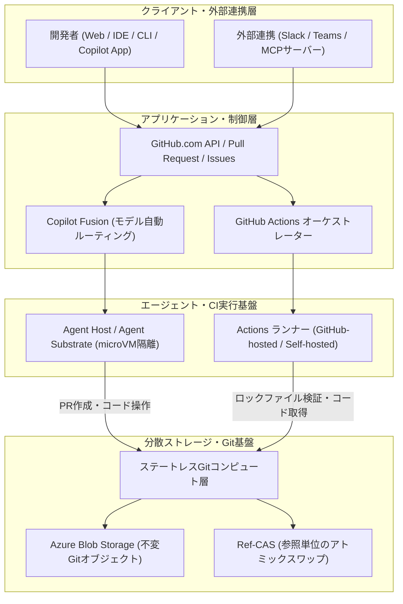

# **GitHub 調査レポート**

## **1. 基本情報**

* **ツール名**: GitHub
* **ツールの読み方**: ギットハブ
* **開発元**: Microsoft
* **公式サイト**: [https://github.com](https://github.com)
* **関連リンク**:
  * ドキュメント: [https://docs.github.com/](https://docs.github.com/)
  * 更新履歴 (GitHub Changelog): [https://github.blog/changelog/](https://github.blog/changelog/)
  * レビューサイト: [G2](https://www.g2.com/products/github/reviews) | [ITreview](https://www.itreview.jp/products/github/reviews)
* **カテゴリ**: バージョン管理
* **概要**: GitHubは、Gitを利用した世界最大のソースコードホスティングおよび統合開発プラットフォームです。単なるコード管理に留まらず、GitHub ActionsによるCI/CD、Issues & Projectsによるタスク管理、Advanced Securityによる脆弱性対策、そしてCopilot FusionやCopilot Projectsをはじめとする自律型AIエージェント機能を提供し、ソフトウェア開発ライフサイクル（SDLC）全体をサポートします。

## **2. 目的と主な利用シーン**

* **解決する課題**: ソフトウェア開発におけるソースコードのバージョン管理、分散チームでの共同作業、CI/CDやリリース作業の自動化、そしてAIエージェントのオーケストレーションによる開発・レビュー生産性の飛躍的向上。
* **想定利用者**: ソフトウェア開発者、DevOpsエンジニア、セキュリティ担当者、プロジェクトマネージャー、オープンソースコミュニティ、AIアプリケーション開発者。
* **利用シーン**:
  * チームおよびマルチリポジトリ環境でのアプリケーション共同開発
  * オープンソースソフトウェアの開発・公開とコミュニティ運営
  * GitHub Actionsを用いたセキュアなCI/CDパイプラインの構築と自動化
  * CopilotやサードパーティAIエージェントを活用した自律的な実装・コードレビュー・テスト
  * セキュリティスキャン（CodeQL / Dependabot / シークレット検出）によるシフトレフト開発

### **2.1 代表的な利用フロー**

```mermaid
swimlane-beta TB
  subgraph User["開発者"]
    A["Issue作成・開発目標を指示"]
    F["レビュー承認・マージ"]
  end
  subgraph Platform["GitHubプラットフォーム"]
    B["リポジトリ・Issue管理"]
    E["Pull Request・Adaptiveコードレビュー"]
  end
  subgraph Agent["Copilot / Agent Host"]
    C["Copilot Fusionによる実装・修正案生成"]
  end
  subgraph CI["GitHub Actions / セキュリティ"]
    D["ビルド・テスト・AI Scan実行"]
  end
  A --> B
  B --> C
  C --> D
  D --> E
  E --> F
```

* **代表的な流れ**: 開発者がGitHub IssuesやCopilot Projectsを通じて開発目標を指示すると、Agent Host上のAIエージェントがCopilot Fusionで最適なモデルを選択しながらコードを生成し、Pull Requestを作成します。続いてGitHub Actionsがビルド・テストやセキュリティスキャン（AI Scan）を自動実行し、Adaptiveコードレビューの結果とあわせて開発者が最終確認・マージを行います。

## **3. 主要機能**

* **リポジトリ & Gitホスティング**: 公開・非公開のGitリポジトリを無制限にホスティング。ブランチ保護ルールやコードオーナー設定により開発ガバナンスを担保します。
* **Pull Request & Code Review Max / Adaptive Review**: コードレビュー・マージの中核機能。2026年11月よりパブリックプレビューとなった「Adaptive」レビュー深度では、PRのリスクや複雑さに応じてCopilotが自動的にレビュー深度（Lite / Balanced / Max）を切り替え、Code Review Maxではマルチエージェントによる高度なバグ・脆弱性検知を行います。
* **GitHub Actions & Workflow Lockfiles**: リポジトリ内イベントをトリガーにCI/CDを自動化。2026年10月に一般提供（GA）されたワークフローロックファイル（`actions.lock`）により、推移的依存関係を含むアクションをイミュータブルなコミットSHAで固定し、サプライチェーン攻撃を防止できます。
* **GitHub Issues & Projects**: バックログ管理、カンバン・テーブルビュー、詳細なIssueステータス（Backlog, Todo, In progress, In review, Done等）やリポジトリボードを備え、開発進捗を可視化します。
* **GitHub Copilot & Copilot Fusion**: AIペアプログラマー兼自律エージェント。2026年10月にGAとなった「Copilot Fusion」が複数モデル（OpenAI, Anthropic, Google, Microsoft MAIやローカルモデル）をタスクに応じて自動ルーティングし、速度向上とコスト削減を両立します。
* **Copilot App, Copilot Projects & Agent HQ**: 専用デスクトップアプリおよび「Agent HQ」を通じて、Copilotやサードパーティ製エージェント（MCP連携含む）を統一管理。Copilot Projectsにより複数リポジトリを横断した並列エージェント作業や、スケジュール駆動の「Agentic Workflows / Copilot Automations」を実行できます。
* **GitHub Advanced Security (GHAS)**: Dependabotによる依存関係更新、CodeQLによる静的解析、500種以上のパターンとLLMを組み合わせたシークレットスキャン、および脆弱性を自動修正する「AI Scan」「Agentic autofix」（2026年10月GA）を提供します。
* **GitHub Codespaces & Pages**: ブラウザやエディタから即座に立ち上げられるクラウド開発環境（Codespaces）と、静的Webサイトホスティング（Pages）を標準搭載しています。

## **4. 動作原理・システム構成**



* **アーキテクチャ**: クラウド完結型のマルチテナントSaaS（GitHub.com / GitHub Enterprise Cloud）を基本としつつ、厳格なオンプレミス要件向けにセルフホスト版（GitHub Enterprise Server）も提供しています。2026年にはAIエージェントによる高頻度コミット（単月73億コミット超）に対応するため、従来のレガシーなレプリカモデルからストレージとコンピュートを分離した次世代アーキテクチャへ刷新されました。
* **主要コンポーネントとデータフロー**:
  * **ストレージとコンピュートの分離**: 不変かつコンテンツアドレス指定されたGitオブジェクト（packfile等）はAzure Blob Storageへ永続化され、ステートレスなコンピュートワーカーがAPIリクエストやCI/CDからの読み込みを並列処理します。これにより、読み取り負荷の増大が書き込み性能を阻害しない構造を実現しています。
  * **Ref-CASによる最小限の排他制御**: 同一リポジトリへ数千のAIエージェントが同時にプッシュする環境に対応するため、オブジェクト書き込みはロックレスで並列実行し、ブランチ等の参照更新のみを「Ref-CAS（Reference-Conditional Atomic Swaps）」で直列化します。
  * **Agent Host & Agent Substrate**: セッションをエディタやCLI・クラウド間でシームレスに引き継ぐ「Agent Host」と、Cloud HypervisorやgVisor等のmicroVM技術でエージェントをゼロトラスト隔離する「Agent Substrate」により、待機中のエージェント状態をスナップショット化して500ms未満で再開できる高密度実行環境を構成しています。
* **特筆すべき要素技術**:
  * **Copilot Fusion**: タスクの難易度やコスト制約に応じ、クラウド上のフロンティアモデルとオンデバイスモデルを動的に振り分けるオーケストレーションエンジン。
  * **Model Context Protocol (MCP)**: 外部の監視・運用ツールやサードパーティエージェントと標準プロトコルで接続し、ランタイムアラートからPR生成までを一気通貫で連携します。

## **5. 開始手順・セットアップ**

* **前提条件**:
  * Webブラウザ（クラウド版利用の場合）
  * GitクライアントおよびGitHub CLI（ローカルでの開発・ロックファイル管理用）
  * メールアドレス（アカウント登録は無料、クレジットカード不要）
* **インストール/導入**:
  * GitHub自体はSaaSでありサーバー導入は不要です。ローカル環境にはGitおよびGitHub CLI（`gh`）をインストールします。

  ```bash
  # macOS (Homebrew)
  brew install git
  brew install gh

  # Actionsワークフローロックファイル用拡張機能の導入（推奨）
  gh extension install actions/gh-actions-lock
  ```

* **初期設定**:
  * アカウント作成後、Git操作用のSSHキー登録またはGitHub CLI（`gh auth login`）での認証を行います。
  * セキュリティ確保のため、2段階認証（2FA）の有効化が必須化されています。
* **クイックスタート**:
  * Web画面の「New repository」または `gh repo create` コマンドでリポジトリを作成し、ローカルのコードをプッシュします。Pull Requestを作成すると、設定に応じてCopilotによる自動レビューやGitHub Actionsワークフローが動作します。

## **6. 特徴・強み (Pros)**

* **エンドツーエンドの自律型AI開発体験**: Copilot Fusion、Copilot Projects、Code Review Maxの統合により、単なるコード補完にとどまらず、Issue起点でのマルチリポジトリ開発・自動テスト・レビューまでを一気通貫で支援します。
* **圧倒的な開発者エコシステムとコミュニティ**: 世界2億2,500万人以上の開発者と膨大なオープンソースプロジェクトが集積しており、GitHub MarketplaceやMCP連携を通じてあらゆる開発ツールと即座に接続できます。
* **スケーラブルかつ堅牢なCI/CD基盤**: GitHub Actionsは豊富なコミュニティアクションを備え、`actions.lock` によるサプライチェーン保護とあわせて高い信頼性を発揮します。
* **高度なネイティブセキュリティ**: CodeQL、Dependabot、AI Scan / Agentic autofix、500種以上のシークレット検出など、脆弱性の発見から自動修正までプラットフォーム内で完結します。

## **7. 弱み・注意点 (Cons)**

* **多機能ゆえの複雑さ**: リポジトリ管理、Projects、Actions、Copilot、Advanced Securityなど機能が極めて多岐にわたるため、組織全体での権限・ガバナンス設計やUIの把握に学習コストがかかります。
* **AIクレジットとコスト管理**: Copilotの従量課金制（GitHub AI Credits）やActionsのランナー利用時間、Advanced Securityのライセンスなど、大規模利用時には予算・アラート管理が不可欠です。
* **プラットフォームへの依存リスク**: クラウド版（GitHub.com）で障害が発生した場合、ソースコード管理からCI/CD・エージェント実行まで開発ワークフロー全体に影響が及ぶ可能性があります。
* **日本語対応の状況**: 多くのドキュメントやUIの主要部分は日本語化されていますが、最新の機能設定画面やChangelog、一部の高度な設定項目は英語表記が中心となる場合があります。

## **8. 料金プラン**

| プラン名 | 料金 | 主な特徴 |
|---|---|---|
| **Free** | 無料 | 無制限の公開・非公開リポジトリ、2,000分のActions/月、500MBのPackagesストレージ、Dependabot・Issues・Projectsの基本機能。 |
| **Team** | $4/ユーザー/月 | Freeの全機能に加え、保護されたブランチ、コードオーナー、ドラフトPR、Codespacesアクセス、3,000分のActions/月、2GBストレージ、Webサポート。 |
| **Enterprise** | $21/ユーザー/月 | Teamの全機能に加え、SAML SSO、EMU（Enterprise Managed Users）、データ所在地選択、監査ログAPI。**GitHub Copilotへのアクセス権がバンドル**（シート追加料金$0、利用量に応じたAIクレジット消費）。 |

### **GitHub Copilot 関連プラン（個人・スタンドアロン向け）**

| プラン名 | 料金 | 主な特徴 |
|---|---|---|
| **Copilot Free / Student** | 無料 | 限定的な利用枠と自動モデル選択（Studentは教育機関認証ユーザー向け）。 |
| **Copilot Pro** | $10/月 | 月1,500 AIクレジット（基本1,000＋フレックス500）、無制限のコード補完。 |
| **Copilot Pro+** | $39/月 | 月7,000 AIクレジット、上位推論モデルへのアクセス。 |
| **Copilot Max** | $100/月 | 月20,000 AIクレジット、ヘビーユーザー向けの優先アクセス枠。 |
| **Copilot Business / Enterprise** | $19 / $39/ユーザー/月 | 組織向けポリシー制御・ガバナンス（GitHub Enterprise Cloud契約ユーザーはシート料金なしでバンドル利用可）。 |

* **課金体系**: プラットフォームはユーザー単位の月額/年額課金。Copilotは1クレジット＝$0.01相当の**GitHub AI Credits**による従量課金体系を採用しており、コード補完は無制限のままチャットや自律エージェント・Code Review Max等の高度な処理でクレジットを消費します。
* **無料トライアル**: Enterpriseプランで30日間の無料トライアルが利用可能です。

## **9. 導入実績・事例**

* **プラットフォーム規模**: 2026年10月公開の年次レポート「Octoverse 2026」によると、世界の開発者数は**2億2,500万人以上**に達し、年間343億件のコミットと179億回のプッシュが行われています。また、新規Pull Requestの**40%以上**でAIによる最初のドラフト生成が活用されています。
* **導入企業**: Spotify、IBM、SAP、Stripe、Ford、Microsoftなど、スタートアップからフォーチュン500企業まで幅広い業界で採用されています。
* **導入事例**: 開発サイクルの高速化、AIエージェントとCodeQL Autofixの併用による脆弱性修正リードタイムの短縮、マルチリポジトリ間の開発標準化などで多数の成果が報告されています。
* **対象業界**: IT・ソフトウェア、金融、自動車・製造、通信、ヘルスケアなど、ソフトウェア開発を行うあらゆる業界。

## **10. サポート体制**

* **ドキュメント**: [GitHub Docs](https://docs.github.com/)として機能別のリファレンス、API仕様、クイックスタートガイドが体系的に整備されており、日本語ページも広く提供されています。
* **コミュニティ**: [GitHub Community Discussions](https://github.com/orgs/community/discussions)において、ユーザー同士やGitHubスタッフとの技術的な質疑応答・フィードバック交換が活発に行われています。
* **公式サポート**: TeamプランではWebベースのサポート窓口、EnterpriseプランではSLA付きのチケットサポートやプレミアムサポート（24時間対応オプション等）が利用可能です。

## **11. エコシステムと連携**

### **11.1 API・外部サービス連携**

* **API**: REST APIおよびGraphQL APIが網羅的に公開されており、リポジトリ操作、Actions管理、セキュリティアラート取得、利用メトリクス（Usage Metrics API）の自動抽出などが可能です。Webhookによるリアルタイムイベント通知にも対応しています。
* **外部サービス連携**: [GitHub Marketplace](https://github.com/marketplace)を通じた数千以上のアプリ連携に加え、2026年11月にはSlackおよびMicrosoft Teams上で `@GitHub` をメンションして直接Issue作成やコーディング・PR作成を依頼できるチャット連携がGAとなりました。また、Model Context Protocol（MCP）を通じてJira、Linear、Datadog、Sentry、クラウドプロバイダーなど多様な外部エージェントと連携できます。

### **11.2 技術スタックとの相性**

| 技術スタック | 相性 | メリット・推奨理由 | 懸念点・注意点 |
|:---|:---:|:---|:---|
| **VS Code / Copilot App** | ◎ | 同じMicrosoft傘下であり、Agent Hostによるセッション継続や拡張機能の統合が完璧。 | 特になし |
| **Node.js / TypeScript** | ◎ | GitHub ActionsやPagesでのサポートが充実し、Vercel等との自動デプロイ連携も容易。 | Actions依存パッケージの固定には `actions.lock` 導入を推奨 |
| **Python** | ◎ | Actionsでのテスト実行、Dependabotによる脆弱性監視、CodeQL解析がスムーズ。 | 特になし |
| **Java / Kotlin** | ◯ | Maven/GradleのキャッシュやビルドパイプラインをActionsで容易に構築可能。 | 大規模ビルドではActionsランナーの実行時間コストに注意 |

## **12. セキュリティとコンプライアンス**

* **認証**: 全ユーザーに対して2段階認証（2FA / パスキー対応）が利用可能（コントリビューターへの2FA必須化推進）。EnterpriseプランではSAML SSO、SCIMプロビジョニング、Enterprise Managed Users（EMU）に対応しています。
* **データ管理**: 通信時（TLS）および保存時の暗号化を標準実装。Enterprise Cloudでは米国・EU・オーストラリア・日本などデータレジデンシー（保存リージョン）の選択が可能です。Copilot Business/Enterpriseでは入力コードが基盤モデルの学習に使用されないプライバシー保護が保証されています。
* **準拠規格**: SOC 1 Type 2、SOC 2 Type 2、ISO/IEC 27001、GDPR、FedRAMP等に対応。SSHアクセスにおける耐量子（Post-quantum）鍵交換にも対応しています。
* **サプライチェーン・AIセキュリティ**: 2026年10月にGAとなった `actions.lock` によるアクションのハッシュ固定や、パブリックリポジトリにおける `pull_request_target` トリガーのデフォルトブロック方針（2026年12月施行予定）、500種以上のパターンとLLMを用いたシークレット検出により、CI/CDおよびAI生成コードの安全性を確保しています。

## **13. 操作性 (UI/UX) と学習コスト**

* **UI/UX**: リポジトリ閲覧、コード検索、Pull Requestの差分確認、新しいPull Requestオーバービュー画面（2026年11月プレビュー）などは直感的で洗練されています。一方で、Enterprise管理画面やActionsの細かな権限ポリシー設定は項目が多く、管理者に一定の習熟が求められます。
* **学習コスト**: Gitの基本操作を理解していれば導入は極めて容易です。ただし、GitHub Actionsのワークフロー設計、MCP連携、Copilot Projectsによる複数エージェントの指揮を使いこなすには段階的な学習が必要です。

## **14. ベストプラクティス**

* **効果的な活用法 (Modern Practices)**:
  * **ワークフローロックファイル（`actions.lock`）の採用**: サードパーティ製GitHub Actionsのタグ乗っ取りを防ぐため、`gh actions-lock` とDependabotを組み合わせてコミットSHAを自動ロック・更新する。
  * **Adaptive Code Reviewの活用**: すべてのPRを一律の深度でレビューするのではなく、変更リスクに応じてLite〜Maxを自動選択させ、コストと品質のバランスを最適化する。
  * **ブランチ保護とルールセットの適用**: `main` ブランチへの直接プッシュを禁止し、必須ステータスチェック（AI Scan・テスト通過）と承認レビューを義務化する。
* **陥りやすい罠 (Antipatterns)**:
  * **シークレットのハードコード**: APIキーや認証情報をコードに直書きしない（必ずGitHub Secretsや環境変数、OIDCフェデレーション認証を使用する）。
  * **`pull_request_target` の無制限利用**: フォーク元PRからの任意コード実行リスクを避けるため、適切な権限分離とポリシー制限を行う。
  * **巨大PRの放置**: エージェントが生成した大量の変更を1つのPRにまとめるとレビュー品質が落ちるため、小さな単位に分割して段階的にマージする。

## **15. ユーザーの声（レビュー分析）**

* **調査対象**: G2、ITreview
* **総合評価**:
  * **G2**: 4.7 / 5.0（2,400〜3,100件以上のレビュー）
  * **ITreview**: 4.5 / 5.0
* **ポジティブな評価**:
  * 「チームでのコラボレーションとPull Requestベースのコードレビュー文化が圧倒的に使いやすい」（G2より引用要約）
  * 「GitHub ActionsによるCI/CD統合により、外部ツールを増やさずに開発パイプラインを完結できる」（G2より引用要約）
  * 「Copilotの進化が凄まじく、コーディングや定型作業の生産性が劇的に向上した」（ITreviewより引用要約）
* **ネガティブな評価 / 改善要望**:
  * 「初心者や大規模チームでは、リポジトリ設定や高度な機能に慣れるまで学習コストがかかる」（G2より引用要約）
  * 「UIのどこに目的の管理設定があるか迷うことがある」（ITreviewより引用要約）
  * 「通知設定を細かく調整しないと、大量のメールやアラートが届いてしまう」（ITreviewより引用要約）
* **特徴的なユースケース**:
  * オープンソースプロジェクトの国際的な開発拠点としての利用に加え、Copilot ProjectsやAgentic Workflowsを用いたマルチリポジトリ一括改修・運用タスクの自動化。

## **16. 直近半年のアップデート情報**

* **2026-11**: Copilotコードレビューに「Adaptive」レビュー深度（Public Preview）、500種以上のシークレット検出・LLM漏洩検知、クロスリポジトリコンテキストが追加。また、Slack / Microsoft Teamsでの `@GitHub` コーディング連携がGAとなり、Issueステータスおよびリポジトリボードレイアウト、新しいPull Requestオーバービュー画面（Public Preview）が公開。
* **2026-10-28**: **GitHub Universe 2026**（10月28〜29日）にて、「Copilot Fusion」（GA）、「Copilot Projects」（Public Preview）、専用「GitHub Copilot app」と「Agent Host」、「Code Review Max」（Public Preview）、「AI Scan」「Agentic autofix」（GA）を発表。あわせてGitHub EnterpriseへのCopilotアクセスバンドル、Gitインフラ刷新（ストレージ・コンピュート分離）、年次レポート「Octoverse 2026」を公開。
* **2026-10-28**: GitHub Actionsのワークフローロックファイル（`actions.lock`）が一般提供開始（GA）。推移的依存関係を含むSHA固定とDependabotによる自動更新に対応。
* **2026-10**: オープンソースの「GitHub Agentic Workflows」がGAとなり、Copilot Fusionがオンデバイスモデルとクラウドモデルの動的ルーティングに対応。
* **2026-09-29**: GitHub Enterprise Cloudにおけるセルフホストランナーの最小バージョン要件を適用開始。同月、`GITHUB_TOKEN` に最小権限の `vulnerability-alerts` 権限およびReusable Workflowのジョブコンテキスト情報が追加。
* **2026-06-04**: GitHub Copilotの100万トークンコンテキスト対応と推論レベル設定が可能に。Copilot ChatでのリッチなPRコンテキスト利用と失敗したActionsの自動修正提案機能を追加。
* **2026-06-02**: サードパーティ等のエージェントを実行できる「Agent apps」およびCopilot Sandboxes / Automationsのパブリックプレビューを開始。
* **2026-06-01**: 全Copilotプランが従量課金ベース（AIクレジット）へ移行し、パワーユーザー向け「Copilot Max」を追加。
* **2026-02-15**: GitHub Copilot Workspaceが一般提供開始（GA）。
* **2026-01-20**: GitHub Advanced SecurityにCodeQL検出脆弱性の自動修正機能（Autofix）を正式搭載。

(出典: [GitHub Changelog](https://github.blog/changelog/) / [GitHub Blog](https://github.blog/))

## **17. 類似ツールとの比較**

### **17.1 機能比較表 (星取表)**

| 機能カテゴリ | 機能項目 | 本ツール (GitHub) | GitLab | Bitbucket | Azure DevOps |
|:---:|:---|:---:|:---:|:---:|:---:|
| **基本機能** | バージョン管理 | ◎<br><small>業界標準・高並列Git基盤</small> | ◎<br><small>同等機能</small> | ◯<br><small>標準的</small> | ◯<br><small>標準的</small> |
| **CI/CD** | パイプライン | ◎<br><small>Actions + actions.lock</small> | ◎<br><small>CI/CD統合 (強力)</small> | △<br><small>Pipelines (制限あり)</small> | ◯<br><small>Pipelines (多機能)</small> |
| **AI支援** | 自律エージェント・レビュー | ◎<br><small>Copilot Fusion / Projects / Review Max</small> | ◎<br><small>GitLab Duo Agent Platform (GitLab 19)</small> | △<br><small>Atlassian Intelligence</small> | ◯<br><small>Copilot連携</small> |
| **セキュリティ** | 脆弱性・サプライチェーン対策 | ◎<br><small>GHAS / AI Scan / Autofix</small> | ◎<br><small>DevSecOps統合・誤検知AI排除</small> | ◯<br><small>基本スキャン・外部連携</small> | ◯<br><small>GHAS for Azure DevOps</small> |
| **非機能要件** | 日本語対応 | ◯<br><small>主要UI・Docs対応</small> | △<br><small>英語中心</small> | ◯<br><small>対応</small> | ◯<br><small>対応</small> |

### **17.2 詳細比較**

| ツール名 | 特徴 | 強み | 弱み | 選択肢となるケース |
|---|---|---|---|---|
| **GitHub** | AIエージェントと開発者コミュニティを核とした統合開発プラットフォーム | Copilot FusionやProjectsによるマルチリポ自律開発、世界最大のエコシステム、Actionsとサプライチェーン保護 | 機能が豊富で設定が複雑、高度なAI利用はクレジット管理が必要 | AIを活用した最新の開発体験、マルチリポの自律開発、OSS協業を重視する場合。 |
| **GitLab** | 単一アプリケーションでDevSecOps全体をカバーするオールインワンプラットフォーム | GitLab 19世代のDuo Agent PlatformやDuo CLIによる統合、セルフホスト（オンプレミス）運用の実績 | 機能が重厚でUIのレスポンスや学習コストが課題になる場合がある | 単一ツールでDevSecOpsを完結させたい、または厳格なセルフホスト要件がある場合。 |
| **Bitbucket** | Atlassian製品（Jira, Confluence）とのシームレスな連携が特徴 | Jira課題とコード・デプロイの連携が非常にスムーズ | 無料プランのCI/CD実行時間に制限があり、AI自律機能は限定的 | すでにJiraやConfluenceをチームの中心基盤として利用している場合。 |
| **Azure DevOps** | Microsoft製品エコシステムと大規模エンタープライズ開発向けの統合基盤 | Azureクラウドとの親和性が高く、Azure Boardsや大規模バックログ管理に強み | GitHubへ機能投資がシフトしており、最新AI機能はGitHub側が先行 | 既存のAzure基盤やWindows/エンタープライズ開発資産を全面活用している場合。 |

## **18. 総評**

* **総合的な評価**:
  GitHubは2026年を通じて、単なるコードホスティングおよびCI/CD基盤から「エージェント駆動型ソフトウェア開発（Agentic SDLC）」の中核プラットフォームへと決定的な進化を遂げました。ストレージとコンピュートの分離やRef-CASによるGit基盤刷新、Copilot Fusionによる動的モデルオーケストレーション、Copilot Projectsによるマルチリポジトリ並列開発、そして `actions.lock` やCode Review Maxによる品質・セキュリティ担保は、開発者の役割を「コードを手書きする作業」から「AIエージェント艦隊を指揮・レビューする役割」へと引き上げています。
* **推奨されるチームやプロジェクト**:
  個人開発者やオープンソースコミュニティから、高度なガバナンスとセキュリティを求める大企業まで、あらゆる規模のソフトウェア開発チームに推奨できます。特にAIエージェントを活用した開発速度の最大化と、最新エコシステムとの連携を重視する組織に最適です。
* **選択時のポイント**:
  Atlassian製品群との密接な連携を最優先するならBitbucket、単一アプリでのオンプレミスDevSecOps完結を求めるならGitLabも有力な選択肢です。しかし、次世代のAIエージェント開発体験、世界最大のコミュニティ、そして継続的なプラットフォーム投資の恩恵を最大限に受けたい場合、GitHubが最も強力な第一候補となります。
