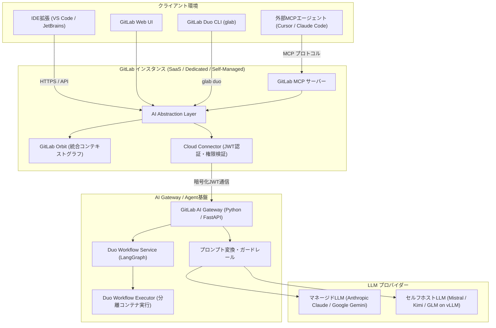

# **GitLab Duo 調査レポート**

## **1. 基本情報**

* **ツール名**: GitLab Duo
* **ツールの読み方**: ギットラボ デュオ
* **開発元**: GitLab Inc.
* **公式サイト**: [https://about.gitlab.com/gitlab-duo/](https://about.gitlab.com/gitlab-duo/)
* **関連リンク**:
  * ドキュメント: [https://docs.gitlab.com/ee/user/gitlab_duo/](https://docs.gitlab.com/ee/user/gitlab_duo/)
  * リリースノート: [https://about.gitlab.com/releases/](https://about.gitlab.com/releases/)
* **カテゴリ**: AIコーディング支援
* **概要**: GitLab Duoは、GitLabのDevSecOpsプラットフォームに深く統合された包括的なAI機能群です。コード生成やチャットアシスタントにとどまらず、自律型エージェント基盤「GitLab Duo Agent Platform」、ターミナルから自律実行を可能にする「GitLab Duo CLI」、外部エージェントと連携する「GitLab MCPサーバー」、統合コンテキストグラフ「GitLab Orbit」を備え、ソフトウェア開発ライフサイクルの全工程を自律化・支援します。

## **2. 目的と主な利用シーン**

* **解決する課題**: 開発者の定型業務やコンテキストスイッチの負担、CI/CDパイプライン失敗時のデバッグ長時間化、セキュリティ脆弱性の発見から修正までのタイムラグ、複数ツールに分断されたコンテキストの断絶。
* **想定利用者**: ソフトウェア開発者、セキュリティエンジニア、DevOps/SREエンジニア、プロダクトマネージャー、QAエンジニア。
* **利用シーン**:
  * **IDEでの開発支援**: VS CodeやJetBrainsなどのIDEで、リアルタイムのコード補完・生成（Code Suggestions）やリファクタリング、テストコードの自動生成。
  * **ターミナルからの自律タスク実行**: GitLab Duo CLIの `/goal` コマンドを用い、Issue解決や機能実装などの多段階タスクをローカル環境で自律実行。
  * **セキュリティのシフトレフト**: SASTスキャンで見つかった脆弱性の解説を受け、ワンクリックで自動修正マージリクエスト（MR）を作成・適用。
  * **CI/CD障害の迅速なトラブルシューティング**: 失敗したパイプラインのログを根本原因分析（Root Cause Analysis）で解析し、修正案を即座に提示。
  * **外部AIツールとの連携**: GitLab MCPサーバーを介し、CursorやClaude Codeなどの外部エージェントからGitLabのプロジェクトデータやパイプライン機能へアクセス。

## **3. 主要機能**

* **Code Suggestions**: 主要IDE（VS Code, JetBrains IDEs, Visual Studio, Neovim, Web IDE）上で動作する高精度なコード自動補完および関数生成機能。
* **GitLab Duo Chat**: 自然言語での対話型アシスタント。Web UIおよびIDEから、コードの解説、リファクタリング提案、テスト作成、GitLab機能の操作支援などを実行可能。画像やダイアグラムの入力にも対応。
* **GitLab Duo Agent Platform & Custom Flows**: 複数のAIエージェントが連携して複雑なタスクを自律遂行する基盤。「Flow Creator Agent」を用いて自然言語からCI/CD駆動のカスタムワークフローYAMLを自動生成可能。
* **GitLab Duo CLI**: 開発者端末のコマンドラインからDuoを利用できるツール。対話モードに加え、CI/CD環境での自動化に適したヘッドレスモード、目標自律達成を指示する `/goal` コマンドを提供。
* **Vulnerability Explanation & Resolution (Agentic SAST)**: セキュリティ脆弱性の原因をAIが詳細に解説し、ソースコード修正案を含むマージリクエスト（MR）を自律的に生成。
* **Secret False Positive Detection**: AIがコードの文脈（テストデータ、ダミーキー、無効化済みトークン等）を解析し、重要度の高いシークレット誤検知アラートを自動除外。
* **Root Cause Analysis**: パイプライン失敗時に、膨大なCIジョブログを瞬時に要約・解析し、根本原因と修正用スクリプトを提示。
* **GitLab Orbit (統合コンテキストグラフ)**: コード、マージリクエスト、Issue、CI/CD、脆弱性情報を単一のコンテキストグラフとして統合・自動更新し、Duoや外部エージェントに高度な文脈情報を提供。
* **GitLab MCP Server**: Model Context Protocol（MCP）の公式サーバー。外部のMCP対応エージェント（Cursor, Claude Code等）に対して、GitLabのリソースやDuo Agent Platformのツール群を安全に公開。
* **MRサマリー & グループ単位レビュー指示**: MRの変更内容や注意点を自動要約。グループ単位でレビュー基準（`.gitlab/duo/mr-review-instructions.yaml`）を設定でき、組織横断で一貫したAIコードレビューを実施。

## **4. 動作原理・システム構成**

GitLab Duoは、GitLab本体（Railsモノリス）とAIモデル群との間に疎結合のマイクロサービス**AI Gateway**を配置するアーキテクチャを採用しています。これにより、各種LLMプロバイダーのAPI差異を吸収し、セキュアかつ低遅延な推論を実現しています。



* **アーキテクチャモデル**: クライアント・サーバー型の疎結合マイクロサービス構成。顧客環境（GitLab.com、Self-Managed、Dedicated）のGitLabインスタンスが、認証基盤「Cloud Connector」を経由して「AI Gateway」と通信します。
* **主要コンポーネントとデータフロー**:
  1. **リクエスト受付と文脈収集**: クライアント（IDE、Web UI、CLI、MCP）からアクションが発生すると、GitLabインスタンス内の「AI Abstraction Layer」が周辺コードやGitLab Orbitのコンテキストグラフ（関連IssueやMR情報）を収集・集約します。
  2. **認証とトークン発行**: Cloud Connectorが暗号化された短期間有効なJSON Web Token（JWT）を生成し、正規のライセンスと権限を確認します。
  3. **AI Gatewayでの処理**: AI GatewayがJWTを検証後、モデルごとのプロンプト最適化、入力ガードレール、レートリミットを適用します。
  4. **推論とモデルルーティング**: クラウド上のマネージドLLM（Claude Opus 4.7やGoogle Gemini）またはオンプレミス/プライベートクラウド上のセルフホストLLM（vLLM）へ安全にルーティングされます。
  5. **自律エージェント実行**: 複数ステップの自律タスクでは「Duo Workflow Service」（LangGraphベース）が推論ループを制御し、サンドボックス環境の「Workflow Executor」が安全にコマンド実行やコード修正を行います。
* **特筆すべき要素技術**:
  * **AI Gateway**: Python/FastAPIベースで構築された独立したプロキシエンジン。マルチモデル（マルチベンダー）の動的切り替えとプロンプト抽象化を担います。
  * **Model Context Protocol (MCP)**: 業界標準のオープンプロトコルを採用し、GitLab内部のデータとエージェント機能を社内外の多様なAIクライアントに安全に接続します。
  * **LangGraph**: 複雑なステートフルマルチエージェントオーケストレーションに採用され、計画から検証までの自律ループを実現しています。

## **5. 開始手順・セットアップ**

* **前提条件**:
  * GitLab SaaS（GitLab.com）または GitLab Self-Managed / Dedicated の利用。
  * GitLab Premium または Ultimate プランのサブスクリプション。
  * GitLab Duo Pro または Enterprise アドオンシートの割り当て。
  * クライアント環境: 対応IDE（VS Code, JetBrains IDEs等）または GitLab CLI（`glab`）。
* **インストール/導入**:
  * **IDEの場合**: Visual Studio Codeの「Extensions」または JetBrainsの「Plugins」から `GitLab Workflow` 拡張機能をインストール。
  * **CLIの場合**: 最新の `glab` CLIツールを導入。

    ```bash
    # glab CLIのインストール (Homebrewの例)
    brew install glab
    ```

* **初期設定**:
  1. GitLab管理画面の「Settings > GitLab Duo」で、グループまたはインスタンス全体でDuo機能を有効化。
  2. ユーザーへDuo ProまたはEnterpriseのシートを割り当て。
  3. IDE拡張機能またはCLIでGitLabアカウントを認証連携。

    ```bash
    # CLIでの認証
    glab auth login
    ```

* **クイックスタート**:
  1. **コード補完**: IDEでコードを入力中、コメントで意図を記述（例: `// calculate sha256 checksum`）すると、数秒で灰色のゴーストテキストとしてコードが提案され、`Tab` キーで採用。
  2. **Duo Chat**: IDEのサイドバーまたはGitLab Web UI右下のチャットアイコンをクリックし、「この関数の単体テストを作成して」と入力。
  3. **Duo CLI (/goal)**: 端末で `glab duo chat` を起動し、`/goal Issue #102のバグを調査して修正パッチを作成して` と入力することで自律エージェントを作動。

## **6. 特徴・強み (Pros)**

* **DevSecOps全工程の包括的カバー**: 単なるコード補完にとどまらず、Issue作成、MRレビュー、CIパイプラインのログ解析、SAST脆弱性修正、本番運用トラブルシューティングまで一気通貫でAIが介入可能。
* **自律型エージェント基盤 (Agent Platform & CLI)**: 単発の質疑応答だけでなく、ゴールを指定して複数ファイルを横断編集し、テスト実行・コミットまで自律的に推進できる実行環境を完備。
* **高いオープン性と相互運用性 (MCP & Orbit)**: 2026年に公式MCPサーバーがGAとなり、CursorやClaude Codeなどの外部ツールからGitLabのコンテキスト（Orbit）やDuoツールをネイティブに活用可能。
* **厳格なプライバシーとエンタープライズ統制**: 顧客のソースコードやプライベートデータをモデルの再学習に一切使用しないポリシーを堅持。オンプレミス環境向けにはセルフホスト型LLMの運用にも対応。
* **シフトレフトを加速するセキュリティ修復**: 脆弱性の指摘だけでなく、修正コードを含むマージリクエストを自動作成できるため、開発者のセキュリティ対応工数を大幅に削減。

## **7. 弱み・注意点 (Cons)**

* **GitLabプラットフォームへの強い依存**: サービスの価値がGitLabのデータ基盤やCI/CDパイプラインと密結合しているため、GitHubやBitbucket、他社CIを利用しているチームでは真価を発揮できない。
* **追加コスト体系**: GitLab PremiumまたはUltimateの基本ライセンス費用に加え、Duo Pro ($19/月) や Enterpriseのアドオン費用、高度なAgent実行に伴うクレジット消費が発生する。
* **日本語対応の成熟度**: Duo Chatやコードレビューでの日本語入力・応答精度は大幅に向上しているものの、CLIの対話メッセージや最新エージェント機能のドキュメント等で英語優先の部分が一部残る。
* **管理・ガバナンス設定の学習コスト**: MCPツールのパーミッション制御、グループ単位のレビュー指示ファイル、エージェント実行権限など、エンタープライズ向け設定項目が多岐にわたり管理者の初期理解が必要。

## **8. 料金プラン**

GitLab Duoは、既存のGitLabプラン（PremiumまたはUltimate）に対する**アドオン形式**で提供されます。

| プラン名 | 料金 | 主な機能・対象 |
|---------|------|--------------|
| **GitLab Duo Pro** | **$19** /ユーザー/月<br><small>(年額一括請求)</small> | ・Code Suggestions（コード補完・生成）<br>・GitLab Duo Chat（自然言語対話）<br>・コード解説・リファクタリング・テスト生成<br>※開発者の日常的なコーディング支援に最適 |
| **GitLab Duo Enterprise** | **要問い合わせ**<br><small>(組織規模に応じたカスタム見積)</small> | ・Duo Proの全機能<br>・Vulnerability Explanation & Resolution（脆弱性自動修復）<br>・Secret False Positive Detection（シークレット誤検知除外）<br>・Root Cause Analysis（CIパイプライン失敗原因分析）<br>・Duo Agent Platform / Custom Flows / GitLab Orbit連携<br>・AI Impact Analytics & DORAメトリクスダッシュボード |

* **追加クレジット (GitLab Credits)**: Duo Enterpriseにおける自律型エージェントの長時間タスクや高度なマルチステップ推論の実行には、従量課金制のGitLab Creditsが利用されます。
* **課金体系**: ユーザーライセンス単位の年間契約（アドオン）。
* **無料トライアル**: 対象のGitLab組織に対して、期間限定（最大60日間）のトライアルプログラムが提供されています。

## **9. 導入実績・事例**

* **導入企業**: NVIDIA, Siemens, T-Mobile, Goldman Sachs, CARIAD (Volkswagen Group) など、厳格なセキュリティと大規模な開発体制を持つグローバルエンタープライズが多数導入。
* **導入事例**:
  * **T-Mobile**: CI/CDパイプライン障害の解析にRoot Cause Analysisを活用し、ビルド障害のトラブルシューティング時間を大幅に削減。
  * **Siemens**: コードレビューの自動化とSAST脆弱性修正MRの活用により、セキュリティコンプライアンス遵守にかかる開発者の工数を半減。
  * **金融・ヘルスケア分野**: コードがモデル学習に利用されないプライバシー保証と、オンプレミスでのセルフホストモデル運用が決め手となり採用が進む。
* **対象業界**: 金融、自動車、通信、製造、公共、テクノロジーなど、コンプライアンスとセキュリティを重視する業界。

## **10. サポート体制**

* **ドキュメント**: [docs.gitlab.com](https://docs.gitlab.com/ee/user/gitlab_duo/) にて、機能別の詳細チュートリアル、プロンプト例、トラブルシューティング、アーキテクチャ解説が体系的に提供されています。
* **コミュニティ**: GitLab Community Forum、GitLab Issue Tracker（公開Issueで機能開発がオープンに議論）、Discord等でユーザー・開発者間の活発な情報交換が行われています。
* **公式サポート**: GitLab Premium/UltimateのSLAに基づく24時間365日のエンタープライズサポート窓口（Webチケット、重大インシデント時の電話対応）が利用可能です。

## **11. エコシステムと連携**

### **11.1 API・外部サービス連携**

* **API**: GitLab GraphQL APIおよびREST API経由でDuo機能やエージェント実行パイプラインと連携可能。
* **公式MCPサーバー**: 2026年にGAとなったGitLab MCP Serverにより、Cursor、Claude Code、Windsurf等のMCP対応クライアントと標準プロトコルで相互接続可能。
* **IDEサポート**: Visual Studio Code, JetBrains IDEs（IntelliJ IDEA, PyCharm, WebStorm等）, Visual Studio, Neovim, GitLab Web IDE。
* **クラウドインフラ・LLM**: Google Cloud (Vertex AI), AWS (Bedrock), Anthropic API、およびオンプレミス上のプライベート推論基盤（vLLM）。

### **11.2 技術スタックとの相性**

| 技術スタック | 相性 | メリット・推奨理由 | 懸念点・注意点 |
|:---|:---:|:---|:---|
| **GitLab CI/CD** | ◎ | パイプラインログの自動解析、失敗原因特定、Custom Flowsとの自動連動が極めて強力 | 他社CI環境ではパイプライン関連機能は使用不可 |
| **Python / Go / Java / TypeScript** | ◎ | 大規模学習データによりコード補完およびエージェントの自律修正精度が非常に高い | 特になし |
| **Terraform / OpenTofu / Ansible** | ◎ | IaCの設定ファイル生成やセキュリティポリシー違反の検知・修正に強みを発揮 | 独自の社内カスタムモジュールではコンテキスト指定が必要 |
| **C / C++ / Rust (組込み・システム)** | ◯ | 安全なメモリ管理や脆弱性修正の提案が有効 | 組込み特有の独自コンパイラ環境ではCI自動検証に工夫が必要 |
| **他社リポジトリ (GitHub, Bitbucket)** | × | GitLabのメタデータに依存するため、他社リポジトリ単体での運用は非対応 | GitLabへの移行またはミラーリングが必要 |

## **12. セキュリティとコンプライアンス**

* **認証**: GitLabの堅牢な認証基盤（SAML SSO, SCIM, OAuth 2.0, LDAP, 多要素認証）を継承。プロジェクトやグループのロールベースアクセス制御（RBAC）と厳格に連動。
* **データ管理**:
  * **Zero Retention / 非学習ポリシー**: 顧客のプライベートコード、プロンプト、生成データはモデルプロバイダー側で学習データとして一切保存・再利用されません。
  * **通信の暗号化**: すべてのデータ転送はTLS 1.3により暗号化。
  * **セルフホストオプション**: 厳格な規制環境向けに、プライベートVPC内またはオンプレミスの推論サーバー（vLLM）でオープンソースモデルを運用可能。
* **準拠規格**: SOC 2 Type 2, ISO/IEC 27001, GDPR, HIPAA, FedRAMPなどのエンタープライズセキュリティ認証に対応。AI Transparency Centerで各機能のデータフローや使用モデルを公開。

## **13. 操作性 (UI/UX) と学習コスト**

* **UI/UX**: GitLab Web画面の右サイドバーにDuo Chatが常駐し、マージリクエスト画面や脆弱性レポート画面にもコンテキストに応じたAIボタン（「Fix with Duo」「Resolve with AI」等）が自然に配置されています。IDE拡張機能も主要なIDEネイティブのキーバインド（`Tab`による受諾等）に準拠しています。
* **学習コスト**: コード補完やチャットは初日から直感的に操作可能。ただし、グループ横断のレビュー設定ファイル（`.gitlab/duo/mr-review-instructions.yaml`）の作成や、Duo Agent Platform用のカスタムワークフロー（Custom Flows）の設計、MCPガバナンス設定にはDevOps担当者の初期設計が求められます。

## **14. ベストプラクティス**

* **効果的な活用法 (Modern Practices)**:
  * **脆弱性修正の自動化フロー確立**: セキュリティスキャン結果に対して開発者が個別に悩むのではなく、Duoによる修正MR作成を実行し、人間のレビューを経てマージする「シフトレフトの日常化」を推進する。
  * **GitLab Orbitを活用したコンテキスト指定**: チャットやCLI利用時に、関連するIssue番号やMR番号を明示的に参照させることで、プロジェクトの文脈を踏まえた精度の高い回答を引き出す。
  * **Flow Creatorを用いたカスタムフロー定義**: 定型的なバグトリアージやリリースノート生成などを、自然言語でFlow Creatorに依頼してCustom Flows化し、CIパイプラインに組み込む。
* **陥りやすい罠 (Antipatterns)**:
  * **AI生成セキュリティパッチの無検証マージ**: Duoが生成した脆弱性修正MRをCIテストや人間によるコードレビューを経ずに盲目的にマージすること（必ず自動テストと人的レビューを実施する）。
  * **コンテキストのない曖昧な指示**: ファイルの指定や目的を明示せずに「動かないので直して」といった曖昧なプロンプトを与えること（関連ファイルやエラーログを提示することが推奨される）。

## **15. ユーザーの声（レビュー分析）**

* **調査対象**: G2, TrustRadius, Gartner Peer Insights, Reddit, 開発者コミュニティ
* **総合評価**: 4.4 / 5.0 (GitLab DevSecOps プラットフォーム統合評価)
* **ポジティブな評価**:
  * 「CI/CDパイプラインが壊れたとき、Root Cause Analysisが失敗した該当行と解決手順を即座に指摘してくれるため、ログと格闘する時間が劇的に減った。」
  * 「SAST脆弱性の修正マージリクエストをワンクリックで作ってくれる機能は、セキュリティチームと開発チームの摩擦を大幅に解消してくれた。」
  * 「GitLab MCPサーバーのおかげで、普段使っているCursorからGitLabのIssueやCI状態を直接操作できるようになり、開発効率が上がった。」
* **ネガティブな評価 / 改善要望**:
  * 「IDEでの単純なインラインコード補完のレスポンス速度は、純粋なコーディング特化ツール（GitHub Copilot等）に比べるとわずかに遅く感じることがある。」
  * 「Enterprise版の高度な機能（脆弱性自動修復やエージェント基盤）を使いたいが、ライセンス費用が高額で全社展開の稟議に時間がかかる。」
  * 「CLI機能や最新のエージェント機能は英語でのプロンプトの方が意図通りに動作しやすい。」
* **特徴的なユースケース**:
  * 大規模マイクロサービス環境において、あるサービスの変更が原因でCI連携テストが失敗した際、Duoが関係する複数リポジトリのログを横断解析して原因コミットを特定した事例。

## **16. 直近半年のアップデート情報**

* **2026-10-15**: (GitLab 19.5) **GitLab MCP サーバーの一般提供（GA）および画像コンテキスト対応**: GitLab公式のModel Context Protocol（MCP）サーバーがGAとなり、CursorやClaude Codeなどの外部エージェントからDuo Agent Platformのツールやワークフローへの安全な接続が可能に。また、Agentic Chatや開発者フローにおいて画像・ダイアグラムの入力に対応。さらに、コード・MR・Issue・パイプラインを統合するコンテキストグラフ「GitLab Orbit」が提供開始。
* **2026-09-17**: (GitLab 19.4) **GitLab Duo CLI `/goal` コマンド導入とMCPツールガバナンス**: GitLab Duo CLIに自律的なタスク達成を指示する `/goal` コマンド（公開ベータ）を導入。外部MCPサーバーに対する統合ガバナンスダッシュボードが追加され、読み取り・書き込み権限の集中管理が可能に。ホステッド型オープンウェイトモデル（Kimi K3, MiniMax M3, GLM 5.3）の拡充。
* **2026-08-20**: (GitLab 19.3) **Flow Creator Agentの導入**: AIカタログに「Flow Creator Agent」が追加され、自然言語の対話を通じてDuo Agent Platform用のカスタムワークフロー（Custom Flows）YAMLを自動生成することが可能に。
* **2026-07-16**: (GitLab 19.2) **GitLab Duo CLIの一般提供（GA）およびCustom Flows GA**: コマンドラインから対話形式またはCI/CD自動化用のヘッドレス形式でDuoを実行できる「GitLab Duo CLI」が正式リリース。CI/CDと連動する再利用可能なAIワークフロー「Custom Flows」もGAに到達。
* **2026-06-18**: (GitLab 19.1) **AIによるシークレット誤検知自動判定（GA）**: SASTおよびシークレット検出スキャンにおいて、AIがコード文脈を自動解析して重要度の高いシークレット誤検知（False Positive）を自動除外する機能がGA。エンタープライズ向けの常時可用性モードを導入。
* **2026-05-21**: (GitLab 19.0) **Duo Agent Platformのモデル拡充とグループ単位レビュー指示**: オンプレミス環境向けにオープンソースモデル（Mistral Devstral 2 123B等）のセルフホスト対応を追加。クラウド側ではAnthropic Claude Opus 4.7やGoogle Geminiモデルをサポート。グループ単位でMRレビュー指示を設定できる `.gitlab/duo/mr-review-instructions.yaml` の提供を開始。

(出典: [GitLab Releases](https://about.gitlab.com/releases/))

## **17. 類似ツールとの比較**

### **17.1 機能比較表 (星取表)**

| 機能カテゴリ | 機能項目 | GitLab Duo | GitHub Copilot | Amazon Q Developer | Qodo |
|:---:|:---|:---:|:---:|:---:|:---:|
| **基本機能** | コード補完・生成 | ◯<br><small>標準的・安定</small> | ◎<br><small>超高速・高精度</small> | ◯<br><small>標準的 (※移行期)</small> | ◯<br><small>コンテキスト重視</small> |
| **チャット・エージェント** | 自律エージェント | ◎<br><small>Agent Platform / CLI (/goal)</small> | ◎<br><small>Copilot Fusion / Workspace</small> | △<br><small>限定的 (Kiroへ移行)</small> | ◯<br><small>タスク指向エージェント</small> |
| **セキュリティ** | 脆弱性修復・MR作成 | ◎<br><small>解説・修正MR自動作成</small> | ◯<br><small>解説・修正提案</small> | ◯<br><small>スキャン・解説</small> | ◎<br><small>高精度レビュー・テスト</small> |
| **CI/CD・運用** | 根本原因分析 (RCA) | ◎<br><small>CIパイプラインログ統合</small> | △<br><small>拡張機能連携</small> | ◯<br><small>AWSログ解析</small> | △<br><small>PRレベルに特化</small> |
| **エコシステム** | 外部連携 (MCP等) | ◎<br><small>公式MCPサーバーGA</small> | ◯<br><small>Extensions / SDK</small> | △<br><small>AWSエコシステム依存</small> | ◯<br><small>IDE / Git連携</small> |
| **データプライバシー** | セルフホスト / 非学習 | ◎<br><small>Zero Retention / 自社推論可</small> | ◯<br><small>非学習ポリシー</small> | ◯<br><small>非学習ポリシー</small> | ◎<br><small>エンタープライズ保護</small> |

### **17.2 詳細比較**

| ツール名 | 特徴 | 強み | 弱み | 選択肢となるケース |
|---------|------|------|------|------------------|
| **GitLab Duo** | DevSecOpsプラットフォーム完全統合型 | コード作成からCIデバッグ、脆弱性修復MR作成までライフサイクル全体を自律化。公式MCPサーバーによるオープン性、GitLab Orbitによる統合コンテキスト。 | GitLab環境が前提。Pro/Enterpriseの追加アドオン費用が必要。 | GitLabを開発基盤として活用し、DevSecOpsやセキュリティシフトレフトを全社推進したい場合。 |
| **GitHub Copilot** | 業界標準のコーディング特化・自律型 | Copilot Fusionによるマルチモデルオーケストレーション、圧倒的なIDE応答速度、無料枠を含む導入の手軽さ。 | ライフサイクル後半（CI/CD詳細ログ解析や運用復旧）の統合度はGitLabに劣る。 | GitHubを中心に利用しており、開発者の日々のコーディング速度やIDE体験を最優先したい場合。 |
| **Amazon Q Developer** | AWS環境・クラウド運用特化型（終息移行期） | AWSコンソールとの深い統合、クラウドインフラ監視、Javaバージョン移行等の自動変換。 | 2026年5月に新規登録停止、2027年4月末にサポート終了予定。次世代ツール「Kiro」への移行が必要。 | AWSを中心とした既存インフラの運用保守を行っており、順次Kiroへの移行を計画している場合。 |
| **Qodo** | コード品質・テスト・レビュー特化型 | PRレビューの徹底検証、テストコードの網羅的自動生成、整合性チェックに特化。 | プラットフォーム全体のライフサイクル（CI運用やデプロイ）カバー範囲は限定的。 | リポジトリ基盤を問わず、コード品質の担保やユニットテスト自動生成、厳格なPRレビューを強化したい場合。 |

## **18. 総評**

* **総合的な評価**:
  GitLab Duoは、コードエディタの中だけで閉じた「点」のAIアシスタントから、DevSecOpsライフサイクル全般（計画・開発・テスト・セキュリティ・CI/CD運用）を貫く「面」の自律エージェント基盤へと大きな進化を遂げました。特に2026年後半にかけての「GitLab Duo CLI（`/goal`）」や「公式MCPサーバーのGA」「GitLab Orbit」の投入により、GitLab内部の閉じたエコシステムにとどまらず、CursorやClaude Codeなどの外部エージェントとも協調できる柔軟でオープンなアーキテクチャを確立しています。
* **推奨されるチームやプロジェクト**:
  * GitLabを開発・デプロイの中心として活用しており、セキュリティ診断から修正マージまでのリードタイムを劇的に短縮したい組織。
  * 頻繁なCI/CDパイプライン失敗のトラブルシューティングに工数を奪われているDevOps/SREチーム。
  * 機密性の高いソースコードを扱い、モデルの再学習防止やオンプレミスでのセルフホスト推論を必要とするエンタープライズ企業。
* **選択時のポイント**:
  * **リポジトリ基盤**: GitLabを全社採用している場合は最有力候補。GitHub採用組織であればGitHub Copilotが第一選択肢。
  * **投資対効果**: 単なるタイピング補助にとどまらず、セキュリティ修正MRの自動作成やCIログ解析など、パイプライン運用の省力化に価値を見出せるかどうかがEnterpriseプラン導入の判断基準となります。
