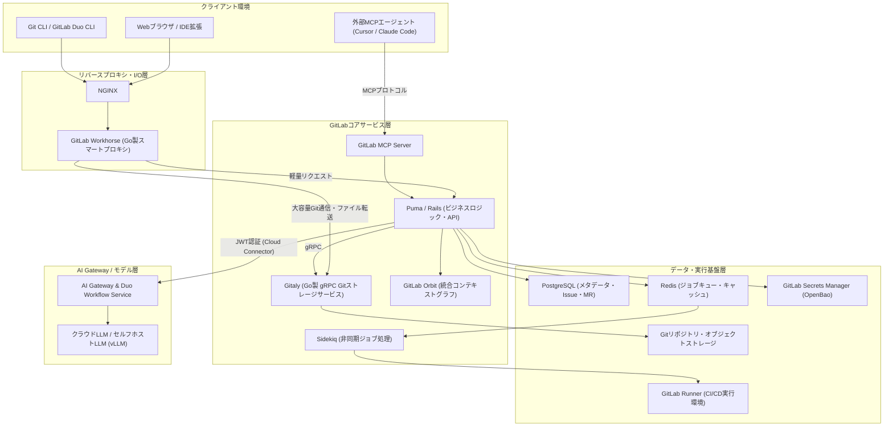

# **GitLab 調査レポート**

## **1. 基本情報**

* **ツール名**: GitLab
* **ツールの読み方**: ギットラボ
* **開発元**: GitLab Inc.
* **公式サイト**: [https://about.gitlab.com/](https://about.gitlab.com/)
* **関連リンク**:
  * GitHub: [https://github.com/gitlabhq/gitlabhq](https://github.com/gitlabhq/gitlabhq)
  * DeepWiki: [https://deepwiki.com/gitlabhq/gitlabhq](https://deepwiki.com/gitlabhq/gitlabhq)
  * ドキュメント: [https://docs.gitlab.com/](https://docs.gitlab.com/)
  * リリース情報: [https://about.gitlab.com/releases/](https://about.gitlab.com/releases/)
  * レビューサイト: [G2](https://www.g2.com/products/gitlab/reviews) | [ITreview](https://www.itreview.jp/products/gitlab/reviews)
* **カテゴリ**: バージョン管理
* **概要**: GitLabは、ソフトウェア開発、セキュリティ、運用を単一のプラットフォームに統合したAI搭載のDevSecOpsプラットフォームです。ソースコード管理からCI/CD、脆弱性スキャン、シークレット管理、プロジェクト管理、そして自律型AIエージェント基盤「GitLab Duo Agent Platform」まで、ソフトウェア開発ライフサイクル（SDLC）全体を統合的にサポートします。

## **2. 目的と主な利用シーン**

* **解決する課題**: 複数の開発・運用ツールを組み合わせることで生じる「ツールチェーンの税（管理コストや連携の手間）」の削減、開発・セキュリティ・運用のサイロ化の解消、セキュリティを開発の初期段階から組み込む「シフトレフト」の実現。
* **想定利用者**: ソフトウェア開発者、DevOpsエンジニア、セキュリティ担当者、IT運用管理者、プロジェクトマネージャー。
* **利用シーン**:
  * Gitリポジトリでのソースコード管理、コードレビュー、マージリクエスト運用
  * CI/CDパイプラインの構築によるビルド、テスト、デプロイの自動化
  * SAST・DAST・依存関係スキャン・シークレット検出・Secrets Managerによる包括的なDevSecOps運用
  * イシューボード、エピック、ロードマップを活用したアジャイルプロジェクト管理
  * GitLab Duo Agent Platformや公式MCPサーバーを活用した自律的なコード生成・脆弱性修復・CI原因分析

### **2.1 代表的な利用フロー**

```mermaid
swimlane-beta TB
  subgraph User["開発者"]
    A["コード変更をPush・MR作成"]
    E["AI修正案と結果を確認・マージ"]
  end
  subgraph GitLab["GitLab本体 (Workhorse / Rails / Gitaly)"]
    B["リポジトリ保存・パイプライン起動"]
    D["MR画面にテスト結果・脆弱性を集約"]
  end
  subgraph Runner["GitLab Runner"]
    C["ビルド・テスト・セキュリティスキャン実行"]
  end
  subgraph Duo["GitLab Duo Agent Platform"]
    F["脆弱性の誤検知除外・修正パッチ生成"]
  end
  A --> B
  B --> C
  C --> D
  D --> F
  F --> E
```

* **代表的な流れ**: 開発者がブランチへコードをプッシュしマージリクエスト（MR）を作成すると、GitLab本体がGitaly経由でリポジトリを更新し、GitLab RunnerでCI/CDおよびセキュリティスキャンを自動実行します。検出された失敗ログや脆弱性情報はMR画面に集約され、GitLab Duo Agent Platformが誤検知のフィルタリングや修正パッチの提案を行い、開発者が確認してマージを完了します。

## **3. 主要機能**

* **ソースコード管理 (SCM)**: Gitリポジトリホスティング、ブランチ保護ルール、マージリクエスト（MR）、Code Ownersによる承認フロー、インラインコードレビュー機能を提供します。
* **CI/CDとCI Catalog**: `.gitlab-ci.yml`による宣言的で柔軟なパイプライン定義、Auto DevOpsによる自動パイプライン生成、共有または自己管理ランナーの実行に加え、組織内のコンポーネント利用状況やバージョンを可視化するCI Catalog Component Analyticsを備えています。
* **統合DevSecOpsとSecrets Manager**: SAST、DAST、シークレット検出、依存関係スキャン、サードパーティ製SARIFスキャナー統合を標準搭載しています。GitLab 19.5ではOpenBaoベースの「GitLab Secrets Manager」が一般提供（GA）となり、ジョブ単位で最小権限にスコープされた認証情報管理を実現しました。
* **アジャイルプロジェクト管理**: イシュー、イシューボード、エピック、ロードマップ、マイルストーンを活用し、コードやMRと直結したプロジェクトおよびポートフォリオ管理を行えます。
* **GitLab Duo Agent Platform（AI機能群）**: 開発ライフサイクル全体を支援する自律型AIプラットフォームです。IDEでのコード補完・チャットに加え、MRライフサイクルを自律支援する「Duo Developer Flow 2.0」、ターミナルやCI上で動作する「GitLab Duo CLI」（`/goal`コマンド対応）、自然言語からカスタムワークフローを作成する「Flow Creator」、SAST・シークレット誤検知のAI自動判定、脆弱性自動修復MRの作成、CI失敗の根本原因分析を提供します。
* **GitLab OrbitとMCP Server**: コード・作業項目・MR・パイプライン・脆弱性をリアルタイムに関連付ける統合コンテキストグラフ「GitLab Orbit」と、CursorやClaude Codeなどの外部AIエージェントからGitLabリソースやツールへ安全にアクセスできる公式「GitLab MCP Server」（ガバナンス設定・監査イベント対応）を備えています。
* **Wiki・Pages・パッケージレジストリ**: プロジェクトごとのドキュメント管理（Wiki）、静的サイトホスティング（GitLab Pages）、Docker/npm/Maven/Terraform State等の各種レジストリを標準で統合しています。

## **4. 動作原理・システム構成**

GitLabは、Ruby on Railsによるコアアプリケーションを中心に、高負荷なI/O処理やGit操作、非同期ジョブ、AI推論をGoやPython製の専用コンポーネントへ分離したマルチプロセス・マイクロサービス連携アーキテクチャを採用しています。



* **アーキテクチャ**: SaaS（GitLab.com）、シングルテナントSaaS（GitLab Dedicated）、オンプレミス/プライベートクラウド（Self-Managed）のいずれでも同一のアプリケーション基盤で動作するクライアント・サーバー型構成です。
* **主要コンポーネントとデータフロー**:
  1. **GitLab Workhorse（スマートリバースプロキシ）**: NGINXの後段に配置されたGo製プロキシです。通常のWebリクエストはPuma（Rails）へ転送しつつ、大容量のGit HTTP通信（`git push`/`clone`）やアーカイブダウンロード、ファイルアップロードを直接処理してRailsプロセスのリソース枯渇を防ぎます。
  2. **Gitaly（Git RPCサービス）**: Gitリポジトリの物理ストレージとRailsアプリケーションを分離するGo製サービスです。従来のNFS依存を排除し、gRPC経由で高速・安全なGit操作と水平スケーリングを実現しています。
  3. **Puma / PostgreSQL / Redis / Sidekiq**: Pumaが権限検証やIssue・MRなどのビジネスロジックをPostgreSQL上で処理し、CI/CDトリガーやWebhook送信、通知メールなどの重い非同期処理はRedisキューを介してSidekiqワーカーが並列実行します。
  4. **AI Gateway / GitLab Orbit**: AI機能はGitLab本体から疎結合なPython/FastAPIベースのAI Gatewayを経由し、Cloud Connectorの短命JWT認証を用いてクラウドLLMやセルフホストLLM（vLLM等）へ安全に推論をルーティングします。
* **特筆すべき要素技術**:
  * **Gitaly Cluster**: 複数ノード間でのGitリポジトリレプリケーションと高可用性（HA）を実現する分散ストレージ機構。
  * **OpenBaoベースのSecrets Manager**: 認証情報をGitLab CI変数から切り離し、監査ログ付きでジョブ単位に動的・最小権限で払い出すシークレット管理基盤。
  * **Model Context Protocol (MCP) & LangGraph**: 外部エージェントとの標準化されたツール連携と、Duo Agent Platformにおけるステートフルな自律エージェント実行ループを支えています。

## **5. 開始手順・セットアップ**

* **前提条件**:
  * **SaaS版 (GitLab.com)**: GitLabアカウントの作成（メール認証のみで利用開始可能、無料プランはクレジットカード不要）。
  * **Self-Managed版**: Linuxサーバー（Ubuntu, Debian, RHEL等）またはKubernetesクラスタ、推奨4コアCPU・4GB以上のRAM（規模により増強）。
  * **CLI連携**: ローカル環境で操作する場合はGitおよびGitLab公式CLI（`glab`）をインストール。
* **インストール/導入**:

  ```bash
  # Self-Managed版 (Ubuntu向け Omnibusパッケージ導入例)
  curl -sS https://packages.gitlab.com/install/repositories/gitlab/gitlab-ee/script.deb.sh | sudo bash
  sudo EXTERNAL_URL="https://gitlab.example.com" apt-get install gitlab-ee

  # Dockerコンテナでの簡易検証起動例
  docker run --detach \
    --hostname gitlab.example.com \
    --publish 443:443 --publish 80:80 --publish 22:22 \
    --name gitlab \
    --restart always \
    gitlab/gitlab-ee:latest
  ```

* **初期設定**:
  * Self-Managed版では初回インストール時に生成される初期rootパスワード（`/etc/gitlab/initial_root_password`）でログインし、パスワード変更とサインアップ制限を実施。
  * 開発者端末のSSH公開鍵をアカウント設定に登録、または個人アクセストークン（環境変数等での安全な管理を推奨）を発行。
* **クイックスタート**:
  * Web UIの「New project」からプロジェクトを作成し、リポジトリルートに `.gitlab-ci.yml` テンプレートを追加してコミットすることで、即座に最初のCI/CDパイプラインを実行できます。

## **6. 特徴・強み (Pros)**

* **単一プラットフォームでの完結**: 計画・コード管理・CI/CD・セキュリティ・パッケージ管理・監視までを単一アプリケーションで提供するため、複数ツールの連携メンテナンスやライセンス管理コストを大幅に削減できます。
* **強力なCI/CDと運用ガバナンス**: `.gitlab-ci.yml`による高度なパイプライン設計、Review AppsによるMRごとの動的検証環境、CI Catalogによる組織内テンプレートの統制と利用状況分析が可能です。
* **徹底したDevSecOps統合**: SAST/DAST・シークレット検出・OpenBaoベースのSecrets Managerが基盤に組み込まれており、さらにAIによる誤検知除外や修正MR自動生成により、セキュリティ対応のリードタイムを短縮します。
* **自律型AIとオープンなエコシステム**: GitLab Duo Agent PlatformやDuo CLI（`/goal`）による自律開発に加え、公式MCPサーバー（GA）やGitLab Orbitにより、CursorやClaude Codeなどの外部AIツールとも統合コンテキストを共有できます。
* **柔軟なデプロイモデル**: クラウドSaaS（GitLab.com）、厳格な規制要件向けのシングルテナント（Dedicated）、完全閉域・オンプレミス対応のSelf-Managed（セルフホストLLM対応含む）から選択できます。

## **7. 弱み・注意点 (Cons)**

* **多機能ゆえの複雑さと学習コスト**: 提供機能が非常に広範であるため、管理画面の設定項目やCI/CD・権限体系の全体像を把握するまでに一定の学習期間を要します。
* **UIのレスポンスと視認性**: 機能が重厚であるため、単機能に特化したツールと比較するとUIの情報量が多く、目的の設定箇所を探すのに慣れが必要という声があります。
* **セルフマネージド運用のインフラ負荷**: Self-Managed版を自社運用する場合、GitalyやSidekiq、Runnerを含めたサーバーリソースの確保と、定期的なアップグレードパス（アップグレードストップの順守）の運用負荷がかかります。
* **日本語対応とAIクレジット管理**: UIの基本部分は日本語化されていますが、公式ドキュメントや最新のリリースノート・AI関連機能は英語が中心です。また、高度なAIエージェント機能は従量課金制の「GitLab Credits」を消費するため、組織内での利用上限やコスト管理が必要です。

## **8. 料金プラン**

| プラン名 | 料金 | 主な特徴 |
|---------|------|---------|
| **Free** | 無料 | 個人・小規模チーム向け。トップレベルグループあたり5ユーザーまで、SCM、CI/CD (400分/月)、10GiBストレージ。 |
| **Premium** | $29/ユーザー/月 (年払い) | 成長企業向け。高度なCI/CD (10,000分/月)、MR承認ルール、エンタープライズアジャイル計画、優先サポート。プロモーションとして月$12分のGitLab Creditsが含まれる。 |
| **Ultimate** | $99/ユーザー/月 (年払い) | 大企業・規制業界向け。SAST/DAST・脆弱性管理・コンプライアンスダッシュボード、ポートフォリオ管理、CI/CD (50,000分/月)。プロモーションとして月$24分のGitLab Creditsが含まれる。 |
| **GitLab Duo Agent Platform (クレジット)** | 従量課金 ($1/クレジット) | Duo Agent Platformや自律型フローの実行に応じた消費型課金。月間コミットメントプール（年間割引あり）やオンデマンド課金を利用可能。Freeプランでもクレジットプール購入で利用可。 |
| **オフライン/エアギャップ向けDuo SKU** | $299/ユーザー/月〜 | クラウド接続不可の完全閉域Self-Managed環境向けシート課金オプション。 |

* **課金体系**: コアプランはユーザー単位の年額課金。AIエージェント実行は利用量に応じた「GitLab Credits」消費モデル（Premium/Ultimateには月次プロモーション枠が付帯）。デプロイ形態としてGitLab.com、Self-Managed、GitLab Dedicated（要問い合わせ）を選択可能。
* **無料トライアル**: Ultimateプランの30日間無料トライアルあり。

## **9. 導入実績・事例**

* **導入企業**: Goldman Sachs、Airbus、NVIDIA、Deutsche Telekom、Lockheed Martinなど、Fortune 100企業の半数以上を含む世界中の企業・公共機関で導入されています。
* **導入事例**: 数十個の個別DevOpsツールをGitLabへ統合することでツールチェーン維持コストを削減し、デプロイ頻度の向上やセキュリティ脆弱性の修正サイクル短縮を達成した事例が多数報告されています。
* **対象業界**: 金融、自動車・航空宇宙、通信、ソフトウェア・SaaS、公共・政府機関など、高いセキュリティ・コンプライアンスと開発速度の両立が求められる業界で広く採用されています。

## **10. サポート体制**

* **ドキュメント**: [GitLab Docs](https://docs.gitlab.com/)にてアーキテクチャ、インストール、CI/CD、API、セキュリティ、AI機能まで極めて網羅的な技術文書が公開されています（主に英語）。
* **コミュニティ**: [GitLab Forum](https://forum.gitlab.com/)やオープンソースのIssueトラッカー上で、開発元エンジニアとユーザーコミュニティ間の議論や改善提案が活発に行われています。
* **公式サポート**: Premiumプランでは翌営業日対応の標準サポート、Ultimateプランでは24時間365日の緊急対応（SLA付き優先サポート）および専任カスタマーサクセス支援が提供されます。

## **11. エコシステムと連携**

### **11.1 API・外部サービス連携**

* **API**: 包括的なREST APIおよびGraphQL APIが公開されており、リポジトリ、イシュー、MR、CI/CDパイプライン、脆弱性レポート、監査イベントなどのほぼ全操作を自動化できます。Webhookによるイベント通知にも対応。
* **外部サービス連携**:
  * **チャット・タスク連携**: Slack（GitLab 19.6で `@GitLab` メンションによるIssue化や要約連携がLimited Availabilityとして追加）、Microsoft Teams、Jira、ServiceNow等と標準連携。
  * **AI・MCP連携**: 公式のGitLab MCP Server（GA）を通じ、Cursor、Claude Code、Windsurf等の外部MCP対応エージェントと双方向連携が可能。
  * **クラウド・インフラ**: AWS、Google Cloud、Azure、Kubernetes、HashiCorp Vault / OpenBao、Terraform等と深く統合。

### **11.2 技術スタックとの相性**

| 技術スタック | 相性 | メリット・推奨理由 | 懸念点・注意点 |
|:---|:---:|:---|:---|
| **Docker / Kubernetes** | ◎ | コンテナレジストリ、Kubernetes Agent統合、脆弱性スキャンが標準搭載 | セルフホストRunnerでのK8s Executor構成は初期設計が必要 |
| **Node.js / Python / Go** | ◎ | Auto DevOpsやCI CatalogテンプレートによりCI/CDとテストを迅速に構築可能 | 特になし |
| **Terraform / OpenTofu** | ◎ | Terraform Stateの暗号化管理・プラン結果のMR表示機能が標準統合 | StateロックとCI権限スコープの設計に注意 |
| **Java / Kotlin** | ◯ | Maven/GradleパッケージレジストリおよびSAST解析がスムーズ | 大規模ビルドではRunnerのメモリ・CPUスペック確保が必要 |

## **12. セキュリティとコンプライアンス**

* **認証**: 2段階認証（2FA / WebAuthnパスキー）、SAML 2.0 SSO、OIDC、LDAP、SCIMプロビジョニングに対応し、グループ単位のロールベースアクセス制御（RBAC）を厳格に適用できます。
* **データ管理**: 通信時（TLS）および保存時の暗号化を実施。GitLab.comはGoogle Cloud上でホストされ、セルフマネージド版やGitLab Dedicatedでは顧客管理の閉域環境や特定リージョンでのデータ保持が可能です。GitLab Duoでは顧客のコードやプロンプトを基盤モデルの学習に使用しないZero Retentionポリシーを採用しています。
* **準拠規格**: SOC 2 Type 2、SOC 3、ISO/IEC 27001、ISO/IEC 27017/27018、TISAX、GDPR、FedRAMP等を取得・準拠。さらにGitLab 19.5でGAとなったSecrets Manager（OpenBao）や、GitLab 19.6で追加されたMCP Serverツール呼び出しの監査イベントにより、AI時代のガバナンスも強化されています。

## **13. 操作性 (UI/UX) と学習コスト**

* **UI/UX**: 左側のナビゲーションバーからリポジトリ、CI/CD、セキュリティ、計画機能へ一貫した操作系でアクセスできます。MR画面ではコード差分、パイプライン結果、脆弱性レポート、AIレビューが一画面に集約され、コンテキストスイッチを抑えた設計になっています。
* **学習コスト**: Gitおよび基本的なCI/CDに慣れた開発者であれば、日々のコード管理やMR運用は容易に習得できます。一方で、グループ階層の権限設計、カスタムRunner運用、Custom FlowsやMCPガバナンスなどの管理機能を最適化するには、専任のDevOpsエンジニアによる設計と学習が必要です。

## **14. ベストプラクティス**

* **効果的な活用法 (Modern Practices)**:
  * **GitLab Secrets Managerと保護変数の徹底**: APIキーやデプロイ認証情報はリポジトリに置かず、OpenBaoベースのSecrets Managerや環境スコープ付きの保護されたCI/CD変数で管理し、OIDCフェデレーションを活用する。
  * **CI Catalogによるパイプライン標準化**: 各リポジトリで `.gitlab-ci.yml` を重複記述せず、バージョン管理されたCI/CDコンポーネントを作成して組織全体で再利用し、Component Analyticsでバージョンを追跡する。
  * **Review AppsとCode Ownersの併用**: MRごとに確認環境を自動生成し、重要ディレクトリにはCode Ownersによる承認とテスト・セキュリティゲートの通過を必須化する。
* **陥りやすい罠 (Antipatterns)**:
  * **シークレットのハードコード**: テスト用を含め認証情報をコードや `.gitlab-ci.yml` に直接記述すること（シークレット検出やAI誤検知判定に依存する前に、設計段階で排除すべき）。
  * **巨大MRや長寿命ブランチの放置**: 変更量が膨大になるとレビュー品質とCI効率が低下するため、トピックブランチを短命に保ち小さくマージする。
  * **アップグレードパスの無視（Self-Managed）**: メジャーバージョンをまたぐ更新時に推奨のアップグレードストップ（例: 19.2, 19.5等）を飛ばすとDBマイグレーション障害の原因となるため、公式パスを順守する。

## **15. ユーザーの声（レビュー分析）**

* **調査対象**: G2、ITreview
* **総合評価**:
  * **G2**: 4.5 / 5.0（900件以上のレビュー）
  * **ITreview**: 4.0 / 5.0（ソースコード管理カテゴリー、75件以上）、CI/CDツール 4.2 / 5.0、コラボレーションツール 4.4 / 5.0
* **ポジティブな評価**:
  * 「ソース管理、Issue管理、CI/CD、セキュリティが単一プラットフォームで完結するため、ツール間の切り替えストレスがなくなる」（G2より引用要約）
  * 「YAMLベースのCI/CDパイプラインが柔軟で強力であり、テストとデプロイの自動化をスムーズに構築できる」（G2・ITreviewより引用要約）
  * 「クラウド版だけでなくオンプレミス（Self-Managed）を選べるため、セキュリティ要件の厳しい企業でも採用しやすい」（ITreviewより引用要約）
* **ネガティブな評価 / 改善要望**:
  * 「機能が非常に豊富なため、全ての機能を使いこなすには学習コストが高い」（G2・ITreviewより引用要約）
  * 「UIが時に複雑に感じられ、目的の設定画面を見つけるのに時間がかかることがある」（G2より引用要約）
  * 「高度なセキュリティ機能やエンタープライズ向け機能を利用するにはUltimateなど上位プランへのコスト負担が大きくなる」（G2・ITreviewより引用要約）
* **特徴的なユースケース**:
  * Jira、Jenkins、外部セキュリティスキャナーなど複数のSaaS・OSSツールをGitLab単体に統合し、ライセンスコストとツール連携の保守工数を削減するケースで特に高く評価されています。

## **16. 直近半年のアップデート情報**

* **2026-11-19**: **GitLab 19.6**: GitLab MCP Serverのツール呼び出しに対する包括的な監査イベント（Audit Events）を追加し、外部AIエージェントの操作追跡を強化。また、GitLab.com向けにSlack上で `@GitLab` をメンションしてIssue作成や議論の要約を行える「GitLab Duo in Slack」（Limited Availability）を提供開始。
* **2026-10-15**: **GitLab 19.5**: 外部MCP対応エージェント（Claude CodeやCursor等）と安全に連携する「GitLab MCP Server」が一般提供（GA）。あわせて、コード・Issue・MR・パイプライン・脆弱性をリアルタイムに結びつける統合コンテキストグラフ「GitLab Orbit」（GA）、およびOpenBaoベースの「GitLab Secrets Manager」（GA）を正式リリース。
* **2026-09-17**: **GitLab 19.4**: GitLab MCP Serverのツールに対するガバナンス機能（読み取り専用は自動許可、書き込み・削除は確認要求など）を導入。また、GitLab Duo CLIに長期タスクを自律実行する `/goal` コマンドおよびクレジット消費上限管理を導入。
* **2026-08-20**: **GitLab 19.3**: 自然言語の対話からDuo Agent Platform向けのカスタムワークフローを生成する「Flow Creator Foundational Agent」を追加。GitLab.com向けのGitLab Secrets Manager（Limited Availability）を展開。
* **2026-07-16**: **GitLab 19.2**: 開発者の端末やヘッドレスCI環境からエージェント機能を利用できる「GitLab Duo CLI」および「Custom Flows」が一般提供（GA）。依存関係の脆弱性に対する自動修復MR作成（Public Beta）を追加。
* **2026-06-18**: **GitLab 19.1**: GitLab Duoによるシークレット誤検知の自動判定（GA）と、サードパーティ製SARIFスキャナー結果の脆弱性管理統合（GA）、イベント駆動型のAIトリガーを追加。
* **2026-05-21**: **GitLab 19.0**: メジャーバージョン刷新。「GitLab Secrets Manager」（Public Beta）、MRライフサイクルを自律支援する「Duo Developer Flow 2.0」、CIコンポーネントの利用状況を可視化する「CI Catalog Component Analytics」、エアギャップ環境向けセルフホストAIモデル連携拡充を実施。
* **2026-04-16**: **GitLab 18.11**: Vulnerability resolution generally available on GitLab Duo Agent Platform
* **2026-03-19**: **GitLab 18.10**: SAST false positive detection with GitLab Duo Agent Platform
* **2026-02-19**: **GitLab 18.9**: GitLab Duo Agent Platform Self-Hosted models now available for cloud licenses
* **2026-01-15**: **GitLab 18.8**: GitLab Duo Agent Platform now generally available
* **2025-12-18**: **GitLab 18.7**: AIエージェント機能の進化、ガバナンス機能の強化、開発者体験の向上が含まれる。

(出典: [GitLab Releases](https://about.gitlab.com/releases/) / [GitLab Release Notes](https://docs.gitlab.com/releases/))

## **17. 類似ツールとの比較**

### **17.1 機能比較表 (星取表)**

| 機能カテゴリ | 機能項目 | 本ツール (GitLab) | GitHub | Jenkins | Azure DevOps |
|:---:|:---|:---:|:---:|:---:|:---:|
| **基本機能** | ソースコード管理 | ◎<br><small>標準機能・Gitaly基盤</small> | ◎<br><small>業界標準・高並列Git基盤</small> | ×<br><small>別途必要</small> | ◯<br><small>標準機能</small> |
| **CI/CD** | パイプライン | ◎<br><small>統合型・Secrets Manager連携</small> | ◎<br><small>Actions + actions.lock</small> | ◎<br><small>プラグイン拡張性高</small> | ◯<br><small>Pipelines (多機能)</small> |
| **AI支援** | 自律エージェント・レビュー | ◎<br><small>Duo Agent Platform / Orbit / MCP</small> | ◎<br><small>Copilot Fusion / Projects / Review Max</small> | ×<br><small>標準非対応</small> | ◯<br><small>Copilot連携</small> |
| **エンタープライズ** | セキュリティ (DevSecOps) | ◎<br><small>統合スキャン・AI誤検知除外</small> | ◎<br><small>GHAS / AI Scan / Autofix</small> | △<br><small>プラグイン依存</small> | ◯<br><small>GHAS for Azure DevOps</small> |
| **非機能要件** | 日本語対応 | △<br><small>UI一部対応・Doc英語中心</small> | ◯<br><small>主要UI・Docs対応</small> | △<br><small>一部英語</small> | ◯<br><small>対応</small> |

### **17.2 詳細比較**

| ツール名 | 特徴 | 強み | 弱み | 選択肢となるケース |
|---------|------|------|------|------------------|
| **GitLab** | AI搭載のオールインワンDevSecOpsプラットフォーム | 単一アプリによるツールチェーン集約、強力なCI/CDと統合セキュリティ、Self-ManagedやGitLab Orbit/MCPの充実 | 多機能ゆえのUI複雑さと学習コスト、最新ドキュメントが英語中心 | 開発からセキュリティまで単一基盤に集約したい場合や、オンプレミス・厳格なガバナンス要件がある場合。 |
| **GitHub** | AIエージェントと開発者コミュニティを核とした統合開発プラットフォーム | Copilot FusionやProjectsによるマルチリポ自律開発、世界最大のOSSエコシステム、Actionsとサプライチェーン保護 | プロジェクト管理やオンプレミス展開の柔軟性はGitLabほど単一完結型ではない | AIを活用した最新のマルチリポ開発体験や、OSSコミュニティとの連携を最優先する場合。 |
| **Jenkins** | CI/CDに特化したオープンソースの自動化サーバー | 2000以上のプラグインによる極めて高いカスタマイズ性と完全無料のオンプレミス運用 | SCMやプロジェクト管理機能を持たず、サーバー保守・プラグイン管理の運用負荷が高い | 非常に特殊なビルド・デプロイ要件があり、既存のオンプレミス資産で柔軟に制御したい場合。 |
| **Azure DevOps** | Microsoft製品エコシステム向けの統合開発プラットフォーム | AzureクラウドやMicrosoft製品群との高い親和性、Azure Boardsによる大規模バックログ管理 | 最新AI機能への投資はGitHub側が先行しており、Microsoft環境外との連携は一手間かかる | 主にAzureクラウドを利用しており、既存のエンタープライズMicrosoft資産を全面活用している場合。 |

## **18. 総評**

* **総合的な評価**:
  GitLabは、単なるソースコード管理ツールではなく、計画・開発・CI/CD・セキュリティ・運用を単一アプリケーションで完結させる「DevSecOpsプラットフォーム」として極めて高い完成度を誇ります。2026年のGitLab 19シリーズでは、統合コンテキストグラフ「GitLab Orbit」、OpenBaoベースの「GitLab Secrets Manager」、公式「GitLab MCP Server」、および「GitLab Duo Agent Platform」の拡充により、単一基盤の強みを維持したまま外部のAIエージェントとも協調できる次世代の自律開発プラットフォームへと進化しました。
* **推奨されるチームやプロジェクト**:
  * 複数の開発・セキュリティツールを統合し、管理コストと「ツールチェーンの税」を削減したい組織。
  * セキュリティスキャンやシークレット管理をパイプラインに標準組み込みし、DevSecOpsを推進したいチーム。
  * 自社インフラ（Self-Managed）や専用シングルテナント環境（Dedicated）での厳格なデータ管理とAI活用を両立させたいエンタープライズ企業。
* **選択時のポイント**:
  * **GitHubとの比較**: 世界最大のコミュニティやCopilot Projects等のマルチリポAI体験を重視するならGitHub、単一アプリでのDevSecOps完結やセルフマネージド運用の柔軟性を優先するならGitLabが優れています。
  * **AIコストとガバナンス**: GitLab Duo Agent PlatformはGitLab Creditsによる消費型課金に移行しているため、Premium/Ultimate付帯枠の活用とクレジット上限設定を含めた運用設計が導入の鍵となります。
