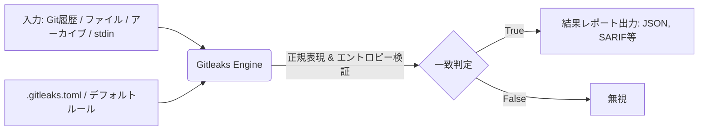

# **Gitleaks 調査レポート**

## **1. 基本情報**

* **ツール名**: Gitleaks
* **ツールの読み方**: ギットリークス
* **開発元**: Zach Rice (zricethezav)
* **公式サイト**: [https://gitleaks.io/](https://gitleaks.io/)
* **関連リンク**:
  * GitHub: [https://github.com/gitleaks/gitleaks](https://github.com/gitleaks/gitleaks)
* **カテゴリ**: セキュリティ
* **概要**: Gitリポジトリ、ファイル、ディレクトリ、および標準入力（stdin）から、パスワード、APIキー、トークンなどのハードコードされたシークレットを検出するためのオープンソースツールです。

## **2. 目的と主な利用シーン**

* **解決する課題**: ソースコードやリポジトリ内に誤ってコミットされた認証情報（APIキー、パスワード、トークンなど）の流出（シークレットリーク）を防ぐこと。
* **想定利用者**:
  * ソフトウェア開発者
  * セキュリティエンジニア / セキュリティチーム
  * DevOps / DevSecOpsエンジニア
* **利用シーン**:
  * **ローカル開発環境**: 開発者がコードをコミットする前にローカルでスキャンを実行する。
  * **CI/CDパイプライン**: プルリクエストやマージ時に自動でスキャンを実行し、シークレットを含むコードの混入をブロックする。
  * **既存リポジトリの監査**: 過去のコミット履歴を遡って、すでに混入しているシークレットを特定する。

## **3. 主要機能**

* **多様なスキャン対象**: ローカルのGitリポジトリ（履歴含む）、ディレクトリ、単一ファイル、および標準入力（stdin）のストリームデータをスキャン可能。
* **正規表現とエントロピーによる検出**: パターンマッチング（正規表現）だけでなく、文字列のエントロピー（複雑さ）を計算して、未知のシークレットを高精度で検出。
* **エンコードテキストの自動デコード**: パーセントエンコーディング、16進数（Hex）、Base64などでエンコードされたテキストを自動的にデコードしてスキャンする機能。
* **アーカイブスキャン**: zipファイルやtarballなどのアーカイブファイルを自動的に展開し、その中身をスキャンする機能。
* **ベースライン機能**: 過去に検出された既知のシークレットをベースラインとして記録し、次回のスキャン時には新しい検出のみを報告させる機能。
* **多様なレポート出力**: JSON、CSV、JUnit、SARIFなどの形式でレポートを出力可能。また、Goのテキストテンプレートを用いたカスタムフォーマットにも対応。

## **4. 動作原理・システム構成**

* **アーキテクチャ**: ローカルファーストのCLIツール
* **主要コンポーネントとデータフロー**:
  * スキャン対象（Gitリポジトリ、ファイルディレクトリ、アーカイブ、stdin）を入力として受け取る。
  * 設定ファイル（`.gitleaks.toml`）またはデフォルト設定からスキャンルール（正規表現およびエントロピー検知の複合条件など）を読み込む。
  * 並行処理により高速にコンテンツをスキャンし、一致したシークレット情報をJSON等の形式で標準出力やファイルに出力する。
* **特筆すべき要素技術**:
  * **Go言語による高速な並行処理**: スキャンを並行して実行するため非常に高速に処理が可能。
  * **エントロピー検知**: シャノンエントロピー等を用いてランダムな文字列（APIキーやトークンの可能性が高いもの）を検知。



## **5. 開始手順・セットアップ**

* **前提条件**:
  * Homebrew、Docker、またはGoがインストールされていること。
  * アカウント作成やクレジットカード登録は不要。
* **インストール/導入**:
  * **MacOS (Homebrew)**:

    ```bash
    brew install gitleaks
    ```

  * **Docker (DockerHub)**:

    ```bash
    docker pull zricethezav/gitleaks:latest
    ```

  * **Go (ソースから)**:

    ```bash
    git clone https://github.com/gitleaks/gitleaks.git
    cd gitleaks
    make build
    ```

* **初期設定**:
  * 特別な設定なしですぐに利用開始可能。カスタムルールを利用する場合は、`.gitleaks.toml`設定ファイルを作成する。
* **クイックスタート**:
  * ディレクトリのスキャン:

    ```bash
    gitleaks dir -v ./
    ```

  * Gitリポジトリのスキャン:

    ```bash
    gitleaks git -v
    ```

## **6. 特徴・強み (Pros)**

* 完全に無料かつオープンソースで提供されており、ライセンス費用が発生しない。
* Dockerイメージ、Homebrew、Goバイナリなど、多様なインストール方法が提供されており導入が容易。
* 27.1k以上のGitHubスター、2,000万回以上のDockerダウンロードと、コミュニティで広く認知され利用されている。
* GitHub ActionsやPre-commitフックとして標準でサポートされており、既存の開発ワークフローに組み込みやすい。
* アーカイブスキャンや多重エンコードのデコード機能により、隠れたシークレットも見逃しにくい。

## **7. 弱み・注意点 (Cons)**

* コマンドラインツール（CLI）であるため、GUIを好むユーザーや非エンジニアにはハードルが高い可能性がある。
* 調査時点で、公式の日本語ドキュメントや日本語対応のGUIは確認されていない。
* パターンマッチングとエントロピーベースの検出であるため、ルール設定によっては誤検知（False Positive）が発生する可能性がある（`.gitleaksignore`等でのチューニングが必要）。

## **8. 料金プラン**

| プラン名 | 料金 | 主な特徴 |
|---------|------|---------|
| **オープンソース版** | 無料 | MITライセンス。すべての機能を制限なく利用可能。 |
| **Organization License** | 無料 | GitHubのOrganizationアカウントでリポジトリをスキャンする場合は、フォームから無料のライセンスキーを取得する必要がある。 |

* **課金体系**: 完全無料
* **無料トライアル**: トライアルではなく完全に無料。

## **9. 導入実績・事例**

* **導入企業**: オープンソースであるため特定の企業リストは公式サイトに大々的には掲載されていないが、2,000万回以上のDockerダウンロードと27.1k以上のGitHubスターから、世界中の多数のプロジェクトや組織で利用されていることが伺える。
* **導入事例**: 特定の企業事例は見当たらないが、DevSecOpsのベストプラクティスツールとして多数の技術ブログやコミュニティで紹介されている。
* **対象業界**: ソフトウェア開発を行うすべての業界、特にセキュリティを重視するテクノロジー企業やスタートアップ。

## **10. サポート体制**

* **ドキュメント**: GitHubのREADMEや公式リポジトリ内のドキュメントによって提供されている。
* **コミュニティ**: Discordサーバー（[リンク](https://discord.gg/8Hzbrnkr7E)）にて、ユーザー間のサポートや交流が行われている。
* **公式サポート**: オープンソースプロジェクトのため、バグ報告や機能要望はGitHub Issuesを通じて行われる。エンタープライズ向けの有償サポートについては、開発者（Zach Rice）への直接の問い合わせが必要となる。

## **11. エコシステムと連携**

### **11.1 API・外部サービス連携**

* **API**: ツール自体はCLIベースであり、Web APIとして提供されているわけではないが、JSONやSARIF形式でのレポート出力により、他のセキュリティツールやダッシュボードとの連携が容易。
* **外部サービス連携**:
  * **GitHub Actions**: 公式の[Gitleaks-Action](https://github.com/gitleaks/gitleaks-action)が提供されており、ワークフローへの組み込みが容易。
  * **Pre-commit**: 公式のHookが用意されており、ローカルでのコミット前の検証に組み込める。

### **11.2 技術スタックとの相性**

| 技術スタック | 相性 | メリット・推奨理由 | 懸念点・注意点 |
|:---|:---:|:---|:---|
| **GitHub Actions** | ◎ | 公式アクションが提供されており、設定が極めて容易。 | Organizationアカウントでの利用には無料ライセンスキーの登録が必要な場合がある。 |
| **Git / CLI** | ◎ | リポジトリの履歴を含めた詳細なスキャンがネイティブにサポートされている。 | 大規模な履歴を持つリポジトリの場合、初回のスキャンに時間がかかることがある（ベースライン機能で対応可能）。 |
| **Docker** | ◎ | 公式イメージ（Docker Hub、ghcr.io）が提供されているため、環境を汚さずに実行可能。 | コンテナ実行のオーバーヘッドがわずかにある。 |

## **12. セキュリティとコンプライアンス**

* **認証**: CLIツールであるため、ユーザー認証の仕組みは不要。
* **データ管理**: スキャン処理はすべてローカル（または実行環境内）で完結し、コードやシークレットが外部のサーバーに送信されることはないため、機密性が保たれる。Gitleaks Playgroundについても、ブラウザ内のWebAssemblyでローカル処理され、アップロードされない設計となっている。
* **準拠規格**: オープンソースのCLIツールであるため、ISO27001やSOC2などのSaaS向けコンプライアンス認証は取得していない（公式サイト等にも記載なし）。

## **13. 操作性 (UI/UX) と学習コスト**

* **UI/UX**: 基本的にCLIツールであるため、ターミナルでの操作が中心となる。出力結果はカラーハイライトされ、検出されたシークレットの箇所が視覚的にわかりやすく表示される。
* **学習コスト**: インストールコマンドや実行コマンドがシンプルであるため、エンジニアにとっては導入から実行までの学習コストは非常に低い。ただし、高度なカスタムルールを作成するためには、正規表現やTOML設定ファイルの記法を理解する必要がある。

## **14. ベストプラクティス**

* **効果的な活用法 (Modern Practices)**:
  * **CI/CDへの統合**: GitHub ActionsなどのCIパイプラインに組み込み、プルリクエスト時に自動スキャンを実行して、問題がある場合はマージをブロックする運用が推奨される。
  * **ベースラインの活用**: 既存の大規模リポジトリに導入する際は、過去のシークレットをベースライン（`--baseline-path`）として記録し、新規の混入のみを検知するように運用を始めるのが効果的である。
  * **アーカイブやエンコードへの対応**: 必要に応じて `--max-archive-depth` や `--max-decode-depth` オプションを有効にし、圧縮ファイルやエンコードされたテキストに隠れたシークレットを検出する。
* **陥りやすい罠 (Antipatterns)**:
  * **誤検知の放置**: 正規表現やエントロピー検知の性質上、テスト用のダミーキーなどが検知されることがある。これを放置すると警告のノイズとなり形骸化を招くため、`.gitleaksignore`や`#gitleaks:allow`コメントを使用して適切に除外設定を行うことが重要。

## **15. ユーザーの声（レビュー分析）**

* **調査対象**: GitHub（スター数、利用実績に基づく評価）
* **総合評価**: 27.1k以上のGitHubスター、2,000万回以上のDockerダウンロード
* **ポジティブな評価**:
  * 動作が軽量かつ高速である。
  * CI/CDパイプライン（特にGitHub Actions）への組み込みが非常に簡単である。
  * 独自ルールの追加やカスタマイズが柔軟に行える。
* **ネガティブな評価 / 改善要望**:
  * G2やCapterraなどのレビューサイトでの一般的なSaaS製品のような評価は登録されていないが、GitHub Issues等では「特定のエッジケースでの誤検知（False Positive）への対応」に関する要望が見られることがある。
* **特徴的なユースケース**:
  * 開発サイクルの初期段階（ローカルコミット時）での`pre-commit`フックによるシークレット漏洩の未然防止。

## **16. 直近半年のアップデート情報**

* **2026-03-21**: v8.30.1 のリリース (Go 1.24への移行など)
* **2025-11-26**: v8.30.0 のリリース (Looker, Airtable Personnal Access Tokenルールの追加など)
* **2025-11-19**: v8.29.1 のリリース
* **2025-11-04**: v8.29.0 のリリース (Amazon Bedrock API key検出の追加など)
* **2025-07-20**: v8.28.0 のリリース (Anthropic API key, Artifactory reference token検出の追加、Composite rulesの導入など)

(出典: [GitHub Releases](https://github.com/gitleaks/gitleaks/releases))

## **17. 類似ツールとの比較**

### **17.1 機能比較表 (星取表)**

| 機能カテゴリ | 機能項目 | Gitleaks | GitGuardian | Secretlint | TruffleHog |
|:---:|:---|:---:|:---:|:---:|:---:|
| **基本機能** | シークレットスキャン | ◎<br><small>正規表現とエントロピーによる高速検出</small> | ◎<br><small>高度な検知エンジン</small> | ◯<br><small>プラガブルなルールベース</small> | ◎<br><small>Live検証機能など高機能</small> |
| **高度な機能** | 過去のコミット履歴スキャン | ◎<br><small>非常に高速</small> | ◎<br><small>プラットフォームで管理</small> | △<br><small>pre-commit等に特化</small> | ◎<br><small>コミット単位での検証可能</small> |
| **導入形態** | オープンソース/無料 | ◎<br><small>完全無料</small> | △<br><small>エンタープライズ中心(無料枠あり)</small> | ◎<br><small>MITライセンス</small> | ◯<br><small>OSS版と商用版のデュアルライセンス</small> |
| **エコシステム** | CI/CD・Pre-commit連携 | ◎<br><small>公式アクション・フック完備</small> | ◎<br><small>広範なDevSecOps連携</small> | ◎<br><small>日々の開発フローに容易に組み込み</small> | ◎<br><small>パイプライン連携が豊富</small> |

### **17.2 詳細比較**

| ツール名 | 特徴 | 強み | 弱み | 選択肢となるケース |
|---------|------|------|------|------------------|
| **Gitleaks** | オープンソースの高速なスキャナー | 無料で導入が容易、高速な動作とCI/CD連携のしやすさ | 管理用ダッシュボードがない、誤検知チューニングが必要 | コストをかけずに超高速なCI/CDパイプラインを構築したい場合 |
| **GitGuardian** | 統合セキュリティプラットフォーム | インシデント管理、SAML/SSO認証、パブリック漏洩監視 | エンタープライズ向けのライセンス費用が掛かる | 全社的なセキュリティガバナンスやダッシュボード管理が必要な大規模組織 |
| **Secretlint** | プラガブルなリンターツール | Node.js環境に親和性が高く、独自ルール追加が容易 | 大規模な履歴全体スキャンには向かない場合がある | JS/TSエコシステム中心で、コミット前の日々のワークフローに自然に組み込みたい場合 |
| **TruffleHog** | Live検証に強いスキャナー | 見つかったキーが有効かどうかを実際にテストするLive検証機能 | エンタープライズ向けの高度な管理機能は商用版のみ | 発見されたシークレットの有効性を自動検証し、対応の優先順位付けを行いたい場合 |

## **18. 総評**

* **総合的な評価**:
  Gitleaksは、開発ライフサイクルにおけるシークレット漏洩を未然に防ぐための、非常に強力かつ信頼性の高いオープンソースツールです。27.1k以上のGitHubスターと2,000万回以上のダウンロードという数字が示す通り、その軽量さとCI/CDパイプライン（特にGitHub ActionsやPre-commit）への統合の容易さが世界中の開発者から高く評価されています。
* **推奨されるチームやプロジェクト**:
  * DevSecOpsの文化を根付かせたいソフトウェア開発チーム
  * コストを抑えつつ、確実なシークレットスキャンをCI/CDに組み込みたいスタートアップや中堅企業
  * セキュリティのシフトレフト（早期発見）を推進したいプロジェクト
* **選択時のポイント**:
  GUIベースの管理コンソールや手厚いエンタープライズサポートを必須要件としない限り、シークレット検出の第一の選択肢としてGitleaksの導入を強く推奨します。
