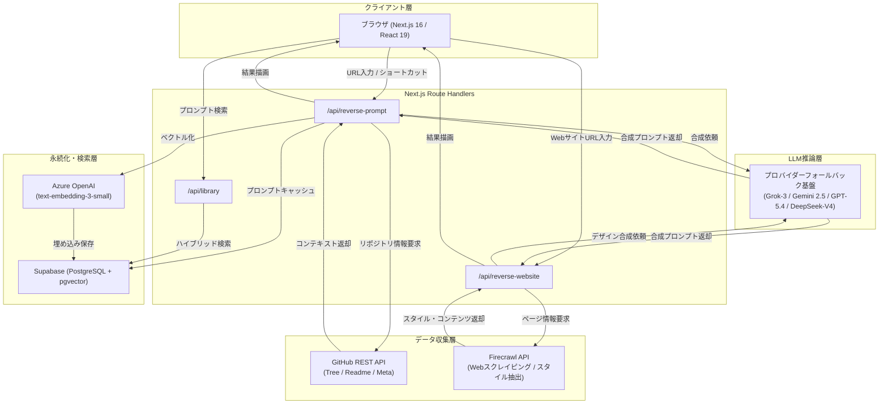

# **GitReverse 調査レポート**

## **1. 基本情報**

* **ツール名**: GitReverse（ギットリバース）
* **ツールの読み方**: ギットリバース
* **開発元**: GitMVP LTD（開発者: Fili / filiksyos）
* **公式サイト**: [https://gitreverse.com/](https://gitreverse.com/)
* **関連リンク**:
  * GitHub: [https://github.com/filiksyos/gitreverse](https://github.com/filiksyos/gitreverse)
* **カテゴリ**: AI開発ワークフロー
* **概要**: GitReverseは、公開されているGitHubリポジトリやWebサイトのURLを入力するだけで、そのプロジェクトの設計意図やアーキテクチャをLLMが分析し、CursorやClaude CodeなどのAIコーディングツールに渡すための自然言語プロンプト（仕様書・指示文）を逆生成（リバースエンジニアリング）するオープンソースツールである。ブラウザのアドレスバーで「github.com」を「gitreverse.com」に書き換えるだけで瞬時にプロンプトが得られる手軽さを備えており、バイブコーディング（Vibe Coding）時代のプロトタイピングやOSS学習を強力に後押しする。

## **2. 目的と主な利用シーン**

* **解決する課題**:
  * 既存のオープンソースリポジトリから設計構造やアーキテクチャを理解するのに膨大な時間がかかる課題
  * AIコーディングエージェント（Cursor, Claude Code, Codex, v0等）に新規開発を依頼する際、適切なゴールや仕様をまとめた自然言語プロンプトの作成に高いスキルを要する課題
  * 既存リポジトリ全体のソースコードをそのままAIに読み込ませるとコンテキストウィンドウの制限やトークンコストが急増する課題
* **想定利用者**: ソフトウェアエンジニア、個人開発者、AIプロンプトエンジニア、プロダクトマネージャー、UI/UXデザイナー
* **利用シーン**:
  * **別スタックへの高速移植・プロトタイピング**: Pythonで書かれた既存OSSの仕様プロンプトを抽出し、CursorやClaude Codeに渡してNext.jsやGoで再構築する。
  * **OSSアーキテクチャの高速速読・学習**: 階層の深いリポジトリ全体を読み解く代わりに、リバース生成されたプロンプトからコアとなる設計意図を素早く把握する。
  * **ライブWebサイトからのUI/UXリバースエンジニアリング**: 既存サイトのURLからデザインシステムやコンポーネント構成を抽出し、v0やCursorでゼロからUIを再現する。

### **2.1 代表的な利用フロー**

```mermaid
swimlane-beta TB
  subgraph User["ユーザー"]
    A[リポジトリまたはWebサイトURLを入力]
    E[生成されたプロンプトをコピー]
  end
  subgraph GitReverse["GitReverse"]
    B[URLパースとコンテキスト抽出要求]
    D[LLMへプロンプト合成を指示]
  end
  subgraph External["GitHub・外部サービス"]
    C[ファイルツリー・README・メタデータ取得]
  end
  subgraph AIAgent["Cursor・Claude Code"]
    F[プロンプトを元にゼロからプロジェクト再構築]
  end
  A --> B
  B --> C
  C --> D
  D --> E
  E --> F
```

* **代表的な流れ**: ユーザーが対象リポジトリやWebサイトのURLを入力すると、GitReverseがGitHub APIやFirecrawlを通じて構造・ドキュメントを収集し、LLMが高密度な自然言語プロンプトへ合成する。ユーザーはそのプロンプトをCursor等のAIエージェントに渡すだけで、ゼロからのプロジェクト再現や新スタックでの再実装に着手できる。

## **3. 主要機能**

* **クイックURLショートカット（URL置換による即時リバース）**:
  ブラウザのアドレスバーで `github.com/owner/repo` のドメイン部分を `gitreverse.com/owner/repo` に書き換えるだけで、即座にリポジトリの解析画面が開きプロンプト生成が実行される。
* **合成ユーザープロンプトの逆生成（Synthetic User Prompt Generation）**:
  README、ルートファイルツリー（深さ1）、リポジトリメタデータを統合分析し、CursorやClaude Codeに入力して1回のバイブコーディングでプロジェクトを構築できる約120〜200語の自然言語プロンプトを自動生成する。
* **ライブWebサイトのリバースエンジニアリング（Website Reverse）**:
  公開WebサイトのURLを入力することで、Firecrawlを用いたスクレイピングにより配色、タイポグラフィ、レイアウト等のデザインシステムとコンテンツを抽出し、UI再構築用のプロンプトおよび `DESIGN.md` テンプレートを自動出力する。
* **マルチLLMプロバイダー対応と自動フォールバック**:
  バックエンド推論基盤として xAI（Grok-3）、OpenRouter（Gemini 2.5 Pro等）、Azure OpenAI（gpt-5.4）、Google AI Studio（Gemini 2.5 Pro）、ApiSmart（DeepSeek-V4-Flash）の5つのプロバイダーに対応し、環境変数設定に応じた優先順位付けと自動フォールバックを行う。
* **プロンプトキャッシュとハイブリッド検索ライブラリ（/library）**:
  生成されたプロンプトをAzure OpenAIのベクトル埋め込み（`text-embedding-3-small`）とSupabase（pgvector）にキャッシュし、コミュニティで生成された過去のプロンプトを高速にキーワード・意味検索できる。
* **ユーザー履歴管理（/history）**:
  未ログイン時はブラウザのローカルストレージに履歴を保持し、Supabase連携によるログイン時にはサーバーサイドへシームレスに同期して過去のリバース結果を再利用できる。
* **高度なリバース制御（Deep Reverse & Manual Control）**:
  単なるルート階層にとどまらず、より深いファイル構造の探索や特定ファイルの絞り込み指定を行える有料/クレジット制の拡張解析機能。
* **スポンサーシップ＆パートナー決済統合**:
  Stripe Checkoutと連動し、コードベース結果画面、Webサイト結果画面、GitHub README上の広告枠を月次サブスクリプション形式で自律管理する機能を実装している。

## **4. 動作原理・システム構成**

* **アーキテクチャ**:
  Next.js 16（App Router）、React 19、TypeScript、Tailwind CSS 4で構築されたフルスタックWebアプリケーション。サーバーサイドはNode.jsランタイム上で動作し、外部API（GitHub API、Firecrawl、各LLMゲートウェイ、Supabase、Stripe）と疎結合に連携する。
* **主要コンポーネントとデータフロー**:
  1. **入力解析層**: クライアントまたはURLルーティング（`/[owner]/[repo]`）からリポジトリ名またはWebサイトURLを正規化。
  2. **コンテキスト収集層**: GitHub REST APIを介してリポジトリのメタデータ（スター数・説明文・主要言語）、ルートファイルツリー（深さ1）、README（最大8,000文字）を並行取得。Webサイトの場合はFirecrawlでDOM・スタイル・メタデータを抽出。
  3. **プロンプト合成推論層**: システムプロンプト（`SYSTEM_PROMPT`）に基づき、集約したコンテキストをLLMへ投入。「アーキテクチャ仕様書」ではなく「人間がAIエージェントに投げかける約120〜200語の自然な依頼文」へと変換。
  4. **キャッシュ・配信層**: 生成結果はSupabaseの `prompt_cache` テーブルに格納され、Azure Embeddingsによりベクトル化されてライブラリ検索インデックスへ即時反映。



* **特筆すべき要素技術**:
  * **合成プロンプト（Synthetic Prompt）の逆算設計**: 単にソースコードを要約するのではなく、「現代のコーディングエージェント（Web検索やドキュメント参照が可能なツール）に対して、ユーザーがどのようなゴールや体験を指示すればゼロから実装できるか」に特化した独自のシステムプロンプト設計を採用。ダッシュやハイフンを排した自然文として出力される。
  * **VIEWS_IP_SALTによるプライバシー保護**: 本番環境では暗号論的ソルトを用いたハッシュ化により、訪問者の生IPアドレスを一切保持せずに閲覧数の重複カウント防止とアクセス統計を両立。

## **5. 開始手順・セットアップ**

* **前提条件**:
  * **Webサービスの利用**: 特別なアカウント登録は不要。モダンブラウザがあれば即時利用可能。
  * **セルフホスト/ローカル開発**: Node.js 20以上、pnpm、GitHubアカウント、および少なくとも1つのLLM APIキー（xAI, OpenRouter, Azure OpenAI, Google AI Studio, ApiSmartのいずれか）。
* **インストール/導入**:

  ```bash
  # リポジトリのクローン
  git clone https://github.com/filiksyos/gitreverse.git
  cd gitreverse

  # 依存パッケージのインストール
  pnpm install
  ```

* **初期設定**:
  環境変数ファイルを作成し、使用するLLMのAPIキーを設定する。

  ```bash
  cp .env.example .env.local
  ```

  `.env.local` に以下のいずれかを記述：

  ```env
  # 例1: OpenRouterを利用する場合
  OPENROUTER_API_KEY=your_openrouter_api_key
  OPENROUTER_MODEL=google/gemini-2.5-pro

  # 例2: xAI Grokを利用する場合
  XAI_API_KEY=your_xai_api_key
  XAI_MODEL=grok-3

  # オプション: GitHub APIのレート制限を緩和する場合
  GITHUB_TOKEN=your_github_personal_access_token
  ```

* **クイックスタート**:
  * **Web版の最速利用**: ブラウザを開き、アドレスバーに `https://gitreverse.com/vercel/next.js` のように入力してEnterを押す。
  * **ローカルサーバー起動**:
    ```bash
    pnpm dev
    ```
    ブラウザで `http://localhost:3000` を開き、対象リポジトリURLを入力して「Reverse」をクリックする。

## **6. 特徴・強み (Pros)**

* **URL直叩きによる圧倒的なUX**:
  アドレスバーの `github.com` を `gitreverse.com` に置き換えるだけで起動するため、拡張機能のインストールや手動のコピペ作業を必要とせず、日常の開発フローに自然に溶け込む。
* **コンテキスト長消費とコストの劇的な削減**:
  リポジトリ全体のソースコードを丸ごとプロンプトに詰め込む従来手法（Repomix等）に比べ、AIエージェントが自律的に設計・実装するための約150語の「指示文」に変換するため、AI側のトークン消費と入力コストを最小化できる。
* **完全なオープンソースとセルフホストの容易さ**:
  MITライセンスでソースコードが公開されており、Next.jsと各種LLM APIキーがあれば誰でも独自のインフラでプライベートに稼働させることが可能。
* **Webサイトのリバース対応によるUI/デザイン抽出**:
  コードリポジトリだけでなく、公開Webサイトからカラーパレット、フォント、レイアウト思想を抽出してv0等のUI生成ツール向けプロンプトを出力できる。
* **堅牢なマルチLLMフォールバック**:
  単一のAIベンダーに依存せず、xAI、OpenRouter、Azure OpenAI、Google AI Studioなどを動的に切り替え可能なアーキテクチャを採用している。

## **7. 弱み・注意点 (Cons)**

* **大規模リポジトリにおける詳細ロジックの欠落**:
  主にREADMEとルート階層のファイルツリー（深さ1）を分析対象としているため、深くネストされたディレクトリに存在する複雑なドメインロジックや特殊なエッジケース処理はプロンプトに反映されにくい。
* **完全な1:1複製の保証はない（概念・MVP再構築向け）**:
  生成されるのは「ゼロから同様の機能を持つアプリを作るための合成プロンプト」であるため、寸分違わぬコードのクローンではなく、MVPの迅速な立ち上げや類似ツールの別スタック実装を前提とする必要がある。
* **UIおよびドキュメントの日本語未対応**:
  GitReverse自体のWeb UIやデフォルトのシステムプロンプトは英語ベースである。対象リポジトリのREADMEが日本語であれば日本語を考慮したプロンプトになるが、UI自体は日本語ローカライズされていない。
* **GitHub APIの未認証レート制限**:
  セルフホスト時やトークン未設定の環境では、GitHub APIのレート制限（IPあたり1時間60回）に達する可能性があるため、頻繁な利用には `GITHUB_TOKEN` の設定が推奨される。

## **8. 料金プラン**

| プラン名 | 料金 | 主な特徴 | 対象ユーザー |
|:---|:---:|:---|:---|
| **Free（無料プラン）** | 無料 | ・クイックリバース（GitHub / Webサイト）無制限<br>・コミュニティプロンプトライブラリ閲覧<br>・ローカル履歴保持 | 一般開発者、OSS学習者、バイブコーダー |
| **Starter / Premium** | 月額制（要問い合わせ/Stripe連携） | ・Deep Reverse（深層探索リバース）<br>・Manual Control（ファイル選定・詳細調整）<br>・月間実行枠の付与 | 高度なカスタマイズを求めるプロ開発者 |
| **Pay-per-use Credits** | 都度購入（Stripe決済） | ・Deep Reverseや手動制御の単発実行用クレジット<br>・未使用クレジットの繰り越し対応 | 単発で深層解析を行いたいスポット利用者 |
| **Sponsorship (広告枠)** | $200〜$4,200/月 | ・コードベース結果画面枠: $2,000/月<br>・Webサイト結果画面枠: $2,000/月<br>・GitHub README枠: $200/月<br>・全3枠バンドル: $4,200/月 | 開発者向けプロダクト運営企業、SaaS企業 |

* **課金体系**: 基本的なクイックリバース機能は完全無料で利用可能。高度な解析（Deep Reverse、Manual Control）には月額サブスクリプションまたはプリペイドクレジットを消費する。また、スポンサー企業向けにStripe Checkoutを通じた月額固定広告枠が提供されている。
* **無料トライアル**: Freeプランで基本機能を期間制限なく永続的に利用可能。

## **9. 導入実績・事例**

* **導入企業・利用層**:
  * 開発者コミュニティを中心に急速に普及し、GitHubリポジトリは公開後短期間でスター数2,000超、フォーク数320超を記録している。
  * スポンサー企業として、AIコードレビュープラットフォームの「CodeRabbit」、開発者ツールの「Afterpack」や「Arcumet」などがGitReverse上の公式スポンサー枠・バナー枠として参画している。
* **導入事例**:
  * **他言語・他フレームワークへの移行検証**: Python製のデータ処理ツールをTypeScript/Next.js環境で再作成する際、GitReverseで生成したプロンプトをClaude Codeに入力して数分でプロトタイプを立ち上げた事例。
  * **UI/UXリデザイン**: 人気WebサービスのランディングページをGitReverseのWebリバースで解析し、そのプロンプトをv0.devに投入して自社製品向けデザインシステムの初期ドラフトを作成した事例。
* **対象業界**: ソフトウェア受託開発、スタートアップ、AIエージェント開発、Webデザイン・フロントエンド開発

## **10. サポート体制**

* **ドキュメント**:
  GitHubリポジトリの [README.md](https://github.com/filiksyos/gitreverse/blob/main/README.md) に環境構築、利用方法、アーキテクチャ概要が記載されている。また、リポジトリ内の `docs/` にスポンサーシップ決済や内部仕様の技術ドキュメントが整備されている。
* **コミュニティ**:
  GitHub IssuesおよびPull Requestsを通じたオープンソースコミュニティでのフィードバック受付が行われているほか、公式Discordサーバーへのリンクがフッターに常設されている。
* **公式サポート**:
  開発元であるGitMVP LTDの公式窓口（`contact@gitmvp.com`）にて、スポンサーシップ、バグ報告、パートナーシップに関する問い合わせに対応している（対応言語: 英語）。

## **11. エコシステムと連携**

### **11.1 API・外部サービス連携**

* **API**:
  Next.jsのRoute Handlers形式で `/api/reverse-prompt`（コードベース用）および `/api/reverse-website`（Webサイト用）を提供。Server-Sent Events（SSE）によるストリーミング出力にも対応。
* **外部サービス連携**:
  * **コード取得**: GitHub REST API
  * **Web抽出**: Firecrawl API
  * **LLMゲートウェイ**: xAI（Grok-3）、OpenRouter、Azure OpenAI（gpt-5.4）、Google AI Studio（Gemini 2.5 Pro）、ApiSmart（DeepSeek-V4-Flash）
  * **データベース/認証**: Supabase（PostgreSQL, pgvector, Supabase Auth）
  * **決済処理**: Stripe Checkout, Stripe Webhook
  * **プロンプト投入先**: Cursor, Claude Code, OpenAI Codex, ChatGPT, v0.dev, Bolt.new, Windsurf

### **11.2 技術スタックとの相性**

| 技術スタック | 相性 | メリット・推奨理由 | 懸念点・注意点 |
|:---|:---:|:---|:---|
| **Next.js 16 / React 19** | ◎ | GitReverse自体の開発スタックであり、App RouterやRSCとの親和性が極めて高い | 最新仕様への追従が必要 |
| **Cursor / Claude Code** | ◎ | GitReverseが生成するプロンプトはこれらの最新コーディングエージェントへの入力に最適化されている | プロンプト長や前提条件の微調整が必要な場合がある |
| **Supabase (pgvector)** | ◎ | プロンプトキャッシュとハイブリッド検索のストレージとして標準統合されている | セルフホスト時にSupabaseプロジェクトのセットアップが必要 |
| **Firecrawl** | ◎ | Webサイトリバース時のスクレイピングエンジンとしてネイティブに組み込まれている | 大規模ページの解析にはFirecrawl APIキーとクレジットが必要 |
| **Python / Go / Rust** | ◯ | ターゲットリポジトリの言語は問わず解析可能であり、別言語への再実装プロンプトとしても機能する | 各言語固有のビルド設定まではプロンプトに含まれない |

## **12. セキュリティとコンプライアンス**

* **認証**:
  一般利用者は認証不要で利用可能。履歴同期やプレミアム機能向けにSupabase Auth（GitHub OAuth、マジックリンク等）を統合している。
* **データ管理**:
  パブリックなGitHubリポジトリおよび公開Webサイトのデータのみを取得・解析対象とする。ユーザーのアクセスログは `VIEWS_IP_SALT` によるソルト付き暗号化ハッシュにより匿名化され、生のIPアドレスは保持されない。ローカル履歴はブラウザのLocalStorageに保存される。
* **準拠規格**:
  現時点でSOC2やISO27001などの第三者認証は取得していない。ただし、オープンソースとしてソースコードが全量公開されており、バックドアや不正なデータ送信がないことを誰でも監査できる透明性が確保されている。

## **13. 操作性 (UI/UX) と学習コスト**

* **UI/UX**:
  ネオブルータリズム様式を取り入れた視認性の高いUIデザインを採用。検索バーにURLを投入するだけ、あるいはアドレスバーのURL書き換えだけで動作し、生成されたプロンプトはワンクリックでクリップボードにコピー可能。生成中の状態はユーモラスなフレーバーテキスト（「READMEを解読中」「バイブコーディング用プロンプトを合成中」等）で表示され、待ち時間の体感ストレスを軽減している。
* **学習コスト**:
  学習コストはほぼゼロである。複雑なパラメータ指定やプロンプトエンジニアリングの知識は一切不要であり、URLを入力して出力されたテキストをそのままAIツールに渡すだけで活用できる。

## **14. ベストプラクティス**

* **効果的な活用法 (Modern Practices)**:
  * **出力プロンプトへのターゲットスタック明記**: GitReverseで生成されたプロンプトをCursorやClaude Codeに渡す際、冒頭に「以下の要件に従い、Next.js 16 App RouterとTailwind CSS 4を用いて実装してください」のように目的の技術スタックを1行追加することで、意図したアーキテクチャでの再構築精度が飛躍的に向上する。
  * **Webリバースとコンポーネントツールの組み合わせ**: デザイン性の高いWebサイトをリバースしたプロンプトをv0.devに入力し、Reactコンポーネントコードを出力させた上でCursorに取り込むワークフローが効果的。
  * **小〜中規模リポジトリの選定**: 1つの明確な目的を持ったライブラリやマイクロサービスのリポジトリを対象にすることで、最も鮮明で再現性の高い合成プロンプトを得ることができる。
* **陥りやすい罠 (Antipatterns)**:
  * **巨大モノレポに対する過度な期待**: 何百ものパッケージを含む巨大リポジトリを入力しても、ルート階層の情報とREADMEのみでは全体像を網羅できず、プロンプトが抽象化されすぎてしまう。
  * **READMEが存在しないリポジトリの解析**: READMEが空白または極めて短い場合、LLMはメタデータとファイル名のみから推測せざるを得ず、生成されるプロンプトの精度が大幅に低下する。
  * **生成プロンプトの無検証投入**: 生成されたプロンプトにはLLMの推論が含まれるため、絶対に含めたい機能要件や除外したい依存関係がないか、AIエージェントに渡す前に目視で一読することが推奨される。

## **15. ユーザーの声（レビュー分析）**

* **調査対象**: X（旧Twitter）、Reddit（r/ChatGPT, r/programming）、YouTube開発系チャンネル、技術ブログ（Stackademic, Medium）
* **総合評価**: 4.6 / 5.0 相当（GitHubスター数2,000超、フォーク数320超の急速な支持）
* **ポジティブな評価**:
  * **圧倒的な利便性とアイデアの秀逸さ**: 「アドレスバーで `github` を `gitreverse` に変えるだけというハックが最高にクール。思いついたときに1秒でプロンプト化できる」（開発者ブログより要約）。
  * **別言語へのリライト・実験の加速**: 「Pythonで書かれた面白いCLIツールをGoに移植したかったが、GitReverseのプロンプトをClaude Codeに渡したら数分で実動するGoコードのひな形ができた」（X投稿より引用）。
  * **プロンプト作成の手間からの解放**: 「AIエージェントにゼロからアプリを作らせるためのプロンプトを自分で書くのは意外と骨が折れるが、GitReverseは完成形リポジトリから逆算してくれるので精度が高い」（Redditより要約）。
* **ネガティブな評価 / 改善要望**:
  * **サブディレクトリ指定の未対応**: 「特定のリポジトリ内のサブフォルダ（`tree/main/packages/...`）だけをリバースしたいが、現時点ではリポジトリルートにリダイレクトされてしまう」（GitHub Issueより要約）。
  * **深層ロジックの再現限界**: 「READMEに書かれていない細かい設定や内部アルゴリズムまでは復元できないため、複雑なOSSの場合は手動での肉付けが必須」（YouTube解説動画より要約）。
  * **READMEの品質への依存**: 「READMEが手抜きなリポジトリだと、出力されるプロンプトも非常に曖昧なものになってしまう」（X投稿より要約）。
* **特徴的なユースケース**:
  古いメンテナンス放棄されたリポジトリの設計意図をGitReverseで吸い出し、最新のモダンフレームワークで同等機能をバイブコーディングして再構築する「レガシーリポジトリの近代化リブート」に活用されている。

## **16. 直近半年のアップデート情報**

* **2026-10-17**: 創業者ソーシャル実験機能の追加と自動失効タイマーの実装
* **2026-10-13**: GitReverseのソースコード全体をMITライセンスの下で正式にオープンソース化
* **2026-10-11**: スポンサーオーディエンス取得のタイムアウト修正とリグレッションテストの追加
* **2026-10-09**: ホームページ上の広告リンクおよびDiscordコミュニティ導線のフッター再配置
* **2026-10-08**: Stripe Checkoutを活用した月額スポンサーシップ決済機能およびAfterpack広告枠の導入
* **2026-10-06**: ライブラリハイブリッド検索のパーサー改修とデータソースフォールバック処理の堅牢化
* **2026-09-28**: コードベースリバース結果画面におけるCodeRabbitスポンサーバナーの統合
* **2026-09-25**: Arcumetスポンサーシップ広告バナーの追加およびヘッダーアイコンの刷新
* **2026-08-20**: ApiSmart（DeepSeek-V4-Flashモデル等）を推論プロバイダーとして新規サポート
* **2026-07-06**: 従量課金クレジット（Pay-per-use credits）用データベーステーブルおよびStripe決済検証ロジックの実装
* **2026-06-08**: プレミアム機能のUX改善およびユーザーID連携処理の最適化

(出典: [GitReverse GitHub Commits](https://github.com/filiksyos/gitreverse/commits/main))

## **17. 類似ツールとの比較**

### **17.1 機能比較表 (星取表)**

| 機能カテゴリ | 機能項目 | GitReverse | Repomix | gitingest | Cursor |
|:---:|:---|:---:|:---:|:---:|:---:|
| **基本機能** | 自然言語プロンプト逆合成 | ◎<br><small>約150語の要約指示文を自動生成</small> | ×<br><small>コード全量のパッキングが目的</small> | ×<br><small>テキスト抽出が目的</small> | △<br><small>チャット上で手動依頼</small> |
| **コード抽出** | ソースコード全量パッキング | ×<br><small>意図的に要約・指示文化</small> | ◎<br><small>Tree-sitter圧縮・全ファイル結合</small> | ◯<br><small>全コードをテキスト出力</small> | ◯<br><small>ワークスペース直接参照</small> |
| **操作性** | URL置換（ショートカット起動） | ◎<br><small>gitreverse.comに変えるだけ</small> | ×<br><small>CLI実行またはWeb手動入力</small> | ◎<br><small>gitingest.comに変えるだけ</small> | ×<br><small>エディタ内操作</small> |
| **対応ソース** | ライブWebサイト逆生成 | ◎<br><small>Firecrawlによるデザイン・UI抽出</small> | ×<br><small>ローカル/Gitリポジトリのみ</small> | ×<br><small>GitHubリポジトリのみ</small> | ×<br><small>非対応</small> |
| **連携機能** | AIエージェントとの直接統合 | ◯<br><small>出力文をCursor/Claudeに渡す</small> | ◎<br><small>MCPサーバー標準対応</small> | △<br><small>テキストコピペ中心</small> | ◎<br><small>エディタ自体がエージェント</small> |
| **非機能要件** | オープンソース / セルフホスト | ◎<br><small>MITライセンス / Next.js</small> | ◎<br><small>MITライセンス / TypeScript</small> | ◎<br><small>MITライセンス / Python</small> | ×<br><small>プロプライエタリSaaS</small> |
| **非機能要件** | 日本語UI対応 | △<br><small>UIは英語（日本語READMEは解析可）</small> | ◯<br><small>日本語ドキュメントあり</small> | △<br><small>英語UIのみ</small> | ◯<br><small>日本語UI・チャット対応</small> |

### **17.2 詳細比較**

| ツール名 | 特徴 | 強み | 弱み | 選択肢となるケース |
|:---|:---|:---|:---|:---|
| **GitReverse** | リポジトリやWebサイトから「AIエージェント向け指示プロンプト」を逆生成するツール | URLを書き換えるだけで瞬時に再構築用プロンプトが得られ、トークン消費を最小化して素早くバイブコーディングを開始できる | 詳細なビジネスロジックや深層ファイルの仕様が省略されるため、完全な1:1複製には向かない | 既存OSSを参考にした新規アプリ開発、別言語への再実装、アイデアの高速プロトタイピング |
| **Repomix** | リポジトリ全体のソースコードをAIが読みやすい単一ファイルにパッキングするCLIツール | Tree-sitterによるコード構造の正確な圧縮、MCP対応、Secretlint連携による高いセキュリティ | 数万〜数十万トークンを消費するため、大規模リポジトリではAIのコンテキスト長やコストを圧迫する | 既存の巨大コードベース全体をClaudeやChatGPTに読み込ませて詳細な不具合調査やリファクタリングを行う場合 |
| **gitingest** | GitHubリポジトリを瞬時にテキストプロンプト化するWebサービス | `gitingest.com` へのURL置換で即座にテキスト抽出でき、ディレクトリツリーとコードを素早く確認可能 | 基本的にソースコードをそのまま連結するツールであり、抽象化された設計意図の抽出は行わない | リポジトリのソースコードの一部または全体を素早くコピーしてAIチャットに貼り付けたい場合 |
| **Cursor** | AIをネイティブ統合したVS Codeベースの次世代コードエディタ | エディタ内で直接コードベース全体を参照しながら自律的に複数ファイルの生成・編集が可能 | エディタ自体のインストールが必要で、ゼロからの新規プロジェクト立ち上げ時の指示プロンプトはユーザーが考案する必要がある | 実際のコーディング、デバッグ、本格的なアプリケーション開発の主力開発環境として |

## **18. 総評**

* **総合的な評価**:
  GitReverseは、AIコーディングが「コードを書く作業」から「AIに適切な指示（プロンプト）を与える作業」へと移行した「バイブコーディング時代」を象徴する極めて独創的なツールである。コード全量を力任せにLLMに流し込む従来のアプローチとは一線を画し、「どのようなプロンプトがあればAIエージェントがこのリポジトリを再現できるか」を逆算して抽出するという発想の転換が素晴らしい。Next.js 16/React 19をベースとした軽快な動作と、URLを書き換えるだけで利用できる秀逸なUXにより、開発者のプロトタイピング効率を飛躍的に高めてくれる。
* **推奨されるチームやプロジェクト**:
  * **個人開発者・スタートアップ**: 新規サービスの立ち上げ時に、参考にしたいOSSリポジトリから骨格となる仕様を素早く抽出し、CursorやClaude Codeで爆速開発したいチーム。
  * **別スタックへの移行・実験を行うエンジニア**: 既存のPython/Rubyリポジトリの機能要件を損なわずにTypeScriptやGoでリプレイス検証を行いたい開発者。
  * **デザイン先行のフロントエンド開発**: 優れたWebサイトのUI/UXを分析し、デザインシステムをv0.devなどで再現したいデザイナーおよびフロントエンド開発チーム。
* **選択時のポイント**:
  既存のコードを「行単位で正確に解析・デバッグしたい」場合はRepomixなどのコードパッキングツールが適しているが、「既存の仕組みを参考にゼロから新しいプロジェクトを素早く立ち上げたい」「別言語で作り直したい」というユースケースにおいては、GitReverseが最も手軽でトークン効率の良い唯一無二の選択肢となる。
