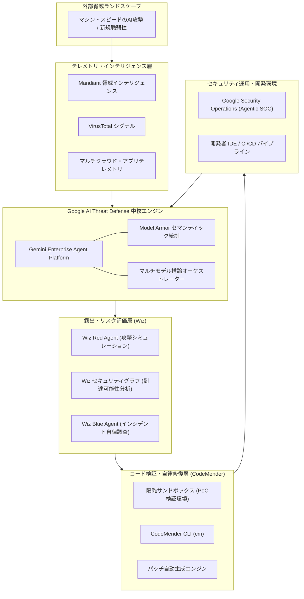

# **Google AI Threat Defense 調査レポート**

## **1. 基本情報**

* **ツール名**: Google AI Threat Defense
* **ツールの読み方**: グーグル エーアイ スレット ディフェンス
* **開発元**: Google Cloud
* **公式サイト**: [https://cloud.google.com/security/ai-threat-defense](https://cloud.google.com/security/ai-threat-defense)
* **関連リンク**:
  * 公式ブログ (発表): [Introducing Google AI Threat Defense to help you outpace the adversary](https://cloud.google.com/blog/products/identity-security/introducing-google-ai-threat-defense)
  * 公式ドキュメント: [https://cloud.google.com/security/ai-threat-defense](https://cloud.google.com/security/ai-threat-defense)
* **カテゴリ**: セキュリティ/脅威インテリジェンス
* **概要**: Google AI Threat Defenseは、AIを活用して高速化・高度化するサイバー攻撃に対抗するために設計された、常時稼働の自律型セキュリティプラットフォームである。Geminiモデルの高度な推論能力、Wizのコンテキストベースのリスク優先順位付け、CodeMenderのコード修正機能、Mandiantの最前線脅威インテリジェンスを統合し、潜在的な攻撃経路の予測から検証済み修正パッチの自律的な適用までを機械のスピード（Machine Speed）で実現する。

## **2. 目的と主な利用シーン**

* **解決する課題**:
  * 攻撃者がAIを用いて前例のない速度で脆弱性を発見・兵器化する「マシン・スピードの攻撃（脆弱性開示から数時間での悪用）」に対する防御の遅れ。
  * セキュリティチームやエンジニアリングチームが、手作業で脆弱性を発見・分析・検証・修正することの限界と深刻なリソース不足。
  * 従来の静的解析（SAST）やCSPMが生成する膨大な理論的アラート（ノイズ）によるアラート疲弊。
* **想定利用者**:
  * 大規模なマルチクラウド環境やアプリケーション群を運用する企業のCISOおよびセキュリティ統括責任者。
  * セキュリティオペレーションセンター（SOC）のセキュリティアナリストおよびインシデントレスポンダー。
  * アプリケーションの安全性を担保しながら高速リリースを追求するDevSecOpsエンジニアおよびソフトウェア開発チーム。
* **利用シーン**:
  * **継続的なエクスポージャ（露出）の監視と低減 (Prepare)**: クラウドインフラ、AIワークロード、API、外部公開資産を継続的にスキャンし、攻撃者が到達可能なエンドツーエンドの攻撃経路を事前に遮断する。
  * **AIエージェントによるペネトレーションテストと優先順位付け (Scan & Prioritize)**: Wiz Red Agentを用いて攻撃者の行動をシミュレートし、Wiz Security GraphのコンテキストとMandiantの脅威インテリジェンスを組み合わせて、真に悪用可能な高リスク脆弱性を特定する。
  * **自律的なコード脆弱性検証とパッチ生成 (Remediate)**: CodeMenderを展開し、隔離された安全なサンドボックス内でPoC検証を実施した上で、開発者のIDEやCI/CDパイプラインに検証済み修正パッチ（Pull Request）を自動投入する。
  * **リアルタイム異常監視と自律トリアージ (Monitor)**: Wiz Blue AgentとGoogle Security OperationsのAgentic SOC機能を連携させ、ネットワーク、ID、ランタイムの異常を常時追跡し、インシデント発生時に自律的な調査と封じ込めを行う。

### **2.1 代表的な利用フロー**

Google AI Threat Defenseにおける、脅威の予兆検知から自律的なリスク検証、修正パッチの生成と開発者への展開に至る代表的な運用フローを以下に示す。

```mermaid
swimlane-beta TB
  subgraph SecOps["運用・開発者"]
    A["脆弱性スキャン・監視ポリシー設定"]
    F["パッチ検証結果の確認・マージ承認"]
  end
  subgraph ThreatDefense["AI Threat Defense 基盤"]
    B["マルチAI推論によるリスク優先順位決定"]
    E["影響度再評価とCI/CD連携通知"]
  end
  subgraph WizPlatform["Wiz エクスポージャ管理"]
    C["Red Agentによる攻撃経路実証"]
  end
  subgraph CodeMenderAgent["CodeMender 修復エージェント"]
    D["隔離サンドボックスでの検証とパッチ生成"]
  end
  A --> B
  B --> C
  C --> D
  D --> E
  E --> F
```

* **代表的な流れ**: セキュリティ担当者が設定したポリシーに基づき、AI Threat Defense統合基盤がGeminiを活用してリスクを評価。Wizが攻撃経路の到達可能性を実証し、CodeMenderが隔離サンドボックス内でPoC検証と修正コードの生成を実施。最終的に検証済みパッチがCI/CD連携を通じて開発者へ提示され、人による安全な承認のもとで本番適用される。

## **3. 主要機能**

* **継続的なエクスポージャ発見 (Wiz連携)**: クラウドインフラ、AIモデル、API、コード、SaaS環境全体を常時スキャンし、外部公開資産やシャドウAPI、誤設定を迅速に特定。攻撃経路を網羅的に可視化する。
* **Wiz Red Agent (AI攻撃シミュレーション)**: 自律型AIエージェントが攻撃者の視点で環境を精査し、従来のシグネチャ型スキャナーでは検知できない認可不備や複雑なロジック欠陥などのエンドツーエンド攻撃経路を実証・検証する。
* **コンテキストベースのリスク優先順位付け**: Wiz Security Graphによる到達可能性分析とMandiantの最前線脅威インテリジェンスを掛け合わせ、ノイズとなる理論的アラートを排除して直ちに対処すべきクリティカルな脆弱性を抽出する。
* **CodeMender (AIコード脆弱性自律検証・パッチ生成)**: Google DeepMindの研究成果を基盤とするAIエージェント。隔離されたサンドボックス環境でPoC検証を実行して脆弱性の実害を確認し、高精度な修正パッチを自律生成する。
* **CodeMender CLI (`cm`)**: 開発者のローカル環境やCI/CDパイプラインと直接統合可能な軽量コマンドラインツール。ローカルサンドボックス内での高速スキャンとコード修正提案を容易にする。
* **Wiz Blue Agent (AI自律調査官)**: SOCアナリストと協調し、アラート発生時にクラウド、コード、ランタイムの全コンテキストを即座に引き出してインシデントの根本原因と波及範囲を機械のスピードで解明する。
* **Google Security Operations連携 (Agentic SOC)**: SIEM/SOAR環境とシームレスに連携し、テレメトリ全体の相関分析と自律的な脅威ハンティング、インシデント封じ込めアクションを実行する。
* **Gemini Enterprise Agent Platform & Model Armor**: 複数のフロンティアAIモデルのオーケストレーションをセキュアに管理し、Model Armorによりプロンプトインジェクションや機密データ漏洩を防止するセマンティックガバナンスを提供する。

## **4. 動作原理・システム構成**

Google AI Threat Defenseは、Google Cloudのセキュアな分散インフラストラクチャ上で動作し、AIエージェントプラットフォーム、クラウド露出管理グラフ、コード修復エージェント、グローバル脅威インテリジェンスを有機的に結びつけたクラウドネイティブな統合防衛アーキテクチャを採用している。

### **4.1 システム構成図**



* **アーキテクチャ特性**:
  * **マルチエージェント協調型アーキテクチャ**: 単一のモノリシックなAIモデルに依存せず、攻撃検証（Wiz Red Agent）、調査トリアージ（Wiz Blue Agent）、コード修正（CodeMender）の各特化型エージェントがGemini Enterprise Agent Platformを介して協調動作する。
  * **マルチクラウド・ハイブリッド対応**: Wizのセンサーレス・エージェントレス技術を活用し、Google CloudだけでなくAWS、Microsoft Azure、オンプレミス環境の資産と通信テレメトリを統一グラフとして把握する。
* **主要コンポーネントとデータフロー**:
  1. **インテリジェンス入力**: Mandiantの脅威フィードおよびVirusTotalのマルウェア解析データが常時パイプラインに供給される。
  2. **露出パスのモデリング**: Wiz Security Graphがネットワーク経路、権限設定、実行中ソフトウェアの相互関係をグラフデータとして解析し、インターネットから到達可能な攻撃経路を特定。
  3. **サンドボックス検証**: 検出されたコード欠陥に対し、CodeMenderが隔離されたローカルまたはコンテナサンドボックス内で安全にPoCを実行し、誤検知（False Positive）を排除。
  4. **修復パッチのデプロイ**: 検証済みパッチをGit差分として作成し、CI/CDの自動テストを実行した上で開発者にPull Requestを提示。
* **特筆すべき要素技術**:
  * **Model Armor**: LLMとのインタラクションにおけるプロンプトインジェクション、データ抽出攻撃、有害コンテンツをインラインで遮断するセキュリティゲートウェイ。
  * **プロセス隔離サンドボックス**: CodeMenderが危険なエクスプロイト検証を本番・開発ホストに影響を与えることなく安全に実行する軽量コンテナ隔離機構。

## **5. 開始手順・セットアップ**

* **前提条件**:
  * Google Cloudのエンタープライズ契約（Organizationリソースの管理者権限）。
  * 連携対象のクラウド環境（Google Cloud、AWS、Azure）への適切な読み取り/監査IAMロール。
  * コードリポジトリ（GitHub、GitLab等）のアクセス権限（CodeMender連携時）。
* **インストール/導入**:
  1. Google Cloudコンソールの「Security」メニューから「AI Threat Defense」ポータルへアクセスする。
  2. Wizコネクタを構成し、対象クラウドプロジェクト/アカウントの権限連携（サービスアカウント・IAM設定）を完了する。
  3. 開発チーム向けにCodeMender CLIツールを導入する。

  ```bash
  # CodeMender CLI (cm) の導入例 (環境別バイナリまたはパッケージ管理)
  curl -fsSL https://cloud.google.com/security/codemender/install.sh | bash
  
  # バージョン確認
  cm --version
  ```

* **初期設定**:
  1. **プロジェクト認証とコンテキスト設定**:

     ```bash
     # Google Cloud 認証とプロジェクトの紐付け
     gcloud auth application-default login
     cm config set project <PROJECT_ID>
     ```

  2. **ローカルリポジトリでの初回ヘルスチェック**:

     ```bash
     cd /path/to/your-repository
     cm scan --fast
     ```

* **クイックスタート**:
  * IDE拡張機能（VS Code / Google Cloud Code）を有効化し、CodeMenderによるリアルタイムサジェストを開始する。
  * Wiz Red Agentによる最初の露出パス監査レポートをコンソール上で確認し、自動生成されたパッチの検証差分をレビューする。

## **6. 特徴・強み (Pros)**

* **業界最高峰のセキュリティ知見と先端AIの融合**: Google自身の強固なインフラ実績に加え、世界最高峰のインシデント対応知見を持つMandiant、CSPMのデファクトスタンダードであるWiz、DeepMind発のコード修復エージェントCodeMenderを統合。
* **「検知」から「実証・修正」までの自律完結**: 従来ツールがアラート通知で終了していたのに対し、隔離環境でのPoC検証による誤検知の排除から、実行可能なパッチの自動生成までを自律的に遂行する。
* **AI攻撃者に対抗するマシン・スピードの防御**: 攻撃者が自動化ツールを用いて数時間で脆弱性を突く時代において、人間の介入待ちによるボトルネックを解消し、即時対応を可能にする。
* **Model Armorによる堅牢なAIガバナンス**: 防御側が利用するAIエージェント自体の安全性にも配慮されており、プロンプトインジェクションや情報漏洩を遮断するエンタープライズガードレールを標準装備。

## **7. 弱み・注意点 (Cons)**

* **エンタープライズ特化の導入規模とコスト**: 複数の一流ソリューションを統合したフラグシップ製品であるため、中堅・中小企業にとってはオーバースペックであり、予算確保のハードルが高い。
* **価格体系の個別見積もり依存**: セルフサービス型の定額プランは存在せず、監視対象アセット数やAIトークン量に応じたエンタープライズカスタム契約が必須。
* **組織・運用のパラダイムシフトの要求**: AIが自動生成したパッチを迅速に承認・マージするためには、成熟したCI/CDテスト自動化環境と、SOC/開発チーム双方の運用プロセス変革が不可欠。
* **日本語ドキュメント・サポートの過渡期**: 主要な管理コンソールやドキュメントは英語が先行しており、日本語での詳細なベストプラクティスや導入支援は認定パートナー企業（Accenture、PwC、Deloitte等）への依存度が高い。

## **8. 料金プラン**

Google AI Threat Defenseは、エンタープライズの保護規模や対象クラウド環境に応じた個別見積もり方式を採用している。

| プラン名 | 料金 | 主な特徴 | 対象組織 |
|---------|------|---------|---------|
| **Enterprise AI Threat Defense** | 要問い合わせ (年間カスタム契約) | Wiz (CSPM/Red/Blue Agent)、Mandiantインテリジェンス、CodeMender、Gemini Enterprise Agent Platformのフル統合 | 大規模クラウド環境を運用するグローバル企業・金融・重要インフラ |
| **CodeMender Add-on (Preview)** | 要問い合わせ | 開発者IDEおよびCI/CDパイプライン向け自律コード修正エージェントの単独/先行利用 | DevSecOpsの迅速な自動化を推進するソフトウェア組織 |

* **課金体系**: 保護対象のクラウドアセット数（VM、コンテナ、サーバーレスインスタンス）、スキャン対象コードベースの規模、AIモデルの推論利用量（トークン数）等に基づく年間コミットメントモデル。
* **無料トライアル**: セルフサービスの無料トライアルは提供されていないが、Google Cloud営業チームおよび認定パートナーを通じた概念実証（PoC）プログラムが提供されている。

## **9. 導入実績・事例**

* **導入企業**:
  * **Google Cloud CISO Community**: Morgan Stanley、MSCI、TELUS、Thalesなどの世界的金融機関・通信・防衛テクノロジー企業が、設計段階および早期導入パートナーとして参画。
* **導入事例・効果**:
  * **クリティカル脆弱性の平均修復時間 (MTTR) を数日から数時間へ短縮**: AIによる攻撃経路実証とパッチ自動生成により、手作業でのトリアージと修正コード作成にかかる工数を80%以上削減。
  * **アラート疲弊の劇的解消**: 理論上の脆弱性数万件の中から、実際にインターネットから到達可能な実害リスク数件をWiz Security Graphが瞬時に絞り込み、セキュリティチームの集中力を最適化。
* **対象業界**: 金融機関、通信キャリア、重要インフラ事業者、ヘルスケア、大規模SaaSベンダーなど、高度なサイバー攻撃の標的となりやすいエンタープライズ。

## **10. サポート体制**

* **ドキュメント**: Google Cloud Securityドキュメントポータルにて、アーキテクチャガイド、APIリファレンス、連携手順書が提供されている。
* **コミュニティ**: Google Cloud Community、Google Cloud CISO Community、およびWizユーザーコミュニティを通じた高度な運用知見の共有。
* **公式サポート**:
  * Google Cloud Premium Supportによる24時間365日のテクニカルサポート（ミッションクリティカルなインシデントへの15分以内応答）。
  * Mandiantの専門コンサルタントによるインシデントレスポンス、脅威ハンティング支援、セキュリティ態勢評価。
  * グローバルSIパートナー（Accenture、Deloitte、PwC、Netenrich、Tenex.ai）による導入設計・運用定着支援。

## **11. エコシステムと連携**

### **11.1 API・外部サービス連携**

* **クラウドセキュリティ統合**: Wiz Defend、Google Security Operations (Chronicle)、VirusTotal、Google Cloud Armorとネイティブ連携。
* **ソースコード管理・CI/CD**: GitHub、GitLab、Bitbucket、Cloud Build、Jenkins、GitHub Actionsと連携し、Pull Requestの自動発行やパイプライン遮断を実行。
* **チケット・通知システム**: Jira、ServiceNow、Slack、PagerDutyと連携し、承認ワークフローや高リスクインシデントの自動エスカレーションを実現。

### **11.2 プラグイン・拡張機能**

* **IDE拡張機能**: Visual Studio Code、JetBrains IDEシリーズ、Google Cloud Codeに対応し、開発者がコードを記述している最中にインラインで脆弱性警告とCodeMenderの修正パッチを提案。
* **CLIツール (`cm`)**: 開発者のターミナル上でローカル差分を即座にスキャン・検証・パッチ適用できる軽量コマンドラインインターフェース。

### **11.3 技術スタックとの相性**

| 技術スタック | 相性 | メリット・推奨理由 | 懸念点・注意点 |
|:---|:---:|:---|:---|
| **Google Cloud (GCP)** | ◎ | Gemini基盤、SecOps、IAM、Cloud Build等と完全ネイティブ統合され、最高パフォーマンスを発揮。 | 特になし |
| **マルチクラウド (AWS / Azure)** | ◎ | Wizの強力なエージェントレススキャンにより、AWS/Azure環境のアセットや権限も一元管理可能。 | 各クラウド側のネイティブ監査ログ収集設定が必要。 |
| **コンテナ・K8s (GKE / EKS / AKS)** | ◎ | クラウドネイティブワークロードのランタイム監視とコンテナイメージ脆弱性修復に高い適合性。 | クラスタ規模に応じたエージェントレス/ランタイムセンサーの設計が必要。 |
| **オンプレミス・ハイブリッド** | ◯ | Google Distributed Cloudやハイブリッドコネクタを経由してインテリジェンスを活用可能。 | クラウド完結型に比べ、ネットワーク設定やデータ転送の設計負荷が増加。 |

## **12. セキュリティとコンプライアンス**

* **認証・データ管理**: Google Cloudの厳格なゼロトラスト原則（BeyondCorp）、IAM条件付きアクセス、VPC Service Controls、カスタマーマネージド暗号化キー（CMEK）に対応。
* **Model ArmorによるAIセーフティ**: 防御プロセス内で稼働するAIエージェントへの悪意あるプロンプト注入（Prompt Injection）や、エージェントを通じた機密データの漏洩をセマンティックフィルターで遮断。
* **隔離サンドボックスによる安全な検証**: CodeMenderが脆弱性を検証する際、本番環境や開発端末に影響を与えないプロセス隔離されたサンドボックス環境でコードを実行。
* **準拠規格**: Google Cloudのインフラ基盤として、ISO/IEC 27001、27017、27018、SOC 1/2/3、PCI DSS、HIPAA、GDPRなどの主要グローバル認証・法規制に準拠。

## **13. 操作性 (UI/UX) と学習コスト**

* **UI/UX**:
  * **ロール別インターフェース**: SecOpsアナリストにはWizのインタラクティブなリスクグラフやGoogle SecOpsの統合コンソールが提供され、開発者には慣れ親しんだIDEやGitのPR画面のみで完結する設計。
  * **直感的な攻撃パス可視化**: 複雑なネットワーク構成やIAM権限の連鎖が「どの外部IPからどの機密データベースへ到達可能か」という視覚的グラフで明快に提示される。
* **学習コスト**:
  * **高（組織的なプロセス習熟が必要）**: 単なるツールの操作習熟にとどまらず、「AIが作成したコードパッチを自動テスト経由で迅速に承認する」という運用規程（Playbook）の策定や、SOCとDevOpsの密接な連携体制の構築が求められる。

## **14. ベストプラクティス**

* **効果的な活用法 (Modern Practices)**:
  * **「Prepare」から「Remediate」への自動ループ確立**: Wiz Red Agentで継続的に露出面を特定し、CodeMenderがパッチを自動生成してPull Requestを作成するパイプラインを組むことで、脆弱性の生存期間を最小化する。
  * **マルチAIモデルの適材適所配置**: 日常的な広域スキャンには軽量で高速なモデルを割り当て、複雑なロジック脆弱性のPoC検証やパッチ生成にはGeminiの最上位フロンティアモデルを動員することで、精度と運用コストを両立させる。
  * **CI/CD自動テストの拡充**: AIが生成したパッチの信頼性を担保するため、単体テスト・結合テストの自動実行パイプラインを整備し、人間によるコードレビューの負荷を最小化する。
* **陥りやすい罠 (Antipatterns)**:
  * **人間によるレビュープロセスの渋滞**: AIが数分でパッチを生成しても、変更承認会議（CAB）などの手動承認プロセスに数週間滞留させては、マシン・スピードの攻撃に対抗できない。
  * **コンテキストを無視した一括アラート対応**: 到達可能性や機密データへの影響を評価せず、単純なCVSSスコア順にパッチ適用を試みる旧来の運用手法を継続すること。

## **15. ユーザーの声（レビュー分析）**

* **調査対象**: Google Cloud CISO Community参加企業、アナリストレポート（Futurum Group、Constellation Research）、セキュリティカンファレンスにおけるフィードバック。
* **評価の傾向**:
  * **ポジティブな評価**:
    * 「Wizの攻撃パス可視化とCodeMenderの自動パッチ生成が連動することで、セキュリティ部門から開発部門への『修正依頼の差し戻し・議論』にかかる無駄な時間が劇的に解消された。」
    * 「攻撃者がAIを使って攻撃の試行錯誤を自動化している現在、防御側もAIエージェントによる攻撃シミュレーション（Red Agent）と調査（Blue Agent）を導入しなければ太刀打ちできないという現実的なニーズに完璧に応えている。」
  * **中立・改善要望**:
    * 「エンタープライズ規模の契約と運用体制が必要であり、初期導入における権限設計やポリシーチューニングにはパートナー企業の手厚い支援が不可欠。」
    * 「CodeMenderの対応言語やフレームワークのさらなる拡大と、日本語UIおよび国内事例の充実を期待したい。」

## **16. 直近半年のアップデート情報**

直近半年（2026年5月〜2026年11月）におけるGoogle AI Threat Defense関連の主要アップデートは以下の通りである。

* **2026-10**: **Gemini Enterprise Agent PlatformにおけるModel Armorの統合**
  * エージェント環境におけるセマンティックガバナンス機能「Model Armor」が標準提供され、AIエージェントに対するプロンプトインジェクション防御および機密データ流出防止策が強化された。
* **2026-09**: **Wiz Red Agent および Wiz Blue Agent の機能統合深化**
  * 自律型攻撃エージェント（Red Agent）による認可不備やAPIロジック欠陥の自動検証機能、ならびにSecOps向け自律調査エージェント（Blue Agent）のトリアージ連携が大幅に強化された。
* **2026-07**: **CodeMender の Public Preview 提供および CLI (`cm`) の公開**
  * Google DeepMind発の自律コード修復エージェントCodeMenderがGoogle Cloud上でパブリックプレビューとなり、ローカル隔離サンドボックス内でのPoC検証と自動パッチ生成を行うコマンドラインツールが提供開始された。
* **2026-05**: **Google AI Threat Defense の正式発表**
  * Google CloudがAI駆動のサイバー攻撃に対抗する常時稼働プラットフォームとして発表。Gemini、Wiz、CodeMender、Mandiantを有機的に統合するビジョンを提示した。

(出典: [Google Cloud Blog](https://cloud.google.com/blog/products/identity-security/introducing-google-ai-threat-defense))

## **17. 類似ツールとの比較**

### **17.1 機能比較表 (星取表)**

| 機能カテゴリ | 機能項目 | Google AI Threat Defense | AWS Security Hub | Microsoft Defender for Cloud |
|:---:|:---|:---:|:---:|:---:|
| **基本機能** | クラウド露出管理 (CSPM) | ◎<br><small>Wiz連携による高度なコンテキスト可視化</small> | ◯<br><small>AWS環境中心のセキュリティ基準チェック</small> | ◎<br><small>マルチクラウド対応の包括的CSPM</small> |
| **脅威インテリジェンス** | 最前線インテリジェンス連携 | ◎<br><small>MandiantおよびVirusTotalとの強力な統合</small> | ◯<br><small>Amazon GuardDuty等の脅威検出と連携</small> | ◎<br><small>Microsoftの大規模脅威シグナルを活用</small> |
| **AIエージェント・修復** | 自律的なコード検証・パッチ生成 | ◎<br><small>CodeMenderによるPoC検証と自動PR作成</small> | △<br><small>Systems Manager自動化スクリプトが主体</small> | ◯<br><small>Security Copilotによるガイダンス支援</small> |
| **攻撃・調査エージェント** | 自律型Red/Blue Agent連携 | ◎<br><small>Wiz Red Agent (攻撃実証) & Blue Agent (調査)</small> | △<br><small>パートナーツール連携に依存</small> | ◯<br><small>Security Copilotによるインシデント要約</small> |
| **非機能要件** | マルチクラウド・ハイブリッド対応 | ◎<br><small>Wizを活用し広範な環境をカバー</small> | △<br><small>サードパーティ統合可能だがAWSが主戦場</small> | ◎<br><small>Azure、AWS、GCPをネイティブサポート</small> |

### **17.2 詳細比較**

| ツール名 | 特徴 | 強み | 弱み | 最適な利用ケース |
|---------|------|------|------|------------------|
| **Google AI Threat Defense** | 各分野のトップソリューション（Wiz、Mandiant、CodeMender、Gemini）を結集した自律防衛基盤 | 隔離環境でのPoC検証に基づく確実な自動パッチ生成、Mandiantの深い知見 | 導入の大規模さ、完全な運用にはDevOps側のテスト自動化成熟度が不可欠 | マシン・スピードのAI攻撃に対抗し、脆弱性の発見からコード修正・適用までを自律的に加速させたいエンタープライズ |
| **AWS Security Hub** | AWS環境のセキュリティ状況を一元集約するクラウドネイティブなコントロールタワー | AWSサービス群（GuardDuty、Inspector等）との密接な統合、シンプルな設定 | 生成AIによる高度な自律コード修復機能は限定的、マルチクラウド管理には追加設計が必要 | ワークロードの大部分がAWS上にあり、AWSネイティブツールで堅牢なセキュリティ体制を維持したい場合 |
| **Microsoft Defender for Cloud** | Azure、AWS、GCPを幅広くカバーする統合クラウドネイティブアプリケーション保護プラットフォーム (CNAPP) | マルチクラウド対応力、Microsoft SentinelおよびSecurity Copilotとの緊密な連携 | 自律的なコード修正（CodeMenderのようなPoC検証型パッチ生成）のアプローチとは異なる | Microsoftエコシステムを中心に据え、マルチクラウド環境全体のポスチャ管理とSOC運用の統合を図りたい企業 |

## **18. 総評**

Google AI Threat Defenseは、サイバー攻撃者が生成AIや自律エージェントを駆使して数時間単位で脆弱性を悪用する「マシン・スピードの脅威」に対し、防御側も最高峰のAIとインテリジェンスを結集して自律的に対抗するという明確なビジョンを具現化したプラットフォームである。

最大の革新性は、Wizによるリアルタイムな攻撃経路の可視化と実証（Red Agent）、Mandiantによる最前線の脅威コンテキスト、そしてGoogle DeepMind発のCodeMenderによる隔離サンドボックス内でのPoC検証と自動パッチ生成が、Gemini Enterprise Agent Platform上でシームレスに連動している点にある。単にアラートを増やすのではなく、ノイズを極小化して「検証済みの修正コード」という具体的な解決策まで自動到達させるアプローチは、深刻なセキュリティ人材不足に悩むエンタープライズにとって強力なブレークスルーとなる。

* **推奨されるチーム・プロジェクト**:
  * 金融、通信、重要インフラ、大規模Webサービスなど、標的型サイバー攻撃のリスクに直面している大企業。
  * 膨大な脆弱性アラートに疲弊しており、発見からパッチ適用までのMTTRを劇的に短縮したい先進的なDevSecOps / SOCチーム。
* **選択時のポイント**:
  * 既存のクラウド環境（特にGoogle Cloud）との親和性を評価するとともに、AIが提示する修正コードを迅速に検証・適用できるCI/CDテスト自動化体制が整っているかどうかが、投資対効果を最大化するための重要要件となる。
