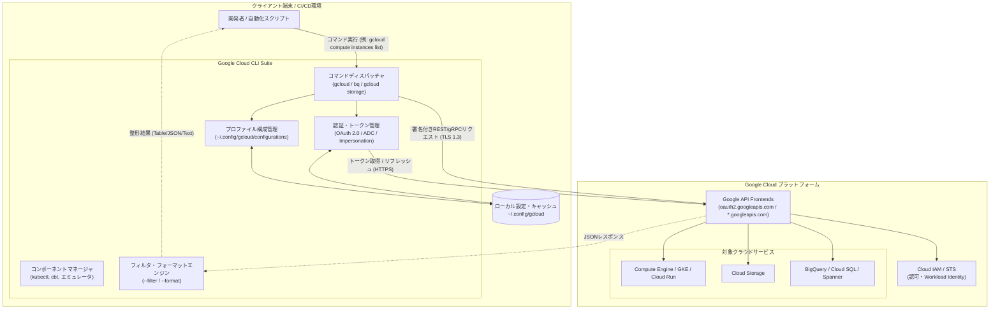

# **Google Cloud CLI 調査レポート**

## **1. 基本情報**

* **ツール名**: Google Cloud CLI (旧称: Google Cloud SDK)
* **ツールの読み方**: グーグル クラウド シーエルアイ
* **開発元**: Google LLC
* **公式サイト**: [https://cloud.google.com/cli](https://cloud.google.com/cli)
* **関連リンク**:
  * ドキュメント: [https://cloud.google.com/sdk/docs](https://cloud.google.com/sdk/docs)
  * レビューサイト: [G2](https://www.g2.com/products/google-cloud-platform/reviews) | [Capterra](https://www.capterra.com/p/158589/Google-Cloud-Platform/) | [ITreview](https://www.itreview.jp/products/google-cloud-platform/reviews)
* **カテゴリ**: クラウドサービス/PaaS
* **概要**: Google Cloud CLI は、Google Cloud 上のリソース（Compute Engine、Google Kubernetes Engine (GKE)、Cloud Run、Cloud Storage、BigQuery、Cloud IAM など）をコマンドラインやスクリプトから包括的にプロビジョニング・管理・運用するための公式統合ツール群である。中核となる `gcloud` コマンドに加え、ストレージ操作用の `gsutil` / `gcloud storage`、大規模データ分析用の `bq` などを内包し、ローカル開発環境から大規模なCI/CDパイプラインまで幅広い自動化を実現する。

## **2. 目的と主な利用シーン**

* **解決する課題**:
  * WebブラウザのGoogle Cloud Console操作によるオペレーションミスや作業再現性の低さの解消
  * CI/CDパイプラインやスクリプト自動化におけるクラウドインフラ操作の統一と標準化
  * 複数プロジェクト・複数組織・複数リージョンにまたがる認証情報や環境コンテキストの切り替えの煩雑さ
  * 静的サービスアカウントキー（JSON）の漏洩リスクを排除するキーレス認証運用の推進
* **想定利用者**: クラウドエンジニア、SRE / DevOpsエンジニア、インフラアーキテクト、バックエンド開発者、データエンジニア
* **利用シーン**:
  * **CI/CDパイプライン自動化**: GitHub Actions、GitLab CI、Cloud Build からコンテナイメージのビルド・デプロイや設定変更を自動実行
  * **インフラ管理・トラブルシューティング**: Compute Engine VM、GKEクラスタ、Cloud Run サービスの稼働ステータス確認、SSH接続、リアルタイムログ監視
  * **セキュアな権限管理**: サービスアカウントImpersonation（なりすまし）やWorkload Identity連携を用いた一時的クレデンシャルによる安全なアクセス制御
  * **大規模データ転送・分析**: `gcloud storage` による並列オブジェクト転送や、`bq` コマンドを用いたペタバイト級データセットへのクエリ実行と結果抽出

## **3. 主要機能**

* **gcloud コアコマンド**: Compute Engine、GKE、Cloud Run、Cloud SQL、IAM、Secret Manager など Google Cloud の主要リソースを統一された構文体系（`gcloud <グループ> <コマンド>`）で操作。
* **コンポーネントマネージャー (`gcloud components`)**: `kubectl`、`cbt`（Bigtable CLI）、Cloud SQL Proxy、ローカルエミュレータ（Pub/Sub、Spanner等）などの周辺ツールを個別にインストール・更新・削除管理。
* **柔軟な認証・プロファイル管理 (`gcloud auth` / `gcloud config`)**: OAuth 2.0 Webログイン、サービスアカウントキー認証、ADC（Application Default Credentials）生成、複数プロジェクト/リージョン/アカウントの切り替え（`configurations`）。
* **Cloud Storage高速操作 (`gcloud storage` / `gsutil`)**: 大容量オブジェクトのマルチスレッド・マルチプロセス並列転送、バケット間同期、ACL/IAM管理を高速かつ安定して実行。
* **BigQuery専用操作 (`bq`)**: コマンドラインからのSQLクエリ実行、データセットやテーブルの作成・削除、スキーマ変更、CSV/JSON/Parquet/Avro形式のバッチデータロード・エクスポート。
* **高度な出力フォーマット・フィルタエンジン**: `--format`（json, yaml, table, csv, value, flattened等）および `--filter`（属性値照合、正規表現、比較演算）により、`jq` や `awk` を使わずにCLI内部で完結するデータ加工・抽出。
* **ローカルエミュレータスイート**: Cloud Spanner、Pub/Sub、Bigtable、Datastore などのローカルエミュレータを起動・制御し、クラウドに課金することなくオフラインで単体・結合テストを実施。
* **Cloud Shell・インタラクティブモード**: Webブラウザ上のGoogle Cloud Shell環境にプリインストールされているほか、端末上でコマンド自動補完やインラインヘルプを表示する `gcloud beta interactive` を提供。

## **4. 動作原理・システム構成**

Google Cloud CLI は、クライアント環境（端末やCI/CDコンテナ）上でPythonベースのランタイムによって駆動し、Google Cloud のグローバルな REST / gRPC API エンドポイントと通信するアーキテクチャを採用している。

### システム構成と通信フロー



* **アーキテクチャ**:
  * クライアント・サーバー型（ローカルCLIクライアントから Google Cloud API サーバーへのHTTPS呼び出し）。
  * コアツールはクロスプラットフォームな Python 実装であり、Bundled Python（同梱環境）またはシステム Python を利用して動作。
* **主要コンポーネントとデータフロー**:
  * **設定とクレデンシャル管理**: プロジェクトID、デフォルトリージョン、認証トークンなどは `~/.config/gcloud`（Windowsは `%APPDATA%\gcloud`）に保存される。
  * **認証フロー**: ユーザーアカウントの場合はブラウザ経由で OAuth 2.0 認可コードを取得し、リフレッシュトークンをキャッシュ。実行時は短期間有効なBearerトークンを自動発行・リフレッシュしてAPIヘッダーに付与。
  * **サービスアカウントImpersonation**: ユーザーの権限で Google Cloud IAM の `generateAccessToken` API を呼び出し、短命なサービスアカウントトークンを動的に取得して目的の操作を実行。
* **特筆すべき要素技術**:
  * **REST/gRPCクライアント自動生成**: Google Discovery サービスに基づき、多数のクラウドサービスAPIクライアントを動的・効率的にハンドリング。
  * **gcloud storage の複合並列転送**: Go言語ベースの並列エンジンやマルチプロセス技術を組み合わせ、従来の `gsutil` と比較して数倍から十数倍の転送スループットを実現。

## **5. 開始手順・セットアップ**

* **前提条件**:
  * 対応OS: Linux, macOS (Apple Silicon / Intel), Windows
  * ランタイム: Python 3.8〜3.12（同梱インストーラーを利用する場合は事前準備不要）
  * アカウント: Google Cloud アカウント（プロジェクト作成権限および請求先アカウント）

* **インストール/導入**:

  OSや運用形態に合わせて複数のインストール方法が提供されている。

  ```bash
  # Linux / macOS (対話型公式インストーラ)
  curl https://sdk.cloud.google.com | bash
  exec -l $SHELL

  # macOS (Homebrew Cask を利用する場合)
  brew install --cask google-cloud-sdk

  # Debian / Ubuntu (公式APTリポジトリを利用する場合)
  sudo apt-get install apt-transport-https ca-certificates gnupg curl
  curl https://packages.cloud.google.com/apt/doc/apt-key.gpg | sudo gpg --dearmor -o /usr/share/keyrings/cloud.google.gpg
  echo "deb [signed-by=/usr/share/keyrings/cloud.google.gpg] https://packages.cloud.google.com/apt cloud-sdk main" | sudo tee -a /etc/apt/sources.list.d/google-cloud-sdk.list
  sudo apt-get update && sudo apt-get install google-cloud-cli

  # Dockerコンテナでの実行
  docker run --rm -it gcr.io/google.com/cloudsdktool/google-cloud-cli:latest gcloud version
  ```

* **初期設定**:

  インストール完了後、初期化ウィザードを実行して認証と基本構成を行う。

  ```bash
  # 対話型初期化ウィザードの起動
  gcloud init
  ```

  ブラウザが起動し、Googleアカウントへのログインと権限付与を承認すると、利用するプロジェクト名やデフォルトのリージョン/ゾーンが設定される。

* **クイックスタート**:

  ```bash
  # 現在の設定状況を確認
  gcloud config list

  # Compute Engine インスタンスの一覧を表示（テーブル形式）
  gcloud compute instances list

  # Cloud Storage バケット一覧を取得
  gcloud storage buckets list

  # サービスアカウントとしての一時的な操作（Impersonation）
  gcloud compute instances list --impersonate-service-account=my-sa@my-project.iam.gserviceaccount.com
  ```

## **6. 特徴・強み (Pros)**

* **一貫性のある直感的なコマンド体系**: `gcloud <プロダクト> <リソース種別> <動詞>` という階層化された統一文法により、数十を超える異なるサービスでも同様の直感で操作可能。
* **圧倒的に強力な内蔵プロジェクション・フィルタ機能**: `--filter="status=RUNNING AND name:web-*"` や `--format="table(name,networkInterfaces[0].networkIP:label=INTERNAL_IP)"` など、外部のテキスト処理コマンドなしでCLI自体が高精度なデータ加工を実行。
* **セキュアなキーレス運用（Keyless Architecture）の推進**: 長期保管リスクのあるサービスアカウントJSONキーを使わず、短命アクセストークンを発行する `--impersonate-service-account` や、GitHub Actions等と連携する Workload Identity Federation をネイティブにサポート。
* **充実した周辺コンポーネントとローカルエミュレータ**: `gcloud components install` コマンドで `kubectl` や各種クラウドエミュレータを即座に追加・統合管理できる。
* **Google Cloud Shell との完全な相互運用性**: ブラウザ上で利用できる Cloud Shell には最新の Google Cloud CLI がプリインストール・認証済みで用意されており、手元の端末環境に依存しない即時検証が可能。

## **7. 弱み・注意点 (Cons)**

* **コマンドの長大さと学習コスト**: リソース階層が深いためコマンドラインが長くなりやすく、シェルエイリアスやオートコンプリートの設定がないとタイピング負荷が高い。
* **パッケージサイズとディスク消費量**: 多数のコンポーネントやエミュレータ、Pythonランタイムを同梱するため、フルインストール時のディスク使用量が数百MBから数GBに達する。
* **インストール方式による更新手順の違い**: APT/YUMやHomebrewなどのOSパッケージマネージャ経由で導入した場合、`gcloud components update` コマンドが無効化され、OS側のパッケージ更新に委ねられる。
* **日本語対応の制約**: コマンドの出力メッセージやヘルプ（`--help`）は基本的に英語のみ。公式ドキュメントは日本語化されているものの、最新の `alpha` / `beta` コマンドやリリースノートの詳細は英語が優先される。

## **8. 料金プラン**

Google Cloud CLI スイート自体のダウンロード、インストール、利用には**一切の料金が発生しない（完全無料）**。

ただし、CLI コマンドを通じてプロビジョニングまたは利用する Google Cloud の各種リソース（Compute Engine、Cloud Storage、BigQuery 等）には各サービスの従量課金が発生する。

| プラン / 利用形態 | 料金 | 主な特徴 |
|---|---|---|
| **Google Cloud CLI** | **無料** | コマンドラインツール自体のライセンス費用は不要、無制限の端末・コンテナに導入可能 |
| **Google Cloud 無料枠 (Always Free)** | 無料 | 毎月一定量（e2-micro 1インスタンス、5GB Cloud Storage、1TB BigQuery クエリ等）を恒久的に無料で利用可能 |
| **Google Cloud 無料トライアル** | 無料（$300分クレジット） | 新規登録時に90日間有効な$300相当のクレジットが付与され、全サービスを検証可能 |
| **従量課金 (Pay-As-You-Go)** | 各サービス料金に準拠 | CLIから作成・稼働させた仮想マシン、ディスク、ネットワーク転送量などに応じた実課金 |

* **課金体系**: CLIツールは無料。操作対象のGoogle Cloudリソースに対して秒単位/GB単位の従量課金。
* **無料トライアル**: 新規Google Cloudユーザー向けに90日間・300米ドル相当の無料クレジットが提供される。

## **9. 導入実績・事例**

* **導入企業**:
  * **メルカリ**: マイクロサービスアーキテクチャの基盤としてGKEを採用し、デプロイや運用自動化パイプラインでGoogle Cloud CLIを全面的に活用。
  * **Spotify**: データ基盤をGoogle Cloud（BigQuery等）へ移行し、大規模なデータパイプライン処理やクラスター管理にCLIを活用。
  * **デジタル庁 / 自治体システム**: ガバメントクラウド運用において、セキュアな構成管理やアクセス制御自動化にCLIを採用。
  * **Twitter (現X) / PayPal / Target**: エンタープライズ規模のマルチリージョン運用、ログ分析、Kubernetesクラスタ管理の自動化に活用。
* **導入事例**:
  * **CI/CDパイプラインの高速化**: サービスアカウントのキーレス認証（Workload Identity）とコンテナ最適化CLIを組み合わせ、セキュアで高速な継続的デプロイを実現。
  * **クラウドセキュリティ・ガバナンス監査**: 組織配下の全プロジェクトからIAMバインディングやファイアウォール設定を `gcloud` 経由で定期抽出・自動監査するスクリプトを運用。
* **対象業界**: Webサービス、FinTech、メディア、Eコマース、官公庁、製造業など、Google Cloudを導入しているあらゆる産業規模に対応。

## **10. サポート体制**

* **ドキュメント**:
  * 公式リファレンス: [https://cloud.google.com/sdk/docs](https://cloud.google.com/sdk/docs) にて全コマンドの文法、フラグ、ユースケース、チートシートが体系的に網羅されている。
  * 各コマンドで `--help` や `gcloud help <コマンド>` を実行することで、端末上からオフラインで完全なリファレンスを閲覧可能。
* **コミュニティ**:
  * Google Cloud Community フォーラム、Stack Overflow（タグ: `gcloud`, `google-cloud-platform`）、Reddit（`r/googlecloud`）等で世界中のエンジニアによる活発な質疑応答が行われている。
* **公式サポート**:
  * Google Cloud のサポート契約（Standard、Enhanced、Premium Support）の対象となっており、テクニカルアカウントマネージャーや24/7の専任サポート窓口によるトラブルシューティングを受けられる。

## **11. エコシステムと連携**

### **11.1 API・外部サービス連携**

* **API**: Google Cloud の全パブリック REST API / gRPC API と 100% 連携可能。
* **外部サービス・CI/CD連携**:
  * **GitHub Actions**: 公式アクション `google-github-actions/auth` および `google-github-actions/setup-gcloud` により、Workload Identity Federation を用いたキーレス認証とCLI実行が標準提供。
  * **GitLab CI / CircleCI / Jenkins**: 公式Dockerイメージ（`gcr.io/google.com/cloudsdktool/google-cloud-cli`）を利用したスムーズなパイプライン統合。
  * **Terraform / OpenTofu**: Google Cloud CLI による認証情報（ADC）をバックエンドとしてプロバイダが直接利用可能。
  * **Kubernetes / Helm**: `gcloud container clusters get-credentials` コマンドにより、ローカルの `kubectl` 設定（Kubeconfig）をワンクリックで自動更新。

### **11.2 技術スタックとの相性**

| 技術スタック | 相性 | メリット・推奨理由 | 懸念点・注意点 |
|:---|:---:|:---|:---|
| **Docker / コンテナ環境** | ◎ | 公式Dockerイメージが軽量 Alpine / Debian ベースで提供されておりCI/CDに最適 | 特になし |
| **Kubernetes (GKE)** | ◎ | `gcloud container` と `kubectl` の統合が非常に強固で認証同期がスムーズ | 特になし |
| **GitHub Actions** | ◎ | 公式AuthアクションによりOIDCキーレス連携が極めて容易 | 特になし |
| **Terraform / IaC** | ◎ | ローカルの `gcloud auth application-default login` の認証情報を透過的に利用可能 | 特になし |
| **Bash / Zsh スクリプト** | ◎ | `--format="value(...)"` や `--filter` により外部依存なしで安全な自動化が可能 | コマンド行が長くなりがち |
| **Windows PowerShell** | ◯ | PowerShell向けエイリアスやタブ補完が提供されている | 一部のエスケープ文字やクォート処理にPowerShell特有の留意が必要 |

## **12. セキュリティとコンプライアンス**

* **認証**:
  * OAuth 2.0 Webフローによるブラウザ認証、およびFIDO2/WebAuthnセキュリティキー連携。
  * サービスアカウントImpersonation（なりすまし）により、個別の静的秘密鍵ファイルを端末に保存することなく最小権限で作業可能。
  * Workload Identity Federation による OIDC / AWS STS クレデンシャル交換をサポートし、外部CI/CDパイプラインでの完全なキーレス運用を実現。
* **データ管理**:
  * 端末ローカルの設定ファイル（`~/.config/gcloud`）はパーミッション 600/700 で厳密に保護。
  * すべてのAPI通信は TLS 1.3 / TLS 1.2 により完全暗号化。
  * トークンキャッシュは有効期限付きの一時トークンとして管理され、失効時は自動的に破棄。
* **準拠規格**:
  * Google Cloud インフラストラクチャ上で動作するため、ISO/IEC 27001、ISO/IEC 27017、ISO/IEC 27018、SOC 1/2/3、PCI DSS、HIPAA、FedRAMP High、日本政府の ISMAP などの最高水準のセキュリティ規格に準拠。

## **13. 操作性 (UI/UX) と学習コスト**

* **UI/UX**:
  * ターミナル操作に特化し、カラー表示、進捗プログレスバー、テーブル/JSON/YAMLの切り替えなど出力の視認性が高い。
  * `gcloud beta interactive` を起動すると、リッチなCLI環境でインタラクティブな補完候補・引数ヘルプ・コマンド履歴がリアルタイム表示される。
* **学習コスト**:
  * 基本的なVMの起動・停止やCloud Runへのデプロイなどの単発操作は直感的であり、学習コストは低い。
  * 一方で、複雑な条件指定（`--filter` 構文の論理演算やネストされたオブジェクト参照）や、IAMロールのバインディングコマンドの細かな仕様習得には一定の実務経験を要する。

## **14. ベストプラクティス**

* **効果的な活用法 (Modern Practices)**:
  * **サービスアカウントJSONキーの廃止**: サービスアカウントキー（JSON）を端末やCI/CDシークレットに保存せず、必ず `--impersonate-service-account` や Workload Identity Federation を使用して短命トークンで操作する。
  * **構成プロファイルの分離**: 開発（dev）、検証（stg）、本番（prod）環境ごとに `gcloud config configurations create <名前>` を作成し、環境を取り違える事故を防止する。
  * **堅牢なスクリプト設計**: シェルスクリプトで出力をパースする際は、画面表示用のテキストではなく `--format="value(id)"` や `--format="json"` を指定して安全に値を取得する。
  * **gcloud storage の優先利用**: 大容量ファイル転送には従来の `gsutil` ではなく、マルチスレッド並列処理が最適化された `gcloud storage` を利用する。
* **陥りやすい罠 (Antipatterns)**:
  * **パッケージマネージャー競合**: OSのパッケージマネージャー（APTやBrew）でインストールしたにもかかわらず `gcloud components update` を実行し、更新エラーや不整合を引き起こす。
  * **フィルタリングの非効率性**: 大量のリソースが存在する環境でフィルタを指定せずに `list` コマンドを実行し、APIレートリミット到達や長時間のレイテンシを発生させる（サーバーサイドフィルタが可能なパラメータを優先指定すべき）。
  * **アクティブプロジェクトの誤認**: 複数プロジェクトを扱う際に `gcloud config set project` の状態を確認せず、意図しないプロジェクトに対して破壊的コマンドを実行してしまう。

## **15. ユーザーの声（レビュー分析）**

* **調査対象**: G2、Capterra、ITreview、Reddit（`r/googlecloud`）
* **総合評価**: 4.4 / 5.0 (G2 / Google Cloud Platform 総合評価)
* **ポジティブな評価**:
  * **フィルタとフォーマットの柔軟性**: 「`--filter` と `--format` が強力すぎて、`jq` や外部ツールを一切使わずに複雑なレポートをワンライナーで出力できる」
  * **Cloud Shell との親和性**: 「端末に重いツールを入れなくても、ブラウザ上のターミナルから同一のCLIが認証済みで即座に使えるのが最高に便利」
  * **キーレス運用の手軽さ**: 「サービスアカウントのなりすましがフラグ1つで実行でき、秘密鍵漏洩のセキュリティリスクを完全に撲滅できた」
* **ネガティブな評価 / 改善要望**:
  * **コマンドの長さ**: 「サブコマンドやフラグの階層が深く、コマンド全体が長文化しがちでタイピングが辛い」
  * **週次アップデートの頻度**: 「リリース頻度が非常に高く、放置していると古いバージョンとの機能差異や非推奨警告が頻出する」
  * **ディスクフットプリント**: 「コンポーネントを複数インストールすると容量が数GB近くに膨らむため、CI環境の初期化時間を短縮する工夫が必要」
* **特徴的なユースケース**:
  * **セキュリティ監査の自動化**: 定期バッチで組織内の全プロジェクトに対して `gcloud asset search-all-iam-policies` を実行し、不要な権限やパブリックアクセスを自動検知してSlack通知する運用。

## **16. 直近半年のアップデート情報**

Google Cloud CLI は継続的なデプロイ体制をとっており、ほぼ毎週新バージョンがリリースされている。以下は直近半年（2026年5月〜2026年10月）における主要なアップデート内容である。

* **2026-10-27**: **v591.0.0** リリース。macOS環境における `gcloud components update` 時のPythonモジュール更新不具合を修正。Agent Registry、Beyondcorp、Cloud Spanner Emulator 等の最新API対応。
* **2026-10-22**: **v590.0.1** リリース。同梱 `certifi` パッケージを 2026.10.19 に更新し、非信頼ルートCA証明書を証明書ストアから除外。Python同梱バイナリのセキュリティ再ビルド。
* **2026-10-20**: **v590.0.0** リリース。非推奨となっていた `gcloud-man-pages`、`app-engine-grpc`、`cloud-build-local` コンポーネントをCLIから完全削除。Linux/Windows環境の同梱Python向け pyOpenSSL 26.4.0 / cryptography 50.0.1 への更新。
* **2026-10-13**: **v589.0.0** リリース。`skaffold` コンポーネントの非推奨化（将来のリリースでの削除に向け、スタンドアロン版Skaffoldへの移行を推奨）。
* **2026-10-06**: **v588.0.0** リリース。Agent Identity 関連コマンド（`gcloud alpha|beta agent-identity auth-providers authorizations`）の追加。Apigee APIプロキシインポートコマンド（`gcloud apigee apis import`）の一般提供（GA）昇格。
* **2026-09-22**: **v586.0.0** リリース。Snapパッケージ（`google-cloud-sdk`）の非推奨化および標準の `google-cloud-cli` パッケージへの統合移行アナウンス。
* **2026-08-25**: **v582.0.0** リリース。レガシーな Cloud SQL Proxy V1 (`cloud_sql_proxy`) コンポーネントの完全削除と、V2 (`cloud-sql-proxy`) への完全移行。
* **2026-08-18**: **v581.0.0** リリース。Cloud Services MCP関連コマンドの更新および整理。

(出典: [Google Cloud CLI リリースノート](https://cloud.google.com/sdk/docs/release-notes))

## **17. 類似ツールとの比較**

### **17.1 機能比較表 (星取表)**

| 機能カテゴリ | 機能項目 | Google Cloud CLI | AWS CLI | Azure CLI | Terraform (Google Provider) |
|:---:|:---|:---:|:---:|:---:|:---:|
| **基本機能** | クラウド全リソース操作 | ◎<br><small>全サービス網羅</small> | ◎<br><small>全サービス網羅</small> | ◎<br><small>全サービス網羅</small> | ◯<br><small>主要リソースに対応</small> |
| **データ加工** | 内蔵フィルタ/フォーマット | ◎<br><small>--filter/--formatが極めて強力</small> | ◯<br><small>--query (JMESPath) 対応</small> | ◯<br><small>--query (JMESPath) 対応</small> | -<br><small>HCLでの状態管理</small> |
| **セキュリティ** | キーレス認証・Impersonation | ◎<br><small>OIDC / Workload Identityネイティブ</small> | ◎<br><small>IAM Role Assume / OIDC対応</small> | ◎<br><small>Managed ID / OIDC対応</small> | ◎<br><small>各種キーレス認証に対応</small> |
| **周辺ツール管理** | コンポーネントマネージャ | ◎<br><small>kubectl/エミュレータを同梱管理</small> | △<br><small>単一バイナリ配布（個別導入必要）</small> | ◯<br><small>CLI機能拡張 (Extensions)</small> | -<br><small>プロバイダ単位の管理</small> |
| **開発環境連携** | Webブラウザシェル統合 | ◎<br><small>Cloud Shell標準統合</small> | ◯<br><small>AWS CloudShell</small> | ◯<br><small>Azure Cloud Shell</small> | -<br><small>CLI実行環境依存</small> |
| **非機能要件** | 日本語ドキュメント | ◯<br><small>公式ドキュメントが日本語化</small> | ◯<br><small>日本語ガイド充実</small> | ◯<br><small>日本語ドキュメント充実</small> | △<br><small>公式リファレンスは英語中心</small> |

### **17.2 詳細比較**

| ツール名 | 特徴 | 強み | 弱み | 選択肢となるケース |
|---------|------|------|------|------------------|
| **Google Cloud CLI** | Google Cloud専用の統合コマンドラインスイート | `--filter` / `--format` による柔軟な出力抽出、Impersonationの手軽さ、Cloud Shellとの統合 | コマンド階層が深く学習が必要、パッケージサイズが大きい | Google Cloud環境の日常運用、アドホックな調査、CI/CD自動化スクリプト |
| **AWS CLI** | Amazon Web Services専用の公式CLI | JMESPathによるクエリ、単一バイナリ配布による安定性、圧倒的なコミュニティ情報量 | コンポーネントマネージャがなく外部ツールは別途導入が必要 | AWS環境のインフラ運用や自動化パイプライン |
| **Azure CLI** | Microsoft Azure専用の公式CLI（Python製） | `az interactive` の使いやすさ、Azureリソースグループ中心の一貫した設計 | 実行時の起動オーバーヘッドがやや大きい | Azure環境の運用管理やAzure DevOpsパイプライン |
| **Terraform** | 宣言的なInfrastructure as Code (IaC) ツール | 複数クラウドに対応した宣言的管理、ドリフト検出、インフラ状態のコード化 | 一時的なリソース調査や対話的操作、トラブルシューティングには不向き | クラウドインフラ全体の構成管理・再現性確保・GitOps運用 |

## **18. 総評**

* **総合的な評価**:
  * Google Cloud CLI（`gcloud` スイート）は、Google Cloud を利用するすべてのエンジニアにとって必須の基盤ツールである。単なるWebコンソールの代替にとどまらず、高度なフィルタリングエンジン（`--filter` / `--format`）、キーレスでセキュアな一時的認証機構（Impersonation / Workload Identity）、そして周辺ツールを包括するコンポーネントマネージャーなど、開発・運用効率を高めるための先進的な仕組みが凝縮されている。
* **推奨されるチームやプロジェクト**:
  * Google Cloud 上でコンテナ（GKE, Cloud Run）やサーバーレスアーキテクチャを展開する開発チーム。
  * CI/CDパイプラインにおいてサービスアカウントキーの静的管理を排除し、強固なセキュリティガバナンスを確立したいDevOps/SRE組織。
  * BigQuery や Cloud Storage を用いて大規模データのロード・抽出処理をバッチ自動化したいデータエンジニアリングチーム。
* **選択時のポイント**:
  * 宣言的なインフラ全体の構成管理には Terraform などの IaC ツールが適しているが、デプロイ実行スクリプト、トラブルシューティング時のリアルタイムログ調査、アドホックなリソース操作、およびIAM権限の動的検証においては Google Cloud CLI が最も強力かつ迅速な選択肢となる。両者を適切に組み合わせて利用することが推奨される。
