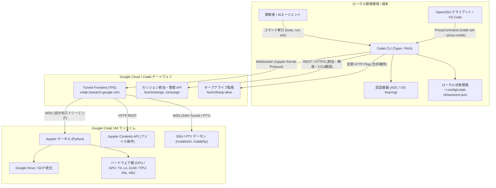

# **Google Colab CLI 調査レポート**

## **1. 基本情報**

* **ツール名**: Google Colab CLI (コマンド名: `colab`)
* **ツールの読み方**: グーグル コラボ シーエルアイ
* **開発元**: Google (Google Colab チーム)
* **公式サイト**: [https://colab.research.google.com/](https://colab.research.google.com/)
* **関連リンク**:
  * GitHub: [https://github.com/googlecolab/google-colab-cli](https://github.com/googlecolab/google-colab-cli)
  * ドキュメント: [https://github.com/googlecolab/google-colab-cli/tree/main/docs](https://github.com/googlecolab/google-colab-cli/tree/main/docs)
* **カテゴリ**: AI開発ワークフロー
* **概要**: Google Colab CLI（`colab`）は、Google Colabが提供するクラウド仮想マシン（CPU、NVIDIA T4 / L4 / A100 / H100 GPU、Google TPU v5e / v6e）をローカル端末のコマンドラインから直接操作・実行するための公式オープンソースCLIツールである。ローカルのPythonスクリプトやJupyter Notebook（`.ipynb`）の透過的リモート実行、双方向ファイル転送、Google Driveマウント、OpenSSH ProxyCommand連携によるVS Code Remote-SSH接続、さらには一発実行・自動リソース回収を行うエフェメラルジョグランナー（`colab run`）やAIエージェント向けスキル提供までを網羅している。

## **2. 目的と主な利用シーン**

* **解決する課題**:
  * **WebブラウザUIへの依存解消**: 従来のWeb画面では、ローカルのGitリポジトリや普段使いのエディタ（VS Code、Neovim等）との連携が煩雑で、ファイルのアップロード・ダウンロードやコード同期の手間が発生していた。
  * **CI/CD・ヘッドレス自動化の欠如**: CI/CDパイプラインや夜間バッチ、自動化スクリプトからColabのGPU/TPU計算資源を直接呼び出す標準手段が存在しなかった。
  * **AIエージェント連携の不在**: Claude Code、Codex、Clineなどの自律型コーディングエージェントが、計算負荷の高い機械学習モデルの学習やベンチマークをクラウド上で自律的に実行するための標準CLIが求められていた。
  * **リソース管理の自動化**: クラウドVMの起動からスクリプト実行、モデル成果物の回収、VMインスタンスの自動破棄までを単一コマンドで完結させ、過剰課金やアイドル放置を防止する。
* **想定利用者**:
  * **機械学習エンジニア / AIリサーチャー**: ローカルでコードを書き、クラウド上のA100/H100 GPUやTPUで即座に学習・推論を実行したい開発者。
  * **データサイエンティスト**: 定期実行バッチやデータ分析ノートブックをローカル環境からシームレスにクラウド実行したい担当者。
  * **MLOps / DevOpsエンジニア**: GitHub ActionsなどのCI/CDパイプライン上でGPUテストやモデル検証をヘッドレスに実行したいエンジニア。
  * **AIエージェント開発者**: コーディングエージェントに一時的なアクセラレータ実行環境を付与したい開発者。
* **利用シーン**:
  * **ワンショット学習・推論ジョブの投入**: `colab run --gpu L4 train.py` により、VMプロビジョニングから学習実行、VM破棄までを1コマンドで自動完了。
  * **VS Code Remote-SSH による対話型クラウド開発**: `colab ssh` をOpenSSH ProxyCommandとして登録し、ローカルのVS CodeからColab VMに接続してリモート開発。
  * **AIコーディングエージェントへの外部計算資源提供**: 事前定義スキル（`colab skill`）を通じて、Claude Code等のエージェントが自律的にGPU VMを確保しコードをテスト。
  * **Jupyter Notebookのバッチ実行と履歴保存**: `colab exec -f report.ipynb` でノートブックをリモート実行し、出力結果付きノートブック（`report_output.ipynb`）やMarkdown形式ログを自動生成。

### **2.1 代表的な利用フロー**

```mermaid
swimlane-beta TB
  subgraph User["ユーザー / AIエージェント"]
    A["スクリプト作成・実行指示<br>colab run --gpu L4 train.py"]
    F["成果物確認・モデル検証"]
  end
  subgraph CLI["Colab CLI"]
    B["セッション自動要求・トークン取得"]
    D["コード送信・実行ストリーム監視"]
    E["終了検知・VM自動解放処理"]
  end
  subgraph Backend["Google Colab基盤"]
    C["GPU VMプロビジョニング"]
  end
  subgraph Kernel["Colab VM / カーネル"]
    G["PyTorch学習実行・ログ出力"]
  end
  A --> B
  B --> C
  C --> D
  D --> G
  G --> E
  E --> F
```

* **代表的な流れ**: ユーザーまたはAIエージェントが `colab run` を実行すると、CLIがColabバックエンドAPIと通信して指定されたアクセラレータVMを自動確保する。続いてローカルスクリプトがリモートJupyterカーネルへ送信されてリアルタイム実行され、実行完了と同時に成果物が反映された後、CLIがVMを自動解放してリソース放置と課金を防止する。

## **3. 主要機能**

* **インスタントVMプロビジョニング (`colab new`, `colab stop`, `colab sessions`, `colab status`)**:
  CPU、NVIDIA GPU（T4, L4, G4, H100, A100）、Google TPU（v5e1, v6e1）をわずか数秒で割り当て・監視・破棄。`--high-mem` による高RAMプロファイル指定にも対応。
* **多様なコード実行モード (`colab exec`, `colab repl`, `colab console`)**:
  ローカルのPythonスクリプト（`.py`）やJupyter Notebook（`.ipynb`）、標準入力（`stdin`）パイプラインの透過的実行。端末での対話型Python REPLや、tmux/PTYベースのリモートbashシェル（`console`）をサポート。
* **エフェメラルジョグランナー (`colab run` & shebang対応)**:
  VMのプロビジョニング、引数転送付きスクリプト実行、終了後のVM自動シャットダウンを1コマンドに統合。`#!/usr/bin/env -S colab run --gpu T4` をファイルの先頭に記述することで、スクリプト自体を自己完結型のクラウドアシスト実行可能ファイルとして運用可能。
* **SSH直接接続とIDE Remote-Devブリッジ (`colab ssh`)**:
  WebSocketトンネルを介したセキュアなSSHアクセスを提供。OpenSSHの `ProxyCommand` ブリッジ（`--proxy-mode`）として動作し、VS Code Remote-SSHやJetBrains GatewayからColab VMへの直接接続を実現。また `colab ssh -- CMD` によるワンショットリモートコマンド実行にも対応。
* **シームレスなリモートファイル管理 (`colab ls`, `colab upload`, `colab download`, `colab rm`, `colab edit`)**:
  Jupyter Contents APIをバックエンドとして利用し、ローカルとリモートVM間でのファイルの閲覧、アップロード、ダウンロード、削除を実行。さらに `$EDITOR` を起動してリモートファイルをインプレース編集可能。
* **ワークスペース自動化・クラウド統合 (`colab auth`, `colab drivemount`, `colab install`)**:
  VM内のPython環境にGoogle Cloud認証を注入（`colab auth`）、Google Driveを `/content/drive` にマウント（`colab drivemount`）、`uv` による爆速システムパッケージインストール（`colab install`、`pip` フォールバック付き）を実行。
* **実行履歴とマルチフォーマットログ出力 (`colab log`)**:
  セッション内の実行イベント履歴を追跡し、Jupyter Notebook（`.ipynb`）、Markdown（`.md`）、プレーンテキスト（`.txt`）、構造化JSONL（`.jsonl`）形式でローカルにエクスポート可能。
* **AIエージェント統合スキル提供 (`colab skill`)**:
  Claude Code、Codex、Clineなどのコーディングエージェントに直接読み込ませることができる事前定義仕様書（`colab-operator` スキル）をCLI自身が出力。エージェントが自律的にGPU/TPU環境を操作可能。
* **課金・コンピュートユニット管理 (`colab usage`, `colab pay`)**:
  Google Colabアカウントの残余Compute Unit（CU）残高や消費レートをターミナル上でリアルタイム確認（`colab usage`）。

## **4. 動作原理・システム構成**



* **アーキテクチャ**:
  ローカルファーストのクライアント・サーバー構成。ローカル端末上で動作するPythonベースのCLIが、Google Colabのクラウドゲートウェイ（Tunnel Frontend: TFE）とHTTPS RESTおよびWebSocketsプロトコルで通信し、Google Cloud基盤上に動的確保されたコンテナVM内のJupyterカーネルおよびSSH/PTYデーモンを遠隔操作する。
* **主要コンポーネントとデータフロー**:
  * **CLIレイヤー (Typer / Rich)**: コマンドライン引数をパースし、非同期通信とカラー・Markdown・ANSIエスケープ対応の端末レンダリングを制御。
  * **認証基盤 (`auth.py`)**: Application Default Credentials（ADC）とOAuth2リモートコピーペーストフローをサポート。OAuthトークンはOSネイティブの安全なキーリング（macOS Keychain / Linux SecretService）に保存・自動暗号化。
  * **状態ストア (`state.py`)**: `~/.config/colab-cli/sessions.json` にセッショントークン、エンドポイントURL、ハードウェア構成を保持。クロスプロセス競合を防ぐため `filelock` による共有読み取り/排他書き込みロックを適用。
  * **ランタイム実行エンジン (`runtime.py`)**: WebSocket経由でJupyter Kernel Messaging Protocol（`execute_request`, `iopub.stream`, `display_data` 等）を送受信。ローカルコードをVMに転送して実行し、標準出力・標準エラー出力をリアルタイムにストリーミング。
  * **SSHプロキシブリッジ (`commands/ssh.py`)**: `wss://<host>/colab/ssh` エンドポイントに対し、ED25519/ECDSA公開鍵をヘッダーに乗せて接続し、標準入出力をWebSocketペイロードと相互変換するOpenSSH ProxyCommandブリッジとして機能。
* **特筆すべき要素技術**:
  * **Activity-Based Liveness と TFE Keep-Alive Ping**: 旧来の内部RPC依存から脱却し、Colab Tunnel FrontendへのHTTP ping（`GET /tun/m/<endpoint>/keep-alive/`）とカーネルアクティビティ連動によって、不要なバックグラウンドデーモンを排除しつつVMの予期せぬアイドル破棄を防止。
  * **Jupyter Contents API統合**: ファイル操作をSSH SCPやFTPではなくJupyter標準のContents API経由で行うことで、ファイアウォールやポート開放の制約なしに確実なファイル転送を実現。
  * **uv パッケージマネージャーの全面採用**: VM上でのパッケージ導入に `uv pip install --system` をデフォルト採用し、従来の `pip` に比べて5〜10倍高速な環境構築を達成。

## **5. 開始手順・セットアップ**

* **前提条件**:
  * OS: **Linux または macOS**（Windowsは現時点で非対応。WSL2上での利用を推奨）
  * Python: **Python 3.12 以上**
  * Google アカウント（Google Colab利用権限）
  * Google Cloud SDK (`gcloud`)（推奨: ADC認証を利用する場合）
* **インストール/導入**:

  ```bash
  # uv を使用したインストール（推奨）
  uv tool install google-colab-cli

  # pip を使用したインストール
  pip install google-colab-cli
  ```

* **初期設定（認証設定）**:
  CLIがColabバックエンドと通信するための認証を設定する。CI/CDやAIエージェント、ローカル開発すべてで最も推奨されるのは **Application Default Credentials (ADC)** である。

  ```bash
  # 推奨: gcloud を使用したADC認証（必要な4つのスコープを一括付与）
  gcloud auth application-default login \
    --scopes=openid,\
  https://www.googleapis.com/auth/cloud-platform,\
  https://www.googleapis.com/auth/userinfo.email,\
  https://www.googleapis.com/auth/colaboratory
  ```

  ※ OAuth2を使用する場合は、`colab --auth=oauth2 new` 実行時に表示されるGoogle認証URLへブラウザでアクセスし、画面に表示された認証コードを端末にペーストすることで認証が完了する（OSのKeyringにトークンが安全に永続化される）。

* **クイックスタート**:

  ```bash
  # 1. T4 GPU インスタンスを割り当て
  colab new -s my-session --gpu T4

  # 2. リモートでPythonコードを実行
  echo 'import torch; print(f"CUDA Available: {torch.cuda.is_available()}, Device: {torch.cuda.get_device_name(0)}")' | colab exec -s my-session

  # 3. 必要なPythonパッケージを高速インストール
  colab install -s my-session transformers datasets

  # 4. セッションを終了し、VMリソースを解放
  colab stop -s my-session
  ```

  **ワンショット実行（エフェメラルジョブ）の場合**:

  ```bash
  # スクリプトの割り当て・実行・解放を1コマンドで完結
  colab run --gpu L4 train.py
  ```

## **6. 特徴・強み (Pros)**

* **圧倒的な手軽さとゼロインフラ管理**:
  クラウドプロバイダーの複雑なVPC、サブネット、IAMロール、SSHキーペア登録などを一切行うことなく、Googleアカウントさえあればコマンド1つでA100/H100 GPUやTPU環境を数秒で利用可能。
* **VS Code / JetBrains とのシームレスな統合 (`colab ssh`)**:
  `colab ssh --proxy-mode` をOpenSSHの設定ファイル（`~/.ssh/config`）に数行記述するだけで、普段使用しているVS CodeやCursorからColab VMにRemote-SSH接続してコーディングやデバッグが可能。
* **ワンショット実行とshebangサポートによる高いポータビリティ**:
  `colab run` により、ローカルスクリプトの先頭に `#!/usr/bin/env -S colab run --gpu L4` と書くだけで、実行時に自動でGPUを確保し、完了後にVMを自動返却する使い捨てバッチ処理が実現。
* **自律型AIエージェント向けの最適化設計**:
  非対話パイプラインでの確実な終了コード伝搬、Richによるクリーンな標準出力・エラー出力の分離、構造化JSONLログ、そしてエージェントに直接読み込ませられる事前定義スキル（`colab skill`）が標準装備。
* **Google DriveおよびGCPとのネイティブな親和性**:
  `colab drivemount` によるGoogle Driveのシームレスなマウントや、`colab auth` によるBigQuery/GCSへのアクセス権限注入など、Googleエコシステムとの緊密な連携が可能。

## **7. 弱み・注意点 (Cons)**

* **プラットフォーム制限（Windowsネイティブ非対応）**:
  現行バージョンではLinuxおよびmacOSのみを公式サポートしており、Windowsネイティブ環境（CMD/PowerShell）では動作しない。WindowsユーザーはWSL2（Windows Subsystem for Linux）環境を導入する必要がある。
* **リソース割り当ての不確実性と混雑時の割当中断（HTTP 412 / 400）**:
  Colabの計算資源はクラウド全体の混雑状況に左右される。特に無料枠や需要の高いハイエンドGPU（A100/H100）では、リソース枯渇により `TooManyAssignmentsError`（HTTP 412）やクォータ不足（HTTP 400）が発生することがある。
* **VM解放忘れによるCompute Unit消費リスク**:
  `colab new` で起動したセッションは明示的に `colab stop` を呼ぶまで（またはバックエンドの無通信タイムアウトまで）リソースを占有し、Colab Pro/Pro+のCompute Unitを消費し続ける。CI/CDや自動スクリプトでは `colab run`（自動解放）の活用が必須。
* **日本語ドキュメントおよびメッセージの英語限定**:
  CLIのヘルプメッセージ、エラー出力、公式ドキュメントはすべて英語で提供されている（Pythonコード内の日本語出力やUTF-8ファイル処理自体には完全対応）。
* **長時間バックグラウンド実行時の監視切断リスク**:
  WebSocket通信が一時的なネットワーク切断に遭った場合、VM側でジョブが実行中であってもCLI側のストリーミング監視が中断することがある（Issue #220で議論・改善進行中）。

## **8. 料金プラン**

Google Colab CLIツール自体は**完全無料のオープンソースソフトウェア（Apache License 2.0）**として提供されるが、バックエンドで実行されるGoogle Colabランタイムの利用にはColabのアカウントおよび以下の料金プランが適用される。

| プラン名 | 料金 (月額/従量) | 主な特徴・付与リソース | 対象ユーザー |
|---------|-----------------|----------------------|-------------|
| **Colab Free** | **無料 ($0)** | ・標準CPUおよび利用可能な場合のT4 GPUアクセス<br>・アイドル切断あり、混雑時の割当中断あり | 個人学習者、学生、軽量コードの動作確認 |
| **Pay As You Go** | **$9.99** (100 CU)<br>**$49.99** (500 CU) | ・月額固定費なし、必要な分だけCompute Unit（CU）を購入<br>・購入したCUは90日間有効<br>・高速GPU（T4, L4, A100）へのアクセス権 | 突発的な実験や週末プロジェクト |
| **Colab Pro** | **$9.99 / 月** | ・毎月100 Compute Unitを付与<br>・高速GPU（T4, L4, A100）およびTPUへの優先アクセス<br>・高メモリマシン（`--high-mem`）選択可能<br>・Geminiコード支援のクォータ拡大 | 個人エンジニア、研究者、頻繁なモデル学習 |
| **Colab Pro+** | **$49.99 / 月** | ・毎月600 Compute Unitを付与（基本100 + 追加500）<br>・最優先のプレミアムGPUアクセス<br>・**バックグラウンド実行最大24時間対応**<br>・最大Geminiクォータ | プロフェッショナルAI研究者、MLチーム |

* **課金体系**: Compute Unit（CU）従量消費制。使用するアクセラレータ（T4は低レート消費、A100/H100は高レート消費）および稼働時間に応じてCUが消費される。
* **無料トライアル**: 常時無料枠（Colab Free）が利用可能。
* **Google One / Google AIプランとの連携**: 対象のGoogle One AIプレミアムプラン等を契約している場合、Colab Proと同等のCompute Unitが毎月自動付帯され、合算して利用可能。

## **9. 導入実績・事例**

* **導入企業・組織**:
  * **Google 社内の研究・エンジニアリングチーム**: 内部プロトタイピングやAI実験の標準ツールチェーンとして活用。
  * **オープンソースAI研究コミュニティ / Kaggle グランドマスター**: Kaggleコンペティションのパイプライン自動化やモデル学習の分散投入。
  * **AIエージェント開発スタートアップ**: Claude Code、Cursor、Cline、OpenAI Codex などのコーディングエージェントに一時的なGPU計算ワーカーを付与する基盤として導入。
  * **大学・学術研究機関**: 高価なオンプレミスGPUサーバーを常時運用することなく、学生や研究員が必要な時だけA100/TPUをCLIから利用。
* **導入事例からわかる効果**:
  * Webブラウザを開かずに端末だけで完結するため、ローカルGitワークフローとの往復作業が90%削減された。
  * GitHub Actionsパイプラインに `colab run` を組み込むことで、高額なクラウドGPUインスタンスを常時契約することなく、PRテスト時のみGPUリソースをオンデマンド利用しインフラコストを大幅削減。
* **対象業界**: AI/ディープラーニング開発、データ分析、高等教育、フィンテック、バイオインフォマティクス。

## **10. サポート体制**

* **ドキュメント**:
  * 公式GitHubリポジトリ内に詳細なサブシステム設計書（`docs/01_session_management.md` 〜 `docs/06_ssh_access.md`）が公開されている。
  * 11種類の実践的な自動化シナリオを網羅したデモウォークスルー集（`docs/demos.md`）が提供されている。
  * CLI内部から `colab help <command>`、`colab skill`、`colab readme` を直接呼び出し可能。
* **コミュニティ**:
  * **GitHub Issues / Discussions**: バグ報告、機能要望、活発なディスカッションがGoogleのメンテナーおよびコミュニティ間で展開されている。
  * **Reddit (`r/GoogleColab`)**: 一般ユーザーや開発者による情報交換コミュニティ。
* **公式サポート**:
  * オープンソースCLI自体はGitHubリポジトリを通じたコミュニティベースの対応が主体。
  * Google Colab Pro/Pro+ のサブスクリプションや課金に関する問い合わせは、Google One サポート窓口またはGoogle Workspaceサポートポータルを通じて提供される。

## **11. エコシステムと連携**

### **11.1 API・外部サービス連携**

* **API**:
  * Google Colab Session API / Tunnel Frontend（TFE: `colab.research.google.com/tun/m/...`）との完全統合。
  * Jupyter Kernel Messaging Protocol（RFC準拠のWebSocketメッセージング）。
  * Jupyter Contents API（RESTfulなファイルCRUD操作）。
* **外部サービス連携**:
  * **Google Cloud Platform (GCP)**: `colab auth` を介してBigQuery、Cloud Storage（GCS）、Vertex AIへの認証トークンをVM内に自動注入。
  * **Google Drive**: `colab drivemount` によるGoogle Driveのシームレスなファイル共有・ストレージ拡張。
  * **OpenSSH / 各種IDE**: `colab ssh --proxy-mode` によるVS Code Remote-SSH、Cursor、JetBrains Gateway連携。
  * **Jupyter Notebook**: ローカルの `.ipynb` ファイルを実行し、セルごとの出力結果を保持したまま新規ノートブックとして保存。
  * **AIエージェントフレームワーク**: Claude Code、Codex、Antigravity CLI、Cline等のエージェントツールとして組み込み可能。

### **11.2 技術スタックとの相性**

| 技術スタック | 相性 | メリット・推奨理由 | 懸念点・注意点 |
|:---|:---:|:---|:---|
| **Python (PyTorch / JAX / Hugging Face)** | ◎ | 公式に最適化されており、GPU/TPUアクセラレータを即時利用可能 | 特になし |
| **Linux (Ubuntu / Debian / macOS)** | ◎ | 完全な公式サポート。PTY、ターミナルリサイズ、Keyring統合がネイティブ動作 | 特になし |
| **VS Code / Cursor (Remote-SSH)** | ◎ | `colab ssh` によるProxyCommand経由でローカルIDEの完全な開発体験を提供 | 初回接続時にリモートサーバーのセットアップに数十秒要する |
| **uv (Python Package Installer)** | ◎ | `colab install` が内部で `uv pip` を標準採用しており、パッケージ導入が極めて高速 | 一部C拡張の特殊ビルドでフォールバックが発生する場合あり |
| **CI/CD (GitHub Actions / GitLab CI)** | ◯ | `colab run` によるワンショットGPUテストや学習ジョブの自動化に最適 | ADCサービスアカウント認証の事前設定が必要 |
| **Windows (PowerShell / CMD)** | × | 現行バージョンでは非対応（UNIX固有のターミナル・シグナル制御に依存） | WSL2（Ubuntu等）の利用が必須 |

## **12. セキュリティとコンプライアンス**

* **認証**:
  * Google OAuth 2.0 および Google Cloud Application Default Credentials（ADC）に対応。
  * 取得したOAuthリフレッシュトークンは、平文ファイルではなくOSネイティブのセキュアなパスワードストレージ（macOS Keychain、Linux SecretService / Keyring）に暗号化保存される。
* **通信・データ暗号化**:
  * CLIとGoogle Colabバックエンド間の通信は、すべてTLS/HTTPSおよび暗号化WebSocket（WSS）で保護される。
  * `colab ssh` における認証は、最新の高強度公開鍵暗号（ED25519、ECDSA）のみを許可（脆弱なRSA鍵はサーバー側で自動拒否）。
* **データ管理とプライバシー**:
  * クラウドVM上のデータはGoogle Cloud基盤の安全な隔離サンドボックス内で実行され、セッション終了時（`colab stop` や `colab run` 完了時）にインスタンスディスクは完全に破棄される。
  * Googleの標準プライバシーポリシーおよびGoogle Colab利用規約に準拠。
* **準拠規格**:
  * バックエンドを提供するGoogle Cloud基盤は、ISO/IEC 27001、SOC 1/2/3、GDPR、HIPAAなどの国際的セキュリティおよびコンプライアンス基準に準拠。

## **13. 操作性 (UI/UX) と学習コスト**

* **UI/UX**:
  * TyperおよびRichライブラリを採用したモダンで洗練されたCLIデザイン。
  * 表形式のセッション一覧（`colab sessions`）、ハードウェア状態の直感的な表示（`colab status`）、ANSIカラーエスケープを保持したストリーミング出力など、ターミナルでの視認性が極めて高い。
  * 画像出力（MatplotlibやPIL等で生成されたプロット）が含まれる場合、ターミナルが対応していればインライン描画し、非対話環境では自動でファイルに保存してパスを案内するスマートな出力制御を搭載。
* **学習コスト**:
  * **極めて低い**。基本的なDockerやGit、sshコマンドを扱えるエンジニアであれば、`colab new`、`colab exec`、`colab stop`、`colab run`、`colab ssh` の数個の基本コマンドを把握するだけで数分で実戦投入できる。

## **14. ベストプラクティス**

* **効果的な活用法 (Modern Practices)**:
  * **ワンショット実行（`colab run`）の標準化**:
    日常的なバッチ学習やデータ処理では、`colab run --gpu L4 script.py` を基本とすることで、VMの停止忘れによる無駄なCompute Unit消費を完全に防止する。
  * **shebang による実行可能スクリプト化**:
    スクリプトの先頭に `#!/usr/bin/env -S colab run --gpu L4` を指定し `chmod +x` することで、手元のMacやPCから直接GPUバッチスクリプトを実行可能にする。
  * **VS Code Remote-SSH の事前構成**:
    `~/.ssh/config` に `Host colab-gpu` エントリを定義し、ProxyCommandに `colab ssh --proxy-mode -s dev --gpu T4` を設定しておくことで、エディタからワンクリックでGPUリモート開発を開始する。
  * **`uv` を用いた高速依存関係管理**:
    セッション作成後に `colab install -r requirements.txt` を実行し、`uv` の並列ダウンロード・キャッシュを活用して環境構築時間を最小化する。
  * **AIコーディングエージェントとの協調**:
    `colab skill` をエージェントのシステムプロンプトやMCP/Skillディレクトリに配置し、エージェントが重い計算処理を自動でColab VMにオフロードする環境を構築する。
* **陥りやすい罠 (Antipatterns)**:
  * **`colab auth` と CLI認証の混同**:
    CLI自体の認証（`--auth=adc` / `--auth=oauth2`）と、VM内部でGCPサービスを叩くための認証（`colab auth`）は別物である。CLIの認証エラーが発生した際にVM側の `colab auth` を実行しても解決しないため、`gcloud auth application-default login` でCLI側スコープを正しく付与すること。
  * **非対話スクリプトやCI/CDでの対話コマンド実行**:
    `colab repl`、`colab console`、`colab auth`、`colab drivemount` は対話型TTYやブラウザでの手動操作を前提としている。パイプラインやエージェントから不用意に呼び出すと入力待ちでハングするため、非対話環境では `colab exec` や `colab run` を使用すること。
  * **セッション解放の放置**:
    `colab new` で作成したセッションを放置すると、バックエンドのアイドル判定までCompute Unitを消費し続ける。作業終了後は必ず `colab stop` を呼ぶ習慣をつけること。

## **15. ユーザーの声（レビュー分析）**

* **調査対象**: GitHub Issues / Discussions、Reddit（r/GoogleColab）、X (Twitter)、技術ブログコミュニティ（ai-tldr、InfoQ、Context7等）
* **総合評価**: ★★★★☆ (4.3 / 5.0 相当)
* **ポジティブな評価**:
  * **開発体験の劇的な向上**: 「ローカルのVS Codeから直接ColabのGPU VMにSSH接続できるようになったのは革命的。Webのノートブック画面でのコピペ作業から完全に解放された。」
  * **CI/CD・バッチ処理の自動化**: 「`colab run` のおかげで、高価な常時起動GPUインスタンスを借りることなく、GitHub Actionsから必要な時だけ格安でGPUテストを実行できるようになった。」
  * **AIエージェントとの親和性**: 「Claude CodeやClineなどのAIエージェントに事前定義スキルを渡すだけで、エージェント自身がGPUマシンを借りてコードを実行・修正してくれるようになった。」
* **ネガティブな評価 / 改善要望**:
  * **Windows非対応への不満**: 「Windowsのネイティブターミナルで動かないため、WSL2を挟まなければならないのが惜しい。」
  * **混雑時のリソース確保エラー**: 「無料枠やピーク時間帯にGPUを指定すると、割当エラー（HTTP 412）が発生してジョブが失敗することがある。」
  * **WebSocket一時切断時のログ中断**: 「長時間の学習ジョブにおいて、ネットワークの瞬断があるとCLI側のログ表示が止まってしまい、再接続の挙動が不安定になることがある。」
* **特徴的なユースケース**:
  * 自律型AIコーディングエージェントが、ローカルで生成したディープラーニングモデルの学習スクリプトを `colab run` 経由でリモートGPUに自動投入し、評価指標が一定基準を超えるまでコードを自己改善ループさせる完全自動MLパイプラインの構築。

## **16. 直近半年のアップデート情報**

* **2026-11-04**: タイムアウト処理のリファクタリングと監視ループの安定性向上（コミット `d2d9779`）
* **2026-11-03**: Linux keyringロック状態の自動検出と警告表示機能の追加（`secretstorage` 経由でロックを検知し、ユーザーに解除案内と `--auth=adc` の利用を提示）
* **2026-11-03**: `--timeout` フラグを「実行全体の強制打ち切り」から「無出力状態のアイドル制限時間」へと挙動を修正（定期的に標準出力を行う長時間の学習ジョブが不意に打ち切られる問題を解消）
* **2026-11-02**: `colab ssh [-s NAME] -- CMD` によるワンショットリモートコマンド実行機能の追加（対話シェルを開かずに単一コマンドを実行し、終了コードをローカルに伝搬）
* **2026-10-29**: サーバー側SSHセッション上限（HTTP 429）到達時のメッセージ表示改善（プランごとの同時接続上限数を明示）
* **2026-10-21**: OSネイティブキーリング（`keyring` ライブラリ）へのOAuth2トークン保存先移行と既存 `token.json` からの自動マイグレーション対応
* **2026-10-15**: **v0.7.5 リリース**（最新のGoogle Colab利用規約更新への追従）
* **2026-09-25**: **v0.7.4 リリース**（`jupyter-kernel-client` 依存関係のピン留め更新とビルドパイプライン修正）
* **2026-09-03**: **v0.7.0 リリース**（`colab ssh` コマンド正式導入、環境変数注入 `--env` フラグ追加、高RAMマシン指定 `--high-mem` フラグ追加、412割当エラーのユーザーフレンドリーなメッセージ化）
* **2026-06-16**: **v0.6.0 リリース**（リモートコピーペーストによるOAuth2フロー刷新、Richライブラリによる表示出力レンダリング刷新、Tunnel Frontendキープアライブping導入によるセッション維持安定化）
* **2026-06-03**: **v0.5.8 リリース**（AIエージェント向け事前定義スキル出力コマンド `colab skill` の新設）

(出典: [GitHub リポジトリ コミット履歴・リリースノート](https://github.com/googlecolab/google-colab-cli/commits/main/))

## **17. 類似ツールとの比較**

### **17.1 機能比較表 (星取表)**

| 機能カテゴリ | 機能項目 | Google Colab CLI | Modal | RunPod CLI | Google Cloud CLI (`gcloud`) |
|:---:|:---|:---:|:---:|:---:|:---:|
| **プロビジョニング** | クラウドGPU/TPU手軽さ | ◎<br><small>Googleアカウントのみで即座に割当</small> | ◎<br><small>Pythonデコレータで秒速起動</small> | ◯<br><small>インスタンス作成手順が必要</small> | △<br><small>VPC・クォータ・IAM設定が必要</small> |
| **実行モデル** | ワンショットジョブ実行 | ◎<br><small><code>colab run</code> / shebang対応</small> | ◎<br><small>サーバーレス関数実行</small> | △<br><small>スクリプトでのコンテナ制御が必要</small> | △<br><small>GCEインスタンス作成スクリプトが必要</small> |
| **開発環境連携** | IDE / SSH連携 | ◎<br><small><code>colab ssh</code> によるVS Code完全統合</small> | △<br><small>インタラクティブシェルはあるが開発向きではない</small> | ◯<br><small>SSH接続およびWebコンソール</small> | ◎<br><small><code>gcloud compute ssh</code> による接続</small> |
| **アクセラレータ** | TPUサポート | ◎<br><small>TPU v5e / v6e 標準対応</small> | ×<br><small>非対応（GPU中心）</small> | ×<br><small>非対応（GPU中心）</small> | ◎<br><small>Cloud TPUリソースとして対応</small> |
| **コスト形態** | 無料枠・手軽な価格 | ◎<br><small>Free枠あり / Pro月100CU付帯</small> | ◯<br><small>毎月$30の無料枠あり</small> | ◯<br><small>従量課金（コミュニティGPUは安価）</small> | △<br><small>エンタープライズ課金（高価）</small> |
| **AIエージェント親和性** | 事前定義スキル・非対話設計 | ◎<br><small><code>colab skill</code> 完備・終了コード伝搬</small> | ◯<br><small>Python SDK経由で連携容易</small> | △<br><small>REST APIやCLIパースが必要</small> | △<br><small>多機能すぎてエージェントの制御が複雑</small> |
| **対応環境** | OSプラットフォーム | △<br><small>Linux / macOS（Windows非対応）</small> | ◎<br><small>クロスプラットフォーム</small> | ◎<br><small>クロスプラットフォーム</small> | ◎<br><small>クロスプラットフォーム</small> |

### **17.2 詳細比較**

| ツール名 | 特徴 | 強み | 弱み | 選択肢となるケース |
|---------|------|------|------|------------------|
| **Google Colab CLI** | Google Colabランタイムを端末から操作する公式オープンソースCLI | インフラ設定不要、T4〜H100/TPU対応、VS Code SSH統合、ワンショット実行、AIエージェントスキル標準装備 | Windows非対応、混雑時のGPU割当不確実性、長時間ジョブでのセッション管理 | 手軽にGoogle ColabのGPU/TPUをローカル開発やAIエージェント、CI/CDから使いたい場合 |
| **Modal** | クラウド上でPythonコードをサーバーレス実行するモダン基盤 | コンテナ起動が数秒、コード内にリソース要件を記述可能、強力なオートスケーリング | プロプライエタリなクラウド仕様、Jupyter/Colabエコシステムとは異なる | 大規模なバッチ処理やWebエンドポイント推論をPythonコードから直接スケールアウトさせたい場合 |
| **RunPod CLI** | 格安GPUクラウドRunPodのインスタンス管理ツール | 多様なコンシューマ・エンタープライズGPUを安価に時間単位レンタル可能 | インスタンスのセットアップや初期設定が手動寄り、TPU非対応 | 長時間のディープラーニング学習を安価な専用GPUインスタンスで回し続けたい場合 |
| **Google Cloud CLI (`gcloud`)** | Google Cloud全体のインフラリソースを網羅的に管理する公式CLI | 確実なリソース予約、強固なエンタープライズセキュリティ、SLA保証 | 設定項目が膨大、学習コストが高い、GPUインスタンス単価が高い | 本番運用や企業の大規模ML基盤として厳密なネットワーク分離やSLAが必要な場合 |

## **18. 総評**

* **総合的な評価**:
  Google Colab CLIは、機械学習コミュニティにおいて最も広く普及しているGoogle Colabのクラウド計算資源を、ローカルの開発環境や自動化パイプラインへとダイレクトに開放する画期的なツールである。Webブラウザ上のノートブックという従来の制約から開発者を解き放ち、普段使いのエディタ（VS Code）やターミナル、さらには自律型AIコーディングエージェントとのシームレスな融合を実現している。ワンショット実行（`colab run`）やOpenSSHプロキシブリッジ（`colab ssh`）など、エンジニアの実務ニーズに極めて的確に応えた設計となっており、Apache 2.0オープンソースとしての開発スピードと透明性も極めて高い。
* **推奨されるチームやプロジェクト**:
  * **個人開発者・AIリサーチャー**: 手元のMacBookやLinux PCのスペックにとらわれず、必要な時だけコマンド1発でGPU/TPUを借りて実験したいプロジェクト。
  * **AIエージェント導入チーム**: Claude CodeやCodexなどのコーディングエージェントに、一時的なGPU計算リソースを安全かつ低コストで割り当てたい組織。
  * **スタートアップ・中小開発チーム**: 高額な常時起動GPUサーバーを契約する予算を抑えつつ、CI/CDでのモデル検証やテストを自動化したいチーム。
* **選択時のポイント**:
  * サーバーレスな分散バッチ処理やAPIデプロイが主目的であれば **Modal** が優位となるが、Google Driveとの連携、Jupyter Notebookの資産活用、TPUの利用、そして普段のエディタからの気軽なGPU活用が主目的であれば **Google Colab CLI** が最善の選択肢となる。
  * Windows環境での利用を前提とする場合は、WSL2の導入が必須となる点に留意が必要である。
