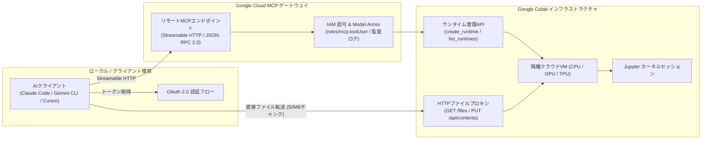

# **Google Colab MCP 調査レポート**

## **1. 基本情報**

* **ツール名**: Google Colab MCP (`colaboratory.googleapis.com/mcp`)
* **ツールの読み方**: グーグル コラボ エムシーピー
* **開発元**: Google (Google Colab / Google Cloud チーム)
* **公式サイト**: [https://developers.google.com/colab/api/reference/mcp](https://developers.google.com/colab/api/reference/mcp)
* **関連リンク**:
  * ドキュメント: [https://docs.cloud.google.com/mcp/overview](https://docs.cloud.google.com/mcp/overview)
  * リリースノート: [https://docs.cloud.google.com/mcp/release-notes](https://docs.cloud.google.com/mcp/release-notes)
  * 関連OSSプロキシ（ローカル連携用）: [https://github.com/googlecolab/colab-mcp](https://github.com/googlecolab/colab-mcp)
* **カテゴリ**: MCPサーバー
* **概要**: Google Colab MCP は、Google が公式にホストするリモート Model Context Protocol（MCP）サーバー（グローバルエンドポイント: `https://colaboratory.googleapis.com/mcp`）である。Claude Code、Gemini CLI、Cursor などの MCP 対応 AI エージェントやアプリケーションから、Google Colab のクラウド仮想マシン（CPU、NVIDIA GPU、Google TPU）のプロビジョニング、Jupyter カーネルセッション管理、Python コードのステートフルな実行を標準プロトコル経由で直接操作できる。なお、ローカルのブラウザ版 Colab セッションと連携するためのオープンソース実装（`googlecolab/colab-mcp`）も補完的に提供されている。

## **2. 目的と主な利用シーン**

* **解決する課題**:
  * **AIエージェントの計算資源不足と環境汚染の解消**: ローカルマシンの貧弱な CPU/GPU で重い機械学習処理を実行したり、AI が生成した未検証コードをローカル環境で直接実行するセキュリティ・依存関係汚染のリスクを回避し、隔離されたクラウドサンドボックスを提供する。
  * **手動コピー＆ペーストの排除**: AI アシスタントが生成したコードをユーザーが手動で Colab ノートブックに貼り付けて実行し、エラーログを再びチャットに貼り戻す反復作業を完全に自動化する。
  * **ヘッドレスかつエンタープライズ統制された実行基盤**: ブラウザ UI 操作（Playwright 等の壊れやすいスクレイピング）に頼らず、Google Cloud IAM や監査ログによる統制下で安定した API/MCP 経由のコード実行を実現する。
* **想定利用者**:
  * **AIエージェント開発者**: コーディングエージェント（Gemini CLI、Claude Code、Cursor 等）に自律的なデータ分析・モデル学習・コード検証能力を組み込みたい開発者。
  * **機械学習エンジニア / AIリサーチャー**: ローカルの IDE から離れることなく、エージェント経由で Colab Pro/Pro+ の GPU/TPU ランタイムを確保・実験したいエンジニア。
  * **データサイエンティスト**: 大規模データの前処理や統計検証を AI エージェントと対話しながらクラウド上で反復実行したい分析担当者。
* **利用シーン**:
  * **自律的なモデル学習とデバッグループ**: エージェントが `execute_code` の `stderr` や `executionError` を読み取り、パッケージ不足の解消（`!pip install`）やバグ修正を自律的に繰り返す。
  * **ステートフルな探索的データ分析（EDA）**: `create_session` で作成した Jupyter カーネルセッション上で変数や DataFrame を保持したまま、段階的に分析を進める。
  * **大容量データセットのクラウド連携処理**: `get_runtime` で取得したプロキシトークンを用いて HTTP 経由でデータファイルを直接ランタイムへ転送し、GPU で高速処理する。

### **2.1 代表的な利用フロー**

```mermaid
swimlane-beta TB
  subgraph User["ユーザー"]
    A["AIエージェントへ分析・学習を指示"]
    F["実行結果とサマリーを確認"]
  end
  subgraph Agent["AIエージェント (MCPクライアント)"]
    B["利用可能スペック・既存ランタイムを確認"]
    D["セッションを作成しPythonコードを送信"]
  end
  subgraph ColabMCP["Google Colab MCPサーバー"]
    C["OAuth 2.0 / IAM検証・ランタイム割当"]
    E["カーネル実行結果 (stdout/result) を返却"]
  end
  subgraph Runtime["Colab クラウドランタイム"]
    R1["Jupyterカーネルでコード実行・状態保持"]
  end
  A --> B
  B --> C
  C --> D
  D --> R1
  R1 --> E
  E --> F
```

* **代表的な流れ**: ユーザーがローカルの AI エージェントにタスクを指示すると、エージェントは Google Colab MCP サーバーへツール呼び出し（`list_runtime_specs` / `list_runtimes` / `create_runtime`）を行い、OAuth 2.0 と Google Cloud IAM の検証を経てクラウドランタイムを確保する。その後、エージェントが `create_session` と `execute_code` を反復呼び出しして Colab ランタイム内の Jupyter カーネルで Python コードを実行し、標準出力や実行エラーを受け取って自律的に検証・修正した結果をユーザーに提示する。

## **3. 主要機能**

Google Colab MCP サーバー（`https://colaboratory.googleapis.com/mcp`）は、以下の 10 個の標準 MCP ツールを公開している。

* **`list_runtime_specs`（ランタイムスペック一覧取得）**: ユーザーが現在の契約プランで利用可能なランタイム構成（バリアント、GPU/TPU アクセラレータ種別、マシン形状）と利用資格を一覧取得する。
* **`list_runtimes`（稼働中ランタイム一覧取得）**: ユーザーが現在保持している Colab ランタイムの一覧を、スペックおよび接続情報（`connectionInfo`）付きで取得する。新規作成前の再利用確認に使用する。
* **`create_runtime`（ランタイム新規作成）**: 指定した `runtimeSpec` と一意の UUID（`requestId`）を用いて Colab ランタイムをプロビジョニングし、起動完了まで待機する。冪等性を備えており、タイムアウト（`DEADLINE_EXCEEDED`）時は同一リクエストの再送で起動完了を安全に待機できる。
* **`get_runtime`（ランタイム詳細・ファイル転送情報取得）**: 指定ランタイムのスペックおよび `connectionInfo`（プロキシ URL、有効期限約 1 時間の `X-Colab-Runtime-Proxy-Token`）を取得する。これにより LLM のコンテキストを消費せずに HTTP 経由で直接ファイル（50MB 単位のチャンク分割アップロードや Range ダウンロード）を送受信できる。
* **`delete_runtime`（ランタイム削除）**: 指定したランタイムおよびその上の全ファイル・セッション・状態を完全に削除し、リソースを解放する。
* **`create_session`（Jupyter セッション作成）**: 稼働中のランタイム上に独立した Jupyter カーネルセッションを開設する。同一セッション内では変数や `import` 状態が保持されるため、軽量な状態分離に最適である。
* **`list_sessions`（セッション一覧取得）**: 指定ランタイム上で開かれているセッション（ユーザーがブラウザで開いたノートブックを含む）の名前一覧を取得する。
* **`delete_session`（セッション終了）**: 指定したセッションを閉じ、カーネルメモリと状態を破棄する（ランタイム自体やディスク上のファイルは維持される）。
* **`execute_code`（Python コード実行）**: 指定したセッション（またはランタイム）の Jupyter カーネル上で任意の Python コードを実行し、`stdout`、`stderr`、最終式の評価値（`result`）、例外情報（`executionError`）をテキスト形式で返却する。`executionId`（UUID）を指定することで、600 秒のタイムアウト超過後も同一リクエストで実行中ジョブへ再アタッチできる。
* **`get_subscription`（サブスクリプション情報取得）**: 認証ユーザーの現在の Colab 契約ティア（Free / Pro / Pro+）を取得し、利用可能なリソース上限を確認する。

## **4. 動作原理・システム構成**



* **アーキテクチャ**: Google Cloud がフルマネージドでホストする**クラウド完結型リモート MCP サーバー**である。ローカルにサーバープロセス（`stdio`）を常駐させる必要がなく、**Streamable HTTP**（JSON-RPC 2.0 over HTTPS）プロトコルで `https://colaboratory.googleapis.com/mcp` へ直接通信する。
* **主要コンポーネントとデータフロー**:
  * **MCP ホスト / クライアント**: AI エージェント側が `tools/list` で利用可能ツールを動的検出し、`tools/call` でランタイム操作やコード実行を要求する。
  * **Google Cloud MCP ゲートウェイ**: リクエスト受信時に OAuth 2.0 アクセストークンと Google Cloud IAM ロール（`roles/mcp.toolUser`）を検証し、オプションで Model Armor によるプロンプトインジェクション・データ流出スキャンや Cloud Audit Logs への記録を行う。
  * **Colab ランタイム & Jupyter カーネル**: バックエンドのクラウド VM 内で Jupyter カーネルが起動し、`execute_code` の実行状態をメモリ上に保持する。なお、大容量ファイルを MCP ツール呼び出し（Base64）経由で渡すと LLM のコンテキストウィンドウを圧迫するため、ファイル転送は `get_runtime` で取得した `connectionInfo.url` へ直接 HTTP リクエストを送信する二層データフローを採用している。
* **特筆すべき要素技術**:
  * **Streamable HTTP & MCP 仕様 2026-07-28 準拠**: SSE（Server-Sent Events）と JSON レスポンスを統合した最新の MCP トランスポート仕様に対応。
  * **冪等性キー（`requestId` / `executionId`）による耐障害性**: ランタイム起動や 600 秒を超える長時間学習ジョブにおいて、通信切断や `DEADLINE_EXCEEDED` が発生しても、同一 UUID で再呼び出しするだけで重複実行を防ぎつつ処理結果へ再アタッチできる。
  * **補完的 OSS プロキシ（`googlecolab/colab-mcp`）との棲み分け**: リモート API エンドポイントとは別に、ローカルのブラウザで開いている Colab ノートブックのセルを直接編集・実行したい用途向けに、WebSocket 連携を行うオープンソース版 `colab-mcp`（`uvx` で起動）も Google Colab チームから提供されている。

## **5. 開始手順・セットアップ**

* **前提条件**:
  * Google アカウントおよび Google Cloud プロジェクト（課金設定または API 有効化権限）
  * MCP 対応クライアント（Gemini CLI、Claude Code、Cursor 等）または `curl` 等の HTTP クライアント
* **インストール/導入**:
  リモート MCP サーバーであるため、サーバー本体のローカルインストールは不要である。Google Cloud 側で API と MCP サーバーを有効化する。

  ```bash
  # Google Cloud CLI で対象プロジェクトの Colab API / MCP エンドポイントを有効化する例
  gcloud config set project <YOUR_PROJECT_ID>
  gcloud services enable colaboratory.googleapis.com
  ```

* **初期設定**:
  1. **IAM 権限の付与**: 利用するユーザーまたはサービスアカウントに対し、プロジェクトまたは組織レベルで IAM ロール **MCP Tool User**（`roles/mcp.toolUser`）を付与する。
  2. **OAuth 2.0 認証の設定**: Google Cloud Console の「API とサービス > 認証情報」から OAuth 同意画面と OAuth クライアント ID を構成し、環境変数等を通じて MCP クライアントに認証情報（`<YOUR_OAUTH_CLIENT_ID>` 等）を設定する。
  3. **MCP クライアント登録**: クライアント設定でリモート MCP サーバーの URL に `https://colaboratory.googleapis.com/mcp` を指定する。
* **クイックスタート**:
  `tools/list` メソッドを叩くことで、MCP サーバーが公開しているツール仕様を取得し疎通確認ができる。

  ```bash
  curl --location 'https://colaboratory.googleapis.com/mcp' \
    --header 'Authorization: Bearer <YOUR_OAUTH_ACCESS_TOKEN>' \
    --header 'content-type: application/json' \
    --header 'accept: application/json, text/event-stream' \
    --data '{
      "method": "tools/list",
      "jsonrpc": "2.0",
      "id": 1
    }'
  ```

## **6. 特徴・強み (Pros)**

* **ゼロインフラ・サーバーレスなリモート MCP 提供**: ローカルに Python 環境や Docker コンテナを準備せず、HTTPS エンドポイントを指定するだけで即座に AI エージェントへクラウド GPU/TPU 実行環境を接続できる。
* **Google Cloud エンタープライズ統制との完全統合**: `roles/mcp.toolUser` と IAM 条件（`tool.name` 属性によるツール単位の許可・拒否）、Cloud Audit Logs、Model Armor がネイティブに統合されており、企業利用に耐えうるガバナンスを備える。
* **600秒超の長時間ジョブに耐える再アタッチ設計**: `executionId` を利用した再アタッチ機構により、大規模データの前処理やモデル学習で MCP の HTTP タイムアウト（600 秒）を超えても、バックグラウンドポーリング用の複雑なコードを書かずに安全に結果を回収できる。
* **ランタイムとセッションの二層分離**: 重い VM プロビジョニング（`create_runtime`）を極力再利用しつつ、軽量な `create_session` でカーネル状態（変数・インポート）を分離でき、速度とコスト効率を両立している。
* **既存 Colab プランの計算資源をそのまま活用**: 普段使っている Colab Free / Pro / Pro+ のアカウント権限がそのまま API/MCP 経由でも継承されるため、追加の専用契約なしで H100 GPU や TPU などをエージェントから利用できる。

## **7. 弱み・注意点 (Cons)**

* **テキスト出力限定（画像・グラフの直接返却不可）**: `execute_code` ツールの戻り値は `stdout`、`stderr`、`result`（最終式の値）、`executionError` のテキスト情報に限られる。Matplotlib などで生成したプロット画像やグラフはそのままレスポンスに含まれないため、ファイルに保存して HTTP プロキシ経由で取得する工夫が必要である。
* **初期設定（Google Cloud プロジェクト・OAuth・IAM）のハードル**: ローカル実行型の `googlecolab/colab-mcp`（ブラウザセッション接続）と異なり、Google Cloud プロジェクトでのサービス有効化や OAuth 2.0 クライアント設定、IAM ロール付与が必要になる。
* **Colab リソースクォータと混雑時の割当失敗**: クラウド全体の混雑状況やユーザーの Compute Units 残高に依存し、リソース不足時には `FAILED_PRECONDITION` が返却される。エージェント側にフォールバック（別スペック選択や既存ランタイム再利用）の実装が求められる。
* **日本語サポート・出力の制約**: 公式ドキュメント（`developers.google.com/colab/api/reference/mcp`）は一部日本語メニューを備えるが、API リファレンス本文やエラーメッセージ、ツール説明文は英語中心である（実行する Python コード内の日本語処理自体は問題なく動作する）。

## **8. 料金プラン**

Google Colab MCP サーバーへのプロトコル接続自体には追加のライセンス料はかからないが、バックエンドでプロビジョニングされる Colab ランタイムの計算資源消費には、ユーザーの Google Colab 契約ティア（または Google Cloud の Colab Enterprise 課金）が適用される。

| プラン名 | 料金 | 主な特徴・対象ユーザー |
|---------|------|---------|
| **Colab Free** | **無料** | 標準 CPU および空き状況に応じた T4 GPU を利用可能。連続稼働時間や同時ランタイム数に厳しい制限があり、個人学習・動作検証向け。 |
| **Pay As You Go** | **$9.99** (100 CU)<br>**$49.99** (500 CU) | サブスクリプション契約不要の従量購入型 Compute Units（CU）。スポット的に GPU/TPU を使いたい開発者向け。 |
| **Colab Pro** | **$9.99/月** | 毎月 100 Compute Units 付与。高速 GPU への優先アクセスや大容量メモリ構成が利用可能で、個人 ML エンジニア向け。 |
| **Colab Pro+** | **$49.99/月** | Pro の特典に加え毎月追加 500 Compute Units（計 600 CU 相当）を付与。最上位 GPU/TPU 優先枠やバックグラウンド実行に対応し、本格研究・エージェント連続稼働向け。 |
| **Colab Enterprise** | **従量課金 (GCP)** | Vertex AI 基盤上で VPC・IAM・組織ポリシーに完全準拠して稼働するエンタープライズ向け。 |

* **課金体系**: Compute Units（消費時間とアクセラレータ種別に応じた従量消費）＋ 月額サブスクリプション、または Google Cloud 従量課金。
* **無料トライアル**: Colab Free プランが恒常的に無料で利用可能（Google Cloud 新規ユーザー向けの無料クレジット枠も併用可能）。

## **9. 導入実績・事例**

* **導入企業**: Google Colab MCP サーバーは 2026 年に一般提供（GA）されたばかりの新規プロトコル基盤であるため、企業名を明示した大規模導入事例はまだ公開されていない。ただし、Google 公式の開発者エコシステム内では Gemini CLI、Claude Code、Cursor、Windsurf などの主要 AI コーディングエージェント環境との連携事例が広く報告されている。
* **導入事例**:
  * AI コーディングエージェントがローカル PC のリソースを消費せず、Colab のクラウド GPU 上で PyTorch / Transformers のファインチューニングやデータ分析を自律実行するハイブリッド開発ワークフロー。
  * ブラウザ操作を伴わないヘッドレス実行により、データサイエンスの反復検証をターミナル完結で行う自動化パイプライン。
* **対象業界**: AI・機械学習研究開発、データサイエンス、ソフトウェア開発（AI エージェント開発企業・スタートアップ・教育研究機関）。

## **10. サポート体制**

* **ドキュメント**: [Google Colab API MCP Reference](https://developers.google.com/colab/api/reference/mcp) および [Google Cloud MCP servers overview](https://docs.cloud.google.com/mcp/overview) にて、エンドポイント仕様、全 10 ツールのパラメータ・エラーハンドリング指針、IAM 設定方法が体系的に整備されている。
* **コミュニティ**: Google Cloud Community フォーラム、GitHub（`googlecolab/colab-mcp` の GitHub Discussions）、Reddit（`r/LLMDevs` 等）で開発者間の知見共有が活発に行われている。
* **公式サポート**: ドキュメントページ上の「Send feedback」からのフィードバック送信に対応。Colab Enterprise および Google Cloud プロジェクト経由の利用では、契約している Google Cloud カスタマーケア（サポートプランに応じた SLA・日本語対応含む）の対象となる。

## **11. エコシステムと連携**

### **11.1 API・外部サービス連携**

* **API**: `colaboratory.googleapis.com` の REST API（v1 / v1beta）および MCP エンドポイント（Streamable HTTP / JSON-RPC 2.0）を公開。MCP 標準の `tools/list` による動的ツール発見に対応。
* **外部サービス連携**:
  * **AI コーディングエージェント / IDE**: Gemini CLI、Claude Code、Claude Desktop、Cursor、Windsurf
  * **Google Cloud サービス**: Google Cloud IAM、Cloud Audit Logs、Model Armor、Vertex AI（Colab Enterprise 連携）
  * **ファイル転送**: Jupyter Server 互換 HTTP プロキシ API（`/files/`、`/api/contents/`）
  * **関連ツール**: Google Colab CLI（`google-colab-cli`）、OSS ローカルプロキシ（`googlecolab/colab-mcp`）

### **11.2 技術スタックとの相性**

| 技術スタック | 相性 | メリット・推奨理由 | 懸念点・注意点 |
|:---|:---:|:---|:---|
| **Python / PyTorch / JAX** | ◎ | Colab ランタイムのネイティブ実行環境であり、GPU/TPU 最適化済みライブラリが即利用可能 | 実行結果はテキスト返却のため可視化画像はファイル経由で取得が必要 |
| **MCP対応エージェント (Claude Code / Gemini CLI)** | ◎ | Streamable HTTP に対応しており、エンドポイント URL と OAuth 設定のみで直接ツール群を認識 | Cursor 等の独自 URI スキームを使うクライアントは最新版の認証設定が必要 |
| **TypeScript / Node.js (MCP SDK)** | ◯ | 公式 MCP TypeScript SDK の Streamable HTTP クライアントから標準プロトコルで接続可能 | Google OAuth 2.0 トークンリフレッシュ処理の組み込みが必要 |
| **CI/CD (GitHub Actions 等)** | △ | サービスアカウントと `roles/mcp.toolUser` を組み合わせたヘッドレス実行は可能 | 単発スクリプト実行なら `Google Colab CLI`（`colab run`）の方が設定が簡潔 |

## **12. セキュリティとコンプライアンス**

* **認証**: Google 標準の **OAuth 2.0**（Authorization Code フロー等）および Google Cloud **IAM** による認証・認可を採用。MCP リクエスト実行には `roles/mcp.toolUser` ロール（`mcp.tools.call` 権限）が必要であり、IAM Conditions と `tool.name` 属性を用いたツール単位の実行制限・拒否ポリシーを構成できる。また、ファイル転送用プロキシには有効期限約 1 時間の短命トークン（`X-Colab-Runtime-Proxy-Token`）が発行される。
* **データ管理**: コード実行およびファイル保存は Google Cloud インフラ上の隔離された Colab ランタイム VM 内で完結する。`delete_session` でカーネルメモリを破棄してもディスク上のファイルはランタイム削除（`delete_runtime`）まで保持される仕様であり、機密データ処理後は明示的なランタイム削除が推奨される。また、Google Cloud MCP ゲートウェイ経由で **Cloud Audit Logs** による操作監査および **Model Armor** によるプロンプトインジェクション検査が適用できる。
* **準拠規格**: Google Cloud 基盤（Colab Enterprise / Google Cloud MCP サーバー）として提供されるため、Google Cloud の包括的なコンプライアンス認証（ISO/IEC 27001、SOC 1/2/3、GDPR 等）の枠組みのもとで運用可能である（コンシューマー版 Colab Free 等のデータ取り扱い詳細は Google プライバシーポリシーおよび Colab 利用規約に準拠）。

## **13. 操作性 (UI/UX) と学習コスト**

* **UI/UX**: 本サービス自体はヘッドレスな MCP API エンドポイントであるため専用 GUI は持たないが、Claude Code や Gemini CLI などの使い慣れたターミナル・IDE 画面上から自然言語で指示を出すだけでシームレスにクラウド GPU を操作できる。ブラウザタブの切り替えや手動セル実行が不要になる点が高く評価されている。
* **学習コスト**: MCP 対応クライアント側の設定経験がある開発者であれば、エンドポイント登録だけで概念を直感的に理解できる。ただし、Google Cloud Console での API 有効化・OAuth クライアント作成・IAM ロール設定に不慣れなユーザーにとっては、初期セットアップにやや学習コストがかかる。

## **14. ベストプラクティス**

* **効果的な活用法 (Modern Practices)**:
  * **ランタイム再利用とセッション分離の徹底**: `create_runtime` は起動に時間がかかりクォータ消費も大きいため、まず `list_runtimes` で既存ランタイムを確認して再利用し、状態の分離には軽量な `create_session`（終了時は `delete_session`）を使用する。
  * **長時間実行には必ず `session` ターゲット + `executionId` を指定**: 600 秒を超える処理で `DEADLINE_EXCEEDED` や `UNAVAILABLE` が返った場合でも、同じ `session` と `executionId`（UUID）で再実行することで重複実行を防ぎつつ安全に再アタッチする。
  * **大容量ファイル転送は HTTP プロキシを利用**: `execute_code` 内に Base64 文字列を埋め込むと LLM のコンテキストウィンドウを浪費するため、`get_runtime` で得た URL とトークンを使って HTTP で直接アップロード/ダウンロードする。
* **陥りやすい罠 (Antipatterns)**:
  * **同一セッションへの並列 `execute_code` 呼び出し**: 1 つのセッションは同時に 1 つのコードしか実行できず、並列呼び出しはキューイングされてタイムアウトの原因になる。並列タスクにはタスクごとに別セッションを作成する必要がある。
  * **不必要な `delete_runtime` の乱用**: 一時的な状態リセットのためにランタイムごと削除すると再起動コストとクォータ待機が発生する。ユーザーが明示的に削除を求めた場合やアクティブ上限に達した場合以外は `delete_session` を使用する。
  * **完了済み `executionId` の使い回し**: 結果が返却された後に同じ `executionId` を再利用するとコードが再実行されてしまうため、新しい実行ごとに必ず新規 UUID を生成する。

## **15. ユーザーの声（レビュー分析）**

* **調査対象**: Reddit（`r/LLMDevs`, `r/Bard`）、DEV Community、Medium 等の技術コミュニティ投稿（G2、Capterra、ITreview には単体製品としてのレビュー登録なし）
* **総合評価**: 定量スコアは未集計（開発者コミュニティでは「ローカル AI エージェントの計算資源ボトルネックを解消する待望の公式基盤」として概ね好意的に評価されている）
* **ポジティブな評価**:
  * 「AI アシスタントのチャット欄から Colab ノートブックへ手動でコードをコピペする煩雑な作業が完全に不要になった」（Reddit 開発者コミュニティより要約）
  * 「非力なローカル環境やセキュリティリスクを気にせず、クラウド上の GPU サンドボックスで AI 生成コードを自律デバッグさせられるのが強力」（DEV Community 技術レビューより要約）
  * 「エージェントが `stderr` を読んで不足ライブラリを自動インストールし、最後まで学習パイプラインを完走できる」（Medium 検証記事より要約）
* **ネガティブな評価 / 改善要望**:
  * 「Colab 本体のクォータや混雑による割当失敗（`FAILED_PRECONDITION`）の影響はそのまま受けるため、無料枠での連続自動化には限界がある」（開発者フィードバックより要約）
  * 「OAuth クライアント設定やリダイレクト URI の制約など、初期の認証セットアップでつまずきやすい」（コミュニティ議論より要約）
  * 「プロット画像などをそのまま MCP レスポンスで視覚的に確認できない点がデータ可視化タスクでは不便」（技術レビューより要約）
* **特徴的なユースケース**:
  * ローカルのコーディングエージェント（Claude Code 等）にデータ分析の計画立案を担当させ、重い前処理とモデル学習だけを Colab MCP 経由で A100/H100 GPU へオフロードする「ローカル思考＋クラウド実行」のハイブリッドエージェント構成。

## **16. 直近半年のアップデート情報**

* **2026-11**: Colab Enterprise 連携ランタイムテンプレートにおけるデフォルト Python 環境として **Python 3.13** が利用可能となり、新規作成ランタイムでの最新エコシステム対応が進展。
* **2026-09-14**: Google および Google Cloud MCP サーバー群が **Model Context Protocol 仕様 Version 2026-07-28** に対応（従来の 2025-11-25 仕様とも後方互換性を維持）。
* **2026-07-22**: Google および Google Cloud リモート MCP サーバーにおけるデスクトップリダイレクト URI の不具合が修正され、**Cursor** からのシームレスな OAuth 認証連携に対応。
* **2026-07-02**: Google Cloud IAM において `tool.name` 属性を用いたポリシー制御が導入され、MCP サーバー内の個別ツール単位での許可・拒否（きめ細かいアクセス制御）が可能に。
* **2026-05-01**: Google および Google Cloud リモート MCP サーバー群が一般提供（**Generally Available / GA**）ステータスに到達。

（出典: [Google Cloud MCP リリースノート](https://docs.cloud.google.com/mcp/release-notes) / [Google Cloud MCP 概要](https://docs.cloud.google.com/mcp/overview)）

## **17. 類似ツールとの比較**

AI エージェントに外部のコード実行環境やクラウド GPU サンドボックスを提供する主要な類似ツール（Google Colab CLI、E2B、Modal、Jupyter MCP Server）と比較する。

### **17.1 機能比較表 (星取表)**

| 機能カテゴリ | 機能項目 | Google Colab MCP | Google Colab CLI | E2B (Code Interpreter) | Modal (Sandboxes) | Jupyter MCP Server |
|:---:|:---|:---:|:---:|:---:|:---:|:---:|
| **基本機能** | MCP 標準対応 (リモート/ローカル) | ◎<br><small>Google公式リモートMCP</small> | △<br><small>CLI/Skill連携中心</small> | ◯<br><small>MCPゲートウェイ提供</small> | △<br><small>MCPホスティング基盤</small> | ◎<br><small>Jupyter特化MCPサーバー</small> |
| **計算資源** | クラウド GPU / TPU 利用 | ◎<br><small>ColabのT4〜H100/TPU</small> | ◎<br><small>ColabのT4〜H100/TPU</small> | ×<br><small>主にCPU MicroVM中心</small> | ◎<br><small>大規模サーバーレスGPU</small> | △<br><small>接続先カーネルに依存</small> |
| **実行制御** | ステートフル実行・再アタッチ | ◎<br><small>セッション+executionId対応</small> | ◯<br><small>セッション維持/SSH接続</small> | ◯<br><small>セッション内状態維持</small> | ◯<br><small>サンドボックスAPI制御</small> | ◎<br><small>ノートブックセル状態保持</small> |
| **出力機能** | 画像・グラフの直接返却 | ×<br><small>テキスト出力のみ</small> | △<br><small>ファイル回収/ipynb出力</small> | ◯<br><small>チャート/ファイル取得可</small> | △<br><small>スクリプト実装次第</small> | ◎<br><small>セル出力画像を取得可</small> |
| **運用・統制** | エンタープライズIAM・監査 | ◎<br><small>GCP IAM/Model Armor</small> | ◯<br><small>ADC/OAuth2認証</small> | ◯<br><small>APIキー/Enterprise枠</small> | ◯<br><small>Workspace/RBAC対応</small> | △<br><small>環境構築に依存</small> |
| **非機能要件** | 日本語ドキュメント対応 | △<br><small>一部UIのみ日本語</small> | ×<br><small>英語のみ</small> | ×<br><small>英語のみ</small> | ×<br><small>英語のみ</small> | ×<br><small>英語のみ</small> |

### **17.2 詳細比較**

| ツール名 | 特徴 | 強み | 弱み | 選択肢となるケース |
|---------|------|------|------|------------------|
| **Google Colab MCP** | Google 公式ホストのリモート MCP エンドポイント (`colaboratory.googleapis.com/mcp`) | サーバー構築不要で即利用可、IAM/監査統合、長時間実行の再アタッチ対応 | 画像出力の直接返却不可、GCP OAuth/IAM 設定が必要、Colab クォータ依存 | MCP 対応エージェントから標準プロトコルで安全にクラウド GPU/TPU を使いたい場合 |
| **Google Colab CLI** | ローカル端末から Colab VM を操作する公式 OSS CLI (`colab`) | VS Code Remote-SSH 連携、`colab run` によるワンショット実行、CI/CD 親和性 | Windows ネイティブ非対応（WSL2 必須）、MCP サーバー単体ではない | 開発者がターミナルや CI/CD から直接 GPU ジョブや SSH 接続を行いたい場合 |
| **E2B** | AI エージェント向けの超高速 Firecracker MicroVM サンドボックス | ミリ秒単位の高速起動、ハードウェアレベルの強固な隔離、多様な言語対応 | 大規模 GPU 学習や TPU ワークロードには不向き | 軽量なコードインタープリターや安全なシェル実行環境を大量に回したい場合 |
| **Modal** | Python ネイティブなサーバーレス・クラウドインフラ基盤 | 数千並列のサンドボックススケーリング、豊富な GPU 構成、低レイテンシ | 単なるチャット連携にはインフラコードの記述・管理が必要 | 本番プロダクションの AI バックエンドや大規模並列 GPU 推論基盤を構築したい場合 |
| **Jupyter MCP Server** | JupyterLab API / カーネルをラップする OSS MCP サーバー群 | `.ipynb` セルの直接編集、グラフ・画像の視覚的取得が可能 | 別途 Jupyter サーバーやクラウド計算環境のホスティングが必要 | データサイエンティストとエージェントが同じ JupyterLab 画面を共有して作業したい場合 |

## **18. 総評**

* **総合的な評価**:
  * Google Colab MCP は、これまで「人間がブラウザ上で操作するノートブック」であった Google Colab を、**AI エージェント向けの標準化されたクラウド計算バックエンド**へと進化させる極めて重要な公式コンポーネントである。Streamable HTTP によるゼロインフラ接続、Google Cloud IAM と Model Armor によるエンタープライズ統制、そして `executionId` を用いた長時間ジョブの再アタッチ機構は、実務での自律エージェント運用を見据えた堅牢な設計となっている。
* **推奨されるチームやプロジェクト**:
  * Gemini CLI、Claude Code、Cursor などの MCP 対応ツールを日常的に利用しており、ローカルマシンの計算資源不足を解消したい機械学習チーム・データサイエンスチーム。
  * Google Cloud 環境を既に運用しており、IAM 統制や監査ログを維持したまま AI エージェントに安全な Python 実行サンドボックスを付与したい企業組織。
* **選択時のポイント**:
  * **MCP エージェント連携・ガバナンス重視**なら **Google Colab MCP**、**ターミナル操作・CI/CD・Remote-SSH 開発重視**なら **Google Colab CLI**、**ブラウザ上のノートブック画面をそのまま操作したい**なら OSS 版の **`googlecolab/colab-mcp`**、**超高速な汎用 MicroVM サンドボックス**が必要なら **E2B** を選択するなど、ワークフローの主軸に合わせて使い分けることが推奨される。
