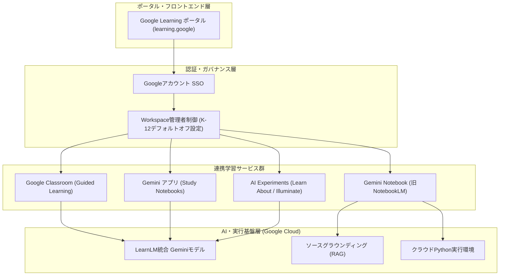

# **Google Learning 調査レポート**

## **1. 基本情報**

* **ツール名**: Google Learning
* **ツールの読み方**: グーグル ラーニング
* **開発元**: Google
* **公式サイト**: [https://learning.google/](https://learning.google/)
* **関連リンク**:
  * Google for Education: [https://edu.google.com/](https://edu.google.com/)
  * Grow with Google: [https://grow.google/](https://grow.google/)
* **カテゴリ**: ナレッジベース/Wiki
* **概要**: Google Learningは、「世界中の誰もが、世界のあらゆることを学べるように支援する」というミッションのもと、Googleが提供する学習リソースやAI学習ツールを集約したポータルサイト。「School（学校）」「Work（仕事）」「Life（生活）」の3つのカテゴリに分かれ、LearnLMを統合したGemini、Guided Learning、Gemini Notebook（旧NotebookLM）、Google Career Certificatesなどの学習ソリューションへシームレスにアクセスできる。

## **2. 目的と主な利用シーン**

* **解決する課題**: 学習リソースが分散していることによる探索コストの削減、および単なる答えの提示にとどまらない「思考力を育む（productive struggle）」AI学習体験の提供。
* **想定利用者**: 学生、教育者、キャリアアップを目指す社会人、新しいスキルを身につけたい一般ユーザー。
* **利用シーン**:
  * **学校教育**: 教師がGoogle Classroomの「Guided Learning」機能やGemini for Educationを活用し、生徒の思考プロセスを支援しながら授業・課題指導を行う。
  * **スキルアップ**: 社会人がGoogle Cloud Skills BoostやGrow with Google、Google Career Certificatesで最新のデジタルスキルやAIスキルを習得する。
  * **日常の学習**: 個人の興味に基づいて、YouTubeやGoogle検索、Arts & Cultureを使って知識を深める。
  * **AIリサーチ・実験的学習**: 「Gemini Notebook（旧NotebookLM）」「Learn About」「Google Illuminate」などのAIツールを使い、手持ちの資料や学術論文から対話的・効率的に学習する。

### **2.1 代表的な利用フロー**

```mermaid
swimlane-beta TB
  subgraph User["学習者・教育者"]
    A["ポータルで目的・カテゴリを選択"]
    E["ヒント・解説を基に理解を深化"]
  end
  subgraph Portal["Google Learning ポータル"]
    B["School / Work / Life からツール案内"]
  end
  subgraph AITools["AI学習ツール群"]
    C["Classroom / Gemini Notebook / Learn About 起動"]
    D["LearnLM基盤で対話・段階的ガイド生成"]
  end
  subgraph Admin["管理・ガバナンス基盤"]
    F["K-12管理者設定・学習インサイト確認"]
  end
  A --> B
  B --> C
  C --> F
  F --> D
  D --> E
```

* **代表的な流れ**: 学習者・教育者がGoogle Learningポータルから目的に応じたカテゴリを選択すると、Google ClassroomやGemini Notebook、Learn Aboutなどの適切なツールへ遷移する。組織・学校アカウントの場合は管理者のオプトイン設定（K-12制御等）を経由してLearnLM基盤のAIエンジンが起動し、段階的なヒントや要約を通じて学習者の理解を深める。

## **3. 主要機能**

* **カテゴリ別リソース案内**: 「School（学校）」「Work（仕事）」「Life（生活）」の3つの軸で、最適なGoogle製品・カリキュラム・資格プログラムを体系的に案内。
* **Guided Learning（2026年11月グローバル展開）**: Google Classroomに統合された1対1のAI学習コーチ機能。教師が指定した教材に基づき、答えを直接教えるのではなく問いかけや段階的ヒントで学習者を導く。集中を保つ「Focus Mode」や教師向けの理解度インサイト要約を備え、Google検索向けパイロットも展開されている。
* **LearnLM統合型Gemini & Study Notebooks**: 教育工学に基づいてファインチューニングされた「LearnLM」の知見がGeminiのコアモデルに統合。Geminiアプリ内の「Study Notebooks」では、授業資料をアップロードして診断クイズで弱点を特定し、一人ひとりに適応した学習プランを生成できる。
* **Gemini Notebook（旧NotebookLM）**: 2026年7月にNotebookLMから改称。アップロードした資料のみを根拠（グラウンディング）として回答・要約・音声概説・フラッシュカード・マインドマップを生成するほか、安全なクラウド実行環境でのPythonコード実行によるデータ分析にも対応する。
* **AI Experiments for Learning**: 学習効率を高めるための実験的なAIツール群への導線を提供。
  * **Learn About**: 会話型のAI学習コンパニオン。図解や関連メディアを交えてトピックを構造的に深掘りする。
  * **Google Illuminate**: 学術論文（arXiv等）や技術文書をAIが分析し、2人のAIホストによる対話形式の音声コンテンツに変換するツール。
  * **Shiffbot**: プログラミング教育者Dan Shiffmanのスタイルでコーディングを教えるAIチャットボット。
* **スキル習得・認定プログラム**: データ分析、UXデザイン、サイバーセキュリティ、AI基礎などを体系的に学べる「Google Career Certificates」や「Google Cloud Skills Boost」へのアクセスを提供。

## **4. 動作原理・システム構成**

* **アーキテクチャ**: Google Cloud上で稼働するクラウド完結型のマルチサービス統合ポータル（SaaSエコシステム）。Google Learning自体は軽量なナビゲーション・ハブとして機能し、実際の学習処理やAI推論はリンク先の各Googleサービス（Gemini、Google Classroom、Gemini Notebook、Google Cloud Skills Boost等）のバックエンドで実行される。
* **主要コンポーネントとデータフロー**:
  * **ポータルフロントエンド**: `learning.google` が対象別（School / Work / Life）のUIを提供し、適切なサービスへルーティングする。
  * **認証・ガバナンス層**: GoogleアカウントによるSSOと、Google Workspace for Education管理者による機能制御（K-12アカウントにおけるAI機能のデフォルトオフ設定およびオプトイン管理）を実施する。
  * **AI学習エンジン層**: 教育心理学・学習科学の原則で調整されたLearnLMベースのGeminiモデルが、プロンプトや教師指定の教材コンテキストを受け取り、ソクラテス式問答や段階的ヒントを生成する。
  * **グラウンディング・実行基盤**: Gemini NotebookなどではRAG（検索拡張生成）によりユーザー提供資料へ回答を厳密に紐づけ、高度な分析には隔離されたクラウドコンピュータ環境（Python実行サンドボックス）を利用する。
* **特筆すべき要素技術**:
  * **LearnLM教育特化ファインチューニング**: 認知負荷の管理、能動的学習（Active Learning）の促進、学習者の理解度に合わせた足場かけ（Scaffolding）を行うモデル設計。
  * **Focus Mode & トランスクリプト監査**: ClassroomのGuided Learningにおいてサイドチャットや無関係なナビゲーションを制限し、対話ログを教師用インサイトへ集約する仕組み。



## **5. 開始手順・セットアップ**

* **前提条件**:
  * Googleアカウント（ほとんどのAIツールやコース保存で必要）。
  * 学校・教育機関（K-12）アカウントの場合、管理者がWorkspace管理コンソールでGeminiやGemini Notebook等のAI機能を明示的に有効化（オプトイン）していること。
  * 一部の実験的機能（Labs）は利用可能な地域や年齢制限がある場合がある。
* **利用開始**:
  1. [https://learning.google/](https://learning.google/) にアクセスする。
  2. 目的のカテゴリ（School, Work, Life）を選択する。
  3. 表示されたツールや学習プログラム（Gemini、Guided Learning、Gemini Notebook、Career Certificatesなど）をクリックして利用を開始する。
* **初期設定**:
  * ポータル自体の特別なセットアップは不要。リンク先の各サービス（例：Google Cloud Skills BoostやCoursera連携講座）では、初回利用時にプロファイル設定や利用規約への同意が求められる場合がある。

## **6. 特徴・強み (Pros)**

* **教育特化AIによる「思考を促す」学習支援**: LearnLMの知見が統合されたGeminiやGuided Learningにより、単なる答えの丸写しを防ぎ、段階的なヒントと問いかけで深い理解（productive struggle）を促す。
* **膨大なリソースの一元的な入り口**: 小学生から教育者、エンジニア、生涯学習者まで、あらゆるフェーズ向けのGoogle公式ツール・認定資格を1箇所から迷わず見つけられる。
* **資料グラウンディングと最新AI体験**: Gemini Notebook（旧NotebookLM）やLearn About、Illuminateなど、手元の教材や論文を根拠に音声・図解・コード実行で学べる先進的ツールを無料で試せる。
* **教育現場向けの安全設計と透明性**: 2026年11月のアップデートにより、K-12アカウントでのAI機能デフォルトオフ制御や、Classroomでの生徒・AI対話履歴の教師向けインサイト提供など、教育現場が求めるガバナンス要件に対応している。

## **7. 弱み・注意点 (Cons)**

* **日本語対応と地域制限のばらつき**: ポータル本体やClassroom、Gemini、Gemini Notebookは日本語に対応しているが、Google検索のGuided Learningパイロット（米国一部校先行）やLabsの一部の実験ツールは英語優先・地域限定で展開されることが多い。
* **サービス名称・構成の頻繁な変化**: NotebookLMからGemini Notebookへの改称や、実験的プロジェクトの統合・終了など、AI関連ツールの名称や提供形態が頻繁に変わるため、運用ドキュメントの追従が必要になる。
* **学習履歴の分散**: ポータル自体はナビゲーションハブであるため、学習進捗や修了証、ノートブックの一元管理は各リンク先サービス（Classroom、Coursera、Skills Boost等）ごとに独立して行われる。
* **K-12環境での初期設定ハードル**: 安全性強化のためK-12アカウントではAI機能がデフォルトオフとなったため、学校側で管理者がポリシーを確認し有効化する運用手続きが必須となった。

## **8. 料金プラン**

Google Learningポータル自体の利用は無料。リンク先の各サービスにより料金体系が異なる。

| プラン名 | 料金 | 主な特徴 |
|---------|------|---------|
| **基本利用（個人・一般）** | 無料 | ポータル閲覧、YouTube Learning、Learn About、Google Illuminate、Gemini / Gemini Notebook（基本機能）などの利用。 |
| **教育機関向け** | 無料〜要問い合わせ | Google Workspace for Education（基本版は無料、Teaching and Learning / Education Plus等の有料エディションで高度な管理・AI機能を提供）。 |
| **スキル認定・クラウド演習** | 有料（一部無料枠あり） | Coursera上のGoogle Career Certificates（Coursera Plus: $59/月・$399/年など）、Google Cloud Skills Boostのサブスクリプション等。 |

* **課金体系**: 各サービスの規定による（個人無料枠、教育機関ライセンス、サブスクリプション等）。
* **無料トライアル**: Coursera連携講座やGoogle Cloud Skills Boostなどの有料サービスでは、無料トライアルや一部無料ラボが用意されている場合が多い。

## **9. 導入実績・事例**

* **導入企業/機関**: 世界中の初等・中等教育機関（K-12）、大学、企業の人材育成部門で広く導入されている。
* **導入事例・実証研究**:
  * **大規模ランダム化比較試験（RCT）による効果実証**: 英国の数学学習プラットフォームEediとの共同研究やシエラレオネでの教育支援研究において、LearnLMを活用したAIチュータリングが人間の個別指導に匹敵する学習定着・成績向上効果を示すことが報告された（2026年公表）。
  * **教育現場でのDX**: ChromebookとGoogle Classroom（およびGuided Learning）の組み合わせにより、生徒一人ひとりの理解度に応じた個別最適化学習と教師の負担軽減を実現。
  * **企業リスキリング**: Grow with GoogleおよびGoogle Career Certificatesを活用し、非IT職種を含む従業員のデジタルスキル・AIリテラシー向上を推進。
* **対象業界**: 初等・中等・高等教育、テクノロジー、全産業の人材育成・リスキリング部門。

## **10. サポート体制**

* **ドキュメント**: 各ツールの公式ヘルプセンター（Google Classroom ヘルプ、Gemini アプリ ヘルプ、Google Cloud ドキュメント等）が日本語を含め多言語で充実している。
* **コミュニティ**: Google for Education ヘルプコミュニティやGoogle Cloud公式コミュニティ、教育者向け認定グループ（GEG: Google Educator Groups）が活発に活動している。
* **公式サポート**: 有料製品（Google Workspace for Education有料版、Google AI Pro/Ultra等）には管理者向けの24時間サポートや専任窓口が提供される。無料ツールはヘルプセンターおよびコミュニティサポートが中心。

## **11. エコシステムと連携**

### **11.1 API・外部サービス連携**

* **API**: ポータル自体（`learning.google`）に独立したAPIはないが、リンク先の中核サービスはGoogle Classroom API、Gemini API（Google AI Studio / Vertex AI経由でLearnLMの教育チューニング能力を含むモデルを利用可能）、Google Workspace APIを提供している。
* **外部サービス連携**:
  * **LMS（学習管理システム）**: Canvas、Schoology、Moodle等とGoogle Classroom / Assignments経由で連携。
  * **オンライン学習プラットフォーム**: Coursera、edX等でのGoogle公式認定講座の配信。
  * **生産性・開発ツール**: Google Workspace（ドキュメント、スライド、スプレッドシート、ドライブ）、YouTube、Chromebook（ChromeOS）。

### **11.2 技術スタックとの相性**

| 技術スタック | 相性 | メリット・推奨理由 | 懸念点・注意点 |
|:---|:---:|:---|:---|
| **Google Workspace** | ◎ | SSO、ドライブ上の資料共有、Classroom/Gemini Notebookとの連携がシームレス。 | Googleエコシステムへの依存度が高まる。 |
| **Chromebook (ChromeOS)** | ◎ | 教育現場向けの端末管理・Focus Mode等の制御が最適化されている。 | オフライン環境ではAI機能の利用が制限される。 |
| **外部LMS (Canvas / Moodle等)** | ◯ | LTIやAssignments経由で課題・成績連携が可能。 | Guided Learning等の最新AI機能はClassroom内が先行しやすい。 |
| **Microsoft 365環境** | △ | ブラウザ経由で各Webツールは利用可能。 | アカウント管理やファイル連携が二元化し運用が煩雑になる。 |

## **12. セキュリティとコンプライアンス**

* **認証**: GoogleアカウントによるSSO、2段階認証（2SV）、パスキー対応。教育機関・企業向けWorkspaceではSAMLベースの外部IdP連携も可能。
* **データ管理**: GoogleのプライバシーポリシーおよびGoogle Workspace for Educationのデータ保護規定に準拠。教育機関向けプランでは生徒の課題データやAIとの対話データが広告配信や汎用モデルの無断学習に利用されない厳格な保護規定が適用される。また2026年11月より、K-12生徒アカウントではGemini・Gemini Notebook・AI検索がデフォルトオフとなり、管理者の明示的な承認なしに有効化されない設計となった。
* **準拠規格**: COPPA（児童オンラインプライバシー保護法）、FERPA（米国家族教育権とプライバシー法）、GDPR、ISO/IEC 27001、SOC 2等に準拠（対象サービス・エディションによる）。

## **13. 操作性 (UI/UX) と学習コスト**

* **UI/UX**: ポータルは「School」「Work」「Life」の3領域に整理されたシンプルなデザインで、目的のツールへ直感的に辿り着ける。各AIツール（Guided LearningのFocus ModeやGemini Notebookの3ペイン構成など）も学習中の集中を妨げない設計が施されている。
* **学習コスト**: 非常に低い。普段Google検索やYouTube、Googleドキュメントを利用しているユーザーであれば特別なトレーニングなしで即座に使い始められる。

## **14. ベストプラクティス**

* **効果的な活用法 (Modern Practices)**:
  * **目的に応じたツールの使い分け**: 学校の課題指導や段階的思考の訓練にはClassroomの「Guided Learning」、手持ち資料・論文の深掘りや音声学習には「Gemini Notebook」、知識体系の探索には「Learn About」と使い分ける。
  * **「答え」ではなく「ヒント」を引き出す**: 学習時はStudy Notebooksの診断クイズやGuided Learningを活用し、自分の弱点を特定した上で段階的に理解を固める。
  * **K-12導入時の段階的オプトイン**: 教育機関の管理者は、学校の方針と指導ガイドラインを整備した上で、学年やクラス単位でAI機能（デフォルトオフからオン）を段階的に開放する。
* **陥りやすい罠 (Antipatterns)**:
  * **AI出力の無批判な丸写し**: AIの回答を出典確認なしに課題へそのまま使用すると、学習効果が失われるだけでなくハルシネーションのリスクがある（Gemini Notebook等の出典リンク機能を必ず確認する）。
  * **実験的ツールへの過度な依存**: Google Labsのツールは仕様変更や名称変更・統合が速いため、長期カリキュラムの中核にはClassroomやWorkspaceなど正式版サービスを据える。

## **15. ユーザーの声（レビュー分析）**

* **調査対象**: 関連サービス（Google Classroom、Gemini、Gemini Notebook / 旧NotebookLM、Coursera連携講座）の教育関係者・学習者によるレビュー（G2、Reddit、SNS、教育メディア等）。
* **総合評価**: 中核ツールの評価は総じて高い（Google ClassroomはG2等で4.5/5.0前後の高評価を維持）。
* **ポジティブな評価**:
  * 「Guided Learningが答えを直接教えずヒントを出してくれるため、生徒の考える力を奪わずにAIを活用できる」
  * 「Gemini Notebookの音声概説やフラッシュカード機能により、膨大な講義資料の復習効率が劇的に向上した」
  * 「無料で高品質な学習コンテンツや最先端のAI学習ツールにアクセスでき、教育格差の縮小に貢献している」
* **ネガティブな評価 / 改善要望**:
  * 「関連ツールやサービス名（NotebookLM→Gemini Notebookなど）の変化が速く、どれを使えばよいか迷うことがある」
  * 「K-12向けデフォルトオフ制御に伴い、AI機能を無効化したまま通常のGoogle検索だけを使わせたい場合の管理設定が分かりにくいという声がある」
  * 「実験的ツールの一部は日本語対応や国内展開が遅れるケースがある」
* **特徴的なユースケース**:
  * 講義スライドとPDF論文をGemini Notebookにまとめ、Python実行機能でデータ分析を再現しつつ、通学中に音声概説で復習するハイブリッド学習。

## **16. 直近半年のアップデート情報**

* **2026-11-03**: **「AI in the Learning Era」発表 — Guided Learningの世界展開とK-12管理制御強化**。Google ClassroomにてLearnLM基盤の1対1学習コーチ「Guided Learning」（Focus Modeおよび教師向けインサイト付き）を全世界で一般提供開始。あわせてGoogle検索でのGuided Learningパイロット導入、およびK-12生徒アカウントにおけるGemini・Gemini Notebook・AI検索の**デフォルトオフ設定**を発表。
* **2026-08**: **Geminiアプリに「Study Notebooks」を追加**（2026年夏〜新学期向けアップデート）。授業ノートやワークシートをアップロードし、診断クイズによる弱点把握と適応型レッスンプランを生成でき、Gemini Notebookと自動同期する機能を提供。
* **2026-07-16**: **NotebookLMを「Gemini Notebook」へ正式改称**（`notebook.google`）。従来の資料グラウンディングや音声概説に加え、安全なクラウドコンピュータ環境でのPythonコード実行、エージェンティックWebリサーチ、リアルタイム音声対話、グラフ・スライド生成機能を追加。
* **2026-05**: **LearnLMのGeminiコアモデル統合とRCT実証結果の公表**。教育特化ファインチューニングモデル「LearnLM」の能力をGeminiコアモデルへ統合し、英国Eediやシエラレオネでの大規模ランダム化比較試験（RCT）で人間のチューターに匹敵する学習向上効果を報告。
* **2026-01**: **Bett 2026でのGoogle for Educationアップデート**。Gemini、Google Classroom、ChromeOSにおける授業準備効率化およびデジタルワークフロー改善機能を発表。
* **2025-11**: **Learn About (Experimental)** および **Illuminate (Experimental)** の公開。対話型学習コンパニオンおよび論文音声変換ツールを提供開始。
* **2025-09**: **Gemini for Google Workspace** の教育機関向け機能強化。
* **2025-05**: **NotebookLM** のモバイルアプリリリース。

(出典: [The Keyword (Google Blog) - Learning & Education](https://blog.google/products-and-platforms/products/education/))

## **17. 類似ツールとの比較**

### **17.1 機能比較表 (星取表)**

| 機能カテゴリ | 機能項目 | Google Learning | Microsoft Learn | LinkedIn Learning | Coursera |
|:---:|:---|:---:|:---:|:---:|:---:|
| **対象** | 教育/仕事/生活 | ◎<br><small>全方位（K-12〜生涯学習）</small> | ◯<br><small>IT技術・仕事中心</small> | ◯<br><small>ビジネス・実務スキル</small> | ◯<br><small>大学講義・専門資格</small> |
| **AI学習支援** | 対話・チュータリング | ◎<br><small>LearnLM / Guided Learning / Gemini Notebook</small> | ◯<br><small>Azure AI / Copilot学習パス</small> | ◯<br><small>AIコーチ・ロールプレイ演習</small> | ◯<br><small>Coursera Coach / AI翻訳</small> |
| **コスト** | 無料コンテンツ | ◎<br><small>主要ツール・学習資源が無料</small> | ◎<br><small>ドキュメント・演習無料</small> | △<br><small>原則有料サブスク</small> | △<br><small>一部プレビュー無料/修了証有料</small> |
| **形式** | マルチモーダル | ◎<br><small>対話/音声/動画/コード実行</small> | ◯<br><small>テキスト/サンドボックス演習</small> | ◯<br><small>動画講義/AIシミュレーション</small> | ◯<br><small>動画講義/課題/学位</small> |

### **17.2 詳細比較**

| ツール名 | 特徴 | 強み | 弱み | 選択肢となるケース |
|---------|------|------|------|------------------|
| **Google Learning** | Google製品・AI学習ツールを統合した学習ポータル。 | 検索、Classroom、LearnLM統合Gemini、Gemini Notebook等の連携。無料リソースの質と量。 | Google製品中心の構成。体系的コースは外部（Coursera等）連携が多い。 | 学校教育DX、最新AIを活用した能動的・探索的な学習を行いたい場合。 |
| **Microsoft Learn** | Microsoft製品（Azure, Copilot, .NET等）の技術ドキュメントと学習パス。 | エンタープライズ技術やAzure AI認定資格（AI-900等）の習得に最適。無料サンドボックス環境が充実。 | 生活教養や初等・中等教育向けのコンテンツは少ない。 | Microsoft技術・Azureの認定資格取得や開発スキルアップを目指す場合。 |
| **LinkedIn Learning** | ビジネス、クリエイティブ、技術スキルの動画コース。 | プロ講師による高品質動画とAIロールプレイ演習。キャリアSNS連携。Teamsプランは$379.88/席/年。 | 個人向け単体プランがなくLinkedIn Premium契約が必要。 | ビジネススキルやマネジメントを体系的に学びたい企業・個人。 |
| **Coursera** | 大学や企業の講義をオンラインで受講できるプラットフォーム。 | 大学レベルの専門知識やGoogle公式認定証・学位を取得可能。Coursera Coach搭載（Plus $59/月・$399/年）。 | 修了証取得やフル受講には費用がかかる。学習時間が長め。 | 大学レベルの体系的知識や、履歴書に記載できる公的修了証が必要な場合。 |

## **18. 総評**

* **総合的な評価**:
  Google Learningは、単なる学習リンク集から進化し、教育科学に基づく「LearnLM」を核としたAI時代の次世代学習ハブへと成長している。特に2026年後半の「Guided Learning」グローバル展開や「Gemini Notebook（旧NotebookLM）」のコード実行・マルチモーダル強化、そしてK-12向けデフォルトオフ制御の導入により、革新性と教育現場での安全性を高いレベルで両立している。
* **推奨されるチームやプロジェクト**:
  * 生徒の主体的な思考力を伸ばしつつ、安全なAI活用ガバナンスを構築したい学校・教育委員会。
  * 手元の資料や論文を根拠に、最新AI（Gemini NotebookやLearn About）で効率的にリサーチ・リスキリングを進めたい個人やエンジニア。
* **選択時のポイント**:
  * Google WorkspaceやChromebookを導入している教育機関・企業にとっては最優先の学習基盤となる。
  * 特定の企業技術資格（Azure等）にはMicrosoft Learn、ビジネス動画研修にはLinkedIn Learning、公的な大学学位・認定証にはCourseraが適しているが、「AIと対話しながら探索的に学ぶ」体験においてはGoogle Learningが最も先進的である。
