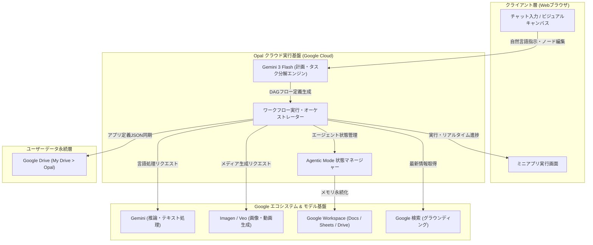

# **Google Opal 調査レポート**

## **1. 基本情報**

* **ツール名**: Google Opal
* **ツールの読み方**: グーグル オパール
* **開発元**: Google (Google Labs)
* **公式サイト**: [https://developers.google.com/opal](https://developers.google.com/opal)
* **関連リンク**:
  * アプリ作成画面 (Web環境): [https://opal.withgoogle.com/](https://opal.withgoogle.com/) （※2026年11月17日のサービス終了までアクセス可能）
  * ドキュメント: [https://developers.google.com/opal](https://developers.google.com/opal)
  * 公式ブログ (Google Labs): [https://blog.google/technology/google-labs/](https://blog.google/technology/google-labs/)
  * 後継移行先 (Gemini): [https://gemini.google.com/](https://gemini.google.com/)
  * 後継移行先 (Google AI Studio): [https://aistudio.google.com/](https://aistudio.google.com/)
* **カテゴリ**: iPaaS/連携
* **概要**: 自然言語で作りたいツールの目的を入力するだけで、テキスト生成（Gemini）、画像生成（Imagen）、動画生成（Veo）、外部検索、Google Workspace連携を組み合わせたAIミニアプリ（ワークフロー）を自動構築・共有できるGoogle Labs発のノーコードプラットフォーム。2026年11月17日をもってGoogle Labsを卒業（単独Webサービスとしての提供終了）し、その機能と知見は「Gemini Skills」および「Google AI Studio」へと継承・統合される。

## **2. 目的と主な利用シーン**

* **解決する課題**:
  * AIアプリケーション開発・プロトタイピングにおける技術的ハードルの解消
  * テキスト、画像、動画などの異種生成AIモデルを組み合わせる際のオーケストレーションの煩雑さ
  * プログラミングやAPI連携の知識を持たない非エンジニアによる業務ワークフローの迅速な自動化
  * アイデア出しから実際の対話型ミニアプリ公開までのリードタイム短縮
* **想定利用者**:
  * プログラミング知識を持たないビジネスパーソン、マーケター、企画担当者
  * 迅速なプロトタイプ検証を求めるプロダクトマネージャーやクリエイター
  * Google Workspace上で日常的な定型業務をAIで自動化したいチームメンバー
* **利用シーン**:
  * **マルチモーダルコンテンツ自動生成**: 1つのテーマからブログ下書き（Gemini）、アイキャッチ画像（Imagen）、紹介ショート動画（Veo）を一括生成するアプリ
  * **リサーチ・競合分析自動化**: Google検索で最新ニュースや競合情報を取得し、要点サマリーを作成してGoogle Docsに保存するワークフロー
  * **データ追記・スプレッドシート連携**: 顧客フィードバックやアンケート回答を分析・分類し、Google Sheetsに自動記録するミニ業務ツール
  * **教育・学習支援ツール**: 入力されたテキスト教材から理解度チェッククイズと解説図解を自動生成する対話アプリ

### **2.1 代表的な利用フロー**

Google Opalでは、ユーザーが自然言語で意図を伝えるだけで、Opalのプランナーエージェントが各AIモデルやサービス連携を組み合わせたノードグラフを自動構築する。生成されたアプリは対話的に実行・調整可能であり、作成データはGoogle Drive上に保持される。

```mermaid
swimlane-beta TB
  subgraph ユーザー
    Input["アプリの目的・要件を自然言語で入力"]
    Review["生成されたフローをテスト実行・微調整"]
    Export["プロンプト・設定をGemini Skillsへ移植"]
  end
  subgraph Opal_Engine["Opal実行エンジン"]
    Plan["指示を分解しノードグラフを自動設計"]
    Execute["モデル呼出とWorkspace連携を実行"]
    Save["ワークフロー定義をGoogle Driveに保存"]
  end
  subgraph Google_Services["Google AI・サービス基盤"]
    ModelCall["Gemini / Imagen / Veoでコンテンツ生成"]
    Workspace["Google検索 / Docs / Sheetsとの入出力"]
  end
  Input --> Plan
  Plan --> Review
  Review --> Execute
  Execute --> ModelCall
  Execute --> Workspace
  ModelCall --> Save
  Save --> Export
```

* **代表的な流れ**:
  1. ユーザーが「最新ニュースを検索して要約し画像を付けるツール」などの目的を自然言語で入力。
  2. Opalの実行エンジンがGemini 3 Flashを用いてタスクを分解し、ノードベースのワークフローを自動生成。
  3. ユーザーがビジュアル画面で確認・編集し、テスト実行を行うと、バックエンドの各モデル（Gemini/Imagen/Veo）やGoogle Workspaceと連動して処理が実行される。
  4. ワークフロー定義はGoogle Driveに永続化され、サービス卒業（2026年11月17日）に備えてGemini Skills等へのプロンプト移植が可能。

## **3. 主要機能**

* **自然言語によるワークフロー自動生成 (Natural Language App Building)**:
  * やりたいことをテキストで入力するだけで、AIが意図を汲み取り、入力・処理・モデル呼び出し・出力を結ぶ最適なフローを即座に構成。
* **Agentic Mode（AIエージェント機能）**:
  * 2026年にGemini 3 Flashをバックボーンとして導入された自律動作機能。「Plan then Act（計画してから実行）」のアプローチを採用し、タスクの動的分解、Google Sheetsを用いた状態（メモリ）の永続化、必要に応じたユーザーへの逆質問（Human-in-the-loop）を実現。
* **最先端マルチモーダルモデルのネイティブ統合**:
  * **Gemini**: 高度なテキスト推論、ロジック生成、要約、コード処理。
  * **Imagen**: 高精細な画像生成、バリエーション作成。
  * **Veo**: 自然言語プロンプトからの高品質な動画生成。これらを同一フロー内で数珠繋ぎに実行可能。
* **Google Workspace & 外部ツール連携**:
  * Google Search（リアルタイムWeb検索によるグラウンディング）、Google Docs、Google Sheets、Google Drive、Gmail、Google Calendarなどとシームレスにデータ連携。
* **ノードベースのビジュアルエディタとRemix機能**:
  * チャットで大枠を生成した後、キャンバス上でノードの追加・削除、プロンプトの調整、入出力のワイヤリングを直感的に変更可能。他者が共有したアプリを自分の環境に複製して改変する「Remix」にも対応。
* **Google Drive自動同期**:
  * 作成したワークフロー定義ファイルは、ユーザー個人のGoogle Drive内にある `My Drive > Opal` フォルダへ自動保存される。
* **即時Webホスティング・リンク共有**:
  * サーバー構築やデプロイ作業なしに、生成されたURL経由で完成したミニアプリをブラウザ上で即座に実行・共有可能（※2026年11月17日のWeb実行環境終了まで）。

## **4. 動作原理・システム構成**

* **アーキテクチャ**: クラウド完結型のサーバーレス・オーケストレーション基盤
* **主要コンポーネントとデータフロー**:
  * **クライアント層**: Webブラウザ上で動作するチャットインターフェースおよびビジュアルノードグラフエディタ。ユーザーの自然言語指示やGUI編集イベントを送信。
  * **エージェント・計画エンジン**: Gemini 3 Flashを基盤とするプランナーが、ユーザーの指示を解析してDAG（有向非巡回グラフ）形式の実行フローへ展開。
  * **ワークフローオーケストレーター**: 各ノードの依存関係に基づき、Gemini API、Imagen API、Veo API、Google検索API、Google Workspace APIへ並列・直列リクエストを発行。
  * **データ永続層**: 各アプリの構成スキーマやノード定義をJSON/テキスト形式でユーザーのGoogle Drive（`My Drive > Opal`）へ同期。外部のブラックボックスなデータベースに隔離されない設計。



* **特筆すべき要素技術**:
  * **Plan then Act推論**: 一度のプロンプトで完了させず、実行前に必要なステップと外部ツールをモデル自身が計画・自己検証するアーキテクチャ。
  * **マルチモーダルパイプライン**: テキストモデルの出力をプロンプトとして画像・動画生成モデルへダイレクトに受け渡すゼロレイテンシー連携。
  * **Driveネイティブストレージ**: プロプライエタリな独自DBではなく、ユーザー所有のGoogle Driveフォルダをプライマリストレージとして活用することで、プライバシー確保とベンダーロックイン緩和（テキストエディタ等での閲覧性確保）を両立。

## **5. 開始手順・セットアップ**

> [!WARNING]
> **サービス終了に伴う重要なお知らせ**:
> Google Opalは2026年11月17日をもってGoogle Labsを卒業し、単独Webサービス（`opal.google.com`）の提供を終了します。以降は対話的ミニアプリのWeb実行が停止するため、作成済みプロンプトのバックアップと、後継機能である「Gemini Skills」または「Google AI Studio」への移行作業を実施してください。

* **前提条件**:
  * Googleアカウント（個人用アカウントまたはLabs機能が許可されたGoogle Workspaceアカウント）。
  * モダンブラウザ（Google Chrome推奨）。
* **アクセス手順**:
  1. [https://opal.withgoogle.com/](https://opal.withgoogle.com/) （または `opal.google.com`）にアクセス。
  2. Googleアカウントでログイン。
* **クイックスタート（基本操作）**:
  1. ホーム画面の入力欄に「〇〇を自動化するアプリを作りたい」と日本語で入力。
  2. AIが自動的にステップを組み立て、右側のキャンバスにフローチャートが表示される。
  3. 各ステップのプロンプトや入力設定を微調整。
  4. 画面上部の「Run」でテスト実行し、期待通りの出力が得られるか確認。
* **移行・バックアップ手順**:
  1. Google Driveを開き、`マイドライブ > Opal`（`My Drive > Opal`）フォルダにアクセス。
  2. 保存されている各アプリのファイルを開き、構築したプロンプトやロジックをテキストエディタで確認・コピー。
  3. [Gemini](https://gemini.google.com/) のカスタム指示 / スキル機能（`/` スラッシュコマンドや `skill.md`）、または [Google AI Studio](https://aistudio.google.com/) のSystem Instructionsにプロンプトを移植して再構築する。

## **6. 特徴・強み (Pros)**

* **直感的かつ対話的な構築体験**: プログラミングやワークフローの設計知識がなくても、自然言語の対話だけで複雑な多段階AIアプリを数分で作成可能。
* **先進的なマルチモーダル連携**: テキスト（Gemini）、画像（Imagen）、動画（Veo）を同一プラットフォーム内で手軽に直結できる稀有な環境を提供。
* **Googleエコシステムとの緊密な親和性**: Google検索によるリアルタイム情報取得や、Google Docs、Google Sheets、Google Driveとのネイティブ連携が追加認証なしでスムーズに動作。
* **自律エージェント機能（Agentic Mode）**: Gemini 3 Flashを活用し、静的なパイプラインを超えて自律的にツール選択や状態管理を行える先進性。
* **完全無料での先行体験**: Google Labsの実験的ツールとして、高コストなVeoやImagenを含む全機能が無料で開放されていた。
* **Drive連携による資産保全**: アプリ定義がGoogle Drive上にユーザー所有ファイルとして保存されるため、サービス終了後もプロンプト資産を失わずに抽出可能。

## **7. 弱み・注意点 (Cons)**

* **単独サービスの終了（2026年11月17日サンセット）**: Google Labsの実験的プロジェクトとしての役割を終え、サービスが終了する。Web上でのインタラクティブなミニアプリ実行環境は利用不能となる。
* **自動移行ツールの不在**: Opalで構築したノードグラフをGemini SkillsやGoogle AI Studioへ自動変換する機能は提供されないため、ユーザー自身によるプロンプトの手動再構築が必要。
* **他プラットフォームへの移植性制限**: ワークフロー定義はJSON形式でDriveに保存されるものの、オープンな規格（DifyのDSLやLangChainのコード等）ではないため、そのまま他社製ツールにインポートすることはできない。
* **エンタープライズ保証・SLAの欠如**: 実験的プロダクトであったため、商用本番稼働に対するSLA（サービス水準合意）や専任サポートは提供されなかった。
* **日本語対応の状況**: UIメニューやヘルプは英語中心。ただしプロンプトの解釈や日本語での入出力処理はGeminiの言語性能により極めて自然かつ高精度に対応している。

## **8. 料金プラン**

Google Labsの実験的プログラムとして提供されており、全提供期間を通じて完全無料で利用可能であった。有料プランや従量課金の課金体系は存在しない。

| プラン名 | 料金 | 主な特徴 | 状況 |
|---------|------|---------|------|
| **Google Labs プレビュー** | 完全無料 | Gemini、Imagen、Veo、Workspace連携を含む全機能の利用が可能 | 2026年11月17日に提供終了 |

* **課金体系**: なし（Labsプレビュー中はAPI利用料やホスティング費用を含め無償）
* **無料トライアル**: 該当なし
* **移行先の費用感**:
  * **Gemini (Skills)**: 無料プランで基本機能が利用可能。高度なモデル利用にはGemini Advanced（Google One AIプレミアムプラン: 月額約2,900円）が対象。
  * **Google AI Studio**: Gemini APIの無料利用枠（Rate Limitあり）およびPay-as-you-go従量課金。

## **9. 導入実績・事例**

* **導入企業・利用状況**: Google Labsの実験的フェーズであったため、エンタープライズの公式基幹システムとしての導入事例は公開されていないが、個人クリエイター、マーケター、企画担当者、研究開発部門のプロトタイピング用途で世界的に広く試行された。
* **代表的な活用事例**:
  * **SNSコンテンツ制作の全自動化**: トレンド記事のURLを入力すると、要約記事（Gemini）、アイキャッチ画像（Imagen）、短尺動画スクリプトと映像（Veo）を自動連鎖生成する個人クリエイターの事例。
  * **競合調査・レポート自動生成**: Google検索で最新の業界動向を巡回し、重要なニュースをGoogle DocsおよびGoogle Sheetsに整理してまとめるマーケティングチームの試み。
  * **Gemini Skillsへのプロンプト再構築**: サービス終了発表に伴い、Opalで確立したプロンプトチェーンをGemini Skillsとして再定義し、日々のGeminiチャットから `/research` などのスラッシュコマンドで呼び出せるよう業務を刷新した事例。
* **対象業界**: マーケティング、メディア、クリエイティブ、教育、スタートアップなどの迅速なAIプロトタイピング領域。

## **10. サポート体制**

* **ドキュメント**: 公式サイト（`developers.google.com/opal`）にてクイックスタートガイド、FAQ、移行アナウンスが提供されている。
* **コミュニティ**: Google Labs専用のDiscordコミュニティやGoogleヘルプフォーラムにて、機能の活用方法や移行に関する情報交換が行われている。
* **公式サポート**: 実験的プロダクトのため、個別対応のチケットサポートやSLAは提供されず、アプリ内の「フィードバック送信」機能および公式FAQを通じた情報提供が主体である。

## **11. エコシステムと連携**

### **11.1 API・外部サービス連携**

* **Google AI モデル群**:
  * Gemini API（推論・テキスト生成・エージェント計画）
  * Imagen 3（高解像度画像生成）
  * Veo（動画生成）
* **Google Workspace**:
  * Google Drive（ワークフロー定義の同期・保管）
  * Google Sheets（データの読み書き・エージェントのメモリ保持）
  * Google Docs（生成レポートのドキュメント出力）
  * Gmail / Google Calendar（通知・スケジュール連携）
* **Webデータソース**:
  * Google Search Grounding（最新Web情報のリアルタイム検索と事実確認）
  * Web Browsing（指定URLのスクレイピング・コンテンツ取得）
* **外部公開API**: Opal自体を外部システムからWeb APIとして直接コールする機能は限定的であり、基本的にはWeb UI上での実行を前提としていた。

### **11.2 技術スタックとの相性**

| 技術スタック | 相性 | メリット・推奨理由 | 懸念点・注意点 |
|:---|:---:|:---|:---|
| **Google Workspace** | ◎ | Googleアカウントとシームレスに紐づき、DriveやSheetsとの認証設定が不要 | Workspace管理者のポリシーによりLabs利用が制限される場合がある |
| **Gemini エコシステム** | ◎ | プロンプト資産やエージェント設計の知見をそのままGemini Skillsに流用可能 | ノードグラフの自動マイグレーションは不可 |
| **Google AI Studio** | ◯ | APIベースでの高度なパラメータ調整やシステムプロンプトの本格運用に移行しやすい | コード知識やAPIキー管理が必要となる |
| **REST API / 外部SaaS** | △ | 基本的なHTTP接続は可能だが、認証設定や柔軟なエラーハンドリングには制約がある | 本格的なiPaaS（Zapierやn8n）ほどの柔軟性はない |
| **Python / JavaScript** | × | Opal内部でカスタムコードを記述・実行する機能は限定的 | コード拡張が必要な場合はLangChainやDifyが適している |

## **12. セキュリティとコンプライアンス**

* **認証・アクセス制御**: Googleアカウント（OAuth 2.0）による強固な認証。作成したOpalアプリはデフォルトで「プライベート」に設定され、意図して共有リンクを発行しない限り第三者に公開されることはない。
* **データプライバシー・モデル学習ポリシー**: 公式FAQに明記されている通り、ユーザーが入力したプロンプトや生成された出力データが、GoogleのAI基盤モデルのトレーニングに使用されることはない。
* **ストレージの安全性**: ワークフロー定義ファイルはユーザー自身のGoogle Drive（`My Drive > Opal`）に保存され、Googleドライブのアクセス権限管理がそのまま適用される。
* **コンプライアンス上の注意**: 実験的サービスであるため、SOC2やISO27001等のエンタープライズ個別認証の対象外であり、機密性の高い個人情報や極秘ビジネスデータを扱う本番運用には適さない。

## **13. 操作性 (UI/UX) と学習コスト**

* **UI/UX**:
  * 左側のチャットパネルで自然言語により要件を伝えると、右側のビジュアルキャンバス上に即座にフローチャートが可視化されるハイブリッドUI。
  * ノード間の接続やプロンプトの修正がドラッグ＆ドロップおよびクリックで直感的に行える。
* **学習コスト**:
  * 極めて低い。「どのようなアプリを作りたいか」を日本語で説明するだけで骨組みが完成するため、プログラミングやシステム設計の経験がないユーザーでも数分で操作を習得できる。

## **14. ベストプラクティス**

* **効果的な活用法 (Modern Practices)**:
  * **プロンプトの確実なバックアップ**: 2026年11月17日のシャットダウン前に、Google Drive（`My Drive > Opal`）から主要なプロンプトや設計メモを抽出しローカルやナレッジベースに保存する。
  * **Gemini Skillsへのモジュール化再構築**: Opalで作成した「検索して要約」「構成案から執筆」といった単機能フローを、GeminiのSkills（スラッシュコマンド `/`）として登録し直す。
  * **ステップごとの対話的検証**: 一度に複雑なアプリを生成させず、小さなプロンプトから始めて段階的にノードを追加・修正する。
* **陥りやすい罠 (Antipatterns)**:
  * **サービス終了後の稼働を前提とした業務設計**: 2026年11月17日以降はアプリが実行できなくなるため、永続的な自動化としてOpalを業務フローの中核に据え続けること。
  * **複雑すぎる分岐・ループ処理の実装**: 複雑な条件分岐や大量データ処理をOpalで無理に構築しようとすると破綻しやすいため、そうした用途にはn8nやZapierを利用すべきである。
  * **機密情報のハードコード**: プロンプトや設定内に業務上の秘密情報や個人情報を含めること。

## **15. ユーザーの声（レビュー分析）**

* **調査対象**: X (旧Twitter)、YouTube、Reddit (r/Bard, r/googlelabs)、Google コミュニティフォーラム
* **総合評価**: 実験的プロダクトとして高い関心と高評価を獲得。特に自然言語によるマルチモーダルアプリ構築の圧倒的な簡便性が絶賛される一方、単独サービス終了（2026年11月17日）に対する惜別の声と後継への移行対応が活発に議論されている。
* **ポジティブな評価**:
  * 「『こういうアプリが欲しい』と喋るだけで本当に動くUIとフローが完成する。ノーコードツールの新しい標準を見た」
  * 「Gemini、Imagen、Veoを同じキャンバス上で簡単に繋げられるのはGoogleならではの圧倒的アドバンテージ」
  * 「作成したファイルがGoogle Driveの通常フォルダに保存されているため、サービスが終了してもプロンプト資産を失わずに救出できるのが素晴らしい」
* **ネガティブな評価 / 改善要望**:
  * 「動画生成（Veo）などの処理待ち時間が長く、リアルタイムな業務アプリとしてはレスポンスが重い場合があった」
  * 「ノードグラフの自動マイグレーションツールがなく、Gemini Skillsへの手動移植が必要なのが惜しい」
  * 「Google Labsの宿命とはいえ、便利に使っていた単体Webアプリが終了してしまうのは寂しい」
* **特徴的なユースケース**:
  * 単に完成アプリとして使うだけでなく、「複雑なプロンプトチェーンの設計図（プロトタイプ）」としてOpalを使い、動作確認ができたプロンプトをGemini Skillsや社内エージェントコードへ清書して移植するという開発ワークフロー。

## **16. 直近半年のアップデート情報**

* **2026-11**: **Google Labs卒業およびサービス終了（サンセット: 2026年11月17日）の正式発表**
  * OpalはGoogle Labsの実験を終了し、その中核機能と開発成果を「Gemini Skills」および「Google AI Studio」へ統合することを発表。
  * 2026年11月17日以降、`opal.google.com` での対話的アプリ実行環境は停止するが、ワークフローファイルはGoogle Drive（`My Drive > Opal`）内に安全に保持され、テキストエディタで閲覧・抽出可能であることがアナウンスされた。
* **2026-05**: **Gemini最新モデルへのバックエンド更新とパフォーマンス改善**
  * ワークフロー実行速度の向上、プロンプト解釈の安定性向上、Google Driveへの自動同期プロセスの堅牢化。
* **2026-02-24**: **プライバシーおよび共有ポリシーに関するFAQ改定**
  * Opalアプリがデフォルトでプライベートであること、Remix共有権限の厳格化、ユーザー入力データがAIの学習に使用されないことの明文化。
* **2026-02**: **Gemini 3 Flash搭載「Agentic Mode（AIエージェント機能）」の導入**
  * 静的なノード連鎖を超えた自律的タスク計画（Plan then Act）、Google Sheetsを活用した状態管理（メモリ永続化）、対話型確認（Human-in-the-loop）機能の追加。
* **2025-11-10**: **グローバル展開と多言語サポートの拡大**
  * 日本を含む多くの国・地域からの利用が正式にサポートされ、多言語プロンプトの解釈精度が向上。

(出典: [Google Labs 公式アナウンス](https://blog.google/technology/google-labs/) / [Opal FAQ ドキュメント](https://developers.google.com/opal))

## **17. 類似ツールとの比較**

### **17.1 機能比較表 (星取表)**

| 機能カテゴリ | 機能項目 | Google Opal | Zapier | n8n | Dify | Gemini (Skills) |
|:---:|:---|:---:|:---:|:---:|:---:|:---:|
| **基本機能** | 自然言語構築 | ◎<br><small>完全自動生成</small> | △<br><small>プロンプト補助</small> | △<br><small>限定的</small> | ◯<br><small>DSL生成</small> | ◎<br><small>会話型構築</small> |
| **AI機能** | マルチモーダル | ◎<br><small>Gemini/Imagen/Veo</small> | △<br><small>外部API連携</small> | △<br><small>外部API連携</small> | ◯<br><small>LLM/画像API</small> | ◎<br><small>ネイティブ統合</small> |
| **拡張性** | 外部連携サービス数 | ◯<br><small>Googleエコシステム中心</small> | ◎<br><small>8,000以上</small> | ◎<br><small>数百以上</small> | ◯<br><small>プラグイン拡張</small> | ◯<br><small>Workspace/拡張機能</small> |
| **運用形態** | ホスティング / 提供形態 | △<br><small>2026年11月17日終了</small> | ◎<br><small>商用SaaS</small> | ◎<br><small>セルフホスト/SaaS</small> | ◎<br><small>OSS/SaaS</small> | ◎<br><small>Googleマネージド</small> |
| **コスト** | 料金体系 | ◎<br><small>完全無料(Labs提供)</small> | △<br><small>実行数従量課金</small> | ◯<br><small>OSS無料/従量</small> | ◯<br><small>OSS無料/従量</small> | ◯<br><small>無料枠/Advanced</small> |

### **17.2 詳細比較**

| ツール名 | 特徴 | 強み | 弱み | 選択肢となるケース |
|---------|------|------|------|------------------|
| **本ツール (Google Opal)** | 自然言語・マルチモーダルAIミニアプリ構築 | テキスト/画像/動画の直感的な統合、完全無料、Google Drive連携 | 2026年11月17日にサービス終了、自動移行なし | Opalで培ったプロンプト資産をバックアップし、Gemini Skills等へ移行する前提の評価 |
| **Gemini (Skills)** | 会話型AIにカスタム指示・スキルを付与 | Geminiとの一体感、スラッシュコマンドでの呼び出し、手軽さ | ビジュアルなノードグラフ画面はない | Opalの日常的な対話ワークフローを最もスムーズに引き継ぎたい場合 |
| **Zapier** | 圧倒的な連携数を誇るクラウドiPaaS | 8,000以上のSaaS連携、高い安定性と実績、エンタープライズ対応 | 複雑な生成AI処理はコスト高になりやすい | 多様な外部SaaSを確実につなぐ本番業務自動化 |
| **n8n** | オープンソース＆高機能ワークフロー自動化 | 柔軟なロジック制御、セルフホストでのデータ主権確保、低コスト | 非エンジニアには学習コストが高い | 高度な条件分岐や自社環境でのセキュアな自動化 |
| **Dify** | LLM・エージェントアプリ開発基盤 | RAGやマルチエージェントの構築、OSS、商用利用実績 | 動画生成等のマルチモーダル直結は開発が必要 | 社内ナレッジを活用したAIエージェントや業務アプリの開発 |

## **18. 総評**

* **総合的な評価**:
  * Google Opalは、「自然言語だけでマルチモーダルAIアプリを組み立てる」という未来の開発体験を具現化した極めて画期的な実験的プロジェクトであった。Gemini、Imagen、Veoを同一キャンバスで繋ぎ合わせ、Google Workspaceと連携させる構想は、ノーコードAI活用の新たな地平を切り拓いた。
  * 2026年11月17日をもってGoogle Labsを卒業し、単独サービスとしては終了するが、その思想と機能は「Gemini Skills」へと発展的に統合される。実験ツールとしての役目を終え、Geminiの標準機能へと昇華した形と言える。
* **推奨されるチームやプロジェクト**:
  * **Opal既存ユーザー**: 早急にGoogle Drive（`My Drive > Opal`）からプロンプトを退避し、Gemini SkillsやGoogle AI Studioへ移行すべきチーム。
  * **プロトタイピング・企画チーム**: Opalで培われた「プロンプトチェーンによる簡易アプリ化」のアイデアをGemini Skillsとして定型化したいチーム。
* **選択時のポイント**:
  * 単独サービスとしてのWeb実行環境は2026年11月17日に停止するため、新規の大規模導入は推奨されない。
  * 日常業務での手軽なAIショートカットには後継の **Gemini Skills** を、自律エージェントや外部SaaSとの本格的な基幹システム連携には **Dify** や **n8n**、**Zapier** を選定することが合理的である。
