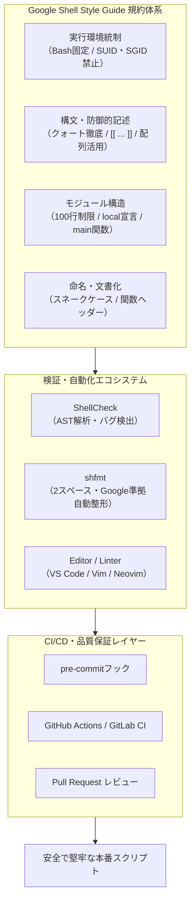

# **Google Shell Style Guide 調査レポート**

## **1. 基本情報**

* **ツール名**: Google Shell Style Guide
* **ツールの読み方**: グーグル シェル スタイル ガイド
* **開発元**: Google (Google LLC)
* **公式サイト**: [Google Shell Style Guide](https://google.github.io/styleguide/shellguide.html)
* **関連リンク**:
  * GitHub: [google/styleguide](https://github.com/google/styleguide)
  * ドキュメント: [Google Style Guides Index](https://google.github.io/styleguide/)
* **カテゴリ**: コード品質/静的解析
* **概要**: Google Shell Style Guideは、Google社内で策定・運用され、オープンソースとして一般公開されているBashシェルスクリプト専門の公式コーディング規約である。シェルスクリプト特有の未引用変数展開やパス名展開、サブシェルによる変数値の喪失といった深刻なバグやセキュリティリスクを未然に防ぎ、チーム開発におけるコードの可読性と保守性を最大化するための実践的な設計規範を体系的に提示している。

## **2. 目的と主な利用シーン**

* **解決する課題**:
  * シェルスクリプトにおける未引用展開（Word Splitting / Globbing）や不正な引数処理に起因する予期せぬデータ破壊や脆弱性の排除
  * チームやプロジェクト間における記述スタイルの不統一と、それに伴うコードレビューコストの増大
  * 複雑化・肥大化したスクリプトの保守限界を見極める明確な言語移行基準（「100行ルール」など）の欠如
  * 静的解析ツール（ShellCheck）やフォーマッター（shfmt）導入時のルール選定における議論の長期化
* **想定利用者**:
  * SRE / インフラエンジニア
  * DevOpsエンジニア / CI/CDパイプライン設計者
  * システム管理者およびバックエンドエンジニア
  * オープンソースプロジェクトのメンテナー
* **利用シーン**:
  * 組織・リポジトリ共通のシェルスクリプトコーディング規約の策定
  * Dockerコンテナのエントリポイントやビルド用フックスクリプトの実装標準化
  * CI/CD自動テスト環境へのShellCheck / shfmt組み込み時の準拠規範
  * 既存シェルスクリプトの安全性検証およびPython/Go等へのリファクタリング計画策定

### **2.1 代表的な利用フロー**

```mermaid
swimlane-beta TB
  subgraph Dev["開発者"]
    A["スクリプト新規作成・改修"]
    E["指摘箇所の修正・リファクタリング"]
  end
  subgraph Guide["スタイルガイド規範"]
    B["Bash前提・クォート徹底・関数化"]
  end
  subgraph Tooling["静的検証・整形ツール"]
    C["ShellCheck静的解析・shfmt整形"]
  end
  subgraph Review["CI・コードレビュー"]
    D["PR検証・構文違反チェック"]
    F["マージ・本番環境デプロイ"]
  end
  A --> B
  B --> C
  C --> D
  D --> E
  E --> C
  D --> F
```

* **代表的な流れ**: 開発者がGoogle Shell Style Guideの規範（Bash固定、引用符徹底、配列活用、`main`関数設計など）に従ってスクリプトを記述し、ローカルやCI環境でShellCheckやshfmtを用いて静的解析・自動整形を実行した上で、コードレビューを経て安全に本番環境やパイプラインへデプロイされる。

## **3. 主要機能**

* **実行環境のBash一本化（POSIX sh過剰適合の排除）**:
  実行可能スクリプトのシバン（Shebang）を `#!/bin/bash` に統一することを義務付け。過度なPOSIX sh互換性の追求や「bashisms」の回避を行わず、Bashの高機能かつ安全なビルトイン機能を積極的に活用することを推奨。

* **シェルの適用限界基準（100行ルールとDeshell推奨）**:
  スクリプトが100行を超える場合や複雑な制御フローを要する場合は、直ちにPythonやGoなどの構造化言語へ書き換えるべきという明確な指針を明示。Google社内の移行ガイド「Deshell Playbook」への参照を提供。

* **防御的クォーティング（Quoting）規約**:
  変数展開やコマンド置換、空白を含む文字列に対する厳格なダブルクォート引用を義務付け。例外としてシェル内部の整数変数（`$?`, `$#` など）の非クォート許容や、引数リストに対する `"$@"` の正確な利用法を規定。

* **高機能テスト構文 `[[ ... ]]` の採用**:
  従来の壊れやすい `test` や `[ ... ]` 構文を原則禁止とし、単語分割やパス名展開が発生しない `[[ ... ]]` 構文を採用。正規表現マッチング（`=~`）や文字列長判定（`-z`, `-n`）の明示的利用を標準化。

* **プロセス置換と配列（Arrays）による安全性担保**:
  パイプから `while` へのループ接続がサブシェルを生成し親プロセスの変数が更新されない問題を回避するため、プロセス置換 `< <(command)` や `readarray -t` の利用を義務付け。コマンド引数の組み立てには単一文字列ではなく配列を強制。

* **スコープ制御とエントリポイント設計（`local` と `main`）**:
  関数内での変数宣言には必ず `local` を付与し、グローバル名前空間の汚染を防止。1つ以上の関数を持つスクリプトには `main "$@"` を必須とし、実行エントリポイントを明確化。

* **算術演算の標準化（`(( ... ))`）**:
  非推奨な `expr` や `let`、`$[ ... ]` の使用を禁止し、組み込み算術構文 `(( ... ))` および `$(( ... ))` に一本化。`set -e` 環境における `(( i++ ))` の終了ステータス落とし穴への注意喚起も明記。

* **標準化されたコメントヘッダー**:
  ファイル概要ヘッダーおよび関数ごとのインターフェース仕様（Globals, Arguments, Outputs, Returns）を記載する統一フォーマットを策定。

* **ShellCheckプロジェクトとの公式統合**:
  規約ドキュメント内で公式に [ShellCheck](https://www.shellcheck.net/) を全スクリプトの必須静的解析ツールとして推奨。

## **4. 動作原理・システム構成**

Google Shell Style Guideは単体で動作するバイナリやコンパイラではなく、**実践的コーディング規約（ガイドライン文書）** と **外部エコシステムツール群（ShellCheck, shfmt, CI/CDランナー）** が密接に組み合わさることで品質保証システムとして機能する。



* **アーキテクチャ特性**:
  * **言語仕様の制約による安全性**: POSIX標準の最小共通項にとどまらず、Bash 4以降の機能（`readarray`、プロセス置換、連想配列等）を活用することで、シェル特有の未定義動作や脆弱性を言語機能レベルで抑制。
  * **明確なレイヤリング**: コアの記述作法（クォーティング、条件式）、スクリプト構造（ヘッダー、`main` 関数、関数配置）、運用の限界（100行でのDeshell移行）の3層構造で整理。
* **主要コンポーネントとデータフロー**:
  * **ソースコード**: 開発者がスタイルガイドに準拠したシェルスクリプト（`.sh`）を記述。
  * **静的解析**: ShellCheckが抽象構文木（AST）を走査し、未引用変数やサブシェル漏れ、構文の曖昧性を検出。
  * **コード整形**: `shfmt -i 2 -ci -bn -sr` が字下げやインデント幅、改行位置を規約通りに正規化。
* **特筆すべき要素技術・設計哲学**:
  * **Word SplittingとGlobbingの完全抑止**: パス名展開時の `-f` や `-r` などのファイル名誤解釈を防ぐため、ワイルドカードには `./*` の使用を義務付けるなど、ファイルシステム攻撃耐性を考慮。
  * **サブシェルのスコープ隔離への配慮**: パイプ処理における環境変数変更の揮発問題をプロセス置換によって解決し、メモリ・状態の不整合を根絶。

## **5. 開始手順・セットアップ**

Google Shell Style Guideをプロジェクトやチームに導入し、開発環境をセットアップする手順は以下の通りである。

* **前提条件**:
  * 実行環境: Bash 4.x / 5.x（Linux / macOS / WSL等）
  * 推奨ツール: ShellCheck、shfmt、pre-commit
  * アカウント作成: 不要（完全公開のオープンソース文書）

* **関連ツールのインストール**:

  ```bash
  # macOS (Homebrew)
  brew install shellcheck shfmt

  # Ubuntu / Debian
  sudo apt-get update && sudo apt-get install -y shellcheck
  # shfmtのインストール（Go環境がある場合）
  go install mvdan.cc/sh/v3/cmd/shfmt@latest
  ```

* **初期設定（`.shellcheckrc` およびフォーマット設定）**:
  プロジェクトルートに `.shellcheckrc` を配置し、Bashをデフォルトシェルとして明示する。

  ```ini
  # .shellcheckrc
  shell=bash
  enable=all
  ```

* **クイックスタート（規約に準拠した最小スクリプト例）**:

  ```bash
  #!/bin/bash
  #
  # Description:
  #   Sample utility adhering to the Google Shell Style Guide.

  set -euo pipefail

  #######################################
  # Print error message with timestamp to STDERR.
  # Arguments:
  #   Error message strings.
  # Outputs:
  #   Writes timestamped error to STDERR.
  #######################################
  err() {
    echo "[$(date +'%Y-%m-%dT%H:%M:%S%z')]: $*" >&2
  }

  #######################################
  # Main execution function.
  # Arguments:
  #   Script arguments.
  #######################################
  main() {
    local target_dir="${1:-.}"

    if [[ ! -d "${target_dir}" ]]; then
      err "Directory '${target_dir}' does not exist."
      return 1
    fi

    echo "Processing directory: ${target_dir}"
    return 0
  }

  main "$@"
  ```

  ```bash
  # 構文チェックとフォーマット実行
  shellcheck script.sh
  shfmt -i 2 -ci -bn -sr -w script.sh
  ```

## **6. 特徴・強み (Pros)**

* **巨大インフラでの実戦経験に基づく高い実効性**:
  世界最大規模のサーバー群を運用するGoogle社内の膨大なトラブル事例から抽出されたノウハウであり、極めて現実的で防御的な設計になっている。
* **シェルの致命的バグに対する先回り防止策**:
  `local var="$(cmd)"` による戻り値消失や、パイプライン内の変数揮発、ワイルドカード展開によるオプション誤認など、ベテランでも見落としがちなシェルの落とし穴に対する明確な解法が提示されている。
* **Good/Badの対比コードによる高い可読性と学習効率**:
  ほぼすべての規則に「推奨される書き方（Good）」と「避けるべき書き方（Bad）」の短い具体例が併記されており、開発者が直感的に理解しやすい。
* **「100行ルール」による過度なシェル依存の抑止**:
  シェルスクリプトを「何でもできる言語」として乱用させず、100行を超えたら速やかに汎用言語へ切り替える基準を定めているため、技術的負債の増殖を構造的に防止できる。
* **現代のCI/CDツールとの親和性**:
  静的解析ツール「ShellCheck」や整形ツール「shfmt」の標準ルールと極めて整合性が高く、CI環境での自動化が容易。

## **7. 弱み・注意点 (Cons)**

* **Bash非搭載環境（Alpine LinuxやPOSIX厳格環境）への不適合**:
  `#!/bin/bash` を前提とし、Bash専用構文（`[[ ... ]]`, 配列, プロセス置換等）を多用するため、軽量コンテナ（BusyBox `ash`）や組み込みLinux（`dash`）環境ではそのまま実行できない。
* **文書規約単独では強制力がない**:
  LinterやFormatterのような実行可能ソフトウェアではないため、チーム内で徹底するにはCIパイプラインやpre-commitフックでShellCheckやshfmtを別途構成する必要がある。
* **日本語公式ドキュメントが存在しない**:
  Google公式ドキュメントは英語のみで提供されている（有志による技術ブログや解説記事は多数存在するが、最新の改訂内容を追従するには公式リポジトリの英語原文を参照する必要がある）。
* **厳格な文字数・インデント制限に対する好みの差**:
  1行80文字制限や2スペースインデントなど、現代のワイドディスプレイ環境やチームの既存ポリシー（4スペース派など）によっては調整が必要となる場合がある。

## **8. 料金プラン**

Google Shell Style Guideはオープンソース（CC-BY 3.0 / Apache 2.0等に準拠したオープンライセンス）としてGitHub上で無償公開されており、商用・非商用を問わず完全無料で利用できる。

| プラン / 利用形態 | 料金 | 主な特徴 / 利用範囲 |
|:---|:---:|:---|
| **パブリックオープンアクセス** | **無料** | Webドキュメントの閲覧、ローカルダウンロード、社内規約への引用・改変利用が無制限で可能 |

* **課金体系**: 課金要素なし（完全無料のオープンナレッジ）
* **無料トライアル**: 該当なし

## **9. 導入実績・事例**

* **導入企業 / プロジェクト**:
  * **Google**: 社内インフラ、Google Cloud管理スクリプト、Chromium、Androidビルドスクリプト等
  * **オープンソースエコシステム**: Kubernetes、TensorFlow、Bazel関連ツール、Kubeflowなどの主要OSSリポジトリ
  * **国内外のエンタープライズ / Web企業**: メルカリ、サイバーエージェント、LINEヤフーなどのクラウド・SRE組織において、社内標準シェル規約のベースとして広く参照されている
* **導入事例・効果**:
  * CI/CDパイプライン内の複雑なデプロイスクリプトにおける予期せぬ単語分割・glob展開バグの撲滅
  * コードレビュー時の記法論争の解消と、レビュー工数の大幅削減
  * 巨大化したシェルスクリプトの棚卸しと、Go/Python言語への円滑な移行判断基準の確立
* **対象業界**:
  * クラウドサービス事業者、SaaS企業、通信・金融インフラ、大規模Webサービス開発

## **10. サポート体制**

* **ドキュメント**:
  * 公式Webサイト: [Google Shell Style Guide](https://google.github.io/styleguide/shellguide.html)
  * 各種言語版インデックス: [Google Style Guides Index](https://google.github.io/styleguide/)
* **コミュニティ**:
  * GitHub Issues / Pull Requests: [google/styleguide Issues](https://github.com/google/styleguide/issues)（誤字脱字や仕様明確化に関するPRが活発に議論されている）
  * Stack Overflow / Reddit: Googleスタイルに関するQ&Aが膨大に蓄積
* **公式サポート**:
  * SLA付きの個別商用サポートは存在しない（Googleエンジニアおよびコミュニティ有志によるGitHub上でのメンテナンス）

## **11. エコシステムと連携**

### **11.1 API・外部サービス連携**

* **静的解析・CIツール連携**:
  * **ShellCheck**: スタイルガイドで推奨されるルールの大部分を自動検知可能
  * **shfmt**: `-i 2 -ci -bn -sr` オプションを指定することで、Googleスタイルにほぼ準拠した自動整形が可能
  * **pre-commit**: Gitのコミット前フックとしてShellCheck / shfmtを連携実行
  * **GitHub Actions / GitLab CI**: PR作成時に自動でスタイル違反をチェックするワークフローの構築
* **IDE・エディタ拡張**:
  * **Visual Studio Code**: `shellcheck` 拡張機能、`shfmt` 拡張機能
  * **JetBrains IDE**: 内蔵のShell Scriptインスペクションおよびプラグイン連携
  * **Neovim / Vim**: `null-ls`、`conform.nvim`、`ALE` 等を用いた自動フォーマット・Lint

### **11.2 技術スタックとの相性**

| 技術スタック | 相性 | メリット・推奨理由 | 懸念点・注意点 |
|:---|:---:|:---|:---|
| **Bash 4.x / 5.x** | ◎ | ガイドが前提とする全機能（配列、プロセス置換、readarray）をフル活用可能 | 特になし |
| **ShellCheck** | ◎ | スタイルガイドで推奨されている静的チェックを完全に自動化可能 | 一部プロジェクト固有ルールは除外設定が必要 |
| **shfmt** | ◎ | 2スペースインデントや改行ルールの自動整形が高速に動作 | 完全な1対1対応ではないため一部微調整が必要 |
| **Python / Go** | ◎ | 100行を超えるスクリプトの移行先言語として最適（Deshell推進） | 移行に伴うリライト工数が発生 |
| **BusyBox / ash (Alpine)** | △ | 軽量コンテナ環境で標準のシェルだが、bashismsがエラーになる | `apk add bash` でBashをインストールする必要あり |
| **POSIX sh / dash** | × | `[[ ... ]]` や配列などの機能がサポートされておらず動作不能 | POSIX限定環境では利用不可 |

## **12. セキュリティとコンプライアンス**

* **SUID / SGID の厳格な禁止**:
  シェルスクリプトへのSUID/SGIDビット付与は、環境変数やシバン評価の脆弱性に起因する権限昇格リスクが極めて高いため、明示的に禁止。権限昇格が必要な場合は `sudo` を使用することを義務付け。
* **コマンドインジェクション・単語分割攻撃の防止**:
  * 変数展開の引用符（`"${var}"`）徹底により、スペースや特殊文字を含む入力による引数の意図しない分割を防止。
  * `eval` の全面的な使用禁止により、動的コード実行に伴うセキュリティホールを根本から排除。
* **ワイルドカード展開（Globbing）攻撃対策**:
  ファイル名がハイフンで始まる場合（例: `-rf` や `-f` という名前のファイル）にコマンドのオプションとして誤認識される事故を防ぐため、ワイルドカード展開には `./*` を強制。
* **ログ出力とSTDERRの明確な分離**:
  機密情報やエラーメッセージが標準出力（STDOUT）に混入してパイプライン後続処理に悪影響を与えるのを防ぐため、すべてのエラー出力は `>&2` を通じてSTDERRに出力することを徹底。

## **13. 操作性 (UI/UX) と学習コスト**

* **UI/UX**:
  * 単一のWebページ（HTML）およびMarkdownファイルで構成されており、ブラウザのページ内検索や目次ナビゲーションで瞬時に該当規則へアクセス可能。
  * 2026年秋のアップデートにより、GoodコードとBadコードが視覚的に明確に区別されるスタイリングが導入され、可読性が向上している。
* **学習コスト**:
  * シェルスクリプトの基礎知識があるエンジニアであれば、30分〜1時間程度で全条項を通読可能。
  * 「なぜこの書き方をすべきなのか」の理由（Rationale）が丁寧に解説されているため、単なる暗記ではなくBashの内部動作の深い理解につながる。

## **14. ベストプラクティス**

* **効果的な活用法 (Modern Practices)**:
  * **テンプレートの社内リポジトリ共有**: 規約に準拠したShebang、`err()`、`main()` を含むスケルトンファイルを共有し、新規作成時の手間を削減。
  * **CIでのShellCheck + shfmt自動実行**: コミット時に自動でLintとFormatを走らせ、レビュアーがスタイルの指摘をする無駄をゼロにする。
  * **早期の「Deshell」判断**: パイプ処理が複雑になったり、連想配列やデータ構造の操作が増えた段階で、躊躇せずにPythonやGoへのリライトを実施する。
* **陥りやすい罠 (Antipatterns)**:
  * **`local var="$(command)"` による終了コード握りつぶし**:
    `local` 宣言とコマンド置換代入を同一行で行うと、`$?` が `local` コマンド自体の終了コード（常に0）になってしまい、`command` のエラー検知が不可能になる。必ず宣言と代入を別行に分けること。
  * **`(( i++ ))` のゼロ評価による `set -e` 異常終了**:
    `i=0` の状態で `(( i++ ))` を実行すると式全体の評価値が0となり、Bashはこれを非ゼロ終了コードとみなして `set -e` 設定下でスクリプトが即座に異常終了する。`(( i += 1 ))` を使うか、インクリメント時の終了コード判定に注意すること。
  * **パイプライン内での変数代入**:
    `cat file | while read -r line; do count=$((count + 1)); done` はサブシェルで実行されるため、ループ終了後に `count` の値は元のままとなる。プロセス置換 `while ... done < <(cat file)` を用いること。

## **15. ユーザーの声（レビュー分析）**

* **調査対象**:
  * GitHub Issues / Discussions (google/styleguide)
  * 技術コミュニティ（Reddit r/bash, Hacker News, Qiita, Zenn, Hatena Bookmark）
* **総合評価**:
  * 推定評価: **4.6 / 5.0**（シェルスクリプト規約の世界的デファクトスタンダードとして圧倒的な支持）
* **ポジティブな評価**:
  * 「シェルスクリプトで経験するほとんどすべての『謎のバグ』がなぜ起こるのか、どう書けば防げるのかが完璧に言語化されている」
  * 「チーム内で『シェルスクリプトはGoogleスタイルに従う』と合意するだけで、不毛なコードレビューの議論が完全に消滅した」
  * 「『100行を超えたら他言語に書き直す』という明確な逃げ道が提示されているため、保守困難な巨大スクリプトの発生を未然に防げる」
* **ネガティブな評価 / 改善要望**:
  * 「Bash専用に割り切っているため、Alpine LinuxなどのBusyBox環境で動かすスクリプトにはそのまま適用できないのが惜しい」
  * 「1行80文字制限は、長くなりがちなパイプラインやURLを扱う際にやや窮屈に感じる」
  * 「関数の名前空間（`mypackage::func`）がBashの標準タブ補完でうまく機能しないケースがある」
* **特徴的なユースケース**:
  * KubernetesやDockerコンテナ起動時のエントリーポイントスクリプトにおける堅牢性向上
  * GitフックやCI/CDパイプラインの前処理・後処理スクリプトの品質標準化

## **16. 直近半年のアップデート情報**

* **2026-11-03**:
  `TODO` コメント記法におけるプレースホルダー例の標準化（`mrmonkey` から汎用的な `username` への更新）。
* **2026-10-23**:
  ガイド全体のフォーマット調整および長文行の折り返しルールの整理による可読性向上。
* **2026-10-13**:
  ドキュメント内の推奨コード（Good）と非推奨コード（Bad）に対する専用スタイルクラス（`goodcode` / `badcode`）の導入。
* **2026-10-05**:
  マークダウンヘッダーのホワイトスペース正規化およびアンカーリンクの安定性向上。
* **2026-09-24**:
  Google社内ガイド最新版の大規模同期エクスポート。関数名前空間（`::`）の推奨と対話補完時の注意点、`(( ... ))` のゼロ評価と `set -e` の相互作用に関する注意喚起、Bash FAQリンクのHTTPS化などを反映。

(出典: [google/styleguide Commits History](https://github.com/google/styleguide/commits/gh-pages))

## **17. 類似ツールとの比較**

### **17.1 機能比較表 (星取表)**

| 機能カテゴリ | 評価項目 | Google Shell Style Guide | ShellCheck | shfmt | bashate |
|:---:|:---|:---:|:---:|:---:|:---:|
| **基本特性** | ツール種別 | スタイル規約（文書）<br><small>設計指針・ベストプラクティス</small> | 静的解析Linter<br><small>Haskell製AST解析ツール</small> | コードフォーマッター<br><small>Go製自動整形ツール</small> | スタイルチェッカー<br><small>Python製PEP8風Linter</small> |
| **自動化** | 自動検証・CI組み込み | △<br><small>単体不可（ツール併用要）</small> | ◎<br><small>CLI・CI・エディタ連携が完備</small> | ◎<br><small>ワンコマンドで自動整形</small> | ◯<br><small>CLIによる違反検出</small> |
| **品質・安全性** | 落とし穴・バグの網羅性 | ◎<br><small>クォート・サブシェル等を網羅</small> | ◎<br><small>数百種の警告ルールを搭載</small> | △<br><small>主にレイアウト・インデント</small> | ◯<br><small>OpenStack規約に基づく</small> |
| **柔軟性** | POSIX sh / 他シェル対応 | ×<br><small>Bashに特化</small> | ◎<br><small>sh / bash / dash / ksh対応</small> | ◎<br><small>POSIX / Bash / mksh対応</small> | △<br><small>Bash中心</small> |
| **学習効果** | 背景・設計思想の解説 | ◎<br><small>Good/Bad対比と理由が明記</small> | ◯<br><small>Wikiに詳細な解説あり</small> | ×<br><small>整形のみ</small> | △<br><small>ルール一覧のみ</small> |

### **17.2 詳細比較**

| ツール名 | 特徴 | 強み | 弱み | 選択肢となるケース |
|:---|:---|:---|:---|:---|
| **Google Shell Style Guide** | Google公式の包括的コーディング規約・設計指針 | 具体的で説得力のあるGood/Bad例と、100行制限など現実的な運用指針 | 文書規約であるため自動検証には他ツールとの併用が必須 | 組織・プロジェクトで統一されたシェルスクリプト規約を策定する場合 |
| **ShellCheck** | Haskellで実装されたデファクトスタンダードの静的解析ツール | 未引用変数や未定義動作をAST解析により高精度で自動検知 | コードスタイルの自動修正（フォーマット）機能は持たない | CI/CDやエディタでシェルスクリプトのバグを機械的に検知したい場合 |
| **shfmt** | Go言語で記述された高速なシェルスクリプトフォーマッター | 構文木に基づきインデントや改行を安全かつ確実に自動整形 | 意味的なバグやセキュリティ脆弱性の検知は行わない | インデントや空白ルールの手動修正コストをゼロにしたい場合 |
| **bashate** | OpenStackプロジェクト発の軽量なBashスタイルチェッカー | PEP8に類似したシンプルなルール体系で高速に動作 | ルール数が少なく、高度なAST解析やBash固有の安全検証は手薄 | OpenStack関連基盤や軽量なインデント検査を好む場合 |

## **18. 総評**

* **総合的な評価**:
  Google Shell Style Guideは、シェルスクリプト特有の落とし穴や危険性を体系的に排除し、安全でメンテナンス性の高いコードベースを維持するための業界最高峰のスタイルガイドである。Bashの強力な言語機能にフォーカスし、過剰なPOSIX互換性に拘泥しない実用的な割り切りと、100行を超えたら即座に汎用言語へ移行するという明確な撤退戦略が、多くの開発組織から高い評価を得ている。
* **推奨されるチームやプロジェクト**:
  * インフラ基盤やCI/CDパイプラインで多数のシェルスクリプトを保守しているSRE・DevOpsチーム
  * 開発者ごとにスクリプトの書き方がバラバラで、レビュー負荷や本番障害リスクに悩んでいる組織
  * Dockerfileのエントリポイントスクリプトの品質とセキュリティを標準化したいコンテナ開発チーム
* **選択時のポイント**:
  * スタイルガイド自体は「文書」であるため、**ShellCheck（静的解析）および shfmt（自動整形）と組み合わせてCIパイプラインで自動強制する体制** を構築することが導入成功の決定的な鍵となる。
  * Alpine LinuxなどのBusyBox ash環境で動作させる必要があるスクリプトについては、POSIX sh向けに一部ルール（`[[ ... ]]` や配列）を緩和・読み替えて適用する必要がある。
