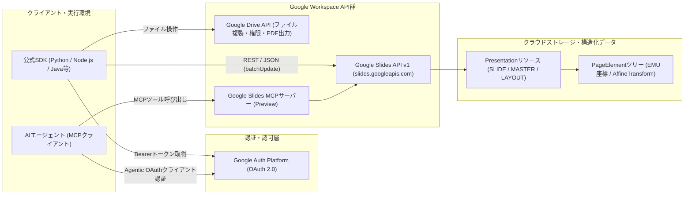

# **Google Slides API 調査レポート**

## **1. 基本情報**

* **ツール名**: Google Slides API
* **ツールの読み方**: グーグル スライズ エーピーアイ
* **開発元**: Google
* **公式サイト**: [https://developers.google.com/workspace/slides/api/reference/rest](https://developers.google.com/workspace/slides/api/reference/rest)
* **関連リンク**:
  * ドキュメント: [https://developers.google.com/workspace/slides/api/guides/overview](https://developers.google.com/workspace/slides/api/guides/overview)
  * リリースノート: [https://developers.google.com/workspace/slides/docs/release-notes](https://developers.google.com/workspace/slides/docs/release-notes)
  * 製品ページ（Google スライド）: [https://workspace.google.com/products/slides/](https://workspace.google.com/products/slides/)
* **カテゴリ**: スライド/プレゼンテーション
* **概要**: Google スライドのプレゼンテーションをプログラムから作成、読み取り、編集、書式設定するための公式REST API（v1）です。単一のHTTPリクエストで複数の変更を原子的に適用する `batchUpdate` メソッドを中核とし、データベースやGoogle スプレッドシートのデータを用いた定型レポートの自動生成から、2026年に導入されたModel Context Protocol（MCP）サーバーを通じたAIエージェント連携まで幅広く活用されています。

## **2. 目的と主な利用シーン**

* **解決する課題**: 営業提案資料、定期レポート、カタログなどのプレゼンテーション作成における手作業でのデータ転記・レイアウト調整の負荷を解消し、最新データに基づく正確なスライド生成とレビュー管理を自動化する。
* **想定利用者**: バックエンド開発者、データエンジニア、業務システム担当者、Google Workspace管理者、AIエージェント開発者
* **利用シーン**:
  * **データ駆動の定型レポート自動生成**: BigQueryやGoogle スプレッドシートの集計結果をテンプレート内のプレースホルダーに差し込み、週次・月次の経営報告やBIレポートを自動作成する。
  * **顧客別提案書・カタログの量産**: CRMや商品データベースの情報をもとに、顧客ごとにパーソナライズされた提案資料や物件・商品カタログをオンデマンドで生成する。
  * **AIエージェントによるスライド編集・レビュー**: LLMやMCPクライアントがスライドの内容を読み取り、スピーカーノートの要約、レイアウト調整、コメントの自動投稿・解決を行う。

### **2.1 代表的な利用フロー**

```mermaid
swimlane-beta TB
  subgraph User["利用者・ビジネスチーム"]
    A["元データ・テンプレートを準備"]
    F["Google スライド上で最終確認・共有"]
  end
  subgraph App["連携アプリ・AIエージェント"]
    B["OAuth 2.0でアクセストークン取得"]
    C["Google Drive APIでテンプレート複製"]
    D["batchUpdateペイロードを構築・送信"]
  end
  subgraph GoogleAPI["Google Slides API"]
    E["プレゼンテーションを原子的に一括更新"]
  end
  A --> B
  B --> C
  C --> D
  D --> E
  E --> F
```

* **代表的な流れ**: 利用者が元データとスライドテンプレートを用意すると、連携アプリまたはAIエージェントがOAuth 2.0認証を経てGoogle Drive APIでテンプレートを複製し、Google Slides APIの `batchUpdate` へ更新命令を一括送信します。Google Slides APIがクラウド上で変更を原子的に反映した後、利用者はブラウザ上で即座に共同編集や確認を行えます。

## **3. 主要機能**

* **プレゼンテーションの作成と構造取得 (`presentations.create` / `get`)**: 新規の空プレゼンテーションを作成し、スライド・マスター・レイアウト・ページ要素を含む完全なJSONツリー構造を取得できます。
* **原子的バッチ更新 (`presentations.batchUpdate`)**: スライド追加、テキスト挿入、図形作成、スタイル変更などの複数操作を1つのリクエスト配列にまとめ、すべて成功するかすべてロールバックされるトランザクションとして実行します。
* **テンプレート差し込み置換 (`replaceAllText` / `replaceAllShapesWithImage`)**: スライド上の `{{COMPANY_LOGO}}` のようなプレースホルダーテキストや指定図形を、動的テキストやURL指定の画像へ一括置換できます。
* **精密なページ要素操作 (`PageElement`)**: テキストボックス・図形（`SHAPE`）、画像（`IMAGE`）、表（`TABLE`）、線（`LINE`）、動画（`VIDEO`）、グループ（`GROUP`）の作成・削除・移動・回転を制御できます。
* **Google スプレッドシートグラフ連携 (`createSheetsChart`)**: Google スプレッドシート上のグラフをスライドにリンク付きで埋め込み、元データ更新時にAPI経由で最新状態へ同期できます。
* **サムネイル画像の生成 (`presentations.pages.getThumbnail`)**: 指定したスライドページのPNGサムネイル画像URLを生成し、Webアプリ上のプレビュー表示などに利用できます。
* **コメント・提案のプログラム管理 (`InsertCommentRequest` 等)**: 2026年9月に正式リリース（GA）された機能により、スライド上のコメントスレッドやアンカーの読み取り、返信、解決・再開、削除をAPIから実行できます。
* **Model Context Protocol (MCP) サーバー連携（Developer Preview）**: 2026年7月より提供開始された公式MCPサーバーにより、`read_presentation` や `update_presentation` などのツールを通じてAIエージェントが標準プロトコルでスライドを操作できます。

## **4. 動作原理・システム構成**

* **アーキテクチャ**: Google CloudおよびGoogle Workspaceインフラストラクチャ上で稼働する完全クラウド完結型（RESTful SaaS API）です。クライアントはHTTPS経由でエンドポイント（`https://slides.googleapis.com/v1/`）と通信し、ファイル管理（コピー、権限付与、PDFエクスポート等）はGoogle Drive APIと役割分担する構成をとります。



* **主要コンポーネントとデータフロー**:
  * **階層型リソースモデル**: 最上位の `Presentation` リソース（`presentationId` で識別）の下に、`SLIDE`、`MASTER`、`LAYOUT`、`NOTES_PAGE` などの `Page` リソースが存在し、各ページ上に一意の `objectId` を持つ `PageElement` が配置されます。
  * **EMU（English Metric Units）単位系**: 要素のサイズや位置はピクセルではなくEMUで厳密に定義されます（1ポイント = 12,700 EMU、1インチ = 914,400 EMU、1センチメートル = 360,000 EMU）。
  * **2Dアフィン変換（`AffineTransform`）**: 要素の位置・拡大縮小・傾き・回転は変換行列（`scaleX`, `scaleY`, `shearX`, `shearY`, `translateX`, `translateY`）で管理され、絶対指定（`ABSOLUTE`）または現在位置からの相対指定（`RELATIVE`）で更新します。
* **特筆すべき要素技術**:
  * **クライアント生成IDによる参照**: `batchUpdate` 内で要素を作成する際、クライアント側で一意の `objectId` を事前指定できるため、同一バッチ内の後続リクエストでその要素を即座に参照・装飾できます。
  * **楽観的ロック（`WriteControl`）**: `requiredRevisionId` を指定することで、他ユーザーや別プロセスによる同時編集との競合を検知し、意図しない上書きを防止します。

## **5. 開始手順・セットアップ**

* **前提条件**:
  * Google アカウントおよび Google Cloud プロジェクト
  * Python（3.10以降推奨）または Node.js（18以降推奨）などの実行環境
  * API利用自体は無料のため、標準クォータ内の検証ではクレジットカード登録は原則不要（Google Cloud課金アカウントの紐付けはクォータ管理や上限引き上げ時に推奨）
* **インストール/導入**:
  * Google Cloud Console で「Google Slides API」を有効化し、OAuth同意画面を設定してクライアント認証情報（`credentials.json`）をダウンロードします。
  * Python向け公式クライアントライブラリをインストールします。

  ```bash
  pip install --upgrade google-api-python-client google-auth-httplib2 google-auth-oauthlib
  ```

* **初期設定**:
  * OAuth 2.0 スコープ（読み取り専用の `https://www.googleapis.com/auth/presentations.readonly`、または編集可能な `https://www.googleapis.com/auth/presentations`）を指定し、認証フローを通じてアクセストークンを取得します。サーバー間自動処理の場合はサービスアカウントを作成し、対象のGoogle スライドファイルをサービスアカウントのメールアドレスに共有します。
* **クイックスタート**:
  * 公式Pythonクイックスタートに基づき、サンプルプレゼンテーションのスライド枚数を取得する最小コード例は以下の通りです（`<YOUR_PRESENTATION_ID>` は対象スライドIDに置き換えてください）。

  ```python
  from google.oauth2.credentials import Credentials
  from googleapiclient.discovery import build

  SCOPES = ["https://www.googleapis.com/auth/presentations.readonly"]
  creds = Credentials.from_authorized_user_file("token.json", SCOPES)
  service = build("slides", "v1", credentials=creds)

  presentation = service.presentations().get(
      presentationId="<YOUR_PRESENTATION_ID>"
  ).execute()
  slides = presentation.get("slides", [])
  print(f"スライド枚数: {len(slides)}")
  ```

## **6. 特徴・強み (Pros)**

* **Google Workspaceとのネイティブな統合性**: 生成したスライドは即座にGoogle ドライブ上で管理・共有され、複数人でのリアルタイム共同編集、バージョン履歴管理、Google Meetでの発表にそのまま移行できます。
* **単一トランザクションでの一貫した一括更新**: `batchUpdate` により数十〜数百の要素追加やスタイル変更を1回のAPIコールで原子的に実行でき、部分的な更新失敗によるレイアウト崩壊を防げます。
* **高いコストパフォーマンス**: 標準クォータ内であればAPI利用料が完全に無料であり、商用SaaSや社内自動化基盤への組み込みコストを抑えられます。
* **AIエージェント時代への先行対応**: 2026年に導入された公式MCPサーバーとコメント管理APIにより、AIエージェントが人間のチームメンバーと同様にスライドを読み書き・レビューするワークフローを公式サポートしています。

## **7. 弱み・注意点 (Cons)**

* **レイアウト構築の高い学習コスト**: HTML/CSSやMarkdownのような自動折り返し・レスポンシブ配置はなく、座標やサイズをEMU単位の数値と `AffineTransform` 行列で計算・指定する必要があるため、ゼロから複雑なデザインを組む難易度は高めです。
* **テンプレート変更への脆弱性**: 既存のテンプレートをUI上で編集してテキストボックスやプレースホルダーのIDが意図せず変わると、API側の置換処理が失敗・位置ズレを起こしやすくなります。
* **厳格なレート制限（クォータ）**: 書き込みリクエストはプロジェクト単位・ユーザー単位で毎分の上限が設定されており、大量のプレゼンテーションを並列生成すると `HTTP 429` エラーが発生するため、指数バックオフ（Exponential Backoff）によるリトライ実装が不可欠です。
* **日本語対応の状況**: APIが扱うテキストデータ自体は日本語（UTF-8）や日本語フォントに完全対応していますが、開発者向けドキュメントの一部や最新のリリースノート・MCP関連ガイドは英語が先行して公開されます。

## **8. 料金プラン**

Google Slides API 自体は Google Cloud の標準APIとして提供されており、標準のレート制限（クォータ）の範囲内であれば追加料金なしで利用できます。

| プラン・利用形態 | 料金 | 主な特徴・クォータ制限 |
|---------|------|---------|
| **Google Slides API（標準利用）** | 無料 | 読み取り: 3,000回/分（プロジェクト）・600回/分（ユーザー）<br>サムネイル取得: 300回/分（プロジェクト）・60回/分（ユーザー）<br>書き込み: 600回/分（プロジェクト）・60回/分（ユーザー） |
| **Google Workspace（個人向け無料版）** | 無料 | 個人のGoogleアカウントでGoogle スライドおよびAPI検証が可能 |
| **Google Workspace（Business / Enterprise）** | 有料プランに準拠 | 組織管理、高度なセキュリティ統制、共有ドライブ連携などWorkspace契約内で利用可能 |

* **課金体系**: APIリクエストごとの従量課金は設定されておらず、クォータ上限内での1日あたりの総リクエスト数にも固定の上限はありません（Google Cloud Consoleの「IAMと管理 > 割り当て」から上限引き上げ申請が可能）。
* **無料トライアル**: Google アカウントがあれば即座に無料で開発・検証を開始できます。

## **9. 導入実績・事例**

* **導入企業**: Adobe、Equifax、Wayfair などのグローバル企業（Google Workspace導入企業として公開）
* **導入事例**:
  * **Adobe**: Google Workspace Add-onおよびAPI連携を通じて、Gmail、Google ドキュメント、Google スライド上でブランドデザイン、ロゴ、フォントを直接共有・挿入できるワークフローを構築し、チームの生産性を大幅に向上させました。
  * **公式BIレポート自動化事例（BigQuery連携）**: Google公式Codelabでも紹介されている通り、BigQueryの大規模データ分析結果をプログラムでGoogle スライドのグラフや表へ自動出力する構成が、データ分析チームやマーケティング部門で広く採用されています。
* **対象業界**: IT・ソフトウェア、不動産・小売（物件・商品カタログの自動生成）、教育（教材配布）、コンサルティング・マーケティング（定期レポート自動化）など、多岐にわたる業界で利用されています。

## **10. サポート体制**

* **ドキュメント**: [公式開発者ドキュメント](https://developers.google.com/workspace/slides/api/guides/overview)にて、RESTリファレンス、主要言語のクイックスタート、概念ガイド（EMU・変換行列・フィールドマスク等）、Codelabが体系的に整備されています。
* **コミュニティ**: [Google Slides API サポートページ](https://developers.google.com/workspace/slides/api/support)にて、Stack Overflow（`google-slides-api` タグ）での技術Q&AやGoogle Issue Trackerでのバグ報告・機能要望窓口が案内されています。
* **公式サポート**: Google Workspace の有償プラン契約企業や Google Cloud サポート契約企業は、公式の技術サポート窓口（チャット・メール・チケット、日本語対応可）を利用できます。

## **11. エコシステムと連携**

### **11.1 API・外部サービス連携**

* **API**: REST API（v1）および Discovery Service に対応し、JSON形式での入出力を提供します。ファイル作成時のフォルダ配置やPDF/PPTX形式へのエクスポートには Google Drive API を併用します。
* **外部サービス連携**:
  * **Google Apps Script (`SlidesApp` / Advanced Slides Service)**: サーバー構築不要でGoogle スライドのアドオンやスプレッドシート連携スクリプトを記述できます。
  * **Google スプレッドシート / BigQuery**: 集計データのスライド自動反映やリンク付きグラフの埋め込みが可能です。
  * **iPaaS・自動化ツール**: Zapier、Make、n8n などのノーコード連携基盤にも標準コネクタが用意されています。
  * **AIエージェント / MCPクライアント**: 公式の Google Slides MCP サーバーを介して、Claude や Gemini などのLLMエージェントと直接連携できます。

### **11.2 技術スタックとの相性**

| 技術スタック | 相性 | メリット・推奨理由 | 懸念点・注意点 |
|:---|:---:|:---|:---|
| **Python** | ◎ | 公式ライブラリ（`google-api-python-client`）と認証SDKが充実し、データ分析基盤（Pandas/BigQuery）と直結しやすい | 同期HTTPクライアントが標準のため、高並列処理ではリトライ・クォータ制御の設計が必要 |
| **Node.js / TypeScript** | ◎ | 公式 `googleapis` パッケージにより型定義付きの非同期呼び出しが可能で、Webバックエンドと親和性が高い | `batchUpdate` のネストしたJSON型定義がやや冗長になりやすい |
| **Java / Kotlin** | ◎ | 公式 `google-api-services-slides` ライブラリが提供されており、エンタープライズシステムへの組み込みが容易 | Gradle/Maven依存関係とOAuthトークン管理の初期設定がやや重い |
| **Go** | ◯ | 公式 `google.golang.org/api/slides/v1` パッケージが提供されており、軽量なCLIやマイクロサービスに適している | 公式クイックスタートのドキュメントはPython/Node.jsに比べ簡素 |
| **フロントエンドSPA (ブラウザ直呼び)** | △ | Google Identity Servicesと組み合わせてクライアントサイドから呼び出し可能 | クライアントID・スコープ管理やCORS、ユーザーごとのOAuth同意画面設計が複雑 |

## **12. セキュリティとコンプライアンス**

* **認証**: OAuth 2.0 およびサービスアカウント認証に対応しています。最小権限の原則に基づき、読み取り専用（`presentations.readonly`）やアプリが作成したファイルのみにアクセスを限定するDriveスコープ（`drive.file`）を選択できます。また、2026年10月の仕様変更により、MCPサーバーを呼び出すOAuthクライアントには「AI-powered agent」指定が必須化されました。
* **データ管理**: Google Cloud / Google Workspace のインフラ上で保存時・通信時ともに暗号化されます。Enterpriseプラン等ではデータリージョン指定（EU等）や Access Transparency（アクセス透明性ログ）を利用できます。
* **準拠規格**: Google Workspace および基盤となる Google Cloud は、**ISO/IEC 27001**、**ISO/IEC 27017**、**ISO/IEC 27018**、**SOC 2 Type II**、**SOC 3** を取得し、**GDPR** 対応のDPA（データ処理追加条項）を提供しています。日本国内向けには政府情報システムのためのセキュリティ評価制度である **ISMAP** にも登録されています。

## **13. 操作性 (UI/UX) と学習コスト**

* **UI/UX**: API自体はヘッドレスなRESTインターフェースであるためGUIはありませんが、生成結果は即座に直感的な Google スライドのWeb UI上で確認・手直しできます。また、API Explorer や Google Apps Script エディタを使えばブラウザ上ですぐに挙動を試せます。
* **学習コスト**: 既存のテンプレート内のテキストや画像を置換する用途（`replaceAllText` 等）は数時間で習得できます。一方、ゼロから動的な表・図形・カスタムレイアウトをプログラムで組み立てる場合は、`PageElement` の階層構造、EMU単位、アフィン変換、フィールドマスク（`fields`）の理解が必要となり、一定の学習コストがかかります。

## **14. ベストプラクティス**

* **効果的な活用法 (Modern Practices)**:
  * **テンプレート駆動設計**: APIで座標をゼロから計算するのではなく、デザイナーがGoogle スライドUI上で美しいテンプレートを作成し、API側は複製（Drive API）とプレースホルダー置換・画像差し込みに徹する構成が最も保守性に優れます。
  * **リクエストのバッチ化とフィールドマスクの活用**: 個別の変更ごとにAPIを呼ばず、1回の `batchUpdate` に複数の `requests` を束ねることでクォータ消費とレイテンシを大幅に削減できます。読み取り時も `fields` パラメータで必要なプロパティのみを取得します。
  * **指数バックオフの実装**: `HTTP 429` や一時的なサーバーエラーに備え、ジッター（揺らぎ）を伴う指数バックオフリトライを標準で組み込みます。
* **陥りやすい罠 (Antipatterns)**:
  * **過剰なOAuthスコープの要求**: 特定ファイルのみ操作すればよい場面で `drive` や `presentations` 全体へのフルアクセススコープを要求すると、公開アプリ審査（OAuth Verification）のハードルが大幅に上がります。
  * **ピクセル単位での直感的な指定**: スライド座標はピクセルではなくEMU単位であるため、単位変換を誤ると要素が極端に小さく描画されたり画面外に配置されたりします。

## **15. ユーザーの声（レビュー分析）**

* **調査対象**: Reddit（r/indiehackers 等）、Stack Overflow 等の開発者コミュニティ、および対象プロダクトである Google スライドの G2・Capterra レビュー
* **総合評価**: 4.5 / 5.0（Capterra・G2における Google スライド / Google Workspace の評価）
* **ポジティブな評価**:
  * 「Google スプレッドシートの集計データから定型プレゼンを自動生成する用途では、ワークスペース内で完結するため非常に強力」（開発者コミュニティより要約）
  * 「生成されたスライドをそのままチームメンバーとリアルタイムで共同編集・コメントできる点が、ローカルファイル生成ライブラリにはない大きな強み」（G2 / 開発者レビューより要約）
  * 「無料プランや既存のWorkspace契約のまま追加コストなしでAPI自動化を始められるコストパフォーマンスが優れている」（Capterraより要約）
* **ネガティブな評価 / 改善要望**:
  * 「`batchUpdate` の深くネストしたJSON構造や座標・変換行列を直接組み立ててカスタムレイアウトを作るのは非常に煩雑」（Redditより要約）
  * 「PowerPoint（`.pptx`）形式でエクスポートすると、複雑なフォントやレイアウトが微妙に崩れることがある」（G2・Capterraより要約）
  * 「書き込みクォータが1分あたり60回/ユーザーと厳しめなため、大量一括処理ではレート制限対策が必須になる」（開発者コミュニティより要約）
* **特徴的なユースケース**:
  * 毎月のクライアント向けマーケティングレポートやSaaSの利用状況サマリー（QBR）をBigQueryから自動生成し、営業担当者がGoogle スライド上で最終コメントを添えて共有するハイブリッド運用。

## **16. 直近半年のアップデート情報**

* **2026-10-12**: Google Slides Model Context Protocol (MCP) サーバーを呼び出すOAuth 2.0クライアントに対し、Google Auth Platform > Clients で「Use this client for an AI-powered agent」の選択が必須化されることを発表（2026年11月11日以降、未設定クライアントからのMCPリクエストは拒否）。
* **2026-10-01**: Google Slides MCPサーバー（Developer Preview）がプレゼンテーションコメントの読み取り・管理に対応（`read_presentation` / `read_slide_page` への `commentsIncluded` 追加、`update_presentation` でのコメント操作）。あわせて `read_slide_page`・`read_slide_page_thumbnail` ツールの追加、`read_presentation` への `fields` パラメータ対応、`update_presentation` への `writeControl` 対応を実施。
* **2026-09-30**: Google Slides API におけるプログラマティックなコメント管理機能が正式リリース（Generally Available）。`presentations.get` / `presentations.pages.get` の `commentsViewMode` や、`InsertCommentRequest`、`AddCommentReplyRequest`、`UpdateCommentPostRequest`、`DeleteCommentRequest`、`DeleteCommentReplyRequest` を提供。
* **2026-08-31**: Google Slides API のコメント管理機能を Developer Preview として公開。
* **2026-07-13**: AIアプリケーションやエージェントがプレゼンテーションの内容を安全に読み取り・更新できる **Google Slides Model Context Protocol (MCP) サーバー** を Developer Preview として公開。

(出典: [Google Slides API リリースノート](https://developers.google.com/workspace/slides/docs/release-notes))

## **17. 類似ツールとの比較**

### **17.1 機能比較表 (星取表)**

| 機能カテゴリ | 機能項目 | Google Slides API | Presenton | Gamma | python-pptx / PptxGenJS |
|:---:|:---|:---:|:---:|:---:|:---:|
| **基本機能** | プログラムによるスライド生成 | ◎<br><small>REST API / batchUpdateで精密制御</small> | ◎<br><small>API・テンプレートで自動生成</small> | ◯<br><small>Public REST API v1.0提供</small> | ◎<br><small>ローカルでPPTX構造を直接構築</small> |
| **基本機能** | AIによる構成・デザイン自動生成 | △<br><small>MCP連携可だがAPI自体は構造操作特化</small> | ◎<br><small>多様なLLM・画像生成モデル統合</small> | ◎<br><small>対話型AIエージェント・図解生成</small> | ×<br><small>AI機能なし（外部LLMと組合せ要）</small> |
| **出力・連携** | リアルタイム共同編集・コメント | ◎<br><small>Google スライド上で即座に共同編集</small> | △<br><small>ローカル編集・PPTX/PDF出力中心</small> | ◎<br><small>Web上で共同編集・コメント可</small> | ×<br><small>静的ファイル出力のみ</small> |
| **出力・連携** | オフライン・セルフホスト実行 | ×<br><small>Google Cloud完結型</small> | ◎<br><small>OSSで完全オフライン実行可</small> | ×<br><small>クラウドSaaS完結</small> | ◎<br><small>サーバー・ローカルで完結</small> |
| **エンタープライズ** | コンプライアンス・SSO認証 | ◎<br><small>ISO27001 / SOC2 / ISMAP / OAuth 2.0</small> | ◯<br><small>セルフホストで閉域運用可</small> | ◯<br><small>SOC 2 Type II・上位プランでSSO</small> | ◎<br><small>外部通信不要で社内環境に閉じる</small> |
| **非機能要件** | 導入コスト（API利用料） | ◎<br><small>標準クォータ内で無料</small> | ◎<br><small>OSS無料（LLM API費は別途）</small> | △<br><small>有料プラン・クレジット制</small> | ◎<br><small>OSS完全無料・クォータ制限なし</small> |

### **17.2 詳細比較**

| ツール名 | 特徴 | 強み | 弱み | 選択肢となるケース |
|---------|------|------|------|------------------|
| **Google Slides API** | Google Workspace標準のクラウドREST API | リアルタイム共同編集、Drive/Sheets連携、標準無料、公式MCP対応 | JSONペイロードが複雑、書き込みクォータ制限あり | - |
| **Presenton** | オープンソースのAIプレゼンテーション生成ツール | オフライン/ローカルLLM対応、PPTX/PDFテンプレート活用、API提供 | ベータ版でありセットアップや環境構築の手間がかかる | 機密データを外部クラウドに出さずAIでスライドを自動生成したい場合 |
| **Gamma** | 対話型AIエージェントと自由配置キャンバスを持つSaaS | デザイン品質と生成速度が非常に高く、Public APIとMCPも提供 | 継続利用に月額課金が必要、PPTX出力時の微調整が必要な場合あり | デザイナー不要で高品質なAI生成スライドを高速に量産したい場合 |
| **python-pptx / PptxGenJS** | PowerPoint（`.pptx`）を直接生成するOSSライブラリ | APIクォータや認証審査が不要、オフラインで高速に大量生成可能 | 共同編集機能がなく、レイアウト計算をすべてコードで書く必要がある | Microsoft PowerPoint形式のファイルを高速・大量にバッチ出力したい場合 |

## **18. 総評**

* **総合的な評価**:
  * Google Slides API は、Google Workspace エコシステムにおけるプレゼンテーション自動化の標準基盤として非常に完成度が高いAPIです。`batchUpdate` による原子的な更新や Google スプレッドシートとの連携に加え、2026年後半にはコメント管理APIの正式対応および公式MCPサーバーの提供が開始され、従来の定型帳票生成だけでなくAIエージェントとの協調ワークフローにも対応できる柔軟性を備えています。一方で、EMU単位やアフィン変換を扱う生JSONの記述は学習コストが高いため、UIで作ったテンプレートを複製して置換するアプローチが現実的です。
* **推奨されるチームやプロジェクト**:
  * すでに Google Workspace を日常的に利用しており、BigQueryやスプレッドシートのデータを週次・月次レポートとして自動生成し、そのままチームで共同編集したい企業や開発チームに最適です。また、社内データに基づくスライド作成・レビューをMCP経由でAIエージェントに委任したい開発プロジェクトにも推奨されます。
* **選択時のポイント**:
  * 「生成後にGoogle スライド上で人間が共同編集・確認するか」が最大の判断軸です。最終成果物として静的な `.pptx` ファイルの大量配布のみが目的であれば `python-pptx` や `PptxGenJS` の方がクォータ制限やOAuth審査がなくシンプルです。逆に、プロンプトからのゼロベースのデザイン生成を重視する場合は `Gamma` や `Presenton` が有力な代替候補となります。
