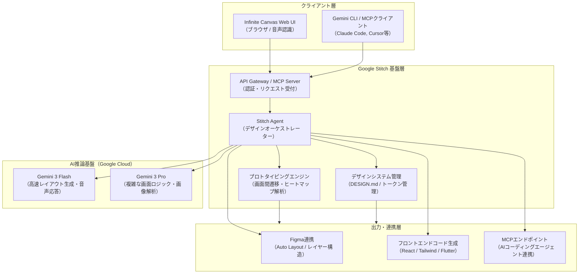

# **Google Stitch 調査レポート**

## **1. 基本情報**

<!--
【ガイドライン】
- 必須: ツール名、開発元、公式サイト、カテゴリ、概要
- 概要は2-3文で簡潔に記述
-->

* **ツール名**: Google Stitch (旧称: Galileo AI)
* **ツールの読み方**: グーグルステッチ
* **開発元**: Google (Google Labs)
* **公式サイト**: [https://stitch.withgoogle.com/](https://stitch.withgoogle.com/)
* **関連リンク**:
  * 公式サイト: [https://stitch.withgoogle.com/](https://stitch.withgoogle.com/)
  * Google Labs: [https://labs.google/](https://labs.google/)
  * Gemini CLI Extension: [https://github.com/gemini-cli-extensions/stitch](https://github.com/gemini-cli-extensions/stitch)
* **カテゴリ**: UI/UX/作図
* **概要**: Google Stitchは、Google Labsが開発・提供するAIネイティブなUI/UXデザインおよびプロトタイピングツールです。Gemini 3シリーズのマルチモーダル推論モデルをコアに据え、無限キャンバス（Infinite Canvas）上で自然言語・音声対話・画像から複数画面のレスポンシブUIを高速に生成します。さらに、Model Context Protocol（MCP）サーバーやGemini CLI拡張をサポートしており、Figmaへのエクスポートだけでなく、AIコーディングエージェントと直接連動したソフトウェア開発パイプラインを実現します。

## **2. 目的と主な利用シーン**

<!--
【ガイドライン】
- 3-5項目を箇条書きで記述
- 想定利用者を具体的に記載
- 末尾に「代表的な利用フロー」をスイムレーンで添付する
-->

* **解決する課題**:
  * アイデアから具体的な複数画面UIプロトタイプへの落とし込みにかかる時間・手間の大幅削減。
  * 専任デザイナーが不在の開発チームやPMによる、直感的な視覚化とモックアップ作成の民主化。
  * デザイン仕様（スタイルガイド、トークン、レイアウト）と実装コード（React、Tailwind、Flutter等）の断絶（Handoffギャップ）の解消。
  * AIコーディングエージェント（Antigravity、Cursor、Claude Code等）への構造化デザインデータの直接供給。
* **想定利用者**:
  * フロントエンドエンジニア / フルスタックエンジニア
  * UI/UXデザイナー / プロダクトデザイナー
  * プロダクトマネージャー（PM） / ディレクター / スタートアップ起業家
* **利用シーン**:
  * 新規事業・MVP（Minimum Viable Product）立ち上げやハッカソンにおける超高速プロトタイピング。
  * ホワイトボードの手書きワイヤーフレームや参考スクショを起点としたアプリ画面フローの自動設計。
  * 音声対話（Voice Canvas）を用いたリアルタイムな画面デザインレビューとバリエーション展開。
  * MCPサーバー経由でのAIエージェントへのデザイン連携とフロントエンドコンポーネントの自動生成。

### **2.1 代表的な利用フロー**

<!--
【ガイドライン】
- ツールを実際に使う際の代表的な流れを、アクター（ユーザー、AIエージェント、ツール、外部サービス等）ごとのスイムレーンで示す
- Mermaidの swimlane-beta を使用し、向きは TB（上から下）に固定する
- subgraph の表示名に記号を含める場合は必ず subgraph ID["表示名"] のように引用符で囲む
- 逆向き矢印の直後にインラインラベルを付ける記法は使用しない
-->

```mermaid
swimlane-beta TB
  subgraph User["ユーザー（開発者・デザイナー）"]
    A["プロンプト・スケッチ画像の入力"]
    D["音声・チャットでのデザイン調整指示"]
    G["生成コード・Figmaデータの取得"]
  end
  subgraph Stitch["Google Stitch（キャンバス）"]
    B["プロジェクト作成とプロンプト解析"]
    E["キャンバス上でリアルタイム描画"]
    F["Playモード・ヒートマップでの検証"]
  end
  subgraph Engine["Geminiモデル基盤"]
    C["複数画面レイアウトとコードの推論"]
  end
  subgraph Agents["外部環境・AIエージェント"]
    H["MCP連携によるアプリ実装・連携"]
  end
  A --> B
  B --> C
  C --> E
  E --> D
  D --> C
  E --> F
  F --> G
  G --> H
```

* **代表的な流れ**: ユーザーがプロンプトや手書きスケッチを入力すると、StitchがGemini推論基盤と連携して複数画面UIをキャンバス上にリアルタイム生成します。ユーザーは音声やチャットで微調整を行いながらPlayモードで画面遷移を検証し、完成したUIをコードやFigma形式で取得するか、MCPサーバー経由で外部のAIコーディングエージェントへ直接受け渡して本番実装へと進めます。

## **3. 主要機能**

<!--
【ガイドライン】
- 5-10項目の主要機能を箇条書きで記述
- 各機能は1-2文で概要を説明
-->

* **AIネイティブな無限キャンバス（Infinite Canvas）**: 単一画面にとどまらず、オンボーディングから決済完了まで最大5画面以上の相互接続された画面フローを広大なキャンバス上で一括生成・レイアウト。
* **マルチモーダル・Vibe Design（テキスト/画像/音声入力）**: 自然言語プロンプト、手書きワイヤーフレーム、スクリーンショット、さらにはリアルタイムな音声指示（Voice Canvas）からUIを直感的に生成・調整可能。
* **自律型デザインエージェント（Stitch Agent）**: キャンバス上でストリーミング描画を行いながら、レイアウトの整合性、カラーパレット、タイポグラフィ、コンポーネント配置を自動推論・調整。
* **デザインシステム & DESIGN.md 統合**: 一貫したカラースキームやフォント、コンポーネント定義を管理し、エージェント向けデザインシステム記述仕様「`DESIGN.md`」やCSSトークンとして出力・適用。
* **インタラクティブ・プロトタイピング（Play Mode）**: 生成された画面間のナビゲーション（ボタンクリックによる画面遷移）を直感的に配線し、キャンバス上でクリック可能なプロトタイプとして即座に動作シミュレーション。
* **視線予測ヒートマップ（Attention Heatmaps）**: AIによる視線予測アルゴリズムを用いて、ユーザーの注視ポイントをヒートマップとして可視化し、CTAボタンや重要要素の配置を事前検証。
* **マルチフレームワーク・コードエクスポート**: HTML/CSSにとどまらず、React、Tailwind CSS、Vue.js、Flutter、SwiftUIなどのクリーンかつコンポーネント化されたフロントエンドコードを出力。
* **Figma連携（Auto Layout保持）**: 生成されたUIをFigmaへ直接クリップボード経由またはファイルとして転送可能で、レイヤー構造やAuto Layout設定を保持したままプロのデザイナー環境へ引き継ぎ可能。
* **Model Context Protocol（MCP）サーバー & Gemini CLI拡張**: 公式MCPエンドポイントおよびGemini CLI拡張を提供し、外部のAIエージェント（Claude Code、Cursor、Google Antigravity等）がターミナルからデザイン資産を直接照会・生成・同期可能。

## **4. 動作原理・システム構成**

<!--
【ガイドライン】
- ツールの動作原理、システム構成（アーキテクチャ）、データの流れ、通信フローなどを記述
- クライアント・サーバー型、ローカルファースト、クラウド完結など、ツールのアーキテクチャ特性を明記
- 可能であればMermaidによる構成図やフロー図を含めること
-->

* **アーキテクチャ**: クラウド完結型のWebアプリケーション、Google Cloud / Gemini AI推論バックエンド、および開発環境と直結するModel Context Protocol（MCP）APIゲートウェイから構成されるハイブリッド設計。



* **主要コンポーネントとデータフロー**:
  1. **入力処理とコンテキスト管理**: Web UIからのプロンプト、アップロード画像、音声ストリーム、またはMCPからのJSON-RPCリクエストがAPI Gatewayに集約されます。
  2. **Stitch Agentによる推論パイプライン**: 要件に応じてGemini 3 Flash（高速な画面下書き・ストリーミング描画）とGemini 3 Pro（手書きスケッチの解釈や複雑なUI構造・トークン抽出）を使い分け、コンポーネントAST（抽象構文木）を生成します。
  3. **デザインシステム統合**: `DESIGN.md` 仕様に基づき、カラーパレットやスペーシングトークンが各画面へ波及適用され、キャンバス全体のデザイン整合性が維持されます。
  4. **コード変換と外部配信**: 生成されたASTはReact/Tailwindなどの実コードにシリアライズされ、Web上でのプレビュー、Figmaへのペーストデータ、またはMCPプロトコルを介したローカルファイルへのエクスポートとして配信されます。
* **特筆すべき要素技術**:
  * **ストリーミングUI描画**: Geminiモデルの出力をトークン単位でUI構造に変換し、キャンバス上で徐々にコンポーネントが組み上がっていくリアルタイム体験を提供。
  * **Model Context Protocol（MCP）準拠**: AIエージェント標準仕様であるMCPに対応することで、IDE内のコーディングエージェントが画面一覧取得（`list_screens`）やコード抽出（`get_screen_code`）を自律的に実行可能。
  * **マルチモーダル画像解析**: ラフな手書きワイヤーフレーム内の文字やボックスの幾何学的関係をGemini Proが高精度に解析し、モダンなUIコンポーネントへと置換。

## **5. 開始手順・セットアップ**

<!--
【ガイドライン】
- アカウント作成から「Hello World」的な最初の動作確認までの手順
- 主要なコマンドや設定項目を記載
-->

* **前提条件**:
  * Googleアカウント
  * モダンWebブラウザ（Google Chrome推奨）
  * （MCP / CLI連携を行う場合）Gemini CLI または MCP対応クライアント（Claude Code, Cursor等）
* **インストール/導入**:
  * Webブラウザから [stitch.withgoogle.com](https://stitch.withgoogle.com/) にアクセスし、Googleアカウントでサインイン。
  * CLIから利用する場合は、公式拡張をインストール：

    ```bash
    gemini extensions install https://github.com/gemini-cli-extensions/stitch --auto-update
    ```

* **初期設定**:
  * 初回アクセス時にGoogle Labsの利用規約およびAIトレーニングへのデータ利用可否（オプトアウト可能）を確認。
  * MCP連携を行う場合は、右上のプロフィール設定画面（Stitch Settings）から「API Keys」を選択し、Stitch API Keyを作成・取得。
* **クイックスタート**:
  1. キャンバス左上の「Start a new design」をクリック。
  2. プロンプト入力欄に「A mobile delivery app with order tracking and dark mode support」などと入力（または手書きスケッチ画像をドラッグ＆ドロップ）。
  3. 「Generate designs」をクリックし、数十秒で複数画面がキャンバス上に生成されるのを確認。
  4. 画面右上の「Play」ボタンをクリックして画面間ナビゲーションの動作を検証。
  5. 画面を選択して「Export」をクリックし、React/TailwindコードまたはFigmaへのコピーを実行。

## **6. 特徴・強み (Pros)**

<!--
【ガイドライン】
- 3-5項目を箇条書きで記述
- 競合との差別化ポイントを明確に
-->

* **超高速なアイデア具現化と「Vibe Design」**: Gemini 3 Flashモデルによる超高速推論と音声対話（Voice Canvas）により、会話しながらリアルタイムに複数画面を組み上げていく圧倒的なプロトタイピング速度。
* **AIコーディングエージェントとの直接接続（MCP対応）**: 公式MCPサーバーおよびGemini CLI拡張の提供により、デザイン成果物を手動エクスポートすることなく、CursorやClaude Code等のAIエージェントがコードベースへ直接取り込めるエコシステム親和性。
* **複数画面フローとインタラクティブ検証の一体化**: 画面単体の生成にとどまらず、画面間の遷移（Play Mode）やアテンションヒートマップによる視線解析までを同一キャンバス内で完結。
* **高精度なコードおよびデザインハンドオフ**: クリーンなReact + Tailwind CSSコード出力に加え、FigmaのAuto Layoutやレイヤー構造を維持したペーストに対応。
* **Google Labsによる無料提供**: 現在のプレビュー期間中は、月間クレジット枠の範囲内で高機能なPro/Flash生成を無償で利用可能。

## **7. 弱み・注意点 (Cons)**

<!--
【ガイドライン】
- 3-5項目を箇条書きで記述
- 日本語対応の状況は必ず含める
-->

* **独自ブランド要件に対する手動調整の必要性**: 生成されるデザインは洗練されているものの汎用的なトーンに寄りやすく、ブランド固有の厳密なデザインガイドラインに適合させるにはFigma等での仕上げが必須。
* **日本語対応および音声入力の言語制約**: プロンプトの日本語解釈は可能であるものの、生成されるモックアップ内のテキストや音声対話（Voice Control）、UI全体の表記は英語が主軸となっており、完全な日本語最適化は発展途上。
* **プレゼンテーション層に特化したコード出力**: エクスポートされるコードはUIレンダリング（HTML/CSS/Reactコンポーネント）が中心であり、複雑なバックエンドAPI連携や動的ステート管理ロジックは別途自前で実装する必要がある。
* **実験的プロダクト（Google Labs）に伴う仕様変更リスク**: 提供形態や利用規約、月間クレジット枠、API仕様が予告なく変更されたり、将来的に有償プランへ移行する可能性がある。

## **8. 料金プラン**

<!--
【ガイドライン】
- 表形式で整理することを推奨
- 最新の料金情報であることを確認
- 価格は通貨を明記
-->

| プラン名 | 料金 | 主な特徴 |
|---------|------|---------|
| **Google Labs (Free)** | 無料 | ・Standard/Flash生成：月間約350画面<br>・Pro/Experimental生成：月間約200画面<br>・無限キャンバス、Play Mode、MCPサーバー連携利用可能 |
| **Enterprise Integration** | 要問い合わせ (Google Workspace / Cloud契約) | ・Gemini Enterprise Connectorを介した社内デザインシステム連携<br>・エンタープライズセキュリティ・データガバナンス適用 |

* **課金体系**: 現在はGoogle Labsの実験的サービスとして全機能を無料で提供（月次クレジットリセット方式）。
* **無料トライアル**: Googleアカウントがあれば即座に無料枠を利用可能。

## **9. 導入実績・事例**

<!--
【ガイドライン】
- 具体的な企業名を3-5社挙げる
- 導入事例がない場合は「公開事例なし。ただし、〜の分野での利用が報告されている」等
-->

* **導入企業**: Google Labsにおける実験的プロダクトのため、公式なエンタープライズ導入社名は非公開。
* **導入事例**:
  * **スタートアップ・MVP開発**: 創業期チームやハッカソン参加者が、デザイン未経験の状態で30分以内に投資家向け・検証用の複数画面プロトタイプを作成した事例が多数報告されている。
  * **AIエージェント駆動開発**: 個人エンジニアがStitchのMCPサーバーをCursorやClaude Codeと接続し、Stitch上で生成したUI仕様から数時間でフルスタックWebアプリを実装・公開。
  * **要件定義・ブレインストーミング**: プロダクトマネージャーがクライアントとのミーティング中にVoice Canvasを使い、その場で画面仕様を修正しながら要件合意を形成。
* **対象業界**: ソフトウェア・Webサービス、モバイルアプリ開発、スタートアップ、教育・ハッカソン。

## **10. サポート体制**

<!--
【ガイドライン】
- ドキュメント、コミュニティ、公式サポートの3項目を必ず含める
- URLがあれば記載
-->

* **ドキュメント**: Web UI内のオンボーディングチュートリアル、YouTubeのGoogle Labs公式解説ビデオ、およびGemini CLI ExtensionのGitHub READMEにて導入ガイドが提供されている。
* **コミュニティ**: Google Labsフィードバックチャンネル、GitHubリポジトリ（`gemini-cli-extensions/stitch`）のIssues/Discussions、Reddit（r/GoogleGemini）、X（旧Twitter）コミュニティ。
* **公式サポート**: 実験的プロダクトのため個別SLA付きの有人サポートや電話窓口は提供されておらず、UI内のフィードバック送信フォーム経由でのバグ報告・改善要望受付が中心。

## **11. エコシステムと連携**

<!--
【ガイドライン】
- API、外部連携、技術スタックとの相性を包括的に記述
-->

### **11.1 API・外部サービス連携**

<!--
【ガイドライン】
- APIの有無と公開状況を明記
- 主要連携サービスを5-10個リストアップ
-->

* **API**: Model Context Protocol（MCP）エンドポイント（`https://stitch.googleapis.com/mcp`）が提供されており、APIキー認証を介して外部クライアントからプロジェクト検索・画面取得・UI生成が可能。
* **外部サービス連携**:
  * **Figma**: クリップボード経由でのAuto Layoutレイヤーペーストおよびデザインファイル連携。
  * **Gemini CLI**: ターミナルから自然言語でStitchプロジェクトを直接操作可能な公式拡張。
  * **AIコーディングエージェント（Antigravity / Cursor / Claude Code）**: MCP経由でデザイン構造やコンポーネントコードを直接読み取り。
  * **Google AI Studio**: プロトタイプからワンクリックでAI Studioへコンテキストを引き継ぎ、バックエンドプロンプトやAPI連携を構築可能。
  * **Netlify**: 生成されたプロトタイプコードをWeb上にワンクリックで公開可能。

### **11.2 技術スタックとの相性**

<!--
【ガイドライン】
- 主要なフレームワークや言語との相性を表形式で整理
- 相性: ◎ (非常に良い), ◯ (良い), △ (工夫が必要/一部非対応), × (非推奨)
-->

| 技術スタック | 相性 | メリット・推奨理由 | 懸念点・注意点 |
|:---|:---:|:---|:---|
| **React + Tailwind CSS** | ◎ | 最も最適化されたコンポーネント形式で出力可能。JSXとTailwindクラスが整然と構造化される。 | 複雑なグローバルステート管理は別途自前で実装が必要。 |
| **HTML / CSS** | ◎ | 標準的なセマンティックHTMLとクリーンなCSSでエクスポートでき、フレームワーク不問で利用可能。 | 静的モックアップのため動的インタラクションは要追加コード。 |
| **Flutter / SwiftUI** | ◯ | モバイル向け画面構成をそれぞれの宣言的UIコードとしてエクスポート可能。 | 一部高度なネイティブアニメーションやカスタムペイントは手動調整が必要。 |
| **Vue.js / Nuxt** | ◯ | HTML/CSSまたはReactコードからVueコンポーネントへの移植が極めて容易。 | Reactに比べると直接出力のテンプレート対応度はやや副次的。 |
| **Figma (デザイン)** | ◎ | Auto Layout、グループ階層、フォントスタイルを維持したままシームレスに同期可能。 | 一部独自CSSエフェクトの完全再現にはFigma側での微調整が必要な場合あり。 |

## **12. セキュリティとコンプライアンス**

<!--
【ガイドライン】
- 認証、データ管理、準拠規格の3項目を必ず調査
- 情報が見つからない場合は「公式サイトで公開されていない。問い合わせが必要。」と記載
-->

* **認証**: GoogleアカウントによるOAuth 2.0認証、およびGoogle Cloud API Key / Application Default Credentials（ADC）によるMCPアクセス制御。
* **データ管理**: アカウント設定から「Allow AI model training（AIモデルトレーニングへのデータ利用）」をオフ（オプトアウト）に設定可能。データ転送時（TLS 1.3）および保存時（AES-256）の暗号化はGoogle Cloud標準の強固な基盤に準拠。
* **準拠規格**: GoogleプライバシーポリシーおよびGoogle Labs利用規約に準拠。基盤となるGoogle CloudインフラストラクチャはSOC 1/2/3、ISO/IEC 27001等の国際認証を取得。

## **13. 操作性 (UI/UX) と学習コスト**

<!--
【ガイドライン】
- 実際の使用感や、類似ツールとの比較を含める
-->

* **UI/UX**: 広大な無限キャンバス上に複数画面が並び、ズームやパンがスムーズ。画面をクリックして個別要素に指示を出せるチャットパネルと、キャンバス全体に働きかけるStitch AgentのUIが統合されており、思考を妨げない優れた操作感を実現している。
* **学習コスト**: 極めて低い。Figmaのような専門ツールのショートカットやAuto Layoutの概念を理解していなくても、「ログインしてプロンプトを入力するだけ」でプロ品質の画面が得られるため、非デザイナーでも数分で習得可能。

## **14. ベストプラクティス**

<!--
【ガイドライン】
- ツールを効果的に活用するための推奨事項や、避けるべきアンチパターンを記述
- 公式ドキュメントのBest Practicesや、熟練エンジニアの知見を参考にする
-->

* **効果的な活用法 (Modern Practices)**:
  * **マルチモーダル入力の併用**: テキストプロンプト単体ではなく、ホワイトボードの手書きスケッチやUI参考画像を合わせて投入することで、Gemini Proの意図理解精度を最大化する。
  * **`DESIGN.md` によるデザインシステム共通化**: カラースキーム、タイポグラフィ、ボタンスタイルを最初に定義・固定し、後続の複数画面生成でトーンの一貫性を保つ。
  * **Attention HeatmapsとPlay Modeの事前検証**: コードエクスポート前に視線予測と画面遷移をキャンバス上で確認し、CTAの視認性や導線の破綻を早い段階で潰す。
  * **MCPを活用したAIコーディング自動化**: 生成コードを手動でコピペするのではなく、MCPサーバー経由でClaude CodeやCursor等のAIエージェントに直接読み取らせ、実装効率を飛躍的に高める。
* **陥りやすい罠 (Antipatterns)**:
  * **本番運用コードとしての過信**: Stitchが生成するコードはプレゼンテーション層に特化しているため、バリデーションやセキュリティ、エラートハンドリング、複雑な状態管理を考慮せずに本番へ投入してはならない。
  * **単一画面のみでの評価**: Stitchの強みは複数画面のフロー生成にあるため、1画面ずつ個別プロジェクトとして作るとデザインの一貫性が失われやすい。
  * **機密情報の無防備な投入**: デフォルト設定では学習利用される可能性があるため、機密情報を扱う際は必ず設定でAIトレーニング利用をオプトアウトすること。

## **15. ユーザーの声（レビュー分析）**

<!--
【ガイドライン】
- 必須調査サイト: G2, Capterra, ITreviewのうち該当するもの
- 追加調査サイト: App Store, Google Play, X(Twitter), Reddit等
- 総合評価スコアがあれば必ず記載
- ポジティブ・ネガティブ各3項目以上
-->

* **調査対象**: X (Twitter), Reddit (r/GoogleGemini, r/webdev), 技術ブログ (UX Planet, Note, Zenn, Medium), YouTube
* **総合評価**: プロトタイピングおよびデザイン-to-コードの革新ツールとしてエンジニア・デザイナー層から高い評価を獲得。
* **ポジティブな評価**:
  * 「音声で指示しながら無限キャンバス上で画面がリアルタイムに組み上がっていく体験は魔法のよう。」
  * 「MCPサーバーに対応したことで、ターミナルからStitchのデザインを取得してCursorで即座にアプリ化できるワークフローが最強。」
  * 「React + Tailwind CSSの出力品質が極めて高く、レイヤー構造やクラス名が論理的に整理されている。」
  * 「完全無料でこれだけの複数画面プロトタイプとPlayモードが動くのはGoogle Labsならではの驚異的な恩恵。」
* **ネガティブな評価 / 改善要望**:
  * 「生成されるデザインのスタイルがモダンだが似通っており、突き抜けた独自性を出すにはFigmaでの再デザインが必要。」
  * 「音声入力やUIの細かいニュアンス指定は英語の方が圧倒的に打率が高く、日本語での微調整にはまだ限界を感じる。」
  * 「大規模な画面フロー（10画面以上）を一度に展開するとキャンバスの動作が重くなることがある。」
* **特徴的なユースケース**:
  * デザイナー不在のハッカソンチームが、手書きスケッチから30分で5画面のモバイルアプリプロトタイプを作成し、MCP経由でAIエージェントにフロントエンドを実装させて最優秀賞を獲得した事例。

## **16. 直近半年のアップデート情報**

<!--
【ガイドライン】
- 日付の降順（新しいものが上）
- 3-10項目をリストアップ
- 各項目に日付と概要を含める
- 情報源のURLを記載（常に最新情報が掲載される公式の永続的なインデックスURL）
-->

* **2026-10-15**: **公式MCPサーバーおよびGemini CLI拡張の公開**: Stitchのプロジェクト、画面一覧、デザイントークンを外部AIコーディング環境から直接取得・生成可能な `gemini-cli-extensions/stitch` およびホステッドMCPサーバー（`https://stitch.googleapis.com/mcp`）を正式提供開始。
* **2026-08-20**: **Attention Heatmaps（視線予測機能）とPlay Modeの拡張**: 生成されたUI画面におけるユーザーの視線集中度をAI予測してヒートマップ表示する機能を追加。複数画面間のクリッカブルな遷移アニメーション設定を強化。
* **2026-05-19**: **Google I/O 2026 - Vibe Design & Stitch Agentの発表**: リアルタイムストリーミング描画を行う「Stitch Agent」および音声対話による「Voice Canvas」機能を導入。エージェント向けデザイン仕様「DESIGN.md」との自動同期に対応。
* **2026-03-18**: **AIネイティブ無限キャンバス（Infinite Canvas）への全面刷新**: 単一画面の生成から、最大5画面以上の相互接続された画面フローを一度に生成・編集可能なコラボレーションワークスペースへフルリニューアル。
* **2025-11-10**: **マルチモーダル入力の強化とFigma Auto Layoutエクスポートの改善**: 手書きスケッチや既存スクリーンショットからのUI生成精度向上と、レイヤー構造を維持したFigmaコピー＆ペースト機能のアップデート。

(出典: [Google Labs Stitch Updates](https://stitch.withgoogle.com/), [Google AI Blog](https://blog.google/technology/ai/), [Gemini CLI Extensions Repository](https://github.com/gemini-cli-extensions/stitch))

## **17. 類似ツールとの比較**

<!--
【ガイドライン】
- 3-5個の類似ツールと比較
- 機能比較表（星取表）と詳細比較の2つの観点で記述する
-->

### **17.1 機能比較表 (星取表)**

| 機能カテゴリ | 機能項目 | 本ツール (Google Stitch) | Figma (Figma AI / Agent) | v0 (Vercel) | Uizard |
|:---:|:---|:---:|:---:|:---:|:---:|
| **キャンバス・生成** | 無限キャンバス生成 | ◎<br><small>複数画面フロー一括</small> | ◯<br><small>ボード上での生成</small> | △<br><small>単一画面中心</small> | ◯<br><small>画面遷移図対応</small> |
| **マルチモーダル** | 音声・画像toUI | ◎<br><small>Voice Canvas・スケッチ解析</small> | △<br><small>画像参照のみ</small> | ◯<br><small>スクショ・画像入力</small> | ◎<br><small>手書き変換の老舗</small> |
| **エージェント連携** | MCP / CLI連携 | ◎<br><small>公式MCPサーバー・Gemini CLI</small> | ◯<br><small>Dev Mode MCP連携</small> | △<br><small>v0 CLI提供</small> | ×<br><small>非対応</small> |
| **コード品質** | 実装コード出力 | ◎<br><small>React / Tailwind / Flutter</small> | ◯<br><small>Code Layers / Dev Mode</small> | ◎<br><small>Next.js / shadcn最適化</small> | ◯<br><small>React / HTML出力</small> |
| **プロトタイピング** | インタラクティブ検証 | ◯<br><small>Play Mode & 視線ヒートマップ</small> | ◎<br><small>業界最高峰のプロトタイプ</small> | ◯<br><small>Web上での即時プレビュー</small> | ◯<br><small>クリッカブルプロト</small> |
| **コスト** | 無料枠・開始コスト | ◎<br><small>Google Labsで無料提供</small> | △<br><small>AI機能・Dev Modeは有償中心</small> | ◯<br><small>無料クレジット枠あり</small> | ◯<br><small>制限付き無料プラン</small> |

### **17.2 詳細比較**

| ツール名 | 特徴 | 強み | 弱み | 選択肢となるケース |
|---------|------|------|------|------------------|
| **Google Stitch** | 無限キャンバスとGemini 3を融合したプロトタイピング基盤 | 音声対話やスケッチからの爆速UI生成、公式MCPサーバーによるAIエージェント直結、完全無料。 | 独自性の高い詳細デザインにはFigma調整が必要。日本語UI・対話は発展途上。 | アイデアを即座に複数画面フローとして形にし、AIコーディング環境へ渡したい開発チームやPM。 |
| **Figma (AI / Agent)** | UI/UXデザインの世界的デファクトスタンダード | 圧倒的なデザイン編集自由度、デザインシステム管理、Code Layersによる実コード同期。 | 高機能ゆえの学習コスト、有償シート・Dev Mode課金が必要。 | 専任デザイナーが主導し、厳密なデザインシステムと本番開発を同期させたいチーム。 |
| **v0 (Vercel)** | Next.js / React / Tailwindに特化したUI生成プラットフォーム | shadcn/ui互換の美しく高品質なフロントエンドコード出力、Vercelデプロイ親和性。 | キャンバス全体での複数画面フロー設計やFigma親和性はStitchに劣る。 | Next.jsスタックを採用しており、個別のコンポーネントや画面コードを直接取得したい開発者。 |
| **Uizard** | 非デザイナー向けの直感的AIプロトタイピングツール | 手書きスケッチ認識の歴史が長く、初心者向けのテンプレートが豊富。 | 出力コードの自由度やエージェント連携（MCP）に乏しく、本格開発への移行に難あり。 | プログラミング知識のないビジネスサイドが、手軽に企画用モックアップを作成したい場合。 |

## **18. 総評**

<!--
【ガイドライン】
- 総合評価、推奨チーム、選択ポイントの3項目を必ず含める
- 客観的で中立的な評価を心がける
-->

* **総合的な評価**:
  Google Stitchは、旧Galileo AIの買収を経てGoogle Labsのもとで急速な進化を遂げ、単なる「テキストから1画面を作るツール」から、「無限キャンバス上で音声・画像・テキストを交えて複数画面フローを協調設計し、MCP経由でAIエージェントに直接引き渡す次世代デザイン基盤」へと飛躍しました。特に2026年に導入されたStitch Agentによるリアルタイム描画、Attention Heatmapsによる視線分析、そして公式MCPサーバーの提供は、デザインとソフトウェア開発の境界を劇的に融解させています。細部のブランディング調整や日本語対話の精度には手動の補完が必要であるものの、初期構想から動くプロトタイプ・実コードまでのリードタイムを最小化するツールとして極めて高い価値を持ちます。
* **推奨されるチームやプロジェクト**:
  * **デザイナー不在のエンジニア・スタートアップチーム**: デザインスキルに依存せず、プロ品質の複数画面モックアップとクリーンなReact/Tailwindコードを爆速で手に入れたいチーム。
  * **ハッカソンやMVP検証プロジェクト**: 限られた時間内でユーザー体験の妥当性を検証し、素早く動くソフトウェアを公開したいプロジェクト。
  * **AIエージェント駆動開発（Antigravity / Cursor / Claude Code）を実践する開発者**: デザイン作成から実装コード生成までを一気通貫で自動化したい先進的エンジニア。
* **選択時のポイント**:
  「コストをかけず、アイデアを直感的に複数画面UIとして可視化し、AIコーディング環境と直結させたい」場合はGoogle Stitchが第一選択肢となります。一方で、「ピクセル単位でのブランド厳密性や複雑なデザインシステムの運用」を重視する場合はFigma、「Next.js/Tailwindの特定コンポーネントの即時実装」を求める場合はv0を選択するなど、プロジェクトのフェーズや役割に応じた使い分けが推奨されます。
