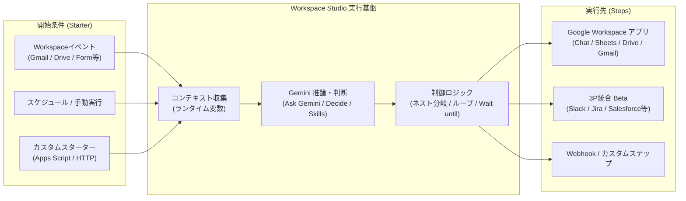

# **Google Workspace Studio 調査レポート**

## **1. 基本情報**

* **ツール名**: Google Workspace Studio
* **ツールの読み方**: グーグル ワークスペース スタジオ
* **開発元**: Google
* **公式サイト**: [https://workspace.google.com/studio/](https://workspace.google.com/studio/) （アプリUI: [https://studio.workspace.google.com/](https://studio.workspace.google.com/)）
* **関連リンク**:
  * 開発者向け拡張ドキュメント: [https://developers.google.com/workspace/add-ons/studio](https://developers.google.com/workspace/add-ons/studio)
  * リリース情報: [https://workspaceupdates.googleblog.com/](https://workspaceupdates.googleblog.com/)
* **カテゴリ**: ワークフローエンジン
* **概要**: Google Workspace Studioは、Gemini AI（Gemini 3等）の推論・エージェント機能を活用して、日常の業務ワークフローを自動化するノーコードプラットフォームです。ユーザーは「Flows（フロー）」と呼ばれる自動化プロセスを自然言語で指示するかテンプレートから構築でき、Gmail・Drive・Sheets・Docs・Chat・Calendar・Meetなどを横断したタスク処理を実現します（以前は「Google Workspace Flows」や「Gemini Flows」の名称で提供・言及されていました）。

## **2. 目的と主な利用シーン**

* **解決する課題**:
  * 複数のGoogle Workspaceアプリを行き来する反復的な手作業（「ちりつも業務」）の削減。
  * プログラミング知識（Google Apps Script等）がない現場担当者による、自律的な業務自動化の実現。
  * メールの内容分類・要約や問い合わせの優先度判定など、従来のルールベース自動化では困難だった非定型・知的タスクの自動化。
* **想定利用者**:
  * Google Workspaceを日常業務の基盤とするビジネスユーザー（営業、人事、バックオフィス、マーケティング等）。
  * 情報システム部門のリソースに頼らず現場主導でDXを推進したいチーム・マネージャー。
* **利用シーン**:
  * **メールのトリアージと下書き作成**: 顧客からの問い合わせメールを受信したら、Geminiが内容を分析・分類し、適切な担当者へGoogle Chatで通知しつつ返信下書きやアクションアイテムを自動作成する。
  * **ドキュメント・ファイルの自動整理と承認**: Google Driveの特定フォルダにファイルが追加されたら、内容を要約してマネージャーへ承認・確認依頼を送り、結果をスプレッドシートへ記録してファイルを移動・コピーする。
  * **会議後フォローアップと日次ダイジェスト**: Google Meetの会議メタデータや参加者リストを基にフォローアップメールの下書きを生成したり、未読メールを毎朝要約してGoogle Chatへ通知する。

### **2.1 代表的な利用フロー**

```mermaid
swimlane-beta TB
  subgraph User["ユーザー"]
    A["自然言語で自動化を指示"]
    F["通知・生成結果を確認・承認"]
  end
  subgraph Studio["Workspace Studio (Gemini)"]
    B["トリガーとステップを生成"]
    C["イベント検知・文脈取得"]
    D["Geminiによる分類・抽出・分岐"]
  end
  subgraph Apps["Workspace / 外部アプリ"]
    E["Sheets更新・Chat通知・メール下書き"]
  end
  A --> B
  B --> C
  C --> D
  D --> E
  E --> F
```

* **代表的な流れ**: ユーザーがチャットまたはビルダー上で「メールを受信したら要約してChatに通知」などの要件を伝えると、Workspace Studioがスターター（開始条件）とステップを生成します。イベント発生時にStudioが文脈を取得してGeminiが判断・構造化を行い、各Google Workspaceアプリや連携サービスへアクションを実行し、結果をユーザーへ返します。

## **3. 主要機能**

* **Flows（フロー）とノーコードビルダー**: トリガー（Starter）と一連のアクション（Steps）で構成される自動化フローを、自然言語プロンプト（「describe a task for Gemini」）、テンプレート（「Discover」タブ）、または手動GUIで構築・共有できます。
* **AIステップ群（Gemini搭載）**: 単純な条件分岐だけでなく、`Ask Gemini`、`Decide`（True/False判定による分岐）、`Extract`（構造化データ抽出）、`Summarize`（要約）、`Recap unread emails`、`Create with Gemini`、`Deep Research` などの知的処理ステップを組み込めます。
* **Skills（スキル）の統合**: 再利用可能なカスタム指示・ルール・テンプレートである「Skills」をWorkspace Studioのフロー内で呼び出し、チーム標準の業務ルールに沿ったAI出力を実現できます（従来の「Ask a Gem」ステップはSkillsへ移行中）。
* **高度なフロー制御ロジック**: ネストされた条件分岐（Nested Conditionals）、リストアイテムの反復処理（`Repeat for each` ループ）、指定条件・時間まで実行を一時停止する `Wait until` ステップに対応しています。
* **Google Workspace ネイティブ統合**: Gmail、Google Drive（ファイル検索・コピー・移動）、Google Sheets、Google Docs、Google Chat（Markdown対応スレッド返信）、Google Calendar、Google Meet（参加者リスト等の出力）、Google Forms、Google Tasks とシームレスに連携します。
* **サードパーティ統合（Beta）**: 2026年9月のアップデートにより、Asana、Confluence、HubSpot、Jira、Mailchimp、QuickBooks、Salesforce、Slack との組み込み連携ステップが提供されています。
* **カスタムスターター / ステップ & Webhook**: Google Apps Script や HTTP アドオンを用いて独自のリアルタイムトリガーや処理ロジックを構築できるほか、外部エンドポイントへHTTPリクエストを送信する Webhook ステップも利用可能です。
* **Google Workspace MCP servers連携**: ClaudeやGoogle Antigravityなどの外部MCP対応AIクライアントから、Google Workspaceのデータや機能へ安全にアクセスするリモートMCPサーバー機能も提供されています。

## **4. 動作原理・システム構成**

* **アーキテクチャ**: Google Cloud / Google Workspace 基盤上で動作する**クラウド完結型SaaS**であり、ワークスペース内の生産性・オーケストレーションレイヤーとして機能します。クライアント側の専用アプリインストールは不要で、Webアプリ（`studio.workspace.google.com`）およびGmail・Chatのサイドパネルから利用します。
* **主要コンポーネントとデータフロー**:
  1. **Starter（イベント / スケジュール検知層）**: メール受信（返信スキップ設定可）、Chatメンション、Driveファイル変更、フォーム送信、定期スケジュール、または外部Apps Script/HTTPアドオンからのカスタムイベントでフローを起動します。
  2. **AI仲介・制御層（Orchestration Layer）**: コンテキスト（メール本文、スプレッドシート値、ドキュメント等）をランタイムで収集し、Geminiモデル（Gemini 3等）によるプロンプト解釈・`Decide`分岐・`Wait until`待機・ループ制御を実行します。
  3. **Action / Integration層**: Google Workspace APIを通じた各種アプリ操作、サードパーティコネクタ、またはWebhook/Apps Scriptカスタムステップを実行します。



* **特筆すべき要素技術・技術的特性**:
  * **非決定性（Probabilistic Execution）と暗黙的状態管理**: 従来の決定論的iPaaSと異なり、AI判断ステップを含むフローはプロンプトに基づく確率的挙動をとります。状態はランタイムのWorkspaceコンテキストから暗黙的に導出され、厳密なトランザクション永続化や過去実行のリプレイ機構は持ちません。
  * **ユーザー単位の所有権モデル**: 各フローは作成者個人のGoogleアカウントに紐づいて実行・権限継承されます（OAuth 2.0および組織ポリシーに準拠）。

## **5. 開始手順・セットアップ**

* **前提条件**:
  * 対象のGoogle Workspace有料プラン（Business Starter / Standard / Plus、Enterprise Standard / Plus、Education各エディション）のアカウント。個人用Googleアカウントは「Google Workspace Experiments」有効化時のみ限定対応。
  * 管理者により Google Workspace 管理コンソール（`アプリ > Google Workspace > Workspace Studio`）で機能およびGeminiへのアクセスが有効化されていること。
* **インストール/導入**:
  * 完全なWebアプリケーションのため、ローカルへのソフトウェアインストールは不要です。
* **初期設定・アクセス**:
  1. [studio.workspace.google.com](https://studio.workspace.google.com/) へ直接アクセスするか、Gmail・Google Chat等の右上にある Workspace Studio アイコンからサイドパネルを開きます。
  2. 管理者がカスタムステップ・3P統合・Webhookを許可している場合は、各連携先のOAuth認証や承認設定を行います。
* **クイックスタート**:
  1. 画面左上の作成ボタンから「プロンプトで作成（describe a task for Gemini）」または「Discover」タブのテンプレートを選択します。
  2. 日本語で要件（例：「特定の件名を含むメールを受信したら、内容を200字で要約してGoogle Chatの指定スペースに通知する」）を入力し、フローを生成します。
  3. 変数や出力先を確認し、「テスト実行」で動作を検証します（※テスト実行でも実際にメール送信やファイル操作が実行されるため、検証用データでのテストが推奨されます）。問題なければ有効化します。

## **6. 特徴・強み (Pros)**

* **Google Workspaceとの完全なネイティブ統合**: 追加のAPIキー発行や外部iPaaS契約なしに、既存のGoogle認証・権限境界のままGmail・Drive・Sheets・Chat・Meetを横断自動化できます。
* **追加費用なしの高い導入容易性**: 主要なBusiness / Enterprise / Educationプランに標準搭載されているため、ライセンスコストの追加負担なく全社展開が可能です。
* **日本語UI・プロンプトへの完全対応**: 2026年5月のアップデートによりUI・ヘルプが日本語化され、日本語での指示入力や日本語ドキュメントの要約・分類も高精度に処理できます。
* **非エンジニアでも扱えるAIエージェント構築**: 自然言語でフローを設計でき、AIによる曖昧な文脈判断（`Decide` / `Extract`）をノーコードで組み込めます。
* **エンタープライズガバナンスとの両立**: 管理者コンソールからステップ単位・スターター単位での利用可否制御、外部データ送信時のユーザー承認（Approvals）強制、Webhook URL許可リスト設定が可能です。

## **7. 弱み・注意点 (Cons)**

* **フロー数・ステップ数・日次実行の上限**: 1ユーザーあたり**最大25フロー**（OFFのフローを含む）、1フローあたり**最大20ステップ**（ループ内のサブステップ含む）の制限があります。また、2026年11月1日より日次のAI使用量上限が本格適用されており（具体数値は非公開）、上限到達時は全アクティブフローが24時間停止します。
* **個人所有権モデルによる運用リスク**: フローは個人アカウントに紐づくため、他者への共有は「コピーの複製」となり共同所有になりません。作成者が退職・アカウント停止された場合やStudio無効化OUへ移動された場合、そのフローは即座に停止します。
* **観測性（Observability）とデバッグの制約**: 従来のiPaaSやApps Scriptのような詳細なステップ別トレース・リプレイやGitによるバージョン管理がなく、AIステップが誤判断した際の原因切り分けは結果の観察とプロンプト調整に依存します。
* **サードパーティ連携の範囲と成熟度**: 3P統合（Asana, Slack, Jira, Salesforce等）は2026年9月にBetaとして登場したばかりであり、数千以上のコネクタを持つZapierやMakeに比べると外部SaaS連携の網羅性では劣ります。
* **利用制限（年齢・個人アカウント）**: 18歳未満の学校アカウントではAIステップが利用できません。また、個人向け無料アカウントでは標準提供されていません。

## **8. 料金プラン**

Google Workspace Studio には単体の料金プランはなく、対象となる Google Workspace エディションのライセンスに標準で含まれています。

| プラン / エディション | 追加料金 | 主な特徴・利用条件 |
|---|---|---|
| **Business Starter / Standard / Plus** | 無料（プラン内） | 追加費用なしで利用可能。各ユーザー上限（25フロー/20ステップ）およびエディションに応じた日次AI使用量上限が適用。Webhook URL許可リストはBusiness Plus以上で対応。 |
| **Enterprise Standard / Plus** | 無料（プラン内） | 上位ガバナンス（Webhook URL許可リスト、詳細な管理コンソール制御等）とともに利用可能。 |
| **Education Fundamentals / Standard / Plus** | 無料（プラン内） | 教育機関向けに含まれますが、18歳未満のユーザーはAIステップを利用不可。 |
| **AI Expanded Access（アドオン）** | アドオン課金 | Business / Enterprise 向けに Workspace Studio の自動化・AI利用上限を引き上げるアドオン。 |
| **個人用 Google アカウント** | 対象外（実験機能のみ） | ビジネス向け標準提供はなく、Google Workspace Experiments を有効化した一部ユーザーのみ試験利用可能。 |

* **課金体系**: Google Workspace のユーザーシート課金に内包。フローの作成および実行がユーザー単位の日次AI利用上限にカウントされます（組織内でのプール合算はされず、毎日太平洋時間 0:00 にリセット）。
* **無料トライアル**: Google Workspace 自体の無料試用期間（14日間）内で評価可能です。

## **9. 導入実績・事例**

* **導入企業・パートナー**: Google Workspace を利用する世界中の企業・教育機関で導入が進んでいます。日本国内でもクラウドインテグレーター（吉積情報、クラスメソッド、ジーアイクラウド等）による検証・導入支援や、現場向けハンドブックの公開が進んでいます。
* **代表的な導入事例・活用パターン**:
  * カスタマーサポートへの問い合わせメールをGeminiが緊急度・カテゴリ別に分類し、Google Chatへ通知して返信ドラフトを作成するトリアージ業務の自動化。
  * 営業チームにおけるWebフォームからのリード受信時のスプレッドシート自動転記・要約通知、および定例会議後のフォローアップメール下書き生成。
* **対象業界**: IT、営業・マーケティング、バックオフィス（人事・総務・経理）、教育機関など、Google Workspace を中心に業務を行うあらゆる業界。

## **10. サポート体制**

* **ドキュメント**: Google Workspace Studio ヘルプセンター、Google Workspace 管理者ヘルプ（ラーニングセンター）、および拡張開発向けの [Google Workspace for Developers](https://developers.google.com/workspace/add-ons/studio) が提供されています。
* **コミュニティ**: Google Cloud Community（Workspace管理者向け公式フォーラム）、YouTube公式プレイリスト、および公式の Google Workspace Studio Discord チャンネルが運営されています。
* **公式サポート**: ご契約中の Google Workspace サポート窓口（管理コンソール経由のチャット・メール・電話、日本語対応）を利用可能です。

## **11. エコシステムと連携**

### **11.1 API・外部サービス連携**

* **拡張API / カスタム開発**: Google Workspace Add-ons フレームワークを通じ、Google Apps Script または HTTP エンドポイントを用いて「カスタムスターター」および「カスタムステップ」を開発・公開できます。
* **外部サービス連携**:
  * **Google Workspace（ネイティブ）**: Gmail, Google Drive, Google Sheets, Google Docs, Google Chat, Google Calendar, Google Meet, Google Forms, Google Tasks。
  * **サードパーティ統合（Beta）**: Asana, Confluence, HubSpot, Jira, Mailchimp, QuickBooks, Salesforce, Slack。
  * **汎用連携**: Outgoing Webhook（HTTPリクエスト送信）、および外部AIエージェント向けのリモートMCPサーバー（Google Workspace MCP servers）。

### **11.2 技術スタックとの相性**

| 技術スタック | 相性 | メリット・推奨理由 | 懸念点・注意点 |
|---|---|---|---|
| **Google Workspace Apps** | ◎ | ネイティブ統合されており、追加の認証設定やAPI管理なしで即座に連携可能。 | 25フロー/20ステップおよび日次AI上限の設計が必要。 |
| **Google Apps Script (GAS)** | ◎ | 公式にカスタムスターター/ステップとして統合可能。複雑なロジックや外部API処理をGAS側へ委譲できる。 | GAS側の実行時間制限（6分等）やカスタムスターターの手動テスト不可仕様に注意。 |
| **REST API / Webhooks** | ◯ | WebhookステップおよびHTTPアドオンにより外部システムと双方向連携が可能。 | URL許可リスト設定はBusiness Plus/Enterprise以上が必要。 |
| **AppSheet** | ◯ | カスタムステップ等で併用可能。入力UIはAppSheet、裏側のAI自律処理はStudioと役割分担できる。 | 双方の権限・ライセンス設計を揃える必要がある。 |

## **12. セキュリティとコンプライアンス**

* **認証**: Google Workspace の組織アカウントおよび OAuth 2.0 認証に完全に統合されており、組織のSSOや2段階認証（2SV）ポリシーがそのまま適用されます。
* **データ管理**: データは Google Workspace のコンプライアンス境界内で処理され、ユーザーの学習データへの流用を防ぐエンタープライズプライバシー保護および DLP（データ損失防止）ポリシーが適用されます。管理者はドメイン・OU・グループ単位で、機能全体のON/OFFだけでなく個別のスターターやステップ単位でアクセス制御が可能です。
* **準拠規格**: Google Workspace 基盤として ISO/IEC 27001、SOC 2 / SOC 3、GDPR、HIPAA などの主要国際規格に準拠しています。外部データ送信を伴うステップ（3P統合やWebhook等）には、実行前に人間の確認を求める承認（Approvals）ガードレールやWebhook URL許可リストを設定できます。

## **13. 操作性 (UI/UX) と学習コスト**

* **UI/UX**: GmailやGoogle Chatのサイドパネルから直接呼び出せるため、普段の作業画面を離れずにフローの作成・確認・承認を行えます。ノーコードのステップカード形式と自然言語チャット入力を組み合わせたシンプルで洗練されたUIです。
* **学習コスト**: プログラミング不要で日本語の自然言語指示からフローを生成できるため、非エンジニアの初期学習コストは極めて低いです。一方、ネストされた条件分岐や変数受け渡し、Apps Scriptカスタムステップを活用する段階では一定の論理的設計力が必要になります。

## **14. ベストプラクティス**

* **効果的な活用法 (Modern Practices)**:
  * **トリガーの厳格なフィルタリング**: 「すべてのメール受信」ではなく送信元・件名・Gmailの返信スキップ設定（Skip Replies）を用いて対象を絞り、日次AI実行上限の浪費を防ぐ。
  * **Human-in-the-loop（人間による承認）の組み込み**: 社外へのメール送信や重要なデータ更新の前には「下書き作成」や承認ステップを挟み、AIの誤判断リスクを吸収する。
  * **重要フローの共有アカウント管理**: チームや業務で継続利用するフローは個人アカウント任せにせず、専用の管理・共有アカウントで所有し、手順やプロンプト意図をドキュメント化する。
  * **Skillsの活用**: 社内フォーマットや判断基準はフローごとにベタ書きせず「Skills」として共通化し、品質を標準化する。
* **陥りやすい罠 (Antipatterns)**:
  * **無制限なスケジュール/メールトリガー**: フィルタなしのメール監視や15分間隔のシート監視を複数作ると、容易に日次上限に到達し全フローが停止する。
  * **トランザクション・厳密性が必要な業務への適用**: 会計処理や100%の決定論的再現性が求められる基幹連携は、Apps Scriptや専用iPaaS（Make/n8n等）に任せるべきである。
  * **「Ask a Gem」ステップの新規依存**: GemsのSkills移行に伴い新規作成は停止されており、既存フローも2027年3月までに「Ask Gemini」等へ置き換える必要がある。

## **15. ユーザーの声（レビュー分析）**

* **調査対象**: The Rundown AI、DEV Community、Google Workspace公式コミュニティ、国内技術メディア・SIer検証記事（ITmedia、クラスメソッド等）。※G2、Capterra、ITreview には2026年11月時点で独立製品としての専用レビュー登録はありません。
* **総合評価**: 独立レビューサイト上のスコアは未集計（Google Workspace 組み込み機能として提供）。
* **ポジティブな評価**:
  * 「GmailやDrive、Sheetsにネイティブに組み込まれており、Workspace契約があれば追加コストなしで即座にAI自動化を始められる点が非常に魅力的」（The Rundown AI / 国内導入記事）。
  * 「2026年5月の日本語UI対応により、自然言語プロンプトで意図通りの日本語要約・分類フローが誰でも作れるようになった」（国内SIer検証レビュー）。
  * 「9月〜10月のアップデートでSlack/Jira連携、Webhook、ネスト分岐が追加され、単なる実験ツールから実務ワークフロー基盤へ大きく前進した」（テックブログ）。
* **ネガティブな評価 / 改善要望**:
  * 「1人25フローの上限や、数値が非公開のまま適用された日次AI利用制限により、高頻度・大規模な業務自動化には使いづらい」（SuperDupr 解説）。
  * 「AIステップの挙動が非決定的であり、実行理由のトレースやデバッグの観測性が不足している」（DEV Community 技術レビュー）。
  * 「フローが個人所有になる仕様上、担当者の退職や異動時にフローが停止するリスクがあり、企業運用ではガバナンス設計が必須」（運用者フィードバック）。
* **特徴的なユースケース**:
  * 専任IT担当者がいない中小企業や事業部門において、問い合わせメールの一次振り分けとスプレッドシート転記を現場メンバー自身が10分程度で構築し、属人化を解消した事例。

## **16. 直近半年のアップデート情報**

* **2026-11-09**: **「Wait until」ステップおよび「Skills」統合の展開開始** — フロー実行を条件や時刻まで一時停止できる制御ステップと、チームのカスタム指示・テンプレートを再利用できる Skills 機能がロールアウト開始。
* **2026-10-09**: **10月機能リリース（制御ロジックと検索拡張）** — ネストされた条件分岐（Nested Conditionals）、Gmailスレッドの返信スキップ設定（Skip Replies）、Google Meet カレンダー参加者メタデータ出力、Google Drive の動的ドキュメント検索（Search for a Doc）ステップを追加。
* **2026-09-17**: **外部連携と拡張性の大幅強化** — カスタムスターター、カスタムステップ（Apps Script / HTTP）、サードパーティ統合 Beta（Asana, Confluence, HubSpot, Jira, Mailchimp, QuickBooks, Salesforce, Slack）、および Webhook ステップ（URL許可リスト制御含む）を導入。
* **2026-09-02**: **Drive・Gmail・Chatのアクション拡充** — Driveファイル/フォルダのコピー・移動、Gmail既存スレッドへの返信（Reply to email）、Markdown対応のGoogle Chatスレッド返信（Send a Chat reply）ステップを追加。
* **2026-06-05**: **Google Workspace MCP servers の公式ドキュメント公開** — ClaudeやGoogle Antigravityなどの外部MCP対応AIエージェントからWorkspaceデータへ安全にアクセスする連携基盤を整備。
* **2026-06-02**: **リストアイテムのループ処理（Loop over a list）追加** — 複数の検索結果や行データを反復処理するループ制御に対応。
* **2026-05-27**: **管理者向けの粒度の細かい制御機能** — サービス単位・個別のスターター/ステップ単位での有効・無効制御を管理コンソールに追加。
* **2026-05-07**: **日本語を含む7言語への対応拡大** — UI・ステップ名・ヘルプ表示の日本語化が完了。
* **2026-04-22**: **Gemini Gems のフロー統合** — カスタムGemをフロー内で呼び出す機能を発表（※その後、Skillsへの統合に伴い2027年3月までに置換予定）。
* **2025-12**: **Google Workspace Studio 正式ローンチ** — 従来の Google Workspace Flows / Gemini Flows を発展させ、Gemini 3 搭載のエージェント型自動化基盤として提供開始。

(出典: [Google Workspace Updates](https://workspaceupdates.googleblog.com/)、[Google Workspace for Developers](https://developers.google.com/workspace/add-ons/studio))

## **17. 類似ツールとの比較**

### **17.1 機能比較表 (星取表)**

| 機能カテゴリ | 機能項目 | 本ツール | Make | Zapier | Microsoft Power Automate | Microsoft Copilot Studio |
|:---:|:---|:---:|:---:|:---:|:---:|:---:|
| **基本機能** | 連携アプリ数 | △<br><small>Workspace中心+3P 8種+Webhook</small> | ◎<br><small>3,500+アプリ・柔軟なHTTP</small> | ◎<br><small>9,000+アプリ（業界最多）</small> | ◎<br><small>1,000+コネクタ+RPA</small> | ◯<br><small>Power Platformコネクタ・MCP</small> |
| **AI機能** | AIによる判断・自律性 | ◎<br><small>Geminiネイティブ・Skills対応</small> | ◎<br><small>Make AI Agents搭載</small> | ◎<br><small>AI by Zapier・MCP対応</small> | ◯<br><small>Copilot / AI Builder</small> | ◎<br><small>自律型エージェント・Work IQ</small> |
| **構築** | 自然言語・ノーコード構築 | ◎<br><small>対話型で即座に構築</small> | ◯<br><small>視覚的シナリオエディタ</small> | ◎<br><small>自然言語ビルダー・直感的</small> | ◯<br><small>Copilot支援（複雑時は学習要）</small> | ◯<br><small>自然言語+ローコードスタジオ</small> |
| **コスト** | 追加コストの低さ | ◎<br><small>Workspaceプランに標準付属</small> | ◎<br><small>無料枠あり・高コスパ</small> | △<br><small>タスク従量課金で高騰しやすい</small> | ◯<br><small>M365付属枠あり・上位は有料</small> | △<br><small>$200/月〜（PAYGOあり）</small> |
| **非機能要件** | 日本語対応 | ◎<br><small>UI・プロンプト完全対応</small> | △<br><small>英語UI中心</small> | △<br><small>英語UI・サポート中心</small> | ◎<br><small>日本語UI・公式ドキュメント充実</small> | ◎<br><small>日本語UI・エンタープライズ支援</small> |

### **17.2 詳細比較**

| ツール名 | 特徴 | 強み | 弱み | 選択肢となるケース |
|---|---|---|---|---|
| **本ツール** | Google Workspace標準のAI自動化基盤 | 追加費用なし、Workspaceとのシームレスな統合、日本語自然言語構築 | 25フロー/20ステップ上限、個人所有モデル、決定論的処理の弱さ | Google Workspace中心の組織で、日常業務を現場主導で素早くAI自動化したい場合。 |
| **Make** | 視覚的ワークフロー＆AI自動化 | 3,500+連携、複雑なデータ加工や条件分岐が得意、高コスパ | JSON等のデータ構造理解が必要、英語UI中心 | 多様な外部SaaS間で複雑なデータ変換・大規模実行を行いたい場合。 |
| **Zapier** | SaaS連携のデファクトスタンダード | 9,000+の圧倒的連携数、AI by Zapier、学習コストの低さ | 英語UI中心、大規模利用時のタスク従量課金コスト | 豊富な外部SaaSをノーコードで手早く接続したい場合。 |
| **Microsoft Power Automate** | M365特化＋デスクトップRPA | Microsoft 365連携、レガシー操作可能なデスクトップRPA | ライセンス体系が複雑、高度なエラー処理の学習コスト | Microsoft 365中心の環境や、Web APIのないデスクトップ自動化（RPA）が必要な場合。 |
| **Microsoft Copilot Studio** | エンタープライズ自律型AIエージェント基盤 | Entra ID/Purview統合、長期稼働エージェント、高度なガバナンス | 高コスト（$200/月〜）、Power Platform等の専門知識が必要 | Microsoft資産を活かし、厳格なガバナンス下で自律型業務エージェントを構築したい場合。 |

## **18. 総評**

* **総合的な評価**:
  * Google Workspace Studio は、Google Workspace を業務基盤とする組織にとって最も導入障壁が低い「純正のAIワークフロー自動化プラットフォーム」です。2026年5月の日本語対応に続き、9月〜11月のアップデートでサードパーティ統合、Webhook、ネスト分岐、ループ、`Wait until`、Skills が立て続けに追加され、実用性が飛躍的に向上しました。
  * 一方で、1ユーザー25フロー/20ステップという制限や日次AI利用上限の適用、個人に紐づくフロー所有権モデル、そしてAI判断に伴う非決定性は明確な制約であり、すべての業務システム連携を置き換えるものではありません。
* **推奨されるチームやプロジェクト**:
  * Gmail・Google Drive・Sheets・Chat を日常的に使用し、情報システム部門に頼らず現場レベルで業務効率化を進めたいチーム・中小〜大企業。
* **選択時のポイント**:
  * 「業務が Google Workspace 内で完結するか」「多少のAI出力の揺らぎを許容し、人間による確認を挟めるか」が判断基準となります。大量トランザクション処理や厳格な決定論的連携が必要な場合は Make / n8n / Google Apps Script と使い分け、日常の知識労働のオーケストレーション層として活用するのが最適です。
