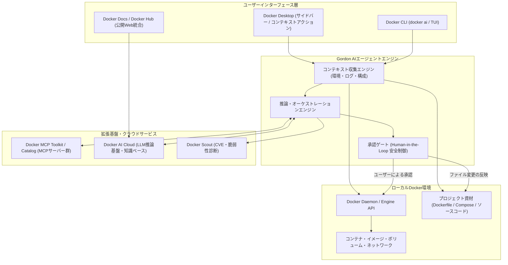

# **Docker Gordon 調査レポート**

## **1. 基本情報**

* **ツール名**: Docker Gordon（通称: Gordon / Docker AI）
* **ツールの読み方**: ゴードン
* **開発元**: Docker Inc.
* **公式サイト**: [https://www.docker.com/products/gordon/](https://www.docker.com/products/gordon/)
* **関連リンク**:
  * ドキュメント: [https://docs.docker.com/ai/gordon/](https://docs.docker.com/ai/gordon/)
* **カテゴリ**: エージェント実行環境/ランタイム
* **概要**: Docker DesktopおよびDocker CLI（`docker ai`）に標準組み込みされたDocker公式のAIエージェント。ローカル環境で稼働中のコンテナ、イメージ、ボリューム、ネットワーク、ログ、Dockerfile、Compose定義を直接読み取り、コンテナ化の支援、エラー原因の自動診断、環境操作コマンドの提案と安全な実行を承認ファースト（Human-in-the-Loop）で実現する。

## **2. 目的と主な利用シーン**

* **解決する課題**:
  * コンテナ起動失敗時やクラッシュ時における膨大なエラーログの解析と原因特定の負担。
  * ベストプラクティス（マルチステージビルド、キャッシュ効率化、軽量ベースイメージ選定、CVE脆弱性低減）を反映したDockerfile・Docker Compose作成の難しさ。
  * ターミナルとWeb検索・AIチャットツール間の煩雑なコンテキストスイッチ。
* **想定利用者**: アプリケーション開発者、DevOpsエンジニア、クラウド/インフラエンジニア、Docker初学者から熟練者まで。
* **利用シーン**:
  * **コンテナ異常終了・OOM時の原因究明**: 終了コード137（OOM Killer）やポート競合などの原因をコンテナログから即時特定し、設定修正コマンドを提示・適用する。
  * **プロジェクトのコンテナ化推進**: 未コンテナ化のリポジトリ構成（Node.js, Python, Go, Javaなど）を自動認識し、本番水準のDockerfileやComposeファイルを一括生成する。
  * **環境クリーンアップとリソース管理**: 肥大化したビルドキャッシュ、未使用ボリューム、孤立イメージの安全な整理を自然言語で指示・確認・実行する。
  * **Docker Scoutと連携した脆弱性修正**: ベースイメージや依存パッケージのCVEを検出し、安全な代替タグや設定への更新を行う。

### **2.1 代表的な利用フロー**

```mermaid
swimlane-beta TB
  subgraph ユーザー
    A["自然言語でタスク・質問を入力<br>(障害調査やDockerfile生成など)"]
    D["提案内容・実行コマンドの確認と承認<br>(Human-in-the-Loop)"]
    F["修正結果の確認・後続作業"]
  end
  subgraph Gordon["Gordon (AIエージェント)"]
    B["リポジトリ構造・実行コンテキストの分析"]
    C["修正プラン・実行コマンドの提案"]
    E["承認されたコマンドの実行・結果解析"]
  end
  subgraph Docker_Env["Docker環境 (Desktop / CLI / MCP)"]
    G["コンテナ状態・ログ・設定の抽出"]
    H["コマンド実行 (コンテナ操作・ファイル反映)"]
  end
  A --> B
  B --> G
  G --> C
  C --> D
  D --> E
  E --> H
  H --> F
```

* **代表的な流れ**: ユーザーがDocker DesktopのサイドバーまたはCLI（`docker ai`）から自然言語で問い合わせを行うと、GordonがローカルのDocker Daemonやファイルツリーから実行コンテキストを抽出し、修正プランやコマンドを策定します。ユーザーが変更差分や実行コマンドを確認・承認して初めて実行が行われ、安全にトラブルシューティングや環境変更が完了します。

## **3. 主要機能**

* **コンテナ環境の自動認識と診断**: 実行中のコンテナ、イメージ、ネットワーク、ボリューム、終了ステータス、ログ出力を自動スキャンし、問題の根本原因を特定。
* **承認ファースト（Human-in-the-Loop）実行モデル**: コマンドの直接実行やファイルの書き換えを行う前に、必ずユーザーに提案内容を提示し、明示的な承認を得てから実行する安全機構。
* **Dockerfile / Composeの自動生成・最適化**: プロジェクトのソースコードや依存ファイルを走査し、マルチステージビルドやキャッシュ最適化を施した構成ファイルを自動生成。
* **Docker Desktop UI統合（1クリック修復）**: コンテナ一覧やビルドログ画面に「Debug with Gordon」「Fix with Gordon」などのコンテキストボタンを配置し、エラー発生箇所から即座に調査を開始可能。
* **CLI統合（`docker ai` TUI）**: ターミナル上で対話型TUI（Terminal User Interface）を起動し、コマンドライン作業を中断せずに自然言語で操作・相談が可能。
* **Model Context Protocol（MCP）クライアント機能**: Docker DesktopのMCP ToolkitおよびDocker MCP Catalogと連動し、外部ツール（データベース、クラウドCLI、監視基盤など）と安全に接続して調査能力を拡張。
* **Docker Scoutセキュリティ連携**: コンテナイメージのCVE脆弱性やセキュリティポリシー違反を検知し、安全なベースイメージや更新手順をレコメンド。
* **Web・公式ドキュメント統合**: Docker Docs（`docs.docker.com`）やDocker Hub上に組み込まれたGordonにより、ドキュメントやパブリックリポジトリのメタデータを直接参照した回答を提供。

## **4. 動作原理・システム構成**

* **アーキテクチャ**: ローカルクライアント（Docker Desktop / Docker CLI）とDocker社が管理するAI推論基盤がセキュアに連携するハイブリッド型アーキテクチャ。ローカル環境の機密性を守るため、コンテキスト収集とコマンド実行はローカル上で完結し、ユーザー承認なしに外部へ勝手な変更を及ぼさない。
* **主要コンポーネントとデータフロー**:
  * **コンテキスト収集レイヤー**: ローカルのDocker Engine APIおよびローカルファイルシステムにアクセスし、実行中コンテナのメタデータ、最新ログ、Dockerfile、Composeファイルなどを読み取ってプロンプトコンテキストを構築。
  * **AI推論エンジン（Docker AI Cloud）**: クラウド上のLLM基盤にコンテキストを送信し、Docker公式ドキュメントやベストプラクティス知識ベースを参照しながら、回答や修正用シェルコマンド、パッチを生成。
  * **承認ゲートウェイ**: 生成されたコマンドやファイル変更差分をUI/CLI上にプレビュー表示し、ユーザーが「Approve」を選択した場合のみ、ローカルのDocker EngineやOSシェルに対して実行を命じる。
  * **MCP連携基盤**: Docker Desktop内に内包されたMCP Toolkitを通じて、コンテナ化されたMCPサーバー群と通信し、コンテキストの拡張や外部ツール操作を安全に仲介。



* **特筆すべき要素技術**:
  * **承認ファースト・ガードレール**: AIエージェントに自律実行権限を全面委譲せず、シェル実行・ファイル書き換えの直前に必ず確認を挟む設計。
  * **Model Context Protocol（MCP）連携**: Docker Hub上の「Docker MCP Catalog」からコンテナ化されたMCPサーバーを1クリックで導入し、安全に外部連携を拡張。
  * **セッション分離**: 実行時のセッションごとに一時的な権限スコープが管理され、セッション終了時に不要なアクセス権限をリセット。

## **5. 開始手順・セットアップ**

* **前提条件**:
  * Docker Desktop バージョン4.74以降（Windows, macOS, Linux）。
  * 有効なDockerアカウント（Personal, Pro, Team, Business）。
  * 組織でDocker Businessを利用している場合は、管理ポータルでのAI機能有効化設定が必要。
* **インストール/導入**:
  * Docker DesktopまたはDocker CLIに標準組み込みされているため、個別の追加パッケージインストールは不要。Docker Desktopを最新版に更新することで即座に利用可能。
* **初期設定**:
  1. Docker Desktopを起動し、右上の「Sign in」からDockerアカウントにサインイン。
  2. 設定画面（Settings > Docker AI）にてGordonの有効化を確認。
* **クイックスタート**:
  * **Docker Desktop**:
    1. 左サイドバーの「Gordon」アイコンをクリック。
    2. 入力欄に「Next.jsプロジェクト用のマルチステージDockerfileを作成して」や「停止したコンテナのエラー原因を調べて」と入力。
  * **CLI**:
    1. ターミナルで対話型TUIを起動：
       ```bash
       docker ai
       ```
    2. 引数として直接プロンプトを渡す実行例：
       ```bash
       docker ai "なぜ直前のビルドが失敗したのか原因と解決策を教えて"
       ```

## **6. 特徴・強み (Pros)**

* **環境直結のコンテキスト認識**: ログやDockerfileを手動でコピー＆ペーストすることなく、ローカルのDocker Daemonの状態（終了コード、コンテナログ、ポート割当、イメージレイヤー）を直接読み取って高精度な診断を行う。
* **堅牢な承認ファースト設計**: すべての変更や実行コマンドに対してユーザーの明示的承認を求めるため、意図しないコンテナ破棄や本番設定の破壊リスクを回避できる。
* **Dockerエコシステムとの深い統合**: Docker Desktop、CLI、Docker Scout、Docker Hub、docs.docker.comといったDockerの全接点で一貫したアシスタンスが提供される。
* **MCP（Model Context Protocol）による拡張性**: Docker MCP Catalogを通じて、PostgreSQLやAWS、GitHubなどの各種MCPサーバーをコンテナ経由で安全に連携可能。
* **無料枠（Gordon Base）の提供**: Dockerアカウントを所持していれば追加料金なしですぐに利用を開始できる。

## **7. 弱み・注意点 (Cons)**

* **アプリケーションロジックの実装には不向き**: コンテナ化、デプロイ、インフラ構成、Docker操作に特化しているため、Webアプリケーション内部のビジネスロジックやアルゴリズムの実装はCursorやGitHub Copilotなどのコーディング専用AIと併用する必要がある。
* **クエリ上限とレートリミット**: Gordon Base（無料枠）では4時間あたり約40問、月間約180問などの制限があり、ヘビーユースにはGordon Plus以上の追加サブスクリプションが必要。
* **英語中心の内部ナレッジ**: 日本語でのプロンプト入力や解説には対応しているものの、エラーログの分析結果や技術的な専門用語は英語中心の出力になる傾向がある。
* **インターネット接続の必須性**: 推論処理はDocker AI Cloud基盤で実行されるため、完全オフラインのエアギャップ環境では動作しない。

## **8. 料金プラン**

Docker Gordonは、Dockerアカウントに標準付帯する無料枠（Base）に加え、月額課金の拡張プラン（Plus / Max / Ultra）が提供されている。

| プラン名 | 料金 | AI予算倍率 | 目安クエリ上限（4時間 / 1日 / 月間） | 主な対象ユーザー |
|:---|:---:|:---:|:---|:---|
| **Gordon Base** | 無料 | 1× | 約40問 / 約100問 / 約180問 | すべてのDockerユーザー（試用・日常のスポット利用） |
| **Gordon Plus** | $20/月 | 2× | 約80問 / 約200問 / 約360問 | 個人開発者、日常的にコンテナ運用を行うエンジニア |
| **Gordon Max** | $50/月 | 5× | 約200問 / 約500問 / 約900問 | コンテナ移行やIaCを日常的に推進するシニアエンジニア |
| **Gordon Ultra** | $100/月 | 10× | 約400問 / 約1,000問 / 約1,800問 | 大規模開発チーム、集中的なデバッグを担うテックリード |

* **課金体系**: ユーザー単位・月額サブスクリプション（Docker HomeのBilling画面よりいつでもアップグレード可能。アップグレードは即時適用、ダウングレードは翌月1日適用）。
* **クエリ消費基準**: 質問に含まれるファイル数やコンテキストの複雑さ、実行操作の規模によってクレジット消費量が変動。
* **公開Webでの無償提供**: `docs.docker.com` および `hub.docker.com` 上でのGordonによるドキュメント・メタデータ検索はパブリック無料提供されており、個人のAIクエリ枠を消費しない。

## **9. 導入実績・事例**

* **導入企業**: Docker Desktopを利用しているグローバル数百万の開発者コミュニティ、およびDocker Businessを導入しているエンタープライズ企業。
* **導入事例**:
  * **新規マイクロサービスの立ち上げ**: 開発環境のDockerfileやCompose作成にかかる時間を数時間から数分へ短縮。
  * **DevOpsチームのオンボーディング**: 新人エンジニアがローカルコンテナ環境の不具合に直面した際、シニアエンジニアの手を煩わせずに自己解決できる割合が向上。
* **対象業界**: Web開発、SaaS開発、モバイルバックエンド、フィンテック、組み込みLinux開発など、コンテナ技術を採用している幅広い業界。

## **10. サポート体制**

* **ドキュメント**: [Docker Docs (Gordon)](https://docs.docker.com/ai/gordon/) に操作チュートリアル、CLIリファレンス、MCP設定手順が詳細に公開。
* **コミュニティ**: Docker Community Slack、公式フォーラム（forums.docker.com）、Docker Community GitHubにて知見共有が活発。
* **公式サポート**: Dockerの契約プラン（Personal, Pro, Team, Business）に基づく公式サポートデスクを提供。Businessプランでは専任サポートやSLAが適用。

## **11. エコシステムと連携**

### **11.1 API・外部サービス連携**

* **Docker CLI & Engine API**: ローカルのDocker Engineと直接対話し、コンテナライフサイクルやイメージビルドを操作。
* **Model Context Protocol（MCP）連携**: Docker MCP CatalogおよびMCP Toolkitを介し、コンテナ化された外部MCPサーバー（GitHub, PostgreSQL, AWS, Sentryなど）と接続可能。
* **Docker Scout**: コンテナイメージの脆弱性（CVE）解析結果を取り込み、推奨修正プランを提示。
* **AIコーディングエージェントとの連携**: Claude Code、Cursor、GitHub Copilotと並行運用可能。アプリケーションコードはコードエージェントが書き、実行環境やデバッグはGordonが担うハイブリッド体制を構築。

### **11.2 技術スタックとの相性**

| 技術スタック | 相性 | メリット・推奨理由 | 懸念点・注意点 |
|:---|:---:|:---|:---|
| **Docker / Docker Compose** | ◎ | ネイティブ統合されており、追加設定なしで環境をフルコントロール可能 | 特になし |
| **Docker Scout** | ◎ | セキュリティスキャン結果を直接読み込み、CVE解消の変更案を即座に提示 | 特になし |
| **Model Context Protocol (MCP)** | ◎ | Docker Desktop内のMCP Toolkitから安全に各種データソースへアクセス可能 | 外部サーバー設定の管理が必要 |
| **Node.js / Python / Go / Java** | ◯ | 言語特性や依存関係（package.json, requirements.txtなど）を把握してDockerfileを自動生成 | 特殊なC拡張やビルド時バイナリ依存は追加指示が必要 |
| **Kubernetes (k8s)** | ◯ | Docker Desktop付属のk8s環境やComposeからの変換（Kompose連携など）を支援 | 本番の複雑なHelmチャートやCRDの高度な管理は対象外 |

## **12. セキュリティとコンプライアンス**

* **認証・アクセス制御**: Dockerアカウントによるシングルサインオン（SSO）および多要素認証（MFA）に対応。BusinessプランではSAML/SCIMによる統合管理が可能。
* **データプライバシー**: Docker AI Privacy Statementに基づき、ユーザーのローカルソースコードやコンテナデータがDocker社の基盤モデル学習に利用されることはない。
* **Human-in-the-Loopによる安全管理**: 破壊的なコマンド（`rm`, `prune` など）や設定変更はすべてプレビューされ、明示的承認なしに実行されることはない。
* **準拠規格**: Dockerのクラウド基盤はSOC 2 Type IIおよびISO 27001の第三者認証を取得しており、エンタープライズ水準のセキュリティ基準を満たす。

## **13. 操作性 (UI/UX) と学習コスト**

* **UI/UX**:
  * **Docker Desktop GUI**: 直感的なチャットインターフェースに加え、障害発生箇所（コンテナログやビルド失敗画面）にコンテキスト対応のクイックアクションが統合されており、迷わず使える。
  * **CLI（TUI）**: ターミナル作業を好むエンジニア向けに、補完や色分け、差分プレビューが効いた軽量TUIを提供。
* **学習コスト**: 極めて低い。Dockerの基本概念を知っていれば、「なぜこのコンテナが落ちるのか」「軽量なDockerfileを作って」と普段の自然言語で指示するだけで直感的に利用可能。

## **14. ベストプラクティス**

* **効果的な活用法 (Modern Practices)**:
  * **コーディングAIとの明確な役割分担**: アプリケーションロジックやアルゴリズムはCursorやClaude Codeで作成し、コンテナ化・Compose構成・環境デバッグはGordonに任せる「適材適所のマルチAIワークフロー」を構築する。
  * **ワンクリックトラブルシューティングの習慣化**: エラー発生時に手作業でログをコピーしてWeb検索する代わりに、Docker Desktop上の「Debug with Gordon」を活用して根本原因を即座に特定する。
  * **Docker Scout連携による脆弱性撲滅**: イメージビルド後にGordonへ「このイメージの脆弱性を減らす改善案を出して」と指示し、セキュアなベースイメージへの置換を自動化する。
* **陥りやすい罠 (Antipatterns)**:
  * **無確認でのコマンド承認**: 提案されたシェルコマンドやファイル更新を差分確認せずに承認し、重要なローカルボリュームや未コミットの変更を上書きしてしまうこと。
  * **機密情報の直接入力**: APIキーやパスワードなどの機密文字列をプロンプトに平文で含めて問い合わせること（環境変数参照やDocker Secretsの形式を使用すべき）。
  * **複雑なアプリケーション実装の丸投げ**: ビジネスロジックの設計をGordonに期待すること（コンテナ環境特化エージェントである点に留意）。

## **15. ユーザーの声（レビュー分析）**

* **調査対象**: Docker Community Forum、Reddit（r/docker）、Hacker News、開発者ブログ・SNS
* **主な高評価**:
  * 「コンテナが起動しないときのログ調査が劇的に速くなった。エラーコードやスタックトレースを読み取って的確な修正案を出してくれる」
  * 「マルチステージビルドのベストプラクティスを取り入れたDockerfileを数秒で作ってくれるため、環境構築の手間が大幅に減った」
  * 「承認ファーストなので、勝手に破壊的なコマンドを実行される心配がなく、安心して作業を任せられる」
* **主な改善要望・懸念点**:
  * 「Gordon Base（無料枠）のクエリ制限が厳しめで、集中的にデバッグを行っていると上限に達してしまう」
  * 「日本語での指示には対応しているが、解説の一部や技術的詳細は英語で返ってくることがある」
  * 「外部の複雑なクラウドインフラや大規模なKubernetes環境のデバッグにはまだ対応しきれていない」

## **16. 直近半年のアップデート情報**

* **2026-10**: **Model Context Protocol（MCP）エコシステムの統合強化**
  * Docker DesktopのMCP ToolkitおよびDocker MCP Catalogと連携。Gordonからコンテナ化された外部MCPサーバー（データベース、クラウドCLI、監視ツール等）を安全に呼び出せる拡張基盤を整備。
* **2026-08**: **Gordon多段階料金プランの導入**
  * Gordon Base（全ユーザー無料）に加え、Gordon Plus（$20/月）、Gordon Max（$50/月）、Gordon Ultra（$100/月）の4段階プランが導入され、クエリ規模に応じた柔軟な利用が可能に。
* **2026-07**: **Docker Desktopにおけるインライン修復アクションの拡充**
  * コンテナ一覧やビルドログ画面に「Debug with Gordon」「Fix with Gordon」ボタンが追加され、コンテキストを自動引き継ぎしたシームレスなトラブルシューティングが可能に。
* **2026-05**: **Docker Gordonの一般提供（GA）開始**
  * Docker Desktop（v4.74以降）およびDocker CLI（`docker ai`）への標準統合が正式リリース。`docs.docker.com` および `hub.docker.com` 上でのWeb統合エージェントも同時公開。

## **17. 類似ツールとの比較**

### **17.1 機能比較表 (星取表)**

| 機能カテゴリ | 機能項目 | Docker Gordon | GitHub Copilot (CLI含む) | Claude Code | Cursor |
|:---:|:---|:---:|:---:|:---:|:---:|
| **コンテナ診断** | ローカルコンテナ・ログの直接把握 | ◎<br><small>Engine API直結で診断</small> | ×<br><small>環境認識不可</small> | △<br><small>シェル経由で個別取得</small> | ×<br><small>エディタ内のみ</small> |
| **コンテナ化支援** | Dockerfile/Compose自動生成 | ◎<br><small>公式ベストプラクティス準拠</small> | ◯<br><small>コードベースから推測</small> | ◯<br><small>ファイル生成可能</small> | ◯<br><small>チャットから生成</small> |
| **コーディング** | アプリケーションコードの実装 | △<br><small>設定・インフラ中心</small> | ◎<br><small>エディタ内補完・生成</small> | ◎<br><small>自律的なリファクタリング</small> | ◎<br><small>統合エディタでの高精度補完</small> |
| **コマンド実行** | 承認ファーストのシェル実行 | ◎<br><small>UI/TUIでプレビュー確認</small> | △<br><small>提案のみ（Copilot in CLI）</small> | ◯<br><small>ターミナル承認実行</small> | ◯<br><small>エディタ内ターミナル実行</small> |
| **拡張プロトコル** | MCP (Model Context Protocol) 対応 | ◎<br><small>Docker MCP Catalog統合</small> | △<br><small>限定的</small> | ◎<br><small>MCPクライアント対応</small> | ◯<br><small>MCP対応</small> |
| **動作環境** | Desktop GUI / CLIネイティブ | ◎<br><small>Desktop & CLI（docker ai）</small> | ◯<br><small>IDE拡張 & CLI</small> | ◯<br><small>CLI特化</small> | ◯<br><small>デスクトップIDE</small> |

### **17.2 詳細比較**

| ツール名 | 主な特徴 | 明確な強み | 弱み・制約 | 最適な利用ケース |
|:---|:---|:---|:---|:---|
| **Docker Gordon** | Docker環境とCLIに完全特化したAIエージェント | コンテナ状態、ログ、ボリューム、イメージを直接把握して安全に操作可能 | アプリケーションロジックのコーディング能力は汎用ツールに劣る | コンテナ化、デバッグ、Docker環境の運用管理 |
| **GitHub Copilot** | GitHubエコシステムと連携する開発支援AI | 幅広いプログラミング言語でのインライン補完やPR作成支援に長ける | ローカルのコンテナ内部状態や実行時ログを自動認識できない | 日常的なアプリケーションコードの記述とレビュー |
| **Claude Code** | ターミナルから自律的にコードベースを調査・変更するAI | 大規模なコードベースの探索、深い論理的思考と自律的な改修 | Docker特化のGUI連携はなく、コンテナ状態の把握はコマンド頼み | 複雑な機能実装、大規模リファクタリング、バグ修正 |
| **Cursor** | AIファーストの統合開発環境（IDE） | エディタ全体でのコード把握と複数ファイルの同時編集 | コンテナランタイム自体の障害診断やDocker特化の運用操作はカバー外 | アプリケーション全体の統合開発とロジック実装 |

## **18. 総評**

Docker Gordonは、コンテナ開発・運用の現場における「トラブルシューティングと環境構築の摩擦」を劇的に解消する画期的なDockerネイティブAIエージェントである。

従来のチャット型AIでは、開発者がエラーログや設定ファイルをコピー＆ペーストして状況を説明する必要があったが、GordonはDocker Engine APIやローカル環境と直接対話することで、状況を瞬時に把握して的確な解決策を導き出す。また、自律的なコマンド実行にあたって「承認ファースト（Human-in-the-Loop）」の安全ガードレールを徹底しているため、開発環境を意図せず破壊するリスクが最小限に抑えられている。

CursorやClaude Codeなどのコーディング用AIエージェントと競合するものではなく、むしろ「コード実装はコーディングAI、コンテナ化と環境トラブルシューティングはGordon」という協調運用によって真価を発揮するツールである。Baseプランによる無料試用が可能なため、Dockerを利用するすべてのエンジニアにとって必須のアシスタントと言える。
