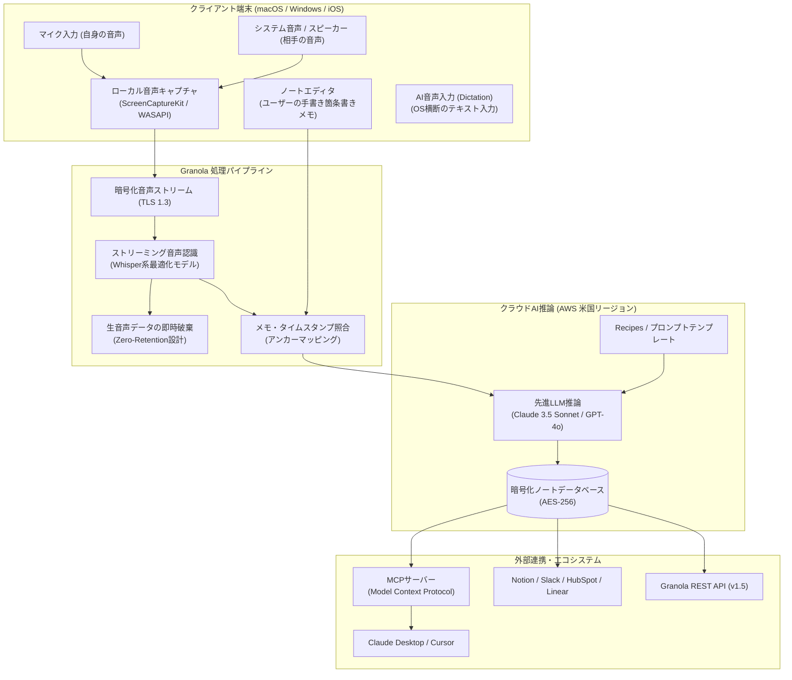

# **Granola 調査レポート**

## **1. 基本情報**

* **ツール名**: Granola
* **ツールの読み方**: グラノーラ
* **開発元**: Granola Labs Ltd.（英国ロンドンを拠点とするAIスタートアップ。元Googleで宿題支援AI「Socratic」を創業・バイアウトしたChristopher Pedregalと、プロダクトデザイナーのSam Stephensonによって設立）
* **公式サイト**: [https://www.granola.ai/](https://www.granola.ai/)
* **関連リンク**:
  * ドキュメント: [https://granola.ai/](https://granola.ai/)
  * レビューサイト: [Product Hunt](https://www.producthunt.com/products/granola-2) | [G2](https://www.g2.com/products/granola/reviews)
* **カテゴリ**: コラボレーション/生産性
* **概要**: Granolaは、オンラインおよび対面会議に対応したAI搭載型のスマートミーティングノートです。会議に外部ボットを参加させることなく、端末上のシステム音声とマイク入力を直接キャプチャしてバックグラウンドで文字起こしを行います。最大の特徴は、会議中にユーザー自身が書いた簡潔な箇条書きメモ（アンカー）と全体の会話ログをAIが融合し、不要な長文を省いた「本当に必要な決定事項と文脈」が凝縮された高品質な議事録・アクションアイテムを生成する点にあります。

## **2. 目的と主な利用シーン**

* **解決する課題**:
  * **ボット参加への心理的抵抗感の解消**: 取引先との初回商談や機密面談において、画面上に外部ボットが表示されることで警戒感を与えたり、会議の雰囲気が硬くなる問題を解消します。
  * **AIによる冗長な要約の抑制**: 会話全体を機械的に均等要約する既存のボットツールでは、重要でない雑談まで長々と記録され、ユーザーが本当に注目したポイントが埋もれてしまう課題を解決します。
  * **議事録作成・CRM入力の工数削減**: バックトゥバック（連続）で続く会議の合間に、記憶を掘り起こしてメモを整形したり、NotionやSalesforceに手動転記する多大な負担を取り除きます。
* **想定利用者**:
  * **プロダクトマネージャー・エンジニア**: 仕様策定会議、スプリント計画、バグトリアージ、ユーザーインタビューの記録。
  * **創業者・経営陣・ベンチャーキャピタリスト**: 投資家ピッチ、取締役会、1on1、パートナーシップ交渉の高速な振り返り。
  * **営業・カスタマーサクセス**: 顧客ディスカバリーミーティング、デモ後のフォローアップ作成、CRM更新。
* **利用シーン**:
  * **商談直後のフォローアップとCRM更新**: 顧客との会話中に重要な要望や数値だけをラフにメモ。会議終了直後に「商談サマリー＋ネクストアクション」が自動生成され、NotionやHubSpotへワンクリック連携。
  * **1on1ミーティングのアクション追跡**: メンティとの対話中にアジェンダ沿いの単語を記録。AIが合意事項や次週までのコミットメントを整理し、共有フォルダへ即時蓄積。
  * **全社横断の「第二の脳」検索**: 「Ask Granola」機能を用いて、過去数ヶ月の会議全体から「先月議論した認証基盤の移行スケジュールはどうなった？」と横断検索し、該当発言の引用付きで即座に回答を取得。
  * **OS横断の高速文章作成**: 会議外でもグローバルショートカット（Fnキー）で「Dictation」を起動し、Slack返信やメールの下書きをAIがフィラー（えーと、あの等）を除去した自然な文章として音声入力。

## **3. 主要機能**

* **ボットレス・バックグラウンド音声キャプチャ**: Zoom、Google Meet、Microsoft Teams、Slackハドル等のWeb会議において、画面にボットを同席させることなく、OSのシステム音声（スピーカー出力）とマイク入力をローカルで個別にキャプチャして文字起こしを実行。
* **ハイブリッド・ノートエンハンスメント（手書きメモ×AI文字起こし）**: ユーザーが会議中に残したラフな箇条書きや単語を「アンカー」として認識し、AI（Claude 3.5 Sonnet / GPT-4o等）がその前後の会話文脈を自動補完・構造化。人間が着目した要点に絞った高品質なノートを生成。
* **カスタムテンプレート＆Recipes（レシピ）**: 1on1、採用面談、顧客ディスカバリー、エンジニアリングレビューなど、用途に合わせた出力構造をワンクリックで適用可能。独自のプロンプトテンプレートを作成・保存してチームで共有可能。
* **Ask Granola（単一・横断AIチャット）**: 閲覧中の単一ミーティングノートに対する質疑応答だけでなく、ワークスペース内の過去のすべての会議記録を横断して会話形式で情報検索・集約が可能。
* **システムワイドAI音声入力（Dictation）**: 2026年秋に登場したOS横断機能。MacのFnキー連打等により、任意のテキストフィールド（メール、Slack、Notion、ブラウザ）上で、不要な言い淀みをカットし構造化した文章をリアルタイム音声入力可能。
* **チーム共有・コラボレーションスペース**: 個人のノート保管庫に加え、プロジェクトや部署ごとの共有スペースを提供。同じ会議に出席したチームメンバー同士のメモをマージしたり、社内Wikiのように閲覧可能。
* **MCP（Model Context Protocol）対応＆REST API**: Anthropicが主導するMCPサーバー接続を標準サポートし、Claude DesktopやCursor、自律型AIエージェントからGranolaの会議録を文脈データとして直接クエリ可能。開発者向けREST API（v1.5）も完備。
* **多言語リアルタイム認識＆話者推定**: 日本語を含む100以上の言語の文字起こしに対応。会話音声から「自分（Me）」と「相手（Them）」の発言を自動推定してダイアログを表示。

## **4. 動作原理・システム構成**

Granolaは、「ローカルファーストの音声キャプチャ・一次処理」と「セキュアなクラウドLLMオーケストレーション」を組み合わせたハイブリッドアーキテクチャを採用しています。

* **アーキテクチャ**:
  * **クライアント・サーバー型＋ローカルオーディオキャプチャ**: クライアントアプリがOSのネイティブオーディオAPIを直接フックし、クラウド上のセキュアなAIバックエンドと常時同期します。
* **主要コンポーネントとデータフロー**:
  1. **ローカルオーディオキャプチャ**: macOSではAppleの`ScreenCaptureKit`またはCoreAudio、WindowsではWASAPIを利用し、外部仮想ドライバのインストール不要で相手音声（システムオーディオ）と自分音声（マイク）を同時に分離キャプチャ。
  2. **音声認識と生データ破棄（Zero-Retention）**: ストリーミングされた音声は高精度なWhisper系モデル等によってテキスト化され、話者判定（Me/Them）が付与されます。**録音された生音声データは文字起こし完了直後に即座に揮発・完全削除**され、サーバーに音声ファイルとして保管されることはありません。
  3. **アンカーマッピングエンジン**: ユーザーがタイピングしたメモのタイムスタンプと、文字起こしログの該当箇所を関連付け、ユーザーが重視した文脈を特定。
  4. **LLMプロンプト合成**: ユーザーのメモ、該当箇所の会話文脈、選択されたRecipesプロンプトを合成し、Claude 3.5 SonnetやGPT-4oなどのフロンティアモデルによって構造化された要約テキストを出力。
  5. **クラウド同期とAPI配信**: 生成されたノートはTLS 1.3で暗号化転送され、AWSのデータベース（AES-256暗号化）に格納。NotionやMCPクライアントなどの外部連携先に配信されます。
* **特筆すべき要素技術**:
  * **ScreenCaptureKitの活用**: Zoomなどのアプリを問わず、OSレベルで極めて低遅延かつ安定して高音質なシステム音声を抽出。
  * **Model Context Protocol (MCP)**: AIエージェントとGranolaノートをシームレスにつなぐ業界標準プロトコルをネイティブにサポート。

## **5. 開始手順・セットアップ**

* **前提条件**:
  * **対応OS**: macOS 12 Monterey以降（Apple Silicon / Intel対応）、Windows 10/11 (64bit)、iOS 16以降
  * **アカウント**: Google WorkspaceまたはMicrosoft 365アカウント（カレンダー連携に推奨）
  * **クレジットカード**: 無料プラン（Basic）の利用時は登録不要
* **インストール/導入**:
  1. 公式サイト（[https://www.granola.ai/](https://www.granola.ai/)）より、Mac版（`.dmg`）またはWindows版インストーラーをダウンロードしてインストールします。
  2. モバイル利用時はApp StoreよりiOSアプリをインストールします。
* **初期設定**:
  1. アプリを起動し、GoogleまたはMicrosoftアカウントでログインします。
  2. カレンダー連携を承認し、当日の予定を自動インポートします。
  3. 初回起動時のプロンプトに従い、OSの「マイクへのアクセス権限」および「画面・システム音声収録権限」を許可します。
  4. 設定画面（`Settings > Languages`）にて、文字起こし言語に「Multi-language」または「Japanese」を選択します。
* **クイックスタート**:
  1. 会議の開始に合わせて、Granola上部の「Start Meeting」ボタンをクリック（またはカレンダー通知ポップアップから開始）。
  2. 会議中、重要なキーワードや決定事項をエディタ上に簡単な箇条書き（単語だけでも可）で入力。
  3. 会議終了時に「End Meeting」をクリック。
  4. わずか数秒〜十数秒で、手元メモをベースに美しく整理された議事録が生成されることを確認。
  5. 必要に応じて右パネルの「Recipes」からテンプレートを切り替えたり、「Share」ボタンからNotionやSlackへ出力。

## **6. 特徴・強み (Pros)**

* **会議にボットが入らない心理的快適さ**:
  従来の議事録ツールのように「〇〇 Notetakerが参加しました」という通知や別参加者の表示が一切出ないため、社外とのセンシティブな商談や役員面談でも、相手に不信感や緊張感を与えることなく自然に使用できます。
* **人間の関心とAIの網羅性を両立するハイブリッド方式**:
  「全自動AI要約」にありがちな、どうでもよい雑談の要約やピントのずれたアクション抽出を排除。人間がメモした数行のキーワードを軸にAIが肉付けするため、読んだ瞬間に会議の勘所が伝わる実用的なノートが完成します。
* **極限まで洗練されたミニマルなUI/UX**:
  タイポグラフィと余白が計算された美しいデザインを採用しており、書くこと・考えることに集中できます。動作も軽快で、重厚なエンタープライズツール特有のもたつきがありません。
* **OS横断で使える強力なAI音声入力（Dictation）**:
  会議中だけでなく、日常の業務でFnキーを押すだけで、Slackの返信やドキュメント作成をAIが言い淀みを取り除いて綺麗な日本語・英語に清書してくれます。
* **オープンなAIエコシステム連携（MCP対応）**:
  Anthropic Claude DesktopやCursorなどの開発環境からMCP経由で「先週のミーティングで話した仕様変更は何だった？」と問い合わせられるため、会議の決定事項をそのままコーディングや資料作成に直結できます。

## **7. 弱み・注意点 (Cons)**

* **無料プラン（Basic）の30日間閲覧制限**:
  無料プランでは過去30日以内のノートしかアプリ上で閲覧・検索できず、それ以前のノートはロックされます（データ自体は保持されアップグレードで解除可能）。長期的なナレッジベースとして活用するには月額$14のBusinessプラン契約が事実上必須です。
* **UIの英語中心設計**:
  文字起こしやAIによる要約出力は日本語に対応しているものの、設定メニュー、ガイド、エラーメッセージなどは英語表記です。チーム全員で導入する場合、英語UIに抵抗があるユーザーへのサポートが必要です。
* **対面多人数会議における話者識別の難しさ**:
  1台のPCやスマートフォンのマイクで複数人が集まる会議室の音声を拾う場合、オンライン会議のようにクリアな話者分離（誰が発言したか）を行うのが難しいケースがあります。
* **完全オンプレミス・データレジデンシー非対応**:
  すべての推論・保管インフラはAWS米国リージョンに配置されており、国内データセンター限定保管や完全ローカル閉塞環境での運用を求める金融機関や官公庁等のセキュリティ要件には適合しない場合があります。

## **8. 料金プラン**

| プラン名 | 料金 (月払い / 年払い) | 主な特徴 |
|---------|---------------------|---------|
| **Basic** | **無料** ($0) | 月間ミーティング数無制限、直近30日間のノート閲覧・検索、標準AIモデル、カスタムテンプレート、多言語文字起こし、AIチャット |
| **Business** | **$14/ユーザー/月** (月払い) *(年払いは約$10/月相当)* | Basicの全機能＋**無制限の過去履歴アクセス**、先進AI思考モデル（Claude 3.5 Sonnet / o1等）、Notion/HubSpot/Slack/Zapier連携、MCP連携、REST APIアクセス、チーム管理 |
| **Enterprise** | **$35/ユーザー/月〜** (個別見積) | Businessの全機能＋SAML SSO/SCIMプロビジョニング、**AIモデル学習の完全デフォルト無効**、HIPAA対応（BAA締結）、専任カスタマーサクセス、利用分析ダッシュボード |

* **課金体系**: ユーザーアカウント単位の月額または年額サブスクリプション課金。
* **無料トライアル**: Basicプランが常時無料枠として提供されており、クレジットカード登録なしで主要な会議メモ・文字起こし機能を即座に利用可能。

## **9. 導入実績・事例**

* **導入企業**: 米国および欧州の先進テック企業、ベンチャーキャピタル、スタートアップを中心に爆発的な普及を見せています。Vercel, Linear, Runway, Stripeなどの開発者コミュニティや、Spark Capital, Lightspeed, Index Venturesといった世界的VCの投資家・パートナー陣が日常的に活用。
* **導入事例**:
  * **スタートアップ経営者・VC**: 1日に10件近く行われる投資ピッチや面談において、会議直後にフォローアップメールの下書きを自動作成。面談後の情報整理にかかる時間を80%以上削減。
  * **プロダクトマネジメントチーム**: 顧客インタビューの定性フィードバックをGranolaで記録し、NotionやLinearのプロダクトバックログへ即座に転記。仕様検討のサイクルを大幅に短縮。
  * **セールス＆カスタマーサクセス**: 商談終了と同時にHubSpotやSalesforceに要約とタスクを自動プッシュし、営業担当者のCRM入力漏れをゼロ化。
* **対象業界**: テクノロジー、ベンチャーキャピタル、コンサルティング、人材紹介・採用エージェント、クリエイティブスタジオなど。

## **10. サポート体制**

* **ドキュメント**: [公式ヘルプセンターおよび開発者ドキュメント](https://granola.ai/)にて、初期設定、キーボードショートカット一覧、MCP接続ガイド、APIリファレンスが提供されています（英語）。
* **コミュニティ**: 公式Xアカウント（[@granola_ai](https://x.com/granola_ai)）や創業者らの発信が非常に活発で、ユーザーのフィードバックが即座にデスクトップアプリの週次アップデートへ反映されています。
* **公式サポート**: アプリ内のインラインチャットおよびメール窓口（`support@granola.ai`）によるサポートを提供。Enterprise契約企業には専任のアカウントマネージャーと優先SLAが設定されます。

## **11. エコシステムと連携**

### **11.1 API・外部サービス連携**

* **API**: Granola REST API（v1.5.0）を提供。ワークスペース、スペース、フォルダ階層、個別ノートのテキストおよび発話タイムスタンプ付きフル文字起こし（`/v1/notes/{note_id}/transcript`）をプログラマブルに取得・操作可能。
* **外部サービス連携**:
  * **ドキュメント・ナレッジ管理**: Notion（ワンクリック同期、プロパティマッピング対応）、Google Docs
  * **タスク・プロジェクト管理**: Linear、Asana
  * **CRMツール**: HubSpot、Salesforce、Attio、Affinity
  * **コミュニケーション**: Slack（指定チャンネルへのサマリー投稿）
  * **iPaaS**: Zapier、Make（数千のWebサービスとのトリガー連携）
  * **AIエージェント・プロトコル**: Model Context Protocol (MCP) を公式サポート。Claude Desktop、Cursor、その他のAIエージェントからGranolaの会議データベースへ直接クエリを発行可能。

### **11.2 技術スタックとの相性**

| 技術スタック | 相性 | メリット・推奨理由 | 懸念点・注意点 |
|:---|:---:|:---|:---|
| **Claude Desktop / Cursor (MCP)** | ◎ | 公式MCP連携により、AI対話から「直近の要件定義ミーティングの内容」を直接参照してコードや仕様書を生成可能 | ローカルでのMCP設定（JSON設定ファイルの編集）が必要 |
| **Notion (ナレッジベース)** | ◎ | 議事録をデータベースプロパティ（日付、参加者、要約）付きでシームレスに同期可能 | Notion側のデータベース構造設計を事前に整えておくことが望ましい |
| **Linear / GitHub Issues** | ◯ | 会議で抽出されたアクションアイテムをコピー＆ペーストやZapier経由で素早くチケット化 | ネイティブの直接課題作成連携は今後の拡充に期待 |
| **Slack / Microsoft Teams** | ◯ | 会議終了後に要約とリンクをチームチャンネルへ手動またはWebhookで共有可能 | 投稿フォーマットのカスタマイズには若干の調整が必要 |
| **オンプレミス / 閉域網環境** | × | クラウド（AWS米国リージョン）でのLLM推論が前提のため、ネットワーク完全閉塞環境では利用不可 | 機密保持規定がオンプレミス必須の環境では導入困難 |

## **12. セキュリティとコンプライアンス**

* **認証**: Google OAuthおよびMicrosoft 365 OAuthによる強固な認証。EnterpriseプランではSAML 2.0に基づくシングルサインオン（Okta、Azure AD、Google Workspace等）およびSCIMプロビジョニングに対応。
* **データ管理**:
  * **音声データの即時破棄（Zero-Retention）**: 音声キャプチャデータはリアルタイム文字起こし完了直後に即座に破棄され、サーバーに音声ファイルとして保管されません。
  * **通信・保管の暗号化**: クライアントとサーバー間の全通信はTLS 1.3によって暗号化され、AWS VPC内のデータベースに保存されるデータはAES-256で暗号化されます。
  * **AIモデルの学習制限**: OpenAIおよびAnthropicとの商用API契約に基づき、ユーザーの会議データがAIモデルの再学習に使用されることはありません。またEnterpriseプランではGranola自体のモデル改善学習もデフォルトでオプトアウトされます。
* **準拠規格**:
  * **SOC 2 Type II**: 独立監査法人によるSOC 2 Type II認証を取得。
  * **GDPR / UK GDPR**: 欧州および英国の一般データ保護規則に準拠し、標準契約条項（SCC）を含むDPAを提供。
  * **HIPAA**: Enterprise契約および個別のBAA（事業提携契約）締結により、医療情報（PHI）の取り扱いに対応可能。

## **13. 操作性 (UI/UX) と学習コスト**

* **UI/UX**:
  * 非常にミニマルで洗練されたインターフェース。会議中はメモ欄と控えめな文字起こしステータスのみが表示され、ユーザーの集中を妨げません。
  * キーボードショートカットが徹底して整備されており、`Cmd+K`によるクイックコマンド呼び出し、`Esc`キーでのホーム画面復帰、`Cmd+Shift+V`によるプレーンテキスト貼り付けなど、エンジニア好みの快適な操作感を提供。
* **学習コスト**:
  * **極めて低い**。一般的なテキストエディタと同じ感覚でメモを入力するだけでよく、複雑なプロンプトエンジニアリングやボットの招待手順を覚える必要が一切ありません。導入初日から直感的に使いこなすことができます。

## **14. ベストプラクティス**

* **効果的な活用法 (Modern Practices)**:
  * **「アンカーメモ」スタイルの実践**: 会議のすべてを必死に書き起こすのではなく、「決定事項」「数値目標」「違和感を持った発言」だけを数行の箇条書きや単語でメモする。AIがそのメモをアンカー（錨）として捉え、周囲の会話から必要な文脈だけを抽出して肉付けするため、最も実用的な議事録になります。
  * **用途別Recipesの登録**: チームで頻繁に行うミーティング形式（例：「採用面談フィードバック」「障害振り返りポストモーテム」「顧客デモディスカバリー」）ごとに専用Recipesを作成しておくことで、ボタン一つで定型レポートを標準化できます。
  * **MCP連携による開発ワークフローの自動化**: CursorやClaude CodeのMCP設定にGranolaを追加し、「先ほどのスプリントMTGで決定したDBスキーマの変更点に基づいてマイグレーションファイルを作成して」と指示することで、会議から実装までのリードタイムを最小化できます。
* **陥りやすい罠 (Antipatterns)**:
  * **手元メモを一切取らない「完全AI任せ」**: メモを1文字も書かずにAI要約を実行すると、一般的な文字起こしボットと同じく「当たり障りのない最大公約数のまとめ」になってしまい、Granola本来の強みであるユーザーの視点に沿った要約が得られなくなります。
  * **無料プランの30日経過によるデータ参照不可**: Basicプランでは30日以上前のノートがロックされるため、重要な決定事項は定期的にNotionや社内Wikiへエクスポートしておくか、チームでBusinessプランを導入することが推奨されます。
  * **OSの音声収録権限の解除漏れ**: macOSのメジャーアップデート時などにScreenCaptureKitの画面・音声収録権限がリセットされると、相手の音声が拾えず自分の発言しか文字起こしされない原因となるため、不具合時は権限設定を確認してください。

## **15. ユーザーの声（レビュー分析）**

* **調査対象**: Product Hunt, G2, X (Twitter), Reddit
* **総合評価**: Product Hunt 4.8 / 5.0（約56件）、G2 4.6 / 5.0（約191件）
* **ポジティブな評価**:
  * **「ボット不参加」に対する圧倒的支持**: 「取引先との商談に気まずいAIボットを入れずに済むのが最大の救い。相手に余計な気を使わせずに高精度な議事録が手に入る。」（Product Huntユーザー）
  * **実用的な要約クオリティ**: 「他のボットが作る要約は長すぎて誰も読まないが、Granolaは自分が残したメモの文脈を完璧に理解して必要な情報だけをスマートにまとめてくれる。」（G2レビュー）
  * **Dictation機能の圧倒的な快適さ**: 「Fnキーを押すだけでどこでも起動する音声入力が魔法のよう。Slack返信やアイデアの書き出しが驚異的なスピードになった。」（Xユーザー）
* **ネガティブな評価 / 改善要望**:
  * **被り発言時の話者判定の揺らぎ**: 「複数の参加者が同時に早口で発言した際、話者属性（Me/Them）が一時的に混同されることがある。」（G2レビュー）
  * **UIの日本語ローカライズ要望**: 「文字起こしや要約は流暢な日本語で出力されるが、アプリのメニューやチュートリアルが英語なので、英語が苦手な同僚への展開に少し説明が必要だった。」（国内ユーザー）
  * **無料プランのアーカイブ制限**: 「30日前のノートがロックされてしまうため、長期で使うには有料プランが実質必須。」（Redditレビュー）
* **特徴的なユースケース**:
  * ベンチャーキャピタリストが1日に十数件連続するスタートアップ面談において、会議終了直後に「Ask Granola」で「先ほど創業者が言及した最新のMRR成長率と解約率は何％だったか？」とピンポイントにファクトチェックを行い、投資検討メモをその場で作成してチームに即時共有する運用。

## **16. 直近半年のアップデート情報**

* **2026-10-15**: **Systemwide Voice Typing & Dictation を正式リリース**。会議外でもMacのFnキー連打からOS上のあらゆるアプリ（Slack、メール、ブラウザ、IDE）に対して、フィラー自動除去付きの高精度AI音声入力を提供。
* **2026-09-22**: **Granola REST API v1.5.0 を公開**。スペース単位のフィルタリング（`space_id`）機能、スペース権限管理、API経由での非公開メモデータ取得をサポート。
* **2026-08-18**: **Granola REST API v1.4.0 を公開**。フォルダ階層構造（`parent_folder_id`）、発話者属性（`me` / `them`）の取得、大規模トランスクリプト専用エンドポイント（`/v1/notes/{note_id}/transcript`）を追加。
* **2026-06-25**: **Model Context Protocol (MCP) 連携の公式サポートを強化**。Claude DesktopやCursor、外部自律型AIエージェントからGranolaノート・文字起こしへの直接クエリ性能を最適化。
* **2026-05-12**: **Windows版デスクトップアプリの正式安定版およびiOS向けロック画面ウィジェット録音機能の提供を開始**。Mac以外の環境や対面・外出先での利用体験を大幅に向上。

(出典: [Granola 公式製品情報・Changelog](https://www.granola.ai/))

## **17. 類似ツールとの比較**

### **17.1 機能比較表 (星取表)**

| 機能カテゴリ | 機能項目 | Granola (本ツール) | Circleback | Otter.ai | Microsoft 365 Copilot |
|:---:|:---|:---:|:---:|:---:|:---:|
| **録音方式** | ボット不要（ローカルキャプチャ） | ◎ <small>OS標準APIによる完全ボットレス</small> | ◯ <small>ボットレス/ボット選択可能</small> | × <small>ボット同席が必須</small> | ◯ <small>Teams組込（外部ボットなし）</small> |
| **要約生成** | 手書きメモ連動ハイブリッド要約 | ◎ <small>ユーザーの手書きメモを核にAIが肉付け</small> | △ <small>自動要約＋手動編集</small> | △ <small>全自動要約中心</small> | △ <small>全自動トランスクリプト要約</small> |
| **外部AI連携** | MCP (Model Context Protocol) 対応 | ◎ <small>公式対応・Claude/Cursor連携</small> | ◎ <small>公式対応・AIエージェント連携</small> | × <small>MCP非対応</small> | × <small>Copilot Studio等の独自網</small> |
| **料金・導入** | 常時無料プランの有無 | ◯ <small>無料枠あり（過去30日履歴制限）</small> | × <small>7日間トライアル後有料化</small> | ◯ <small>月300分無料枠あり</small> | × <small>有償ライセンスアドオン必須</small> |
| **会議統合** | Web会議ツール横断対応 | ◎ <small>Zoom, Meet, Teams, Huddle等全対応</small> | ◎ <small>主要Web会議ツール対応</small> | ◎ <small>主要Web会議ツール対応</small> | △ <small>Microsoft Teamsに特化</small> |
| **付加機能** | OS横断のAI音声入力 (Dictation) | ◎ <small>Fnキー連打で全アプリ入力対応</small> | × <small>会議メモ特化</small> | × <small>会議・音声メモ特化</small> | △ <small>Windows音声入力等（別枠）</small> |
| **非機能要件** | 音声データの即時破棄 (プライバシー) | ◎ <small>生音声即時削除ポリシー</small> | ◯ <small>暗号化クラウド保管</small> | △ <small>音声クラウド長期保管</small> | ◯ <small>M365テナント内保管</small> |
| **非機能要件** | 日本語UIローカライズ | △ <small>文字起こし/要約は対応、UIは英語</small> | △ <small>文字起こし対応、UIは英語</small> | △ <small>一部日本語対応、UIは英語中心</small> | ◎ <small>UI/サポート完全日本語対応</small> |

### **17.2 詳細比較**

| ツール名 | 特徴 | 強み | 弱み | 選択肢となるケース |
|---------|------|------|------|------------------|
| **Granola** | ユーザーの手書きメモとAI文字起こしを融合するボットレスAIミーティングノート | ボットが不要で相手に警戒感を与えない、自分が重視した要点に絞った高密度な議事録、MCP連携、OS横断のDictation機能 | 無料版は30日間の閲覧制限、UIが英語中心 | 取引先との商談や1on1が多く、ボットを嫌うプロフェッショナル、要点を自分でコントロールしたいエンジニアや投資家 |
| **Circleback** | MCP対応とCRM・タスク管理への自動操作に強いAIミーティングアシスタント | ボットレス/ボット両対応、LinearやHubSpotへの深い自動アクション実行、高度なワークフロー自動化 | 完全無料プランがない（$25/月〜）、リアルタイム文章作成機能はない | 営業チームやCS部門で、会議後のCRM登録やタスク起票を完全に全自動化したい場合 |
| **Otter.ai** | 老舗のAI文字起こし・ミーティングアシスタント | 知名度が高く実績豊富、リアルタイム字幕表示やスライド自動キャプチャが充実 | ボットが必ず会議に参加する、要約が網羅的すぎて要点が散漫になりがち | 社内講義、ウェビナー、大規模ミーティングで全体の逐語録とリアルタイム字幕が必要な場合 |
| **Microsoft 365 Copilot** | TeamsやOfficeアプリ群と緊密に統合されたエンタープライズAI | Teams会議のネイティブ連携、Office文書や組織内データとの強固な横断連携、完全な日本語対応 | 高額な年間ライセンス費用、Google MeetやZoom単体環境ではメリットが薄い | すでにMicrosoft 365 / Teamsを全社導入しており、同一エコシステム内で完結させたい大企業 |

## **18. 総評**

* **総合的な評価**:
  * Granolaは、「AIによる全自動要約」の限界と「会議ボットの気まずさ」という2大ペインを完璧に解決した、新世代のAIミーティングノートです。会議にボットを同席させないローカルオーディオキャプチャ技術と、ユーザー自身の手書きメモを核にAIが文脈を肉付けするハイブリッド方式により、実用性とプライバシーを最高水準で両立させています。さらに、MCP対応によるAIエージェント連携や、OS横断のAI音声入力（Dictation）など、単なる議事録ツールの枠を超えて「知的生産性を底上げするパーソナルAIワークスペース」へと進化しています。
* **推奨されるチームやプロジェクト**:
  * **社外との重要な商談・投資面談・採用面接が多いプロフェッショナル**: ボットを入れられない機密会議でも安心して使用可能。
  * **プロダクトマネージャー・エンジニアチーム**: 仕様決定やスプリントの議論をMCP経由でClaudeやCursorに直接引き渡したい開発組織。
  * **連続する会議（Back-to-Back）に追われるスタートアップ経営陣・リーダー**: メモ作成工数を極限まで圧縮し、次のアクションへ即座に移行したいチーム。
* **選択時のポイント**:
  * 全自動でCRMやタスク管理へデータを流し込みたい場合はCircleback、全社でTeamsに統一されている大企業ならMicrosoft 365 Copilotが候補となりますが、**「相手にボットを意識させず、自分の言葉と視点を重視したスマートな議事録を作りたい」「日常的なAI音声入力やClaude連携も活用したい」**と考えるすべてのナレッジワーカーにとって、Granolaは現時点で最も洗練された第一選択肢と言えます。
