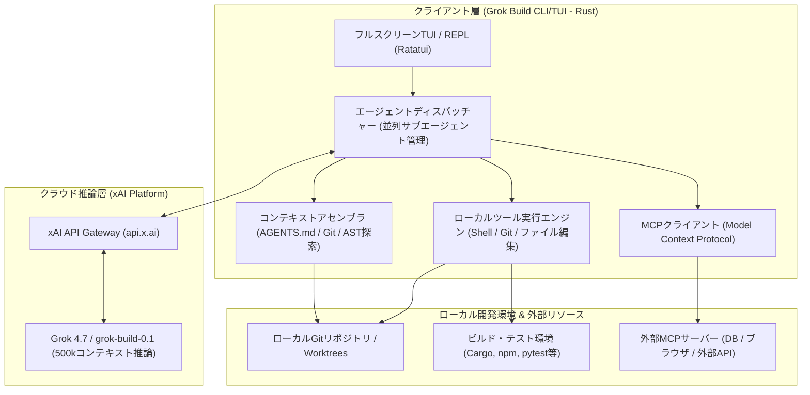

# **Grok Build 調査レポート**

## **1. 基本情報**

* **ツール名**: Grok Build
* **ツールの読み方**: グロック ビルド
* **開発元**: xAI
* **公式サイト**: [https://x.ai/build](https://x.ai/build)
* **関連リンク**:
  * GitHub: [https://github.com/xai-org/grok-build](https://github.com/xai-org/grok-build)
  * DeepWiki: [https://deepwiki.com/xai-org/grok-build](https://deepwiki.com/xai-org/grok-build)
  * ドキュメント: [https://docs.x.ai](https://docs.x.ai)
* **カテゴリ**: 自律型コーディングエージェント
* **概要**: xAIが公式に開発・提供する、Rustベースのオープンソースなターミナル完結型自律コーディングエージェント。最新のフロンティアモデル「Grok 4.7」の500kトークンコンテキストと強力な推論能力を標準搭載し、フルスクリーンTUI（Terminal User Interface）、変更前の計画立案（Plan Mode）、並列サブエージェント実行、Model Context Protocol（MCP）連携を通じて、複雑なソフトウェア開発ライフサイクルを高速かつ安全に自律遂行する。

## **2. 目的と主な利用シーン**

* **解決する課題**:
  * ターミナルとGUIエディタ、ブラウザ、AIチャット画面の頻繁な往復（コンテキストスイッチ）に伴う認知負荷と作業効率の低下
  * 大規模コードベースにおける依存関係の把握漏れや、複数ファイルにまたがるリファクタリング時の破壊的変更リスク
  * 事前の計画提示や人間によるレビューなしにファイルを直接書き換えてしまう自律AIツールの暴走・不透明性
  * 外部データベースや社内API、Webブラウザとの連携が難しく、ローカルファイル編集だけに閉じてしまう課題
* **想定利用者**:
  * フルスタックエンジニア、ソフトウェア開発者
  * DevOps / SRE エンジニア（CI/CD自動化やインフラコードの改修）
  * オープンソースメンテナー・コントリビューター
  * 高速なプロトタイピングから本番保守までを効率化したいスタートアップ開発チーム
* **利用シーン**:
  * **大規模リファクタリングと新機能実装**: Plan Modeで実装方針や影響範囲をステップ単位で事前策定し、レビュー・修正した上でクリーンな差分を適用
  * **バグ調査・テスト駆動修正**: ターミナル上でテストやビルドを実行し、失敗ログを読み取って自動的に原因を特定・修正を繰り返す自己修復ループ
  * **CI/CD・スクリプトによるヘッドレス自動化**: `-p` フラグを活用し、PRコードレビュー、脆弱性スキャン、Issueトリアージをパイプライン上で無人実行
  * **MCPサーバー連携による統合開発**: データベース、ブラウザ自動操作、社内ドキュメントサーバーと連携し、データスキーマのマイグレーションやエンドツーエンドの動作検証を実施

### **2.1 代表的な利用フロー**

```mermaid
swimlane-beta TB
  subgraph User["ユーザー"]
    A["タスク指示・ゴール入力"]
    D["計画レビュー・修正承認"]
    G["ファイル差分確認・適用承認"]
  end
  subgraph GrokBuild["Grok Build (CLI/TUI)"]
    B["文脈収集 (AGENTS.md・Git状態・コード探索)"]
    C["計画ドラフト (Plan Mode) 提示"]
    E["サブエージェント分散実行・ファイル編集"]
    F["差分プレビュー生成・検証テスト実行"]
  end
  subgraph Inference["xAI推論基盤 (Grok 4.7)"]
    B1["コンテキスト理解・タスク分解"]
    E1["コード生成・コマンド生成・自己検証"]
  end
  subgraph Environment["ローカル環境 & 外部連携"]
    H["Git Worktree反映・コミット・MCP連携"]
  end
  A --> B
  B --> B1
  B1 --> C
  C --> D
  D --> E
  E --> E1
  E1 --> F
  F --> G
  G --> H
```

* **代表的な流れ**: ユーザーがタスクを入力すると、Grok Buildがプロジェクト内の `AGENTS.md` やGit状態を読み込み、Grok 4.7推論基盤と連携して計画（Plan）を策定します。ユーザーが計画を承認すると、並列サブエージェントがコード生成やテスト実行を自律的に進め、最終的な差分（Diff）をユーザーが確認・承認した段階でローカル環境やGit Worktreeに安全にコミット・適用されます。

## **3. 主要機能**

* **フルスクリーン対話型TUI（Terminal User Interface）**: マウス操作に対応し、マルチペイン表示、コードハイライト、キーボードショートカット（Vimキーバインド対応）を備えた洗練されたターミナルインターフェース。
* **計画モード（Plan Mode）**: 複雑なアーキテクチャ改修や長大タスクに対して、コードを即時変更せずステップごとの実装計画を策定。ユーザーが各手順を精査・編集・承認してから実行へ移行する安全設計。
* **並列サブエージェント実行（Subagents）**: 独立したコンテキストウィンドウを持つ軽量なサブエージェントを動的に生成し、コード調査、テスト実行、レビュー作業などを並列分散処理。
* **階層型ルール管理（AGENTS.md / CLAUDE.md互換）**: プロジェクトルートやディレクトリ単位に配置された `AGENTS.md`（または `AGENT.md`, `CLAUDE.md`）を自動探索し、コーディング規約やビルド手順を厳格に順守。
* **Model Context Protocol（MCP）ネイティブ対応**: MCPサーバーを介して、ブラウザ操作、データベース接続、Issue管理システム（GitHub/Linear）など外部ツールやコンテキストソースとシームレスに接続。
* **ヘッドレス実行＆CI/CD連携モード**: `-p` フラグ（`--output-format streaming-json` 等）を用いたヘッドレス実行に対応し、GitHub Actionsやシェルスクリプトから自動実行可能。
* **Git Worktree連動と安全な差分管理**: 一時的なGit Worktree上で実験的改修を行い、作業完了後にクリーンな差分プレビューを提示して本ブランチへ安全にマージ。
* **ワークスペーススキルの動的生成（`/skillify`）**: 繰り返し行う開発セッションやベストプラクティスを、再利用可能なカスタムスキルとしてワンコマンドで抽出・保存。
* **診断とヘルスチェック（`grok doctor`）**: 設定ファイル（`~/.grok/config.toml`）の非推奨設定や接続状況、システム要件を即座に診断しトラブルシューティングを迅速化。

## **4. 動作原理・システム構成**

* **アーキテクチャ**: ローカルファーストのクライアント・ハーネス（Rust製TUI/CLI）とクラウド推論基盤（xAI API / Grok 4.7）によるハイブリッド分散アーキテクチャ。
* **主要コンポーネントとデータフロー**:
  * **クライアント層**: Rustの非同期ランタイム（Tokio）と端末描画ライブラリ（Ratatui/crossterm）で実装。ローカルファイル走査、Gitステータス監視、シェル実行を安全なローカルプロセス内で直接ハンドリング。
  * **コンテキストアセンブラ**: プロジェクト構造、関連ソースコード、`AGENTS.md`、直近のコミット差分をトークンバジェット内に効率よくパック。
  * **エージェント・ディスパッチャー**: メインタスクから並列サブエージェントへのタスク分割、ツールコール（Tool Call）のオーケストレーション、実行結果の統合を管理。
  * **クラウド推論層**: xAIのColossusクラスタ上で動作する「Grok 4.7」APIへセキュアなストリーミング通信（HTTPS/WebSockets）を行い、リアルタイムにトークンとツール呼び出し指示を受信。



* **特筆すべき要素技術**:
  * **Rustによるゼロオーバーヘッド実装**: Node.jsやPython製のCLIと比較して起動が極めて高速（数ミリ秒）で、メモリフットプリントが小さく、長時間セッションでもUIが軽快に追従。
  * **Agent Client Protocol（ACP）のサポート**: TUI単体だけでなく、外部エディタ（VS Code拡張等）や自動化ランナーと通信するための標準化されたプロトコルインターフェースを内包。
  * **Git Worktreesによるコンテキスト分離**: ユーザーの作業ツリーを汚さずに並行して別の実験的ブランチでテストを実行可能。

## **5. 開始手順・セットアップ**

* **前提条件**:
  * OS: macOS、Linux、または Windows (WSL / Git Bash / PowerShell)
  * Git がインストールされていること
  * xAI アカウントおよび API キー（または X Premium/SuperGrok 認証）
* **インストール/導入**:

  ```bash
  # macOS / Linux / WSL (Bash)
  curl -fsSL https://x.ai/cli/install.sh | bash

  # Windows (PowerShell)
  irm https://x.ai/cli/install.ps1 | iex
  ```

* **初期設定**:
  初回起動時に認証が促されます。ブラウザ認証またはAPIキー直接入力のいずれかを選択可能です。

  ```bash
  # 認証コマンドの明示実行
  grok auth
  
  # または環境変数でAPIキーをエクスポート
  export XAI_API_KEY="your-xai-api-key-here"
  ```

* **クイックスタート**:

  ```bash
  # プロジェクトディレクトリへ移動
  cd path/to/your-project

  # 対話型TUIセッションを開始
  grok

  # またはPlan Modeを直接指定して開始
  grok --plan "REST APIエンドポイントを追加し、ユニットテストを作成して"

  # ヘッドレスモード（CI/CDスクリプト等）での実行例
  grok -p "プロジェクトのアーキテクチャと依存関係を解説して"
  ```

## **6. 特徴・強み (Pros)**

* **Grok 4.7による超高速推論と500kコンテキスト**: 競合フロンティアモデルと比較しても極めて俊敏なレスポンスを誇り、大規模なリポジトリ全体のソースコードや長大なエラーログを丸ごとコンテキストに収容可能。
* **オープンソース（Apache 2.0）クライアント**: クライアントハーネスおよびTUIの全ソースコードがGitHub上で公開されており、内部のプロンプト構築、ツール実行ロジック、通信内容が完全に透明化・検証可能。
* **Plan ModeとフルスクリーンTUIによる高い安全性**: いきなりコードを乱雑に変更せず、詳細なプランをユーザーが確認・修正した上で実行に移すため、予期せぬ破壊的変更やバグ混入を未然に防止。
* **短期の厳格なレート制限なし**: 競合ツールで見られる数時間ごとの厳しい利用制限枠がなく、サブスクリプション枠や従量課金APIキーで長時間の集中開発を持続可能。
* **MCPおよびAGENTS.mdの優れた標準互換性**: 既存のMCPサーバー資産を流用できるほか、`AGENTS.md` や `CLAUDE.md` などの他ツール向けルールファイルをそのまま読み込んで動作可能。

## **7. 弱み・注意点 (Cons)**

* **大規模モノレポでのメモリとトークン消費**: 巨大なリポジトリで多数の並列サブエージェントを自動起動した場合、トークン消費が急増しやすく、環境によっては大量のメモリを消費する事例が報告されている。
* **初期のプライバシー設定に関する懸念**: 初期リリース時にGitコミット履歴等の同期挙動に関してコミュニティで議論があり、機密リポジトリで運用する際は `~/.grok/config.toml` のテレメトリ設定や `.gitignore` の除外設定を注意深く確認する必要がある。
* **日本語対応の最適化が途上**: 英語圏を主軸に設計されており、英語でのプロンプティングに比べて日本語での長大な論理指示でトークン効率が低下したり、TUIの全角文字折り返しで僅かな描画ずれが生じる場合がある。
* **自律実行時の暴走防止措置の重要性**: 複雑な依存関係の解決時に、エージェントが連続したツール呼び出しループに陥るケースがあるため、適切なステップ制限やユーザー確認の設定が推奨される。

## **8. 料金プラン**

Grok Buildは、オープンソースのクライアントハーネスを利用しつつ、バックエンド推論基盤として「X/xAI サブスクリプションプラン」または「xAI API（従量課金）」を選択して利用します。

| プラン名 | 料金 | 主な特徴・対象ユーザー |
|:---|:---:|:---|
| **Free** | 無料 ($0/月) | 基本的なチャット・プロトタイプ向け。利用枠に制限あり |
| **Plus** | $8/月 | 基本的なGrok利用枠、Xプラットフォーム連携機能 |
| **Premium** | $30/月 | Plusの約4倍の利用枠。Grok Buildのフル機能、開発者向け推奨 |
| **Super** | $100/月 | Plusの約15倍の利用枠。高負荷作業、ピーク時優先アクセス |
| **Ultra** | $200/月 | Plusの約50倍の利用枠。ヘビーパワーユーザー、大規模開発向け |
| **API従量課金** | 従量制（トークン課金） | `console.x.ai` 経由。CI/CD連携や独自ツール組み込み向け |

* **課金体系**:
  * **サブスクリプション方式**: 週次・月次の利用プール枠から消費。超過時は低速化または追加購入。
  * **API従量課金（Grok Build 0.1 / Grok 4.7）**:
    * `grok-build-0.1`: 入力 $1.00 / 100万トークン（キャッシュ入力 $0.20）、出力 $2.00 / 100万トークン
    * `grok-4.7`: 入力 $2.00 / 100万トークン（キャッシュ入力 $0.50）、出力 $6.00 / 100万トークン
* **無料トライアル**: 新規開発者向けに `console.x.ai` での初回サインアップクレジットが提供される場合あり。

## **9. 導入実績・事例**

* **導入企業**:
  * xAI社内エンジニアリングチーム（Grokモデル自体の学習・評価基盤開発およびドッグフーディング）
  * X Corp.（Xプラットフォームの大規模バックエンド・インフラ保守自動化）
  * Teslaエンジニアリング部門（車載ソフトウェアおよび分散システムのテスト・検証）
  * 各種オープンソース開発者およびAIスタートアップ企業
* **導入事例**:
  * **モノレポの型エラー一括解消**: 数千ファイルに及ぶTypeScript/Rustリポジトリにおいて、型定義の変更に伴うコンパイルエラーをPlan Modeで洗い出し、サブエージェントで並列自動修正。
  * **CI/CDパイプラインでの自動トリアージ**: GitHub Actionsと連携し、失敗したE2Eテストログの解析と修正PRの自動起票を実施。
* **対象業界**: ソフトウェア・SaaS開発、フィンテック、自動車・ロボティクス、Web3・ブロックチェーンなど、高度なエンジニアリング精度と速度が求められる技術主導型企業。

## **10. サポート体制**

* **ドキュメント**: [xAI Developer Docs (docs.x.ai)](https://docs.x.ai) にてCLIリファレンス、API仕様、MCP連携ガイド、設定方法が詳細に提供されているほか、CLI内から `grok help` や `grok doctor` で自己診断が可能。
* **コミュニティ**: GitHub上の公式リポジトリ（[xai-org/grok-build](https://github.com/xai-org/grok-build)）のIssuesおよびDiscussions、X上の開発者コミュニティやハッシュタグ（`#GrokBuild`）を通じて世界中のエンジニアと活発に情報交換が行われている。
* **公式サポート**: 開発者ポータルからの問い合わせ窓口、Enterprise契約企業向けの専用Slack/Teamsチャンネルおよび専任テクニカルアカウントマネージャー（TAM）によるサポートを提供。

## **11. エコシステムと連携**

### **11.1 API・外部サービス連携**

* **API**: xAI REST APIおよびOpenAI互換エンドポイントを公開。ストリーミング、ツール呼び出し（Function Calling）、構造化出力（JSON Schema）に完全対応。
* **外部サービス連携**:
  * **MCP（Model Context Protocol）**: SQLite、PostgreSQL、GitHub、Linear、Brave Search、Puppeteer等の各種MCPサーバーと標準連携。
  * **バージョン管理・開発基盤**: Git、GitHub Actions、GitLab CI、Bitbucket。
  * **エディタ連携**: Agent Client Protocol（ACP）を介してVS Code等の外部IDEと連携可能。

### **11.2 技術スタックとの相性**

| 技術スタック | 相性 | メリット・推奨理由 | 懸念点・注意点 |
|:---|:---:|:---|:---|
| **Rust / C++** | ◎ | ハーネス自体がRust製。厳格な型システムやコンパイルエラーの自己解決能力が極めて高い | ビルド時間が長いプロジェクトではコマンド実行待ちが発生 |
| **Python / FastAPI / Django** | ◎ | 動的テスト実行（pytest）と相性が良く、スクリプト作成やデータ処理の自動化に最適 | 型ヒントが不足している古いコードベースでは推論精度が下がる場合あり |
| **TypeScript / Next.js / React** | ◎ | フロントエンド・フルスタック開発で高い実績。コンポーネント分割やAPIルート作成がスムーズ | モノレポ構造ではnode_modulesの除外設定を徹底する必要あり |
| **Go** | ◯ | 静的型付けと標準テストツール（go test）の自動実行がスムーズに機能 | 特になし |
| **Java / Kotlin** | ◯ | Gradle/Mavenによるビルドとテストを解釈可能 | 巨大なクラス階層を持つモノレポではコンテキスト肥大化に注意 |

## **12. セキュリティとコンプライアンス**

* **認証**: xAI APIキーによる暗号化通信認証、またはX OAuth経由のセキュアなトークン認証に対応。
* **データ管理**:
  * 送信データ（プロンプト・コード差分）はTLS 1.3で暗号化して転送。
  * エンタープライズプランおよび商用API利用規約では、顧客コードのモデル再学習利用をオプトアウト可能。
  * 設定ファイル（`~/.grok/config.toml`）により、テレメトリ送信の無効化や特定機密ディレクトリの明示的除外を設定可能。
* **準拠規格**: SOC 2 Type II認証取得、GDPRおよびCCPAに準拠したデータ保護体制を整備。

## **13. 操作性 (UI/UX) と学習コスト**

* **UI/UX**:
  * 洗練されたRust製TUIを採用し、マウススクロールによる履歴参照やファイルツリーのクリック選択が可能。
  * 差分（Diff）がシンタックスハイライト付きで見やすく描画され、変更の採否をインタラクティブに判断可能。
  * Vimキーバインド（`/vim-mode`）をサポートし、ターミナル愛好者にとって極めて親和性が高い。
* **学習コスト**:
  * `grok` コマンドを実行するだけで直感的に開始でき、基本操作の習得は容易。
  * Plan Modeの使いこなし、MCPサーバーの追加、`AGENTS.md` の階層ルール設計など、高度なエージェントオーケストレーションを最適化するには一定のプラクティス習得が必要（学習コスト：中程度）。

## **14. ベストプラクティス**

* **効果的な活用法 (Modern Practices)**:
  * **プロジェクト専用の `AGENTS.md` を作成する**: リポジトリのビルドコマンド、テスト実行手順、コーディング規約、禁止事項を `AGENTS.md` に明記することで、エージェントの無駄な試行錯誤を大幅に削減。
  * **大規模タスクでは必ずPlan Modeを活用する**: 複数ファイルにまたがる実装では、最初に `grok --plan` またはプロンプト内で「まず計画を立てて」と指示し、手順と設計を確認してから実行を承認する。
  * **MCPサーバーによるコンテキスト拡張**: データベーススキーマやブラウザ検証が必要なタスクでは、専用のMCPサーバーを登録してエージェントに直接参照・検証させる。
  * **`/skillify` による開発知識の資産化**: チーム内で頻出するワークフロー（リリース前チェックやマイグレーション作成手順）を実行後に `/skillify` コマンドでスキル化し再利用する。
* **陥りやすい罠 (Antipatterns)**:
  * **巨大な依存関係フォルダの探索放置**: `.git`, `node_modules`, `target`, `vendor` などのフォルダが `.gitignore` や設定で適切に除外されていないと、コンテキストアセンブラが無駄なトークンを大量消費する。
  * **ノーチェックでのフル自律実行**: テストやリンターの自動実行を伴わないまま広範囲のファイル変更を一括承認すると、デグレの温床となる。ステップごとの差分レビューを怠らないこと。
  * **機密情報の管理不備**: `.env` などの環境変数ファイルを不用意にコンテキストに含めないよう、設定ファイルで除外パターンを明記する。

## **15. ユーザーの声（レビュー分析）**

* **調査対象**: X（旧Twitter）開発者コミュニティ、Reddit（r/MachineLearning, r/LocalLLaMA, r/programming）、Hacker News、GitHub Discussions
* **総合評価**: 4.3 / 5.0 相当
* **ポジティブな評価**:
  * **圧倒的なレスポンス速度**: Grok 4.7モデルの高速なストリーミング生成により、待ち時間が極小化され対話型開発のテンポが非常に良い。
  * **長時間の集中作業に耐える利用体系**: 競合CLIツールのような短期（数時間単位）の厳しいレートリミットによる作業中断がなく、ヘビーコーディングに最適。
  * **低レベルデバッグ・アルゴリズムの強さ**: スレッド安全性、メモリ管理、論理回路パズルなどの難解な低レベルロジックに対して他のAIモデルより的確な解決策を提示する。
* **ネガティブな評価 / 改善要望**:
  * **サブエージェントによる過剰なトークン消費**: 複雑な探索タスクにおいてエージェントが自律ループを繰り返し、短時間で大量のAPIクレジットを消費してしまうことがある。
  * **巨大モノレポでのメモリ負荷**: 並列サブエージェントが複数立ち上がると、端末側のメモリ消費が急増し環境が重くなる場合がある。
  * **初期のプライバシー設定に対する警戒感**: 送信されるリポジトリメタデータやテレメトリ設定に対する透明性の向上を求める声が存在する。
* **特徴的なユースケース**:
  * 既存のOSSライブラリのRustリライト作業において、Plan Modeでアーキテクチャのモジュール依存グラフを作成し、モジュールごとにサブエージェントへ実装と単体テスト生成を並列分散させて短期間で移植を完了した事例。

## **16. 直近半年のアップデート情報**

* **2026-10-23**: v1.0.70 リリース。コンパクトモード連動による質問回答表示の改善、`/plugins` コマンドにおける外部リンクリソースのスキップ明示とロード済みスキルカウント機能を追加。
* **2026-10-22**: v1.0.69 リリース。ダッシュボードにフォルダ別エージェントグループ表示を追加、全ディレクトリ横断でのセッション再開機能（`/resume`）の強化、`grok doctor` による非推奨設定の検知とシャットダウン高速化。
* **2026-10-22**: v1.0.68 リリース。Vimナビゲーション設定（`[keys] vim`）の集約、Git Worktree作成・フォーク時のファイルコピー失敗時の安全なエラーハンドリング実装、端末カラー適応背景表示の追加。
* **2026-09-28**: Grok 4.7モデル統合。500kトークンの長大コンテキストウィンドウ、推論性能の飛躍的向上、長時間エージェントワークフローに対する自己修復能力を強化。
* **2026-08-07**: v1.0.0 正式リリースおよびオープンソース化。Apache License 2.0の下でGitHub（`xai-org/grok-build`）にソースコードを一般公開。
* **2026-05-20**: パブリックベータ開始。ターミナル完結型コーディングエージェントとしての実証実験と開発者フィードバックの収集を開始。

(出典: [xAI Build Release Notes & GitHub Repository](https://github.com/xai-org/grok-build))

## **17. 類似ツールとの比較**

### **17.1 機能比較表 (星取表)**

| 機能カテゴリ | 機能項目 | Grok Build | Claude Code | Cursor | Aider |
|:---:|:---|:---:|:---:|:---:|:---:|
| **基本仕様** | 提供形態 | ◎<br><small>Rust製オープンソースCLI/TUI</small> | △<br><small>プロプライエタリCLI</small> | ◯<br><small>プロプライエタリGUI IDE</small> | ◎<br><small>Python製オープンソースCLI</small> |
| **AIモデル** | 主力エンジン | ◎<br><small>Grok 4.7 (500kコンテキスト)</small> | ◎<br><small>Claude 4.5 / Opus 5</small> | ◯<br><small>マルチモデル (Claude/GPT等)</small> | ◯<br><small>マルチモデル対応</small> |
| **実行制御** | 計画モード (Plan Mode) | ◎<br><small>事前計画策定・ステップ編集対応</small> | ◯<br><small>Plan / Actモード対応</small> | ◯<br><small>Composer / Agent機能</small> | △<br><small>プロンプト指示ベース</small> |
| **分散並列** | サブエージェント | ◎<br><small>並列サブエージェント対応</small> | ◯<br><small>サブプロセス起動対応</small> | △<br><small>単一エージェント中心</small> | ×<br><small>非対応</small> |
| **拡張性** | MCP対応 | ◎<br><small>ネイティブMCPクライアント完備</small> | ◎<br><small>MCPフルサポート</small> | ◯<br><small>MCPサポート</small> | △<br><small>限定的 / 独自ツール拡張</small> |
| **開発規約** | ルールファイル継承 | ◎<br><small>AGENTS.md / CLAUDE.md両対応</small> | ◯<br><small>CLAUDE.md専用</small> | ◯<br><small>.cursorrules</small> | ◯<br><small>CONVENTIONS.md</small> |
| **非機能要件** | レスポンス速度 | ◎<br><small>超高速ストリーミング</small> | ◯<br><small>標準〜高速</small> | ◯<br><small>標準</small> | ◯<br><small>接続先モデルに依存</small> |
| **非機能要件** | 日本語対応 | ◯<br><small>入出力対応（UIは英語中心）</small> | ◯<br><small>入出力対応（UIは英語中心）</small> | ◎<br><small>日本語UI・チャット対応</small> | ◯<br><small>入出力対応</small> |

### **17.2 詳細比較**

| ツール名 | 特徴 | 強み | 弱み | 選択肢となるケース |
|:---|:---|:---|:---|:---|
| **Grok Build** | xAIのRust製オープンソースTUIエージェント。Grok 4.7を中核に据えた高速CLI | 圧倒的な応答速度、500kトークンの大容量コンテキスト、オープンソースならではの透明性とカスタマイズ性 | 大規模タスクでのトークン消費量、日本語UIの完全ローカライズは未対応 | ターミナル環境で最高速の対話型開発を行い、Plan Modeで安全にリファクタリングを進めたい場合 |
| **Claude Code** | Anthropicが提供する自律型コーディングエージェントCLI | Claude 4.5/Opus 5の卓越した推論力・コード品質、Agentic Searchによる深いリポジトリ理解 | クライアントがプロプライエタリ、短期利用枠（5時間制限等）の厳格さ | 最も難解な設計問題や正確無比なコード生成・リファクタリングを追求したい場合 |
| **Cursor** | VS Codeフォーク型のAIネイティブ統合開発環境（GUI） | 直感的なGUI、タブ補完、マルチファイル編集、充実した拡張機能エコシステム | GUI前提（ターミナル単体やヘッドレスでの自動化には不向き）、重量級エディタ | GUIエディタを中心としてコード補完からチャット支援までをシームレスに行いたい場合 |
| **Aider** | Python製の軽量コマンドラインペアプログラミングツール | 多様なLLMプロバイダを自由に切り替え可能、Git自動コミット機能が優秀 | フルスクリーンTUIや並列サブエージェント機構は非搭載、複雑な計画立案機能は限定的 | 既存の多種多様なAPIキーを活用し、軽量なGit連動ペアプログラミングを行いたい場合 |

## **18. 総評**

* **総合的な評価**:
  * Grok Buildは、xAIの最先端推論モデル「Grok 4.7」の圧倒的な応答速度と長大コンテキスト（500kトークン）を、Rust製の洗練されたオープンソースTUIクライアントを通じて最大限に引き出した次世代の自律型コーディングエージェントです。単にファイルを直接書き換える危険性を排除し、Plan Modeによる人間主導の事前検証と、並列サブエージェントによる効率的な調査・テスト実行を巧みに両立させています。オープンソース（Apache 2.0）であるため、企業内の独自セキュリティ要件に合わせた監査やカスタマイズが容易である点も大きな魅力です。
* **推奨されるチームやプロジェクト**:
  * ターミナル中心で開発を行うフルスタック開発者やDevOps/SREエンジニア
  * 大規模な既存コードベースの高速なリファクタリングや型移行を進めるエンジニアリングチーム
  * CI/CDパイプラインやGitHub Actionsに自律的なIssueトリアージやコードレビューを組み込みたい自動化推進組織
  * プロプライエタリなブラックボックスCLIツールを避け、オープンソースの透明性を重視するチーム
* **選択時のポイント**:
  * 最高レベルの応答速度と長大コンテキスト、そして柔軟なターミナル操作性を重視するなら **Grok Build** が第一候補となります。極めて高度で複雑な数学的推論や設計を最優先する場合は **Claude Code**、GUI中心の快適な統合エディタ環境を望む場合は **Cursor** との棲み分けが明確であり、プロジェクトの作業スタイルに合わせて選定することが推奨されます。
