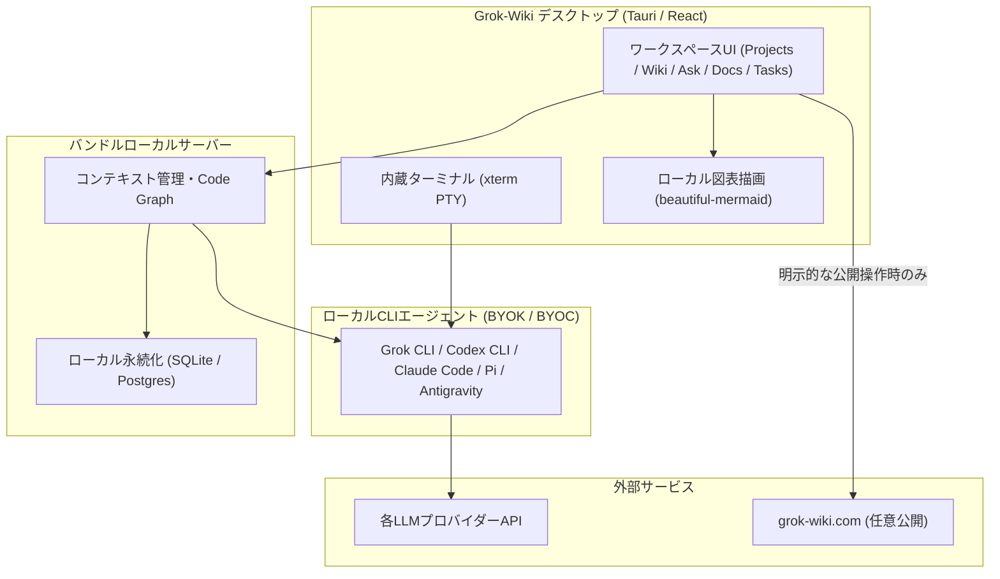

# **Grok-Wiki 調査レポート**

## **1. 基本情報**

* **ツール名**: Grok-Wiki
* **ツールの読み方**: グロックウィキ
* **開発元**: AsyncFuncAI
* **公式サイト**: [https://grok-wiki.com/](https://grok-wiki.com/)
* **関連リンク**:
  * GitHub: [https://github.com/AsyncFuncAI/grok-wiki](https://github.com/AsyncFuncAI/grok-wiki)
* **カテゴリ**: ドキュメント生成
* **概要**: ローカルのCLIエージェント（Grok CLI、Codex CLI、Claude Code、Pi、Antigravity CLI）をバックエンドに利用し、GitHubリポジトリやローカルフォルダからソースコードに基づく技術Wiki、アーキテクチャガイド、質問応答（Ask）、ドキュメントサイト（Docs）、タスクボード（Tasks）を生成・管理できるmacOS（Apple Silicon）向けローカルファーストのデスクトップワークスペース。同開発元のOSSプロジェクトであるDeepWiki-Openの発展系として位置づけられている。

## **2. 目的と主な利用シーン**

* **解決する課題**: リポジトリの構造やコードの意図を把握するためのドキュメント作成・調査作業を、ソースコードやAPIキーを独自クラウドに預けることなく、手元のローカルCLIエージェントと統一されたGUIワークスペースで自動化する。
* **想定利用者**: 開発者、テクニカルライター、OSSコントリビューター
* **利用シーン**:
  * 初めて参加するプロジェクトや大規模OSSのコードベースを理解するための技術Wiki・コードマップ生成
  * 既存プロジェクトのアーキテクチャや依存関係（Code Graph活用）の可視化と、ファイル・行番号の根拠付き質問応答（Ask）
  * Askで得た調査結果をナレッジベース（Knowledge Bases）にカードとして蓄積したり、Tasksボードへ切り出してローカルエージェントに実装・修正を実行させるワークフロー

### **2.1 代表的な利用フロー**

```mermaid
swimlane-beta TB
  subgraph User["ユーザー"]
    A["リポジトリやローカルフォルダを指定"]
    E["Wiki・Ask・Tasksの結果を確認"]
  end
  subgraph App["Grok-Wiki デスクトップ"]
    B["Code Graphとコンテキストを準備"]
    D["成果物を生成しローカルライブラリに保存"]
  end
  subgraph Agent["ローカルCLIエージェント"]
    C["手元の認証情報でコード解析・推論を実行"]
  end
  subgraph Cloud["grok-wiki.com (任意)"]
    F["読み取り専用スナップショットを公開"]
  end
  A --> B
  B --> C
  C --> D
  D --> E
  E -->|明示的な公開操作時のみ| F
```

* **代表的な流れ**: ユーザーが対象リポジトリやローカルフォルダを指定すると、Grok-Wikiがコンテキスト（必要に応じてCode Graphを含む）を準備し、選択されたローカルCLIエージェントに推論を委譲する。生成されたWikiやAsk回答、Docs、Tasksの履歴はローカルライブラリに保存され、ユーザーが明示的に公開操作を行った場合のみ `grok-wiki.com` へ読み取り専用スナップショットとして公開される。

## **3. 主要機能**

* **Wiki生成 (Generate Wiki)**: GitHubリポジトリURLやローカルフォルダ（`.git` を含まないフォルダも可）を指定し、メンタリティモデル、デバッグマップ、機能調査などの用途別フォーマットで技術Wikiやスライドプレビューを自動生成する。生成前の短い確認インタビュー（Guided Wiki）にも対応。
* **リポジトリへの質問 (Ask)**: 単一または複数リポジトリを横断して質問を行い、ソースコードのファイルや行番号を根拠として回答する。スクリーンショット添付、フォローアップのキューイング、フローティングアウトライン表示、読み取り専用リンクとしての共有に対応。
* **Docs生成 & Docs Chat**: リポジトリからドキュメントサイト構造（MDX形式等）を生成し、ドキュメントページ上で直接質問・フォローアップを行えるインプレースのDocs Chat機能を提供する。
* **Tasksボード & 内蔵ターミナル**: Askの調査結果からバックログカード・エピック・サブタスクを抽出し、選択したローカルCLIエージェントでタスクを実行できる。xtermベースのPTY内蔵ターミナル（`Cmd+D` / `Cmd+Shift+D` による画面分割対応）で実行ログをリアルタイムに監視可能。
* **Knowledge Bases（ナレッジベース）**: Askセッションの内容をソース根拠付きの学習カードとして抽出し、既存のカードと統合してカード/リスト形式で閲覧したり、プライベートリンクで共有したりできる。
* **Code Graph（オプトイン）**: リポジトリの構造・依存関係をグラフとして準備し、AskやWiki生成時に根拠あるコンテキストとして活用する。
* **マルチエージェント対応 & 公開・エクスポート**: Grok CLI、Codex CLI、Claude Code、Pi（Pi.Codex / Pi.Claude）、Antigravity CLIに対応。Markdown ZIPエクスポート（Obsidian等向け）や `grok-wiki.com` への公開ライブラリ機能を備える。

## **4. 動作原理・システム構成**

* **アーキテクチャ**: TauriベースのmacOSデスクトップアプリケーション（Reactフロントエンド）と、アプリにバンドルされたローカルサーバーで構成される**ローカルファースト・BYOK/BYOC（Bring Your Own Key / CLI）アーキテクチャ**を採用している。
* **主要コンポーネントとデータフロー**:
  * **デスクトップUI（Tauri / React）**: `Projects`（`Cmd+1`）、`Wiki`（`Cmd+2`）、`Ask`（`Cmd+3`）、`Docs`（`Cmd+4`）、`Tasks`（`Cmd+5`）および `Quick Open`（`Cmd+P`）を提供。Mermaid図はリモートスクリプトに依存せず、ローカルの `beautiful-mermaid` パッケージのみでレンダリングする。
  * **バンドルローカルサーバー & 永続化層**: リポジトリのコンテキスト構築、Code Graphの準備、実行履歴・成果物の永続化（SQLiteおよびバックグラウンドPostgres再接続制御）を担当し、高頻度ストリーミング時のメモリ肥大化を抑える制御を備える。
  * **ローカルCLIエージェント連携**: アプリがAPIキーを直接保持するのではなく、ユーザーのログインシェル環境（npm / pnpm / Bun / Volta / asdf / mise / nvm / fnm やプロキシ設定 `NO_PROXY` / CAバンドルを含む）から検出したCLI実行ファイルを起動し、認証・モデル呼び出しを各CLIへ委譲する。



## **5. 開始手順・セットアップ**

* **前提条件**:
  * macOS（Apple Silicon: M1 / M2 / M3 / M4）
  * いずれか1つ以上のローカルエージェントCLIがインストール・認証済みであること（Grok CLI、Codex CLI、Claude Code、Pi、Antigravity CLI）
* **インストール/導入**:
  1. GitHubの [Releases](https://github.com/AsyncFuncAI/grok-wiki/releases) から署名・公証済みの最新 `.dmg` ファイル（例: `Grok-Wiki_<version>_aarch64.dmg`）をダウンロードする。
  2. `.dmg` を開き、`Grok-Wiki.app` を `/Applications` へドラッグ＆ドロップする。
* **初期設定**:
  1. `Grok-Wiki.app` を起動すると、初回オンボーディング画面が表示される。
  2. 使用するローカルCLIエージェント、外観テーマ、アプリUI言語（英語・日本語・簡体字中国語・韓国語）を選択する。未インストールの場合はアプリ内にセットアップ手順が表示される。
* **クイックスタート**:
  1. `Projects` またはランチャーからGitHubリポジトリURL、またはローカルフォルダのパスを指定する。
  2. 必要に応じてWikiフォーマットやエージェントランタイムを選択し、生成を開始する（生成完了時はネイティブ通知やDockバッジで通知される）。

## **6. 特徴・強み (Pros)**

* **徹底したローカルファースト & BYOK/BYOC設計**: APIキーや認証情報をGrok-Wiki本体に渡す必要がなく、各CLIエージェント側の権限・認証経路をそのまま利用するためセキュア。
* **ドキュメント生成を超えた統合ワークスペース**: Wiki生成だけでなく、複数リポジトリ横断のAsk、Docs Chat、Knowledge Bases、Tasksボード、画面分割対応のxtermターミナルまで1つのアプリに統合されている。
* **マルチエージェントのシームレスな切り替え**: Grok、Codex、Claude、Pi、Antigravityを用途や好みに応じて切り替えでき、特定モデルUnavailable時の自動フォールバックにも対応。
* **厳格なプライバシー境界**: オプションのテレメトリ（PostHog）においても、プロンプト、回答、ソースコード、パス、キー、実行ログなどの機密ペイロードを送信せず、オプトアウト設定もクライアント・ローカルサーバー双方に同期される。
* **多言語UIと出力言語の分離**: デスクトップUIは日本語を含む4言語に対応しつつ、生成されるWikiの出力言語はUI設定とは独立して制御できる。

## **7. 弱み・注意点 (Cons)**

* **対応OSの制約**: 現時点の公式配布バイナリはmacOS（Apple Silicon）専用であり、Windows、Linux、Intel Macでは利用できない。
* **外部CLIエージェントへの依存**: アプリ単体ではLLM推論を行えないため、別途対応するローカルCLIエージェントの導入と認証（および各サービスの利用枠・API課金）が必須となる。
* **v0.0.x系の急速な開発段階**: 非常に高頻度で機能追加や安定性改善が行われている初期リリース段階（v0.0.x）であり、仕様変更や一部ワークフローの調整が入る可能性がある。なお、公開GitHubリポジトリ（`AsyncFuncAI/grok-wiki`）の `main` ブランチには `README.md` と `skills/` が公開されており、アプリ本体はReleasesのバイナリとして配布されている。

## **8. 料金プラン**

| プラン名 | 料金 | 主な特徴 |
|---------|------|---------|
| **無料版 (デスクトップアプリ)** | 無料 | Wiki生成、Ask、Docs、Tasks、Knowledge Bases、公開共有など全機能が利用可能。別途各CLIエージェントの利用料が必要。 |

* **課金体系**: Grok-Wikiアプリケーション自体は完全無料。バックエンドとして呼び出す各ローカルCLIエージェント側のサブスクリプション（ChatGPT Plus/Pro、Claude Pro/Max等）またはAPI従量課金はユーザー負担となる。
* **無料トライアル**: なし（アプリ本体は制限なく無料利用可能）。

## **9. 導入実績・事例**

* **導入企業**: 個人・開発者向けのローカルファーストツールであり、企業単位の公式導入事例は公開されていない。
* **導入事例**: `grok-wiki.com` の公開ライブラリ（Public library）上では、`stablyai/orca`、`warpdotdev/warp`、`twentyhq/twenty`、`timescale/tigerfs` といったオープンソースプロジェクトのWikiやDocsがサンプル・ショーケースとして公開されている。
* **対象業界**: ソフトウェア開発、テクニカルライティング、OSS開発・コードリーディング

## **10. サポート体制**

* **ドキュメント**: GitHubリポジトリの [README.md](https://github.com/AsyncFuncAI/grok-wiki/blob/main/README.md) および同梱の `skills/`（`grok-wiki-cli`、`grok-wiki-custom`）が公式ガイドとして提供されている。
* **コミュニティ**: [GitHub Issues](https://github.com/AsyncFuncAI/grok-wiki/issues) を通じたバグ報告・要望受付、および公式サイト上のショートフィルム（Episodes）やXアカウントによる情報発信。
* **公式サポート**: エンタープライズ向けの有償サポート窓口は公開されていない。コミュニティベースのサポートとなる。

## **11. エコシステムと連携**

### **11.1 API・外部サービス連携**

* **API**: 外部向けのREST APIは公開されていない（デスクトップアプリ内部のバンドルローカルサーバー経由で動作）。
* **外部サービス連携**:
  * **GitHub / ローカルGit・非Gitフォルダ**: リポジトリURLやローカルパスを直接読み込んで解析可能。
  * **ローカルCLIエージェント群**: Grok CLI、Codex CLI、Claude Code、Pi（Pi.Codex / Pi.Claude）、Antigravity CLIと標準連携。
  * **grok-wiki.com**: 生成したWiki、Askセッション、Knowledge Baseの読み取り専用スナップショット公開機能。

### **11.2 技術スタックとの相性**

| 技術スタック | 相性 | メリット・推奨理由 | 懸念点・注意点 |
|:---|:---:|:---|:---|
| **各種ローカルCLIエージェント** | ◎ | Grok CLI, Claude Code, Codex, Pi, Antigravityと標準連携。PATHやプロキシ設定もログインシェルから自動継承。 | 事前に各CLIのインストールと認証（`grok login` 等）が必要。 |
| **Obsidian / Markdownツール** | ◎ | Markdown ZIPエクスポートやローカル保存により、そのままナレッジベースへ取り込み可能。 | 特になし。 |
| **macOS (Apple Silicon)** | ◎ | 署名・公証済みのネイティブDMGおよびTauri自動アップデータを標準提供。 | Intel Macは非対応。 |
| **Windows / Linux** | × | 2026年11月時点で公式ビルドは提供されていない。 | インストール不可。 |

## **12. セキュリティとコンプライアンス**

* **認証**: アプリケーション独自のアカウント作成やログインは不要。モデルアクセス認証はすべて各ローカルCLIエージェント側が保持し、Grok-Wiki本体はAPIキーを保存・保持しない。
* **データ管理**: Wiki、Ask履歴、Docs、Tasks、Knowledge Basesはすべてローカルマシン上に保存される。`grok-wiki.com` への公開はユーザーが明示的にクリックした場合のみ行われる。テレメトリ送信時もプロンプト・回答・コード・パス・キーは除外され、例外報告もトークンやメールアドレス等をマスクした上で送信される（オプトアウトで完全無効化可能）。
* **準拠規格**: 公式なエンタープライズ向け認証（SOC2、ISO27001等）の取得状況は公式サイトで公開されていない。ただしmacOS向け配布バイナリはAppleの署名・公証（Signed & Notarized）を受けている。

## **13. 操作性 (UI/UX) と学習コスト**

* **UI/UX**: `Cmd+1`〜`5` によるビュー切り替え、`Cmd+K` 検索、`Cmd+P` によるQuick Open（ファジーファイル検索＆即時プレビュー）、`Cmd+Shift+Space` のグローバルホットキーなど、キーボード中心で高速に操作できる洗練されたデスクトップUIを備える。英語・日本語・簡体字中国語・韓国語の4言語UIに対応。
* **学習コスト**: 低。初回オンボーディングでエージェントとUI言語を選ぶだけですぐに使い始められ、リポジトリURLやローカルフォルダを指定すれば数クリックでWiki生成やAskを開始できる。

## **14. ベストプラクティス**

* **効果的な活用法 (Modern Practices)**:
  * **Ask → Knowledge Base / Tasks の連続ワークフロー**: 大規模コードベースをAskで調査した後、重要な知見をKnowledge Baseカードへ抽出し、修正や実装が必要な項目をTasksボードに起票して内蔵ターミナル上のローカルエージェントに実行させる。
  * **Code Graphの有効化とQuick Openの併用**: 依存関係が複雑なリポジトリでは設定からCode Graphを有効にして精度を高め、`Cmd+P` で関連ソースを即座にプレビューしながらWikiを読み進める。
  * **Obsidian連携**: 生成したWikiをMarkdown ZIPでエクスポートし、個人のローカルナレッジベースとして継続管理する。
* **陥りやすい罠 (Antipatterns)**:
  * 選択したCLIエージェントのモデルが利用不可、または認証切れの状態で実行すると失敗するため、設定画面のReadiness表示やプロバイダーアカウント状態を確認してから生成を開始する。
  * 公開ライブラリへのPublishは読み取り専用ページとして外部から閲覧可能になるため、非公開プロジェクトのWikiを公開する際は対象範囲に注意する。

## **15. ユーザーの声（レビュー分析）**

* **調査対象**: GitHub（Star/Releases）、技術ブログ・解説記事、公式サイト（grok-wiki.com）
* **総合評価**: G2やCapterraなどのB2Bレビューサイトには未掲載だが、同開発元の `deepwiki-open` からの進化系ローカルファーストワークスペースとして開発者コミュニティで注目を集めている。
* **ポジティブな評価**:
  * 「自分のCLIエージェントと認証ループを変えずに、リッチなGUIでWiki生成からAsk、Tasksまで回せるのが便利。」
  * 「APIキーをアプリに渡さず、テレメトリでもコードやプロンプトを送らないローカルファースト設計が安心できる。」
  * 「Markdown出力がきれいで、ObsidianへのエクスポートやQuick Openでのソース確認が快適。」
* **ネガティブな評価 / 改善要望**:
  * 「WindowsやLinux、Intel Macにも対応してほしい。」
  * 「長時間のストリーミングやローカルCLIとの通信環境によっては、タイムアウトや環境PATH差異の調整が必要になるケースがあった（v0.0.23〜v0.0.38で順次改善中）。」
* **特徴的なユースケース**:
  * 複数リポジトリを同時に参照するマルチリポジトリAskを活用し、別プロジェクトの設計パターンを比較・学習する「スタディパートナー」としての利用。

## **16. 直近半年のアップデート情報**

* **2026-08-18**: v0.0.38 をリリース。高頻度なAsk/Wikiストリームイベントによる長時間セッション時のメモリ肥大化を解消し、Postgres再接続バックログの結合・制限、ネイティブターミナルの順序付き増分ストリーミング、アイドル時のアダプティブポーリングを導入。
* **2026-08-08**: v0.0.37 をリリース。英語・日本語・簡体字中国語に加えて、韓国語デスクトップUIに完全対応（生成Wikiの出力言語設定とは独立）。
* **2026-08-05**: v0.0.36 をリリース。Code Graphによるリポジトリ認識コンテキスト準備の信頼性を向上し、長時間ローカルエージェントストリームでのデフォルトモデル自動リトライおよびDocs Chatのアクティブ会話スコープ制御を強化。
* **2026-08-02**: v0.0.33〜v0.0.35 をリリース。Orcaスタイルのターミナルプロジェクトレール、オプトインのCode Graphサポート、`Cmd+P` によるプロジェクト横断Quick Open（ファジー検索・即時プレビュー）、プロバイダーアカウント・使用量表示、Askフォローアップのセッション復元修正を追加。
* **2026-06-16**: v0.0.31 をリリース。Mermaid図表の描画をローカルの `beautiful-mermaid` パッケージのみに統一し、リモートスクリプトを許可しない厳格なCSPへ移行。
* **2026-06-10**: v0.0.27 をリリース。Askの調査結果からバックログカード・エピック・サブタスクを抽出してローカルエージェントで実行できる「Tasksボード」と、Ask/Clarifyへのスクリーンショット添付機能を追加。
* **2026-06-09**: v0.0.26 をリリース。Askセッションを根拠付きカードへ蒸留・統合できる「Knowledge Bases」と、生成前の短い確認質問を行うガイド付きWiki/Askインタビューフローを追加。
* **2026-06-06**: v0.0.22 をリリース。xtermベースのPTY内蔵ターミナル（`Cmd+D` / `Cmd+Shift+D` 分割対応）と、完了時のネイティブ通知・Dockバッジ通知を追加。
* **2026-06-04**: v0.0.20 をリリース。ローカルCLIピッカーの修正や安定性向上。
* **2026-06-02**: v0.0.17 をリリース。Docs Chat機能の追加により、ドキュメントページ上で直接Q&Aが可能に。
* **2026-05-25**: v0.0.14 をリリース。Pi.CodexとPi.Claudeをローカルエージェントランタイムとしてサポート。

(出典: [GitHub Releases](https://github.com/AsyncFuncAI/grok-wiki/releases) )

## **17. 類似ツールとの比較**

### **17.1 機能比較表 (星取表)**

| 機能カテゴリ | 機能項目 | 本ツール | Code Wiki | DeepWiki-Open | Claude Code |
|:---:|:---|:---:|:---:|:---:|:---:|
| **基本機能** | ドキュメント生成 | ◎<br><small>Wiki/Docs/ナレッジ統合</small> | ◎<br><small>コード変更に自動追従</small> | ◎<br><small>OSSでWiki/図表生成</small> | △<br><small>CLI操作・実装が主</small> |
| **環境** | ローカル実行 | ◎<br><small>デスクトップ+CLI連携</small> | △<br><small>Web版メイン</small> | ◎<br><small>Dockerセルフホスト</small> | ◎<br><small>完全ローカルCLI</small> |
| **セキュリティ** | プライバシー保護 | ◎<br><small>BYOK/BYOC・ローカル保存</small> | △<br><small>公開リポジトリ中心</small> | ◎<br><small>自社環境で完結可</small> | ◎<br><small>API直接通信</small> |
| **対応OS** | クロスプラットフォーム | ×<br><small>Mac (Apple Silicon)限定</small> | ◎<br><small>ブラウザ</small> | ◎<br><small>Docker対応OS</small> | ◎<br><small>主要OS対応</small> |

### **17.2 詳細比較**

| ツール名 | 特徴 | 強み | 弱み | 選択肢となるケース |
|---------|------|------|------|------------------|
| **本ツール (Grok-Wiki)** | 複数CLIエージェントを活用するローカルファーストワークスペース | BYOK/BYOC、Wiki+Ask+Docs+Tasks統合、Obsidian連携 | macOS (Apple Silicon) 専用 | Mac上で手元の複数CLIエージェントを活かし、セキュアにコード理解とタスク実行を行いたい場合 |
| **Code Wiki** | GoogleのAI（Gemini）がコードを解析しWikiを自動生成 | コード変更への自動追従、ダイアグラム生成に強い | プライベートリポジトリ対応（CLI拡張）はウェイトリスト制 | 公開リポジトリの調査やGoogleのエコシステムを主軸に使う場合 |
| **DeepWiki-Open** | 同開発元AsyncFuncAIによるOSSのWiki生成Webアプリ | 完全OSSでDockerセルフホスト可能、多様なLLM/Ollama対応 | DockerやAPIキー設定など導入・運用の技術的ハードルがある | Linux/Windowsサーバー上でチーム向けにセルフホストWiki基盤を立てたい場合 |
| **Claude Code** | Anthropic公式の自律型コーディングエージェント | Claude 4.5 / Opus 5等の強力な推論力でのコード編集・調査 | GUIがなく、WikiやKnowledge Baseのような閲覧体験には向かない | ターミナルやIDE内で直接コードの変更やコマンド実行を自律的に行いたい場合 |

## **18. 総評**

* **総合的な評価**:
  Grok-Wikiは、単なる「リポジトリからのWiki自動生成ツール」から進化し、ローカルCLIエージェント（Grok CLI、Codex CLI、Claude Code、Pi、Antigravity CLI）を駆動エンジンとする統合型のローカルファースト開発ワークスペースへと成長した。APIキーやソースコードを独自クラウドに預けないBYOK/BYOC設計を維持しながら、Wiki生成、複数リポジトリ横断Ask、Docs Chat、Knowledge Bases、Tasksボード、内蔵ターミナルまでを一気通貫で提供する完成度は非常に高い。
* **推奨されるチームやプロジェクト**:
  * 既存コードのドキュメント化やオンボーディング資料の整備が遅れているプロジェクト
  * セキュリティポリシー上、WebベースのSaaSへソースコードやAPIキーを預けられない環境のmacOS（Apple Silicon）開発者
* **選択時のポイント**:
  現状はmacOS（Apple Silicon）専用である点と、別途CLIエージェントのセットアップが必要な点が導入条件となるが、Apple Silicon Mac環境で複数の最新AIエージェントを使い分けながら、コード理解からナレッジ化・タスク実行までを効率よく回したい開発者にとって極めて有力な選択肢となる。
