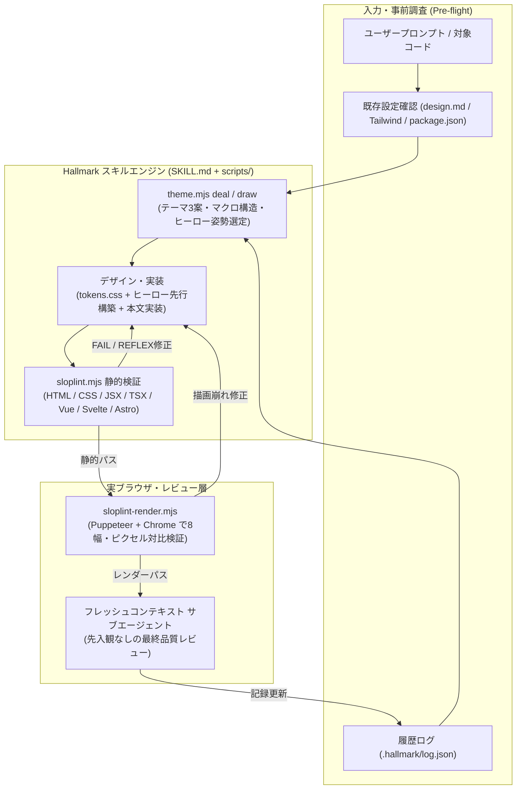

# **Hallmark 調査レポート**

## **1. 基本情報**

* **ツール名**: Hallmark (`Nutlope/hallmark`)
* **ツールの読み方**: ホールマーク
* **開発元**: Nutlope (Hassan El Mghari) / Together AI
* **公式サイト**: [https://www.usehallmark.com/](https://www.usehallmark.com/)
* **関連リンク**:
  * GitHub: [https://github.com/Nutlope/hallmark](https://github.com/Nutlope/hallmark)
* **カテゴリ**: エージェントスキル/標準仕様
* **概要**: Hallmarkは、Claude Code、Codex CLI、Cursor、OpenCodeなどのAIコーディングエージェント向けに開発された「アンチAIスロップ（Anti-AI-slop）」設計スキルおよび検証フレームワークです。LLMがデフォルトで生成しがちな画一的な紫グラデーションや均等カード羅列といった量産型UIを排除し、約50種類のマテリアルテーマ、用途（Job）駆動のページ構成、ゼロ依存の機械的リンター（`sloplint.mjs`）と実ブラウザ検証を通じて、人間が設計したような完成度の高いWebページを構築・リデザインします。

## **2. 目的と主な利用シーン**

* **解決する課題**: AIコーディングエージェントにWebページの実装を指示すると、紫〜青のグラデーション、見出し上の小さなアイブロウ（Eyebrow）、トラッキングされた大文字ラベル、架空の統計数値、空のプレースホルダー枠など、いわゆる「AI Slop（AIが量産した没個性なUI）」に収束しやすいという課題を解決します。
* **想定利用者**: フロントエンドエンジニア、個人開発者、スタートアップのプロダクトチーム、AIコーディングエージェントでランディングページやWebアプリUIを高速に構築したいデザイナー・開発者。
* **利用シーン**:
  * 新規プロダクトやサービスのランディングページ・Webページを、用途（予約、購入、購読、試用など）に最適化されたレイアウトでゼロから生成するシーン
  * 既存のWebページやアプリ画面（`./src/app` や `index.html`）を対象に、既存のリンク・フォーム・イベントハンドラを壊さずにデザインシステムのみを刷新（`/hallmark redesign`）するシーン
  * 既存サイトのコントラスト比、フォーカスリング、レスポンシブ崩れ、AI特有の定型表現を自動診断（`/hallmark audit`）するシーン

### **2.1 代表的な利用フロー**

```mermaid
swimlane-beta TB
  subgraph User["ユーザー"]
    A["要件や対象パスを指示"]
    F["生成・検証結果を確認"]
  end
  subgraph Agent["AIコーディングエージェント"]
    B["Pre-flightで既存構成を把握"]
    D["ヒーロー先行構築と全体実装"]
    E["別コンテキストで最終レビュー"]
  end
  subgraph Hallmark["Hallmarkスクリプト"]
    C["theme.mjsでテーマ・構成を選定"]
  end
  subgraph Browser["ヘッドレスブラウザ"]
    G["sloplint --renderで8幅描画検証"]
  end
  A --> B
  B --> C
  C --> D
  D --> G
  G --> E
  E --> F
```

* **代表的な流れ**: ユーザーが新規作成やリデザインを指示すると、AIエージェントがプロジェクトの既存トークンや `design.md` を読み取った上で `theme.mjs` から重複しないテーマとページ解剖図（Anatomy）を取得します。エージェントはまずヒーロー領域を単体で実装・検証した後にページ全体を構築し、`sloplint.mjs --render` によるヘッドレスブラウザでの多幅レンダリング検査とフレッシュコンテキストでのサブエージェントレビューを経てユーザーへ返却します。

## **3. 主要機能**

* **3層品質ゲート（Floor / Reflex / Finish）**: 絶対に妥協しない必須基準「Floor」（CSS変数トークン強制、`:focus-visible`、`prefers-reduced-motion`、架空データ禁止、モバイルレイアウト破綻禁止など）、理由を明記すればCSSスタンプコメントで例外承認できる「Reflex」、品質の仕上げ項目である「Finish」の3段階で品質を統制します。
* **約50種類のマテリアルテーマとテーマディール（`theme.mjs deal`）**: 紙面質感・タイポグラフィ・配色・コンポーネント特性を定義した約50種のテーマ（Dusk、Cobalt、Studio、Atelier、Ribbonなど）を収録し、過去の生成履歴（`.hallmark/log.json`）と重複しない3候補を自動提示して単一パターンへの収束を防ぎます。
* **用途（Job）駆動のページ解剖図と21種のマクロ構造**: 「予約する」「購入する」「購読する」「試す」など訪問者の目的（Job）に応じた行動導線（`anatomy.md`）と、21種類の構造パターン（Bento Grid、Workbench、Catalogue、Narrative Workflow等）を組み合わせて設計します。
* **カスタムモード（`custom`）**: ユーザーが既存テーマを使わない自由設計を求めた場合、既成のレイアウトやパレットレシピを外し、`direction.md` とFloorゲートのみを基盤としてクライアント固有のコンセプトからデザインを導出します。
* **ゼロ依存リンター＆実ブラウザ検証（`sloplint.mjs`）**: Node.js 18+のみで動作する静的検査に加え、`--render` オプションでChrome/Puppeteerを起動し、複数ビューポート（8幅）での見切れ・コントラスト・Tabフォーカス・セクションリズムを自動検証します。
* **既存ページのリデザイン＆監査（`redesign` / `audit`）**: `redesign` モードでは変更前のリンク・フォーム項目・ハンドラを `sloplint --before` で記録し、変更後に `--kept` で欠落がないかを強制検証します。`audit` モードではコードを書き換えずに問題点のみをレポートします。
* **実プロダクト撮影＆オープンライセンス写真カタログ（755枚）**: `capture.mjs` によりローカル開発サーバーやURLのスクリーンショットを自動撮影できるほか、Wikimedia Commons由来のオープンライセンス写真755枚のメタデータ（`photos.json`）からクレジット付きで実画像を組み込めます。

## **4. 動作原理・システム構成**



* **アーキテクチャ**: ローカルファーストの**エージェントスキル・CLIスクリプトハイブリッド構成**です。中核となる指示書（`skills/hallmark/SKILL.md` および `references/` 配下のジャンル・テーマ・ゲート定義群）をAIコーディングエージェントがコンテキストとして読み込み、決定論的な選定や検証処理をローカルのNode.jsスクリプト群（`skills/hallmark/scripts/*.mjs`）に委譲します。
* **主要コンポーネントとデータフロー**:
  * **Pre-flight & キャッシュ**: プロジェクトルートの `design.md` / `DESIGN.md`、既存CSSトークン、フレームワーク構成を走査し、`.hallmark/preflight.json` に保存します。
  * **選定エンジン（`theme.mjs`）**: OKLCH色空間ベースのテーマ定義と `.hallmark/log.json` の履歴を照合し、直近のビルドと軸が重複しないテーマ・構造をシード値付きで抽選（`deal` / `draw`）します。
  * **機械的検証（`sloplint.mjs` / `sloplint-render.mjs`）**: `.html` や `.css` に加え、`.jsx` / `.tsx` / `.vue` / `.svelte` / `.astro` のTailwindクラス文字列や `cn`/`clsx`/`cva` 呼び出しも静的解析します。`--render` 指定時はヘッドレスChrome上で実際に描画し、背景ピクセルとのコントラスト比やファーストビュー収容（1280x800）を測定します。
* **特筆すべき要素技術**:
  * **CSSスタンプによる決定トレーサビリティ**: 生成されたCSSの先頭コメントに選択テーマ、批評スコア、Reflexゲートの免除理由（`waive`）を構造化記録し、リンターが根拠の妥当性を自動検証します。
  * **編集時フック（`install-hook.mjs` / `lint-hook.mjs`）**: Claude Code向けにファイル編集時の自動Floorチェックフックを組み込むことが可能です。

## **5. 開始手順・セットアップ**

* **前提条件**:
  * Node.js 18以上
  * 対応するAIコーディングエージェント（Claude Code、Codex CLI、Cursor、OpenCode、GitHub Copilotなど）
  * （任意）実ブラウザ検証（`sloplint --render`）およびスクリーンショット撮影を行う場合は Chrome と `puppeteer-core`
  * アカウント登録・クレジットカード登録は不要（完全ローカル実行）
* **インストール/導入**:

  ```bash
  # 全プロジェクト共通（グローバル）でスキルを追加
  npx skills add nutlope/hallmark -g

  # 特定のエージェント（例: Claude Code）のみに導入する場合
  npx skills add nutlope/hallmark -g --agent claude-code

  # 実ブラウザ検証を有効にする場合（任意）
  npm i -g puppeteer-core
  ```

  * Claude Codeプラグインとして導入する場合は、セッション内で `/plugin marketplace add nutlope/hallmark` 実行後に `/plugin install hallmark@hallmark` を実行します。
* **初期設定**:
  * 基本的な利用に必須のAPIキーや設定ファイルはありません。
  * 既存のブランドシステムを強制したい場合は、プロジェクトルートに `design.md`（または `DESIGN.md`）を配置しておくと Pre-flight で自動優先されます。
  * 任意で環境変数 `TOGETHER_API_KEY` が設定されている場合、デザインカンプ・画像生成ステップ（`comp.md` / `imagegen.mjs`）と連携します。
* **クイックスタート**:

  ```text
  # AIエージェント上で新規ページを設計・構築
  /hallmark 開発者向けのローカルファーストMarkdownノートアプリのランディングページを作成して

  # 既存ページのリデザインまたは監査
  /hallmark redesign ./src/app
  /hallmark audit ./index.html
  ```

## **6. 特徴・強み (Pros)**

* **「AIっぽさ」の言語化と機械的強制力の高さ**: 単なるプロンプト集ではなく、AIが陥りがちなパターンを具体的なゲート番号（Floor / Reflex / Finish）として定義し、ゼロ依存のリンター `sloplint.mjs` で機械的に弾くため、出力品質の下限が極めて高く安定しています。
* **連続利用でもデザインが被らない設計**: `.hallmark/log.json` に過去のテーマや構造軸を記録し、`theme.mjs` が重複を避けて異なるマテリアル・マクロ構造を提示するため、複数ページや複数案件を作っても同じ見た目になりません。
* **既存コードを壊さないリデザイン機構**: `sloplint --before` と `--kept` の仕組みにより、既存ページのリンク先、フォームフィールド、イベントハンドラ、テストフックの欠落を自動検知しながら安全なUI刷新が可能です。
* **オープンライセンス写真の安全な活用**: UnsplashやPexelsなどの規約でAIによる自動選定が制限されるストックサイトを避け、Wikimedia CommonsのCC0/CC BY系写真755枚をクレジット付きで安全に組み込めます。

## **7. 弱み・注意点 (Cons)**

* **トークン消費量と生成時間の増加**: Pre-flight分析、テーマ選定、ヒーロー単体構築・レビュー、全体構築、`sloplint --render` ループ、最終サブエージェントレビューという多段階フローを経るため、通常の1ショットプロンプト生成に比べて待ち時間とLLMトークンコストが増大します。
* **日本語環境・日本語タイポグラフィへの対応**: スキル定義（`SKILL.md`）、リファレンス、テーマ定義はすべて英語で記述されており、日本語フォントの組み方や和文組版（文字詰め・禁則・フォントウェイト選定）に特化した公式ガイドラインは提供されていません。
* **モデルやテーマによる過剰演出のリスク**: コミュニティレビューでも指摘されている通り、コンテキストによっては極端なディスプレイ書体（ブラックレター等）が選ばれることがあり、最終的なブランド適合性は人間による確認・微調整が必要です。

## **8. 料金プラン**

| プラン名 | 料金 | 主な特徴 |
|---|---|---|
| **オープンソース版 (MIT)** | 無料 | 全機能（50テーマ、21マクロ構造、`sloplint.mjs`、`theme.mjs` 等）を商用・非商用問わず無制限に利用可能 |

* **課金体系**: ツール自体の利用料金は完全無料（MITライセンス）です。ただし、Hallmarkを実行するAIコーディングエージェント（Claude Code、Cursor、Codex等）のLLM API・サブスクリプション利用料、および任意で画像生成連携（`TOGETHER_API_KEY`）を使う場合のTogether AI API利用料はユーザー負担となります。
* **無料トライアル**: オープンソースのため試用期限や機能制限はありません。

## **9. 導入実績・事例**

* **導入企業**: 特定の商用導入企業名の公式ケーススタディは公開されていませんが、開発元であるTogether AIの支援のもとオープンソースとして公開され、GitHubリポジトリはスター数60,000超・フォーク数3,300超（2026年11月時点）と世界中の個人開発者・スタートアップ・フロントエンド開発者に広く利用されています。
* **導入事例**: 公式サイト（[usehallmark.com](https://www.usehallmark.com/)）では、銀行照合SaaS（Duskテーマ）、Webhook APIサービス（Cobaltテーマ）、デザインスタジオ（Studioテーマ）、香水アトリエ（Atelierテーマ）、睡眠アプリ（Ribbonテーマ）など、業種・用途別の実例ページがショーケースとして公開されています。
* **対象業界**: Webサービス・SaaS開発、クリエイティブエージェンシー、EC・予約サイト制作、個人開発プロダクト全般。

## **10. サポート体制**

* **ドキュメント**: GitHubリポジトリの `README.md`、`ROADMAP.md`、`CONTRIBUTING.md`、および `skills/hallmark/references/` 内の各種リファレンス（テーマ仕様、ゲート定義、リデザイン手順等）と公式サイト（[usehallmark.com](https://www.usehallmark.com/)）が整備されています。
* **コミュニティ**: GitHub IssuesおよびPull Requestsを通じて活発なバグ報告・機能改善（Windows環境対応、各フレームワーク対応など）が行われており、Reddit（`r/BestGitHubRepos` 等）やX（Twitter）でも開発者間で知見が共有されています。
* **公式サポート**: OSSプロジェクトのため有償の電話・SLA付きサポート窓口は用意されていません。不具合報告や質問はGitHub Issues（英語）にて受け付けています。

## **11. エコシステムと連携**

### **11.1 API・外部サービス連携**

* **API**: REST API型のSaaSではなくローカル実行型のスキル・CLIスクリプト群であるため、Web APIは提供していません。`sloplint.mjs` は `--json` フラグにより機械可読なJSON形式で検査結果を出力し、他ツールやCIパイプラインと連携できます。
* **外部サービス連携**:
  * **AIコーディングエージェント（ハーネス）**: Claude Code、Codex CLI、Cursor、OpenCode、GitHub Copilot
  * **Skills CLI**: `npx skills add nutlope/hallmark` によるクロスエージェント配布標準
  * **Puppeteer / Chrome**: `--render` モードおよび `capture.mjs` による実ブラウザ描画・撮影
  * **Inspo MCPサーバー**: `mcp__inspo__*` ツールが環境内に存在する場合、Pre-flightのシグナルとして自動連携
  * **Together AI API**: `TOGETHER_API_KEY` 設定時のデザインカンプ・画像生成（`imagegen.mjs`）
  * **Wikimedia Commons**: `photos.json` に収録された755枚のオープンライセンス写真データ

### **11.2 技術スタックとの相性**

| 技術スタック | 相性 | メリット・推奨理由 | 懸念点・注意点 |
|:---|:---:|:---|:---|
| **素のHTML / CSS** | ◎ | 最も想定された出力形式で、CSS変数・スタンプ・`sloplint` の全ゲートが完全動作 | 大規模アプリの状態管理は別途構成が必要 |
| **React / Next.js (JSX / TSX)** | ◎ | `sloplint.mjs` が `.jsx`/`.tsx` やTailwind、`cn`/`clsx`/`cva` を直接解析可能 | コンポーネント分割時はCSSトークン配置の配慮が必要 |
| **Vue / Svelte / Astro** | ◯ | `.vue` / `.svelte` / `.astro` ファイルの静的解析に対応 | `--render` 検証には開発サーバー起動（`--url`）が必要 |
| **Tailwind CSS** | ◯ | Tailwind設定の自動読み取りとTailwindユーティリティのsloplint解析に対応 | Floorゲートにより `:root` トークン経由の色・フォント管理が必須 |
| **ネイティブモバイル / デスクトップアプリ** | × | Webブラウザ（HTML/CSS/DOM）前提の設計・検証機構 | Web技術ベース以外のUIには非対応 |

## **12. セキュリティとコンプライアンス**

* **認証**: ローカルで完結するCLIスクリプトおよびMarkdown指示書であるため、ツール独自のユーザー認証・SSO・アカウント管理機能はありません。
* **データ管理**: プロジェクトコードや設定キャッシュ（`.hallmark/preflight.json`、`.hallmark/log.json`）はすべてユーザーのローカル環境に保存され、Hallmark側サーバーへのコード送信は行われません（実際に送信される先は、ユーザーが利用しているAIエージェントのLLMプロバイダのみです）。リポジトリには `SECURITY.md` が整備されています。
* **準拠規格**: OSSローカルツールであるためSOC2やISO27001等のクラウドサービス向け認証は該当しません。公式サイトでクラウドSaaSとしてのコンプライアンス認証取得は公開されていません。

## **13. 操作性 (UI/UX) と学習コスト**

* **UI/UX**: 専用のGUI管理画面を持たず、AIコーディングエージェントのチャット欄（`/hallmark` や `$hallmark`、または自然言語での指名）とCLIコマンドで完結します。テーマ一覧のプレビューは公式サイト（[usehallmark.com](https://www.usehallmark.com/)）で視覚的に確認できます。
* **学習コスト**: 導入自体は `npx skills add nutlope/hallmark -g` の1コマンドで完了し非常に容易です。一方、独自の設計ルール（Floor/Reflexゲートや `waive` 記述法、`design.md` 連携）を深く使いこなすにはリファレンスを一読する必要があります。

## **14. ベストプラクティス**

* **効果的な活用法 (Modern Practices)**:
  * **既存プロジェクトでは `design.md` を先に用意する**: ブランドカラーやタイポグラフィが確定している場合、ルートに `design.md` を配置することでHallmarkが既存デザインシステムを最優先で尊重します。
  * **既存UIの改修には必ず `redesign` か `audit` を明示する**: 通常の微修正にHallmarkを誤発動させず、全面刷新したいときだけ `/hallmark redesign <path>` を使うことで、配線破壊や不要なトークン消費を防げます。
  * **ローカル開発サーバーへ `--url` で検証する**: ReactやNext.jsプロジェクトではビルド前後の実ページを `node sloplint.mjs --url http://localhost:3000` で直接検査すると精度が高まります。
* **陥りやすい罠 (Antipatterns)**:
  * **通常のUI微修正にHallmarkを使ってしまう**: `SKILL.md` でも禁止されている通り、既存画面のボタン1つの修正などに使うと過剰な再設計が走りやすくなります。
  * **`--render` 無しで完了とする**: 静的解析だけではビューポートの重なりや背景画像上のコントラスト不足を見落とすため、重要なページでは必ず `puppeteer-core` + Chrome環境を用意して `--render` を実行することが推奨されます。
  * **Floorゲートを `waive` しようとする**: Floorゲートは例外免除不可であり、スタンプに `waive` を書いてもリンターに拒否されます。

## **15. ユーザーの声（レビュー分析）**

* **調査対象**: Reddit（`r/BestGitHubRepos` 等の技術コミュニティ）、GitHub Discussions / Issues、X (Twitter) および技術ブログの公開レビュー
* **総合評価**: 4.5/5.0相当（GitHubスター60,535件、コミュニティ上で高品質UI生成スキルとして高評価）
* **ポジティブな評価**:
  * 「素のAIエージェントが1分で作る紫グラデーションの量産型ページと比べ、Hallmarkを通した出力は明らかに人の手で仕上げたような完成度になる」（Redditレビューより要約）
  * 「ダミーのグレーボックスや架空の数値を入れず、実在するオープンライセンス写真や実際のアプリ画面キャプチャを組み込んでくれる点が実用的」（技術コミュニティ評価より要約）
  * 「新規作成だけでなく `/hallmark audit` を使って既存ページの余白崩れやコントラスト違反を洗い出す使い方が非常に便利」（開発者レビューより要約）
* **ネガティブな評価 / 改善要望**:
  * 「複数ステップの計画・構築・ブラウザ検査を回すため、通常のコード生成よりも実行時間が長くトークン消費も大きくなる」（Redditレビューより要約）
  * 「稀にプロンプトの業種（モダンなカフェなど）に対して極端に個性的なフォント（ブラックレター等）を選んでしまうことがあり、人間の目での軌道修正が必要」（コミュニティ報告より要約）
  * 「`--render` によるブラウザ検証を動かすために別途Chromeと `puppeteer-core` を入れる手間がかかる」（開発者コメントより要約）
* **特徴的なユースケース**:
  * ハッカソンや新規SaaSの立ち上げ時に、AIに丸投げしても「AI製だと一目で分かる見た目」にならないランディングページを短時間で用意する用途。
  * 既存アプリのフロントエンドを壊さずにモダンなテーマへ刷新する際の安全網（`redesign` + `--kept` 検証）としての活用。

## **16. 直近半年のアップデート情報**

* **2026-11-11**: 全テストファイルの一括CI実行設定、`CONTRIBUTING.md`・`AGENTS.md`・`SECURITY.md`・Issue/PRテンプレートを整備しOSS開発体制を強化。
* **2026-11-05〜2026-11-10**: Windows環境での `capture.mjs` 画像パス区切り（スラッシュ）問題、同一ファイル名ルートのスクリーンショット衝突、テーマダイアログ表示、CRLF環境でのビルドヒントなど複数の不具合を修正。
* **2026-11-04**: `--render` の1440px幅検証、`--scope app` 時のゲート85スキップ処理、アプリ足場生成コマンドを改善。
* **2026年秋（v2.0.0）**: 50種類のマテリアルテーマ、21種類のマクロ構造、用途（Job）駆動設計、`redesign` / `audit` モード、755枚のオープンライセンス写真カタログ、`sloplint --render` 実ブラウザ検証を統合したv2.0.0へ刷新。

(出典: [Hallmark GitHubリポジトリ](https://github.com/Nutlope/hallmark) / [コミット履歴](https://github.com/Nutlope/hallmark/commits/main) / [ROADMAP.md](https://github.com/Nutlope/hallmark/blob/main/ROADMAP.md))

## **17. 類似ツールとの比較**

### **17.1 機能比較表 (星取表)**

| 機能カテゴリ | 機能項目 | Hallmark | Stitch Skills | design.md | Superpowers |
|:---:|:---|:---:|:---:|:---:|:---:|
| **デザイン品質管理** | アンチパターン静的/動的Lint | ◎<br><small>sloplint + 実ブラウザ8幅検証</small> | ◯<br><small>AST検証付きReact変換</small> | ×<br><small>フォーマット仕様のみ</small> | △<br><small>デザイン特化ではなくSDLC検証</small> |
| **デザインシステム** | テーマ・構造カタログ | ◎<br><small>50テーマ・21マクロ構造</small> | ◯<br><small>Google Stitch連携生成</small> | ◯<br><small>プロジェクト固有定義に特化</small> | ×<br><small>デザインテーマ非提供</small> |
| **既存コード刷新** | 配線保持リデザイン・監査 | ◎<br><small>redesign / audit / --kept</small> | △<br><small>新規生成・変換が中心</small> | ×<br><small>設計仕様の記述用途</small> | ×<br><small>汎用開発プロセス向け</small> |
| **ワークフロー統制** | TDD・開発プロセス強制 | △<br><small>UI設計とレビュー工程に特化</small> | △<br><small>UIビルド自律ループ中心</small> | ×<br><small>ドキュメント仕様</small> | ◎<br><small>TDD・worktree・2段階レビュー</small> |
| **マルチエージェント** | 対応ハーネス数 | ◯<br><small>Claude Code / Codex / Cursor / OpenCode</small> | ◎<br><small>Antigravity等主要ツール広く対応</small> | ◎<br><small>Markdown仕様で汎用</small> | ◎<br><small>16種の主要ハーネスに対応</small> |

### **17.2 詳細比較**

| ツール名 | 特徴 | 強み | 弱み | 選択肢となるケース |
|---|---|---|---|---|
| **Hallmark** | 「AI Slop」排除に特化したデザインスキル＆実ブラウザ検証フレームワーク | 50種のマテリアルテーマと3層ゲート、`sloplint --render` による視覚的品質保証が強力 | トークン消費・処理時間が増えやすく、日本語組版向けの最適化は限定的 | AIで量産型に見えない高品質なWebページやLPを新規構築・安全にリデザインしたい場合 |
| **Stitch Skills** | Google Stitch MCPと連携しUIデザイン生成からReact実装まで行う公式スキル集 | Google Stitchのデザイン生成能力とAST検証付きReact/React Native変換が直結 | Google Stitch MCPサーバーと認証設定が必須 | Google Stitchを基盤としてデザイン生成からフレームワーク実装まで一気通貫で行いたい場合 |
| **design.md** | AIエージェントにデザインシステムを伝達するための標準Markdown仕様 | W3C Design Token互換で軽量・シンプル。HallmarkのPre-flightからも参照可能 | 単体ではテーマ提案や自動Lint機能を持たない | 既存プロダクトの確定済みデザインシステムをAIエージェントへ正確に共有したい場合 |
| **Superpowers** | ブレインストーミングからTDD・Git worktree隔離まで強制する開発手法スキル | ソフトウェア開発ライフサイクル（SDLC）全体の規律と16ハーネス対応の広さ | UIデザインの審美性やビジュアルの画一化防止には特化していない | アプリケーションのバックエンドやロジックを含め、厳格なTDDで開発を進めたい場合 |

## **18. 総評**

* **総合的な評価**:
  * Hallmarkは、AIコーディングエージェントが生成するUIの最大の課題である「どれも同じに見える安っぽさ（AI Slop）」に対し、プロンプトの工夫だけでなく**テーマ抽選機構・用途駆動の解剖図・ゼロ依存リンター・実ブラウザ検査**というエンジニアリングの仕組みで正面から解決策を示した非常に優れたオープンソーススキルです。MITライセンスで無料公開されており、既存の `design.md` とも併用できる柔軟性を備えています。
* **推奨されるチームやプロジェクト**:
  * Claude Code、Cursor、Codex CLI、OpenCode等を使ってWebサイトやランディングページを制作する個人開発者、スタートアップ、フロントエンドチームに特に推奨されます。また、既存サイトのUX・アクセシビリティを壊さずデザインを刷新したいチームにも有効です。
* **選択時のポイント**:
  * 汎用的な開発プロセス全体（TDDや設計合意）を統制したい場合は **Superpowers**、Google Stitchのエコシステムを活用する場合は **Stitch Skills** が適していますが、「アウトプットされるWebページのデザイン品質とオリジナリティ」を最優先で引き上げたい場合は **Hallmark** が最も有力な選択肢となります。既存のデザイン規定があるプロジェクトでは `design.md` と組み合わせて運用することで最大の効果を発揮します。
