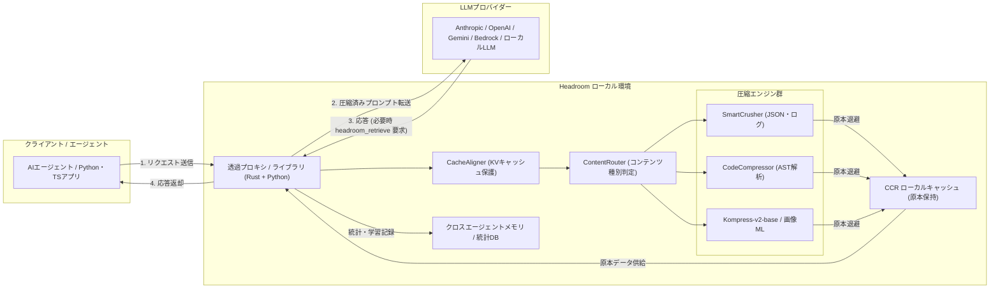

# **Headroom 調査レポート**

## **1. 基本情報**

* **ツール名**: Headroom
* **ツールの読み方**: ヘッドルーム
* **開発元**: Headroom Labs（Tejas Chopra 氏により開始、旧個人リポジトリ `chopratejas/headroom` から組織 `headroomlabs-ai` へ移行）
* **公式サイト**: [https://headroomlabs.ai](https://headroomlabs.ai)
* **関連リンク**:
  * GitHub: [https://github.com/headroomlabs-ai/headroom](https://github.com/headroomlabs-ai/headroom)
  * DeepWiki: [https://deepwiki.com/headroomlabs-ai/headroom](https://deepwiki.com/headroomlabs-ai/headroom)
  * ドキュメント: [https://docs.headroomlabs.ai/docs](https://docs.headroomlabs.ai/docs)
* **カテゴリ**: AIエディタ/IDE拡張
* **概要**: AIエージェントが読み込むツール出力、ログ、データベース結果、RAG検索結果、ソースコード、会話履歴などのコンテキストを、LLMに到達する前にローカル環境で高速に圧縮するコンテキスト最適化レイヤー。可逆的圧縮（CCR）やKVキャッシュ保護、出力トークン削減（Output Shaper）、クロスエージェントメモリ、失敗学習（`headroom learn`）を備え、回答精度を維持したままトークン消費とAPIコストを大幅に削減する。

## **2. 目的と主な利用シーン**

* **解決する課題**: AIエージェントが大量のビルドログ、コードベース、JSON応答を読み込むことで発生する膨大なトークン消費・レート制限到達・APIコスト増大、およびノイズによるLLMの推論精度低下を解決する。
* **想定利用者**: 開発者、SRE、AIエージェント（Claude Code、Cursor、Codex、Copilot等）を日常的に活用するエンジニア、およびチーム全体のAIコストを最適化したい開発組織。
* **利用シーン**:
  * AIコーディングエージェント（Claude Code、Cursor、GitHub Copilot CLI、OpenCode、Google Antigravity IDE等）を `headroom wrap` や透過プロキシ経由で動作させ、ツール実行結果や会話コンテキストを自動圧縮する
  * SREインシデントデバッグ時に大量のログやトレースデータをAIに解析させ、エラー行（FATAL等）を保持したまま冗長行を圧縮する
  * Python / TypeScript アプリケーションやRAGパイプラインにライブラリ・ミドルウェアとして組み込み、検索結果やAPI応答のトークン数を削減する

### **2.1 代表的な利用フロー**

```mermaid
swimlane-beta TB
  subgraph User["開発者 / アプリケーション"]
    A["開発タスクを指示・プロンプト送信"]
    G["圧縮統計や回答を確認"]
  end
  subgraph Agent["AIエージェント / SDK"]
    B["ツール出力や大量ログを含むリクエスト送信"]
    F["回答を受け取りタスクを続行"]
  end
  subgraph Headroom["Headroom (ローカルプロキシ / CCR)"]
    C["ContentRouterで種別判定し圧縮・原本をCCRへ保存"]
    E["出力制御・統計記録を行いレスポンスを中継"]
  end
  subgraph LLM["LLMプロバイダー"]
    D["圧縮済みプロンプトで推論（必要に応じCCR復元を要求）"]
  end
  A --> B
  B --> C
  C --> D
  D --> E
  E --> F
  F --> G
```

* **代表的な流れ**: 開発者がAIエージェントやアプリ経由で指示を出すと、Headroomのローカルプロキシ（またはライブラリ）がLLMへ送られる直前のコンテキストをインターセプトします。Headroomはデータの種別（JSON、コード、ログ、自然言語）に応じて最適な圧縮を適用し、原本をローカルのCCRキャッシュへ退避した上でLLMプロバイダーへ転送します。

## **3. 主要機能**

* **コンテキストの自動圧縮**: JSON配列・ネストオブジェクト向けの **SmartCrusher**、9言語以上対応のASTベース **CodeCompressor**、エージェントトレース学習済みモデル **Kompress-v2-base**、MLルーターによる画像圧縮を組み合わせ、データ型ごとに最適な圧縮を行う。
* **透過プロキシ & エージェントラッパー**: `headroom proxy` によるDrop-inプロキシに加え、`headroom wrap` コマンドで Claude Code、Codex、Cursor、GitHub Copilot CLI、VS Code Copilot、Google Antigravity IDE、OpenCode、Cline、Continue、Goose、OpenHands、Hermes 等18種以上のエージェントをコード変更なしでラップできる。
* **出力トークン削減（Output Shaper）**: システムプロンプト末尾に簡潔な出力指示を付加（KVキャッシュを破壊しない設計）して冗長な前置きやコードの再掲を抑制し、`headroom learn --verbosity` で過去の操作履歴から最適な簡潔度レベルを自動学習する。
* **CCR (Compress-Cache-Retrieve) 機構**: 圧縮された元データをローカルにキャッシュし、LLMが詳細を必要とした際に `headroom_retrieve` ツール（ストリーミング応答にも対応）を通じてオンデマンドで原本を復元できる可逆的圧縮システム。
* **キャッシュ最適化とライブゾーン圧縮**: `CacheAligner` によりKVキャッシュを無効化する揮発要素を検知しつつ、過去の凍結プレフィックスはバイト単位で保持し、最新のツール出力・ターンのみ（ライブゾーン）を圧縮する。
* **モデルルーター**: 条件（`max_output_tokens` 等）に応じて複数のアップストリーム（Anthropic Cloud、ローカル oMLX 等）へ振り分けるルーティング機能と、実ルーティングを行わず検証のみ行うシャドーモード（`HEADROOM_MODEL_ROUTER_LOG_ONLY`）を提供。
* **クロスエージェントメモリ & SharedContext**: Claude、Codex、Gemini、Grok など複数のエージェント間で重複排除付きの共有メモリ（HNSWベクトル検索対応）を保持し、マルチエージェント間でコンテキストを受け渡す `SharedContext` を備える。
* **`headroom learn`**: 失敗したエージェントセッションを自動解析し、再発防止のルールや修正知見を `CLAUDE.local.md`（デフォルト）、`CLAUDE.md`、`AGENTS.md`、`GEMINI.md`、`GROK.md` へ書き出す。
* **MCPサーバー統合**: MCP SDK 2.x 準拠のMCPサーバーとして動作し、`headroom_compress`、`headroom_retrieve`、`headroom_stats` ツールを提供する。
* **リアルタイムダッシュボード & システムトレイ**: `headroom dashboard`、`headroom savings`、`headroom output-savings` によりリクエスト単位の削減トークン数・削減金額（`cost_usd`）・CO₂削減量を可視化。v0.45.0からはオプトインのシステムトレイアイコンも追加された。

## **4. 動作原理・システム構成**

* **アーキテクチャ**: ローカルファーストのハイブリッド構成（Python製オーケストレーション層＋Rust製高速コアプロキシ＋ONNX Runtime）。圧縮処理およびCCRキャッシュはすべてユーザーのローカルマシン上で完結し、圧縮目的で外部サーバーへプロンプトやソースコードを送信しない。
* **主要コンポーネントとデータフロー**:
  1. **プロキシ / SDK受付層**: OpenAI（`/v1/chat/completions`, `/v1/responses`）、Anthropic（`/v1/messages`）、Gemini、Bedrock等のワイヤ形式を自動判別し、統一パイプライン（`Setup` → `Input Received` → `Input Cached` → `Input Routed` → `Input Compressed` → `Input Remembered` → `Pre-Send` → `Response Received`）へ渡す。
  2. **CacheAligner & ContentRouter**: プロンプトの凍結プレフィックスを保護しつつ、Magika（またはヒューリスティック）によりライブゾーン内のコンテンツ種別を判定する。
  3. **専用圧縮エンジン群**: JSONには統計的分散・異常値保持を行う `SmartCrusher`、コードにはAST解析を行う `CodeCompressor`、自然言語には `Kompress-v2-base` を適用する。
  4. **CCRストレージ & 拡張シーム**: 圧縮前の原本をローカルキャッシュへ格納し、`headroom_retrieve` 要求時に復元を返す。



* **特筆すべき要素技術**:
  * **Rustコア & ONNX Runtime（AVX2自動フォールバック）**: RustコアとONNX Runtimeにより10KトークンのJSON検索結果をp50 **0.21ms**（100Kトークンでも1.4ms）で圧縮。x86環境でAVX2が利用できない場合もBM25やヒューリスティック判定へ自動フォールバックする。
  * **プロバイダー別アダプタ分離**: `headroom/providers/` 配下に Claude、Copilot、Codex、Grok、OpenClaw、Gemini 等のランタイム差異を分離し、共通ライフサイクルを維持している。

## **5. 開始手順・セットアップ**

* **前提条件**:
  * Python 3.11以上（CLIツール導入は `uv tool install --python 3.13` を推奨）
  * TypeScript SDKを利用する場合は Node.js 18以上（別途ローカルプロキシが必要）
  * アカウント登録・クレジットカード登録不要
* **インストール/導入**:

  ```bash
  # CLI・プロキシ環境（uv による分離インストール推奨）
  uv tool install --python 3.13 "headroom-ai[all]"

  # Python ライブラリ / CLI（pip の場合。v0.44.0以降は [ml] や [memory] 等のPyTorch系extraは分離）
  pip install "headroom-ai[all]"

  # TypeScript / Node.js SDK（ライブラリのみ）
  npm install headroom-ai

  # Docker コンテナ版
  docker pull ghcr.io/headroomlabs-ai/headroom:latest
  ```

* **初期設定**:
  * 各種LLMプロバイダーのAPIキー（`OPENAI_API_KEY`、`ANTHROPIC_API_KEY` 等）を環境変数に設定する（設定値には実キー文字列ではなく環境変数参照を使用）。
  * 完全オフライン実行やテレメトリ停止が必要な場合は `HEADROOM_OFFLINE=1` または `HEADROOM_BEACON=off` を設定する。
* **クイックスタート**:

  ```bash
  # ターンキーでのローカル常駐セットアップ
  headroom deploy

  # 既存エージェントをラップして起動（例: Claude Code）
  headroom wrap claude

  # 透過プロキシとして起動
  headroom proxy --port 8787

  # ヘルスチェックとライブダッシュボード確認
  headroom doctor
  headroom dashboard
  ```

## **6. 特徴・強み (Pros)**

* **圧倒的な低レイテンシとローカル完結**: 圧縮処理がすべてローカルで動作し、10Kトークンあたり約0.21msとエージェントの体感遅延にほぼ影響を与えない。機密コードやログを外部の圧縮SaaSへ送る必要がない。
* **可逆的圧縮（CCR）とKVキャッシュの両立**: 単なる文字列切り捨てではなく、原本をキャッシュしてLLMからの `headroom_retrieve` 要求に応答できる。また、ライブゾーンのみを圧縮するためプロバイダーのPrompt Cacheヒット率を損なわない。
* **入力＋出力の双方向コスト削減**: コンテキスト圧縮に加え、Output Shaper によって出力トークン（入力の数倍の単価となる場合が多い）の冗長さも抑制できる。
* **極めて広いエコシステム対応**: 18種以上のコーディングエージェントのラップに加え、Python/TS SDK、LangChain、LiteLLM、Vercel AI SDK、Agno、Strands、MCP 2.x に標準対応する。

## **7. 弱み・注意点 (Cons)**

* **英語中心のドキュメント・UI**: 公式ドキュメント、CLIメッセージ、ダッシュボードは英語のみであり、日本語の公式ドキュメントやUIサポートは提供されていない。
* **Python環境やオプション依存の構築**: `headroom` CLIやプロキシはPython 3.11+環境に依存する（TypeScript SDK単体ではCLIが同梱されず、バックグラウンドプロキシの起動が必要）。また、MLモデル（`[ml]`）やHNSWベクトル検索（`[vector]`）等の拡張機能はPyTorchやC++ツールチェインを必要とする。
* **短文・散文での圧縮効果の限界**: 構造化データ（JSON、ログ、コード）では高い削減率を発揮する一方、短い会話プロンプトや既に高密度な自然言語テキストではほとんど圧縮されない。
* **CCR再取得によるラウンドトリップ**: LLMが詳細確認のため `headroom_retrieve` を頻繁に呼び出すワークフローでは、追加のツール呼び出しターンが発生して削減効果の一部が相殺される場合がある。

## **8. 料金プラン**

| プラン名 | 料金 | 主な特徴 |
|---------|------|---------|
| **Headroom OSS** | 無料 | Apache-2.0ライセンス。ライブラリ、透過プロキシ、MCPサーバー、CCR、Output Shaper、ダッシュボード等の全コア機能をローカルで利用可能 |
| **Headroom Enterprise / Teams** | 要問い合わせ | オンプレミス／VPCデプロイ、独自フォーマット向け最適化パイプライン、組織全体のTokens Secured・詳細アトリビューション分析、専任サポート・SLA |

* **課金体系**: OSS版は完全無料（Apache-2.0）。チーム・エンタープライズ向け機能はカスタム見積もり（問い合わせ窓口: `hello@headroomlabs.ai`）。
* **無料トライアル**: OSS版は常時無料で利用可能。

## **9. 導入実績・事例**

* **導入企業**: 具体的な導入企業名は非公開。ただしGitHub Stars 80,000超の広範な開発者コミュニティで採用されており、企業・チーム向けの Headroom Enterprise も展開されている。
* **導入事例（再現可能な公式ベンチマーク）**:
  * **SREインシデントデバッグ**: 55,957 トークン → 24,340 トークン（**57%削減**）
  * **コードベース探索**: 58,801 トークン → 33,895 トークン（**42%削減**）
  * **GitHub Issue トリアージ**: 46,067 トークン → 32,429 トークン（**30%削減**）
  * **コード検索（100件）**: 17,199 トークン → 13,597 トークン（**21%削減**）
  * **反復的なJSON配列・ログ**: **90%以上削減**（精度評価では GSM8K 0.870 維持、SQuAD v2・BFCL 97% 維持を確認）
* **対象業界**: ソフトウェア開発、SRE / IT運用、AIアプリケーション開発全般。

## **10. サポート体制**

* **ドキュメント**: [公式ドキュメント](https://docs.headroomlabs.ai/docs) が非常に充実しており、アーキテクチャ解説、ベンチマーク手法、企業ネットワーク（SSLインスペクション）対応ガイドに加え、AIエージェント向けの `llms.txt` / `llms-full.txt` も公開されている。
* **コミュニティ**: [Discord コミュニティ](https://discord.gg/yRmaUNpsPJ) および GitHub Issues / Discussions による活発なコミュニティサポートが存在する。
* **公式サポート**: OSS版はGitHub・Discord中心のコミュニティサポート。Enterprise版では専任サポートおよびSLA付きの導入支援（`hello@headroomlabs.ai`）が提供される。

## **11. エコシステムと連携**

### **11.1 API・外部サービス連携**

* **API互換**: OpenAI（Chat Completions / Responses API）、Anthropic Messages API、Google Gemini、AWS Bedrock、Azure Foundry、ローカルLLM（oMLX等）と互換性のあるHTTPプロキシとして動作。
* **MCP・周辺ツール連携**: MCP SDK 2.x 準拠サーバーを提供。コードナビゲーション用の **Serena**（`headroom wrap --code-memory serena` で自動統合）や出力制御用の **Ponytail** 等との併用が公式に推奨されている。

### **11.2 技術スタックとの相性**

| 技術スタック | 相性 | メリット・推奨理由 | 懸念点・注意点 |
|:---|:---:|:---|:---|
| **Python** | ◎ | ネイティブライブラリとして `compress()` をインプロセスで直接呼び出せる（ネット不要） | Python 3.11以上が必要 |
| **TypeScript (Node.js)** | ◯ | npmパッケージ（`withHeadroom` / `compress()`）が提供されている | 実行にはバックグラウンドでPython製のHeadroomプロキシプロセスが必要 |
| **Vercel AI SDK** | ◎ | `headroomMiddleware()` により `wrapLanguageModel` へシームレスに組み込める | プロキシプロセスの起動が前提 |
| **LangChain / LiteLLM / Agno / Strands** | ◎ | 専用のモデルラッパー・コールバック（`HeadroomChatModel`, `HeadroomCallback` 等）が提供されている | 各フレームワーク用extra（`[langchain]`等）の個別指定が必要 |
| **Docker / コンテナ環境** | ◎ | 公式イメージ（`ghcr.io/headroomlabs-ai/headroom:latest`）が提供されておりCIや常駐デプロイが容易 | x86非AVX2環境ではONNX高速化が無効（BM25等へ自動フォールバック） |

## **12. セキュリティとコンプライアンス**

* **認証とバイナリ検証**: プロキシやアップストリームTLSの検証にはOSの証明書ストア（企業のZscaler / Netskope / Palo Alto等のCA証明書を含む）を利用でき、`HEADROOM_CA_BUNDLE` や `HEADROOM_TLS_STRICT=0` による企業プロキシ環境への柔軟な対応が可能。バイナリ検証はフェイルクローズ設計（`HEADROOM_BINARIES_ALLOW_UNVERIFIED`）を採用している。
* **データ管理**: 圧縮処理とCCRキャッシュはすべてローカル完結であり、プロンプト本文やソースコードが圧縮のために外部送信されることはない。なお、デフォルトで匿名テレメトリ（圧縮率・OS・モデルID等の統計のみで、プロンプトやファイルパスは非送信）が有効だが、`HEADROOM_BEACON=off`、`DO_NOT_TRACK=1`、`HEADROOM_OFFLINE=1` で完全にオプトアウトできる。
* **準拠規格**: OSS版におけるSOC2やISO27001等の第三者認証取得は公開されていない。エンタープライズ向けにはオンプレミス／VPC内での閉域デプロイが提供されている。

## **13. 操作性 (UI/UX) と学習コスト**

* **UI/UX**: CLIベースながら `headroom deploy` や `headroom wrap <agent>` により1コマンドで導入・起動が完了する。また、`headroom dashboard` によるWebダッシュボードや、v0.45.0で追加されたオプトインのシステムトレイアイコンにより、削減トークン数やコスト削減額を直感的に把握できる。
* **学習コスト**: 既存のAIコーディングツールをラップして使う場合は極めて低い。一方、カスタムモデルルーティング、Output Shaperの調整、企業内SSLインスペクション環境での証明書設定など高度な運用を行う場合は公式ドキュメントの参照が必要となる。

## **14. ベストプラクティス**

* **効果的な活用法 (Modern Practices)**:
  * Claude CodeやCursorなどの日常的なコーディングエージェントでは `headroom wrap` または常駐プロキシ（`headroom deploy`）を使い、`--mode cache`（デフォルト）でKVキャッシュを維持しながらコンテキストを削減する。
  * `headroom learn` や `headroom learn --verbosity` を定期実行し、過去の失敗パターンや好まれる回答の簡潔度を `CLAUDE.local.md` やプロキシ設定へ自動反映させる。
  * サードパーティのOpenAI互換エンドポイント（DeepSeek、OpenRouter等）を使う場合は `--openai-api-url` または `OPENAI_TARGET_API_URL` を明示する。
* **陥りやすい罠 (Antipatterns)**:
  * TypeScript SDK（`npm install headroom-ai`）のみを導入し、バックグラウンドの `headroom proxy` を起動し忘れて接続エラーになるケース。
  * 短い雑談や1ターン完結の散文生成プロンプトに対して過剰に期待すること（構造化データや大規模ログ・コード探索で最大の効果を発揮する）。

## **15. ユーザーの声（レビュー分析）**

* **調査対象**: GitHub リポジトリ、Reddit（`r/ClaudeAI`、`r/PiCodingAgent`）、Hacker News
* **総合評価**: GitHub Stars **80,370** 以上（2026年11月時点）を獲得し、開発者コミュニティで極めて高い注目を集めている。
* **ポジティブな評価**:
  * コード探索、SREログ解析、Issueトリアージなどで大幅なトークン削減とコスト抑制を実感できる点。
  * 単純な文字列切り捨てではなく、AST解析や統計的JSON圧縮を組み合わせた堅牢性と、再現可能なベンチマークを公開している透明性。
  * 既存エージェント（Claude Code、Cursor、Copilot等）へ設定変更ほぼなしで透過導入できる手軽さ。
* **ネガティブな評価 / 改善要望**:
  * 新規コードの積極的な執筆や短い単発プロンプトでは削減効果が限定的になる点。
  * CCRによる原本再取得（`headroom_retrieve`）が頻繁に走ると、追加のAPIラウンドトリップが発生してメリットが薄れる場合がある点。
  * 企業のSSLインスペクション環境やWindows環境での認証・証明書設定に追加工数が必要な場合がある点。

## **16. 直近半年のアップデート情報**

* **2026-11-22**: **v0.45.0** リリース。オプトインのシステムトレイアイコン（削減カウンター・ダッシュボード・更新通知）、リクエストごとのモデル出力削減見積もり記録、OpenCode向け `--extra-model` フラグを追加。
* **2026-11-10**: **v0.44.0** リリース。PyTorch依存extraを `[all]` から分離しインストールを軽量化。Hermesエージェントのwrapサポート、モデルルーターのシャドーモード（`HEADROOM_MODEL_ROUTER_LOG_ONLY`）、損失なし `/v1/compress` モード、`/stats` でのリクエスト別 `cost_usd` 出力を追加。
* **2026-11-05**: **v0.43.0 / v0.43.1** リリース。MCPサーバーを **MCP SDK 2.x** へ移行し、ストリーミング応答中の `headroom_retrieve` に対応。Claude Code / Codex / Copilot / skills.sh 向けの Headroom スキルを追加。
* **2026-10-26**: **v0.42.0** リリース。リクエストごとの反実仮想（counterfactual）削減記録を追加し、OpenAI Responses API（HTTP / WebSocket）でのターンフック書き換えに対応。
* **2026-10-14**: **v0.41.0** リリース。**Google Antigravity IDE** へのネイティブ統合、OpenCode 2.x プラグインAPI対応、Rustプロキシ向けのネイティブ統計・ダッシュボード機能、Claude Code向けアニメーション拡張 `headroom-snip` を追加。
* **2026-10-06**: **v0.40.0** リリース。キャッシュ安全なライブエージェント向けデンス化モード（lossless and cache-safe）、ダッシュボードへの **CO₂ Saved** カード追加、`headroom learn` における Antigravity CLI（`agy`）バックエンド対応、`HEADROOM_LICENSE` 読み取りと利用状況レポートのオプトイン化を実施。
* **2026-08-05〜2026-08-22**: **v0.34.0〜v0.36.x** リリース。VS Code内の Claude Code (`headroom wrap vscode-claude`) および VS Code Copilot (`headroom wrap vscode`) の透過プロキシに対応。PHP対応のCodeCompressor、Anthropic `[1m]` 1Mコンテキスト層の価格・ルーティング対応、セキュリティ強化（WEB-01〜07対策）を実施。
* **2026-06-29**: **v0.28.0** リリース。`headroom learn` のデフォルト出力先を gitignore 対象の `CLAUDE.local.md` に変更し、CodeCompressor に Perl サポートを追加。
* **2026-06-04**: **v0.23.0** リリース。GitHub Copilot のサブスクリプションモードの認証とプロキシをサポート。
* **2026-06-01**: **v0.22.4** リリース。Cline、Continue、Goose、OpenHands などのCLIラッパー対応を追加。
* **2026-05-20**: **v0.22.2** リリース。メモリ機能の改善として、IDを利用したメモリ参照機能を追加。
* **2026-05-19**: **v0.22.0** リリース。特定のツールをプロキシ圧縮から除外する `--exclude-tools` フラグを追加。

(出典: [GitHub Releases](https://github.com/headroomlabs-ai/headroom/releases) )

## **17. 類似ツールとの比較**

### **17.1 機能比較表 (星取表)**

| 機能カテゴリ | 機能項目 | 本ツール (Headroom) | RTK | TokenEconomizer |
|:---:|:---|:---:|:---:|:---:|
| **基本機能** | コンテキスト・出力圧縮 | ◎<br><small>全データ型＋出力制御対応</small> | ◎<br><small>CLI出力＋パイプライン</small> | ◯<br><small>知識注入・ツール除外・ループ抑止</small> |
| **カテゴリ特定** | 透過プロキシ対応 | ◎<br><small>コード変更不要のHTTPプロキシ</small> | ◯<br><small>CLIフック＋rtk-proxy</small> | ×<br><small>エージェントプラグイン型</small> |
| **カテゴリ特定** | 可逆的圧縮(CCR) | ◎<br><small>LLMからオンデマンド復元</small> | ◯<br><small>rtk recallでローカルDB復元</small> | ×<br><small>セッション履歴学習型</small> |
| **カテゴリ特定** | ローカル処理 | ◎<br><small>ローカルで完結</small> | ◎<br><small>単一Rustバイナリで完結</small> | ◎<br><small>Python標準ライブラリで完結</small> |
| **拡張性** | クロスエージェントメモリ・学習 | ◎<br><small>共有メモリ＋learn機能</small> | ◯<br><small>rtk learnによるエラー学習</small> | ◎<br><small>Micro-skills自動学習</small> |

### **17.2 詳細比較**

| ツール名 | 特徴 | 強み | 弱み | 選択肢となるケース |
|---------|------|------|------|------------------|
| **本ツール (Headroom)** | あらゆるコンテキストをローカルで透過的かつ可逆的に圧縮 | LLM側がCCRで原本復元でき、JSON・AST・画像・出力トークンまで網羅。SDKやミドルウェアとしてアプリ組込みも可能 | Python 3.11+等の実行環境セットアップが必要 | コーディングエージェントから自作LLMアプリまで包括的にトークンコストを削減したい場合 |
| **RTK** | Rust製の高速CLIプロキシ＆パイプラインエンジン | 単一バイナリでコマンドあたり25ms未満の超低遅延動作。100種以上のCLIコマンド専用フィルタと `rtk-proxy` を提供 | v1.0以降は一部エンジン/プロキシがBUSL-1.1ライセンス（`rtk-oss`はApache-2.0） | シェルコマンド出力の高速圧縮と軽量バイナリでの導入を最優先したい場合 |
| **TokenEconomizer** | セッション履歴から学習するブラックボックス型プラグイン | 過去の作業履歴からリポジトリ知識（Micro-skills）を注入し、不要なMCPツール除外や失敗ループ検知を行う | 履歴学習前のコールドスタート期間は効果が出にくい | 同一リポジトリでの反復開発における「再探索・失敗ループ」を減らしたい場合 |

## **18. 総評**

* **総合的な評価**:
  * Headroom は、2026年後半の急速な進化（`headroomlabs-ai` への移行、GitHub Stars 80,000超、Rust製プロキシ、Output Shaper、Antigravity IDE や MCP SDK 2.x 対応）を経て、ローカルファーストのAIコンテキスト最適化基盤として圧倒的な完成度に達している。可逆的圧縮（CCR）とKVキャッシュ保護により精度とコスト削減を高い次元で両立している点が最大の強み。
* **推奨されるチームやプロジェクト**:
  * Claude Code、Cursor、GitHub Copilot、Antigravity IDE などのコーディングエージェントを日常的に利用し、トークン消費量やレート制限に課題を感じている開発チーム。また、大量のログやRAG検索結果を扱うLLMアプリケーション開発チーム。
* **選択時のポイント**:
  * 既存のCLI・IDEワークフローを変えずに即座に効果を得たい場合は `headroom wrap` や `headroom deploy` が最適であり、さらにシェル特化の超低遅延を求める場合は RTK、反復作業の知識蓄積を重視する場合は TokenEconomizer との比較・併用を検討するとよい。
