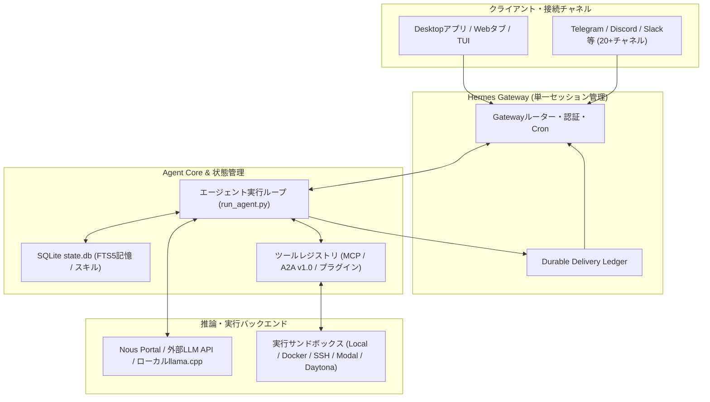

# **Hermes Agent 調査レポート**

## **1. 基本情報**

* **ツール名**: Hermes Agent
* **ツールの読み方**: エルメスエージェント / ハーメスエージェント
* **開発元**: Nous Research
* **公式サイト**: [https://hermes-agent.nousresearch.com](https://hermes-agent.nousresearch.com)
* **関連リンク**:
  * GitHub: [https://github.com/NousResearch/hermes-agent](https://github.com/NousResearch/hermes-agent)
  * DeepWiki: [https://deepwiki.com/NousResearch/hermes-agent](https://deepwiki.com/NousResearch/hermes-agent)
  * ドキュメント: [https://hermes-agent.nousresearch.com/docs/](https://hermes-agent.nousresearch.com/docs/)
* **カテゴリ**: 自律型AIエージェント
* **概要**: Nous Researchによって開発された、時間とともに成長し、自律的にタスクを実行するオープンソース（MITライセンス）のAIエージェントです。ローカルPCや$5程度のVPS、クラウドコンテナ上に常駐し、経験からスキルを自己生成・改善する学習ループと、CLI・デスクトップアプリ・20以上のメッセージングプラットフォームを単一ゲートウェイで統合する柔軟性を備えています。

## **2. 目的と主な利用シーン**

* **解決する課題**: 特定のIDEや単発のチャット画面に縛られず、過去の文脈や獲得したスキルを永続的に保持しながら、あらゆる端末・チャットツールからシームレスに呼び出せる自律的なAIアシスタントを構築すること。
* **想定利用者**: 開発者、研究者、インフラ運用者、高度な自動化を求めるパワーユーザー
* **利用シーン**:
  * 定期的なタスクの自動化（メモリ連携型Cronによる日次レポート作成、バックアップ、システム監査など）。
  * Telegram・Discord・CLI・デスクトップアプリ・ブラウザタブをまたいだ会話のシームレスな継続。
  * サーバー上での自律的なスクリプト実行、障害調査、LinearやNotion等の外部SaaS連携ワークフローの自動化。

### **2.1 代表的な利用フロー**

```mermaid
swimlane-beta TB
  subgraph User["ユーザー"]
    A["チャットやDesktopから指示を送信"]
    F["結果確認・必要に応じ操作介入"]
  end
  subgraph Gateway["Hermes Gateway"]
    B["単一セッションを受信・状態管理"]
    E["Durable Ledger経由で応答を配信"]
  end
  subgraph AgentCore["Agent Core・LLM"]
    C["永続メモリ・スキル参照と推論計画"]
  end
  subgraph Sandbox["実行環境・外部連携"]
    D["サンドボックス/MCP/外部APIを実行"]
  end
  A --> B
  B --> C
  C --> D
  D --> C
  C --> E
  E --> F
```

* **代表的な流れ**: ユーザーがCLI・Desktop・Telegram等の任意の窓口からタスクを依頼すると、単一ゲートウェイがセッションを一元管理し、Agent Coreが永続メモリ（`state.db`）とスキルを参照して計画を立案します。実際のコマンドやMCPツールは分離された実行環境で処理され、完了した結果はDurable Delivery Ledgerを通じて確実にユーザーへ配信されます（CAPTCHA等が発生した場合は人間が画面を引き継ぐことも可能です）。

## **3. 主要機能**

* **自己改善学習ループ**: エージェント自身がタスクの実行経験から再利用可能なスキル（`SKILL.md`）を自動作成し、利用を通じて改善し続けます。`/learn` による明示的なスキル化や、バックグラウンドでのスキル自律整理機能も搭載しています。
* **単一ゲートウェイによる統合セッション（v0.23+）**: マシンごとに1つのゲートウェイがすべてのセッションを所有し、CLI、TUI、Desktop、Webブラウザ、エディタ（ACP）、各種チャットボット、Cronジョブが同一の会話状態をリアルタイムに共有します。
* **マルチプラットフォーム・音声対話**: Telegram、Discord、Slack、WhatsApp Business Cloud API、iMessage（Photon Spectrum経由）、Signal、Email、Microsoft Teams、Google Chat、WeChatなど20以上のチャネルに対応。文節単位のストリーミングTTSと割り込み（Barge-in）、ローカルウェイクワード検出によるリアルタイム音声対話も可能です。
* **ネイティブDesktop & ブラウザワークスペース**: macOS、Windows（Microsoft Store MSIX対応）、Linux向けのネイティブデスクトップアプリに加え、ゲートウェイから標準ブラウザのタブとして全ワークスペースを展開できるWebapp機能を備えています。
* **キー不要オンボーディング & ローカルLLM対応**: 初回起動時は無料のトライアルモデル（`nous/welcome`）でガイド付きセットアップが可能。さらにワンクリックで `llama.cpp` ランタイムを起動し、ローカルのオープンウェイトモデルをオフライン実行できます。
* **マルチエージェント & Bot Mode**: `hermes peer` やDesktopのBot Modeにより、アバター付きの複数エージェントプロファイルによるグループチャットや `@メンション` 協調に対応。A2A（Agent-to-Agent）プロトコル v1.0 や、ゲートウェイ再起動後も継続可能な永続サブエージェント、`/goal` による自己検証・完了コントラクト（Coding Verification Evidence Ledger）も備えています。
* **MCP Command Center & プラグインエコシステム**: Model Context Protocol（MCP）サーバーの統合管理（ヘルスチェック、利用コスト上限設定、`hermes://` インストールリンク）と、1,050件以上のエントリを擁するプラグインカタログをサポートしています。
* **メモリ・スケジュール自動化**: SQLite + FTS5によるクロスセッション記憶検索、Honchoによるユーザーモデリング、スクラッチパッドや監視モードを備えたメモリ連携型Cronジョブを実行できます。
* **多様なサンドボックスとコネクタ**: Local、Docker、SSH、Modal、Daytona、Vercel Sandbox、Singularity/Apptainer等の実行バックエンドに加え、LinearやNotion等のHosted App Connectorsや、認証壁・CAPTCHA突破時に人間がブラウザを操作できる「Bot Screen Takeover」機能を搭載しています。

## **4. 動作原理・システム構成**

* **アーキテクチャ**: ローカルファーストかつゲートウェイ中心のクライアント・サーバー構成を採用しています。各マシン上で常駐する単一の `gateway/` プロセスが全セッションの正本（Single Source of Truth）を管理し、Desktopアプリ（Electron）、TUI（React/Ink）、Webapp、メッセージングアダプタがクライアントとして接続します。
* **主要コンポーネントとデータフロー**:
  * **オーケストレーション層（`run_agent.py` / `agent/`）**: ユーザー入力を受け取り、LLM推論・ツール呼び出し・自己検証ループを制御します。Mixture-of-Agents（MoA）やモデルフォールバックチェーンにも対応します。
  * **永続化・状態管理（`state.db` / `hermes_state.py`）**: 会話履歴、セッション系譜、ゲートウェイルーティングをローカルのSQLite（FTS5全文検索対応）に保存し、プロセス障害時にも応答が失われないDurable Delivery Ledgerを維持します。
  * **ツールレジストリ & 拡張（`tools/registry.py`）**: 85以上の組み込みツール、MCPサーバー、A2A v1.0エンドポイント、1,050以上のプラグインを統一インターフェースでLLMへ公開します。
* **特筆すべき要素技術**: Docker、SSH、Modal、Daytona、Vercel Sandboxなどの隔離されたターミナルバックエンド、ローカル推論用の `llama.cpp` / Ollama / vLLM連携、パスワードマネージャー（Bitwarden / 1Password）連携による安全なシークレット注入などを備えています。



## **5. 開始手順・セットアップ**

* **前提条件**:
  * macOS 12+、Windows 10/11（ネイティブ実行・WSL2両対応）、主要Linuxディストリビューション、Android（Termux）。
  * アカウント登録・クレジットカードはOSS版のローカル利用では不要（初回Desktop起動時はキー不要の `nous/welcome` トライアルモデルで対話可能）。
* **インストール/導入**:
  * **デスクトップアプリの場合**: 公式サイト（[ダウンロードページ](https://hermes-agent.nousresearch.com)）またはWindows向けMicrosoft Store（MSIXパッケージ）からインストーラーを取得して実行。
  * **CLI（Linux, macOS, WSL2）**:

    ```bash
    curl -fsSL https://hermes-agent.nousresearch.com/install.sh | bash
    ```

  * **CLI（Windows PowerShell・ネイティブ対応）**:

    ```powershell
    iex (irm https://hermes-agent.nousresearch.com/install.ps1)
    ```

* **初期設定**:
  * インストール後にシェルを再読み込みし、以下のコマンドで設定を開始します。
  * `hermes setup`（フルセットアップウィザード）
  * `hermes setup --portal`（Nous Portalを利用する場合、OAuthログインで200+モデルとTool Gatewayを自動設定）
  * 環境変数やローカル推論（`llama.cpp` / Ollama）を使う場合は設定画面または `hermes model` から選択します。
* **クイックスタート**:
  * `hermes`（インタラクティブCLI / TUIで会話を開始）
  * `hermes gateway`（マルチチャネルおよびWebapp向けのゲートウェイを起動）
  * `hermes doctor`（環境や依存関係の診断）

## **6. 特徴・強み (Pros)**

* **自己学習と永続記憶**: スキルの自動生成・整理とFTS5検索により、使い込むほどユーザー固有のワークフローに最適化される。
* **あらゆる場所から同一セッションへアクセス**: 単一ゲートウェイ構成により、外出先のTelegramから始めた作業を帰宅後にDesktopやブラウザタブでそのまま引き継げる。
* **圧倒的な導入・運用の柔軟性**: 無料のOSS＋ローカルモデル（`llama.cpp`）構成から、$5 VPSでのセルフホスト、公式の24時間クラウドコンテナ（Hermes Cloud）まで用途に応じて選べる。
* **巨大な拡張エコシステム**: MCP Command Center、A2A v1.0、1,050以上のプラグインカタログ、Linear/Notion等のコネクタにより外部ツール連携が容易。

## **7. 弱み・注意点 (Cons)**

* **自律実行に伴う安全性への配慮が必須**: 広範なファイル操作やターミナル権限をローカル環境にそのまま与えると意図しない変更を起こすリスクがあるため、Dockerや使い捨てVPS等でのサンドボックス隔離が強く推奨される。
* **高度な運用には技術知識が必要**: キー不要オンボーディングやDesktop版で初期導入の敷居は大きく下がったものの、常駐ゲートウェイやMCPサーバー、Cron自動化の本格運用には一定のCLI・インフラ知識を要する。
* **日本語対応の限界**: UIや公式ドキュメントは英語が中心であり、日本語での公式サポートやガイドは限定的である。

## **8. 料金プラン**

| プラン名 | 料金 | 主な特徴 |
|---------|------|---------|
| **OSS版 (BYOK / ローカルLLM)** | 無料 | MITライセンス。自身のAPIキーまたは `llama.cpp` 等のローカルモデルを利用。サーバー費用等は自己負担。 |
| **Nous Portal: Free** | $0/月 | 無料モデル（標準レート制限）と無料Web検索を試用可能。クラウド常駐や有料クレジットは非付属。 |
| **Nous Portal: Plus** | $20/月 | 月間$22相当のクレジット、200+モデル、Tool Gateway、**Hermes Cloud Agent 1基（RAM 4GB / ディスク 25GB）**、繰越上限$10。 |
| **Nous Portal: Super** | $100/月 | 月間$110相当のクレジット（Plusの約5倍）、高レート制限、**Hermes Cloud Agent 1基（RAM 4GB / ディスク 100GB）**、繰越上限$50。 |
| **Nous Portal: Ultra** | $200/月 | 月間$220相当のクレジット（Plusの約10倍）、最高レート制限、**Hermes Cloud Agent 1基（RAM 8GB / ディスク 100GB）**、繰越上限$100。 |

* **課金体系**: ソフトウェア自体は無料（MITライセンス）。Nous Portalを利用する場合は月額サブスクリプション（従量クレジットのプリペイド追加チャージも可）でモデル利用・Tool Gateway（Web検索、画像生成、TTS、クラウドブラウザ）・24時間稼働のHermes Cloudを一括利用できます。
* **無料トライアル**: Nous PortalのFreeティアおよび、Desktop初回起動時のキー不要トライアルモデル（`nous/welcome`）が用意されています。

## **9. 導入実績・事例**

* **導入企業**: オープンソースツールであるため特定の商用企業名の公式公開は限定的です。
* **導入事例**: ソフトウェア開発者、AI研究者、自動化エンジニアのコミュニティを中心に、個人用24時間常駐アシスタント、サーバー監視・自動修復、定期リサーチおよびレポート配信パイプライン、強化学習用トラジェクトリ生成基盤として広く活用されています。
* **対象業界**: ソフトウェア開発、AI・機械学習研究、ITインフラ運用、個人生産性向上

## **10. サポート体制**

* **ドキュメント**: 公式サイトに体系的なドキュメント（[https://hermes-agent.nousresearch.com/docs/](https://hermes-agent.nousresearch.com/docs/)）が整備されており、QuickstartからMCP・プラグイン開発まで網羅しています。
* **コミュニティ**: 非常に活発な公式Discordコミュニティ（[https://discord.gg/NousResearch](https://discord.gg/NousResearch)）およびGitHub Discussions / Issuesが存在します。
* **公式サポート**: OSS版はコミュニティおよびGitHub Issueベースのサポートが中心です。Nous Portalの有料プランやHermes Cloudに関するアカウント・課金サポートはNous Portal経由で提供されます。

## **11. エコシステムと連携**

### **11.1 API・外部サービス連携**

* **API / プロトコル**: MCP（Model Context Protocol）サーバーの統合管理、A2A（Agent-to-Agent）プロトコル v1.0、署名付きアウトバウンドWebhook、およびOpenAI互換エンドポイントに対応。プラグインSDKを通じた機能拡張も可能です。
* **外部サービス連携**:
  * **メッセージング**: Telegram、Discord、Slack、WhatsApp Business、iMessage（Photon Spectrum）、Signal、Email、SMS、Microsoft Teams、Google Chat、Matrix、Mattermost、WeChat、DingTalk、Feishu、WeCom等（20以上）。
  * **ビジネス・開発SaaS**: Linear、Notion（Hosted App Connectors）、GitHub、Home Assistant、Bitwarden / 1Password（シークレット管理）。
  * **推論プロバイダ**: Nous Portal、OpenRouter、OpenAI、Anthropic、Google Gemini、xAI（Grok）、ローカル（`llama.cpp`、Ollama、vLLM、SGLang）。

### **11.2 技術スタックとの相性**

| 技術スタック | 相性 | メリット・推奨理由 | 懸念点・注意点 |
|:---|:---:|:---|:---|
| **Python** | ◎ | コア実装およびスキル・プラグイン・RPCツールの拡張がPythonで統一されている | 環境分離には `uv` 等の理解が望ましい |
| **Docker / コンテナ** | ◎ | 公式DockerイメージおよびDockerサンドボックスバックエンドを標準装備し安全に隔離可能 | ボリューム権限やネットワーク設定の基礎知識が必要 |
| **Linux / macOS / VPS** | ◎ | 60秒インストーラと常駐ゲートウェイにより軽量VPSでも安定稼働する | 常時稼働させる場合はプロセス管理が必要 |
| **Windows (ネイティブ / WSL2)** | ◯ | PowerShellワンライナーおよびMicrosoft Store MSIXによりWSLなしでも動作可能 | 一部開発ツールのウイルス対策ソフト誤検知に注意が必要 |

## **12. セキュリティとコンプライアンス**

* **認証**: デバイスペアリング、コマンド実行前承認（Smart Approvals）、Webappアクセス時のサインイン認証、およびBitwarden / 1Password等のパスワードマネージャー連携によるセキュアな認証情報注入（Vault Secrets）をサポートしています。
* **データ管理**: Docker、SSH、Modal、Daytona、Vercel Sandbox等による実行環境の隔離と名前空間分離をサポート。ローカル構成（特に `llama.cpp` 併用時）では会話履歴（`state.db`）やスキルデータを完全に手元へ留めることが可能です。また、2FAやCAPTCHA遭遇時には人間が画面を引き継ぐ「Bot Screen Takeover」により認証情報の過度な委譲を防ぎます。
* **準拠規格**: オープンソースソフトウェアのため、コンプライアンス準拠（SOC2、GDPR等）は各ユーザーのホスティング環境および選択するLLMプロバイダの規約に依存します。

## **13. 操作性 (UI/UX) と学習コスト**

* **UI/UX**: インタラクティブなTUI（マルチライン編集、画像インライン表示、スラッシュコマンド補完、会話巻き戻し）に加え、ネイティブDesktopアプリ（Bot Mode、アバター付きグループチャット、Artifacts、サブエージェントのリアルタイム監視）およびブラウザタブで開けるWebappを提供しており、開発者から一般ユーザーまで扱いやすいUIを備えています。
* **学習コスト**: キー不要オンボーディングにより「最初の対話」までの学習コストは非常に低くなっています。一方、カスタムスキル設計、MCPサーバー連携、安全なサンドボックス構成を習得するには中程度の学習コストがかかります。

## **14. ベストプラクティス**

* **効果的な活用法 (Modern Practices)**:
  * ラップトップ上だけでなく、Docker隔離した常駐VPSまたはHermes Cloudへデプロイし、Telegram・Discord・Webタブからいつでも呼び出せる構成にする。
  * 定型業務は `hermes skills` や `/learn` でスキル化し、`/goal` の自己検証コントラクトと組み合わせて品質を担保する。
  * MCP Command Centerで paid MCP ツールの利用上限（Spend Limits）を設定し、予期せぬ課金を防止する。
* **陥りやすい罠 (Antipatterns)**:
  * ホストOSの重要ディレクトリへ無制限の書き込み権限を与えたまま自律実行させる（必ずDockerや専用ユーザーで隔離する）。
  * ラップトップのスリープ環境のみで運用し、Cronジョブや常駐ゲートウェイの恩恵を活かしきれない。

## **15. ユーザーの声（レビュー分析）**

* **調査対象**: GitHub（Star: 約264,200+）、Reddit、Hacker News
* **総合評価**: 開発者コミュニティから極めて高い支持を獲得（GitHubスター数が半年で約4.6万から26.4万超へと急成長）。
* **ポジティブな評価**:
  * 3層メモリと自己スキル生成ループにより、セッションを跨いで「使えば使うほど自分の環境に適応して賢くなる」点が画期的と評価されている。
  * $5〜$10の安価なVPSに常駐させ、TelegramやDiscordからインフラ操作やリサーチを非同期実行できる体験が高く支持されている。
  * 単一ゲートウェイ統合や `llama.cpp` によるローカル完結運用の自由度が好評。
* **ネガティブな評価 / 改善要望**:
  * 純粋なソフトウェア開発（SWE-bench的な単一リポジトリの深いコード編集）では、特化型のClaude Code等に軍配が上がる場面があるとの指摘。
  * 高い自律性ゆえに、適切なサンドボックス隔離を行わないと意図しないファイル変更を起こす危険性がある。
  * 多機能化に伴い、全設定やプラグインを使いこなすための学習負荷がやや高い。
* **特徴的なユースケース**:
  * $5 VPS上のDockerコンテナに常駐させ、スマートフォンのTelegramからサーバー監視・コード生成・Web調査を指示し、必要に応じてBot Screen Takeoverで認証を通過するパーソナルOpsアシスタント運用。

## **16. 直近半年のアップデート情報**

* **2026-11-16**: **v0.23.2** リリース。v0.23.1以降の約1,989件のPRを統合したパッチリリース。ゲートウェイ障害を跨いで継続できる永続サブエージェント、セッション単位のプロンプトキャッシュクロック、`hermes fallback check`、Gemini Interactions APIデフォルト化、Claude Mythos 5.2 fast mode等の基盤強化を実施。
* **2026-11-10**: **v0.23.1** リリース。プラグインカタログのクライアント受信上限を2 MiBから16 MiBへ引き上げ、TUIでのEscバックトラックやグループチャット安定性を改善。
* **2026-11-05**: **v0.23.0 "The Hearth Release"** リリース。ゲートウェイがDesktopワークスペース全体をブラウザタブへ配信するWebapp機能、全サーフェス（CLI/TUI/Desktop/Web/Bot/Cron）を統合する単一ゲートウェイ・セッション所有アーキテクチャ、ターミナル内インライン画像表示、1,050件超のプラグインカタログ、MCPコスト上限管理を追加。
* **2026-10-14**: **v0.22.0 "The Threshold Release"** リリース。無料トライアルモデル（`nous/welcome`）によるキー不要オンボーディング、`llama.cpp` ワンクリックローカルモデル実行、Linear/Notion向けHosted App Connectors、人間がブラウザ認証を引き継ぐBot Screen Takeover、Microsoft Store MSIX署名済みパッケージ、600件のプラグインカタログとコードベース約34%削減を達成。
* **2026-08-31**: **v0.21.0 "The Pantheon Release"** リリース。DesktopでのNative Bot Mode（アバター付きグループチャット・`@メンション`）、`hermes peer` によるボット間対話、メモリ連携Cronジョブ、サブエージェントのリアルタイム制御、MCP Command Centerを追加。
* **2026-08-03**: **v0.20.0 "The Herald Release"** リリース。文節ストリーミングTTSと割り込み（Barge-in）対応のリアルタイム音声対話、A2A（Agent-to-Agent）プロトコル v1.0、署名付きアウトバウンドWebhook、Grounded Citationsスキル、Desktop Artifacts・プラグインSDKを追加。
* **2026-07-20**: **v0.19.0 "The Quicksilver Release"** リリース。コールドスタートを約4.3秒から約0.9秒へ約80%高速化、Bitwarden/1Password連携のVault Secrets、Smart Approvals、Durable Delivery Ledger、サブエージェントのライブテレメトリを追加。
* **2026-07-01**: **v0.18.0 "The Judgment Release"** リリース。テスト・ビルド実測に基づく自己検証コントラクト（`/goal`）とEvidence Ledger、Mixture-of-Agents（MoA）プロバイダ、`/learn`・`/journey` 機能を追加。
* **2026-06-19**: **v0.17.0** リリース。Photon Spectrum経由のネイティブiMessage連携、WhatsApp Business Cloud API、非同期バックグラウンドサブエージェントを追加。
* **2026-06-06**: **v0.16.0 "The Surface Release"** リリース。macOS/Windows/Linux対応のネイティブElectronデスクトップアプリ、Web管理パネル、ファジーモデルピッカーを追加。
* **2026-05-29**: v0.15.2 リリース。macOS、Windows、Linux向けのデスクトップアプリがリリース。Windowsネイティブでの動作サポート、Nous Portalとの統合（`hermes setup --portal`）によるAPIキー管理の簡素化が追加されました。
* **2026-05-29**: v0.15.1 リリース。ダッシュボードのループバックモードでのリロードループ修正、MCPやDockerのバグフィックスを実施。
* **2026-05-28**: v0.15.0 "The Velocity Release" リリース。Kanbanマルチエージェント基盤の大幅拡張、Cold-startのパフォーマンス向上、TUIセッションオーケストレーター、新しい画像生成プロバイダーなどを追加。
* **2026-05-16**: v0.14.0 "The Foundation Release" リリース。Grokネイティブ対応、Microsoft Teamsエンドツーエンド連携、X (Twitter) 検索ツール等を追加。
* **2026-05-07**: v0.13.0 "The Tenacity Release" リリース。Kanbanマルチエージェントボード機能の拡充やGoogle Chat対応などを追加。
* **2026-04-30**: v0.12.0 "The Curator Release" リリース。バックグラウンドでのスキル自律整理機能、新しい推論プロバイダ等の追加。
* **2026-04-23**: v0.11.0 "The Interface Release" リリース。React/InkによるTUI刷新、QQBot対応、プラグインシステムの拡張。
* **2026-04-13**: v0.9.0 "The everywhere release" リリース。ローカルWebダッシュボード追加、Termux(Android)対応、iMessage、WeChat対応など。
* **2026-04-08**: Hermes Agent v0.8.0 リリース。バックグラウンドプロセスの自動通知、モデルのライブ切り替え等に対応。

(出典: [GitHub Releases](https://github.com/NousResearch/hermes-agent/releases) )

## **17. 類似ツールとの比較**

### **17.1 機能比較表 (星取表)**

| 機能カテゴリ | 機能項目 | 本ツール | OpenHands | OpenClaw | Claude Code |
|:---:|:---|:---:|:---:|:---:|:---:|
| **基本機能** | 常駐・自律動作 | ◎<br><small>単一ゲートウェイ常駐・Cron</small> | ◯<br><small>タスク単位の自律実行</small> | ◎<br><small>ローカル常駐アシスタント</small> | ◯<br><small>セッション中心・自己ホストランナー</small> |
| **学習・記憶** | 自己学習・永続記憶 | ◎<br><small>スキル自動生成＋FTS5記憶</small> | △<br><small>セッション内コンテキスト中心</small> | ◯<br><small>メモリ・スキル対応</small> | ◯<br><small>CLAUDE.md等による記憶</small> |
| **コーディング** | 深いコード編集・修正 | ◯<br><small>汎用実行＋/goal検証</small> | ◎<br><small>SWEタスク・Issue解決特化</small> | △<br><small>汎用操作が主目的</small> | ◎<br><small>Agentic search・Opus 5等</small> |
| **連携** | チャット・マルチチャネル | ◎<br><small>20+チャネル＋音声＋Webタブ</small> | △<br><small>Web UI / API連携中心</small> | ◎<br><small>WhatsApp, Telegram等多数</small> | ◯<br><small>CLI / IDE / Slack等</small> |
| **運用** | OSS・ローカルLLM対応 | ◎<br><small>MIT・llama.cppワンクリック</small> | ◎<br><small>MIT・Docker + BYOK</small> | ◎<br><small>OSS・完全ローカル動作</small> | ×<br><small>商用プラン必須（CLI一部公開）</small> |

### **17.2 詳細比較**

| ツール名 | 特徴 | 強み | 弱み | 選択肢となるケース |
|---------|------|------|------|------------------|
| **本ツール** | 自己学習ループと単一ゲートウェイ統合を持つ汎用自律エージェント | スキル自己改善、20+チャット連携、Desktop/Webタブ統合、MITライセンス | 純粋なSWEベンチ性能ではコーディング特化型に譲る場面がある | 日常のあらゆる端末から呼び出せ、使い込むほど成長する汎用AI基盤を求める場合 |
| **OpenHands** | ソフトウェア開発タスクの自律実行に特化したOSSエージェント | Dockerサンドボックスでの高精度なコード修正・PR作成 | 日常のチャットツール連携や音声対話などは主目的ではない | Issue解決からテスト・PR作成までの開発自動化を重視する場合 |
| **OpenClaw** | ローカルデバイス上で動作するプライバシー重視のパーソナルAIアシスタント | 完全ローカル実行による高いプライバシー性とチャット連携 | セットアップに技術的知識を要する | クラウドに極力依存せず個人PC上のパーソナルアシスタントを構築したい場合 |
| **Claude Code** | Anthropic提供のターミナル・IDE向け自律型コーディングエージェント | Claude最新モデルによる圧倒的なコード理解と編集精度 | Anthropic契約が前提で汎用常駐ボット用途には不向き | エンジニアの日常的なコードベース開発・リファクタリング効率を最大化したい場合 |

## **18. 総評**

* **総合的な評価**:
  * Hermes Agentは、単なるコーディングアシスタントやチャットラッパーを超え、経験からスキルを学習して成長し続ける「常駐型・汎用自律AIエージェント基盤」として群を抜いた完成度に達しています。特に2026年後半のv0.20〜v0.23系では、単一ゲートウェイによる全サーフェス統合、ブラウザタブでのワークスペース展開、`llama.cpp` によるローカル実行、1,050件超のプラグインエコシステムが揃い、個人からチームまで幅広く活用できるプラットフォームへと進化しました。
* **推奨されるチームやプロジェクト**:
  * 自動化ワークフローを自在に構築したい開発者、インフラ運用者、AIエージェント研究者、最新モデルやMCP/A2Aエコシステムをフル活用したいエンジニアチーム。
* **選択時のポイント**:
  * 純粋なリポジトリ内コーディング支援だけを求める場合はClaude CodeやOpenHandsが有力ですが、「PC・スマホ・チャット・スケジュール実行を単一の記憶とスキルで繋ぎ、自分専用に育てられるOSSエージェント」を求める場合、Hermes Agentは最有力候補となります。
