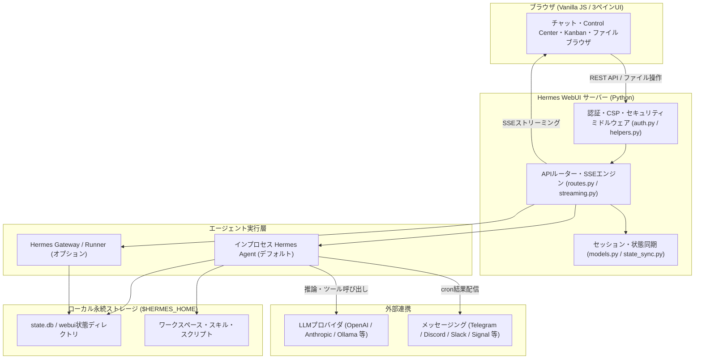

# **Hermes WebUI 調査レポート**

## **1. 基本情報**

* **ツール名**: Hermes WebUI
* **ツールの読み方**: ヘルメスウェブユーアイ
* **開発元**: オープンソースコミュニティ
* **公式サイト**: [https://get-hermes.ai/](https://get-hermes.ai/)
* **関連リンク**:
  * GitHub: [https://github.com/nesquena/hermes-webui](https://github.com/nesquena/hermes-webui)
  * DeepWiki: [https://deepwiki.com/nesquena/hermes-webui](https://deepwiki.com/nesquena/hermes-webui)
  * ドキュメント: [https://github.com/nesquena/hermes-webui/tree/master/docs](https://github.com/nesquena/hermes-webui/tree/master/docs)
* **カテゴリ**: エージェントエコシステム/基盤
* **概要**: Hermes Agentのための軽量で高機能なWebアプリケーションインターフェースです。ビルドやフレームワーク、バンドラーは不要で、Python標準ライブラリベースのHTTPサーバーとvanilla JSのみで構築されており、CLIとほぼ1:1の機能パリティをブラウザ上で提供します。

## **2. 目的と主な利用シーン**

* **解決する課題**: ターミナルで動作するHermes Agentの強力な機能（永続メモリ、ジョブスケジュール、マルチプロバイダ連携、スキル管理等）を、ブラウザから視覚的かつ直感的に利用・運用できるようにすること。
* **想定利用者**: 開発者、データサイエンティスト、AIエージェントを活用するシステム運用者
* **利用シーン**:
  * ブラウザからHermes Agentへアクセスし、チャットやサブエージェント委任、Kanbanタスクを実行・管理する。
  * ワークスペース内のファイルをプレビュー・Git操作しながら、AIエージェントに指示を出す。
  * オフライン時でも動作する自己ホスト型のcronジョブ（スケジュールタスク）を管理し、結果をメッセージングアプリへ配信する。

### **2.1 代表的な利用フロー**

```mermaid
swimlane-beta TB
  subgraph User["ユーザー"]
    A["ブラウザでプロンプト・タスクを入力"]
    F["結果・ツール実行カードを確認"]
  end
  subgraph WebUI["Hermes WebUI"]
    B["認証・コンポーザー入力を受信"]
    E["SSEでトークン・ツールカードを描画"]
  end
  subgraph Agent["Hermes Agent"]
    C["メモリ・スキル参照と推論計画"]
    D["ツール実行・ワークスペース更新"]
  end
  subgraph External["外部サービス・LLM"]
    G["LLM API / 外部ゲートウェイ呼び出し"]
  end
  A --> B
  B --> C
  C --> G
  G --> D
  D --> E
  E --> F
```

* **代表的な流れ**: ユーザーがブラウザ（WebUI）から指示を送信すると、WebUIバックエンドがHermes Agentを呼び出して永続メモリやスキルを参照しながらLLM APIと連携してツールを実行し、処理結果やトークンをSSE経由でリアルタイムにブラウザへ返却します。

## **3. 主要機能**

* **3ペインレイアウト & Control Center**: 左サイドバー（セッション・プロジェクト・ナビゲーション）、中央（チャット）、右ペイン（ワークスペースファイルブラウザ）の3ペイン構成に加え、サイドバー下部の「Hermes Control Center」とコンポーザーフッター（モデル・プロファイル・コンテキスト使用量リング）で全操作を完結できます。
* **ストリーミングレスポンス & 高度なチャット操作**: SSE（Server-Sent Events）によるリアルタイム表示、処理中のメッセージ自動キューイング、過去メッセージのインライン編集・再生成、ワンクリックリトライ、タスクの即時キャンセルに対応しています。
* **マルチプロバイダ・モデルエイリアス対応**: OpenAI、Anthropic、Google、DeepSeek、Nous Portal、OpenRouter、MiniMax、Xiaomi MiMo、Z.AIに加え、Settings画面からOllamaやLM Studioなどのセルフホストプロバイダを容易に追加でき、プロファイル紐付けのモデルエイリアス機能も備えます。
* **セッション・記憶管理**: `MEMORY.md` / `USER.md` のインライン編集、動的リコールプリフィル（Joplin/Obsidian/Notion/llm-wiki連携）、プロジェクトごとのワークスペース・モデル固定（Project bindings）、テーマ付きスタンドアロンHTML形式での会話エクスポートが可能です。
* **自己改善スキル & エージェントオーケストレーション**: 経験から自動的にスキル（再利用可能な手順）を作成・保存する機能を持ち、Claude CodeやCodexなどをサブエージェントとして呼び出して結果を自身のメモリに取り込めます。
* **スケジュールジョブ（Tasks）& メッセージング連携**: プリセットや自然文ビルダーでcron構文なしにスケジュールを作成でき、読み取り専用のcron実行履歴を編集可能なチャットへフォークしたり、他プロファイルのジョブを参照したりできます。結果はTelegram、Discord、Slack、Signal、WeCom、Matrix等10以上のプラットフォームへ配信可能です。
* **運用・可視化パネル（Kanban / Insights / Artifacts / Todos / Scripts）**: タスクのステータス管理を行うKanbanボード（Scheduled列対応）、期間指定可能なトークン・コスト分析（Insights）、変更ファイルとスキル使用回数を集計するArtifacts、プロファイル内 `~/.hermes/scripts/` の閲覧タブ（Scripts）を搭載しています。
* **ワークスペースブラウザ & 拡張機能**: コード・Markdown・画像のインラインプレビュー、相対パスコピー、ワークスペースGit操作を提供し、管理者が注入できるWebUI拡張機能（同意ベースのループバックサイドカープロキシおよびメッセージアクションAPI対応）もサポートしています。

## **4. 動作原理・システム構成**

* **アーキテクチャ**: ローカルファーストのクライアント・サーバー構成です。フロントエンドのビルド工程・バンドラー・SPAフレームワークを一切排除し、Python標準ライブラリベースのHTTPサーバー（`server.py`）とVanilla JS（`static/`）で動作する軽量設計を採用しています。
* **主要コンポーネントとデータフロー**:
  * **バックエンド（`server.py` / `api/`）**: `routes.py` がRESTful APIとSSEをディスパッチし、`streaming.py` がエージェント実行・キャンセル・コンテキスト圧縮を担当します。`models.py` と `state_sync.py` がセッションとHermes Agent側の `state.db` を同期し、`auth.py`、`profiles.py`、`workspace.py`、`onboarding.py` が認証・プロファイル・ファイル操作を担います。
  * **実行モード**: デフォルトではWebUIプロセス内でHermes Agentを直接実行（インプロセス）し、`$HERMES_HOME` の設定と `$HERMES_HOME/webui` の状態ディレクトリを参照します。運用要件に応じて `HERMES_WEBUI_CHAT_BACKEND=gateway` によるHermes Gateway経由のルーティングや、`HERMES_WEBUI_RUNTIME_ADAPTER=runner-local` によるランナー実行も選択可能です。
  * **フロントエンド（`static/`）**: Vanilla JSによる3ペインUI、SSEイベントストリーム受信、ツールカード・サブエージェント委任カードの描画、ローカルテーマ適用を行います。
* **特筆すべき要素技術**:
  * **SSEストリーミング**: リアルタイム通信にSSEを採用し、バッファリングを行うリバースプロキシ環境向けに `HERMES_WEBUI_SSE_CHUNKED` によるチャンク転送オプションも用意しています。
  * **自動環境検出 & プロセス管理**: `bootstrap.py` / `start.sh` / `ctl.sh` によりHermes AgentのディレクトリやPython仮想環境を自動検出し、ポート競合の事前チェックやデーモンライフサイクル管理を実現しています。



## **5. 開始手順・セットアップ**

* **前提条件**:
  * Python環境（Python 3.11〜3.13推奨、Linux / macOS / WSL2。ネイティブWindowsにはコミュニティガイドあり）
  * Hermes Agent（未導入の場合は `bootstrap.py` が公式インストーラーの実行を試行）
* **インストール/導入**:

  ```bash
  # リポジトリをクローンしてブートストラップスクリプトを実行
  git clone https://github.com/nesquena/hermes-webui.git hermes-webui
  cd hermes-webui
  python3 bootstrap.py
  ```

  VMやホームラボ環境でバックグラウンドデーモンとして管理する場合は `ctl.sh` を利用できます（PIDファイルは `~/.hermes/webui.pid`、ログは `~/.hermes/webui.log`）。

  ```bash
  ./ctl.sh start              # バックグラウンド起動
  ./ctl.sh status             # PID・稼働時間・/health 確認
  ./ctl.sh logs --lines 100   # ログ参照
  ./ctl.sh restart            # 再起動
  ./ctl.sh stop               # 停止
  ```

  Docker（GHCRのマルチアーキテクチャ公式イメージ `ghcr.io/nesquena/hermes-webui:latest`）やNix flake / NixOSモジュールでのデプロイも公式サポートされています。

  ```bash
  cp .env.docker.example .env
  docker compose up -d
  ```

* **初期設定**:
  * `bootstrap.py`（または `./start.sh`）を実行すると、Hermes AgentのディレクトリやPython環境が自動検出され、ポート事前確認のうえサーバーが起動します。初回起動時にはオンボーディングウィザードが表示され、プロバイダやローカルLLM（Ollama / LM Studio等）の設定を行えます。
* **クイックスタート**:
  * サーバー起動後、ブラウザで `http://127.0.0.1:8787` にアクセスします。リモート環境からはSSHトンネル（`ssh -N -L 8787:127.0.0.1:8787 user@host`）またはTailscale Serve経由での安全な接続が推奨されます。

## **6. 特徴・強み (Pros)**

* **CLIとの完全なパリティ**: ターミナルで実行可能な操作（スラッシュコマンド、モデル切替、メモリ・スキル・cron管理等）をWeb UIからもほぼ1:1で実行できます。
* **文脈の永続性とプロファイル分離**: セッションごとにリセットされず、ユーザー環境やプロジェクトの文脈を保持でき、プロファイル単位での環境分離・プロジェクトへのモデル固定も可能です。
* **軽量・ゼロビルド設計**: フロントエンドのビルドステップや重いフレームワークを排除しており、セットアップやデバッグ、拡張機能によるカスタマイズが容易です。
* **外部エージェント・多様な環境との連携力**: Claude CodeやCodexをサブエージェントとしてオーケストレーションできるほか、Docker（1/2/3コンテナ構成）、NixOS、Gateway連携など幅広い運用形態に対応します。

## **7. 弱み・注意点 (Cons)**

* **ネイティブWindows対応の制限**: `bootstrap.py` 等は標準ではLinux、macOS、WSL2を想定しており、ネイティブWindowsでの実行にはコミュニティ提供の手順（`start.ps1` 等）に従う必要があり、一部POSIX前提のツールに制限があります。
* **2コンテナDocker構成時のツール実行境界**: AgentとWebUIを分離する2コンテナ構成では、WebUIチャットからトリガーされたツールがWebUIコンテナ側で実行される制約（#681）があるため、用途に応じて単一コンテナ構成やDockerfileの拡張が必要です。
* **日本語および多言語対応の状況**: UIは有志コミュニティにより日本語を含む8つの非英語言語（独・西・仏・日・韓・葡・中・露）へ完全にローカライズされており、直近で未翻訳の664項目も解消されました。ただし、新機能追加直後の一部の設定項目やドキュメント類は英語表記が先行する場合があります。

## **8. 料金プラン**

| プラン名 | 料金 | 主な特徴 |
|---------|------|---------|
| **無料プラン (OSS)** | 無料 | すべての機能を無料で利用可能。自ホスト環境（サーバー費用やLLM API利用料は別途発生） |

* **課金体系**: オープンソースソフトウェア（MITライセンス）であり、ソフトウェア自体の利用は完全に無料です。ただし、クラウドLLMプロバイダへのAPI通信料等はユーザー負担となります（Ollama / LM Studio等のローカルLLM利用時はAPI費用も不要）。
* **無料トライアル**: オープンソースのため該当なし。

## **9. 導入実績・事例**

* **導入企業**: オープンソースツールのため特定の導入企業名は公式には公開されていませんが、開発者やAI研究者のコミュニティで広く採用されています。
* **導入事例**: GitHubのStar数は19,500を超え（2026年11月時点）、個人開発のローカル環境からVM・Docker・NixOSを用いたチームでの自律型エージェント運用、Tailscale経由のモバイル運用まで幅広く活用されています。
* **対象業界**: ソフトウェア開発、AI研究、インフラ運用、ナレッジ管理など。

## **10. サポート体制**

* **ドキュメント**: GitHubの `docs/` ディレクトリ配下（`ARCHITECTURE.md`, `CONTRACTS.md`, `docker.md`, `remote-access.md`, `kanban.md`, `EXTENSIONS.md` 等）および `README.md` に詳細な仕様と運用ガイドが整備されています。
* **コミュニティ**: GitHub IssuesやPRを中心に非常に活発な開発・議論が行われており、468名以上のコントリビューターがリリースに参加しています。また、約11,500件の自動テスト（約1,150ファイル）がCIで継続的に実行されています。
* **公式サポート**: OSSのため有償の公式サポート窓口はありません。コミュニティベースのサポートが中心です。

## **11. エコシステムと連携**

### **11.1 API・外部サービス連携**

* **API**: バックエンドサーバーが提供するRESTful APIおよびSSE（ストリーミング）を採用しています。外部システムとはHermes Gateway（`HERMES_WEBUI_CHAT_BACKEND=gateway`）やランナーアダプター経由での連携も可能です。
* **外部サービス連携**: OpenAI、Anthropic、Google、DeepSeek、OpenRouter、Nous Portal、Ollama、LM StudioなどのLLMプロバイダ。Telegram、Discord、Slack、Signal、WeCom、Matrix、メール等10以上のメッセージングプラットフォーム。さらにJoplin、Obsidian、Notion、llm-wikiルーターを用いた動的リコールプリフィル連携に対応します。

### **11.2 技術スタックとの相性**

| 技術スタック | 相性 | メリット・推奨理由 | 懸念点・注意点 |
|:---|:---:|:---|:---|
| **Python** | ◎ | バックエンドがPython（3.11〜3.13）で記述されており、拡張やテストが容易。 | 特になし |
| **Vanilla JS** | ◎ | フロントエンドはビルド不要のプレーンなJSで書かれており、依存が極めて少ない。 | モダンなJSフレームワーク特有のビルド時型検査等は利用しない。 |
| **Docker / Compose** | ◯ | GHCRの公式イメージと1〜3コンテナ用Composeファイルが提供されている。 | バインドマウント時はUID/GIDや `HERMES_SKIP_CHMOD=1` の設定に注意が必要。 |
| **Nix / NixOS** | ◯ | 公式のNix flakeおよびNixOSモジュールが提供され、宣言的に運用可能。 | Nixエコシステムの知識が必要。 |

## **12. セキュリティとコンプライアンス**

* **認証**: ローカルループバック（`127.0.0.1`）バインド時はデフォルト無効ですが、ネットワーク公開時はパスワード認証（`HERMES_WEBUI_PASSWORD`）やPasskey / WebAuthnをサポートしています。
* **データ管理**: セッションには署名付きHMAC HTTP-only Cookieを利用し、会話やメモリはすべて自ホスト内の `$HERMES_HOME`（デフォルト `~/.hermes/`）に保存されます。CSP（Content Security Policy）によりリモート画像はデフォルトでブロックされ（`HERMES_WEBUI_CSP_IMG_EXTRA` で許可制）、拡張機能のローカルサイドカープロキシもユーザーによる明示的なオリジン別同意（consent-gated）を必須としています。
* **準拠規格**: オープンソースプロジェクトのため、公的なコンプライアンス認証（ISO27001、SOC2等）の取得はありません。

## **13. 操作性 (UI/UX) と学習コスト**

* **UI/UX**: Calm Consoleデザイン方針に基づく洗練された3ペインUIを採用し、ライト・ダークモードやカスタムテーマ・スキンに対応しています。モバイル画面（640px未満）ではハンバーガーメニューとスライドオーバーのファイルパネルを備え、全インタラクティブ要素で44px以上のタップ領域を確保、`prefers-reduced-motion` にも対応しています。
* **学習コスト**: AIエージェントの基本概念（プロンプト、ツール、メモリ、cron）を理解していれば、直感的なUIと初回オンボーディングウィザード、日本語を含む8言語の完全ローカライズにより、導入初日から容易に活用できます。

## **14. ベストプラクティス**

* **効果的な活用法 (Modern Practices)**:
  * VMや常駐環境では `ctl.sh`（またはsystemd / NixOSモジュール）を用いてプロセスを管理し、リモートアクセス時はポート直接公開ではなくSSHトンネルやTailscale Serveを利用する。
  * プロジェクトごとにワークスペースと使用モデルを固定（Project bindings）し、頻繁に使う定型処理はスキルやcronジョブとして蓄積する。
* **陥りやすい罠 (Antipatterns)**:
  * `sudo docker compose up -d` を実行すると `${HOME}` がrootに展開され `~/.hermes` を正しくマウントできないため、一般ユーザーで実行するか明示的に絶対パスを渡す。
  * ポートを `0.0.0.0` 等で外部公開したまま `HERMES_WEBUI_PASSWORD` を未設定にする運用は避ける。

## **15. ユーザーの声（レビュー分析）**

* **調査対象**: GitHubのStar・Issues・PR・Discussions、コミュニティフィールドレポート等（G2/Capterra等の商用SaaSレビューサイトには未登録）。
* **総合評価**: 非常に高い。GitHubのStar数は19,500を超えており、コミュニティ主導で連日活発に改善されています。
* **ポジティブな評価**:
  * 「CLIの強力な機能をそのままWebから使えるため、生産性が大幅に向上した」
  * 「ビルドステップが不要で導入が非常に簡単であり、ネイティブ環境では軽量に動作する（コミュニティ実測でネイティブWindows約330MB vs WSL2+Docker約1080MB）」
  * 「セルフホストでローカル動作するため、会話データやメモリのプライバシーが完全に守られる」
* **ネガティブな評価 / 改善要望**:
  * 「ネイティブWindows環境でのセットアップにはコミュニティガイドの参照など若干の工夫が必要」
  * 「Docker利用時のバインドマウントでUID/GIDミスマッチによるパーミッション問題が起きやすい」
  * 「2コンテナ分離構成でのツール実行環境の違い（WebUI側で実行される点）に注意が必要」
* **特徴的なユースケース**:
  * Tailscale Serveとスマホブラウザを組み合わせて外出先からタスクを指示し、カメラ撮影画像をチャットへ直接添付する。

## **16. 直近半年のアップデート情報**

* **2026-11-15**: `v0.52.678` — Settings画面からのセルフホストプロバイダ（Ollama / LM Studio）追加機能、イベント駆動サイドバー更新のスロットリングおよびセッション保存の競合防止を実装。
* **2026-11-12**: `v0.52.667` — Hermes Desktopやメッセージングアプリで開始した会話をWebUIから継続可能に（対応環境時）。Tasksパネルに読み取り専用の「Scripts」タブを追加し、セッション内検索結果へのジャンプ機能を実装。
* **2026-10-25**: `v0.52.544` — Insightsパネルにカスタム日付範囲指定を追加、Kanbanボードに「Scheduled」列を追加、モバイル端末でのカメラ直接撮影添付およびチャット内タスクリスト表示オプションを実装。
* **2026-10-21**: `v0.52.492` — サイドバープロジェクトへのワークスペース・モデル固定（Project bindings）、英語多言語Edge TTS音声対応、下書き自動保存の高速化を実施。
* **2026-10-14**: `v0.52.458` — 拡張機能によるメッセージアクション追加API、中クリック/Ctrl+クリックでの新規タブ開く対応、フランス語Edge TTS音声、ジョブ単位のTasksバッジ切り替えを追加。
* **2026-08-14**: `v0.52.113` — カスタムプロバイダモデルの識別子保持、Artifactsタブのファイル名優先表示、`prefers-reduced-motion` の適用範囲拡大を実施。
* **2026-06-03**: `v0.51.229` — `/model <name>` コマンドのバージョン指定改善、ドラッグ&ドロップ挙動・巨大Markdownプレビュー改善、新規チャットのサイドバー表示修正などを実施。
* **2026-06-02**: `v0.51.223` — `openai-api` のファーストクラスピッカープロバイダ対応およびMiniMax-M3サポートを追加。

(出典: [GitHub CHANGELOG](https://github.com/nesquena/hermes-webui/blob/master/CHANGELOG.md) / [GitHub Releases](https://github.com/nesquena/hermes-webui/releases))

## **17. 類似ツールとの比較**

### **17.1 機能比較表 (星取表)**

| 機能カテゴリ | 機能項目 | 本ツール | OpenClaw | Claude Code | OpenCode |
|:---:|:---|:---:|:---:|:---:|:---:|
| **基本機能** | メモリ(文脈保持) | ◎<br><small>セッション横断の完全なメモリ</small> | ◯<br><small>対応</small> | △<br><small>CLAUDE.md等で部分的</small> | △<br><small>限定的</small> |
| **自動化** | スケジュール実行 | ◎<br><small>セルフホストでのcron実行</small> | ◯<br><small>対応</small> | △<br><small>クラウド管理のみ（自己ホスト不可）</small> | ×<br><small>非対応</small> |
| **利便性** | Web UI | ◎<br><small>フル機能のWeb UI</small> | △<br><small>ダッシュボードのみ</small> | ×<br><small>CLI / IDE中心</small> | ◯<br><small>対応</small> |
| **柔軟性** | プロバイダ非依存 | ◎<br><small>多数のプロバイダ・ローカルLLM対応</small> | ◯<br><small>対応</small> | ×<br><small>Claudeのみ</small> | ◯<br><small>75以上のプロバイダ対応</small> |
| **拡張・生態系** | スキル・プラグイン | ◎<br><small>自己改善スキル＋WebUI拡張機能</small> | ◯<br><small>ClawHubマーケットプレイス</small> | ◯<br><small>MCP対応</small> | ◯<br><small>MCP連携強化</small> |

### **17.2 詳細比較**

| ツール名 | 特徴 | 強み | 弱み | 選択肢となるケース |
|---------|------|------|------|------------------|
| **本ツール** | Hermes AgentのためのWebUI。 | 自律的なスキル作成、自己ホストcron実行、文脈の長期保持、軽量な3ペインUI。 | ネイティブWindows環境でのサポートがコミュニティ依存。 | 複雑な自律エージェントを自社・ローカル環境で視覚的に運用したい場合。 |
| **OpenClaw** | Node.jsエコシステムベースの汎用パーソナルアシスタント。 | 15以上のチャットプラットフォーム対応、ClawHubを通じたスキル共有。 | 自己完結型のスキル自動生成に弱く、Web UIはダッシュボード中心。 | JSエコシステムやClawHubの豊富なコミュニティスキルを重視する場合。 |
| **Claude Code** | Anthropic提供の自律型コーディングエージェント（Claude 4.5 / Opus 5対応）。 | Claudeに特化した高い推論力とコード生成力、MCP・自己ホストランナー対応。 | 特定プロバイダにロックインされ、自己ホスト型のフルWeb UIやcronがない。 | コーディングタスクに特化してClaudeの最高峰モデルを利用したい場合。 |
| **OpenCode** | ターミナル・IDE・デスクトップで動作するOSSコーディングエージェント。 | 75以上のLLMプロバイダ対応、プライバシー重視、TUI/GUIの柔軟性。 | 自己ホスト型の定期cronスケジューリングや汎用メッセージング連携が弱い。 | コーディング支援を中心に多様なLLMを自由に切り替えたい場合。 |

## **18. 総評**

* **総合的な評価**:
  * Hermes WebUIは、自律型AIエージェントであるHermes Agentのポテンシャルをブラウザ上から最大限に引き出すことができる非常に完成度の高いインターフェースです。ゼロビルドの軽量なPython + Vanilla JS構成でありながら、3ペインUI、Control Center、Kanban、Insights、拡張機能、10以上のメッセージング連携、8言語の完全ローカライズを備え、約11,500件の自動テストに支えられた高い信頼性を持っています。
* **推奨されるチームやプロジェクト**:
  * オープンソースモデル（Ollama / LM Studio等）やマルチプロバイダを活用し、データを外部に預けずにセキュアな自律型エージェントを運用したい開発チームや個人運用者。
* **選択時のポイント**:
  * 長期的な文脈保持、オフラインでも動作する自己ホスト型cronスケジュール、自己改善型のスキル蓄積を求める場合、OpenClawやコーディング特化型エージェント（Claude Code、OpenCode）と比較して、Hermes WebUI（およびHermes Agent）のエコシステムは極めて強力な選択肢となります。
