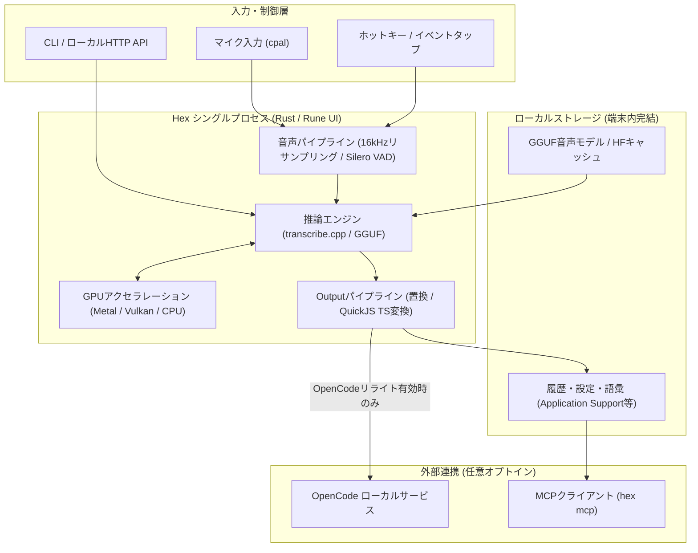

# **Hex 調査レポート**

## **1. 基本情報**

* **ツール名**: Hex
* **ツールの読み方**: ヘックス
* **開発元**: Anomaly (Kit Langton 氏らによる開発。AIコーディングエージェント OpenCode の開発元)
* **公式サイト**: [https://anoma.ly/hex](https://anoma.ly/hex)
* **関連リンク**:
  * GitHub: [https://github.com/anomalyco/hex](https://github.com/anomalyco/hex)
  * ドキュメント: [https://github.com/anomalyco/hex/tree/dev/docs](https://github.com/anomalyco/hex/tree/dev/docs)
* **カテゴリ**: デスクトップ/環境操作
* **概要**: Hex は、macOS・Windows・Linux に対応した MIT ライセンスのオープンソース音声ディクテーション（音声入力）アプリケーションです。Rust でネイティブ実装されており、初回に音声認識モデルをダウンロードした後は完全にオフライン（ローカルマシン上）で音声をテキスト化し、現在フォーカスしている任意のアプリへ即座に貼り付けます。

## **2. 目的と主な利用シーン**

* **解決する課題**: クラウド型音声入力ツールにおける音声データの外部送信によるプライバシーリスクや月額課金コスト、および従来のローカル Whisper 環境構築（Python 依存関係の解決など）の手間を解消します。
* **想定利用者**: プライバシーや機密保持を重視するソフトウェアエンジニア、ライター、Linux/Windows/macOS を併用するパワーユーザー、およびローカル音声認識を自前ツールに組み込みたい開発者。
* **利用シーン**:
  * IDE、ターミナル、チャットアプリ、ブラウザ上での高速な音声コーディング・プロンプト入力やテキスト執筆
  * アプリや Web サイトごとの出力パイプライン（単語置換、TypeScript スクリプト変換、任意の OpenCode リライト）を活用した文体・フォーマットの自動整形
  * macOS でのオンライン会議（Slack、Teams、Discord 等）のローカル録音・文字起こし、および画面録画＋音声注釈（Annotate）によるエージェントへの指示出し

### **2.1 代表的な利用フロー**

```mermaid
swimlane-beta TB
  subgraph User["ユーザー"]
    A["ホットキーを押しながら発話"]
    F["貼り付けられたテキストを確認"]
  end
  subgraph HexApp["Hex (ローカルアプリ)"]
    B["音声をキャプチャ・VAD処理"]
    C["ローカルモデルで文字起こし"]
    D["Outputパイプラインで整形・置換"]
  end
  subgraph External["OpenCode / 外部AI (任意)"]
    E["文脈に応じたテキストリライト"]
  end
  subgraph TargetOS["OS・アクティブアプリ"]
    G["カーソル位置へ自動ペースト"]
  end
  A --> B
  B --> C
  C --> D
  D -->|リライト有効時| E
  E -->|整形済みテキスト| D
  D --> G
  G --> F
```

* **代表的な流れ**: ユーザーがショートカットキー（Push-to-Talk またはトグル）を押して話すと、Hex がローカルで音声を録音・文字起こしし、設定された Output パイプライン（必要に応じて OpenCode 等と連携）で整形した上で、OS のアクティブなアプリのカーソル位置へ自動的に貼り付けます。

## **3. 主要機能**

* **クロスプラットフォーム・ローカル音声入力**: macOS（Apple Silicon）、Windows（x64 / ARM64）、Linux（x86_64 / ARM64、X11 および wlroots 系 Wayland / KDE / GNOME）に対応し、ショートカットキーの押下（Hold）またはタップ（Tap）で任意のアプリへ音声入力を行います。
* **豊富なローカル音声モデル選択**: ストリーミング対応の Parakeet Unified English や Nemotron 3.5 ASR をはじめ、多言語対応の Parakeet v3、Cohere Transcribe、Whisper large-v3-turbo、Qwen3-ASR 0.6B、SenseVoice Small（日中韓英対応）、Granite Speech 5.0、さらに独自の GGUF モデルインポートに対応しています。
* **Output パイプラインとアプリ別モード（Modes）**: すべてのディクテーション結果に対して、単語置換、組み込みクリーンアップ、埋め込み QuickJS によるユーザー定義 TypeScript 変換（`~/.config/hex/hex.config.ts`）、および任意の OpenCode リライトをアプリや Web サイト単位で切り替えて実行できます。
* **共有語彙（Vocabulary）**: 固有名詞や専門用語、発音ヒント（"sounds like"）を登録でき、Whisper や Qwen3-ASR での推論時バイアスや、Parakeet 系モデル（Labs 有効時）・OpenCode リライト時の精度向上に活用できます。
* **履歴管理と再貼り付け（History / Paste Last）**: 過去のディクテーション結果（利用モデル・言語・生テキスト・処理後テキスト）をローカルに検索可能な形で保持（デフォルト 7 日間、音声保存も選択可能）し、`Option-Shift-V`（Win/Linux は `Ctrl-Alt-V`）で直前の結果を再貼り付けできます。
* **Annotate（画面録画・描画＋音声注釈）**: 画面上にペン等で描画しながら話した内容を動画と文字起こしとして記録し、開発作業やバグ報告、OpenCode セッションへの指示として活用できる機能（macOS/Windows/Linux 対応）を備えています。
* **会議録音・文字起こし（Meetings・macOS オプトイン / Labs）**: Slack、Microsoft Teams、Discord、Google Meet などの通話アプリを検出し、マイク音声と通話音声をローカルで録音・文字起こしします。`hex mcp` サブコマンドにより、MCP（Model Context Protocol）経由でエージェントから会議記録を全文検索（BM25）することも可能です。
* **CLI・認証付きローカル API・TypeScript SDK**: `hex` コマンドによるアプリ制御やファイル文字起こし（`hex transcribe`）、ローカル HTTP API（`/control`, `/streams`, `/dictations`, `/transcriptions`）、および外部アプリ組み込み用の TypeScript SDK（`@kitlangton/hex`）を提供しています。
* **モバイル展開（Hex Mobile）**: iOS（TestFlight / App Store）および Android（プレビュービルド）向けに、オンデバイス音声入力キーボードの開発も活発に進められています。

## **4. 動作原理・システム構成**



* **アーキテクチャ**: ローカルファーストのシングルプロセス・デスクトップアプリケーション（1ユーザーにつき1プロセス）。UI レイヤーには Anomaly 製の Rust GUI フレームワークである **Rune**（GPUI から完全移行済み）を採用し、macOS / Windows / Linux で共通のウィンドウおよび設定基盤を共有しています。
* **主要コンポーネントとデータフロー**:
  * **音声キャプチャと前処理**: `cpal` によるマイク入力を 16kHz モノラル PCM にリサンプリングし、オプションの Silero VAD（CPU 上で動作する音声区間検出）によって無音区間を除外してから推論エンジンに渡します。
  * **推論エンジン**: C++ ベースの `transcribe.cpp`（GGUF 形式）を統合し、macOS では Metal、Windows x64 / Linux では Vulkan による GPU アクセラレーション（失敗時は自動的に CPU へフォールバックし、問題のある GPU を `gpu-failures.json` に記憶）で高速に文字起こしを実行します。
  * **決定論的後処理（QuickJS）**: 外部の Node.js や Bun ランタイムに依存せず、バイナリに組み込まれた **QuickJS**（`rquickjs` + `oxc` パーサー）上でユーザー定義の `~/.config/hex/hex.config.ts` を高速に実行し、テキスト変換を行います。
* **特筆すべき要素技術**:
  * **認証付きローカル API**: データフォルダ内のオーナー限定ファイル（Unix ではパーミッション `0600` の `local-api.json`）を介した Bearer 認証付きループバック HTTP API により、CLI（`hex`）や外部ツール（`hex service --embedded`）と安全に連携します。
  * **OpenCode との安全な連携**: CLI やシェルを直接起動するのではなく、OpenCode サービスが生成する `service.json` を検証した上でループバック HTTP 通信を行います。ユーザーが明示的に有効化しない限り、テキストが外部の LLM プロバイダへ送信されることはありません。

## **5. 開始手順・セットアップ**

* **前提条件**:
  * **OS**: macOS（Apple Silicon 推奨）、Windows（x64 / ARM64）、Linux（glibc 2.36 以降: Debian 12 / Ubuntu 23.04 / Fedora 37 等、X11 または wlroots 系 Wayland / KDE / GNOME）
  * **アカウント・クレカ**: 不要
  * **OS 権限**: マイクアクセス権限、および自動貼り付けのためのアクセシビリティ / 入力権限（初回起動時のオンボーディングで案内）
* **インストール/導入**:

  ```bash
  # macOS (Homebrew)
  brew install --cask anomalyco/tap/hex

  # Linux (公式インストールスクリプト)
  curl -fsSL https://anoma.ly/hex/install-linux.sh | sh

  # Linux (Arch系 AUR)
  yay -S hex-bin

  # Linux (Nix)
  nix profile add github:anomalyco/hex
  ```
  *Windows の場合は公式サイトから x64 または ARM64 版インストーラー（Setup.exe）、Debian/Ubuntu や Fedora/openSUSE では `.deb` / `.rpm` パッケージも提供されています。*

* **初期設定**:
  * 初回起動時のインタラクティブなオンボーディング画面に従い、マイク権限や貼り付け権限を許可します。
  * システム言語に応じた推奨音声モデル（英語環境では Parakeet Unified English、日本語利用時は多言語対応モデル等）が自動選択・ダウンロードされます。既存の Hugging Face キャッシュ内に互換モデルがある場合は再ダウンロードをスキップして再利用可能です。
* **クイックスタート**:
  1. 任意のテキストエディタやブラウザの入力欄にカーソルを置きます。
  2. 設定したショートカットキー（例: `Option` 等）を長押ししながら話し、キーを離すとカーソル位置にテキストが入力されます。
  3. コマンドラインから音声ファイルを文字起こしする場合は以下を実行します：

  ```bash
  hex transcribe meeting.m4a
  ```

## **6. 特徴・強み (Pros)**

* **完全ローカル完結によるプライバシー保護とゼロコスト**: 初回のモデルダウンロード後は音声データが端末外に一切送信されないため、機密情報や個人情報の入力にも安心して利用でき、月額課金も不要です。
* **Rust + GPU による軽快な動作とマルチ OS サポート**: macOS のみに対応するツールが多い中、Windows や Linux（X11/Wayland/Nix）までネイティブ Rust バイナリで網羅し、Metal や Vulkan を活用した高速推論を実現しています。
* **開発者向けの拡張性とエコシステム**: QuickJS による TypeScript テキスト変換スクリプト、CLI（`hex`）、MCP サーバー（`hex mcp`）、認証付きローカル API、TypeScript SDK（`@kitlangton/hex`）など、自動化や他ツール連携の手段が極めて豊富です。
* **最新の音声認識モデルへの迅速な追従**: Parakeet、Whisper、Qwen3-ASR、SenseVoice、Nemotron、Granite Speech、Orukeet など多様なモデルを即座に切り替え可能で、独自 GGUF モデルの持ち込みもサポートしています。

## **7. 弱み・注意点 (Cons)**

* **UI の日本語ローカライズ未対応**: 音声認識自体は Whisper large-v3-turbo や SenseVoice Small、Qwen3-ASR 等を通じて日本語の認識に対応していますが、アプリケーションの画面表示言語（Interface language）は英語・中国語・フランス語・ポルトガル語・ロシア語のみで日本語 UI には未対応です。
* **Windows / Linux 版および一部 Labs 機能のベータ性**: macOS 版が最も機能が成熟しており（会議録音・Apple Intelligence 連携・画面周辺テキスト参照等）、Windows 版や Linux 版はホットキーや環境ごとの制約（例: 一部 Wayland コンポジタでのグローバルショートカット制限）に注意が必要です。
* **多機能ゆえの設定の複雑さ**: Output パイプライン、Modes、多数の Labs 実験機能、CLI/設定ファイルなどパワーユーザー向けの機能が豊富なため、シンプルなツールを好むユーザーには設定項目が多く感じられる場合があります。
* **プルリクエスト非受付の開発体制**: OSS（MIT ライセンス）ですが、コントリビューション方針として外部からの Pull Request は受け付けておらず、バグ報告や機能要望は GitHub Issue 経由で提出する運用となっています。

## **8. 料金プラン**

| プラン名 | 料金 | 主な特徴 |
|---------|------|---------|
| **オープンソース版 (全機能)** | 無料 | MIT ライセンスで全機能・全プラットフォーム（macOS / Windows / Linux）を制限なく利用可能 |

* **課金体系**: 完全無料（オープンソースソフトウェア）。ただし、Output や Meetings の要約機能で外部の OpenCode / LLM API を任意で連携させる場合は、接続先プロバイダの利用料金が別途発生します。
* **無料トライアル**: 全機能が無料のためトライアル不要。

## **9. 導入実績・事例**

* **導入企業**: オープンソースツールのため企業別の公式導入事例ページは公開されていませんが、GitHub で 8,200 以上のスターを獲得しており、個人開発者やスタートアップのエンジニア、Linux デスクトップユーザーを中心に広く利用されています。
* **導入事例**:
  * **Linux / Windows 環境での開発・執筆効率化**: Python や CUDA の環境構築なしにワンコマンドでオフライン音声入力を導入できるツールとして、古いノート PC（ThinkPad T480 等）から最新マシンまで幅広い環境での利用が報告されています。
  * **OpenCode との連携による音声駆動開発**: Annotate（画面録画＋音声指示）や Output の OpenCode リライト機能を組み合わせ、ハンズフリーでコーディングエージェントにタスクを指示するワークフローで活用されています。
* **対象業界**: ソフトウェア開発、IT・Web サービス、テクニカルライティング、プライバシー要件の厳しい研究開発領域。

## **10. サポート体制**

* **ドキュメント**: GitHub リポジトリ内の [`docs/`](https://github.com/anomalyco/hex/tree/dev/docs) に、OS 別セットアップ（Windows/Linux/Nix）、CLI リファレンス、機能マップ（`docs/features/`）、ローカル API 仕様まで非常に詳細なドキュメントが整備されています（英語）。
* **コミュニティ**: [GitHub Issues](https://github.com/anomalyco/hex/issues) を中心に活発なバグ報告・機能要望のやり取りが行われているほか、Hacker News や Reddit（`r/LocalLLM` 等）でも活発な情報交換が行われています。
* **公式サポート**: 商用サポート窓口は提供されておらず、GitHub Issues を通じた対応（開発元のエージェントおよびメンテナーによる迅速な修正）が基本となります。脆弱性報告については GitHub Private Vulnerability Reporting が用意されています。

## **11. エコシステムと連携**

### **11.1 API・外部サービス連携**

* **API**: ローカルループバック HTTP API（`local-api.json` による Bearer 認証）を公開しており、音声ストリーム文字起こし（`/streams`）、ファイル/バッファ文字起こし（`/transcriptions`）、アプリ制御（`/control`）、ディクテーション制御（`/dictations`）が可能です。また `hex service --embedded` により子プロセスとして組み込むこともできます。
* **外部サービス連携**:
  * **OpenCode**: 公式の AI リライト・会議要約・Annotate 送信先としてネイティブ連携（ループバック HTTP サービス経由）
  * **MCP (Model Context Protocol)**: `hex mcp` により、Claude Desktop や OpenCode 等の MCP クライアントへ会議記録の全文検索機能を提供
  * **Hugging Face キャッシュ**: 既存のローカルキャッシュ内の互換 GGUF モデルを自動検出して利用可能
  * **通話アプリ検出 (macOS / Windows)**: Slack、Microsoft Teams、Discord、Google Meet、Arc、Gather、WhatsApp 等を検出し会議録音と連携

### **11.2 技術スタックとの相性**

| 技術スタック | 相性 | メリット・推奨理由 | 懸念点・注意点 |
|:---|:---:|:---|:---|
| **TypeScript / Node.js (`>=20.3.0`)** | ◎ | 公式 TypeScript SDK (`@kitlangton/hex`) と埋め込み QuickJS 変換設定を提供 | SDK 利用時は別途 Hex のネイティブ実行バイナリを指定する必要あり |
| **Rust** | ◎ | 本体および UI (Rune)・音声処理がすべて Rust で書かれておりソース連携が容易 | 依存クレートや GGUF ビルドツールチェーンのセットアップがやや重い |
| **CLI / シェルスクリプト** | ◎ | `hex` コマンド全機能が `--json` 出力・冪等性・終了コードに対応し自動化に最適 | macOS ではアプリバンドル内のバイナリへのシンボリックリンク作成が必要 |
| **MCP 対応 AI エージェント** | ◎ | `hex mcp` で標準入出力（stdio）経由の会議検索ツールを即座に提供可能 | 会議録音機能（Meetings）自体は現在 macOS 中心の提供 |

## **12. セキュリティとコンプライアンス**

* **認証**: デスクトップアプリ自体の利用にアカウント登録は不要です。ローカル HTTP API は、ユーザーオーナー限定パーミッション（Unix 系では `0600`、Windows ではユーザー専用 ACL）で保護された `local-api.json` 内の Bearer トークンで認証されます。macOS 版では MDM 構成プロファイルによる機能のロックにも対応しています。
* **データ管理**: すべての音声処理・文字起こしはローカルデバイス内で完結し、デフォルトでは音声ファイルやテキストが外部サーバーに送信されることはありません。履歴データはローカルの Application Support 等のデータディレクトリに保存され（デフォルト保持期間 7 日間）、直近の診断ログからもディクテーション本文を除外する設計が採られています。
* **準拠規格**: オープンソースソフトウェアであり、SOC2 や ISO27001 などの商用 SaaS 向け認証は取得していません（クラウド上にデータを保持しないローカル実行型のため）。脆弱性報告は [GitHub Security Advisories](https://github.com/anomalyco/hex/security/advisories/new) で受け付けています。

## **13. 操作性 (UI/UX) と学習コスト**

* **UI/UX**: Rust 製カスタム UI フレームワーク「Rune」と OpenCode テーマによる洗練されたモダンなインターフェースを備えています。画面上部の録音 HUD（macOS ではノッチ表示も Labs で選択可）や、General / Output / History / Labs の整理されたタブ構成、変換結果を即座に試せる Try ボックスなど、実用性の高い UX です。
* **学習コスト**: 基本的な音声入力（ショートカットを押して話すだけ）の学習コストは極めて低く、オンボーディングの対話型チュートリアルにより数分で習得できます。一方、TypeScript によるカスタム変換スクリプトや CLI/ローカル API 連携まで使いこなす場合は、開発者向けの技術知識が求められます。

## **14. ベストプラクティス**

* **効果的な活用法 (Modern Practices)**:
  * **用途・言語に応じたモデル選択**: 英語中心ならストリーミング応答が速い `Parakeet Unified English`、日本語や多言語の精度と語彙登録を重視する場合は `Whisper large-v3-turbo` や `Qwen3-ASR 0.6B`、`SenseVoice Small` を使い分けることが推奨されます。
  * **アプリ別 Modes と Vocabulary の活用**: コードエディタやターミナルでは技術用語を Vocabulary に登録し、必要に応じて専門的な整形スクリプトや OpenCode リライトをアプリ単位で割り当てると入力精度が大幅に向上します。
  * **既存 Hugging Face キャッシュの再利用**: すでに他ツールでダウンロード済みの互換 GGUF モデルがある場合は、初回セットアップのリストから選択することで通信量と待ち時間を節約できます。
* **陥りやすい罠 (Antipatterns)**:
  * **無自覚な外部送信設定**: Hex 自体は完全ローカル動作ですが、Output の OpenCode リライト機能や Labs の「Rewrite reads nearby text（macOS）」を有効にすると、設定先の LLM プロバイダ（クラウド API 含む）へテキストが送信される点に注意が必要です。
  * **Wayland 環境でのキーバインド設定**: Linux の Hyprland や Niri などの一部 Wayland コンポジタでは、グローバルショートカットポータル（XDG Desktop Portal）の仕様によりアプリ側からのキー登録が制限されるため、コンポジタ側の設定で `hex dictation` コマンドを直接バインドするのが確実です。

## **15. ユーザーの声（レビュー分析）**

* **調査対象**: Hacker News、Reddit（`r/LocalLLM` 等）のコミュニティディスカッション（※ G2・Capterra には同名のデータ分析基盤「Hex」は掲載されているものの、本音声入力アプリ Hex のレビューページは未掲載）
* **総合評価**: コミュニティ（Hacker News / Reddit）での評価は非常に高く、特に GitHub スター数 8,200 超という支持を集めています。
* **ポジティブな評価**:
  * 「複雑な Python 環境や Whisper の依存関係と格闘することなく、Windows や Linux でも一発で動作した初のオフライン音声入力ツールだ」（Reddit より要約）
  * 「10年前の古い ThinkPad T480 のようなハードウェアでも驚くほどキビキビと動作する」（Reddit より要約）
  * 「標準のローカルモデルでも技術用語や専門的なジャルゴンを非常に正確に聞き取ってくれる」（Hacker News より要約）
* **ネガティブな評価 / 改善要望**:
  * 「設定項目や Labs の実験機能が非常に多く、最初は機能の全体像を把握するのに少し圧倒される」（Hacker News より要約）
  * 「Linux の一部の Wayland デスクトップ環境では、グローバルホットキーの設定に手動でのコンポジタ調整が必要になる場合がある」（GitHub / コミュニティ報告より要約）
  * 「UI の日本語表示にまだ対応していないため、英語や他言語の UI で設定を行う必要がある」
* **特徴的なユースケース**:
  * ターミナルやエディタ上での AI コーディングエージェント（OpenCode や Claude Code 等）への長文プロンプト入力を音声で行い、タイピングの負担を大幅に削減する用途で広く支持されています。

## **16. 直近半年のアップデート情報**

* **2026-11-23**: iOS ベータ版（`Hex Mobile`）および Android プレビュー版（`Hex Preview 0.2.2`）の継続的なビルド配信を実施。
* **2026-11-11**: **Hex v3.4.0** をリリース。新音声モデル（Orukeet、Granite Speech 5.0 470M TurboCTC、NB-Whisper medium）の追加、ロシア語 UI 対応、履歴保持メニューの刷新と再文字起こし時の言語指定、macOS 向けスクリーンショット撮影・注釈エディタ（Labs）やノッチ HUD、セキュア入力中のショートカット維持などを実装。
* **2026-11-02**: **Hex v3.3.0** をリリース。音声モデルピッカーでの 3 モデル横並び比較 UI、ロシア語向け GigaAM v3 対応、繁体字中国語 UI 対応、Mode ごとの語彙設定、macOS 構成プロファイルによる機能ロック、Linux ローカル API からのディクテーション制御などを追加。
* **2026-11-01**: **Hex v3.2.0** をリリース。インタラクティブな初回オンボーディング刷新、Hugging Face キャッシュからの既存モデル自動検出、ヘブライ語 Whisper や Nemotron 3.5 ASR 0.6B 対応、GPU ハング時の自動 CPU フォールバックと記憶機能（`gpu-failures.json`）を導入。
* **2026-10-31**: **Hex v3.0.0** をリリース。デスクトップ UI を従来の GPUI から自社製 Rust UI フレームワーク **Rune** へ完全移行し、macOS / Windows / Linux での単一プロセス・共通 UI アーキテクチャを確立。

（出典: [GitHub Releases](https://github.com/anomalyco/hex/releases) / [docs/releases/](https://github.com/anomalyco/hex/tree/dev/docs/releases)）

## **17. 類似ツールとの比較**

### **17.1 機能比較表 (星取表)**

| 機能カテゴリ | 機能項目 | Hex | Aqua Voice | Typeless | OpenHinoVoice |
|:---:|:---|:---:|:---:|:---:|:---:|
| **基本機能** | ローカル完結推論 | ◎<br><small>GGUFモデルで完全オフライン動作</small> | ×<br><small>クラウド処理ベース</small> | ×<br><small>クラウド処理ベース</small> | ◎<br><small>ローカルモデル実行対応</small> |
| **基本機能** | マルチOS対応 | ◎<br><small>macOS/Win/Linux (iOS/Android開発中)</small> | ◯<br><small>macOS / Windows対応</small> | ◎<br><small>macOS / Win / iOS / Android</small> | △<br><small>Windows中心</small> |
| **独自機能** | 開発者向け拡張 (CLI/API/SDK) | ◎<br><small>CLI・ローカルAPI・MCP・TS SDK完備</small> | △<br><small>アプリ連携中心</small> | ×<br><small>エンドユーザー向け</small> | △<br><small>OSSだが外部API統合は限定的</small> |
| **独自機能** | AI文脈整形・リライト | ◯<br><small>QuickJS変換・任意でOpenCode連携</small> | ◎<br><small>エディタ/文脈認識が強力</small> | ◎<br><small>意図理解・自動整形に特化</small> | ◯<br><small>LLM整形に対応</small> |
| **コスト** | 無料利用範囲 | ◎<br><small>MITライセンス・完全無料</small> | △<br><small>無料枠あり ($8/月〜)</small> | △<br><small>無料枠あり ($12/月〜)</small> | ◎<br><small>OSS・完全無料</small> |
| **非機能要件** | 日本語対応 | △<br><small>日本語音声認識対応・UIは英語等</small> | ◯<br><small>日本語音声入力対応</small> | ◎<br><small>日本語の認識・整形が高精度</small> | ◎<br><small>日本語UI・日本語音声入力対応</small> |

### **17.2 詳細比較**

| ツール名 | 特徴 | 強み | 弱み | 選択肢となるケース |
|---------|------|------|------|------------------|
| **Hex** | Rust 製のクロスプラットフォーム・ローカルファースト音声入力 OSS | 完全無料・オフライン完結・Linux/Win/Mac 対応・CLI/API/SDK の充実 | UI が日本語非対応、設定項目が多め、Win/Linux 版は一部機能が発展途上 | プライバシー最重視、Linux 環境、開発者・自動化の組み込み用途 |
| **Aqua Voice** | 低遅延のクラウド AI 音声入力ツール | 開発者向け文脈理解や超低遅延の応答、洗練された商用 UX | 月額課金（$8/月〜）、クラウド送信必須、Linux 非対応 | コストよりクラウドの快適さと開発時の文脈認識を重視する場合 |
| **Typeless** | 発話の意図を汲み取って自動整形する AI 音声入力 SaaS | フィラー除去や構造化などの文章整形能力と日本語の自然さ | 月額課金（$12/月〜）、オフライン非対応 | ビジネス文書やメールの口述筆記で高度な文章整形を求める場合 |
| **OpenHinoVoice** | Windows 向けのオープンソース・ローカル音声入力アプリ | 完全無料・日本語 UI 対応・Windows 環境での導入のしやすさ | macOS や Linux に非対応、SDK や MCP 等のエコシステムは限定的 | Windows 専用で日本語 UI のシンプルなローカル音声入力を求める場合 |

## **18. 総評**

* **総合的な評価**:
  * Hex は、オープンソースのローカル音声入力ツールとして極めて高い完成度と開発スピードを誇ります。単なる Whisper のラッパーにとどまらず、Rust 製 UI（Rune）によるマルチ OS ネイティブ対応、QuickJS による決定論的テキスト変換、認証付きローカル API、TypeScript SDK、MCP サーバー、さらには画面注釈（Annotate）までを一貫した設計で統合している点が際立っています。
* **推奨されるチームやプロジェクト**:
  * ソースコードや機密情報を扱うため音声データを外部クラウドに送信できない開発チーム
  * Linux（X11/Wayland）や Windows、macOS が混在する環境で統一された音声入力・文字起こし基盤を使いたいエンジニア
  * 自社のデスクトップアプリやエージェントワークフローにローカル文字起こし機能を組み込みたい開発者
* **選択時のポイント**:
  * クラウド型 SaaS（Aqua Voice や Typeless）のような「日本語 UI での手軽な初期体験とクラウド LLM による高度な自動文章整形」を最優先する場合は商用ツールに軍配が上がります。一方、「プライバシー完全保護・維持費ゼロ・クロスプラットフォーム・高いカスタマイズ性とプログラマブルな連携」を求める場合、Hex は現時点で最も有力な選択肢となります。
