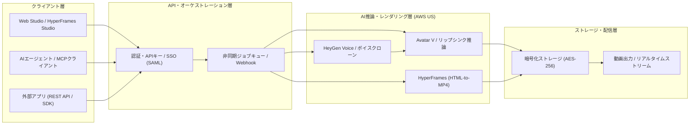

# **HeyGen 調査レポート**

## **1. 基本情報**

* **ツール名**: HeyGen
* **ツールの読み方**: ヘイジェン
* **開発元**: HeyGen Inc.（2020年創業、旧Movio、共同創業者兼CEO: Joshua Xu / Wayne Liang、米国ロサンゼルス拠点）
* **公式サイト**: [https://www.heygen.com/](https://www.heygen.com/)
* **関連リンク**:
  * ドキュメント: [https://developers.heygen.com/](https://developers.heygen.com/)
  * セキュリティポータル: [https://security.heygen.com/](https://security.heygen.com/)
  * 製品アップデート・ブログ: [https://www.heygen.com/blog](https://www.heygen.com/blog)
* **カテゴリ**: AI動画生成プラットフォーム
* **概要**: HeyGenは、テキストスクリプトや音声入力からフォトリアリスティックなAIアバター動画を生成できるクラウド完結型のAI動画生成プラットフォームです。スタジオ撮影やカメラ機材なしに高品質なプレゼン動画やマーケティング動画を制作できるほか、話者の声質を保持したまま177以上の言語・方言へリップシンク付きで翻訳する機能や、リアルタイム対話可能なLiveAvatar、開発者向けAPI/MCP連携を提供しています。

## **2. 目的と主な利用シーン**

* **解決する課題**: 従来の動画制作では、スタジオ予約、撮影機材、演者のスケジュール調整、多言語展開時の再撮影や吹き替え手配に多大な時間とコストがかかっていました。HeyGenは、デジタルツイン（AIアバター）とAI音声合成・動画翻訳を組み合わせることで、スクリプトを修正するだけで即座に動画を生成・更新できるワークフローを実現し、動画制作とグローバルローカライズのリードタイムを大幅に短縮します。
* **想定利用者**: マーケティング担当者、セールスイネーブルメントチーム、企業のL&D（人材育成・研修）部門、コンテンツクリエイター、対話型AIエージェントを組み込むソフトウェア開発者。
* **利用シーン**:
  * **グローバル向け動画ローカライズ**: 製品紹介や社内研修動画を177以上の言語へ翻訳し、話者本人の声色と自然な口元（リップシンク）を維持したまま展開する。
  * **パーソナライズド営業・マーケティング動画**: 顧客名や企業名などの変数をAPI経由で差し込み、見込み客ごとにパーソナライズされた営業アプローチ動画を大量生成する。
  * **プロンプトベースの自動動画制作（Video Agent）**: URLやPDF資料、企画プロンプトを入力し、構成案・アバター・モーション・テロップを含む完成動画を自律的に生成する。
  * **リアルタイム対話アバター（LiveAvatar）**: Webサイトやカスタマーサポート窓口にリアルタイムで応答する会話型AIアバターを組み込む。

### **2.1 代表的な利用フロー**

```mermaid
swimlane-beta TB
  subgraph User["ユーザー（制作者・開発者）"]
    A[スクリプト・音声または動画素材を入力]
    E[プレビュー確認・ダウンロード・公開]
  end
  subgraph HeyGen["HeyGen プラットフォーム"]
    B[AIアバター・音声モデル・言語を選択]
    C[音声合成・リップシンク・映像レンダリング]
  end
  subgraph External["外部連携・配信先"]
    D[API / MCP / LMS・CRM連携]
  end
  A --> B
  B --> C
  C --> D
  D --> E
```

* **代表的な流れ**: ユーザーがスクリプトや翻訳対象動画、アバター設定を入力すると、HeyGenのクラウドエンジンが音声合成（HeyGen Voice）と映像・リップシンク生成（Avatar V等）を非同期で実行します。生成された動画はStudio画面から直接ダウンロードできるほか、APIやWebhook、MCPサーバー、外部のCRM・LMS連携を通じて自動配信・公開されます。

## **3. 主要機能**

* **AIアバター生成（Avatar V / Stock Avatars）**: 500種類以上のストックアバターに加え、Webカメラでの15秒録画から自身のデジタルツインを作成できます。2026年のAvatar Vでは自然言語プロンプトによる姿勢・視線・ジェスチャーの指示（Custom Motion）や、最大30分の単一パス長尺トーク動画生成に対応しています。
* **動画翻訳（Video Translate）**: 既存の動画ファイルをアップロードするだけで、177以上の言語・方言へ音声翻訳し、話者固有の声質をクローンしたまま口元の動きを翻訳後の音声に合わせて自然にリップシンクさせます。
* **Video Agent 2.0**: プロンプト、URL、PDFなどの入力から、AIが構成設計（ブループリント）・アバター配置・Bロール・字幕・モーショングラフィックス（HyperFrames統合）までを一貫して生成し、対話形式で修正できるエージェント機能です。
* **HeyGen Voice & ボイスクローニング**: 自社開発の高品質TTSモデル「HeyGen Voice」および低遅延・低コスト版「Voice Turbo」を提供します。20分以上の音声データを用いたプロフェッショナル・ボイスクローンや、IPA（国際音声記号）による発音辞書指定、WebSocketストリーミング入力にも対応します。
* **LiveAvatar（リアルタイム対話アバター）**: 低遅延のストリーミング技術により、ユーザーの音声やテキスト入力に対してリアルタイムに表情と口元を動かして応答する会話型アバターを構築・埋め込みできます。
* **Edit Look（ルック編集）**: 再撮影することなく、既存アバターの照明・露出調整、肌の補正、メイクや身だしなみの調整をプラットフォーム上で後から行えます。
* **Studioテンプレート & 変数差し込み**: 作成した動画を再利用可能なStudioテンプレートに変換し、API経由でテキストや画像・アバターなどの変数を動的に差し替えてバッチ生成できます。
* **Video Podcast App**: スクリプト、URL、PDFなどから2人のホストによる対談形式の動画ポッドキャストを、マルチカメラ切り替えやBロール付きで自動生成します。

## **4. 動作原理・システム構成**



* **アーキテクチャ**: 米国AWS上にホストされた完全クラウド完結型のSaaSアーキテクチャを採用しています（デスクトップ向け補助エディタのHyperFrames Studioはローカル処理とクラウド連携を併用）。動画生成処理は計算負荷が高いため、リクエスト受付と生成処理を分離した非同期タスクキュー方式で動作します。
* **主要コンポーネントとデータフロー**:
  * **入力・認証層**: Web Studio（ブラウザ）、REST API v3、Vercel AI SDK（`@ai-sdk/heygen`）、または公式MCPサーバー（`https://mcp.heygen.com/mcp/hyperframes/`）を通じてリクエストを受け付けます。
  * **推論・合成パイプライン**: テキスト入力はHeyGen Voice（TTS）で音声化され、WebSocketストリーミングまたはバッチ音声としてAvatar推論モデルへ渡されます。Avatarモデルは音声波形とモーションプロンプトからフレーム単位で表情・リップシンクを生成し、HyperFramesエンジンによるHTML/CSSベースのモーショングラフィックスと合成されます。
  * **出力・通知**: 完成したMP4/WebM動画はTLS暗号化通信とAES-256暗号化ストレージで保護され、ステータス確認API（`GET /v3/models/videos/{video_id}`）のポーリングまたはWebhookコールバック経由でクライアントへ返却されます。
* **特筆すべき要素技術**: 内部のニューラルレンダリングモデルの詳細は非公開ですが、プロンプト制御可能な「Avatar V」、リアルタイム対話用のオープンソース・スタック（`GPT-Live-1`連携等）、および確定的なHTML-to-MP4レンダリング基盤「HyperFrames」を組み合わせています。

## **5. 開始手順・セットアップ**

* **前提条件**:
  * モダンWebブラウザ（Web Studio利用時）。
  * アカウント登録が必要（Freeプランはクレジットカード登録なしで利用開始可能）。
  * API利用時はHeyGen Platform Dashboardから発行するAPIキーと、`Node.js` / `curl` / `Python` 等のHTTPクライアント環境。
* **インストール/導入**:
  * Webブラウザで [https://www.heygen.com/](https://www.heygen.com/) にアクセスしてアカウントを作成するだけで即座に利用開始できます。
  * Vercel AI SDK経由でNode.js/TypeScriptプロジェクトに組み込む場合は以下を実行します。

  ```bash
  pnpm add ai @ai-sdk/heygen
  ```

* **初期設定**:
  * APIを利用する場合は、ダッシュボードのAPI Keys画面からキーを取得し、環境変数に設定します。

  ```bash
  export HEYGEN_API_KEY="<YOUR_HEYGEN_API_KEY>"
  ```

* **クイックスタート**:
  * 認証確認および動画生成リクエストの基本フローは以下の通りです（非同期処理のため、`video_id` を取得後にステータスをポーリングします）。

  ```bash
  # 1. 認証確認
  curl -s "https://api.heygen.com/v3/users/me" \
    -H "X-Api-Key: ${HEYGEN_API_KEY}"

  # 2. テキストから動画を生成 (HeyGen Video)
  curl -s -X POST "https://api.heygen.com/v3/models/videos" \
    -H "X-Api-Key: ${HEYGEN_API_KEY}" \
    -H "Content-Type: application/json" \
    -d '{"prompt": "未来都市の夕暮れを紹介する5秒のシネマティック映像"}'
  ```

## **6. 特徴・強み (Pros)**

* **業界最高水準のアバターリアリズムとリップシンク**: 競合ツールと比較して、表情の微細な動き（マイクロエクスプレッション）、自然な頭の傾き、手のジェスチャー、口元の同期精度が非常に高く評価されています。
* **オリジナル声を保持した高精度な多言語動画翻訳**: 177以上の言語・方言に対応し、単に字幕や別人の吹き替えを当てるのではなく、元の話者の声質・トーンを保ったまま自然なリップシンク動画へ変換できます。
* **エージェント・開発者向けエコシステムの先進性**: Video Agent 2.0や、AnthropicのModel Context Protocol（MCP）対応、Vercel AI SDK公式プロバイダ（`@ai-sdk/heygen`）、HTMLベースの動画生成フレームワーク「HyperFrames」など、AIエージェント時代のワークフローへの適合が非常に高い点が強みです。
* **迅速なアバター作成と編集の柔軟性**: 15秒のWebカメラ録画でデジタルツインを作成でき、「Edit Look」機能により撮影後に照明や肌補正を調整できるため、再撮影の手間を大幅に削減できます。

## **7. 弱み・注意点 (Cons)**

* **クレジット消費型によるコストの予測しにくさ**: 料金体系がクレジット制であり、Avatar Vなどの高度なモデルや高解像度出力では分あたりの消費クレジットが大きくなります。また、スクリプトの小さな誤字修正による再生成でもクレジットを消費するため、試行錯誤が多いと想定以上に早く枠を使い切る点に注意が必要です。
* **管理画面・一部機能の日本語UI対応**: 出力音声・翻訳としての日本語品質は非常に高い一方、Web Studioの高度な機能や開発者ポータル、一部スタジオモジュールは英語中心のUIとなっており、英語に不慣れなユーザーには学習コストがかかる場合があります。
* **レンダリング待機時間と利用用途の制約**: 4K出力や長尺動画の生成時はキューによる待機時間が発生することがあります。また、プレゼンター主体の動画には最適ですが、複雑なカメラワークや映画的なストーリー展開を伴う動画制作には、専用の映像制作ツールや他社生成AI動画モデルとの併用が必要です。

## **8. 料金プラン**

| プラン名 | 料金 | 主な特徴 |
|---------|------|---------|
| **Free** | 無料 ($0/月) | 月3本程度までの無料枠、最大1分/本、720p出力、HeyGen透かし（ウォーターマーク）あり、500+ストックアバター利用可 |
| **Creator** | $29/月（年払いで約$24/月） | 月600クレジット（月払い時は1ヶ月繰り越し可）、1080p出力、透かしなし、最大30分/本、ボイスクローニング、カスタムアバター1枠、175+言語対応 |
| **Pro** | $49/月〜 | 月1,000クレジット〜（拡張可）、4K出力対応、高速レンダリングキュー、シネマティックアバター・最新モデル利用可 |
| **Business** | $149/月〜（追加シート約$20/月） | ワークスペース共有1,500クレジット/月、最大60分/本、4Kアップスケール、ブランドキット、SAML/SSO、LMS・Zapier・HubSpot連携 |
| **Enterprise** | 個別見積もり | カスタムクレジット量、動画長無制限、SCIM対応、HIPAA（BAA締結）、専任カスタマーサクセス、ロールベース権限管理 |

* **課金体系**: 月額サブスクリプション＋クレジット消費型。利用するアバターモデル（標準ストック vs Avatar V等）や機能（翻訳、4K出力、API経由の従量課金など）によって1分あたりのクレジット消費レートが異なります。APIのAvatar V利用時は秒単価（$0.05/秒〜）などの従量設定も提供されています。
* **無料トライアル**: クレジットカード不要のFreeプランが常設されており、基本的なアバター動画生成や翻訳ワークフローを事前に検証できます。

## **9. 導入実績・事例**

* **導入企業**: Miro、Workday、Würth Group、Komatsu（コマツ）、trivago など（Fortune 100企業の多くを含むグローバル企業が導入）。
* **導入事例**:
  * **Miro**: 9,000万人のグローバルユーザー向けチュートリアルやコミュニケーション動画の制作速度を従来比で**10倍**に向上。
  * **Workday**: 10〜15言語への研修・製品動画のローカライズ期間を**数ヶ月から数時間へ短縮**。
  * **Würth Group**: グローバル地域チーム向けの研修・マーケティング動画の翻訳コストを**80%削減**し、制作時間を半減。
  * **Komatsu（コマツ）**: ローカライズされた一貫性のあるAIアバター研修動画の導入により、従業員の研修完了率を**約90%**まで引き上げ。
  * **trivago**: 30の国際市場向けパフォーマンスマーケティング広告のポストプロダクション時間を半減し、タイムラインを3〜4ヶ月短縮。
* **対象業界**: SaaS・IT、人材育成（L&D）、製造業、旅行・Eコマース、不動産、マーケティングエージェンシーなど、多言語展開や継続的な動画更新が求められる中堅〜大企業。

## **10. サポート体制**

* **ドキュメント**: 公式ヘルプセンターおよび開発者向けポータル（[https://developers.heygen.com/](https://developers.heygen.com/)）が整備されており、API v3リファレンス、SDKガイド、AIエージェント向けドキュメント（`for-ai-agents.md`）まで充実しています（主に英語）。
* **コミュニティ**: 公式コミュニティやYouTubeチャンネル、X（Twitter）、GitHub（`heygen-com`）を通じた情報発信・テンプレート共有が活発です。
* **公式サポート**: プランに応じたメール・チャットサポートを提供しており、Enterpriseプランでは専任のカスタマーサクセスマネージャー（CSM）やコンプライアンス・セキュリティレビュー支援が付属します。日本語の専任電話窓口等は公式には明示されていません。

## **11. エコシステムと連携**

### **11.1 API・外部サービス連携**

* **API**: RESTful API（v3）およびWebSocketストリーミングTTS API、Webhookコールバックを公開しており、動画生成・翻訳・TTS・LiveAvatar・テンプレート差し込みをプログラムから制御可能です。また、Model Context Protocol（MCP）サーバーを公式提供しています。
* **外部サービス連携**:
  * **ワークフロー自動化**: Zapier、Make、n8n
  * **CRM / マーケティング**: HubSpot
  * **AI開発・エージェント**: Vercel AI SDK（`@ai-sdk/heygen`）、Claude Code、Cursor（MCP経由）
  * **デザイン・学習管理**: Canva、Adobe Express、各種LMS（Business/Enterpriseプラン）

### **11.2 技術スタックとの相性**

| 技術スタック | 相性 | メリット・推奨理由 | 懸念点・注意点 |
|:---|:---:|:---|:---|
| **TypeScript / Next.js (Vercel AI SDK)** | ◎ | 公式パッケージ `@ai-sdk/heygen` が提供されており、`generateVideo` で即座に統合可能 | 非同期生成のタイムアウト管理に配慮が必要 |
| **MCP対応AIエージェント (Claude Code / Cursor)** | ◎ | 公式MCPサーバー（HeyGen / HyperFrames）が用意され、自然言語から動画生成が可能 | APIクレジット消費の上限管理が必要 |
| **Python (FastAPI / LangChain等)** | ◯ | REST API v3およびWebSocketエンドポイントが明確で、標準HTTPクライアントで容易に実装可能 | Python公式SDKよりもREST直接呼び出しが主流 |
| **ノーコードツール (Zapier / Make / n8n)** | ◯ | 公式コネクタ・WebhookによりCRMイベント起点での動画自動生成が容易 | 大量バッチ処理時はコスト管理が重要 |

## **12. セキュリティとコンプライアンス**

* **認証**: Enterprise・BusinessプランでSAMLベースのSSO（Okta、Microsoft、Google Workspace等）およびEnterpriseでのSCIMプロビジョニングに対応しています。全アカウントで多要素認証（MFA）をサポートしています。また、本人の同意確認（Consent Verification）を組み込んだアバター作成フローを採用しています。
* **データ管理**: インフラは米国リージョンのAmazon Web Services（AWS）上にホストされています。データは保存時AES-256、転送時TLSで暗号化され、ユーザーの生成コンテンツやアバターデータを無断で第三者モデルの学習に利用しないプライバシー保護方針を掲げています。
* **準拠規格**: SOC 2 Type II認証を取得済みであり、GDPR、CCPA、EU-US Data Privacy Framework（DPF）、EU AI Actの安全要件に準拠しています。EnterpriseプランではBAA（Business Associate Agreement）締結によるHIPAA準拠にも対応します。詳細レポートやサブプロセッサ一覧は [security.heygen.com](https://security.heygen.com/) から請求可能です。

## **13. 操作性 (UI/UX) と学習コスト**

* **UI/UX**: Webブラウザ上で動作するスタジオ画面は、スライド作成ツールとシンプルな動画編集タイムラインを融合させたような直感的なデザインです。スクリプトの入力、アバターの選択、背景やテキストオーバーレイの配置をドラッグ＆ドロップで完結でき、専門的な映像編集ソフト（Premiere Pro等）の知識は不要です。
* **学習コスト**: 基本的なトーキングアバター動画や動画翻訳はアカウント作成から数十分程度で習得でき、学習コストは非常に低いです。一方、API連携やStudioテンプレートの動的変数設計、HyperFramesを用いたコードベースのモーション制御を使いこなすには、一定のWeb開発知識が求められます。

## **14. ベストプラクティス**

* **効果的な活用法 (Modern Practices)**:
  * **StudioテンプレートとAPIの組み合わせ**: 毎回ゼロから動画を構成するのではなく、デザインを確定させたStudioテンプレートを作成し、API経由でテキストや顧客名だけを差し替えて量産することで品質とコストを最適化できます。
  * **事前テキスト校正とTTSプレビューの徹底**: 映像レンダリング前にスクリプトの読み上げ（TTS音声）やIPA発音辞書による固有名詞の発音を確認してから本レンダリングを実行することで、再生成によるクレジット消費を防げます。
  * **AIエージェント連携の活用**: 技術解説動画やPR紹介動画はHyperFramesおよびMCPサーバーと組み合わせることで、コード変更から解説動画生成までを自動化できます。
* **陥りやすい罠 (Antipatterns)**:
  * **テスト段階での4K/最高品質モデル常用**: 構成確認の段階から高消費レートのモデルや4K出力を使うとクレジットが急減するため、ドラフト確認は低コスト設定や短いクリップで行うべきです。
  * **クレジット残高・自動更新の管理漏れ**: 月払いと年払いでクレジットの繰り越し仕様や単価が異なるため、チームの月間制作分数を見積もった上でプランを選定しないと予算超過や解約トラブルにつながります。

## **15. ユーザーの声（レビュー分析）**

* **調査対象**: G2、Capterra、Trustpilot、Reddit
* **総合評価**: 4.8/5.0 (G2) / 約4.7/5.0 (Capterra)
* **ポジティブな評価**:
  * 「他のAIアバターツールと比較して、表情の自然さとリップシンクの精度が圧倒的に高く、ロボットらしさが少ない」（G2より要約）
  * 「1本の動画を数十言語に翻訳でき、元の話者の声のまま多言語展開できるため、外部スタジオ費と制作期間を劇的に削減できた」（Capterraより要約）
  * 「動画編集の専門知識がなくても直感的なUIですぐに高品質な解説動画を作れる」（Trustpilotより要約）
* **ネガティブな評価 / 改善要望**:
  * 「クレジット消費のルールが厳しく、ちょっとしたセリフ修正で再生成するとクレジットがすぐになくなる」（G2より要約）
  * 「4K出力やチーム機能を使おうとすると上位プランへのアップグレードが必要になり、大量生成ではコストが高い」（Capterraより要約）
  * 「サブスクリプションの更新や解約・一時停止のポリシーが分かりにくい場合がある」（Capterraより要約）
* **特徴的なユースケース**: 企業のコンプライアンス研修や製品オンボーディング動画の多言語展開、不動産・B2B営業におけるパーソナライズ動画メッセージの自動送信、YouTubeやSNS向けの顔出しなし（Faceless）解説動画の量産などに広く活用されています。

## **16. 直近半年のアップデート情報**

* **2026-11**: **HeyGen Voice API強化（発音辞書・WebSocketストリーミング）**: `/v3/models/audio/tts` でのIPA（国際音声記号）および発音辞書パラメータ対応、最大10,000文字入力、ならびにLLMトークンをリアルタイム音声化するWebSocketストリーミング入力（`/v3/models/audio/tts/stream-input`）を追加。また、HyperFrames Studio（v0.9.6）のローカルレンダリングと音声ステム処理を改善。
* **2026-10**: **HeyGen Voice / Voice Turbo & MCP統合**: 自社開発TTSモデル「HeyGen Voice」がArtificial Analysisリーダーボードで1位を獲得し、低遅延API向け「Voice Turbo」をリリース。さらにAnthropicのModel Context Protocol（MCP）公式対応、StudioテンプレートのAPI変数化、30以上の公開LiveAvatar拡充を実施。
* **2026-09**: **API向けプロフェッショナル・ボイスクローン & リアルタイムスタック公開**: 20分以上の音声データから学習する専用ボイスアダプタをAPI（`POST /v3/models/audio/voices`）で公開。加えて `GPT-Live-1` を活用したオープンソースのリアルタイムアバタースタックおよびCode2Video Benchmarkを発表。
* **2026-08**: **HeyGen for Real Estate & Edit Look**: 不動産業界向けの初のバーティカル製品をリリース。また、既存アバターの照明・肌・メイクを撮影後に微調整できる「Edit Look」機能を追加。
* **2026-07**: **30分長尺トークモデル & Video Podcast App**: 単一パスで最大30分の一貫したアバター動画を生成する機能や、URL/PDFから2人対談動画を自動生成する「Video Podcast App」、Video Agent内でのHyperFrames統合をリリース。
* **2026-06**: **ARR 2億ドル達成 & HyperFrames新スキル**: 22の新機能を一挙公開し、Website-to-Video、PR-to-Video、Beat Syncなどのエージェント向け自動化パイプラインを拡充。
* **2026-05**: **Avatar V Custom Motion & LiveAvatar API統合**: 自然言語プロンプトでアバターの視線・姿勢・ジェスチャーを制御できる「Avatar V Custom Motion」とAPI（$0.05/秒）を提供開始。

（出典: [HeyGen 公式ブログ・アップデート情報](https://www.heygen.com/blog)）

## **17. 類似ツールとの比較**

### **17.1 機能比較表 (星取表)**

| 機能カテゴリ | 機能項目 | HeyGen | Synthesia | D-ID | Colossyan |
|:---:|:---|:---:|:---:|:---:|:---:|
| **基本機能** | アバターの自然さ・表現力 | ◎<br><small>Avatar Vによる高精度な表情・ジェスチャー</small> | ◯<br><small>長尺での安定性が高い</small> | ◯<br><small>静止画アニメーションに強み</small> | ◯<br><small>ビジネス・研修向け標準品質</small> |
| **基本機能** | 多言語動画翻訳 (リップシンク) | ◎<br><small>177+言語・原音保持クローン</small> | ◯<br><small>140〜160+言語対応</small> | ◯<br><small>120+言語対応</small> | ◯<br><small>70〜120+言語対応</small> |
| **対話・開発** | リアルタイム対話 / API・MCP | ◎<br><small>LiveAvatar・API v3・MCP公式対応</small> | △<br><small>主にEnterprise向け展開</small> | ◎<br><small>V4 Visual Agents・API特化</small> | ×<br><small>録画・分岐シナリオ中心</small> |
| **学習・教育** | LMS / SCORM出力・分岐シナリオ | △<br><small>Business以上・外部連携中心</small> | ◯<br><small>EnterpriseでSCORM対応</small> | △<br><small>L&D特化機能は限定的</small> | ◎<br><small>ネイティブSCORM・分岐シナリオ完備</small> |
| **エンタープライズ** | セキュリティ認証・SSO | ◎<br><small>SOC 2 Type II・GDPR・HIPAA・SSO</small> | ◎<br><small>SOC 2 Type II・ISO 42001・SSO</small> | ◯<br><small>企業向けセキュリティ対応</small> | ◯<br><small>SOC 2・SSO対応</small> |
| **非機能要件** | 日本語対応 (音声 / UI) | ◯<br><small>音声・翻訳は高精度、UIは一部英語</small> | ◯<br><small>日本語音声対応、UIは英語中心</small> | ◯<br><small>日本語音声対応</small> | ◯<br><small>日本語音声対応</small> |

### **17.2 詳細比較**

| ツール名 | 特徴 | 強み | 弱み | 選択肢となるケース |
|---------|------|------|------|------------------|
| **HeyGen** | 表現力と翻訳精度、AIエージェント/MCP連携に優れた総合AI動画プラットフォーム | アバターの自然さ、177+言語リップシンク翻訳、HeyGen Voice、API/MCP対応 | クレジット消費制で再生成コストがかさみやすい | - |
| **Synthesia** | 大企業向けL&D・社内研修のスタンダードプラットフォーム | 長尺研修動画での高い一貫性、ISO 42001等の強固なガバナンス | カスタムEnterprise価格が高額になりやすく、表現の自由度はHeyGenに譲る | 大企業の人事・コンプライアンス部門で厳格なガバナンス下に長尺研修動画を運用する場合 |
| **D-ID** | 静止画アニメーションと対話型Visual Agentsに強みを持つ開発者向けプラットフォーム | リアルタイム対話エージェントと低価格からのAPI従量課金 | スライド一体型の動画編集スタジオ機能はやや簡素 | 自社アプリやWebサイトにリアルタイム対話アバターをAPI経由で軽量に組み込みたい場合 |
| **Colossyan** | 企業研修・教育（L&D）ワークフローに特化したAI動画作成ツール | ネイティブSCORMエクスポート、分岐シナリオ教材、画面録画統合 | マーケティング向けのシネマティックな表現やMCP連携は弱い | LMS向けのeラーニング教材やインタラクティブな研修コースを内製する場合 |

## **18. 総評**

* **総合的な評価**:
  * HeyGenは、AIアバター動画生成の分野において「人物の自然さ」「多言語リップシンク翻訳」「音声合成品質（HeyGen Voice）」の3点で業界をリードするプラットフォームです。さらに2026年に入り、Video Agent 2.0やHyperFrames、公式MCPサーバーの提供によって、単なるWeb上の動画編集ツールから「AIエージェントと連携して動画をプログラム・自動生成する基盤」へと進化を遂げています。一方で、クレジット制による再生成コストの高さには運用上の工夫が求められます。
* **推奨されるチームやプロジェクト**:
  * 多言語への製品紹介・マーケティング動画展開を高速化したいグローバルSaaS企業やマーケティングチーム。
  * 社員研修やオンボーディング動画を少人数・短期間で量産したいL&D部門。
  * APIやMCP、Vercel AI SDKを活用してアプリケーションやAIエージェントに動画生成・リアルタイム対話アバターを組み込みたい開発チーム。
* **選択時のポイント**:
  * **表現力・多言語翻訳・AIエージェント連携**を最重視する場合は **HeyGen** が第一選択肢となります。
  * 一方、LMSへのネイティブSCORM出力や分岐シナリオ教材が主目的であれば **Colossyan**、大企業向けの厳格な長期運用・ISO 42001準拠を重視する場合は **Synthesia**、軽量な対話型エージェントのAPI組み込みに特化する場合は **D-ID** と比較検討することを推奨します。
