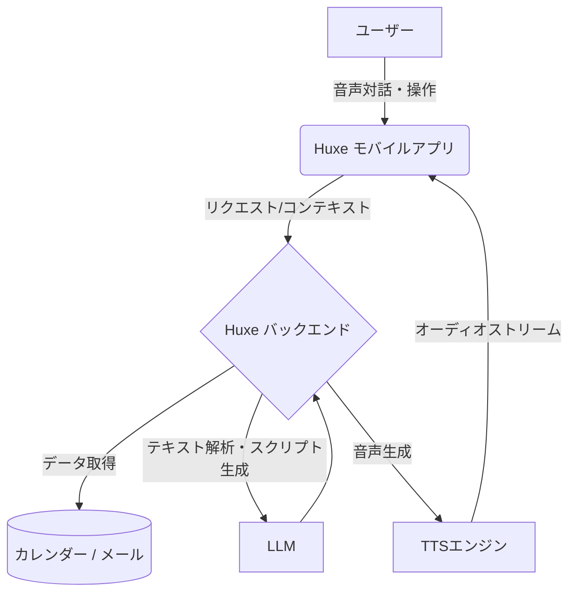

# **Huxe 調査レポート**

## **1. 基本情報**

* **ツール名**: Huxe
* **ツールの読み方**: ヒュクス / ハックス
* **開発元**: Huxe AI, Inc.
* **公式サイト**: [https://www.huxe.com/](https://www.huxe.com/)
* **カテゴリ**: 生成AI
* **概要**: 日々の情報、メール、カレンダーの予定などをパーソナライズされた音声インテリジェンスに変換するパーソナルオーディオアシスタントアプリ。Google NotebookLMの元リーダーであるRaiza Martin氏らによって開発されたが、**2026年5月28日をもってサービスを終了**した。

## **2. 目的と主な利用シーン**

* **解決する課題**: 無限のスクロールや画面を見続けることなく、自分にとって重要な情報を効率的に収集・把握する。
* **想定利用者**: 常に最新情報を追いたいビジネスパーソン、通勤・運動中の時間を有効活用したい一般ユーザー。
* **利用シーン**:
  * **朝のブリーフィング**: 身支度をしながら、メールやカレンダーに基づく5分間のパーソナライズされた音声を聴いて1日の準備をする。
  * **移動中の情報収集**: 通勤や犬の散歩中に、最新のニュースや自分の関心事についてのアップデートを聴く。
  * **オンデマンドの学習**: 「あの新しいSNSについて教えて」など、気になったことをその場で質問し、解説ポッドキャストを生成させる。

## **3. 主要機能**

* **Daily Briefings (毎日のブリーフィング)**: ユーザーのメール、カレンダー、現在の状況から情報を抽出し、パーソナライズされた音声ブリーフィングを生成する。
* **Interactive Intelligence (インタラクティブな音声)**: 音声の再生中に割り込んで、「もっと詳しく」「別の説明をして」など対話的に内容や方向性をコントロールできる。
* **DeepCasts**: ユーザーの質問や好奇心を、数秒で即座に解説ポッドキャストに変換する機能。
* **Your Personalized Feed**: 一般的なおすすめではなく、ユーザー個人の関心に合わせた専用の最新コンテンツを生成する。
* **Huxe Insights**: コンテキスト（カレンダーやメールなど）を連携し、必要な情報を必要なタイミングで提示する。

## **4. 動作原理・システム構成**

* **アーキテクチャ**: クラウドバックエンド型モバイルアプリ
* **主要コンポーネントとデータフロー**:
  * モバイルアプリ（iOS/Android）がユーザーのフロントエンドとして機能。
  * ユーザーの許可に基づき、連携されたカレンダーやメールのアカウントから定期的に情報を取得・同期する。
  * クラウド上のLLM（大規模言語モデル）を用いて、抽出したテキスト情報を対話型のオーディオスクリプトに変換し、TTS（テキスト音声合成）技術で音声を生成してストリーミング配信する。

* **特筆すべき要素技術**:
  * **インタラクティブ音声生成**: 単なる読み上げではなく、会話の途中でユーザーが割り込み（Interrupt）を行い、即座にコンテキストを再計算して音声を生成し直す技術。

## **5. 開始手順・セットアップ**

* **提供終了**: 2026年5月28日をもってサービスを終了したため、現在アプリのダウンロードおよび利用はできない。

## **6. 特徴・強み (Pros)**

* **究極のパーソナライゼーション**: ユーザー個人のデータ（メールやカレンダー）と関心を深く結びつけ、自分専用のオーディオコンテンツを生成する。
* **対話的な「聴く」体験**: 単なるテキストの読み上げではなく、会話を遮って質問や深掘りができる革新的なインタラクティブ性を備えている。
* **シームレスなコンテキスト連携**: 情報源を手動でアップロードする必要なく、接続されたアカウントから自動的に重要な情報を抽出し要約する。

## **7. 弱み・注意点 (Cons)**

* **サービス終了**: 2026年5月28日をもってサービスを終了しており、現在は利用できない。

## **8. 料金プラン**

| プラン名 | 料金 | 主な特徴 |
|---------|------|---------|
| **提供終了** | - | 2026年5月28日をもってサービスを終了した。 |

* **課金体系**: サービス終了済み。

## **9. 導入実績・事例**

* **導入企業**: BtoC（コンシューマー向け）アプリのため、特定企業の導入事例は公開されていない。
* **導入事例**: 一般ユーザーや開発者コミュニティにおいて、移動中の情報収集ツールとして利用されている。
* **対象業界**: 業界を問わず、効率的な情報収集を求める個人。

## **10. サポート体制**

* **ドキュメント**: 公式ブログや利用規約（Terms of Service）で基本情報が提供されている。
* **コミュニティ**: 公式のDiscordサーバーが存在し、ユーザー間の交流やフィードバックが行われている。
* **公式サポート**: メール（<legal@huxe.ai>）や公式のお問い合わせページを通じたサポートが提供されている。

## **11. エコシステムと連携**

### **11.1 API・外部サービス連携**

* **API**: 開発者向けの公開APIは現時点では提供されていない。
* **外部サービス連携**: GoogleカレンダーやGmailなど、ユーザーの個人アカウント（Google Workspace等）との連携が可能。

### **11.2 技術スタックとの相性**

| 技術スタック | 相性 | メリット・推奨理由 | 懸念点・注意点 |
|:---|:---:|:---|:---|
| **Google Workspace (Gmail / Calendar)** | ◎ | ユーザーのスケジュールやメールをコンテキストとして読み込み、ブリーフィングに活用できる。 | Google APIの制限や仕様変更に依存する。 |

## **12. セキュリティとコンプライアンス**

* **認証**: サードパーティのログイン（Google、Appleなど）を利用。
* **データ管理**: Google Restricted Scopes等の最小限のアクセス権限のみを要求し、データを第三者に販売したり広告目的で使用したりしないと明記されている。
* **準拠規格**: プライバシーポリシーにてデータの取り扱いを規定。DMCA（デジタルミレニアム著作権法）への対応窓口も設置されている。

## **13. 操作性 (UI/UX) と学習コスト**

* **UI/UX**: 画面を見る必要性を最小限に抑えた、音声ファーストの直感的なモバイルインターフェース。会話の進行に合わせて画面のコンテキストが自動で更新される。
* **学習コスト**: 非常に低い。日常的にポッドキャストを聴いたり、音声アシスタントを使ったりする感覚で利用開始できる。

## **14. ベストプラクティス**

* **効果的な活用法 (Modern Practices)**:
  * **カレンダーとメールの連携**: Huxeの真価を発揮させるため、普段使用している仕事や個人のアカウントを連携し、毎朝のブリーフィングの精度を高める。
  * **インタラプトの活用**: 音声をただ聴くだけでなく、「もっと詳しく」「スキップして」など積極的に割り込んでパーソナライズを促す。
* **陥りやすい罠 (Antipatterns)**:
  * **重要な意思決定への過信**: 利用規約でも明記されている通り、AIによる生成コンテンツには不正確な情報が含まれる可能性があるため、法務や医療などの重大な決定に直接用いるべきではない。

## **15. ユーザーの声（レビュー分析）**

* **調査対象**: App Store, Google Play, 関連ブログ記事
* **総合評価**: リリース直後から、その革新的な音声インターフェースが高く評価されている。
* **ポジティブな評価**:
  * 「画面を見続ける必要がなく、移動中や家事の合間に情報収集できるのが素晴らしい」
  * 「自分の興味に完全に一致した内容が流れてくるので、汎用的なニュースアプリより実用的」
  * 「音声の途中で質問すると即座に答えてくれるインタラクティブ性が魔法のよう」
* **ネガティブな評価 / 改善要望**:
  * 「デスクトップ（PC）版も欲しい」
  * 「一部のニュースソースで情報の鮮度や正確性に課題がある」
  * 「日本語での読み上げや認識精度が英語に比べるとまだ完璧ではない」
* **特徴的なユースケース**:
  * 朝のジョギング中や通勤電車の中で、その日のスケジュール確認と業界ニュースのキャッチアップを同時に行う。

## **16. 直近半年のアップデート情報**

* **2026-05-28**: **サービス完全終了**: 午前10時（太平洋標準時）をもって機能が停止し、オーディオ再生が不可に。
* **2026-05-21**: **ストアからの削除**: App StoreおよびGoogle PlayストアからHuxeアプリを削除。
* **2025-09-23**: **Huxe 公式ローンチ**: Google NotebookLMの共同創設者であるRaiza Martin氏らによって、パーソナルオーディオインテリジェンスアプリ「Huxe」が発表され、iOSとAndroid向けに提供開始。

(出典: [Huxe 公式サイト](https://www.huxe.com/) など)

## **17. 類似ツールとの比較**

### **17.1 機能比較表 (星取表)**

| 機能カテゴリ | 機能項目 | 本ツール | NotebookLM | ChatGPT | Perplexity |
|:---:|:---|:---:|:---:|:---:|:---:|
| **入力データ** | 個人データ自動連携 | ◎ <small>メール・カレンダー自動連携</small> | ◯ <small>Google Drive連携・Deep Research等</small> | ◯ <small>Google Workspace/Microsoft連携</small> | △ <small>ファイルアップロードのみ</small> |
| **出力形式** | 音声（ポッドキャスト） | ◎ <small>対話・割り込み可能</small> | ◎ <small>Audio/Video Overview</small> | ◎ <small>Advanced Voice Mode</small> | △ <small>読み上げ程度</small> |
| **利用環境** | プラットフォーム | △ <small>モバイルアプリ専用</small> | ◎ <small>Web / アプリ</small> | ◎ <small>Web / アプリ / デスクトップ</small> | ◎ <small>Web / アプリ</small> |
| **操作性** | 画面非依存 | ◎ <small>完全音声ファースト</small> | ◯ <small>バックグラウンド再生可能</small> | ◯ <small>Voice Mode時</small> | △ <small>画面確認が基本</small> |

### **17.2 詳細比較**

| ツール名 | 特徴 | 強み | 弱み | 選択肢となるケース |
|---------|------|------|------|------------------|
| **Huxe** | 日常生活に溶け込むパーソナル音声アシスタント。 | ユーザーのコンテキスト（予定・メール）を自動取得し、対話型で情報を提供する点。 | 自分でドキュメントを大量にアップロードしての緻密な分析には向かない。 | 移動中や作業中に、自分専用の最新情報を「聴いて」把握したい場合。 |
| **NotebookLM** | ドキュメントベースのAIリサーチアシスタント。 | Deep Researchによる高度なリサーチ自動化と、エージェンティック機能・推論能力。 | 個人の動的な予定（カレンダー等）のストリーミングには特化していない。 | 信頼できる資料とWeb情報を組み合わせて、深く調査・学習したい場合。 |
| **ChatGPT** | 汎用型のLLMチャットAI。 | Canvas機能やリアルタイムWeb検索、高度なAdvanced Voice Modeによる幅広い対応力。 | 自発的なプッシュ型の音声ブリーフィングには向いていない。 | 自由な対話、ドキュメントの共同執筆、コーディングなど多目的なアシストを求める場合。 |
| **Perplexity** | AI検索エンジン。 | Pro Searchによる推論検索と、Agent API（Finance Search等）の拡張性。 | 音声でのインタラクションはメインの体験ではない。 | 出典が明らかな具体的な事実関係や最新ニュースを素早く調べたい場合。 |

## **18. 総評**

* **総合的な評価**:
  Huxeは、「スクリーンを見続ける」という現代の課題に対し、パーソナライズされた「対話型の音声」という強力な解決策を提示した画期的なアプリであった。NotebookLMで培われた音声生成の知見をさらに進化させ、ユーザーが意識せずとも必要な情報が受動的に手に入る体験は非常に革新的であったが、惜しまれつつも2026年5月にサービスを終了した。
* **推奨されるチームやプロジェクト**:
  * （サービス終了のため該当なし）
* **選択時のポイント**:
  現在はサービスが終了しているため、類似の音声学習・リサーチ体験を求める場合は、NotebookLM（Audio/Video Overview）やChatGPT（Advanced Voice Mode）などを代替として検討することが推奨される。
