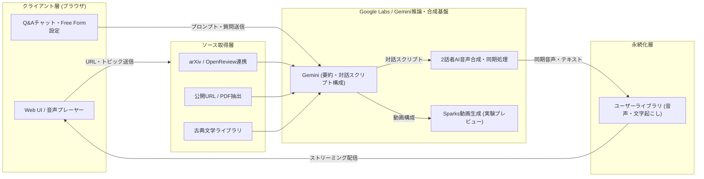

# **Google Illuminate 調査レポート**

## **1. 基本情報**

* **ツール名**: Google Illuminate
* **ツールの読み方**: グーグル イルミネート
* **開発元**: Google (Google Labs)
* **公式サイト**: [https://illuminate.google.com/](https://illuminate.google.com/)
* **関連リンク**:
  * ドキュメント / ホーム: [https://illuminate.google.com/home](https://illuminate.google.com/home)
  * Google Labs: [https://labs.google/](https://labs.google/)
  * レビュー記事: [NanoBits](https://nanobits.beehiiv.com/p/3-minutes-to-master-any-research-paper-with-google-illuminate)
* **カテゴリ**: 特定用途AIアシスタント
* **概要**: Google Labsの実験プロジェクトとして開発されたAI学習支援ツール。学術論文（主にarXivやOpenReview）、公開Web記事、古典文学などを入力すると、Geminiモデル群を用いて内容を構造化・要約し、2人のAIホストによる対話形式の音声コンテンツ（ポッドキャスト風）を生成する。同期トランスクリプトや再生中のインタラクティブQ&A、さらに短尺動画解説の実験機能「Sparks」など、専門知識を「聴いて・対話して」インプットする体験を提供する。

## **2. 目的と主な利用シーン**

* **解決する課題**: 専門用語や数式が多く難解な学術論文・技術文書を読む心理的ハードルを下げ、移動中や作業中でも効率的に知識をインプットし、疑問点をその場で解消できるようにする。
* **想定利用者**: 研究者、大学院生・学生、ソフトウェアエンジニア、最新技術トレンドをキャッチアップしたいビジネスパーソンや教育者。
* **利用シーン**:
  * **通勤・通学中の論文インプット**: 移動時間に最新論文の概要をNPR風の落ち着いたポッドキャスト感覚で聴取する。
  * **ながら作業でのサーベイ**: 家事や単純作業をしながら、複数論文や技術記事の要点を効率よく把握する。
  * **精読前のスクリーニングと疑問解消**: 論文の全文を読む前に音声で全体像をつかみ、気になる箇所で再生を止めてAIに質問し、精読すべきか判断する。
  * **教育・古典文学の学習補助**: 公開されている古典書籍や教育記事を対話形式に変換し、講義前の予習教材として活用する。

### **2.1 代表的な利用フロー**

```mermaid
swimlane-beta TB
  subgraph User["ユーザー"]
    A["論文URL検索またはトピック入力・スタイル選択"]
    E["同期音声再生・トランスクリプト確認"]
    F["再生を一時停止しQ&Aで質問"]
  end
  subgraph Illuminate["Google Illuminate"]
    B["ソース取得・設定条件の受付"]
    D["音声プレーヤー・タイムスタンプ同期UI配信"]
  end
  subgraph AI["Gemini・音声生成基盤"]
    C["テキスト解析・2話者対話スクリプト・音声生成"]
    G["文脈に基づくQ&A回答を生成"]
  end
  subgraph Source["外部論文・Webソース"]
    S["arXiv・OpenReview・公開Webページ"]
  end
  A --> B
  B --> S
  S --> C
  C --> D
  D --> E
  E --> F
  F --> G
  G --> E
```

* **代表的な流れ**: ユーザーが論文URLやスタイル（Casual / Formal / Free Form等）を指定すると、Google IlluminateがarXiv等の外部ソースから本文を取得し、Geminiおよび音声合成基盤で2話者の対話音声と同期トランスクリプトを生成・配信する。ユーザーは聴取中にいつでも一時停止し、文脈を保持したAIへ直接質問できる。

## **3. 主要機能**

* **AI音声会話生成（対話スタイルカスタマイズ対応）**: 論文や文書の内容を基に、2人のAIホストが対話形式で解説する音声を生成する。「Casual」「Formal」「Guided」などのプリセットに加え、「Free Form」モードではホスト・ゲストの音声ペルソナ選択、トーン、長さ、対象読者を指定するカスタムプロンプト入力が可能。
* **インタラクティブ・トランスクリプト**: 音声再生に合わせて文字起こしがリアルタイムでハイライト表示され、任意のテキストをクリックするとその発言箇所から即座に再生できる。
* **再生中Q&A（Raise Hand機能）**: 音声の聴取中に一時停止してフォローアップの質問を入力（またはサジェストから選択）すると、対象ソースの文脈に基づいた解説を即座に受け取り、その後元の音声再生へ戻ることができる。
* **多様なソース入力（arXiv / OpenReview / 任意URL / 古典文学）**: ツール内でのarXiv・OpenReview検索に加え、ペイウォール等のない公開Web記事・PDFのURL指定（最大4ソースの組み合わせに対応）や、パブリックドメインの古典文学ライブラリからの生成に対応している。
* **ライブラリ保存・スクリプト/カバー管理**: 生成した音声コンテンツは個人ライブラリに保存され、再生速度調整や後から聞き返す操作が可能。さらに生成スクリプトの確認・編集やカスタムカバー生成などの補助機能も順次テストされている。
* **Sparks（早期プレビュー動画解説）**: Google Labs内の実験的プレビューとして、テキストやトピックから1〜3分程度の縦型ショート解説動画（音声ナレーション同期付き）を自動生成する「Sparks」機能の開発・試験提供が行われている。

## **4. 動作原理・システム構成**

* **アーキテクチャ**: Google CloudおよびGoogle Labs基盤上で稼働するクラウド完結型のWebアプリケーション（SaaS / 実験的サービス）。クライアント側の専用アプリやローカルランタイムは不要で、ブラウザ経由で完結する。内部の具体的なマイクロサービス構成やモデル重みなどの詳細は非公開だが、公開されている挙動およびGoogleの生成AI基盤から以下の処理フローで構成される。
* **主要コンポーネントとデータフロー**:
  1. **ソースインジェスト層**: arXiv / OpenReviewのメタデータ検索API、公開URLのWebフェッチャー（PDF・HTMLテキスト抽出）、およびキュレーション済み古典書籍データベースからテキストを取得する。
  2. **対話構成・LLM推論層**: 抽出された専門テキストとユーザーの指定パラメータ（スタイル、対象読者、Free Formプロンプト）を入力として、Geminiモデルが正確性を保ちつつ2話者の掛け合いスクリプトおよびタイムスタンプ構造を生成する。
  3. **マルチモーダル合成層**: 生成されたスクリプトを自然な抑揚を持つ2種類のAI音声へ合成し、発言単位でトランスクリプトと同期させる（Sparksプレビューでは動画生成モデルとの連携も実施）。
  4. **インタラクティブQ&A・配信層**: 生成済みの音声ファイルとトランスクリプトをユーザーライブラリに永続化し、再生中の質問時には対象ソースのコンテキストを参照して即時回答を返す。
* **特筆すべき要素技術**:
  * **ソースグラウンディング**: 雑談や過度な脚色を抑え、学術論文・査読済み文献の記述に忠実な解説を維持するプロンプト・推論設計が採用されている。
  * **タイムスタンプ同期型インタラクティブプレーヤー**: 音声ストリームと文字起こしトークンを密に同期させることで、シーク操作や途中質問後のシームレスな復帰を実現している。



## **5. 開始手順・セットアップ**

* **前提条件**:
  * Googleアカウントが必要（クレジットカード登録は不要）。
  * モダンなWebブラウザ（Chrome, Safari, Edge, Firefox等）が動作するPCまたはモバイル環境。
  * 一部の実験的機能（Sparks等）や地域によっては順次ロールアウトとなり、利用可能になるまで待機が必要な場合がある。
* **インストール/導入**:
  * Webアプリケーションのため、ソフトウェアのインストールは不要。
* **初期設定**:
  1. [https://illuminate.google.com/](https://illuminate.google.com/) にアクセスし、「Sign in」からGoogleアカウントでログインする。
  2. 利用規約およびGoogle Labsの実験的ツールに関する同意を確認する。
* **クイックスタート**:
  1. トップページの検索バーに興味のあるトピック（例: `"Generative AI"`）を入力してarXiv論文を検索するか、任意の論文・Web記事URLを貼り付ける。
  2. 対話スタイル（Casual、Formal、Guided、またはカスタムプロンプトを指定できるFree Form）を選択し、「Generate」をクリックする。
  3. 数分待つと2話者の音声会話と同期トランスクリプトが生成され、ブラウザ上で再生・Q&Aが可能になる。

## **6. 特徴・強み (Pros)**

* **学術文献への高い忠実性と学習効率**: 専門的な論文を噛み砕いた対話形式で聴ける一方、NotebookLMの汎用的な掛け合いに比べて学術的・客観的なトーン（NPRスタイル）が保たれやすく、論文の本質を正確に把握しやすい。
* **同期トランスクリプトと再生中Q&A**: 音声だけでは聞き取りにくい専門用語を即座にテキストで確認でき、疑問が浮かんだ瞬間に再生を止めてAIホストへ質問できる点が能動的な学習に極めて有効。
* **柔軟な出力カスタマイズ**: 「Free Form」モード等により、話者の組み合わせ、解説の深さ、トーンをプロンプトで細かく制御でき、初心者向けから専門家向けまで目的に合わせた音声教材を作成できる。
* **完全無料での提供**: Google Labsの実験プロジェクトとして無料で提供されており（1日あたりの生成上限あり）、コストを気にせず論文サーベイに組み込める。

## **7. 弱み・注意点 (Cons)**

* **対応ソースの制限**: ローカルPCからのPDFや音声ファイルの直接アップロードには未対応（ローカル資料の分析にはNotebookLMの利用が推奨される）。また、ペイウォールや認証が必要なWebページは読み込めない。
* **日本語対応の制約**: UIおよび主力の入力ソース・出力音声は英語が中心である。NotebookLMの「音声概説」が50言語以上の多言語出力へ拡大したのに対し、Illuminateは日本語論文や日本語音声の生成において制限が多く、英語文献のインプット用途が主体となる。
* **実験的サービスゆえの不安定さと簡略化**: Google Labsのプレビュー段階であるため、仕様変更や機能統合・終了のリスクが常にある。また、数分〜十数分の音声に要約されるため、厳密な数式展開や実験データの細部は省略される。

## **8. 料金プラン**

| プラン名 | 料金 | 主な特徴 |
|---------|------|---------|
| **Google Labs Preview** | 無料 | Googleアカウントがあれば全機能を無料で利用可能。実験段階のため、1日あたりの音声生成回数に上限（例: 20回/日程度）が設けられている。 |

* **課金体系**: 現在は完全無料（商用有料プランの設定なし）。
* **無料トライアル**: 期間制限なくプレビュー版として無料利用が可能。

## **9. 導入実績・事例**

* **導入企業**: Google Labsの個人向け実験プロジェクトであるため、法人単位での公式導入事例は公開されていない。
* **導入事例**: 大学の研究室、大学院生、機械学習・ソフトウェアエンジニアが、arXivの新着論文を毎日効率的にスクリーニングする用途や、教育者が古典文学の事前学習教材を作成する用途で広く活用されている。
* **対象業界**: アカデミア（高等教育・研究機関）、テクノロジー・AI開発業界、EdTech分野。

## **10. サポート体制**

* **ドキュメント**: サービス内（[https://illuminate.google.com/home](https://illuminate.google.com/home)）に基本的な使い方やサンプルライブラリが掲載されているが、体系的な技術ドキュメントやAPIリファレンスは提供されていない。
* **コミュニティ**: 専用の公式フォーラムは設けられていないが、Reddit（`r/notebooklm` 等）やX（Twitter）上で研究者・AIユーザーによる活用Tipsや比較レビューが活発に共有されている。
* **公式サポート**: 画面上のフィードバック送信機能からバグ報告や要望を送ることは可能だが、個別のSLA付きサポート窓口は存在しない。

## **11. エコシステムと連携**

### **11.1 API・外部サービス連携**

* **API**: 2026年11月現在、外部開発者向けの公開APIやSDKは提供されていない。
* **外部サービス連携**:
  * **arXiv**: プレプリント論文データベースと直接連携し、アプリ内検索からシームレスに音声生成へ移行可能。
  * **OpenReview**: 機械学習系国際会議等の査読論文URLの読み込みに対応。
  * **公開Webコンテンツ**: 一般公開されている技術ブログやHTML記事、直リンクPDFのURL指定に対応。
  * **Google Account**: Googleアカウントによるシングルサインオン認証と個人ライブラリ同期に対応。

### **11.2 技術スタックとの相性**

| 技術スタック | 相性 | メリット・推奨理由 | 懸念点・注意点 |
|:---|:---:|:---|:---|
| **Webブラウザ (Chrome/Safari等)** | ◎ | インストール不要でPC・スマートフォンのブラウザから即座に利用可能。 | 専用ネイティブアプリ（iOS/Android）は提供されていない。 |
| **Python / Node.js (API連携)** | × | 該当なし（非対応）。 | 公式APIやSDKが未公開のため、プログラムからの自動バッチ生成等には組み込めない。 |
| **Google Workspace / NotebookLM** | ◯ | 同じGoogleアカウントで併用でき、URLベースはIlluminate、手持ちPDFやDocsはNotebookLMと使い分けが容易。 | 両サービス間で生成ライブラリを直接同期・移行する機能はない。 |

## **12. セキュリティとコンプライアンス**

* **認証**: Googleアカウント（OAuth / 2段階認証対応）による認証を利用。
* **データ管理**: GoogleのプライバシーポリシーおよびGoogle Labsの利用規約に従う。生成された音声とトランスクリプトはユーザーの個人ライブラリに関連付けられる。実験的サービスであるため、入力データやフィードバックがモデル改善・品質向上に利用される可能性がある点に留意が必要。
* **準拠規格**: Google Labsの実験的プレビューであるため、SOC2、ISO27001、HIPAA等のエンタープライズ向けコンプライアンス保証やデータ処理契約（DPA）の対象外である。社外秘の未公開論文や機密文書の入力は避けるべきである。

## **13. 操作性 (UI/UX) と学習コスト**

* **UI/UX**: 非常にシンプルで洗練されたWebインターフェースを採用している。トップ画面に検索バー・URL入力欄とキュレーションされたサンプル（Exploreライブラリ）が並び、生成後は左側に同期トランスクリプト、下部または中央に再生コントロールとQ&A入力欄が配置される直感的な構成となっている。
* **学習コスト**: 極めて低い。アカウントログイン後、1分以内に最初の音声生成を開始でき、特別なプロンプトエンジニアリングの知識も不要（Free Form利用時のみ任意で指示を記述）。

## **14. ベストプラクティス**

* **効果的な活用法 (Modern Practices)**:
  * **論文スクリーニングの一次フィルター**: 大量のarXiv論文をすべて精読するのではなく、朝や移動中にIlluminateで音声化し、「精読すべき論文」と「概要把握で十分な論文」を選別する。
  * **Free Formによる聴き手レベルの調整**: 初見の異分野論文を聴く際は、「専門外のエンジニア向けに具体例を交えて解説する」といったプロンプトをFree Formで指定し、理解速度を高める。
  * **Raise Hand（Q&A）の積極利用**: 聞き流して疑問に思った専門用語や前提知識は、後回しにせずその場で一時停止して質問し、文脈が温まっているうちに解消する。
* **陥りやすい罠 (Antipatterns)**:
  * **要約結果への過度な依存**: 音声解説は理解を助けるための要約であり、数式の厳密な証明、ハイパーパラメータ、実験の限界事項などは省略される。論文引用や実装の際には必ず原典PDFを確認すること。
  * **機密情報の入力**: 公開URLのみが対象とはいえ、限定公開URLや未発表の研究データなど機密性の高い文書を入力しないこと。

## **15. ユーザーの声（レビュー分析）**

* **調査対象**: Reddit（AI・リサーチ関連スレッド）、NanoBits、テックブログ、X（Twitter）（※Google Labsの無料実験ツールであるため、G2・Capterra・Product Hunt等の商用SaaSレビューサイトには製品ページが存在しない）
* **総合評価**: 商用レビューサイトの数値スコアはないものの、研究者・学生コミュニティからは「難解な論文を読む負担を劇的に下げるツール」として好意的に評価されている。
* **ポジティブな評価**:
  * 「専門用語だらけの論文を読むのが苦痛だったが、NPR風の落ち着いたラジオ感覚で聴けて理解の助けになる」（Reddit等より要約）
  * 「再生しながらトランスクリプトの該当箇所をクリックしてジャンプできる機能と、途中で質問できる機能が学習に非常に便利」（NanoBits / テックレビューより要約）
  * 「NotebookLMと比べて、学術論文の文脈に忠実で過剰な雑談が少ない点が良い」（Redditより要約）
* **ネガティブな評価 / 改善要望**:
  * 「ローカルのPDFファイルを直接アップロードしたい（その場合はNotebookLMを使う必要がある）」（Reddit等より要約）
  * 「Free Form以外のプリセットでは、少しジョークを入れようとしてもNPR調の硬さが残って不自然に感じることがある」（ユーザーレビューより要約）
  * 「日本語の論文や日本語音声への対応をさらに充実させてほしい」（SNS上の声より要約）
* **特徴的なユースケース**:
  * 非ネイティブの研究者・エンジニアが、自身の専門分野の英語論文を「英語リスニング教材」兼「技術キャッチアップ」として毎日聴取する活用法が定着している。

## **16. 直近半年のアップデート情報**

* **2026年（継続更新）**: **マルチモーダル動画実験「Sparks」およびライブラリ拡充**: テキストやトピックから1〜3分の短尺縦型動画解説を生成する早期プレビュー「Sparks」の検証や、古典文学・複数URLソースの組み合わせ対応、Free Formによる話者・スクリプト制御の洗練をGoogle Labs上で継続。
* **2025-07-12**: **音声概説・インタラクティブ体験の強化**: トランスクリプトの同期精度向上、再生中のフォローアップQ&A機能、および対話スタイルカスタマイズ機能の改善を実施。
* **2024-09-19**: **パブリックベータ展開**: 一般ユーザーへの公開範囲が拡大され、arXiv検索連携や対話型音声生成機能が広く利用可能に。

(出典: [Google Illuminate 公式サイト](https://illuminate.google.com/) / [Google Labs](https://labs.google/))

## **17. 類似ツールとの比較**

### **17.1 機能比較表 (星取表)**

| 機能カテゴリ | 機能項目 | 本ツール | NotebookLM | LilysAI | ChatGPT |
|:---:|:---|:---:|:---:|:---:|:---:|
| **入力ソース** | 論文(arXiv)/URL | ◎<br><small>arXiv・URL特化</small> | ◎<br><small>多様(URL/YouTube等)</small> | ◎<br><small>動画/PDF/URL</small> | ◯<br><small>Search・URL参照</small> |
| **ファイル** | ローカルPDFアップロード | ×<br><small>公開URLのみ</small> | ◎<br><small>対応</small> | ◎<br><small>対応</small> | ◎<br><small>対応</small> |
| **出力形式** | ポッドキャスト風音声対話 | ◎<br><small>2話者・スタイル調整可</small> | ◎<br><small>音声概説(50言語以上)</small> | △<br><small>構造化ノート/図解中心</small> | △<br><small>Advanced Voice(1対1対話)</small> |
| **学習支援** | 同期トランスクリプト・途中Q&A | ◎<br><small>クリック同期・Raise Hand</small> | ◯<br><small>インタラクティブ参加可</small> | ◎<br><small>タイムスタンプ・マインドマップ</small> | ◯<br><small>チャットで随時質問</small> |
| **多言語** | 日本語対応 | △<br><small>英語中心</small> | ◎<br><small>日本語音声・UI対応</small> | ◎<br><small>日本語要約高精度</small> | ◎<br><small>GPT-5.5等で自然に対応</small> |

### **17.2 詳細比較**

| ツール名 | 特徴 | 強み | 弱み | 選択肢となるケース |
|---------|------|------|------|------------------|
| **Google Illuminate** | 学術論文・公開URL・古典文学の音声対話化に特化したGoogle Labsツール。 | 論文URLを貼るだけで学術的に忠実な2話者音声を生成。同期トランスクリプトやFree Formカスタマイズが優秀。 | ローカルファイル不可。日本語対応が限定的で、実験段階のため仕様変更リスクがある。 | 英語のarXiv論文や公開技術記事を移動中に「聴いて」効率的にサーベイしたい場合。 |
| **NotebookLM** | 個人資料を統合管理・分析するGoogleの包括的AIリサーチアシスタント。 | PDF・Docs・YouTubeなど多様なソースに対応し、50言語以上の音声概説やエージェント型リサーチが可能。 | 単に1本の論文URLをサッと聴きたいだけの場合、ノートブック作成の手間がやや重い。 | 手持ちの複数PDFや社内資料を組み合わせて深く分析し、日本語で音声化・整理したい場合。 |
| **LilysAI** | 動画・音声・PDFから構造化ノートやマインドマップを生成する学習支援SaaS（現Readray）。 | 外国語動画・資料の高精度な日本語要約やマインドマップ生成、MCP連携による外部AI参照が強み。 | 2話者によるラジオ・ポッドキャスト風の音声生成には特化していない。 | 論文や動画教材を「音声で聴く」よりも「日本語の図解・構造化ノート」として保存・活用したい場合。 |
| **ChatGPT** | OpenAIによる汎用会話型AI（GPT-5.5 Instant / GPT-5.4 Thinking等）。 | どんな質問にも答えられる汎用性と推論力。CanvasやSearch、音声対話モードによる柔軟な議論が可能。 | 2人のホストによるポッドキャスト番組形式の自動生成や同期トランスクリプトプレーヤーは標準提供されない。 | 論文の内容についてAIと1対1で深く議論したり、コード実装や数式の解説を求めたりしたい場合。 |

## **18. 総評**

* **総合的な評価**:
  Google Illuminateは、難解な学術論文や技術文書のインプットに「カスタマイズ可能なポッドキャスト風音声＋同期トランスクリプト＋途中Q&A」という優れた学習体験をもたらすツールである。同じくGoogleが提供するNotebookLMが汎用リサーチワークスペースへと進化する中でも、Illuminateは学術文献への忠実さと気軽な「聴くサーベイ」に特化しており、研究者やエンジニアにとって依然として価値の高い存在である。
* **推奨されるチームやプロジェクト**:
  * **研究室・アカデミア**: 最新の英語論文（arXiv/OpenReview）のキャッチアップを効率化したい学生・研究者。
  * **エンジニアリングチーム**: 新技術のホワイトペーパーや公開技術ブログをチームメンバーが隙間時間でインプットしたい組織（機密情報を含まない公開情報に限る）。
* **選択時のポイント**:
  「手持ちのPDFや複数資料を日本語で深く整理したい」場合は **NotebookLM**、「動画や論文を構造化ノート・マインドマップにしたい」場合は **LilysAI**、「公開されている英語論文やWeb記事を移動中に自然な音声対話で聴き、その場で疑問を解消したい」場合は **Google Illuminate** を選ぶのが最適な使い分けである。
