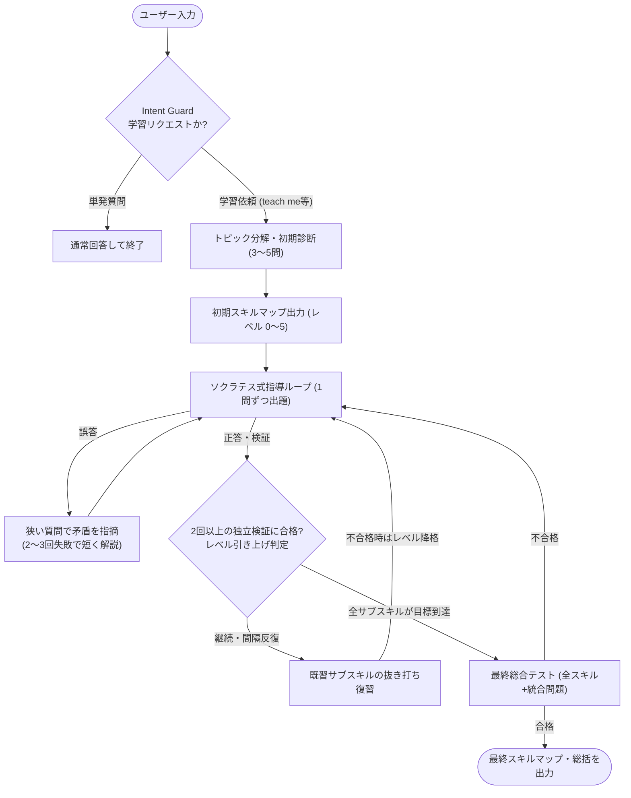

# **Jane Street Agent Skills 調査レポート**

## **1. 基本情報**

* **ツール名**: Jane Street Agent Skills (`janestreet/agent_skills`)
* **ツールの読み方**: ジェーン ストリート エージェント スキルズ
* **開発元**: Jane Street (Jane Street Group, LLC)
* **公式サイト**: [https://github.com/janestreet/agent_skills](https://github.com/janestreet/agent_skills)
* **関連リンク**:
  * GitHub: [https://github.com/janestreet/agent_skills](https://github.com/janestreet/agent_skills)
  * Jane Street Open Source: [https://opensource.janestreet.com/](https://opensource.janestreet.com/)
* **カテゴリ**: エージェントスキル/標準仕様
* **概要**: Jane Street Agent Skillsは、世界的なクオンツ取引企業であるJane StreetがMITライセンスで公開している、AIエージェントおよびチャットボット向けのスキルコレクションです。共通規格である `SKILL.md` 形式のプレーンテキスト指示ファイルで構成されており、コーディングエージェントのスキルフォルダに配置するか、チャットボットのシステムプロンプトへ貼り付けるだけで利用できます。第1弾として収録された `socratic-tutor` は、AIが直接答えを教えるのではなく、診断テスト・スキルマップ・ソクラテス式問答・間隔反復復習を通じて学習者を本質的な理解へ導く厳格なパーソナルチューター機能を提供します。

## **2. 目的と主な利用シーン**

* **解決する課題**: 汎用LLMやAIコーディングエージェントは質問に対して即座に完成した回答やコードを出してしまうため、学習者が「わかったつもり」になりやすく、応用力や深い理解が定着しにくいという課題を解決します。また、プロンプトを毎回ゼロから設計する手間を省き、再現性の高い指導ワークフローを標準化します。
* **想定利用者**: 新しいプログラミング言語や技術領域を体系的に習得したいソフトウェアエンジニア、CS学生・独学者、社内教育やオンボーディングにAIチューターを活用したい開発チーム。
* **利用シーン**:
  * Claude CodeやOpenAI Codex CLIなどのコーディングエージェントに組み込み、OCaml・Rust・統計学・アルゴリズムなどを対話形式で実践的に学ぶ
  * ChatGPTやClaude、GeminiなどのWebチャットに `SKILL.md` をシステムプロンプトとして設定し、専門分野の模擬面接や集中ドリルを実施する
  * 長期にわたる学習セッションを `save state` で保存し、別日・別セッションで `resume from:` により学習進捗を引き継いで継続する

### **2.1 代表的な利用フロー**

```mermaid
swimlane-beta TB
  subgraph User["ユーザー"]
    A["学習リクエスト入力 (teach me X)"]
    C["診断質問へ回答"]
    E["問答・演習への回答"]
    G["最終確認テストを受験"]
  end
  subgraph Agent["AIエージェント / LLM"]
    B["SKILL.md を読み込み起動"]
    D["サブスキル分解とスキルマップ生成"]
    F["回答の厳格評価・間隔反復復習"]
    H["最終スキルマップと総括を出力"]
  end
  subgraph Skill["socratic-tutor 仕様"]
    S1["Intent Guard で学習意図を確認"]
    S2["1問ずつの問いかけ・ヒント制限ルール"]
  end
  A --> B
  B --> S1
  S1 --> C
  C --> D
  D --> S2
  S2 --> E
  E --> F
  F -->|"目標レベル未達なら再出題"| S2
  F -->|"全項目が目標到達"| G
  G --> H
```

* **代表的な流れ**: ユーザーが学習開始フレーズを入力すると、AIエージェントが `socratic-tutor/SKILL.md` のルールに従って起動し、まずIntent Guardで単発の質問でないことを確認します。その後、診断テストから初期スキルマップ（レベル0〜5）を構築し、仕様に定義された「1問ずつの問答・厳格評価・間隔反復」のループを経て、全サブスキルが目標レベルに到達した時点で最終テストと総括を行います。

## **3. 主要機能**

* **意図確認ガード（Intent Guard）**: `"explain X"` や `"what is X"` のような単発の質問に対して誤ってチュートリアルを開始しないよう、意図が曖昧な場合は短い確認質問を挟み、明確な学習リクエスト（`"teach me"`, `"tutor me"`, `"quiz me"`, `"drill me"`, `"help me master"`）でのみ起動します。
* **初期診断とサブスキル分解（Diagnostic Placement）**: セッション開始時にトピックを4〜10個の具体的なサブスキル（広範なテーマの場合は2階層のツリー）に分解し、易〜難の3〜5問の診断クイズを1問ずつ出題して各サブスキルの初期レベルを判定します。
* **ASCIIスキルマップによる習熟度可視化（Skill Map 0-5）**: 各サブスキルをレベル0（unaware）からレベル5（can teach it / handle edge cases）の6段階で管理し、レベル変化時や `"show progress"` 要求時に進捗バー付きのASCIIチャートを描画します。
* **厳格なソクラテス式指導ループ（Teaching Loop）**: 1メッセージにつき質問を1つだけに限定し、答えやヒントを先回りして提示しません。誤答時には矛盾に気づかせるより狭い質問を投げかけ、2〜3回失敗した場合のみ短い解説を行い、直後に別角度から再テストします。正答時にも悪魔の代弁者（devil's advocate）として揺さぶりをかけ、理解の堅牢性を検証します。
* **厳格な評価と間隔反復復習（Evaluation & Spaced Review）**: お世辞（flattery）を禁止し、2回以上の独立した検証（うち1回はヒントなしの想起）をパスした場合のみレベルを引き上げます。学習中に予告なく過去のサブスキルを再テストする間隔反復を組み込み、不合格時はレベルを下げて再学習させます。
* **セッション状態の保存と復元（State Serialization）**: `"save state"` コマンドで現在のトピック、各サブスキルのレベル、誤解の傾向や学習済み範囲をコンパクトなテキストブロックとして出力し、別セッションで `"resume from:"` に貼り付けることで学習を中断なく再開できます。
* **ユーザー制御コマンド**: 学習中いつでも `"show progress"`（進捗表示）、`"harder"` / `"easier"`（難易度調整）、`"just tell me"`（現在の質問のみ直接回答を許可）などのコマンドで進行を柔軟にコントロールできます。

## **4. 動作原理・システム構成**

* **アーキテクチャ**: サーバーやデータベース、実行バイナリを持たない**完全ローカル・ステートレスなプロンプト仕様（Prompt-as-Code）構成**です。リポジトリ自体はディレクトリ単位でスキルを管理し、各スキルディレクトリ配下の `SKILL.md` がYAMLフロントマター（メタデータ・発火条件）とMarkdown本文（状態遷移と行動規範）の2層構造で構成されています。
* **主要コンポーネントとデータフロー**:
  * **トリガーマッチング層（YAML Frontmatter）**: `name` と `description` フィールドをAgent Skills対応エージェントが常時軽量に読み込み、ユーザーの入力文脈がトリガーフレーズに合致した段階でのみ `SKILL.md` 本文をコンテキストへ展開します（Progressive Disclosure）。
  * **状態管理・指導エンジン層（Markdown Prompt）**: LLMのコンテキストウィンドウを仮想的なステートマシンとして利用し、診断 → スキルマップ更新 → 指導ループ → 間隔反復 → 最終評価という一連の状態遷移を自然言語ルールで強制します。永続化が必要な場合は `"save state"` によるテキストシリアライズで外部保存します。
* **特筆すべき要素技術**:
  * **オープン標準 `SKILL.md` フォーマット**: 特定ベンダーのSDKやAPIに依存せず、Claude CodeやCodex CLI等のAgent Skills対応ツールではファイル配置のみで自動認識され、非対応のWebチャットでも本文コピー＆ペーストで同一の振る舞いを再現できます。
  * **実践演習との統合**: コーディングエージェントなどツール実行環境が利用可能な場合、`"write a query that..."` や `"predict what this code prints"` のような実環境での演習を出題し、実際の出力結果を検証する指示が組み込まれています。



## **5. 開始手順・セットアップ**

* **前提条件**:
  * 対応するAIコーディングエージェント（Claude Code、OpenAI Codex CLI、Cursor等）または任意のLLMチャットサービス（ChatGPT、Claude、Gemini等）
  * GitHubリポジトリの取得には `git`（またはブラウザでのファイル閲覧・ダウンロード）。アカウント登録やクレジットカード登録は不要です。
* **インストール/導入**:

  ```bash
  # リポジトリをクローン
  git clone https://github.com/janestreet/agent_skills.git

  # 例: Claude Code のプロジェクトローカルスキルとして配置する場合
  mkdir -p .claude/skills
  cp -r agent_skills/socratic-tutor .claude/skills/

  # 例: ユーザー全体（グローバル）に配置する場合
  mkdir -p ~/.claude/skills
  cp -r agent_skills/socratic-tutor ~/.claude/skills/
  ```

* **初期設定**:
  * Agent Skills対応エージェントの場合は、上記ディレクトリ配置のみで自動認識されます。
  * 通常のWebチャットボット（ChatGPTやGemini等）で利用する場合は、`socratic-tutor/SKILL.md` の本文（YAMLフロントマター以降、または全文）をコピーし、カスタム指示（Custom Instructions / System Prompt）またはチャット冒頭に貼り付けます。
* **クイックスタート**:
  * 導入後、エージェントやチャットに対して `"teach me OCaml"` や `"quiz me on TCP/IP"` のように依頼すると、初期診断テストから学習セッションが開始されます。

## **6. 特徴・強み (Pros)**

* **実践的かつ厳格な教育設計**: お世辞を排除し、「1問ずつ質問する」「2回以上の独立した検証でレベルを上げる」「抜き打ちの間隔反復を行う」といった認知科学・教育工学に根ざしたルールが細部まで言語化されており、LLM特有の「甘やかし」や「答えの丸投げ」を防ぎます。
* **依存関係ゼロの極めて高いポータビリティ**: 外部サーバー、データベース、APIラッパー、特定ランタイムを一切必要とせず、1つのMarkdownファイルのみで完結するため、ローカル環境でもクラウドチャットでも即座に導入できます。
* **コンテキスト状態の明示的な保存・復元**: 長時間の学習セッションでコンテキストウィンドウが逼迫したり別端末へ移動したりしても、`"save state"` と `"resume from:"` によって学習状態をテキストとして持ち運べます。
* **MITライセンスによる自由な改変・再配布**: 企業や教育機関の社内研修用チューターや、特定ドメイン特化スキル（例：自社の技術スタック専用ドリル）のベーステンプレートとして自由にカスタマイズできます。

## **7. 弱み・注意点 (Cons)**

* **収録スキル数の少なさ**: 2026年11月時点では `socratic-tutor` の1種類のみが公開されており、多様なエージェントスキル集として利用するには今後の追加やコミュニティPRの取り込みを待つ必要があります。
* **日本語対応の状況**: リポジトリのドキュメントおよび `socratic-tutor/SKILL.md` はすべて英語で記述されており、トリガーフレーズも英語（`"teach me"`, `"quiz me"` 等）が前提となっています。日本語で対話すること自体はLLMの能力により可能ですが、日本語トリガーでの確実な発火や日本語のニュアンスに沿った指導を行いたい場合は `SKILL.md` の翻訳・カスタマイズが推奨されます。
* **エージェント側の入力補完（オートコンプリート）との干渉**: GitHub Issueでも報告されている通り、Claude Codeなどの一部コーディングエージェントでは「次のユーザー入力候補」を自動提案する機能が働くため、チューターが出した質問の**正解をUI側がサジェストしてしまう**現象が起きることがあります。利用時はエージェント側のプロンプト提案機能をオフにするなどの工夫が必要です。
* **LLMのコンテキスト長・記憶保持への依存**: 長期セッションでは会話履歴が長くなり、初期のスキルマップや厳格なルールへの注意（Attention）が薄れることがあるため、定期的な `"show progress"` や `"save state"` によるセッションリセットが推奨されます。

## **8. 料金プラン**

| プラン名 | 料金 | 主な特徴 |
|---------|------|---------|
| **オープンソース (MIT License)** | 無料 | GitHubから無償で取得可能。商用利用・改変・再配布すべて許可。 |

* **課金体系**: ツール自体は完全無料（MITライセンス）。ただし、実際にスキルを実行するAIエージェントやLLM（Claude、ChatGPT、Gemini、またはAPI利用）のサブスクリプション費用・従量課金は利用者側の負担となります。
* **無料トライアル**: オープンソースのため期間制限なく無料で利用可能です（無料のWebチャット版LLMと組み合わせて試用できます）。

## **9. 導入実績・事例**

* **開発元・公開背景**: 世界有数のクオンツ取引・マーケットメイク企業であり、関数型言語OCamlの大規模活用でも知られるJane Streetが2026年11月3日に公式GitHub組織（`janestreet`）から公開しました。
* **コミュニティでの反響**: 公開直後からHacker NewsやReddit、開発者コミュニティで大きな話題となり、公開から約10日間でGitHubスター数 **8,200以上**、フォーク数 **530以上** を獲得しています（2026年11月時点）。
* **活用領域**: 公開事例として特定の導入企業名は公表されていませんが、個人開発者による新言語（OCaml、Rust等）やシステム設計の独学、面接対策の模擬ドリル、社内教育用カスタムスキルの雛形としての利用が広く報告されています。

## **10. サポート体制**

* **ドキュメント**: リポジトリ内の `README.md`、`CONTRIBUTING.md`、およびスキル定義ファイル `socratic-tutor/SKILL.md` 自体が仕様書兼ドキュメントとなっています（英語のみ）。
* **コミュニティ**: GitHubのIssuesおよびPull Requestsを通じてバグ報告、改善提案、新規スキルの投稿が行われています。コントリビューションにはDeveloper Certificate of Origin（DCO 1.1）への署名（`git commit -s`）が必要です。
* **公式サポート**: 商用サポート窓口、電話・メールサポート、SLA保証はありません。開発・メンテナンスはJane Streetのオープンソースチームおよびコミュニティによるベストエフォートで行われます。

## **11. エコシステムと連携**

### **11.1 API・外部サービス連携**

* **API**: ツール独自のREST APIやSDKは提供していません。プロンプト仕様ファイルとして動作するため、任意のLLM APIの `system` メッセージへテキストを渡すだけでプログラムからの組み込みが可能です。
* **外部サービス連携**: `SKILL.md` 規格（Agent Skills標準）に対応した各種AIエージェント・IDE・チャット環境と連携します。
  * **コーディングエージェント**: Claude Code、OpenAI Codex CLI、Cursor、Cline など
  * **汎用AIチャット**: Claude、ChatGPT、Google Gemini など（システムプロンプト・カスタム指示経由）

### **11.2 技術スタックとの相性**

| 技術スタック | 相性 | メリット・推奨理由 | 懸念点・注意点 |
|:---|:---:|:---|:---|
| **Claude Code** | ◎ | `.claude/skills/` に配置するだけで自動認識・発火し、コード実行演習もシームレス | 入力予測サジェストがクイズの答えを表示してしまう場合がある |
| **OpenAI Codex CLI** | ◎ | `SKILL.md` 形式のネイティブ読み込みに対応し、CLI上で対話・演習が可能 | 長時間セッションではコンテキスト圧縮に注意が必要 |
| **Cursor / Cline 等** | ◯ | ルール/スキルディレクトリへ配置またはカスタムルールとして取り込み可能 | ツールごとにスキル読み込みパスや発火仕様が一部異なる |
| **Web版チャット (ChatGPT / Claude / Gemini)** | ◯ | 特別な環境構築なしで `SKILL.md` を貼るだけで即利用可能 | ファイル操作やコード実行による自動採点は環境により制限される |
| **ローカルLLM (Ollama等)** | △ | システムプロンプトに設定すれば完全オフラインで学習可能 | 指示追従能力が低い小型モデルでは「答えを言わない」等の厳格ルールが崩れやすい |

## **12. セキュリティとコンプライアンス**

* **認証**: ツール自体に認証機能（SSO、2段階認証等）はありません。利用するホスト側のAIエージェントやLLMサービスの認証設定に依存します。
* **データ管理**: 静的なMarkdownファイルであり、外部へのテレメトリ送信や独自のデータ保存機能は一切持ちません。学習対話の内容や `"save state"` で出力するテキストデータの保存場所・暗号化・学習利用オプトアウト等は、利用するLLMプロバイダ（Anthropic、OpenAI、Google等）のポリシーに従います。
* **準拠規格**: ソフトウェア自体としてのISO27001やSOC2等の認証取得はありません（公式サイト・リポジトリ上での認証記載なし）。なお、コントリビューションの透明性と権利関係を明確にするため、DCO（Developer Certificate of Origin 1.1）によるコミット署名が義務付けられています。

## **13. 操作性 (UI/UX) と学習コスト**

* **UI/UX**: 専用のGUIは持たず、すべてテキストベースの対話UI（CLIまたはチャット画面）で完結します。ただし、`socratic-tutor` はASCII文字（`█` / `░`）を用いた視認性の高いスキルマップや現在フォーカス中の項目（`<- current focus`）を自動描画するため、テキストベースでありながら現在地と到達度を直感的に把握できます。
* **学習コスト**: **非常に低い**。導入はファイルのコピーまたは貼り付けのみであり、操作も自然な対話と数種類のシンプルな英語コマンド（`"show progress"`, `"save state"`, `"just tell me"` 等）を覚えるだけで使いこなせます。

## **14. ベストプラクティス**

* **効果的な活用法 (Modern Practices)**:
  * **実演習の併用**: Claude Codeなどコード実行が可能な環境で使う場合は、理論の質問だけでなく実際にコードやクエリを書かせて実行結果を確認させることで、理解の定着度が大幅に高まります。
  * **定期的な状態保存**: 長期学習では数サブスキルごとに `"save state"` を実行して状態ブロックをローカルメモに保存しておき、会話が長くなりすぎたら新しいセッションで `"resume from:"` を使って再開すると、ルール遵守精度を高く保てます。
  * **ターゲットレベルの調整**: 基礎を素早く押さえたい場合はデフォルト（レベル4/5）で進め、面接対策や実務の重要領域では開始時に「全項目5/5（full mastery）を目標にする」と明示すると効果的です。
* **陥りやすい罠 (Antipatterns)**:
  * **単発質問にスキルを強制適用する**: 単に仕様を調べたいだけの時に無理に起動すると遠回りになります。Intent Guardの設計通り、体系的に学びたいトピックに限定して使うのが適切です。
  * **小型・低推論モデルでの利用**: 「答えを教えず質問だけする」「2回以上の独立検証を行う」といった複合制約は指示追従性（Instruction Following）を要求するため、フロンティアモデル（Claude Opus/Sonnet、GPT-4o/o系、Gemini Pro系など）の利用が推奨されます。
  * **IDEの入力サジェストを放置する**: Claude Code等で次の入力候補が自動表示される設定のままだと、回答を考える前に答えが見えてしまい学習効果が損なわれます。

## **15. ユーザーの声（レビュー分析）**

* **調査対象**: GitHub Issues / Pull Requests、Hacker News、Reddit（G2・Capterra・ITreview等のBtoB SaaSレビューサイトにはオープンソースの軽量スキル集であるため未登録）
* **総合評価**: 公開直後ながらGitHubスター8,200超を記録し、コミュニティから高い評価を獲得（レビューサイト上の数値スコアなし）。
* **ポジティブな評価**:
  * 「Jane Streetからクオンツ取引アルゴリズムではなく教育用プロンプトが出たのは意外だったが、中身が驚くほど実践的でよく設計されている」（Hacker News / Redditでの反応要約）
  * 「LLMにお世辞を言わせず、曖昧な回答を許さず、抜き打ち復習まで行う厳格さが本物のチューターらしくて学習に効く」（開発者コミュニティでの反応要約）
  * 「依存関係なしの `SKILL.md` 1ファイルで完結しており、他のエージェントスキルや自前プロンプトの設計見本（リファレンス）として非常に参考になる」（GitHub / 技術ブログでの反応要約）
* **ネガティブな評価 / 改善要望**:
  * 「Claude Codeで2〜3問目あたりから、入力欄のサジェスト機能が質問の正解を提案してしまい、ネタバレになる」（GitHub Issue #16より引用）
  * 「最初から質問攻めではなく、まず概要を説明してから質問するモード（explain mode）や、学習者のニーズに合わせた柔軟な適応がほしい」（GitHub PR #9, #15での改善提案）
  * 「現時点では `socratic-tutor` しか入っていないため、Jane Streetならではのマーケットメイキング演習やシステム設計など他スキルの追加に期待したい」（GitHub PR #4等の動向より）
* **特徴的なユースケース**:
  * プログラミング学習にとどまらず、金融・マーケット理論の学習、技術書を読む際の理解度チェック、設計計画のレビュー（PR #10の `refine mode` 提案など）への応用がコミュニティで進んでいます。

## **16. 直近半年のアップデート情報**

* **2026-11-03**: Jane StreetがGitHubリポジトリ `janestreet/agent_skills` をMITライセンスで初回公開（Initial commit `1578f1b` およびタグ付相当コミット `v0.18~preview.133.03+642`）。第1弾スキルとして `socratic-tutor/SKILL.md` を収録。
* **2026-11-03〜2026-11-14**: 公開後約10日間でスター数8,200超に到達し、コミュニティから `explain mode`（PR #9）、`refine mode`（PR #10）、`market-making-sim`（PR #4）、`SKILL.md` ルール違反チェッカー（PR #3）などの機能拡張PRが多数提案され活発に議論中。

(出典: [GitHubリポジトリ コミット履歴](https://github.com/janestreet/agent_skills/commits/master) / [GitHub Pull Requests](https://github.com/janestreet/agent_skills/pulls))

## **17. 類似ツールとの比較**

### **17.1 機能比較表 (星取表)**

| 機能カテゴリ | 機能項目 | Jane Street Agent Skills | Anthropic Agent Skills | Vercel Agent Skills | Gemini Skills |
|:---:|:---|:---:|:---:|:---:|:---:|
| **基本機能** | `SKILL.md` 標準仕様準拠 | ◎<br><small>単一ファイル完結の軽量構成</small> | ◎<br><small>仕様の本家リファレンス実装</small> | ◎<br><small>18種以上のエージェントに対応</small> | ◯<br><small>Gemini CLI / エージェント向け</small> |
| **基本機能** | 教育・チューター特化設計 | ◎<br><small>厳格なソクラテス式指導を実装</small> | △<br><small>汎用タスク中心で教育特化なし</small> | ×<br><small>開発ベストプラクティス特化</small> | ×<br><small>開発・ツール連携特化</small> |
| **エコシステム** | 収録スキル数・網羅性 | △<br><small>公開時点で1種（socratic-tutor）</small> | ◎<br><small>Office生成・開発・テスト等多数</small> | ◯<br><small>React/Next.js/Deploy等充実</small> | ◯<br><small>Google/Geminiエコシステム向け</small> |
| **運用・環境** | 外部ツール・CLI非依存性 | ◎<br><small>Webチャットへのコピペでも動作</small> | △<br><small>一部スキルでCLI/ランタイム必須</small> | △<br><small>Node.js/Vercel環境との併用前提</small> | △<br><small>Gemini環境前提</small> |
| **非機能要件** | 日本語対応 | △<br><small>英語前提（LLM側で日本語対話は可）</small> | △<br><small>英語記述中心で日本語発火は工夫要</small> | △<br><small>英語ドキュメント中心</small> | ◯<br><small>多言語プロンプト対応</small> |

### **17.2 詳細比較**

| ツール名 | 特徴 | 強み | 弱み | 選択肢となるケース |
|---------|------|------|------|------------------|
| **Jane Street Agent Skills** | 思考力・理解定着に特化した `socratic-tutor` を提供する軽量スキル集 | 厳格な教育フレームワーク、外部依存ゼロでWebチャットでも即利用可能 | 収録スキル数がまだ1種類のみで、開発自動化等の実務タスクは対象外 | - |
| **Anthropic Agent Skills** | `agentskills.io` 仕様を牽引する公式スキルリポジトリ | docx/pdf/pptx/xlsx生成やMCP開発など本番品質のスキルが豊富 | 一部スキルは実行スクリプトやローカル環境依存がある | ドキュメント自動生成や実務ワークフローの自動化をエージェントに任せたい場合 |
| **Vercel Agent Skills** | React/Next.jsやVercel運用のベストプラクティスを提供するスキル群 | フロントエンド開発・最適化・デプロイに直結する実践的知見 | Webフロントエンド・Vercel領域以外には適用しにくい | Next.js/Reactアプリの開発品質とデプロイ効率をエージェントで高めたい場合 |
| **Gemini Skills** | Google Geminiおよび周辺開発環境向けのスキル群 | GeminiエコシステムやGoogleサービスとの親和性が高い | 他社エージェントとの横断的なポータビリティは限定的 | Gemini CLIやGoogle系開発スタックを中心にエージェントを活用している場合 |

## **18. 総評**

* **総合的な評価**:
  * Jane Street Agent Skillsは、派手な自動化スクリプトや独自ランタイムを持たず、「プロンプト設計の洗練度」と「汎用的な `SKILL.md` 形式」だけでAIの振る舞いを劇的に変える好例です。特に `socratic-tutor` は、AIに答えを聞くだけで終わらせず学習者に考えさせるという明確な設計思想が貫かれており、個人学習から技術習得まで高い実用性を備えています。
* **推奨されるチームやプロジェクト**:
  * 新しいプログラミング言語やコンピュータサイエンスの基礎を効率よく定着させたいエンジニア個人、ジュニアメンバーの自律的な学習を支援したい開発チーム、および自社独自のエージェントスキル（コードレビュー指導、設計壁打ちなど）を設計する際のリファレンスを求めるAI推進担当者に推奨できます。
* **選択時のポイント**:
  * 実務タスクの自動実行やドキュメント生成が目的なら **Anthropic Agent Skills** や **Vercel Agent Skills** が適していますが、「人間の理解を深める・スキルを鍛える」用途や、外部環境を構築せずに純粋なプロンプト資産としてAIチューターを導入したい場合は **Jane Street Agent Skills** が最有力な選択肢となります。
