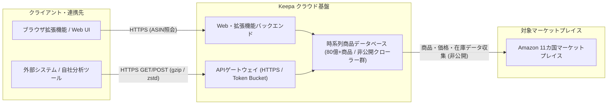

# **Keepa 調査レポート**

## **1. 基本情報**

* **ツール名**: Keepa
* **ツールの読み方**: キーパ
* **開発元**: Keepa.com
* **公式サイト**: [https://keepa.com/](https://keepa.com/)
* **関連リンク**:
  * ドキュメント/フォーラム: [https://keepa.com/#!discuss](https://keepa.com/#!discuss)
  * APIドキュメント: [https://api.keepa.com/](https://api.keepa.com/)
  * レビューサイト: [G2](https://www.g2.com/products/keepa/reviews) | [Trustpilot](https://www.trustpilot.com/review/keepa.com)
* **カテゴリ**: データ分析
* **概要**: Amazonにおける商品の価格履歴、売れ筋ランキング、出品者数、在庫推移などをグラフで可視化・提供するデータ分析ツール。日本や米国、欧州など11の国際Amazonマーケットプレイスに対応し、80億以上の商品を追跡している。EC事業者やせどり実践者の仕入れ・競合分析から、一般消費者の買い時判断、さらには経済調査機関による価格動向分析まで幅広く利用されている。

## **2. 目的と主な利用シーン**

* **解決する課題**: 商品の適正価格の把握、季節性や価格変動のトレンド分析、競合出品者の在庫状況・カートボックス獲得状況の確認。
* **想定利用者**: Amazon出品者（セラー）、せどり・EC物販事業者、ECマーケティング・価格調査担当者、一般のAmazon利用者。
* **利用シーン**:
  * **仕入れ判断**: 過去の価格と売れ筋ランキング（BSR）推移、閲覧数や販売数指標から、商品がいつ・いくらで・どれくらい売れているかを分析し、仕入れの可否を判断する。
  * **競合・在庫分析**: 「Other Sellers on Amazon」パネルや出品者別在庫履歴を活用し、FBA/FBM別の出品者数や競合の在庫水準、90日間のBuy Boxシェアを把握して販売価格を最適化する。
  * **買い時・再入荷通知**: 欲しい商品が指定した価格以下になった際や、在庫切れからの再入荷時に通知を受け取る（トラッキング機能・Stock Alerts）。

### **2.1 代表的な利用フロー**

```mermaid
swimlane-beta TB
  subgraph User["ユーザー"]
    A["Amazon商品ページを閲覧"]
    E["グラフ・在庫・アラートを確認し意思決定"]
  end
  subgraph Extension["Keepaブラウザ拡張機能"]
    B["ページ内のASINを検出しデータ要求"]
    D["商品ページ内に価格・BSRグラフを埋め込み描画"]
  end
  subgraph KeepaCloud["Keepaクラウド"]
    C["履歴DBから価格・BSR・Buy Box・在庫データを返却"]
  end
  A --> B
  B --> C
  C --> D
  D --> E
```

* **代表的な流れ**: ユーザーがAmazonの商品ページを開くと、ブラウザ拡張機能が商品識別子（ASIN）を自動検出し、Keepaのクラウドデータベースから履歴・統計データを取得して商品ページ内に直接グラフを描画する。ユーザーはその場で価格推移や在庫・競合状況を分析し、仕入れや購入の意思決定を行う。

## **3. 主要機能**

* **価格履歴グラフ**: 新品、中古、Amazon直販など、コンディションごとの価格推移を長期間にわたりグラフ表示する。
* **売れ筋ランキング履歴**: Amazonの売れ筋ランキング（Sales Rank / BSR）の推移を表示し、商品の需要や回転率を把握できる（Proプラン機能）。
* **価格・在庫アラート（Stock Alerts）**: 指定した価格を下回った場合や、在庫切れ時および再入荷した際にメール等で通知を受け取れる。
* **Other Sellers on Amazon・在庫履歴（Stock Buster）**: FBA/FBM別の出品者内訳、出品者ごとの過去の在庫数推移、隠された在庫数の推定表示など、競合の在庫状況を詳細に確認できる。
* **Buy Box（カートボックス）統計**: 90日間のBuy Box獲得シェアやローテーション状況、獲得価格履歴（輸入関税デポジット含むかどうかの判定含む）を確認できる。
* **Product Finder / Product Viewer**: カテゴリ、価格帯、ランキング、FBA/FBM出品者数、特定フィールドの有無（`exists`フィルタ）などの詳細条件で商品を検索・一括抽出できる。Filter Builder（Beta）やJump-to-Filter検索により絞り込み操作も強化されている。
* **ブラウザ拡張機能・モバイルアプリ**: Chrome、Firefox、Edge、Safari等にインストールしてAmazon商品ページ内にグラフを直接埋め込めるほか、iOS/Androidアプリからも確認可能。
* **Keepa Data Access API**: トークンバケット方式を採用したREST APIにより、商品情報、検索インサイト、閲覧数履歴（`viewCountHistory`）等をプログラムから取得できる。

## **4. 動作原理・システム構成**

Keepaのバックエンドにおけるデータ収集クローラーや内部ストレージの詳細は非公開だが、公開されているクライアント機能およびAPI仕様から、システム全体は以下の構成で動作している。

* **アーキテクチャ**: クラウド完結型の集中データベース（SaaS）を中核とし、クライアント側の**ブラウザ拡張機能**、**Webダッシュボード**、および開発者向けの**REST API（Keepa API）**からHTTPS経由でアクセスするクライアント・サーバー構成を採用している。
* **主要コンポーネントとデータフロー**:
  * **履歴データベース**: 11のAmazonマーケットプレイスにおける80億以上の商品について、価格・BSR・出品者数・Buy Box・閲覧数などの時系列データを圧縮配列形式で保持している。
  * **ブラウザ拡張機能**: Amazonの商品ページ読み込み時にDOMへスクリプトを注入し、ASINをキーとしてKeepaサーバーと通信し、インタラクティブなグラフやオファーパネルをページ内にレンダリングする。
  * **APIゲートウェイとトークンバケット制御**: `https://api.keepa.com/` 経由でGET/POSTリクエストを受け付け、プランごとの「1分あたり生成トークン数 × 60分（最大バケット容量）」に基づいてレート制限を動的に制御する。
* **特筆すべき要素技術**:
  * 巨大な時系列配列を含むJSONレスポンスの転送効率を高めるため、HTTPレスポンスは `gzip` またはより高圧縮・高速な `zstd`（Zstandard）による圧縮を標準採用し、HTTP Keep-Aliveによる接続再利用を推奨している。



## **5. 開始手順・セットアップ**

* **前提条件**:
  * Webブラウザ（Chrome, Firefox, Edge, Opera, Safari）またはiOS/Android端末
  * Keepaアカウント（無料の基本グラフ閲覧のみでも利用可能だが、トラッキングやPro機能にはアカウント登録が必要）
* **インストール/導入**:
  公式サイトまたは各ブラウザの拡張機能ストアから「Keepa - Amazon Price Tracker」をインストールする。

  ```bash
  # ブラウザ拡張機能の導入例（Google Chrome）
  # Chrome Web Store で "Keepa - Amazon Price Tracker" を検索して「Chromeに追加」をクリック
  ```

* **初期設定**:
  1. 拡張機能を有効化し、Keepa公式サイトで言語・通貨・通知用メールアドレスを設定する。
  2. APIを利用する場合は、KeepaアカウントのダッシュボードからAPIアクセスキーを発行する。
* **クイックスタート**:
  * **ブラウザ拡張機能**: Amazonの任意の商品ページを開き、商品情報の下部に自動表示される価格履歴グラフと「トラッキング」タブから目標価格を設定する。
  * **Keepa API（curlでの疎通確認例）**:

    ```bash
    # 商品情報取得エンドポイント（圧縮レスポンスを展開して確認）
    curl -s --compressed "https://api.keepa.com/product?key=<YOUR_API_KEY>&domain=5&asin=B08N5WRWNW"
    ```

    ※ `domain=5` はAmazon.co.jpを指す。APIキーは環境変数等で管理し、コードへ直書きしないこと。

## **6. 特徴・強み (Pros)**

* **圧倒的なデータ網羅性と長期履歴**: 80億以上の商品を11の国際マーケットプレイスで追跡しており、季節変動や長期トレンド、偽のセール（二重価格）の見極めに非常に強い。
* **Amazonページ内でのシームレスな分析**: 拡張機能により別ツールへ移動することなく、商品ページ上で価格推移、BSR、FBA/FBM在庫状況、Buy Boxシェアを即座に確認できる。
* **高度な検索と在庫可視化**: Product Finderの豊富なフィルタ群（`exists`フィルタやFilter Builder等）や、出品者別の在庫推移・Stock Buster機能により、精密な商品リサーチが可能。
* **高性能なデータAPI**: トークンバケット制と `zstd` 圧縮により、大量のASINデータを効率的かつ安定して自社システムやスプレッドシートへ統合できる。

## **7. 弱み・注意点 (Cons)**

* **料金値上げと無料版の制限強化**: 2026年2月にProプランが€19/月から€29/月へ約52%値上げされ、無料プランのトラッキング上限等も厳格化されたため、ライトユーザーや一般消費者にはコストハードルが高くなっている。
* **UIの複雑さと学習コスト**: 1つのグラフやテーブルに膨大な指標が凝縮されているため、初心者が波形の意味や各統計値を正確に読み解くには一定の学習が必要。
* **サポート体制・解約規定・日本語対応**: 拡張機能やWeb画面のUIは日本語に対応しているものの、公式サポート窓口（メール）やフォーラム、APIドキュメントは主に英語で提供されている。また、厳格な返金不可ポリシーや解約手順の分かりにくさに対するユーザーの不満が報告されている。

## **8. 料金プラン**

2026年2月の料金改定以降の主要プランは以下の通り（すべてユーロ建て課金）。

| プラン名 | 料金 | 主な特徴 |
|---|---|---|
| **Free Account** | 無料 | 基本的な価格履歴グラフの閲覧、制限付きでの価格トラッキング通知。※売れ筋ランキング履歴やProduct Finder等は利用不可。 |
| **Keepa Pro (Data Access)** | €29/月（年額 €290/年） | 売れ筋ランキング履歴、Buy Box統計、Product Finder全機能、出品者在庫履歴、トラッキング枠大幅拡大、制限付きAPIトークン等。 |
| **Keepa API** | €49/月〜 | 開発者・法人向けAPI専用プラン。最小プランは20トークン/分（バケット上限1,200トークン）。リクエスト量に応じて上位プラン（数千トークン/分規模）を選択可能。 |

* **課金体系**: 月額または年額の前払い制（ユーロ建てのため、日本円決済時は為替レートやカード会社の為替手数料の影響を受ける）。APIプランは「1分あたり生成トークン数」に基づくトークンバケット制。
* **無料トライアル**: Proプランの無料トライアルは原則なし（Free Accountで基本操作を確認可能）。

## **9. 導入実績・事例**

* **導入企業**: 具体的な導入企業名は公式に公開されていない。ただし、個人・法人のAmazonセラー、ECコンサルティング会社、サードパーティの価格改定・リサーチツールベンダーによって業界標準インフラとして広く利用されている。
* **導入事例**: せどり・卸売・D2Cメーカーによる仕入れ判断および競合価格モニタリングが代表的な利用形態。また、米国等の消費者団体・経済調査機関（Groundwork Collaborative等）が、ブラックフライデーやサイバーマンデーにおけるEC小売の割引実態を検証するための基礎データとしてKeepaの履歴ログを活用している事例も報告されている。
* **対象業界**: Eコマース、小売・卸売、D2C製造業、市場調査・経済分析。

## **10. サポート体制**

* **ドキュメント**: 公式サイト内に[Discussion Board（フォーラム）](https://keepa.com/#!discuss)があり、仕様質問やアップデート議論が行われている。また、開発者向けに[Keepa API Documentation](https://api.keepa.com/)が提供されている。
* **コミュニティ**: 公式フォーラムのほか、世界中のAmazonセラーによるブログ記事、YouTube解説動画、Pythonラッパー等のGitHubコミュニティが活発に存在する。
* **公式サポート**: メール（`info@keepa.com`）およびフォーラム経由での問い合わせに対応。対応言語は主に英語であり、返信速度や返金対応の柔軟性についてはユーザー間で厳しい意見も見られる。

## **11. エコシステムと連携**

### **11.1 API・外部サービス連携**

* **API**: [Keepa API](https://api.keepa.com/)（HTTPS GET/POST対応）を提供。`/product`（1トークン〜/ASIN）、`/search`（10トークン/クエリ）、`/bestsellers`（約50トークン）、`/tracking`、`/deal` などのエンドポイントを備える。レスポンスメタデータに `tokensLeft`・`refillIn`・`refillRate` が含まれ、クライアント側で動的なスロットリングが可能。
* **外部サービス連携**: 多数のAmazon物販支援ツール（価格改定ツール、利益計算ツール、在庫管理SaaS）やGoogleスプレッドシート連携アドオンがバックエンドでKeepa APIを利用している。

### **11.2 技術スタックとの相性**

| 技術スタック | 相性 | メリット・推奨理由 | 懸念点・注意点 |
|:---|:---:|:---|:---|
| **Java** | ◎ | Keepa公式のAPIライブラリが提供されており、型安全に統合可能。 | 特になし |
| **PHP** | ◎ | Keepa公式のAPIライブラリが提供されており、ECバックエンドとの親和性が高い。 | 特になし |
| **Python** | ◯ | `pydantic` や `pandas` と連携する充実したコミュニティ製非同期/同期ラッパーが存在する。 | 公式SDKではないためラッパーの追従状況に注意が必要 |
| **Node.js** | ◯ | 標準的なHTTPSクライアントと `zstd` 展開ライブラリを用いて容易に統合可能。 | 時系列圧縮配列のパース処理を自前またはライブラリで実装する必要がある |

## **12. セキュリティとコンプライアンス**

* **認証**: Webサービスはメールアドレスとパスワードによるログイン。APIはアカウントごとに発行されるプライベートアクセスキー（`key` パラメータ）による認証を行う。SSOや2段階認証（MFA）のエンタープライズ向け対応詳細は公開されていない。
* **データ管理**: 通信はすべてHTTPSで暗号化される。ユーザーのトラッキング設定やアカウント情報はKeepaのサーバー上で管理される。
* **準拠規格**: 公式サイト上でISO27001やSOC2などの第三者セキュリティ認証の取得状況は公開されていない。詳細なセキュリティ要件の確認が必要な場合は、公式サイト経由での問い合わせが必要。

## **13. 操作性 (UI/UX) と学習コスト**

* **UI/UX**: 複数の価格線・BSR・出品者数が1つのチャートに重なるため初見では情報密度が高いが、2026年のUI改善により「Other Sellers on Amazon」パネルでのFBA/FBM・在庫確認や、Product FinderのJump-to-Filter検索・Filter Builderが導入され、慣れたユーザーにとっては極めて高速に分析できる設計へと進化している。
* **学習コスト**: グラフの各種ラインの意味、Buy Boxローテーション、BSRの波形の解釈などを習得するには一定の慣れが必要であり、学習コストは中〜やや高め。

## **14. ベストプラクティス**

* **効果的な活用法 (Modern Practices)**:
  * **出品者別在庫履歴とBuy Boxシェアの併用**: 単に価格とBSRを見るだけでなく、FBA/FBM別の出品者数と90日間のBuy Boxシェアを確認し、Amazon直販や独占メーカーがカートを占有していないか見極める。
  * **API連携時の帯域・トークン最適化**: APIレスポンスには `zstd` 圧縮を指定し、バリエーション商品の親タイトル取得には `parentTitle` フィールドを活用して不要な追加リクエスト（トークン消費）を削減する。
* **陥りやすい罠 (Antipatterns)**:
  * **無料版のみでの仕入れ判断**: 売れ筋ランキング履歴が表示されないため、高値で出品されているだけの「売れていない商品」を誤って仕入れるリスクが高い。
  * **瞬間的な値動きへの過剰反応**: 一時的な在庫切れによる価格高騰やタイムセールに惑わされず、90日〜180日の平均価格とBSRの回転数を確認する。
  * **トークン枯渇の考慮漏れ**: APIバッチ処理で `tokensLeft` と `refillRate` を監視せずに並列リクエストを送るとエラーになるため、必ずバケット残量に応じたスロットリングを実装する。

## **15. ユーザーの声（レビュー分析）**

* **調査対象**: G2, Trustpilot, App Store
* **総合評価**: 4.3/5.0 (G2), 約1.5/5.0 (Trustpilot), 4.8/5.0 (App Store)
* **ポジティブな評価**:
  * 「Amazonで商品リサーチや卸売仕入れを行う上で、絶対に欠かせない業界標準ツール。」（G2より要約）
  * 「BSR履歴やBuy Box追跡、APIの応答速度とデータ精度が非常に高く、ビジネスの意思決定に不可欠。」（G2より要約）
  * 「モバイルアプリでもグラフを確認できるため、店舗での仕入れ判断に重宝している。」（App Storeより要約）
* **ネガティブな評価 / 改善要望**:
  * 「2026年の値上げ（€29/月）や無料プランの制限強化により、ライトユーザーには負担が大きくなった。」（Trustpilotより要約）
  * 「厳格な返金不可ポリシーや自動更新・解約の分かりにくさにより、意図しない課金トラブルが起きやすい。」（Trustpilotより要約）
  * 「ライブチャット等の即時サポートがなく、フォーラムやメール対応が硬直的・遅いと感じることがある。」（G2 / Trustpilotより要約）
* **特徴的なユースケース**:
  * プロのAmazonセラーがG2等で高く評価する一方、Trustpilotでは課金・解約面での不満から低評価が集中するなど、利用者層（B2Bプロ vs 一般消費者）によって評価が大きく二極化している。

## **16. 直近半年のアップデート情報**

* **2026-11-17**: **API Product Objectに商品ページ閲覧数履歴（`viewCountHistory` / `lastViewUpdate`）を追加**:
  * 過去1週間・1ヶ月あたりの商品ページ閲覧頻度の履歴データを取得可能になった（`history=0` 指定時は除外可能）。
* **2026-09-03**: **API Search InsightsにFBA/FBM別の平均新規出品者数指標を追加**:
  * `avgOfferCountNewFBA` および `avgOfferCountNewFBM` フィールドを追加し、フルフィルメント形態別の競合密度を把握しやすくなった。
* **2026-08-27**: **Product Finderの `exists` フィルタおよび輸入関税判定フラグを追加**:
  * 特定フィールド（例：`brand`）の有無で絞り込める `exists` フィルタと、Buy Box価格に輸入関税デポジットが含まれるかを示す `buyBoxPriceIncludesImportFees` を追加。
* **2026-08-25**: **バリエーション商品への親商品情報スナップショット（`parentTitle` / `parentHighlights`）を追加**:
  * 親ASINを別途リクエストせずに、バリエーション商品単体のレスポンスから親商品のタイトル・特徴を参照できるようになった。
* **2026-08-18**: **Offer Objectに参考価格・二重価格表示用の `savingBasis` / `savingBasisType` を追加**:
  * Amazon上で取り消し線付きで表示される参考価格（90日中央値、メーカー希望小売価格等）の追跡に対応。
* **2026-08-09**: **商品画像配列への画像種別コード（`variant`）追加**:
  * `images` 配列の各要素に `MAIN`、`PT01`–`PT08`、`SWCH` などの画像種別コードが付与され、用途別の画像フィルタリングが容易になった。
* **2026-02〜04（参考・重要変更）**: **Proプラン料金改定（€19/月 → €29/月）およびUI/API大幅刷新**:
  * 2026年2月3日よりKeepa Proが€29/月（年額€290/年）へ改定されたほか、APIの価格履歴定義変更（2月23日）やレガシーフィールド削除、拡張機能における「Other Sellers on Amazon」パネル・Stock Buster・Filter Builder（Beta）等のUI強化が順次展開された。
* **2025-10-21**: **在庫アラート（Stock Alerts）の追加**:
  * 追跡対象の商品が在庫切れ（Out of stock）または再入荷（Back in stock）した際に通知を受け取れる機能が追加された。

(出典: [Keepa 新着情報 / ニュース](https://keepa.com/#!news) / [Keepa API Documentation](https://api.keepa.com/))

## **17. 類似ツールとの比較**

### **17.1 機能比較表 (星取表)**

| 機能カテゴリ | 機能項目 | Keepa | CamelCamelCamel | Helium 10 | Jungle Scout |
|:---:|:---|:---:|:---:|:---:|:---:|
| **基本機能** | 価格履歴グラフ | ◎<br><small>80億+商品、全コンディション・長期履歴</small> | ◯<br><small>新品・中古・Amazon直販に対応</small> | ◯<br><small>価格履歴追跡に対応</small> | ◯<br><small>価格・売上履歴追跡に対応</small> |
| **基本機能** | 在庫・再入荷通知 | ◎<br><small>Stock Alerts、出品者別在庫履歴対応</small> | ◯<br><small>値下げメール通知に対応</small> | △<br><small>在庫管理はあるが競合在庫追跡は弱め</small> | △<br><small>自社在庫管理中心</small> |
| **分析機能** | 売れ筋ランキング履歴 | ◎<br><small>Pro版で詳細なBSR・閲覧数指標を表示</small> | ×<br><small>非対応</small> | ◎<br><small>Xray等で需要・BSRを詳細分析</small> | ◎<br><small>販売速度・収益予測に強み</small> |
| **検索・リサーチ** | 商品・キーワード発掘 | ◎<br><small>Product Finderで多軸フィルタ検索</small> | △<br><small>ウィッシュリスト取込・基本検索のみ</small> | ◎<br><small>Black Box / Cerebro等でSEO・キーワード最強クラス</small> | ◎<br><small>Opportunity FinderやサプライヤーDB充実</small> |
| **開発者向け** | API提供 | ◎<br><small>トークンバケット制API、zstd対応</small> | ×<br><small>非公開</small> | △<br><small>上位プラン・AIコネクタ中心で限定的</small> | △<br><small>Cobalt等エンタープライズ向け中心</small> |
| **コスト** | 無料プラン・低価格帯 | △<br><small>無料枠制限厳格化、Proは€29/月</small> | ◎<br><small>完全無料（アフィリエイト収益型）</small> | △<br><small>無料体験枠のみ、Platinumは$99/月〜</small> | △<br><small>無料プランなし、Starterは$29/月〜(年払)</small> |

### **17.2 詳細比較**

| ツール名 | 特徴 | 強み | 弱み | 選択肢となるケース |
|---|---|---|---|---|
| **Keepa** | 価格・BSR・出品者在庫履歴に特化したデータベースと拡張機能。 | 80億以上の商品履歴の網羅性と精度。拡張機能の高速さ。トークン制APIの柔軟性。 | UIが複雑。2026年の値上げ（€29/月）で一般層には割高。SEO・広告運用機能はない。 | 本格的にAmazonの価格・需要・競合在庫の履歴データを分析したい場合、またはAPIで自社ツールへ組み込みたい場合。 |
| **CamelCamelCamel** | 一般消費者向けの完全無料Amazon価格追跡ツール。 | 完全無料で使える。UIがシンプルで分かりやすい。Amazon 8カ国＋Walmart（Camelmart）対応。 | 売れ筋ランキングやBuy Box・出品者在庫のデータがない。API非公開。 | 一般の購入者が「買い時」を知りたいだけの場合や、コストをかけずに値下げ通知だけ欲しい場合。 |
| **Helium 10** | Amazon・Walmart・TikTok Shopセラー向けオールインワン suite。 | 逆引きASINキーワード調査（Cerebro）、SEO最適化、PPC広告管理、AI連携まで一気通貫。 | Keepaに比べて料金が高い（年払$99/月〜）。長期の細かい価格・在庫履歴はKeepaが優位。 | 独自ブランド（OEM/ODM）の販売で、キーワードSEOや広告運用まで1つのツールに統合したい場合。 |
| **Jungle Scout** | ニッチ市場発掘・サプライヤー開拓に強みを持つセラー支援ツール。 | 新規参入しやすい市場の発見（Opportunity Finder）や、認証済みサプライヤーDBが充実。 | 歴史的な価格・競合在庫データの細かさではKeepaに劣る。 | 新規プライベートブランド立ち上げに向け、売れる商品ジャンルと仕入先工場を効率的に探したい場合。 |

## **18. 総評**

* **総合的な評価**:
  * Keepaは、Amazon市場における価格推移・売れ筋ランキング・競合在庫履歴の分野で揺るぎない業界標準の地位を確立している。2026年2月の大幅値上げ（€29/月）や無料プランの制限強化、解約・サポート面の課題はあるものの、拡張機能のUI強化やAPIへの継続的な新指標追加（閲覧数履歴やFBA/FBM別統計など）により、プロフェッショナル向けの分析基盤としての価値は依然として極めて高い。
* **推奨されるチームやプロジェクト**:
  * **Amazonセラー・卸売事業者（個人・法人）**: 仕入れ判断の精度向上、競合在庫やBuy Boxシェアの監視に必須。
  * **ECデータアナリスト・自社ツール開発チーム**: Keepa APIを用いて大量の商品履歴データを自動収集・分析するプロジェクトに最適。
* **選択時のポイント**:
  * 正確な「売れ筋ランキング履歴」や「出品者別の在庫・Buy Box推移」を軸に仕入れや市場分析を行う場合は、Keepa Pro（€29/月）が第一選択となる。
  * 単に欲しい商品の値下げ通知を受け取りたいだけの一般ユーザーであれば、完全無料のCamelCamelCamelで十分なケースが多い。
  * 自社ブランドのSEOや広告運用まで一括管理したい場合はHelium 10やJungle Scoutが有力だが、データの詳細さからプロセラーはKeepaを併用するのが一般的である。
