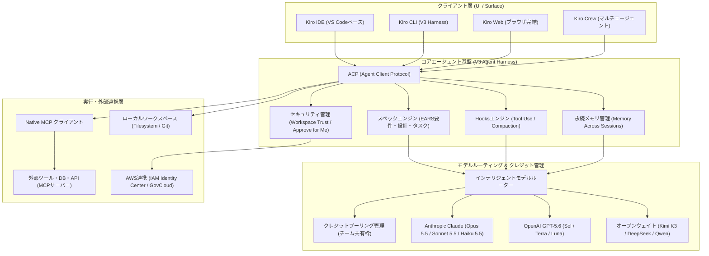

# **Kiro 調査レポート**

## **1. 基本情報**

* **ツール名**: Kiro
* **ツールの読み方**: キロ
* **開発元**: Amazon Web Services (AWS)
* **公式サイト**: [https://kiro.dev/](https://kiro.dev/)
* **関連リンク**:
  * ドキュメント: [https://kiro.dev/docs/](https://kiro.dev/docs/)
  * ダウンロード: [https://kiro.dev/downloads/](https://kiro.dev/downloads/)
  * ブログ: [https://kiro.dev/blog/](https://kiro.dev/blog/)
  * Changelog: [https://kiro.dev/changelog/](https://kiro.dev/changelog/)
* **カテゴリ**: AIエディタ/IDE
* **概要**: Kiroは、自然言語プロンプトからEARS記法の要件定義書、システム設計、実装タスクを構造化生成し、自律エージェントがコーディング・デバッグを行う「スペック駆動開発 (Spec-Driven Development)」を採用したAIネイティブIDEです。デスクトップIDE（VS Code互換）、単一バイナリのKiro CLI（V3 Harness）、ブラウザ完結のKiro Web、バックグラウンド協調運用のKiro Crewなど多様なサーフェスを展開しています。AWS内の専門チームによって開発・運営されています。

## **2. 目的と主な利用シーン**

* **解決する課題**: チャットベースの場当たり的なAIコーディングで生じがちなコンテキスト喪失、要件齟齬、大規模な変更時の不整合や手戻りを解消します。
* **想定利用者**: スタートアップのエンジニア、プロトタイプから本番運用まで構造的に開発したい開発者、大規模コードベースを保守・モダナイゼーションするチーム。
* **利用シーン**:
  * 新規機能・プロダクトの要件定義から設計・タスク分解・実装までのワンストップ推進
  * 既存コードベースへの大規模なリファクタリングやアーキテクチャ刷新
  * バグ修正仕様書（Bugfix Spec）の自動策定と根本原因分析に基づく自律修正
  * CI/CD前の自動Lint、テスト実行、ドキュメント自動更新（Agent Hooks連携）

### **2.1 代表的な利用フロー**

```mermaid
swimlane-beta TB
  subgraph User["開発者 (ユーザー)"]
    A[機能要件を自然言語で入力]
    C[生成されたSpecを確認・承認]
    F[コード差分とテスト結果を検証]
  end
  subgraph SpecEngine["Kiro スペックエンジン"]
    B[EARS要件・設計・タスクを構造化生成]
  end
  subgraph AgentHarness["Kiro V3 エージェント"]
    D[タスクを分解しコードを生成・編集]
    G[Hooks経由でテスト実行・自己修正]
  end
  subgraph Environment["実行環境 / ツール"]
    E[ファイル変更・MCPサーバー連携]
  end
  A --> B
  B --> C
  C --> D
  D --> E
  E --> G
  G --> F
```

* **代表的な流れ**: ユーザーが機能要件をプロンプトで入力すると、スペックエンジンがEARS記法の要件定義・設計・タスク一覧を生成します。ユーザーが内容を確認・承認（Approve）すると、V3エージェントがタスクを順次実行し、ローカル環境やMCPツールを通じてコード編集とHooksによるテスト検証・自己修正を自律的に行います。

## **3. 主要機能**

* **スペック駆動開発 (Spec-Driven Development)**: 自然言語からEARS記法（Easy Approach to Requirements Syntax）に準拠した要件定義書、アーキテクチャ設計書、実装タスクリストを自動生成し、手戻りのない段階的実装を実現します。
* **Kiro Agents & V3 Harness**: 独立したサブタスクを並行実行し、コンパイルエラーやテスト失敗時に自己修正を試みる自律コーディングエージェント基盤です。CLI環境ではV3ハーネスが標準化され、堅牢な実行環境を提供します。
* **Agent Hooks (イベント駆動自動化)**: ファイル保存時、ツール実行前後（Pre/Post Tool Use）、会話要約前後（Pre/Post Compaction）などのライフサイクルイベントをフックし、テスト実行、Lintチェック、ドキュメント更新を自動トリガーします。
* **チャット横断メモリ (Memory Across Sessions)**: セッション間で蓄積したプロジェクト固有の文脈やユーザーの好みを永続保持し、サブエージェントへの読み取り権限付与など効率的な文脈引き継ぎを行います。
* **自律承認 (Approve for Me)**: 日常的・安全なルーチンアクションをAIが自動承認し、リスクの高いコマンドや不確実な変更のみユーザーに確認を求めることで、開発作業の中断を最小化します。
* **ワークスペース信頼 (Workspace Trust)**: プロジェクトを開く際、フックやエージェント、MCPサーバーをロードする前に安全性を確認し、不正なスクリプト実行を防止します。
* **Native MCP & ACP サポート**: Model Context Protocol (MCP) により外部DBやAPIと柔軟に連携し、Agent Client Protocol (ACP) によりターミナル認証や外部クライアント連携を統一プロトコルで処理します。
* **マルチサーフェス展開**: VS Code互換のデスクトップIDE、単一バイナリ `kiro-cli`、クラウド完結のKiro Web、バックグラウンド自律運用のKiro Crewを用途に応じて使い分け可能です。
* **先端マルチモデル対応**: Claude Opus 5.5 / Sonnet 5.5 / Haiku 5.5、GPT-5.6 (Sol / Terra / Luna)、Kimi K3、DeepSeek、Qwenなど最新のプロプライエタリおよびオープンウェイトモデルを柔軟に選択・併用可能です。
* **チーム向けクレジットプーリング (Credit Pooling)**: 組織全体で月間クレジット枠を共有プール化し、個人の上限到達による作業中断を防ぎながら効率的なリソース配分を実現します。

## **4. 動作原理・システム構成**

* **アーキテクチャ**:
  Kiroは、ローカル開発環境（デスクトップIDE・CLI）とクラウドインフラ（LLMゲートウェイ・Kiro Web・AWSバックエンド）が密結合したハイブリッド構成を採用しています。クライアントとエージェントコア間はACP（Agent Client Protocol）を通じて抽象化されており、単一のエージェントロジックがIDE、CLI、Webの各UIサーフェスで一貫して動作します。
* **主要コンポーネントとデータフロー**:
  1. **クライアント層**: VS Code互換エディタ、単一バイナリ `kiro-cli`、Webブラウザ（Kiro Web）からユーザー入力を受け付けます。
  2. **コアエージェント層 (V3 Agent Harness)**: スペックエンジンがEARS記法で設計・タスクを分解し、Hooksエンジンがイベント駆動でライフサイクルを制御します。永続メモリ機構がセッション間の文脈を保持します。
  3. **モデルルーティング & アカウント層**: ユーザーやタスク特性に応じてClaude 5.5系、GPT-5.6系、オープンモデルにルーティングし、クレジットプールから消費枠をリアルタイム管理します。
  4. **外部連携・実行環境層**: Native MCPクライアント経由で外部APIやデータベースと連携し、ローカルファイルシステムやGitワークスペースに変更を適用します。
* **特筆すべき要素技術**:
  * **ACP (Agent Client Protocol)**: エディタとエージェントハーネス間の通信を標準化し、ターミナル認証やプロンプト承認をシームレスに調停。
  * **Pre/Post Compaction Hooks**: LLMの長文コンテキストが要約圧縮される前後にフックを起動し、必須情報の欠落を防止。
  * **自律承認エンジン (Approve for Me)**: 実行予定のコマンドリスクを分類し、安全な読み取りや定常編集を自動許可。



## **5. 開始手順・セットアップ**

* **前提条件**:
  * macOS (Apple Silicon / Intel)、Windows 10/11、または Linux (x86_64 / arm64)
  * 認証アカウント: AWS Builder ID、AWS IAM Identity Center (SSO)、GitHub、または Google アカウント
* **インストール/導入**:
  公式サイトの [Downloads](https://kiro.dev/downloads/) ページからインストーラー（macOS `.dmg`、Windows システムワイドインストーラー `.exe`、Linux `.deb` / `.rpm` / `.AppImage`）をダウンロードするか、CLIバイナリを直接セットアップします。

  ```bash
  # Kiro CLI のインストール例（公式インストーラースクリプト）
  curl -fsSL https://kiro.dev/install-cli.sh | bash
  ```

* **初期設定**:
  1. 初回起動時に認証プロバイダー（AWS Builder ID や GitHub 等）を選択してサインインします。
  2. 既存の VS Code 環境から設定・キーバインド・拡張機能をインポートするか選択します。
  3. 初回オープンするワークスペースで「Workspace Trust」の確認ダイアログに応答します。
* **クイックスタート**:
  1. `Cmd+K`（または `Ctrl+K`）を押してチャットパネルを開きます。
  2. 作成したい機能概要を自然言語で入力し、「Generate Spec」を指示します。
  3. 生成された要件定義書と設計書、タスク一覧を確認し、「Approve」をクリックします。
  4. Kiro Agent が自律的にコード生成・テスト・Lint検証を実行します。

## **6. 特徴・強み (Pros)**

* **構造化されたスペック駆動開発**: 単なる行単位・関数単位の補完にとどまらず、要件定義から設計・タスク分解を経て実装するため、手戻りや設計破綻が極めて少ないです。
* **先進的なエージェント機能と自動化**: V3 Harnessによる並行タスク処理、Pre/Post Compaction Hooks、チャット横断メモリなど、自律型開発に不可欠なインフラが洗練されています。
* **マルチサーフェスの一貫性**: デスクトップIDEだけでなく、単一バイナリCLIやWebブラウザから同一のエージェント・設定で作業可能です。
* **エンタープライズ対応とクレジットプーリング**: AWS IAM Identity CenterによるSSO、SOC 2 Type II、HIPAA準拠、AWS GovCloud対応に加え、チームでクレジットを共有できるクレジットプーリングにより大規模導入が容易です。
* **最新モデルの迅速な統合**: Claude 5.5世代（Opus/Sonnet/Haiku）やGPT-5.6世代、Kimi K3などの先端モデルが即座に利用可能です。

## **7. 弱み・注意点 (Cons)**

* **日本語対応の限定性**: UI表記や公式ドキュメント、エラーメッセージは英語中心であり、プロンプト指示も英語の方がより緻密に解釈される傾向があります。
* **学習コスト**: スペック駆動開発の作法や、Agent Hooks、MCP/ACP設定、メモリ管理など、多機能ゆえに使いこなすまでの理解が必要です。
* **クレジット消費の管理**: モデルによってクレジット消費係数が異なり、大規模な並行エージェント実行では消費速度が速まるため、予算に応じたプール管理や使用量通知の設定が推奨されます。

## **8. 料金プラン**

| プラン名 | 料金 | 主な特徴 |
|---------|------|---------|
| **Kiro Free** | 無料 | 月50クレジット、オープンウェイトモデルおよびClaude Sonnet 4.5への制限付きアクセス |
| **Kiro Pro** | $20/月 | 月1,000クレジット、プレミアムモデル対応、超過分追加購入可能（$0.04/クレジット） |
| **Kiro Pro+** | $40/月 | 月2,000クレジット、プレミアムモデル対応、優先サポート、超過分追加購入可能 |
| **Kiro Pro Max** | $100/月 | 月5,000クレジット、プレミアムモデル対応、高負荷開発・ヘビーエージェント利用者向け |
| **Kiro Power** | $200/月 | 月10,000クレジット、プレミアムモデル無制限枠、最大キャパシティ |
| **Teams & Enterprises** | $20/シート/月 | 1シートあたり月500クレジットをチーム共有プールに拠出（クレジットプーリング対応）、AWS一括請求 |

* **課金体系**: 月額サブスクリプション制。プラン付与クレジットの超過分は $0.04/クレジット でアドオン購入可能。AWS GovCloud (US) リージョン経由の利用時は標準価格より約20%の調整が適用されます。
* **無料トライアル**: 初回サインアップ時に500ボーナスクレジット（有効期限30日間）が付与されます。

## **9. 導入実績・事例**

* **導入企業**: スタートアップ、SaaS事業者、クラウドインフラ専任ベンダー、エンタープライズ開発組織まで幅広く導入されています。
* **導入事例**:
  * **SaaSスタートアップ**: バックエンドのビジネスロジック実装において、要件定義書とタスク分解をKiroに一任することで、開発リードタイムを大幅短縮。
  * **クラウドインフラチーム**: Terraformモジュールの設計・コード生成・バリデーションをKiro Agent Hooksと連携させ、インフラ構築の標準化を達成。
  * **セキュリティエンジニアリング**: EARS記法による厳密なセキュリティ仕様策定と自律テスト修正により、脆弱性の混入を未然に防止。
* **対象業界**: ソフトウェア・SaaS開発、クラウドインフラ運用、金融・ヘルスケア（HIPAA準拠環境）など。

## **10. サポート体制**

* **ドキュメント**: [Kiro Docs](https://kiro.dev/docs/) にて機能ガイド、アーキテクチャ、API/ACP/MCPリファレンス、CLIコマンド仕様、トラブルシューティングを網羅。
* **コミュニティ**: 公式Discordサーバーにて全世界の開発者とのQ&A、スキルやHooksの共有、開発チームへの直接フィードバックが活発に進行。
* **公式サポート**: GitHub Issuesでのバグ報告・機能要望のほか、Pro+以上のプラン向けに専用サポート窓口、エンタープライズ向けにAWS専任サポートを提供。

## **11. エコシステムと連携**

### **11.1 API・外部サービス連携**

* **API / プロトコル**:
  * **MCP (Model Context Protocol)**: ネイティブクライアントを搭載し、ローカル・リモートのMCPサーバー経由でGitHub、PostgreSQL、Slack、Jira等と接続可能。
  * **ACP (Agent Client Protocol)**: ターミナル認証や外部エディタ統合を行う標準化プロトコル。
* **外部サービス連携**:
  * AWS IAM Identity Center (SSO)、AWS Builder ID、Google、GitHubによるOAuth認証。
  * GitKraken / GitLensとの統合連携（コミットグラフ表示、Git文脈のMCP提供）。

### **11.2 技術スタックとの相性**

| 技術スタック | 相性 | メリット・推奨理由 | 懸念点・注意点 |
|:---|:---:|:---|:---|
| **TypeScript / Node.js** | ◎ | 最も手厚く検証されており、型定義を活かした自律デバッグ精度が高い | 特になし |
| **Python** | ◎ | テスト実行フックやスクリプト生成との親和性が非常に高い | 仮想環境（venv / uv）の事前設定を推奨 |
| **Terraform / IaC** | ◎ | インフラ仕様からの設計・コード生成に強みを発揮 | 破壊的変更（destroy等）は手動承認が必要 |
| **Rust / Go** | ◯ | 静的型付け言語として高品質なコード生成が可能 | ビルド時間が長いプロジェクトではHooks実行時間に配慮が必要 |
| **AWS SDK / CDK** | ◎ | AWS公式チーム開発ツールのため、最新APIやCDK constructへの追従が最速 | 特になし |

## **12. セキュリティとコンプライアンス**

* **認証**: AWS IAM Identity Center (SSO)、AWS Builder ID、Google、GitHub、Okta、Microsoft Entra ID に対応。
* **データ管理**: ユーザーの入力コードおよびプロンプトは基盤モデルの学習データとして使用されません。保存データおよび転送データは強力に暗号化されます。
* **準拠規格**: SOC 2 Type II 準拠、GDPR対応、HIPAA（医療情報保護法）準拠。AWS GovCloud (US) リージョンでの運用にも対応。
* **権限管理**: フォルダ単位の「Workspace Trust」、ルーチンアクションを自動承認し危険操作を遮断する「Approve for Me」により、エージェントの暴走や不正操作を二重に防御します。

## **13. 操作性 (UI/UX) と学習コスト**

* **UI/UX**: VS Codeのレイアウトを踏襲しており、既存のショートカットやテーマ、拡張機能をそのまま流用できます。新規追加された「Workflow Tab」により、エージェントの思考プロセスやステップツリー、実行ログが視覚的に把握しやすくなっています。
* **学習コスト**: 基本的なチャットによるコード補完は導入初日から利用可能ですが、スペック駆動開発（EARS記法要件策定）、Agent Hooks、Memory、MCPサーバー設定などを本格的にカスタマイズするには一定の理解と運用設計が必要です。

## **14. ベストプラクティス**

* **効果的な活用法 (Modern Practices)**:
  * **Design-First ワークフロー**: いきなりコード生成を求めず、まず要件（Requirements）とアーキテクチャ（Design）をKiroに策定させ、人間が仕様をレビュー・合意してからタスク実行へ進める。
  * **Pre/Post Compaction Hooksの導入**: 長時間のセッションで会話要約が行われる際に、重要な要件やテストコマンドが落ちないようフックで保護する。
  * **クレジットプーリングの活用**: チーム利用時はクレジットプーリングを有効化し、利用頻度の偏りによる個別枯渇を防ぐ。
* **陥りやすい罠 (Antipatterns)**:
  * **Specの無確認承認**: 生成された要件書を精読せずに承認すると、エージェントが想定外の設計方針で大量のファイルを書き換えるリスクがある。
  * **無制限の自動承認**: 全ての操作を盲目的に自動許可すると、意図しない外部通信や破壊的Git操作を引き起こす恐れがあるため、危険なコマンドは手動承認を残す。

## **15. ユーザーの声（レビュー分析）**

* **調査対象**: 公式サイト事例、開発者コミュニティ（Discord）、Reddit、X(Twitter)の技術レビュー
* **総合評価**: 4.6 / 5.0（構造化開発体験とAWS親和性において極めて高い評価）
* **ポジティブな評価**:
  * 「行き当たりばったりのチャットAIと違い、仕様書を起点にタスクを消化していくため、中規模以上の機能開発でも破綻しない」
  * 「Agent Hooksでコミット前のLintとテスト修正が完全自動化され、PRレビューの負担が激減した」
  * 「チームでクレジットプーリングが使えるようになり、メンバーごとの残クレジットを気にするストレスがなくなった」
* **ネガティブな評価 / 改善要望**:
  * 「UIやドキュメントが英語メインなので、日本のチーム全体に展開する際の導入ハードルがある」
  * 「高性能モデルを連続して動かすとクレジットの消費が激しく、適切なモデル選択の勘所が必要」
* **特徴的なユースケース**:
  * クラウドネイティブなマイクロサービスの初期ボイラープレートとAPI仕様策定の自動化。
  * 医療機関・製薬系SaaSでのHIPAA準拠環境におけるセキュアコーディング。

## **16. 直近半年のアップデート情報**

* **2026-11-05**: [CLI 3.1 & IDE 1.4.121] PreCompactおよびPostCompactフックを追加。サブエージェントによる親エージェントのメモリ読み取り機能、Workflow Runs検索機能、セッション使用クレジット表示（`/usage`）を追加。
* **2026-11-04**: [Models] Claude Haiku 5.5 および Kimi K3 が一般提供（GA）開始。IDE、CLI、Crew、Webの全サーフェスで正式サポート。
* **2026-11-04**: [General] チーム向けクレジットプーリング（Credit Pooling）機能を提供開始。組織内のクレジット枠を一元管理し、個人の上限枯渇を防止。
* **2026-11-03**: [CLI 3.0] Kiro CLIのデフォルトハーネスを「V3」に刷新。単一スタンドアロンバイナリ `kiro-cli` に一本化し、旧インターフェースを整理。
* **2026-11-02**: [IDE 1.4.86] ワークフロー実行をステップツリーとトランスクリプトで俯瞰できる「Workflow Tab」を追加。ステアリングドキュメントの警告表示を強化。
* **2026-10-30**: [Models] Claude Opus 5.5 および GPT-5.6 Sol が一般提供（GA）開始。本番ワークロード向けの安定したキャパシティを提供。
* **2026-10-30**: [CLI 2.37] V2エージェントからV3への自動アップグレード機能およびターミナル認証対応のACPサインインを導入。Mermaidネスト構造の描画を改善。
* **2026-10-29**: [CLI 2.36] 定常・安全なアクションを自律的に承認する「Approve for Me」機能を追加。
* **2026-10-28**: [Web] Kiro Webにセッション要約機能（Session Recaps）およびガイド付きワークフローを導入。
* **2026-10-21**: [Models] Claude Fable 5.1、Claude Sonnet 5.5、GPT-5.6 Terra、GPT-5.6 Luna が一般提供（GA）開始。
* **2026-10-20**: [CLI & IDE] ワークスペース信頼（Workspace Trust）機能およびチャットセッション横断メモリ（Memory）機能を導入。
* **2026-05-26**: [General] HIPAA準拠のサービスとして公式認定。
* **2026-05-07**: [Web & Models] ブラウザベースのKiro Web（プレビュー）公開、Claude Opus 4.7およびAdaptive Thinking対応を追加。

(出典: [Kiro Changelog](https://kiro.dev/changelog/))

## **17. 類似ツールとの比較**

### **17.1 機能比較表 (星取表)**

| 機能カテゴリ | 機能項目 | 本ツール (Kiro) | Cursor | Amazon Q Developer | GitHub Copilot |
|:---:|:---|:---:|:---:|:---:|:---:|
| **基本機能** | コード補完・インライン生成 | ◯<br><small>標準的補完</small> | ◎<br><small>極めて高速・高精度</small> | ◯<br><small>標準的補完</small> | ◎<br><small>業界デファクト</small> |
| **開発手法** | スペック駆動開発 (SDD) | ◎<br><small>EARS要件定義からタスク直結</small> | -<br><small>チャット/Composer中心</small> | △<br><small>タスク単位の指示</small> | -<br><small>プロンプト中心</small> |
| **自律性** | エージェントハーネス・Hooks | ◎<br><small>V3 Harness / Compaction Hooks</small> | ◯<br><small>Agent mode / Composer</small> | ◯<br><small>Agent for software dev</small> | ◯<br><small>Copilot Workspace</small> |
| **プロトコル** | MCP / ACP 対応 | ◎<br><small>Native MCP & ACP双方対応</small> | ◯<br><small>MCP対応</small> | △<br><small>AWS独自連携中心</small> | ◯<br><small>拡張機能連携</small> |
| **対応環境** | マルチサーフェス (IDE/CLI/Web) | ◎<br><small>IDE / CLI V3 / Web / Crew</small> | ◯<br><small>デスクトップIDE中心</small> | ◯<br><small>IDE拡張 / CLI / コンソール</small> | ◎<br><small>IDE / CLI / Web / Mobile</small> |
| **組織管理** | チームクレジットプーリング | ◎<br><small>共有プール運用対応</small> | -<br><small>個別シート課金</small> | -<br><small>月額固定シート課金</small> | -<br><small>月額固定シート課金</small> |
| **セキュリティ** | HIPAA / GovCloud / SSO | ◎<br><small>HIPAA・SOC2・GovCloud対応</small> | ◯<br><small>SOC2 Type II / SSO</small> | ◎<br><small>AWS厳格基準準拠</small> | ◎<br><small>エンタープライズ準拠</small> |

### **17.2 詳細比較**

| ツール名 | 特徴 | 強み | 弱み | 選択肢となるケース |
|---------|------|------|------|------------------|
| **Kiro** | スペック駆動開発型AIネイティブIDE | 要件定義・設計・タスク分解から実装まで構造的に完結。V3 Harness、Hooks、クレジットプーリング、AWS親和性 | 日本語UI・ドキュメントの不足、概念の学習コスト | 設計と実装の整合性を重視する中大規模開発、AWS環境、自律エージェントを制御したいチーム |
| **Cursor** | 高速レスポンス重視のAIネイティブIDE | 極めて滑らかなTab補完、直感的なインライン編集、Origin App Marketplace | 構造化された仕様管理（Spec）フローは手動設計が必要 | 個人開発者や、瞬発的なコーディング速度・UXを最優先する場合 |
| **Amazon Q Developer** | AWS統合型コーディングアシスタント | AWSリソース・コンソールとの親和性、レガシーコード変換（Java等） | 新規受付停止中（移行期）、自由度の高いエージェントカスタマイズ性は限定的 | 既存のAWSインフラに深く依存しており、現行契約を維持している組織 |
| **GitHub Copilot** | GitHubエコシステム統合型支援ツール | 既存のVS Code/JetBrains等にアドオン可能、圧倒的なコミュニティ規模と普及率 | 構造化されたスペック駆動ワークフローの標準非搭載 | 開発環境を変えずに全社規模でAIアシスタントを展開したい場合 |

## **18. 総評**

* **総合的な評価**:
  Kiroは、単なるコード補完やチャット対話の枠組みを超え、自然言語から要件定義（EARS記法）・システム設計・タスク分解を経て実装を自律推進する「スペック駆動開発 (Spec-Driven Development)」を確立した革新的IDEです。2026年後半にかけて、単一バイナリCLI（V3 Harness）、Pre/Post Compaction Hooks、チャット横断メモリ、そして組織での運用を円滑にするクレジットプーリングなど、実運用に直結する機能強化が急速に行われ、完成度が飛躍的に高まっています。
* **推奨されるチームやプロジェクト**:
  * 仕様策定と実装のズレを防ぎたい中規模〜大規模プロダクト開発チーム
  * AWS IAM Identity CenterやGovCloud、HIPAA準拠など高度なセキュリティ要件が求められる企業
  * インフラ（Terraform/IaC）とアプリケーション開発を自律エージェントで一貫推進したいクラウドエンジニア
* **選択時のポイント**:
  直感的なチャットでの試行錯誤を好む場合はCursor等の選択肢もありますが、「要件を固めてからAIに手戻りなく実行させる」というエンジニアリング原則を重視する場合、Kiroは他の追随を許さない最適な選択肢となります。
