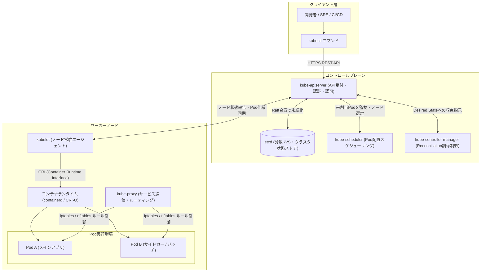

# **Kubernetes 調査レポート**

## **1. 基本情報**

* **ツール名**: Kubernetes (k8s)
* **ツールの読み方**: クバネティス / クーべネティス
* **開発元**: Cloud Native Computing Foundation (CNCF)
* **公式サイト**: [https://kubernetes.io](https://kubernetes.io)
* **関連リンク**:
  * GitHub: [https://github.com/kubernetes/kubernetes](https://github.com/kubernetes/kubernetes)
  * DeepWiki: [https://deepwiki.com/kubernetes/kubernetes](https://deepwiki.com/kubernetes/kubernetes)
  * ドキュメント: [https://kubernetes.io/docs/home/](https://kubernetes.io/docs/home/)
* **カテゴリ**: コンテナ/仮想化
* **概要**: Googleによって設計され、現在はCNCFによって管理されているオープンソースのコンテナオーケストレーションシステム。コンテナ化されたアプリケーションのデプロイ、スケーリング、および管理を自動化するためのプラットフォームとして、クラウドネイティブインフラのデファクトスタンダードとして世界中で広く採用されている。

## **2. 目的と主な利用シーン**

* **解決する課題**:
  * 多数のコンテナの手動デプロイ・運用監視によるオペレーション負荷の増大
  * ノード障害やトラフィック急変時におけるアプリケーションの可用性と耐障害性の確保
  * コンピューティング（CPU/メモリ/GPU）リソース効率の最適化とビンパッキング
  * マルチクラウド・ハイブリッド環境における環境差異による移植性の問題
* **想定利用者**: DevOpsエンジニア、SRE (Site Reliability Engineer)、インフラエンジニア、バックエンドエンジニア、プラットフォームエンジニア
* **利用シーン**:
  * **マイクロサービスアーキテクチャ**: 数百から数千のマイクロサービスを疎結合に連携させ、独立したリリースと自動回復を実現する基盤
  * **ハイブリッド/マルチクラウド運用**: AWS, Google Cloud, Azure, オンプレミス間で一貫したAPI操作を提供し、ベンダーロックインを回避
  * **大規模Webサービスの基盤**: HPA（Horizontal Pod Autoscaler）やIn-place Pod Resizeによる動的スケーリングと高可用性の確保
  * **AI/ML・データ基盤**: Dynamic Resource Allocation (DRA) を活用したGPU/アクセラレータの柔軟なスケジューリングとバッチ推論・学習ジョブの効率的実行

### **2.1 代表的な利用フロー (スイムレーン)**

```mermaid
swimlane-beta TB
  subgraph "開発者・運用者"
    A[マニフェスト定義・GitOpsコミット]
    F[デプロイ結果と稼働ステータス確認]
  end
  subgraph コントロールプレーン
    B[kube-apiserverが認証と検証を実施]
    C[etcdに期待状態を永続化]
    D[kube-schedulerが最適ノードを割当]
  end
  subgraph ワーカーノード
    E[kubeletがコンテナランタイムを制御しPod起動]
    G[kube-proxyがトラフィック経路を設定]
  end
  A --> B
  B --> C
  C --> D
  D --> E
  E --> G
  G --> F
```

* **代表的な流れ**: 開発者や運用者がYAMLマニフェストまたはGitOpsを通じてリソースの「あるべき状態」を宣言すると、コントロールプレーンのAPIサーバーが検証・永続化し、スケジューラーが最適なワーカーノードを選定する。ノード上のkubeletがコンテナを起動・健全性を監視し、kube-proxyがルーティングを自動構成することで、クライアントは透過的に安定稼働するサービスへアクセス可能となる。

## **3. 主要機能**

* **サービスディスカバリと負荷分散**: コンテナに固有のIPアドレスを割り当て、単一のDNS名を付与してトラフィックを自動で分散。
* **ストレージオーケストレーション & ボリューム管理**: ローカルストレージ、パブリッククラウドのブロックストレージ（EBS, Persistent Disk等）、ネットワークストレージを自動マウント。v1.36でVolume Group SnapshotsがGAとなり、複数ボリュームの整合性スナップショットが可能に。
* **自動ロールアウトとロールバック**: アプリケーション更新時に段階的にPodを入れ替え、ヘルスチェック失敗時には即座に前バージョンへ自動ロールバック。
* **自動ビンパッキング & Dynamic Resource Allocation (DRA)**: ノードのリソース状況に応じてコンテナを最適配置。v1.37でDRAのExtended Resource SupportおよびDevice Taints/TolerationsがGAとなり、特定GPUカードの障害切り離しや効率的なアクセラレータ共有を実現。
* **In-place Pod Vertical Scaling**: Podを停止・再起動することなく、実行中のコンテナに対してCPUやメモリの割り当て量を動的に拡大・縮小可能（v1.35 GA）。
* **自己修復 (Self-healing)**: プロセスダウン時のコンテナ再起動、ノード障害時の別ノードへの再スケジューリング、Probe（Liveness/Readiness/Startup）による不健全コンテナの自動排除。
* **Secretと構成管理**: パスワードやAPIキーなどの機密情報をConfigMap/Secretで安全に分離管理し、イメージ再ビルドなしで設定を反映。
* **User Namespaces Support**: Pod単位でLinux User Namespacesを適用し、ホストroot権限を持たないネイティブなrootlessコンテナ実行を実現（v1.36 GA）。マルチテナント環境のコンテナ脱出攻撃リスクを極小化。
* **Resilient Watch Cache**: 大規模クラスタ起動時や再接続時にAPIサーバーがetcdに過負荷をかけるのを防ぐ堅牢なキャッシュ初期化機能（v1.37 GA）。
* **Pod Certificates & Cluster Trust Bundles**: Projected Volumeを介してPodが短寿命のX.509証明書をネイティブ取得可能となり、外部ツールなしで強固なワークロード認証を実現（v1.37）。

## **4. 動作原理・システム構成**

Kubernetesは、クラスタ全体の制御と状態管理を担う**コントロールプレーン（Master）**と、実際のワークロードコンテナを実行する**ワーカーノード（Worker Node）**から構成される分散クライアント・サーバーアーキテクチャを採用しています。

システムの根本的な動作原理は「**宣言的設定（Declarative Configuration）**」と「**調停ループ（Reconciliation Loop）**」です。利用者がYAML等でクラスタの「あるべき状態（Desired State）」をAPIサーバーに登録すると、各コンポーネントが自律的に「現在の状態（Current State）」をあるべき状態に収束させるよう絶え間なく動作します。



* **アーキテクチャ特性**:
  * **完全疎結合なAPI駆動設計**: 全ての内部・外部コンポーネントは `kube-apiserver` のREST APIを唯一のエンドポイントとして通信し、etcdへ直接アクセスするのはAPIサーバーのみ。
  * **プラグインインターフェースによる高い拡張性**:
    * **CRI (Container Runtime Interface)**: containerd, CRI-O等のコンテナランタイムを標準インターフェースで制御。
    * **CNI (Container Network Interface)**: Calico, Cilium, Flannel等のネットワークプラグインを通じてオーバーレイネットワークやeBPFベースの高速通信を実現。
    * **CSI (Container Storage Interface)**: クラウドベンダーやストレージアプライアンスの永続ボリュームを共通APIで動的プロビジョニング。
* **主要コンポーネントとデータフロー**:
  1. `kube-apiserver`: クラスタのフロントエンドとして認証・認可・検証を実行。Watch APIを通じて変更通知を配信。
  2. `etcd`: 高可用かつ整合性の保証された分散KVS。クラスタ全体の真実の情報源（Single Source of Truth）。
  3. `kube-scheduler`: リソース要求量、Affinity/Anti-affinity、Taint/Toleration、DRAポリシーを考慮し、Podを実行する最適ノードを決定。
  4. `kube-controller-manager`: Node Controller、Deployment Controller、Job Controllerなどを内包し、障害検知やレプリカ数の維持を継続監視。
  5. `kubelet`: 各ノードで動作し、APIサーバーからの指示に基づいてコンテナのライフサイクル管理とヘルスチェック（Probe）を実行。
  6. `kube-proxy`: ノード上のパケット転送ルール（iptables/nftables）を維持し、Serviceに対するクラスタ内外からの負荷分散通信をルーティング。
* **特筆すべき要素技術**:
  * **In-place Vertical Scaling & DRA**: Pod再起動なしでのCPU/メモリ動的割り当て変更や、GPUなどのハードウェアアクセラレータのきめ細やかな排他制御。
  * **User Namespaces**: ノードのroot権限とコンテナ内root権限の分離（UID/GIDマッピング）により、多層防御セキュリティを実現。

## **5. 開始手順・セットアップ**

* **前提条件**:
  * 仮想化環境またはコンテナランタイム（Docker Desktop, containerd, OrbStackなど）
  * `kubectl` コマンドラインツール
* **インストール/導入**:

  ```bash
  # ローカル開発向け簡易セットアップ (minikube)
  curl -LO https://storage.googleapis.com/minikube/releases/latest/minikube-linux-amd64
  sudo install minikube-linux-amd64 /usr/local/bin/minikube

  # または kind (Kubernetes in Docker) を利用する場合
  # go install sigs.k8s.io/kind@v0.24.0
  ```

* **初期設定**:
  * `minikube start` （または `kind create cluster`）でローカルクラスタを起動
  * `kubectl cluster-info` でクラスタの接続と稼働状態を確認
* **クイックスタート**:

  ```bash
  # Nginxデプロイメントの作成
  kubectl create deployment nginx --image=nginx:alpine

  # NodePortによるサービスの公開
  kubectl expose deployment nginx --type=NodePort --port=80

  # サービスのURL取得とアクセス確認
  minikube service nginx --url
  ```

## **6. 特徴・強み (Pros)**

* **圧倒的なエコシステムとデファクトスタンダード**: CNCFの中核プロジェクトとして世界中で普及。Prometheus, Envoy, Argo CD, Ciliumなど、監視・メッシュ・デプロイ・セキュリティの周辺ツールが極めて充実している。
* **最高水準の移植性 (Portability)**: AWS (EKS), Google Cloud (GKE), Azure (AKS), オンプレミスベアメタルまで全く同じAPI仕様で動作し、特定のクラウドベンダーへのロックインを完全に回避できる。
* **堅牢な宣言的APIと自動調停 (Reconciliation Loop)**: 障害発生時でもシステムが自律的に「あるべき状態」を再構築するため、大規模環境での運用自動化と高可用性が担保される。
* **Custom Resource Definitions (CRD) とOperatorパターン**: データベースやメッセージキューなどのステートフルアプリケーションの運用手順をコード化し、Kubernetes APIネイティブに自動運用できる。
* **AI/ML・GPUワークロードへの最適化**: Dynamic Resource Allocation (DRA) や In-place Pod Vertical Scaling、Image Volumesなどの新機能により、大規模AIモデルの学習・推論インフラとしての俊敏性とリソース効率が飛躍的に向上。

## **7. 弱み・注意点 (Cons)**

* **非常に高い学習コスト**: Pod, Service, Ingress, Deployment, PVC, NetworkPolicy, RBACなど固有の概念が多く、インフラ・ネットワーク・Linuxカーネルの深い知識が求められる。
* **運用・保守の複雑さ**: コントロールプレーンやetcdの運用、ノードOSのパッチ適用、年3回のマイナーバージョンアップ追従（API廃止対応）など、運用側の継続的なメンテナンス負荷が高い。
* **スモールスタートや小規模アプリには過剰**: 単純なWebサイトや小規模APIの場合、マネージドコンテナサービス（Cloud Run, AWS App Runner等）と比較して構築・管理のオーバーヘッドが過大になる。
* **日本語ドキュメントの追従ラグ**: 公式ドキュメントの日本語版は存在するものの、急速に進化する最新バージョン（v1.36〜v1.37等）の新機能やマイグレーションガイドは英語情報が先行する。

## **8. 料金プラン**

| プラン名 | 料金 | 主な特徴 |
|---------|------|---------|
| **OSS版 (セルフホスト)** | 無料 | 自身でサーバー（ベアメタル/クラウドVM）を用意して構築。ソフトウェア利用料は完全無料。 |
| **GKE (Google Cloud)** | $0.10/時間/クラスタ (月1クラスタ分の管理費無料枠あり) | Autopilotモード（Podリソース従量課金）とStandardモード（ノードVM課金）。 |
| **EKS (AWS)** | $0.10/時間/クラスタ | コントロールプレーン管理費。ワーカーノード（EC2/Fargate）のコンピュート費用は別途。Extended Supportは追加課金。 |
| **AKS (Azure)** | 無料 (Standard Tierは有料) | クラスタ管理無料（Free Tierあり）。SLA保証付きのStandard Tierは$0.10/時間。ノードVM費用別途。 |

* **課金体系**: オープンソースソフトウェアとしては完全無料。パブリッククラウド各社のマネージドサービス（EKS/GKE/AKS）を利用する場合、「コントロールプレーン管理手数料（約$72〜74/月）」と「ワーカーノードのリソース利用料（CPU/メモリ/GPU/ストレージ）」が主な課金対象となる。
* **無料トライアル**: OSSは無期限無料。各クラウドプロバイダーが提供する無料枠（Google Cloudの新規登録クレジットや月額$74.40のクラスタ管理費相殺枠、Azure AKSのFree Tierなど）を活用した検証が可能。

## **9. 導入実績・事例**

* **導入企業**: Spotify, OpenAI, Mercedes-Benz, The New York Times, Yahoo! JAPAN, メルカリ, LINEヤフー
* **導入事例**:
  * **OpenAI**: 超大規模なAIモデルの分散トレーニングおよび低遅延推論クラスタの基盤としてKubernetesを大規模運用。GPUクラスタの動的割り当てと高スループットネットワークを最適化。
  * **Spotify**: 数千に及ぶマイクロサービス群をKubernetes上で稼働させ、自社開発の社内ポータル（Backstage）と連携して自律的なデプロイパイプラインを確立。
  * **Mercedes-Benz**: コネクテッドカーから収集される膨大なテレメトリデータのリアルタイム処理基盤およびエッジコンピューティング環境としてKubernetesを採用。
  * **LINEヤフー / メルカリ**: 日本国内の大手テック企業において、プライベートクラウドおよびマルチクラウドの大規模コンテナ基盤として標準採用。
* **対象業界**: Webサービス、FinTech、通信、自動車、製造、ヘルスケア、エンタープライズSaaSなど、高トラフィック処理やマイクロサービス化を推進する全業界。

## **10. サポート体制**

* **ドキュメント**: [公式ドキュメント](https://kubernetes.io/docs/)および[リリースノート](https://kubernetes.io/releases/)が完備されており、チュートリアル、コンセプト解説、APIリファレンスが網羅的に提供されている（多言語対応）。
* **コミュニティ**: 世界最大級のオープンソースコミュニティを形成。CNCF公式Slack（数十万人のエンジニアが参加）、Kubernetes Forum、Stack Overflow、GitHub Discussions、および年数回開催される世界規模のカンファレンス「KubeCon + CloudNativeCon」が極めて活発。
* **公式サポート**: CNCFとしての商用個別サポートは存在しないが、Red Hat (OpenShift), VMware by Broadcom (Tanzu), SUSE (Rancher), ならびにAWS, Google Cloud, Microsoftなどの主要クラウドベンダーが24時間365日のエンタープライズSLAサポートを提供。

## **11. エコシステムと連携**

### **11.1 API・外部サービス連携**

* **API**: 完全に標準化されたRESTful JSON/Protobuf APIを提供。`kubectl`、公式クライアントライブラリ（Go, Python, Java, JavaScript, C#など）、Terraformプロバイダー、CI/CDツールから統一操作が可能。
* **外部サービス連携**:
  * **CI/CD & GitOps**: Argo CD, Flux, GitHub Actions, GitLab CI, Jenkins, Tekton
  * **オブザーバビリティ (監視・ログ・トレース)**: Prometheus, Grafana, Datadog, OpenTelemetry, Fluent Bit, Loki, Jaeger
  * **サービスメッシュ & 通信**: Istio, Linkerd, Cilium (eBPF), Envoy
  * **セキュリティ & ポリシー管理**: Falco, Trivy, Kyverno, Open Policy Agent (OPA/Gatekeeper)
  * **ストレージ & バックアップ**: Rook/Ceph, Longhorn, Velero
  * **AI/ML基盤**: Kubeflow, Ray on Kubernetes (KubeRay), vLLM

### **11.2 技術スタックとの相性**

| 技術スタック | 相性 | メリット・推奨理由 | 懸念点・注意点 |
|:---|:---:|:---|:---|
| **Docker / containerd** | ◎ | コンテナ標準のOCI仕様に準拠し、ビルドから実行まで完全な互換性を保持。 | containerdが標準ランタイム（Dockershimは廃止済み）。 |
| **Go** | ◎ | Kubernetes自体の開発言語。クライアントSDK（client-go）やOperator SDKが最も迅速かつ手厚くサポート。 | 特になし。 |
| **Python (AI/ML・FastAPI)** | ◎ | 機械学習モデルのサービングやデータパイプラインでの利用が標準的。DRA連携が容易。 | GPUリソースの確保とメモリ消費のチューニングが必要。 |
| **Java (Spring Boot / Quarkus)** | ◯ | QuarkusやGraalVMの台頭で起動時間・メモリ消費が大幅改善。大規模エンタープライズでの実績多数。 | JVMのヒープメモリ設定とコンテナリソース制限（cgroups）の整合性に注意。 |
| **Terraform / OpenTofu** | ◎ | クラウド上のクラスタプロビジョニングからHelm・マニフェスト適用までコードで一元管理可能。 | クラスタのライフサイクルとアプリマニフェストのState管理の分離が推奨される。 |

## **12. セキュリティとコンプライアンス**

* **認証・認可**:
  * X.509証明書、OpenID Connect (OIDC)、Webhookトークン認証など多様な認証メカニズムをサポート。
  * RBAC（Role-Based Access Control）により、NamespaceやAPIリソース単位で厳格な最小権限付与が可能。
  * Pod Certificates機能（v1.37）により、外部エージェントなしでPodが直接短寿命のmTLS証明書を取得可能に。
* **データ管理と分離**:
  * Secretリソースによる機密情報管理（KMSプラグインを用いたetcdエンベロープ暗号化を強く推奨）。
  * User Namespaces（v1.36 GA）により、Pod内のrootユーザーがホストOSの非特権ユーザーにマッピングされ、コンテナ脱出攻撃の脅威を激減。
  * NetworkPolicyによるPod間通信のホワイトリスト型アクセス制御。
* **準拠規格**:
  * 各クラウドのマネージドサービス（EKS, GKE, AKS）は、SOC 1/2/3, ISO/IEC 27001, PCI DSS Level 1, HIPAA, FedRAMPなどの厳格な国際コンプライアンス認証を取得済み。

## **13. 操作性 (UI/UX) と学習コスト**

* **UI/UX**:
  * 標準は強力なCLIツール `kubectl`。JSON/YAML出力や柔軟なフィルタリング（jsonpath）が可能。
  * 公式Webダッシュボード（Kubernetes Dashboard）のほか、サードパーティの統合デスクトップツール「Lens」やターミナルUI「K9s」、Webベースの「Headlamp」などが広く利用されており、運用者の可視性と作業効率を大幅に向上させている。
* **学習コスト**: **非常に高い**。
  * コンテナの基礎知識に加え、分散システム、Podネットワーク（オーバーレイネットワーク、CIDR）、永続ストレージモデル、Linuxカーネル（cgroups, namespaces, iptables/eBPF）の理解が不可欠。
  * 本番運用に耐えうる設計・トラブルシューティング能力を身につけるには数ヶ月〜年単位の実務経験が必要。

## **14. ベストプラクティス**

* **効果的な活用法 (Modern Practices)**:
  * **GitOpsの徹底**: Argo CDやFluxを導入し、マニフェストリポジトリを唯一の信頼できる情報源としてクラスタ状態を自動同期。直接 `kubectl apply` を打たない運用を確立。
  * **適切なResource Requests / Limitsの設定**: ノードのメモリ枯渇によるOOM Killer発動を防ぎ、In-place Pod Resizeを活用して無停止でリソース調整を実施。
  * **ヘルスチェックProbeの精緻な設定**: Startup, Liveness, Readiness Probeを正しく分離設定し、初期化の遅いアプリでも安全なローリングアップデートを実現。
  * **PodDisruptionBudget (PDB) の策定**: ノード更新やクラスタアップグレード時におけるアプリの同時停止数を制限し、可用性を維持。
* **陥りやすい罠 (Antipatterns)**:
  * **`:latest` タグの利用**: どのコンテナイメージが実行されているか不明になり、障害発生時のロールバックが困難になる。
  * **etcdのバックアップ未実施・暗号化未設定**: コントロールプレーン障害時の復旧不能リスクや、Secretの平文露出リスク。
  * **特権コンテナ (`privileged: true`) の安易な付与**: ノードのroot権限がコンテナに奪われ、クラスタ全体の侵害につながる。

## **15. ユーザーの声（レビュー分析）**

* **調査対象**: G2, Capterra, Techブログ, Reddit (2025-2026年レビュー)
* **総合評価**: 4.6 / 5.0 (G2)
* **ポジティブな評価**:
  * 「**耐障害性と自動スケーリングの信頼性**: 突発的なアクセス集中でもクラスタが自動でノードやPodをスケールさせ、ダウンタイムなくトラフィックを捌き切る安心感がある。」
  * 「**エコシステムの圧倒的な広さ**: 監視、CI/CD、セキュリティなど、直面した課題に対するオープンソースのソリューションが必ず見つかる。」
  * 「**v1.36のUser Namespaces GAとv1.37のDRA強化**: rootlessコンテナが標準で扱いやすくなり、マルチテナント環境のセキュリティが飛躍的に向上した。GPUリソースのきめ細やかな管理（Device Taints）もAI基盤として非常に助かっている。」(2026年 レビュー)
* **ネガティブな評価 / 改善要望**:
  * 「**運用複雑性と人件費**: Kubernetes専任の熟練したSRE/プラットフォームエンジニアが不可欠で、採用コスト・人件費が跳ね上がる。」
  * 「**バージョンアップ追従の負担**: 年3回のリリースサイクルに追従し、非推奨APIの移行や周辺ツールの互換性検証を行い続けるのが運用の大きな負荷。」
  * 「**小規模ワークロードには不向き**: 単純なコンテナを動かすだけなら、Cloud RunやECSの方が遥かに安く迅速に構築できる。」
* **特徴的なユースケース**:
  * AI/ML分野でのアクセラレータオーケストレーション基盤として利用が急速に拡大しており、LLM推論クラスターや分散トレーニング基盤の共通プラットフォームとして不可欠な地位を確立している。

## **16. 直近半年のアップデート情報**

* **2026-08-26 (v1.37 "Garhwal")**:
  * **Resilient Watch Cache Initialization (Stable/GA)**: 大規模クラスタ起動時や再接続時にAPIサーバーがetcdに過負荷をかけるのを防ぐ仕組みがGAに。HTTP 429 Retry-Afterにより制御プレーンの復帰信頼性を大幅向上。
  * **Dynamic Resource Allocation (DRA) の大幅前進 (Stable/GA)**: Extended Resource SupportがGAとなり、ワークロードSpecを書き換えることなくDRAドライバーが既存のリソース要求（`example.com/gpu`等）に対応。さらにDevice Taints/TolerationsがGAとなり、特定ハードウェア（障害GPU等）のみを隔離・ドレイン可能に。
  * **Metrics API (`metrics.k8s.io`) のGA昇格**: `kubectl top` や Horizontal Pod Autoscaler (HPA) の中核となるメトリクスAPIが長期のベータを経て正式版へ。
  * **Pod Certificates & Cluster Trust Bundles (Stable/GA)**: Projected Volume経由でPodが短寿命のX.509証明書を直接取得可能になり、外部mTLS基盤なしでセキュアなワークロード識別を実現。
  * **Pod-Level Resources (Beta)**: コンテナ単位ではなくPod全体としてCPU/メモリ/Hugepagesの枠をプール定義可能に。
  * **非推奨・削除**: `kube-proxy` のIPVSモードが非推奨化（将来的なnftables統合への移行準備）。Static PodによるSecret/ConfigMapの直接参照制限。
* **2026-04-22 (v1.36 "Haru")**:
  * **User Namespaces Support in Pods (Stable/GA)**: Linux User NamespacesがPodでGAに昇格。ホストroot権限を持たないネイティブなrootlessコンテナ実行が可能となり、マルチテナンシーとセキュリティが大きく前進。
  * **Volume Group Snapshots (Stable/GA)**: 複数ボリュームにまたがる一貫性のあるストレージスナップショット機能がGA化。
  * **Declarative Validation (Stable/GA)**: APIスキーマ内での宣言的バリデーションルールがGA化。
  * **Mutating Admission Policies (GA)**: CEL (Common Expression Language) を用いた宣言的なミューテーションポリシーがGA化。
* **2025-12-17 / 2026-01 (v1.35 "Timbernetes")**:
  * **In-place Pod Vertical Scaling (Stable/GA)**: Podを再起動することなくCPU/メモリのリソース要求・制限を動的に変更可能に。AI学習ジョブやJavaアプリの可用性を大きく改善。
  * **Image Volumes (GA/Beta)**: OCIコンテナイメージをボリュームとしてPodに直接マウント可能となり、AIモデルや大容量データアーティファクトの配布効率が向上。

(出典: [Kubernetes Official Releases & Blog](https://kubernetes.io/releases/))

## **17. 類似ツールとの比較**

### **17.1 機能比較表 (星取表)**

| 機能カテゴリ | 機能項目 | Kubernetes | Docker Swarm | Amazon ECS | Red Hat OpenShift |
|:---:|:---|:---:|:---:|:---:|:---:|
| **基本機能** | オーケストレーション | ◎<br><small>デファクト標準</small> | ◯<br><small>軽量・シンプル</small> | ◯<br><small>AWSネイティブ</small> | ◎<br><small>K8s完全互換</small> |
| **拡張性** | CRD / Operator / DRA | ◎<br><small>極めて高い</small> | ×<br><small>非対応</small> | △<br><small>AWS機能に依存</small> | ◎<br><small>OperatorHub充実</small> |
| **運用負荷** | 管理の容易さ | △<br><small>学習・運用負荷大</small> | ◎<br><small>極めて容易</small> | ◯<br><small>フルマネージド</small> | ◯<br><small>統合GUI・自動化</small> |
| **エコシステム** | 周辺ツール・OSS連携 | ◎<br><small>世界最大規模</small> | △<br><small>Docker中心</small> | ◯<br><small>AWS連携中心</small> | ◎<br><small>エンタープライズ向け</small> |
| **移植性** | マルチクラウド対応 | ◎<br><small>どこでも稼働</small> | ◯<br><small>ホストOS依存</small> | ×<br><small>AWS限定</small> | ◎<br><small>マルチクラウド対応</small> |

### **17.2 詳細比較**

| ツール名 | 特徴 | 強み | 弱み | 選択肢となるケース |
|---------|------|------|------|------------------|
| **Kubernetes** | デファクトスタンダードのOSSオーケストレーター | 移植性が極めて高く、マルチクラウド・オンプレミスで統一運用可能。エコシステムと拡張性が最大。 | 概念が多く学習コストと運用オーバーヘッドが高い。 | 中〜大規模システム、マイクロサービス、マルチクラウド戦略、AI/ML基盤。 |
| **Docker Swarm** | Dockerネイティブの軽量オーケストレーション | Docker Composeの資産をそのまま活用でき、学習コストが低く即座に導入可能。 | 機能が限定的で、複雑な自動修復やアクセラレータ制御、大規模スケーリングには不向き。 | 小規模チーム、シンプルなWebアプリ、検証用クラスタ。 |
| **Amazon ECS** | AWSに特化したフルマネージドコンテナサービス | AWS IAM、CloudWatch、ALB、Fargateとのシームレスな統合。コントロールプレーン管理が不要。 | AWSへの強いロックインが発生し、他クラウドやオンプレミスへの移植性が低い。 | AWS専任組織、インフラ運用コストを極小化したいプロジェクト。 |
| **Red Hat OpenShift** | エンタープライズ向け商用Kubernetesプラットフォーム | 開発者向けCI/CD、セキュリティ監査、統合コンソールが標準装備。Red Hatの手厚い商用サポート。 | ライセンス費用が高額で、OpenShift独自の作法（SCC等）の習得が必要。 | 大手企業、金融・公共系など、手厚いエンタープライズサポートと高度なコンプライアンスが必須な場合。 |

## **18. 総評**

* **総合的な評価**:
  * Kubernetesは、現代のクラウドネイティブインフラにおける**絶対的な業界標準（デファクトスタンダード）**としての地位を確立しています。v1.36でのUser Namespaces（rootlessコンテナ）GAや、v1.37でのResilient Watch CacheおよびDRA（Dynamic Resource Allocation）の進化に見られるように、基盤としての耐障害性・セキュリティを盤石にしつつ、AI/MLワークロードへの最適化を猛スピードで推進しています。学習コストと運用の難易度は依然として高いものの、得られる拡張性と移植性は他を圧倒しています。
* **推奨されるチームやプロジェクト**:
  * マイクロサービスアーキテクチャを採用し、多数のサービスを自律分散的にリリース・運用したい組織。
  * マルチクラウドまたはハイブリッドクラウド（オンプレミス併用）戦略を持つエンタープライズ。
  * GPU等のアクセラレータを効率的に共有・スケジューリングしたい大規模なAI/ML・データ基盤。
  * プラットフォームエンジニアリングチームを設置し、社内開発者向けに統一されたInternal Developer Platform (IDP) を提供したい組織。
* **選択時のポイント**:
  * 「本当にKubernetesが必要か？」を常に検証することが重要です。単一のWebアプリケーションや少数のマイクロサービスであれば、ECS、Cloud Run、App RunnerといったPaaS/CaaSを選択する方が、初期構築および運用コストを大幅に抑制できます。しかし、将来的なシステムの拡大、複雑なトラフィック制御、ベンダーロックインの完全な排除、またはAIクラスタの高度なリソース制御を志向する場合、Kubernetesは唯一無二の最適解となります。
