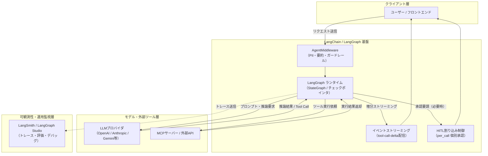

# **LangChain 調査レポート**

## **1. 基本情報**

<!--
【ガイドライン】
- 必須: ツール名、開発元、公式サイト、カテゴリ、概要
- 概要は2-3文で簡潔に記述
-->

* **ツール名**: LangChain
* **ツールの読み方**: ラングチェーン
* **開発元**: LangChain, Inc.
* **公式サイト**: [https://www.langchain.com/](https://www.langchain.com/)
* **関連リンク**:
  * GitHub: [https://github.com/langchain-ai/langchain](https://github.com/langchain-ai/langchain)
  * CodeWiki: [https://codewiki.google/github.com/langchain-ai/langchain](https://codewiki.google/github.com/langchain-ai/langchain)
  * DeepWiki: [https://deepwiki.com/langchain-ai/langchain](https://deepwiki.com/langchain-ai/langchain)
  * ドキュメント: [https://docs.langchain.com/](https://docs.langchain.com/)
* **カテゴリ**: AIアプリ開発基盤
* **概要**: LangChainは、大規模言語モデル（LLM）と外部データや各種ツールを結合し、高機能なAIアプリケーションを構築するためのオープンソースフレームワークです。v1.0の安定版リリースを経て破壊的変更の抑制が徹底されたほか、低レイヤーのステートフルオーケストレーション基盤「LangGraph」、Model Context Protocol (MCP) サポート、本番向けミドルウェアアーキテクチャの拡充により、自律型AIエージェント開発基盤のデファクトスタンダードとして進化を続けています。

## **2. 目的と主な利用シーン**

<!--
【ガイドライン】
- 3-5項目を箇条書きで記述
- 想定利用者を具体的に記載
- 末尾に「代表的な利用フロー」をスイムレーンで添付する
-->

* **解決する課題**: 生のLLM API呼び出しだけでは実装が困難な「文脈の持続」「外部ツールやデータソースの動的連携」「人間による確認（Human-in-the-loop）」「複雑なループ・分岐制御」を統一的なインターフェースで提供し、開発工数と保守リスクを低減する。
* **想定利用者**: AIアプリケーションエンジニア, バックエンドエンジニア, データサイエンティスト
* **利用シーン**:
  * 社内文書や最新データベースを検索・統合して回答する高度なRAG（検索拡張生成）システム
  * MCPサーバーや各種APIを呼び出して自律的にタスクを完結させるAIエージェント
  * ユーザーの承認や修正指示を受け付けながらステップ実行するHuman-in-the-loopワークフロー
  * 複数モデルの協調や推論思考プロセスの構造化（Reasoning Blocks）を含む自動化パイプライン

### **2.1 代表的な利用フロー**

<!--
【ガイドライン】
- ツールを実際に使う際の代表的な流れを、アクターごとのスイムレーンで示す
- Mermaidの swimlane-beta を使用し、向きは TB（上から下）に固定する
- subgraph の表示名に記号を含む場合は必ず引用符で囲む
- レーンは3〜5個、ステップは4〜8個程度に収め、図内は日本語表記
-->

```mermaid
swimlane-beta TB
  subgraph ユーザー
    U1[タスクや質問を入力]
    U2[承認・修正の判断]
    U3[最終回答を確認]
  end
  subgraph LangChain基盤
    L1[入力受付と状態初期化]
    L2[ミドルウェア検証と実行計画]
    L3[承認要求の生成]
    L4[ツール結果の統合と回答生成]
  end
  subgraph 外部連携
    E1[LLM推論とReasoning実行]
    E2[MCPツール・API実行]
  end
  U1 --> L1
  L1 --> L2
  L2 --> E1
  E1 --> L3
  L3 --> U2
  U2 --> E2
  E2 --> L4
  L4 --> U3
```

* **代表的な流れ**: ユーザーから入力された要求をLangChain基盤が受け取り、ミドルウェア（PII保護やプロンプト検証）を経てLLM推論を実行します。危険なツール実行や外部書き込みが必要な局面ではHuman-in-the-loop機能でユーザーへ承認を求め、承認後にMCPツールやAPIを実行して最終的な回答を組み立てます。

## **3. 主要機能**

<!--
【ガイドライン】
- 5-10項目の主要機能を箇条書きで記述
- 各機能は1-2文で概要を説明
-->

* **create_agent & AgentMiddleware**: 高水準なエージェント構築APIと、PIIマスキング（`PIIMiddleware`）、会話自動要約（`SummarizationMiddleware`）、人間介入制御（`HumanInTheLoopMiddleware`）などの合成可能なミドルウェア層。
* **LangGraph**: ループ、条件分岐、ステートフルな永続化、人間介入（Human-in-the-loop）をグラフ構造で実現するオーケストレーションランタイム。標準JSONスキーマライブラリ（Zod, Valibot等）と連携可能なStateSchemaに対応。
* **Model Context Protocol (MCP) ネイティブサポート**: 外部ツールやデータソースとの接続規格であるMCPを標準サポートし、多様なMCPサーバーとのシームレスな相互運用を提供。
* **高精度イベントストリーミング**: `langchain-core` 1.7より `tool-call-delta` イベントに対応し、ツールの引数差分のみをインクリメンタル配信することでUI側での高速・低レイテンシなストリーミング表示を実現。
* **Model I/O & 推論ブロック標準化**: OpenAI, Anthropic, Google Gemini等の主要LLMの差異を抽象化し、`reasoning` ブロックを含む思考プロセスの標準取得に対応。
* **Chains & LCEL (LangChain Expression Language)**: パイプライン演算子（`|`）を用いた宣言的な処理パイプラインの記述方式。ストリーミングや非同期実行を標準サポート。
* **Retrieval (RAG)**: ドキュメントローダー、テキスト分割（RecursiveSplitter）、ベクトル検索などの連携基盤を提供し、外部ナレッジを取り込んだ回答生成を支援。
* **LangSmith & LangGraph Studio**: 実行トレース、コスト・レイテンシ監視、評価、プロンプト実験を行える可観測性基盤と、エージェントの挙動をGUIで可視化・デバッグできる専用ツール。
* **LangServe**: LangChain/LangGraphで作成したエージェントやチェーンを、プロダクションレディなREST/ストリーミングAPIとして数行で公開できるサービング機能。

## **4. 動作原理・システム構成**

<!--
【ガイドライン】
- ツールの動作原理、システム構成（アーキテクチャ）、データの流れ、通信フローなどを記述
- Mermaidによる構成図やフロー図を含める（原則日本語表記）
- subgraph の表示名に記号を含める場合は必ず引用符で囲む
-->

* **アーキテクチャ**: アプリケーションレイヤー（`langchain`）、オーケストレーション・ランタイムレイヤー（`langgraph`）、基本抽象化レイヤー（`langchain-core`）、プロバイダ別統合レイヤー（`langchain-openai`, `langchain-anthropic` 等）による多層レイヤード構成。クライアント・サーバー型アーキテクチャを採用し、バックエンドからフロントエンドへの高速なServer-Sent Events（SSE）ストリーミングを実現します。
* **主要コンポーネントとデータフロー**:
  * **入力・ミドルウェア処理**: クライアントからのリクエストを受け取り、`AgentMiddleware` がガードレール検証、個人情報（PII）のサニタイズ、会話履歴の圧縮要約を実施。
  * **LangGraphステートマシン**: 状態（State）をチェックポインタ（Memory/PostgreSQL等）に保存しながらノード間を遷移。
  * **LLM推論 & ツール呼び出し**: モデルから思考ブロック（`reasoning`）やツール呼び出し命令を受け取り、必要に応じてユーザーへの承認割り込み（`interrupt_mode="per_call"`）を発生。
  * **MCPツール実行 & 差分配信**: 承認されたMCPツールを実行し、結果を即座に状態へマージ。進行中の引数やテキストは `tool-call-delta` / `text-delta` としてフロントエンドへ低遅延ストリーミング配信。
  * **観測データ収集**: すべてのノード実行・トークン消費・外部通信は非同期でLangSmithへ送出され、可観測性を担保。
* **特筆すべき要素技術**:
  * **StateGraph & チェックポインティング**: 分散環境でもスレッドごとの状態をミリ秒単位で復元・分岐できるスナップショット機構（`snapshot_frequency` の最適化）。
  * **個別割り込みハンドラ**: バッチ処理ではなくツール呼び出し単位で独立したInterrupt IDを発行し、フォームスキーマ（`response_schema`）に基づく検証付き承認を可能にする仕組み。



## **5. 開始手順・セットアップ**

<!--
【ガイドライン】
- アカウント作成から「Hello World」的な最初の動作確認までの手順
- 主要なコマンドや設定項目を記載
-->

* **前提条件**:
  * Python 3.10以上 または Node.js 18以上
  * 各種LLMプロバイダのAPIキー（OpenAI, Anthropic, Google等）
* **インストール/導入**:

  ```bash
  # Python版の最新コア・パートナーパッケージ・エージェント基盤をインストール
  pip install -U langchain langchain-core langgraph langchain-openai
  ```

* **初期設定**:
  * 環境変数にAPIキーおよびLangSmith監視設定（任意）を指定します。

  ```bash
  export OPENAI_API_KEY="sk-..."
  # LangSmithでトレーシングを行う場合（推奨）
  export LANGSMITH_TRACING="true"
  export LANGSMITH_API_KEY="lsv2_..."
  ```

* **クイックスタート**:
  * 最新の `create_agent` インターフェースを用いた基本的なエージェント実装例：

  ```python
  from langchain.agents import create_agent
  from langchain_openai import ChatOpenAI
  from langchain_core.tools import tool

  @tool
  def get_weather(city: str) -> str:
      """指定された都市の天気を取得するツール"""
      return f"{city}は快晴、気温22度です。"

  # モデルとエージェントの初期化
  model = ChatOpenAI(model="gpt-4o", temperature=0)
  agent = create_agent(model, tools=[get_weather])

  # エージェントの実行
  response = agent.invoke({"messages": [("user", "東京の天気を教えてください")]})
  print(response["messages"][-1].content)
  ```

## **6. 特徴・強み (Pros)**

<!--
【ガイドライン】
- 3-5項目を箇条書きで記述
- 競合との差別化ポイントを明確に
-->

* **圧倒的なエコシステムと拡張性**: 60以上のLLMプロバイダ、数百種類のベクターストアやSaaSツール、最新のModel Context Protocol (MCP) に対応しており、技術スタックの柔軟な差し替えが可能。
* **v1.0以降のセマンティックバージョニングとAPI安定性**: 過去の急激な破壊的変更から脱却し、安定版ポリシーに基づく長期的後方互換性が維持されているため、エンタープライズの本番システムへの採用リスクが極小化。
* **LangGraphによる柔軟かつ堅牢なエージェント制御**: 従来の直線的なパイプラインでは対応できない「ループ」「条件分岐」「長時間実行スレッド」「ステートフルな再試行」をグラフ構造で直感的に定義可能。
* **本番運用に即したミドルウェア & HITL設計**: 個別ツール呼び出し単位での割り込み承認（`interrupt_mode="per_call"`）や、スキーマ検証付き入力フォームの動的生成など、業務自動化におけるガバナンス機能が強力。
* **業界最高水準の可観測性とデバッグ環境**: LangSmithとLangGraph Studioの組み合わせにより、ブラックボックスになりがちなエージェントの思考プロセスや状態遷移をリアルタイムに視覚化・評価可能。

## **7. 弱み・注意点 (Cons)**

<!--
【ガイドライン】
- 3-5項目を箇条書きで記述
- 日本語対応の状況は必ず含める
-->

* **学習コストの高さ**: LCEL、Graph State、Middleware、チェックポインタなど独自の概念が多く、単純なプロンプト発行ツールと比較して習得難易度が高い。
* **過剰な抽象化（Over-engineering）の危険**: 単純な1往復の問い合わせや小規模なタスクに対してLangChain/LangGraphを導入すると、コードベースが不必要に肥大化する恐れがある。
* **クライアントとサーバーのバージョン整合性への配慮**: `langchain-core` 1.7の `tool-call-delta` ストリーミング仕様変更のように、サーバー側をアップデートする前にUIクライアント側（`@langchain/react` 等）を対応バージョンに先行更新する必要がある。
* **日本語技術情報の鮮度管理**: 公式ドキュメントの最新アップデートや高度な機能（LangGraphのStateSchemaやHITLミドルウェア）に関するドキュメント・知見は英語が中心であり、日本語の解説記事には古いAPI（v0.x系）の情報が混在している。

## **8. 料金プラン**

<!--
【ガイドライン】
- 表形式で整理することを推奨
- 最新の料金情報であることを確認
- 価格は通貨を明記
-->

LangChainおよびLangGraphフレームワーク自体はオープンソース（MITライセンス）であり**完全無料**で商用利用可能です。以下は運用監視・評価プラットフォーム「LangSmith」の料金体系です。

| プラン名 | 料金 | 主な特徴 |
|---------|------|---------|
| **Developer** | 無料 | 個人開発者向け。月間5,000トレースまで無料。基本デバッグ・プロンプト管理機能。 |
| **Plus** | $39/ユーザー/月 | チーム向け。共有ワークスペース、高度なオンライン評価機能、超過トレースの従量課金対応。 |
| **Enterprise** | 要問い合わせ | エンタープライズ向け。SAML/SSO、RBAC、HIPAA/SOC2対応、専任サポート、Self-Hosted（オンプレミス）展開オプション。 |

* **課金体系**: ユーザーライセンス料 ＋ トレース保存量に応じた従量課金。
* **無料トライアル**: Developerプランは期間無制限で無料利用可能。Plusプランの無料試用枠も提供。

## **9. 導入実績・事例**

<!--
【ガイドライン】
- 具体的な企業名を3-5社挙げる
- 導入事例がない場合はその旨を記載
-->

* **導入企業**: Rakuten, Elastic, Moody's, Klarna, Retool, Uber, LinkedIn など。
* **導入事例**:
  * **Rakuten**: 全社規模のAI基盤においてLangChain/LangGraphを標準フレームワークとして採用し、社内各サービスのAIエージェント化を推進。
  * **Klarna**: カスタマーサポートAIエージェントのコアロジックに採用し、問い合わせ解決率の向上と対応時間の劇的な短縮を実現。
  * **Elastic**: 検索基盤「Elasticsearch」とLangChainのRAG機能を高度に連携させ、エンタープライズ向けハイブリッド検索ソリューションを展開。
* **対象業界**: 金融、EC・小売、ソフトウェア/SaaS、メディア、通信など、LLMをプロダクトや業務自動化に組み込むすべての産業。

## **10. サポート体制**

<!--
【ガイドライン】
- ドキュメント、コミュニティ、公式サポートの3項目を必ず含める
- URLがあれば記載
-->

* **ドキュメント**: 公式ドキュメント（[https://docs.langchain.com/](https://docs.langchain.com/)）はチュートリアル、概念解説、APIリファレンスが極めて充実。
* **コミュニティ**: GitHub Discussionsおよび公式Discordサーバー（数万人規模のエンジニアが参加）にて活発なQ&Aやナレッジ共有が行われている。
* **公式サポート**: LangSmith有料プラン（Plus / Enterprise）の契約者向けに、専任サポートエンジニアによるSLA保証付き問い合わせ窓口が提供される。

## **11. エコシステムと連携**

<!--
【ガイドライン】
- API、外部連携、技術スタックとの相性を包括的に記述
-->

### **11.1 API・外部サービス連携**

<!--
【ガイドライン】
- APIの有無と公開状況を明記
- 主要連携サービスを5-10個リストアップ
-->

* **API**: 各種LLMプロバイダ、ベクターストア、ツール群を統一抽象化インターフェースで呼び出し可能。Model Context Protocol (MCP) クライアント機能も標準内蔵。
* **主要連携サービス**:
  * **LLMプロバイダ**: OpenAI (GPT-4o/o3), Anthropic (Claude 3.5/3.7), Google Vertex AI / Gemini, AWS Bedrock, Azure OpenAI, Groq
  * **ベクターストア**: Pinecone, Qdrant, Weaviate, Chroma, Milvus, Supabase (pgvector)
  * **ツール・プロトコル**: Model Context Protocol (MCP), Google Search, Tavily, GitHub API, Slack, Jira, Zapier

### **11.2 技術スタックとの相性**

<!--
【ガイドライン】
- 主要なフレームワークや言語との相性を表形式で整理
- 相性: ◎ (非常に良い), ◯ (良い), △ (工夫が必要/一部非対応), × (非推奨)
-->

| 技術スタック | 相性 | メリット・推奨理由 | 懸念点・注意点 |
|:---|:---:|:---|:---|
| **Python (FastAPI / Poetry / uv)** | ◎ | 最も新機能の反映が早く、LangGraphやCoreの全機能がフルに利用可能。 | 非同期（async/await）の適切な設計が必要。 |
| **TypeScript / Next.js (Node.js)** | ◎ | `@langchain/core` および `@langchain/langgraphjs` が整備されており、UI連携フック（`@langchain/react` 等）も充実。 | 一部の最新実験的機能でPython版先行の場合がある。 |
| **Streamlit / Chainlit** | ◎ | プロトタイピングや社内PoC環境において、数行でストリーミングチャットUIを構築可能。 | 本番高トラフィック運用時は別途FastAPI等のAPI構成を推奨。 |
| **C# (.NET) / Java** | △ | コミュニティによるラッパーや移植版が存在するが、公式サポートは限定的。 | エンタープライズの.NET環境ではMicrosoft Agent Frameworkの併用を検討。 |

## **12. セキュリティとコンプライアンス**

<!--
【ガイドライン】
- 認証、データ管理、準拠規格の3項目を必ず調査
-->

* **認証**: LangSmithではGitHub/Google OAuth認証に加え、Enterprise向けにSAML SSOやOIDC、きめ細やかなロールベースアクセス制御（RBAC）に対応。
* **データ管理**: LangChainライブラリ自体はローカル完結型であり、外部へ無断でデータを送信しない。LangSmithではEUリージョンホスティング、データ保持期間のカスタム設定、データマスキング設定が可能。さらにオンプレミスや自社VPC内で完結するSelf-Hosted展開もサポート。
* **準拠規格**: SOC 2 Type II認証取得済み。GDPRおよびHIPAAコンプライアンス要件に準拠したエンタープライズ契約（BAA締結）に対応。

## **13. 操作性 (UI/UX) と学習コスト**

<!--
【ガイドライン】
- 実際の使用感や、類似ツールとの比較を含める
-->

* **UI/UX**: LangGraph Studioにより、エージェントのStateGraph定義をブラウザ上でグラフィカルに可視化し、ノードごとの状態を巻き戻して再実行（タイムトラベルデバッグ）できる体験が極めて優れている。
* **学習コスト**: 高い。特に従来のChainからLangGraphへのパラダイムシフト、状態管理の型定義、`tool-call-delta` やミドルウェアの設計作法など、プロダクション品質で使いこなすには相応のアーキテクチャ理解が求められる。

## **14. ベストプラクティス**

<!--
【ガイドライン】
- ツールを効果的に活用するための推奨事項や、避けるべきアンチパターンを記述
-->

* **効果的な活用法 (Modern Practices)**:
  * **LangGraph中心の設計**: 単純な1ステップ処理以外は、状態の再現性と耐障害性に優れたLangGraphランタイムを採用する。
  * **ミドルウェアによる関心事の分離**: 入力サニタイズ（PII保護）やトークン要約、HITL承認などの横断的関心事は、エージェントロジック内にベタ書きせず `AgentMiddleware` として合成する。
  * **クライアント・サーバーの同期アップグレード**: `langchain-core` 1.7等のストリーミング更新を行う際は、必ずクライアント側ライブラリ（`@langchain/react` 等）を先行して最新化する。
  * **初期段階からのLangSmith導入**: プロンプトの試行錯誤やモデルのレイテンシ・トークンコストを可視化するため、開発開始時からトレースを有効化する。
* **陥りやすい罠 (Antipatterns)**:
  * **非推奨となったレガシーChainの混在**: v0.x系の古いチュートリアルに記載された `LLMChain` 等の古い抽象化を新規プロジェクトに持ち込む。
  * **過度な巨大グラフの一括構築**: 最初から数十ノードの巨大グラフを作ろうとせず、小さなサブグラフ（Subgraphs）に分割して階層化する。
  * **生APIで十分な単純タスクへの過剰適用**: 単一の要約API呼び出しなど、素のSDK呼び出し数行で済む処理に無理にLangChain全体を導入すること。

## **15. ユーザーの声（レビュー分析）**

<!--
【ガイドライン】
- 必須調査サイト: G2, Capterra, ITreviewのうち該当するもの
- 総合評価スコアがあれば記載
- ポジティブ・ネガティブ各3項目以上
-->

* **調査対象**: G2, Reddit, Hacker News, 各種開発者コミュニティ（2026年最新データ）
* **総合評価**: 4.5 / 5.0 (G2)
* **ポジティブな評価**:
  * 「LangGraphの登場とv1.0の安定化によって、以前のスパゲッティコードが嘘のように整然としたステートマシンとして保守できるようになった。」（G2レビュー）
  * 「LangSmithのトレースとLangGraph Studioのビジュアルデバッグは、LLMアプリ開発において手放せないインフラ。」（開発者フォーラム）
  * 「MCPサポートとHITL個別承認（per_call）のおかげで、業務向けエージェントに必要なガバナンスとツール連携が驚くほど容易になった。」（Reddit）
* **ネガティブな評価 / 改善要望**:
  * 「フレームワークの進化速度が非常に速く、依存パッケージ（Core、LangGraph、パートナーSDK）間の互換性管理に気を遣う必要がある。」（G2レビュー）
  * 「ドキュメントやネット上の解説記事に新旧の書き方が混ざっており、初心者にとって学習のハードルが高い。」（Hacker News）
  * 「小規模なユースケースでは抽象化が過剰に感じられ、素のOpenAIやAnthropic SDKを直接使った方が見通しが良い場合がある。」（Reddit）
* **特徴的なユースケース**:
  * 金融機関の契約書審査において、LangGraphで「OCR抽出 → 整合性チェック → 不明点の人手エスカレーション（HITL） → 承認・DB更新」の循環フローを完全自動化。

## **16. 直近半年のアップデート情報**

<!--
【ガイドライン】
- 日付の降順（新しいものが上）
- 3-10項目をリストアップ
- 情報源のURLを永続リンクで記載
-->

* **2026-10-xx**: **LangChain 1.4.6**: `HumanInTheLoopMiddleware` における個別ツール承認モード（`interrupt_mode="per_call"`）および回答スキーマ検証（`response_schema`）のサポートを追加。
* **2026-10-xx**: **LangChain-Core 1.7.0**: イベントストリーミングにおいて `tool-call-delta` イベントを新設。引数全体の重複配信を廃止し、増分差分のみを配信することでUIレンダリングの高速化と帯域削減を実現。
* **2026-09-xx**: **LangChain 1.4.2**: 人間介入（HITL）での編集時にツール呼び出しデータが欠落しない永続化機能の強化、および推論モデルの思考ブロック（`type == "reasoning"`）の標準化対応。
* **2026-08-xx**: **LangGraph 1.2.x**: `StateSchema` における各種JSON Schemaライブラリ（Zod, Valibot, ArkType等）のサポート、および長時間実行スレッドの読み出しを高速化する `snapshot_frequency` のデフォルト最適化。
* **2026-06-xx**: **LangChain 1.4.0**: Model Context Protocol (MCP) の公式ネイティブ対応、高水準エージェント構築API（`create_agent`）および合成可能ミドルウェア群（`AgentMiddleware`）の標準提供開始。
* **2026-05-15**: **LangChain 1.3.1**: 要約トークンチェックロジックの修正、バグ修正と安定性向上リリース。
* **2026-05-12**: **LangChain 1.3.0**: Agentの `stream_events(version="v3")` や `astream_events` のサポートを追加。

(出典: [LangChain Changelog Docs](https://changelog.langchain.com/) / [LangChain GitHub Releases](https://github.com/langchain-ai/langchain/releases) / [LangChain Blog](https://blog.langchain.dev/))

## **17. 類似ツールとの比較**

<!--
【ガイドライン】
- 3-5個の類似ツールと比較
- 機能比較表（星取表）と詳細比較の2つの観点で記述
-->

### **17.1 機能比較表 (星取表)**

| 機能カテゴリ | 機能項目 | 本ツール (LangChain) | LlamaIndex | Semantic Kernel | Microsoft Agent Framework |
|:---:|:---|:---:|:---:|:---:|:---:|
| **基本機能** | LLM連携・エコシステム | ◎<br><small>60以上・MCP標準対応</small> | ◯<br><small>主要モデル対応</small> | ◯<br><small>Azure親和性高い</small> | ◯<br><small>OpenAI/Azure中心</small> |
| **カテゴリ特定** | RAG・データ連携精度 | ◯<br><small>標準的かつ強力</small> | ◎<br><small>高度なインデックス特化</small> | ◯<br><small>コネクタ経由</small> | ◯<br><small>Skills連携</small> |
| **エージェント** | ワークフロー制御性 | ◎<br><small>LangGraphによる完全制御</small> | △<br><small>ワークフロー機能発展中</small> | ◯<br><small>Planner機能</small> | ◎<br><small>宣言型ワークフロー(1.0)</small> |
| **運用・統制** | HITL・ガバナンス | ◎<br><small>個別承認・Middleware</small> | △<br><small>基本的なコールバック</small> | ◯<br><small>フィルター機能</small> | ◎<br><small>Governance Toolkit</small> |
| **非機能要件** | 言語・可観測性 | ◎<br><small>Python/TS・LangSmith</small> | ◯<br><small>Python/TS中心</small> | ◎<br><small>C#/Python/Java</small> | ◯<br><small>C#/Python中心</small> |

### **17.2 詳細比較**

| ツール名 | 特徴 | 強み | 弱み | 選択肢となるケース |
|---------|------|------|------|------------------|
| **LangChain** | 汎用LLM・エージェント基盤の業界標準。 | LangGraphによる循環制御、MCP対応、LangSmithによる強力な可観測性。 | 抽象化の学習コストが高く、依存関係管理に注意が必要。 | 複雑な自律型エージェント、マルチモーダル、MCPツール連携を本格開発する場合。 |
| **LlamaIndex** | 検索・RAGに特化したデータフレームワーク。 | 多彩なデータコネクタ、高度なドキュメントインデックス化、クエリ最適化。 | 複雑なステートフルエージェント制御はLangChainほど柔軟ではない。 | 高精度な社内ナレッジ検索やQ&Aボットが主目的の場合。 |
| **Semantic Kernel** | Microsoft製のエンタープライズ向け軽量SDK。 | .NET/C#との親和性、Azure OpenAI Serviceとの強固な統合。 | OSSコミュニティのプラグイン数やサードパーティツール連携でLangChainに劣る。 | C#/.NET環境を主軸とし、Azureインフラ上で構築する場合。 |
| **Microsoft Agent Framework** | Semantic KernelとAutoGenの利点を統合した次世代基盤。 | 宣言型ワークフロー、GitHub Copilot統合、エンタープライズ統制。 | JavaScript/TypeScriptエコシステムは発展途上。 | C#/Python環境でエンタープライズ向けの堅牢なエージェント群を構築する場合。 |

## **18. 総評**

<!--
【ガイドライン】
- 総合評価、推奨チーム、選択ポイントの3項目を必ず含める
-->

* **総合的な評価**:
  LangChainはv1.0の安定化と2026年のアップデート（LangChain 1.4 / Core 1.7 / LangGraph 1.2）を経て、かつての「実験的ライブラリ」から「エンタープライズ水準のエージェント開発基盤」へと確固たる進化を遂げました。Model Context Protocol (MCP) の公式統合や、`interrupt_mode="per_call"` による精緻なHuman-in-the-loop制御、`tool-call-delta` によるストリーミング最適化など、本番環境での運用性とガバナンスが大幅に強化されています。
* **推奨されるチームやプロジェクト**:
  PythonまたはTypeScriptを主言語とし、単なる単発のチャットボットにとどまらず「自律的にツールを実行し、必要に応じて人間の承認を得ながら複雑なタスクを完結させるAIエージェント」を構築する中〜大規模な開発チームに強く推奨されます。
* **選択時のポイント**:
  純粋なドキュメント検索・RAGシステムの精度追求が主目的であればLlamaIndexが優位な場合があります。また、社内インフラがMicrosoft/.NETエコシステムに特化している場合はMicrosoft Agent FrameworkやSemantic Kernelが自然な選択肢となります。それ以外の、柔軟なモデル選択、MCPツール連携、高度なグラフ制御、世界最大級のコミュニティエコシステムを享受したい場合は、LangChainが最も信頼できる第一選択肢となります。
