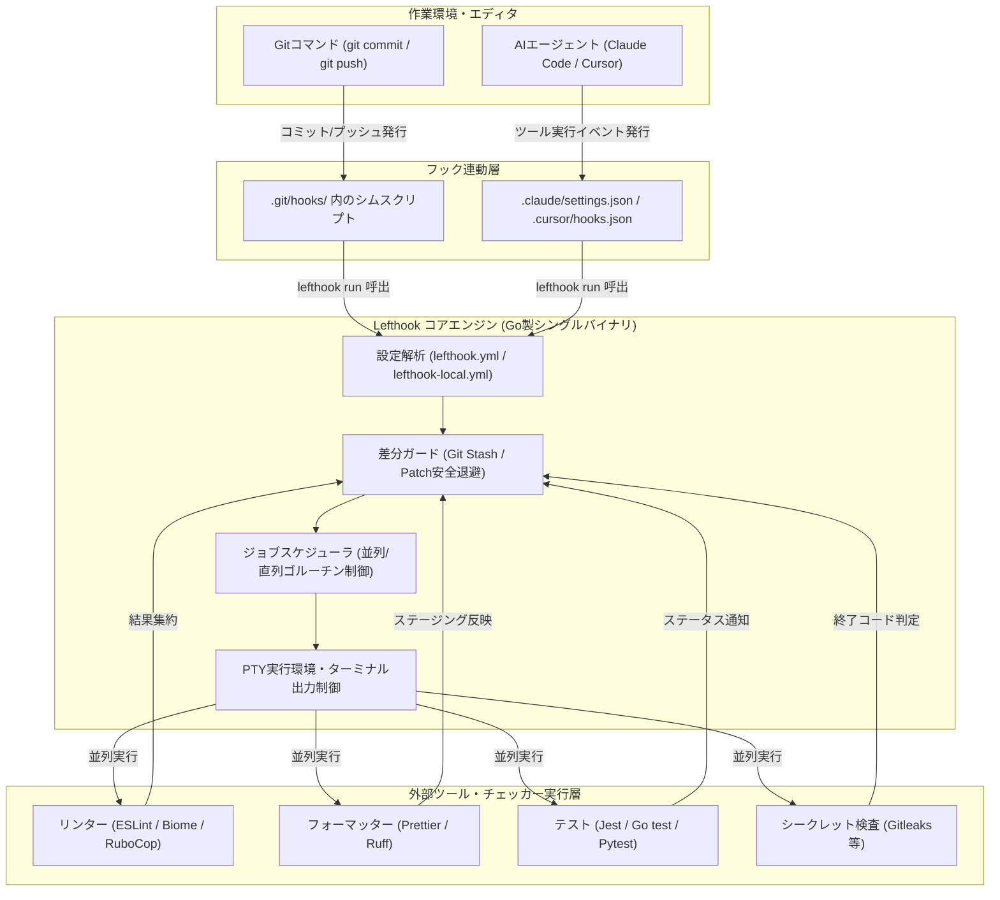

# **Lefthook 調査レポート**

## **1. 基本情報**

* **ツール名**: Lefthook
* **ツールの読み方**: レフトフック
* **開発元**: Evil Martians
* **公式サイト**: [https://lefthook.dev/](https://lefthook.dev/)
* **関連リンク**:
  * GitHub: [https://github.com/evilmartians/lefthook](https://github.com/evilmartians/lefthook)
  * DeepWiki: [https://deepwiki.com/evilmartians/lefthook](https://deepwiki.com/evilmartians/lefthook)
  * CodeWiki: [https://codewiki.google/github.com/evilmartians/lefthook](https://codewiki.google/github.com/evilmartians/lefthook)
  * ドキュメント: [https://lefthook.dev/](https://lefthook.dev/)
* **カテゴリ**: CI/CD周辺ツール
* **概要**: Go言語で実装された超高速かつ依存関係不要のGitフック管理ツール。コマンドの並列実行や柔軟なファイルフィルタリング（Globや正規表現）、部分ステージング変更の安全な退避・復元機能を備え、あらゆる開発言語およびモノレポ構成で統一的なコード品質チェックを実現する。最新バージョンでは、Claude CodeやCursorなどのAIコーディングエージェントと連動するフック管理機能（`ai:` 設定）も搭載されている。

## **2. 目的と主な利用シーン**

* **解決する課題**:
  * Huskyやpre-commitなどの既存Gitフックツールにおける実行遅延と直列処理による開発者の待ち時間
  * 複数言語が混在するモノレポ環境におけるフック設定の分散・複雑化
  * 開発者個人のローカル環境とCI/CDパイプライン間でのチェック内容の乖離
  * AIコーディングエージェントが自動生成したコードに対する即座の品質検証やセキュリティチェックの自動化
* **想定利用者**:
  * ソフトウェアエンジニア（フロントエンド、バックエンド、インフラ）
  * SRE / DevOpsエンジニア
  * 大規模プロジェクトやモノレポを管理するテックリード
  * AIコーディングエージェントを活用する開発チーム
* **利用シーン**:
  * コミット前のリンター（ESLint, Biome, RuboCop等）やフォーマッター（Prettier, Ruff等）の並列自動実行
  * プッシュ前のテストスイート実行やセキュリティスキャン（Gitleaks等）
  * コミットメッセージの形式バリデーション（Commitlint準拠チェック等）
  * AIエージェント（Claude Code等）のツール呼び出し前後における自動検証

### **2.1 代表的な利用フロー**

```mermaid
swimlane-beta TB
  subgraph Developer["開発者 / AIエージェント"]
    CodeChange["コード変更・コミット実行"]
    Feedback["実行結果の確認・修正"]
  end
  subgraph GitHook["Git / フックシム"]
    TriggerHook["Gitフックを起動"]
    ReturnResult["成否ステータスを返却"]
  end
  subgraph LefthookEngine["Lefthook エンジン"]
    FilterFiles["対象ファイルの抽出・Git退避"]
    RunJobs["ゴルーチンによる並列ジョブ実行"]
    RestoreFiles["未ステージング差分の安全復元"]
  end
  subgraph LinterTools["リンター / フォーマッター"]
    ExecLinters["ESLint / Biome / テストの実行"]
  end

  CodeChange --> TriggerHook
  TriggerHook --> FilterFiles
  FilterFiles --> RunJobs
  RunJobs --> ExecLinters
  ExecLinters --> RestoreFiles
  RestoreFiles --> ReturnResult
  ReturnResult --> Feedback
```

* **代表的な流れ**: 開発者またはAIエージェントがコミットやプッシュを実行すると、Gitフック経由でLefthookが起動します。Lefthookは未ステージングの変更を一時的に安全退避し、ステージングされた変更ファイルのみを抽出して登録されたリンターやテストを並列実行します。結果を集約して元のワーキングツリー差分を復元し、エラーがあればコミットを中断して開発者に即時フィードバックします。

## **3. 主要機能**

* **並列実行 (Parallel Execution)**: 独立した複数のジョブやコマンドをGoのゴルーチンを用いて並列実行し、コミット・プッシュ時の待ち時間を最小化。
* **柔軟なファイルフィルタリング**: `{staged_files}`, `{all_files}`, `{push_files}` などの組み込み変数やGlobパターン、正規表現により、変更された対象ファイルのみを的確に抽出。
* **AIコーディングエージェント連携 (`ai:` 設定)**: Claude Code (`.claude/settings.json`)、Cursor (`.cursor/hooks.json`)、Codex CLI、GitHub Copilotなどのエージェント設定ファイルを自動生成し、エージェントの停止時やツール実行時にフックを駆動。
* **サブディレクトリ・モノレポ制御**: `root` オプションにより、特定のサブディレクトリ配下のファイルが変更された場合のみ該当ディレクトリに移動してコマンドを実行可能。
* **スクリプト・コンテナ実行**: ワンライナーコマンドに加え、プロジェクト内のスクリプトファイル実行やDockerコンテナ内でのコマンド実行をネイティブサポート。
* **タグによる選択的実行**: ジョブにタグ（`frontend`, `backend`, `security` 等）を付与し、CI環境や特定の開発コンテキストでスキップや単体実行が可能。
* **差分の安全な退避・復元**: コミット対象外の未ステージング差分を一時的にStashまたはPatchとして安全に退避し、フォーマッター適用後も作業中の変更を破損させずに復元。
* **ローカル設定上書き (`lefthook-local.yml`)**: チーム共通の設定を維持しつつ、各開発者がローカル環境固有のツールパスやカスタムコマンドを安全に上書き可能。
* **JSON Schemaサポート**: `https://lefthook.dev/schema.json` が公式公開されており、VS CodeやIntelliJなどのエディタでYAMLの自動補完やバリデーションが可能。
* **タイムアウト制御**: 各コマンドやスクリプトに実行制限時間（`timeout`）を設定し、無限ループやハングアップを確実に防止。

## **4. 動作原理・システム構成**

* **アーキテクチャ**:
  * ローカルファーストのGo言語製シングルバイナリCLIツール。外部デーモンやバックエンドサーバーを必要とせず、すべてクライアント端末上で自己完結して高速動作する。
* **主要コンポーネントとデータフロー**:
  * **フック登録層**: `lefthook install` 実行時に、Gitリポジトリの `.git/hooks/` 配下にシム（薄いシェルスクリプトまたは直接のバイナリ呼び出し）を配置。また、`ai:` 設定が存在する場合は各AIエージェントのHooks設定ファイルを生成・同期。
  * **差分管理・ステージングガード**: Gitのインデックス情報とワーキングツリーを走査し、部分的にステージングされた変更がある場合は差分パッチを作成して未ステージ変更を保護。
  * **スケジューラ・並列実行エンジン**: `lefthook.yml` の定義に従い、依存関係のないコマンドをゴルーチンで並行起動。疑似端末（PTY）の制御を行いながらリアルタイムに標準出力をフォーマット。
* **特筆すべき要素技術**:
  * **Git Stash / Patchメカニズム**: コミット時にフォーマッターが自動修正を加えた場合でも、未ステージの変更との競合を防ぎ安全にステージング（`stage_fixed`）を行う高度なGit状態復元ロジック。
  * **疑似端末 (PTY) 制御**: インタラクティブな出力やANSIカラーコードを保持し、非TTY環境（CI等）では適切に出力をプレーンテキスト化。



## **5. 開始手順・セットアップ**

* **前提条件**:
  * Gitがインストールされたプロジェクト
  * 各種パッケージマネージャ（Go, npm, Ruby gem, Homebrew, Composer, pipx 等のいずれか）
* **インストール/導入**:
  プロジェクトやチームの技術スタックに合わせて最適なインストール方法を選択可能：

  ```bash
  # Go (シングルバイナリ直接インストール)
  go install github.com/evilmartians/lefthook/v2@latest

  # Node.js (npm / pnpm / yarn)
  npm install lefthook --save-dev

  # Homebrew (macOS / Linux)
  brew install lefthook

  # PHP (Composer) - v2.2.1以降
  composer require --dev evilmartians/lefthook

  # Ruby (Gem)
  gem install lefthook
  ```

* **初期設定**:
  プロジェクトルートで初期化を実行：

  ```bash
  lefthook install
  ```

* **クイックスタート**:
  プロジェクトルートに `lefthook.yml` を作成：

  ```yaml
  # yaml-language-server: $schema=https://lefthook.dev/schema.json

  pre-commit:
    parallel: true
    commands:
      lint:
        glob: "*.{js,ts,tsx}"
        run: npx eslint {staged_files}
      format-check:
        glob: "*.{json,md,yml}"
        run: npx prettier --check {staged_files}
      security:
        run: gitleaks protect --staged --verbose

  # AIコーディングエージェント連携の例 (v2.1.10以降)
  ai:
    claude:
      Stop: pre-commit
    cursor:
      stop: pre-commit
  ```

  設定完了後、`git commit` を実行すると自動的に各コマンドが並列に実行される。

## **6. 特徴・強み (Pros)**

* **圧倒的な実行速度**: Go言語で記述されたシングルバイナリで起動オーバーヘッドが極小であり、並列実行によって全体のチェック時間が劇的に短縮される。
* **完全な言語非依存 (Polyglot)**: Node.jsプロジェクトはもちろん、Go、Rust、Python、Ruby、PHPなど多様な言語スタックが混在するリポジトリでも統一したツールでフックを管理可能。
* **AIコーディングエージェントとの先駆的統合**: Claude CodeやCursor、GitHub Copilotなどのエージェント向けHooks設定を自動生成し、AI主導の開発フローでもコード品質を担保可能。
* **モノレポ・Git Worktreeへの高い適応力**: ディレクトリ別の実行制御や、Worktree環境におけるパッチ名の分離・安全性確保が標準で組み込まれている。
* **依存関係ゼロで導入可能**: Node.jsランタイムのないCI環境やサーバー上でも、シングルバイナリを配置するだけで動作する。

## **7. 弱み・注意点 (Cons)**

* **独自YAML構文の学習コスト**: シェルスクリプトをそのまま配置する形式と異なり、`glob`, `run`, `root`, `stage_fixed` などのLefthook固有のディレクティブを把握する必要がある。
* **コミュニティ・エコシステムの知名度**: Node.jsコミュニティにおけるHuskyや、Pythonコミュニティにおけるpre-commitに比べてデファクトスタンダードとしての知名度で劣る場合がある。
* **日本語ドキュメントの不足**: 公式ドキュメントおよびGitHub上の情報は英語のみで提供されている。

## **8. 料金プラン**

| プラン名 | 料金 | 主な特徴 |
|:---|:---:|:---|
| **Open Source (MIT)** | 完全無料 | すべての機能（並列実行、AI連携、モノレポ制御、ローカル設定等）が無制限で利用可能 |

* **課金体系**: 完全無料（オープンソースソフトウェア）
* **無料トライアル**: 該当なし（登録不要で即座に利用可能）

## **9. 導入実績・事例**

* **導入企業・プロジェクト**:
  * Evil Martians（開発元）
  * GitHub上で約9,000スターを獲得しており、多数のグローバルテック企業やオープンソースコミュニティで採用。
  * Rails、React/Next.js、Go等の大規模モノレポを採用しているエンタープライズ企業。
* **導入事例**:
  * 開発者数十名〜数百名規模の多言語モノレポにおいて、コミット前のリント待ち時間を従来の1/3以下に短縮。
  * AIコーディングエージェントを大規模導入したチームで、エージェント生成コードの即時バリデーション基盤として採用。
* **対象業界**: Web開発、SaaS、金融テック、大規模プラットフォーム開発など全般。

## **10. サポート体制**

* **ドキュメント**: 公式ドキュメント（[https://lefthook.dev/](https://lefthook.dev/)）にて、設定リファレンス、各種言語別の設定例、JSON Schemaが提供されている。
* **コミュニティ**: GitHub IssuesおよびDiscussionsにて活発なバグ報告や機能要望のディスカッションが行われている。
* **公式サポート**: オープンソースソフトウェアのため商用SLAサポートは原則存在しないが、開発元（Evil Martians）による継続的なメンテナンスとコミュニティサポートが提供されている。

## **11. エコシステムと連携**

### **11.1 API・外部サービス連携**

* **API**: CLIツールのためREST API等はなし（コマンドラインインターフェースとして動作）。
* **外部サービス・エージェント連携**:
  * **AIエージェント**: Claude Code、Cursor、OpenAI Codex CLI、GitHub CopilotとのHooks設定自動生成連携。
  * **CI/CD環境**: GitHub Actions, GitLab CI, CircleCI等において、ローカルと同一のコマンド（`lefthook run pre-commit --all-files`）でチェックを実行可能。
  * **コンテナ環境**: Dockerコンテナ内でのコマンド実行に対応。

### **11.2 技術スタックとの相性**

| 技術スタック | 相性 | メリット・推奨理由 | 懸念点・注意点 |
|:---|:---:|:---|:---|
| **Node.js / TypeScript** | ◎ | Husky＋lint-stagedの組み合わせよりも高速で、並列実行が極めて強力。 | npm/pnpmラッパー経由で導入可能だが、チーム内でバイナリダウンロードの許可が必要。 |
| **Go** | ◎ | ネイティブツールであるため親和性が最も高く、シングルバイナリで完結。 | 特になし。 |
| **Ruby (Rails)** | ◎ | 開発元のEvil MartiansがRailsに精通しており、RuboCop等との連携実績が豊富。 | 特になし。 |
| **Python** | ◎ | `pipx` や Homebrew等で導入可能。`pre-commit`より圧倒的に高速。 | Python専用フック集のエコシステムは`pre-commit`の方が依然として多い。 |
| **PHP** | ◎ | v2.2.1より公式Composerパッケージが提供され、PHPプロジェクトへの導入が容易に。 | 特になし。 |
| **Monorepo** | ◎ | `root` オプションによるサブディレクトリごとの個別実行制御が極めて優秀。 | 設定ファイルが肥大化しやすいため、タグや分割設定の工夫が推奨される。 |

## **12. セキュリティとコンプライアンス**

* **認証**: ローカル完結のCLIツールのためアカウント認証等は不要。
* **データ管理**: ソースコードや差分情報を外部サーバーに送信することは一切なく、完全にローカル端末内で処理が完結。
* **準拠規格**: オープンソース（MITライセンス）としてGitHub上でソースコードが全公開されており、高い透明性を確保。サプライチェーンセキュリティとしてリリースバイナリの検証が行われている。

## **13. 操作性 (UI/UX) と学習コスト**

* **UI/UX**: CLI実行時の出力は美しく色分けされ、ジョブごとの進捗状況や実行時間、エラーログが整理されて表示される。非TTY環境では余計な制御文字が自動抑制される。
* **学習コスト**: 低〜中。JSON Schema（`lefthook.dev/schema.json`）を活用することで、エディタ上での補完が効き、YAML構文の記述難易度は大幅に低下している。

## **14. ベストプラクティス**

* **効果的な活用法 (Modern Practices)**:
  * **並列化の積極活用**: 相互に依存しないリンターや型チェック、テストは `parallel: true` を指定して同時並行で走らせる。
  * **AIエージェントとの連携**: `ai:` 設定を活用し、Claude CodeやCursorがコードを書き換えた直後に自動でテストとリントを実行させる。
  * **CIとの統一**: CIパイプライン側でも `lefthook run pre-commit --all-files` を実行し、ローカルとCIの検証ルールを100%一致させる。
  * **ローカル設定の活用**: 個人用の特別なチェックやマシン性能に合わせた調整は `.gitignore` に含めた `lefthook-local.yml` に記述する。
* **陥りやすい罠 (Antipatterns)**:
  * コミット毎に全ファイル（`{all_files}`）に対して重いテストを実行し、コミットの手軽さを損なう（ステージング対象 `{staged_files}` に絞るべき）。
  * 複雑で長大なシェルスクリプトをYAML内にインラインで記述し、デバッグや保守を困難にする（別個のスクリプトファイルに切り出すべき）。

## **15. ユーザーの声（レビュー分析）**

* **調査対象**: GitHub Issues/Discussions, Reddit, Dev.to, 技術ブログ
* **総合評価**: 非常に高い満足度。特にHuskyやpre-commitからの移行者において、並列実行による高速化とモノレポでの柔軟性が絶賛されている。
* **ポジティブな評価**:
  * 「大規模TypeScriptモノレポでHuskyから乗り換えたところ、コミット待ち時間が10秒から2秒に激減した」
  * 「Go製シングルバイナリなので、Node.jsのない環境でも共通ツールとして導入できるのが助かる」
  * 「最新のAIエージェント設定（Claude CodeやCursor）までカバーされていて設定の一元化が進んだ」
* **ネガティブな評価 / 改善要望**:
  * 「チームメンバー全員にバイナリ実行権限やインストール手順を周知・定着させる必要がある」
  * 「設定ミスの際、どのファイルフィルタが適用されているのかの確認に少し慣れが必要」
* **特徴的なユースケース**:
  * Dockerコンテナ開発環境において、ホスト側のGitコミットからコンテナ内のリンターを直接キックする構成。
  * AIコーディングエージェントに自律修正を行わせる際、Lefthookのフックでセキュリティ検査を強制実行するガードレール構築。

## **16. 直近半年のアップデート情報**

* **2026-10-13 (v2.2.2)**: 現在のスタッシュハッシュのみをクリーンアップする安全性の向上、MIMEタイプマッチングの簡素化、Android環境のパッケージングサポート追加。
* **2026-10-08 (v2.2.1)**: PHP Composerパッケージングのサポート（Composer経由でのバイナリ導入）、Git Worktree環境におけるパッチファイル名競合の修正、ラッパー内のパスキャッシュ改善。
* **2026-10-07 (v2.2.0)**: 公式JSON Schemaの公開（`lefthook.dev/schema.json`）、AIフック設定におけるインストール時固定パス書き込みの修正、`--files-from-stdin` における終端NUL文字の無視、git diff引数処理の修正。
* **2026-10-05 (v2.1.17)**: `fail_on_changes` チェック時のサブモジュールハッシュ除外、デフォルトブランチとのマージベースに対するプッシュ差分比較の改善、ブランチ保護設定例のドキュメント追加。
* **2026-10-01 (v2.1.16)**: コンフリクト発生時における無関係な未ステージング差分の保護機能、部分的にステージングされたファイルの安全な修正適用テスト追加、依存ライブラリの脆弱性（CVE）解消。
* **2026-09-29 (v2.1.15)**: `CLICOLOR_FORCE` によるフックコマンドへのカラー強制伝播サポート、リモート追跡ブランチに対するプッシュ対象ファイル解決の改善、生成フックシム内のパス引用符エスケープ対応。
* **2026-09-14 (v2.1.14 / v2.1.13)**: `--job` / `--command` が一致しなかった際のエラーハンドリング改善、非TTY環境におけるTTYエミュレーションの無効化、グループ化ジョブでのファイル継承ドキュメント化。
* **2026-08-21 (v2.1.11)**: PTYコマンドにおけるターミナル画面サイズの継承改善、コミットメッセージ設定ドキュメントの修正、Go 1.26.6への依存バージョン引き上げ。
* **2026-07-08 (v2.1.10)**: **AIコーディングエージェント統合機能（`ai:` 設定）の追加**。Claude Code, Cursor, OpenAI Codex CLI, GitHub Copilot向けのHooks設定ファイル自動生成をサポート。
* **2026-05-29 (v2.1.9)**: リセット後のフックパス更新処理の修正および内部依存関係の更新。

(出典: [GitHub Releases](https://github.com/evilmartians/lefthook/releases))

## **17. 類似ツールとの比較**

### **17.1 機能比較表 (星取表)**

| 機能カテゴリ | 機能項目 | Lefthook | Husky | pre-commit (Python) | lint-staged |
|:---:|:---|:---:|:---:|:---:|:---:|
| **パフォーマンス** | 並列ジョブ実行 | ◎<br><small>標準で完全並列実行</small> | ×<br><small>基本は順次実行</small> | △<br><small>一部フックのみ</small> | △<br><small>タスク単位の並列</small> |
| **ランタイム** | 言語非依存性 | ◎<br><small>Goシングルバイナリ</small> | △<br><small>Node.js必須</small> | △<br><small>Python必須</small> | △<br><small>Node.js必須</small> |
| **エージェント連携** | AIエージェントHooks統合 | ◎<br><small>Claude/Cursor/Copilot自動生成</small> | ×<br><small>手動スクリプト連携</small> | ×<br><small>未対応</small> | ×<br><small>未対応</small> |
| **モノレポ** | サブディレクトリ制御 | ◎<br><small>rootオプションで自在</small> | △<br><small>シェル制御が必要</small> | ◯<br><small>設定で対応可能</small> | △<br><small>工夫が必要</small> |
| **安全性** | 部分ステージング差分の保護 | ◎<br><small>Stash/Patch自動退避</small> | △<br><small>プラグイン任せ</small> | ◯<br><small>Stash自動退避</small> | ◎<br><small>バックアップ機能あり</small> |
| **導入** | パッケージマネージャ対応 | ◎<br><small>Go/npm/gem/Composer/Brew等</small> | ◯<br><small>npm中心</small> | ◯<br><small>pip/pipx/Brew中心</small> | ◯<br><small>npm中心</small> |

### **17.2 詳細比較**

| ツール名 | 特徴 | 強み | 弱み | 選択肢となるケース |
|:---|:---|:---|:---|:---|
| **Lefthook** | 超高速・言語非依存・次世代 | 並列実行による圧倒的な高速性、モノレポ制御、AIエージェントHooks自動生成 | YAML独自文法の学習が必要 | 大規模プロジェクト、モノレポ、CI短縮、AIエージェント開発環境 |
| **Husky** | Node.jsエコシステムの標準 | シンプルな構成、フロントエンド界隈での圧倒的な知名度 | 順次実行による遅延、Node.js以外のスタックでの導入が困難 | 小〜中規模の純粋なNode.js/JavaScriptプロジェクト |
| **pre-commit** | Pythonエコシステムの標準 | 膨大な公式・コミュニティ製フックリポジトリの再利用性 | 実行速度が遅い、Python環境への依存 | Pythonメインのリポジトリ、既存の豊富なフック集をそのまま使いたい場合 |
| **lint-staged** | ステージング特化チェッカー | ステージングされたファイルのみへの適用に特化 | 単体ではGitフックを管理できずHusky等と組み合わせが必須 | 既存のHusky環境にステージング絞り込みのみを追加したい場合 |

## **18. 総評**

* **総合的な評価**:
  Lefthookは、Go言語によるシングルバイナリの起動速度とゴルーチンを活用した並列実行により、コミットやプッシュ時のストレスを根本から解消する最前線のGitフックマネージャーである。さらに直近のアップデートでは、Claude CodeやCursorといった最新のAIコーディングエージェントとの連携（Hooks自動生成）をいち早く果たすなど、現代のソフトウェアエンジニアリングの変化に最も機敏に対応している。
* **推奨されるチームやプロジェクト**:
  * 複数言語（Node, Go, Python, PHP等）が混在するモノレポ構成のプロジェクト
  * コミット前のリントや型チェック項目が多く、待ち時間を削減したい開発チーム
  * Claude CodeやCursorなどのAIエージェントを日々の開発に本格導入しているチーム
  * CI環境とローカル開発環境で全く同一のチェックルールを保証したいDevOps/SREチーム
* **選択時のポイント**:
  * **実行速度と並列性を最重視**: Lefthookが最善の選択肢。
  * **AIエージェントとのHooks連携を一元管理したい**: Lefthook一択。
  * **最小限のJavaScriptプロジェクト**: Huskyで事足りる場合もあるが、チェック数が増えた段階でLefthookへの乗り換えが推奨される。
