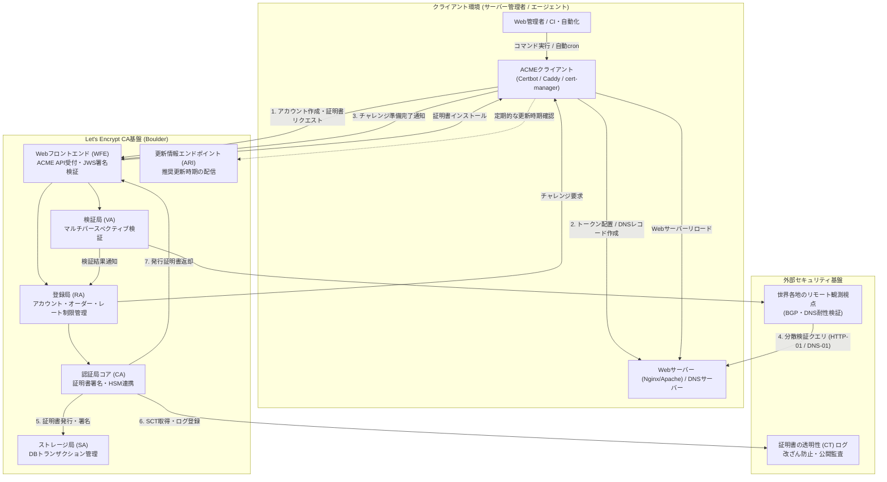

# **Let's Encrypt 調査レポート**

## **1. 基本情報**

* **ツール名**: Let's Encrypt
* **ツールの読み方**: レッツ・エンクリプト
* **開発元**: Internet Security Research Group (ISRG)
* **公式サイト**: [https://letsencrypt.org/](https://letsencrypt.org/)
* **関連リンク**:
  * GitHub: [https://github.com/letsencrypt](https://github.com/letsencrypt)
  * ドキュメント: [https://letsencrypt.org/docs/](https://letsencrypt.org/docs/)
  * コミュニティ: [https://community.letsencrypt.org/](https://community.letsencrypt.org/)
* **カテゴリ**: CDN/セキュリティ
* **概要**: Let's Encryptは、非営利団体である Internet Security Research Group (ISRG) が運営する、無料・自動・オープンな認証局（CA）です。IETF RFC 8555で標準化された ACME プロトコルを通じて、Webサーバーにおける SSL/TLS 証明書の発行・更新作業を完全に自動化し、全世界の常時HTTPS化を牽引しています。

## **2. 目的と主な利用シーン**

* **解決する課題**:
  * 有償SSL/TLS証明書にかかる購入コストや更新手続きの金銭的・人的負担の解消。
  * 証明書の有効期限切れによるWebサイトの障害やセキュリティ警告の防止。
  * 暗号化されていない平文通信（HTTP）による盗聴・改ざんリスクの撲滅。
* **想定利用者**:
  * 個人ブログから大規模エンタープライズまで、あらゆるWebサイト管理者
  * インフラ基盤を構築・運用するDevOpsおよびSREエンジニア
  * 顧客向けに無料SSL機能を提供するクラウドホスティング事業者やSaaSベンダー
* **利用シーン**:
  * 公開Webサーバー（Apache、Nginx、Caddyなど）の常時SSL/TLS化
  * Kubernetes環境（cert-manager等）でのIngress証明書の自動プロビジョニング
  * クラウドロードバランサーやリバースプロキシでの自動証明書ライフサイクル管理
  * 開発・ステージング環境におけるセキュアな通信環境の迅速な構築

### **2.1 代表的な利用フロー**

WebサーバーにCertbot等のACMEクライアントを導入し、証明書を自動取得・適用する代表的なフローは以下の通りです。

```mermaid
swimlane-beta TB
  subgraph Administrator["Webサイト管理者"]
    A[ドメインDNS設定・Certbot実行]
    F[HTTPS接続・SSL設定の動作確認]
  end
  subgraph ACMEClient["ACMEクライアント (Certbot等)"]
    B[秘密鍵生成・証明書発行要求]
    D[チャレンジ応答トークンをサーバーへ配置]
    E[証明書の保存・Webサーバーへの自動適用]
  end
  subgraph WebDNS["対象サーバー (Web / DNS)"]
    ChallengeHost[チャレンジ応答ファイルの公開 / TXTレコード反映]
  end
  subgraph LetsEncryptCA["Let's Encrypt (CA基盤)"]
    C[ACMEチャレンジの出題]
    Validate[世界各地からのマルチパースペクティブ検証]
    IssueCert[証明書署名・CTログ登録・発行]
  end

  A --> B
  B --> C
  C --> D
  D --> ChallengeHost
  ChallengeHost --> Validate
  Validate --> IssueCert
  IssueCert --> E
  E --> F
```

* **代表的な流れ**: 管理者がCertbotコマンドを実行すると、クライアントが秘密鍵をローカルで生成し、Let's Encrypt CAに対して発行要求を送信します。CAが出題するチャレンジ（HTTP-01やDNS-01）に対し、クライアントが自動で応答ファイルを配置します。CAが世界各地の観測拠点から検証を行い、所有確認が完了すると証明書が署名・発行され、Webサーバーに自動適用されます。

## **3. 主要機能**

* **完全無料のドメイン認証 (DV) 証明書発行**: 隠れた費用や年間更新料なしで、信頼性の高いSSL/TLS証明書を無制限に取得可能です。
* **ACME プロトコルによる完全自動化**: IETF RFC 8555準拠のAPIにより、秘密鍵の作成、ドメイン検証、証明書のインストール、更新チェックまでの全ライフサイクルを人手不要で完結できます。
* **ワイルドカード証明書対応**: DNS-01 チャレンジを介して、`*.example.com` のようなワイルドカード証明書の発行に対応し、多数のサブドメインを一括保護できます。
* **IPアドレス証明書のサポート**: ドメイン名だけでなく、パブリックなIPv4およびIPv6アドレスを直接対象とした証明書発行に対応しています。
* **超短期（6日間 / 160時間）証明書プロファイル**: `shortlived` プロファイルにより、失効リスト（CRL/OCSP）への依存度を低減させた高セキュリティな短期運用が可能です。
* **ACME Renewal Information (ARI) 対応**: 証明書の失効や推奨される更新タイミングをクライアントに動的に通知し、更新トラフィックの平準化と安全な再発行を支援します。
* **マルチパースペクティブ検証 (Multi-Perspective Validation)**: BGPハイジャックやDNSポイズニングを阻止するため、世界各地の複数拠点から同時にドメイン検証クエリを実行します。
* **Certificate Transparency (CT) ログへの自動登録**: 発行されたすべての証明書は公開CTログに記録され、不正発行や証明書の改ざんを世界規模で監視可能です。
* **次世代ルート証明書階層「Generation Y」**: TLSハンドシェイクのサイズ削減と処理効率化を実現し、Web PKIの最新規格に完全準拠しています。

## **4. 動作原理・システム構成**

Let's Encryptの動作原理は、オープンソースの認証局ソフトウェア「**Boulder**」（Go言語製）と、ACMEプロトコル（IETF RFC 8555）によって構成される高度に自動化されたマイクロサービスアーキテクチャです。

* **アーキテクチャ特性**: クライアント・サーバー型分散CAアーキテクチャ。証明書発行基盤は内部ネットワークで厳格に分離され、ハードウェアセキュリティモジュール（HSM）によって署名鍵が保護されています。
* **主要コンポーネントとデータフロー**:
  * **WFE (Web Front End)**: ACMEプロトコル（REST/JSON）の外部リクエストを受け付けるHTTPエンドポイント。JWS（JSON Web Signature）署名を検証して各内部サービスへルーティングします。
  * **RA (Registration Authority)**: アカウント登録、オーダー状態、レートリミット（発行制限）を集中管理します。
  * **VA (Validation Authority)**: クライアントが提示したドメイン所有権（HTTP-01、DNS-01、TLS-ALPN-01）の検証を実行します。世界各地に展開されたリモート観測視点（Remote Perspectives）と協調し、分散検証を行います。
  * **CA (Certificate Authority Core)**: 検証成功後にCSR（証明書署名要求）を受け取り、HSMに格納された秘密鍵を用いてX.509証明書をデジタル署名します。
  * **SA (Storage Authority)**: データベース（MariaDB）との読み書きを安全に調停し、トランザクションの整合性を保ちます。
  * **ARI (ACME Renewal Info)**: クライアントからの問い合わせに対し、対象証明書の最適な更新期間ウィンドウを計算して応答します。
* **次世代の要素技術（耐量子暗号への挑戦）**:
  ポスト量子暗号（PQC）への移行において、従来のアルゴリズムでは署名サイズが肥大化しTLSハンドシェイクが遅延する課題があります。Let's Encryptは Sovereign Tech Agency の支援を受け、**Merkle Tree Certificates (MTCs)** の開発と実証実験を推進しており、数千件の証明書をマークル木に集約してルートハッシュのみを署名することで、軽量かつセキュアな耐量子Web PKIの構築を目指しています。



## **5. 開始手順・セットアップ**

* **前提条件**:
  * パブリックインターネットからアクセス可能なLinux環境（Ubuntu/Debian推奨）
  * Webサーバー（Nginx、Apache、Caddy等）が稼働していること
  * ドメイン名が取得済みで、サーバーのグローバルIPアドレスにDNSレコードが向いていること
  * ポート 80 (HTTP) および 443 (HTTPS) が開放されていること
* **インストール/導入**:

  Certbotは公式にSnap経由でのインストールが推奨されています。

  ```bash
  # Snapデーモンの更新
  sudo snap install core; sudo snap refresh core

  # 既存のOSパッケージCertbotがある場合は削除後にSnap版をインストール
  sudo snap install --classic certbot
  sudo ln -s /snap/bin/certbot /usr/bin/certbot
  ```

* **初期設定**:
  * クライアントの設定ファイルは不要で、初回実行時に対話形式でメールアドレス登録および利用規約の同意を行います。
* **クイックスタート**:

  ```bash
  # Nginxの設定を自動認識して証明書を取得・適用する場合
  sudo certbot --nginx

  # Apacheの設定を自動認識して証明書を取得・適用する場合
  sudo certbot --apache

  # Webサーバーの設定を変更せず、証明書ファイルのみを取得する場合
  sudo certbot certonly --standalone -d example.com -d www.example.com

  # 自動更新のドライランテスト（設定が正常か検証）
  sudo certbot renew --dry-run
  ```

## **6. 特徴・強み (Pros)**

* **完全無償の継続利用**: 証明書の発行・更新に費用が一切発生せず、スタートアップや個人開発者でもコストの懸念なく常時SSLを導入できます。
* **運用の完全自動化**: ACMEプロトコルとCertbotなどのクライアントにより、定期的な有効期限チェックから再発行、Webサーバーのリロードまで人手を介さず自動実行されます。
* **絶大な信頼性とエコシステム**: 主要なOS、ブラウザ、モバイル端末のルート証明書ストアに標準組み込みされており、世界中で7億以上のWebサイトを保護しています。
* **オープン標準・非ベンダーロックイン**: ACMEプロトコルはIETF RFC 8555としてオープン標準化されており、特定ベンダーに縛られることなく多様なクライアントや言語SDKを自由に選択できます。
* **業界最高峰のセキュリティ基準**: Certificate Transparency（CT）ログへの全件登録や、多地点からの検証（Multi-Perspective Validation）など、最新の暗号セキュリティ技術をリードしています。

## **7. 弱み・注意点 (Cons)**

* **有効期限の短縮傾向と自動化の絶対義務**: 従来の90日間から、2027年2月にはデフォルト64日、2028年には45日へと段階的に短縮されます。自動更新が正しく稼働していない場合、早期に失効障害が発生するリスクがあります。
* **ドメイン認証 (DV) のみ提供**: 組織の実在性を証明する企業認証（OV）やEV証明書は発行できません。企業の信頼性明示が必要な金融機関等では有償証明書との使い分けが必要です。
* **TLSクライアント認証 (EKU) の廃止**: サーバー認証に特化するため、クライアント認証用証明書の発行は2026年7月をもって完全に廃止されました（mTLSの社内クライアント証明書用途などには利用不可）。
* **有人個別サポートの非提供**: 個別の電話やメールによるSLA付きテクニカルサポートはなく、公式ドキュメントおよびコミュニティフォーラム（英語主体）での自己解決が前提となります。
* **厳格なレート制限 (Rate Limits)**: 同一ドメインに対する週ごとの証明書発行上限（50件/週など）や重複リクエスト制限があるため、初期構築やCI/CDテスト時にはStaging環境の利用が不可欠です。

## **8. 料金プラン**

| プラン名 | 料金 | 主な特徴 | 対象ユーザー |
|:---|:---:|:---|:---|
| **標準プラン** | **完全無料** | ドメイン認証（DV）証明書、ワイルドカード対応、IPアドレス証明書、超短期プロファイル対応 | 全ての個人開発者、中小企業、大企業、ホスティング事業者 |

* **課金体系**: 完全無料（非営利）。ISRGはCisco、Google、Amazon、Mozilla、EFFなどのスポンサーシップおよび寄付金によってインフラ運用費を賄っています。
* **無料トライアル**: 不要（登録直後から永続的に無料利用可能）。

## **9. 導入実績・事例**

* **導入企業・サービス**: Shopify, Squarespace, Cisco, Mozilla, EFF, Fastly, Automattic (WordPress.com) などの大手グローバル企業。
* **導入事例**:
  * **Shopify / Squarespace**: プラットフォーム上で開設される数百万件のマーチャントストアに対し、バックエンドでLet's Encrypt APIを叩いてカスタムドメインのSSL証明書を自動発行・常時保護。
  * **Cisco / AWS**: 自社ネットワーク機器やクラウドオーケストレーション基盤において、エッジデバイスやコンテナの証明書自動管理にACMEを統合。
* **対象業界**: 個人サイト、Eコマース、SaaS、メディア、金融・公共サービスの一般Webフロントエンドなど、業界・規模を問わずWeb全体で採用されています。

## **10. サポート体制**

* **ドキュメント**: [https://letsencrypt.org/docs/](https://letsencrypt.org/docs/) - ACME仕様、Certbot導入、レート制限、エラー解決、セキュリティ方針が網羅された包括的ドキュメントが提供されています。
* **コミュニティ**: [Let's Encrypt Community Support](https://community.letsencrypt.org/) - 世界中のエンジニアやCAエンジニアが参加する非常に活発なフォーラム。質問投稿に対して迅速な回答が得られます。
* **公式サポート**: 個別契約による有人ヘルプデスクや緊急SLAサポートは提供されていません。企業がサポートを必要とする場合は、Let's Encryptを組み込んだマネージドクラウド（AWS ACM、Cloudflare、有償ホスティング）を利用する形が一般的です。

## **11. エコシステムと連携**

### **11.1 API・外部サービス連携**

* **API**: IETF RFC 8555 に準拠した RESTful な ACME v2 API エンドポイントを提供。
* **外部サービス連携**:
  * **Webサーバー**: Nginx, Apache, Caddy, HAProxy, Envoy, Traefik
  * **コンテナ / Kubernetes**: cert-manager (Kubernetesデファクト標準), Ingress-Nginx
  * **クラウド / DNS**: Cloudflare, AWS Route 53, Google Cloud DNS, Azure DNS (DNS-01チャレンジ連携)
  * **主要クライアント**: Certbot, acme.sh, lego, Caddy内蔵クライアント

### **11.2 技術スタックとの相性**

| 技術スタック | 相性 | メリット・推奨理由 | 懸念点・注意点 |
|:---|:---:|:---|:---|
| **Caddy** | ◎ | サーバー自体がACMEクライアントを内包し、設定ゼロで自動取得・更新が完結 | 特になし（最も親和性が高い） |
| **Linux (Nginx / Apache)** | ◎ | 公式推奨のCertbotにより、コマンド数行で設定注入と自動更新が可能 | OS更新時のSnapデーモンの維持に配慮が必要 |
| **Kubernetes (cert-manager)** | ◎ | マニフェスト（ClusterIssuer / Certificate）で宣言的に証明書を自動管理 | DNSチャレンジ用APIクレデンシャルの権限管理が必要 |
| **AWS (ALB / CloudFront)** | ◯ | Route 53とLambda等を用いてACME連携が可能 | AWS環境内であればマネージドなAWS Certificate Manager (ACM) の方が構成が容易 |
| **共有レンタルサーバー** | △ | コントロールパネルにLet's Encrypt統合機能があればワンクリックで利用可能 | SSHアクセスやAPIが制限されているサーバーでは導入不可 |

## **12. セキュリティとコンプライアンス**

* **認証方式**: ドメイン認証（DV）。HTTP-01（Webルート配下にトークン設置）、DNS-01（DNS TXTレコードの設置）、TLS-ALPN-01 による厳格な自動認証を実施。
* **データ管理と鍵保護**: CA署名用秘密鍵はFIPS 140-2 Level 3基準を満たすHSM内で安全に管理され、運用ネットワークは厳重に分離されています。
* **耐改ざん性・透明性**: すべての発行証明書は公開Certificate Transparency（CT）ログに記録。BGPハイジャック対策として世界各地からのマルチパースペクティブ検証を必須化。
* **準拠規格**: WebTrust for Certification Authorities、CA/Browser Forum Baseline Requirements に完全準拠。

## **13. 操作性 (UI/UX) と学習コスト**

* **UI/UX**: Web管理画面はなく、CLI（Certbot等）または構成管理ファイル（Caddyfile、Kubernetes YAML）経由での操作です。Certbotの対話型ウィザードは初学者にも分かりやすく設計されています。
* **学習コスト**: DNSレコードやポートフォワーディングの概念が理解できていれば、導入の学習コストは非常に低いです。自動更新を維持するための cron や systemd タイマーの知識が基本となります。

## **14. ベストプラクティス**

* **効果的な活用法 (Modern Practices)**:
  * **ACME Renewal Information (ARI) の活用**: ARI対応クライアントを採用し、CAから推奨される最適なタイミングで更新リクエストを分散実行する。
  * **証明書寿命の2/3での更新ルール**: 64日および45日への短縮を見据え、固定日数（残り30日等）ではなく「有効期間の2/3が経過した時点」で自動更新をトリガーする。
  * **テスト時はStaging環境を活用**: `--dry-run` または `--staging` フラグを用いて検証を行い、本番APIのレート制限消費を回避する。
  * **ワイルドカード証明書にはDNS-01を採用**: 外部APIと連携したDNSプラグイン（certbot-dns-cloudflare、certbot-dns-route53等）を用いて安全に自動化する。
* **陥りやすい罠 (Antipatterns)**:
  * **固定日数のハードコード更新設定**: 「残り30日以下で更新」と設定していると、将来45日証明書になった際に更新猶予期間が極端に狭まり事故の原因となる。
  * **手動更新への依存**: 90日（今後64日/45日）の有効期間を手動で更新し続ける運用は失効事故の温床であり、完全自動化が必須。
  * **同一ドメインに対する過度なリトライ**: 設定不備による連続失敗でレート制限に達し、数日間証明書が発行不能になるトラブル。
  * **クライアント認証への利用**: 2026年7月に `tlsclient` プロファイルが完全廃止されたため、mTLSクライアント証明書として発行を試みるとエラーとなる。

## **15. ユーザーの声（レビュー分析）**

* **調査対象**: G2、Reddit (r/sysadmin, r/devops)、Hacker News、技術コミュニティ
* **総合評価**: 4.8 / 5.0 (各種レビューコミュニティ・インフラエンジニア間での評価)
* **ポジティブな評価**:
  * 「SSL証明書の購入伺いや年間更新のExcel台帳管理から完全に解放された。インフラ界における最大のゲームチェンジャー。」
  * 「CertbotやCaddyとの組み合わせにより、サーバーを立ち上げて数分で安全なHTTPS通信が完了する。」
  * 「完全無料でありながら稼働安定性が極めて高く、CTログや多地点検証などセキュリティへの取り組みも常に業界の最先端を行っている。」
* **ネガティブな評価 / 改善要望**:
  * 「有効期限が短いため、万が一自動更新バッチがサイレントに失敗していた場合のサイトダウンのリスクがある。」
  * 「ドメイン認証（DV）のみのため、企業のブランド認知や組織実在証明が必須となる金融系サービスでは依然として高額なEV証明書が必要。」
  * 「CLIでのトラブルシューティング時に、DNSの伝播遅延やファイアウォール遮断のエラー原因が初心者には特定しにくいことがある。」
* **特徴的なユースケース**:
  * ホームラボやRaspberry Pi、プライベートクラウド環境におけるDDNSとDNS-01チャレンジを組み合わせた完全自動暗号化。
  * マイクロサービス間の通信暗号化における短期証明書の自動ローテーション。

## **16. 直近半年のアップデート情報**

* **2026-11-05**: Sovereign Tech Agency より100万ユーロ（€1M）の助成金を受け、耐量子暗号（PQC）対応および Merkle Tree Certificates (MTCs) の実装・検証を加速させるプロジェクトを発表。
* **2026-10-29**: ISRGの研究者が、NIST標準楕円曲線のシード値生成に関する25年来の数学的未解決問題を解明した功績により暗号バウンティを受賞。
* **2026-10-27**: ドメイン検証の堅牢性向上を目的として、マルチパースペクティブ検証（Multi-Perspective Validation）に2つの新たなリモート観測視点を追加。
* **2026-10-14**: 2027年の本番移行に向け、ステージング環境におけるデフォルト証明書の有効期間を64日間に短縮する先行運用を開始。
* **2026-10-07**: デフォルト証明書有効期限を2027年2月10日より「64日間」、2028年に「45日間」へと短縮する正式スケジュールを発表。ACME Renewal Information (ARI) の導入を推奨。
* **2026-07-08**: サーバー認証への特化に伴い、暫定的に提供されていた `tlsclient` プロファイルを正式に廃止（TLSクライアント認証EKUの完全削除完了）。
* **2026-06-18**: 耐量子暗号（PQC）時代に対応する Web PKI ロードマップを公開し、巨大な公開鍵・署名サイズを抑制する Merkle Tree Certificates (MTC) の採用方針を策定。
* **2026-05-13**: 次世代のルート証明書および中間CA階層「Generation Y」への移行を実施し、同時に45日有効期限を選択できる `tlsserver` プロファイルを提供開始。
* **2026-04-10**: 「Webサイトが壊れていることを確認する難しさ（The difficulty of making sure your website is broken）」と題した技術考察記事を公開。
* **2026-03-17**: ACME Renewal Information (ARI) による証明書更新タイミングの最適化とトラフィック平準化の実装を発表。
* **2026-03-11**: 短期間（6日間）証明書とIPアドレス証明書のCertbotにおける正式サポートを開始。
* **2026-02-24**: 証明書のデフォルト有効期間を90日から64日、最終的に45日へと段階的に短縮する方針を初期発表。
* **2026-02-18**: DNSベースのチャレンジ検証における新モデル「DNS-PERSIST-01」を発表。
* **2026-01-15**: 160時間（約6日間）の超短期証明書（`shortlived` プロファイル）およびパブリックIPアドレス証明書の一般提供（GA）を開始。
* **2025-12-29**: 年末のエグゼクティブディレクターメッセージを公開し、年間を通じたWeb暗号化率の向上と新インフラの成果を総括。
* **2025-12-09**: Let's Encrypt証明書の発行開始から10周年を記念する特設記事を公開。

(出典: [Let's Encrypt Blog](https://letsencrypt.org/blog/))

## **17. 類似ツールとの比較**

### **17.1 機能比較表 (星取表)**

| 機能カテゴリ | 機能項目 | Let's Encrypt | ZeroSSL | Cloudflare | 有料SSL (DigiCert等) | Caddy (自動SSL) |
|:---:|:---|:---:|:---:|:---:|:---:|:---:|
| **基本機能** | 無料発行 | ◎<br><small>完全無制限・無料</small> | ◯<br><small>3件まで無料</small> | ◎<br><small>エッジ側で無料</small> | ×<br><small>有償（高額）</small> | ◎<br><small>CA連携で無料</small> |
| **自動化** | ACME標準対応 | ◎<br><small>RFC 8555策定元</small> | ◎<br><small>ACME対応</small> | -<br><small>独自プラットフォーム</small> | △<br><small>一部エンタープライズ</small> | ◎<br><small>内部で完全自動化</small> |
| **柔軟性** | 有効期限 | △<br><small>90日（64日/45日予定）</small> | △<br><small>90日</small> | ◎<br><small>1年（自動更新）</small> | ◎<br><small>1年〜（複数年契約）</small> | △<br><small>連携CAの規約に準拠</small> |
| **認証範囲** | OV / EV対応 | ×<br><small>DVのみ</small> | ◯<br><small>有償プランで対応</small> | ◯<br><small>有償プランで対応</small> | ◎<br><small>厳格な組織実在証明</small> | ×<br><small>DVのみ</small> |
| **先進暗号** | 耐量子暗号(PQC)への対応 | ◎<br><small>MTCsロードマップ進行中</small> | △<br><small>標準的な対応待ち</small> | ◎<br><small>PQC暗号化対応中</small> | ◯<br><small>ハイブリッド証明書開発</small> | ◯<br><small>Go暗号基盤依存</small> |
| **運用形態** | 管理UIの提供 | ×<br><small>CLI / APIのみ</small> | ◎<br><small>Webコンソールあり</small> | ◎<br><small>Webダッシュボード</small> | ◎<br><small>専用管理ポータル</small> | △<br><small>設定ファイル中心</small> |

### **17.2 詳細比較**

| ツール名 | 特徴 | 強み | 弱み | 選択肢となるケース |
|:---|:---|:---|:---|:---|
| **Let's Encrypt** | 無料・自動化のグローバル標準CA | 完全無料、ACME標準、ベンダー中立、強固なコミュニティ | 有効期限が短い、DVのみ、個別有人サポートなし | コストをかけずにサーバーの常時HTTPS化を自動化したい全てのWebサイトや開発プロジェクト。 |
| **ZeroSSL** | ACME対応の商用・無料ハイブリッドCA | 直感的なWeb管理画面、REST API、ACMEプロトコル両対応 | 無料枠は3証明書まで、以降は有償サブスクリプションが必要 | Webコンソールで直感的に証明書を一覧管理したい場合や、Let's Encrypt以外のACMEエンドポイントを併用したい場合。 |
| **Cloudflare** | CDN・エッジセキュリティ統合型 | エッジでのワンクリックHTTPS化、DDoS対策やWAFとの統合 | オリジンサーバーとエッジ間の暗号化（Origin CA等）が別途必要 | CDNやエッジ配信、高度なWebセキュリティを一括で導入・集中管理したい場合。 |
| **有料SSL (DigiCert等)** | 企業の信頼性を担保する老舗認証局 | 企業認証（OV/EV）、巨額の損害補償、24時間365日の専任サポート | 年間数万〜数十万円のコスト、発行時の登記簿審査などの手続き負荷 | 金融機関、上場企業コーポレートサイト、実在証明が強く求められるEC決済サイト。 |
| **Caddy** | 自動SSLを標準内包したモダンWebサーバー | 設定ファイル1行でLet's Encryptと連携し、証明書管理の手間がゼロ | 既存のNginx/Apache構成からの移行・運用ノウハウの再構築が必要 | 新規Webサーバーの立ち上げやリバースプロキシで、証明書運用を完全にブラックボックス化したい場合。 |

## **18. 総評**

* **総合的な評価**:
  Let's Encryptは、Web全体の暗号化を民主化し、HTTPSを「特別な有料オプション」から「インターネットの必須インフラ」へと変革させた最も重要なオープンソースイニシアチブの一つです。ACMEプロトコルによるゼロタッチ更新は運用コストを根底から削減し、現代のクラウドネイティブなインフラ環境において事実上のデファクトスタンダードとして君臨しています。有効期限の短縮（90日→64日→45日）や耐量子暗号（MTCs）への取り組みなど、常にセキュリティの先端基準を世界に提示し続けています。
* **推奨されるチームやプロジェクト**:
  * サーバーインフラの自動化やIaC（Infrastructure as Code）を推進するエンジニアチーム
  * コストを抑えつつセキュアな本番環境を構築したいスタートアップや中小規模プロジェクト
  * 数千〜数万のカスタムドメインやコンテナを動的にプロビジョニングするSaaS・ホスティング事業者
* **選択時のポイント**:
  Webサイトの実在証明（企業名表示や厳しいコンプライアンス要件）が求められない限り、Let's Encryptは第一候補として最適です。一方で、有効期限が短縮サイクルに入るため、cronやsystemdタイマー、cert-manager等の自動更新機構が確実にテストされ、正常に稼働していることを前提に運用設計を行うことが肝要です。
