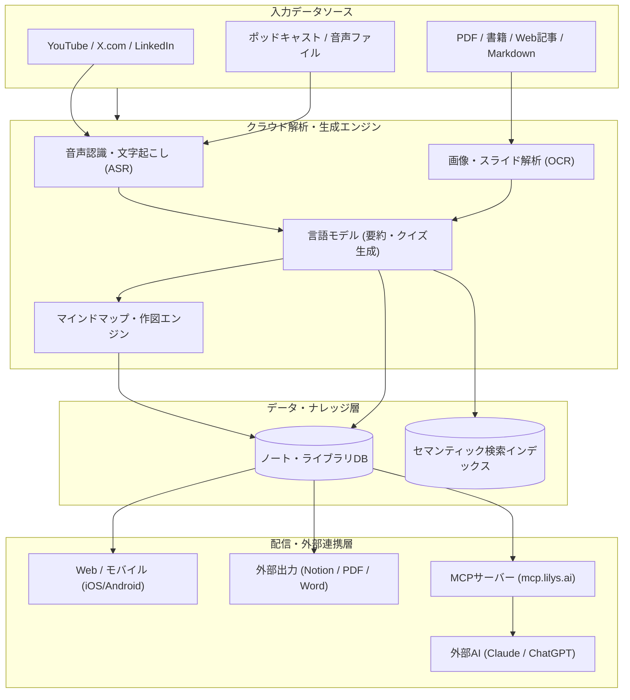

# **LilysAI 調査レポート**

## **1. 基本情報**

<!--
【ガイドライン】
- 必須: ツール名、開発元、公式サイト、カテゴリ、概要
- 概要は2-3文で簡潔に記述
-->

* **ツール名**: LilysAI（リブランディング名: Readray）
* **ツールの読み方**: リリスAI / リードレイ
* **開発元**: TeamLilys
* **公式サイト**: [https://lilys.ai/](https://lilys.ai/) （新ドメイン: [https://readray.ai/](https://readray.ai/)）
* **関連リンク**:
  * ドキュメント: [Help Center](https://help.lilys.ai/en/)
  * レビューサイト: [Product Hunt](https://www.producthunt.com/products/lilysai)
  * コミュニティ: [Discord](https://discord.gg/afeA9GDbjX)
* **カテゴリ**: 特定用途AIアシスタント
* **概要**: YouTube動画、ポッドキャスト、PDF、Web記事、音声ファイルなど、多様な形式のコンテンツから要点を抽出し、タイムスタンプ付きの構造化要約ノートを自動生成するAI学習・リサーチ支援ツール。テキスト要約だけでなく、マインドマップ、インフォグラフィック、フラッシュカード、確認クイズなどを自動生成し、理解と記憶定着を強力に後押しする。2026年には「Readray」へのリブランディングおよびModel Context Protocol（MCP）連携を発表し、Claude Code等の外部AIツールから自作ライブラリを参照できるエコシステムへと拡張している。

## **2. 目的と主な利用シーン**

<!--
【ガイドライン】
- 3-5項目を箇条書きで記述
- 想定利用者を具体的に記載
- 末尾に「代表的な利用フロー」をスイムレーンで添付する
-->

* **解決する課題**: 長時間の講義動画やポッドキャスト、長大な論文PDFの内容を短時間で構造化・把握し、復習や試験対策にかかる時間と認知的負荷を劇的に削減する。
* **想定利用者**: 学生、大学院生、研究者、ビジネスパーソン、コンテンツクリエイター、資格試験受験者。
* **利用シーン**:
  * **動画・ポッドキャスト学習**: 1〜2時間の講義動画やSpotify/Apple Podcastsの専門番組を数分で読める構造化ノートに変換し、マインドマップで論理構造を整理する。
  * **多言語リサーチ・技術調査**: 海外のカンファレンス動画や英語論文PDFをインポートし、自然な日本語の要約と重要用語集を生成して迅速にキャッチアップする。
  * **試験対策と自習**: 教科書や配布資料を読み込ませて自動生成されたフラッシュカードやクイズを解き、アクティブリコール（想起練習）を実践する。
  * **AIエージェント連携（MCP）**: Claude CodeやChatGPTなどの対話環境からLilysAIに保存した要約ノートを直接検索・引用し、リサーチやレポート執筆のソースとして活用する。

### **2.1 代表的な利用フロー**

<!--
【ガイドライン】
- ツールを実際に使う際の代表的な流れを、アクター（ユーザー、AIエージェント、ツール、外部サービス等）ごとのスイムレーンで示す
- Mermaidの `swimlane-beta` を使用し、向きは `TB`（上から下）に固定する
- `subgraph` の表示名に `・` や全角記号、`(` `)` `[` `]` などの記号を含める場合は、必ず `subgraph ID["表示名"]` のように引用符で囲む。ID自体にも記号を使わず、ASCIIの識別子にすること
- 逆向き矢印の直後にインラインラベルを付ける記法（`A <--|ラベル| B`）は使用しない。この記法は構文解析を通過してもレンダリング時に図全体が壊れるため、逆向きの関係は始点・終点を入れ替えた順方向エッジ（`B -->|ラベル| A`）で記述すること
- レーン（subgraph）は3〜5個、ステップは4〜8個程度に収め、図内のレーン名・ステップ名は日本語で簡潔に記述する
-->

```mermaid
swimlane-beta TB
  subgraph User["ユーザー"]
    A["動画URLや資料を入力"]
    E["生成ノート・マインドマップを確認"]
    G["クイズ学習・ハイライト整理を実行"]
  end
  subgraph Lily["LilysAI / Readray"]
    B["メディア取得とコンテンツ解析"]
    D["構造化ノート・図解・クイズを生成"]
    F["MCPサーバー経由でナレッジを提供"]
  end
  subgraph Sources["コンテンツソース (YouTube/Web/PDF)"]
    C["音声・テキスト・映像データを返却"]
  end
  subgraph ExternalAI["外部AIツール (Claude / ChatGPT)"]
    H["MCP経由で要約ノートを照会・参照"]
  end
  A --> B
  B --> C
  C --> D
  D --> E
  E --> G
  D --> F
  F --> H
```

* **代表的な流れ**: ユーザーがURLやファイルを投入すると、LilysAIが外部ソースからメディア・文書を取得して解析を実行。構造化ノートやマインドマップ、クイズが自動生成され、ユーザーはWeb/モバイルアプリで学習・確認できる。さらにMCPサーバー機能を介して、外部AI開発環境からもノートを直接参照できる。

## **3. 主要機能**

<!--
【ガイドライン】
- 5-10項目の主要機能を箇条書きで記述
- 各機能は1-2文で概要を説明
-->

* **マルチメディア要約**: YouTube動画、X.com（Twitter）動画、LinkedIn動画、ポッドキャスト（Spotify / Apple Podcasts）、PDF、Web記事、音声・動画ファイルなど、多岐にわたるソースの要約に対応。
* **タイムスタンプ付き構造化ノート**: 動画や音声の再生位置と連動したタイムスタンプ付きのノートを生成。クリックすることで該当シーンの再生や文字起こしへ即座に移動可能。
* **マインドマップ・インフォグラフィック生成**: 抽出した論点を視覚的なツリー図やグラフィカルなインフォグラフィックに自動変換し、全体像と各セクションの因果関係を可視化。
* **文字起こしスクリプト直接編集**: 録音や動画から生成された文字起こしスクリプトを、文単位で直接手動編集・検索置換できる機能。
* **学習支援機能（クイズ・フラッシュカード・用語集）**: ノートの内容から復習用の4択クイズ、単語帳形式のフラッシュカード、重要キーワードの解説リストをワンクリックで生成。
* **Agent Lily / 対話型AIアシスタント**: 生成されたノートや元の資料をもとに、チャット形式で質問や追加の解説、深掘りした論点整理を依頼可能。
* **書籍要約（Book Summaries）**: 書籍タイトルや著者名を入力するだけで、書籍の構成・主要メッセージ・アクションプランの構造化要約を即座に引き出せる。
* **ハイライト一括管理（Highlights at a Glance）**: 全ノートで保存した重要ハイライトを一覧で集約・検索・日付別ソートし、画像としてエクスポート可能。
* **Model Context Protocol（MCP）連携**: MCPサーバー機能を提供し、Claude CodeやCodex、ChatGPT等の外部AIクライアントからReadray/LilysAI内のノートやソースを直接検索・参照可能。
* **マルチデバイス＆エクスポート**: 公式iOS/Androidモバイルアプリを提供。作成したノートはNotion、PDF、Markdown、Word形式等へエクスポート可能。

## **4. 動作原理・システム構成**

<!--
【ガイドライン】
- ツールの動作原理、システム構成（アーキテクチャ）、データの流れ、通信フローなどを記述
- クライアント・サーバー型、ローカルファースト、クラウド完結など、ツールのアーキテクチャ特性を明記
- 可能であればMermaidによる構成図やフロー図を含めること（Mermaid内のノードや説明テキストは原則日本語表記で作成する）
- `subgraph` の表示名に `・` や全角記号、`(` `)` `[` `]` などの記号を含める場合は、必ず `subgraph ID["表示名"]` のように引用符で囲む。ID自体にも記号を使わず、ASCIIの識別子にすること
- 逆向き矢印の直後にインラインラベルを付ける記法（`A <--|ラベル| B`）は使用しない。この記法は構文解析を通過してもレンダリング時に図全体が壊れるため、逆向きの関係は始点・終点を入れ替えた順方向エッジ（`B -->|ラベル| A`）で記述すること
-->

* **アーキテクチャ**: クラウド完結型SaaS（Web/モバイルクライアント）を中核とし、外部連携用のMCPサーバーエンドポイントを備えたマルチクライアント・アーキテクチャ。
* **主要コンポーネントとデータフロー**:
  1. **インジェスチョン層**: ユーザーが送信したURL（YouTube/ポッドキャスト/Web）またはアップロードファイル（PDF/音声/動画/画像）を受け取り、コンテンツをダウンロード・抽出。
  2. **解析・変換層**: 音声データには高精度ASR（自動音声認識）を適用してタイムスタンプ付き文字起こしを生成。PDFや画像にはOCRおよびレイアウト解析を適用。
  3. **推論・生成層（LLM/ビジュアルエンジン）**: 大規模言語モデルにより、要約、論点ツリー、クイズ、用語集を作成。マインドマップエンジンやインフォグラフィックエンジンにより視覚データをレンダリング。
  4. **データ保存・配信層**: ユーザーのプロジェクト/ノートDBおよび意味検索用インデックスに永続化。Web/iOS/Androidアプリへのリアルタイム同期と、Notion/PDFエクスポートを実施。
  5. **MCP統合層**: Model Context Protocolに準拠したセキュアなエンドポイントを提供し、外部の自律エージェントやIDE拡張と双方向でノートを連携。



* **特筆すべき要素技術**:
  * **音声・映像のタイムスタンプ連動同期**: 文字起こしスクリプトの各センテンスがミリ秒単位でメディア位置と同期しており、ノートの該当箇所をクリックするだけで動画・音声の対象シーンへジャンプ再生可能。
  * **Model Context Protocol（MCP）準拠**: AIエージェント標準のオープンプロトコルを採用。外部ツールから追加の認証ヘッダーを付与して接続することで、個人の学習ナレッジをエージェントの短期/長期記憶として再利用可能。

## **5. 開始手順・セットアップ**

<!--
【ガイドライン】
- アカウント作成から「Hello World」的な最初の動作確認までの手順
- 主要なコマンドや設定項目を記載
-->

* **前提条件**:
  * インターネット接続環境（モダンブラウザ、またはiOS/Android端末）。
  * Googleアカウント等によるログイン。
* **利用開始**:
  * 公式サイト [https://lilys.ai/](https://lilys.ai/) （または [https://readray.ai/](https://readray.ai/)）にアクセスし、「Get Started」または「Googleで続行」を選択してサインアップ。
* **クイックスタート**:
  1. ダッシュボードの入力フィールドにYouTube動画やポッドキャストのURLを貼り付ける（またはPDF/音声ファイルをドラッグ＆ドロップ）。
  2. 出力言語（日本語など）や希望のノートテンプレート（標準ノート、インフォグラフィック、試験対策など）を選択。
  3. 「要約」をクリックすると、数十秒〜数分でタイムスタンプ付きノート、マインドマップ、重要ポイントが自動生成される。
* **MCP（Model Context Protocol）連携のセットアップ**:
  * Claude CodeやClaude Desktopの設定ファイル（例: `claude_desktop_config.json`）にLilysAIのMCPサーバーを追加することで連携可能：

```json
{
  "mcpServers": {
    "readray": {
      "command": "npx",
      "args": ["-y", "@modelcontextprotocol/server-fetch", "https://mcp.lilys.ai/mcp"]
    }
  }
}
```

※認証が必要な場合は環境変数または専用の設定画面からAPIトークンを渡して利用する（実在形式のキーやシークレットの直接ハードコードは避けること）。

## **6. 特徴・強み (Pros)**

<!--
【ガイドライン】
- 3-5項目を箇条書きで記述
- 競合との差別化ポイントを明確に
-->

* **マルチモーダル＆マルチソースの圧倒的な網羅性**: YouTubeだけでなく、X.com、LinkedIn動画、Spotify/Apple Podcasts、書籍、PDF、画像（教科書写真）まで幅広く対応し、情報収集をワンストップで完結できる。
* **視覚的・構造的な出力の充実**: テキストだけでなく、マインドマップ、インフォグラフィック、アニメーションテンプレートなどを自動生成し、視覚的な直感理解を促す。
* **アクティブラーニング支援機能**: 自動生成される4択クイズ、フラッシュカード、用語集により、受動的な情報消費にとどまらず能動的な記憶定着・学習が可能。
* **MCPによる次世代AIワークフロー対応**: 外部AIツール（Claude Code、Codex、ChatGPT等）からノートをシームレスに参照できるため、個人用ナレッジベースとしての拡張性が高い。
* **長尺動画への強力なサポート**: 上位プランでは最大30時間の超長尺動画（講義まとめや配信アーカイブ等）にも対応し、膨大な講義コンテンツを圧縮できる。

## **7. 弱み・注意点 (Cons)**

<!--
【ガイドライン】
- 3-5項目を箇条書きで記述
- 日本語対応の状況は必ず含める
-->

* **クレジット消費型モデル（Boost/クレジット）の管理**: 無料枠（毎日150クレジット）や各プランの月間クレジット上限があり、長尺動画の頻繁な要約や高度なモデル利用を続けるとクレジット不足になりやすい（追加Top-Upが可能）。
* **複数文書を横断した高度な論理推論**: 1つのソースを深掘り・構造化する能力には極めて優れる一方、10冊以上の学術書を同時に読み込ませて複雑な仮説検証を行うようなディープリサーチ用途では、Google NotebookLMに優位性がある場合がある。
* **ブランド名称の移行に伴う呼称の併存**: 現在「LilysAI」から「Readray」へのリブランディングが進められており、ドメインやドキュメント内で表記が混在している点に留意が必要。

## **8. 料金プラン**

<!--
【ガイドライン】
- 表形式で整理することを推奨
- 最新の料金情報であることを確認
- 価格は通貨を明記（例: $10/月、¥1,000/月）
-->

最新の料金体系（米国ドル基準・月額契約時の定価）は以下の通り。年払い契約を選択した場合は約20%の割引が適用される。

| プラン名 | 月額料金 (月払い) | 付与クレジット | ストレージ | ソース上限 | 主な機能・特徴 |
|:---|:---|:---|:---|:---|:---|
| **Free** | $0（無料） | 初回500 + 毎日150付与 | 500 MB | 100件 | 標準モデル要約、基本テンプレート、マインドマップ生成。 |
| **Starter** | $8.99/月 | 5,000 /月 | 3 GB | 無制限 | 高度なモデル選択、PDF/Wordエクスポート、3時間以上の動画、30日以上のソース保持。 |
| **Basic** | $17.99/月 | 15,000 /月 | 60 GB | 無制限 | Starterの全機能、限定公開YouTube対応、パスワード共有、クレジット追加Top-Up可能。 |
| **Pro** | $59.99/月 | 60,000 /月 | 200 GB | 無制限 | 最上位モデル無制限アクセス、月最大30本の超長尺動画（最長30時間）、最優先処理。 |
| **Business** | 要問い合わせ | カスタム | 60 GB〜 | 無制限 | チーム管理、請求書払い、優先サポート、共有ワークスペース。 |

* **課金体系**: サブスクリプション制（月額/年額）。要約やAI生成の実行ごとにクレジットを消費する。Basicプラン以上では、月間上限到達後も必要な分だけクレジットを追加購入（Top-Up）可能。
* **無料トライアル**: Freeプランが永続的に利用可能（毎日クレジットが付与されるため継続検証が可能）。

## **9. 導入実績・事例**

<!--
【ガイドライン】
- 具体的な企業名を3-5社挙げる
- 導入事例がない場合は「公開事例なし。ただし、〜の分野での利用が報告されている」等
-->

* **導入企業・利用規模**: グローバル展開により全世界で60万人以上の登録ユーザーを達成（個人学習者、研究者、教育機関関係者、ビジネスパーソンが中心）。
* **導入事例・活用パターン**:
  * **大学生・大学院生**: オンライン大学講義や研究セミナー動画をノート化し、自動生成クイズで定期試験や資格試験の対策を効率化。
  * **研究者・アナリスト**: 英語圏の最新技術カンファレンスや論文PDFを日本語で要約し、先行研究の調査時間を大幅に短縮。
  * **ポッドキャスト・動画リスナー**: 通勤中や移動中に聴いたSpotifyやYouTubeの解説番組を文字起こし・ハイライト化し、後から要点を見返し・整理。
* **対象業界**: EdTech（教育・学習支援）、学術研究、コンサルティング、コンテンツ制作。

## **10. サポート体制**

<!--
【ガイドライン】
- ドキュメント、コミュニティ、公式サポートの3項目を必ず含める
- URLがあれば記載
-->

* **ドキュメント**: [Help Center](https://help.lilys.ai/en/) にて、機能別の使い方、リリースノート、トラブルシューティングガイドを提供。
* **コミュニティ**: [Discord](https://discord.gg/afeA9GDbjX) コミュニティが運営されており、最新機能のアップデート情報共有やフィードバックが可能。
* **公式サポート**: ヘルプセンター内のチャットサポートウィジェットおよび問い合わせフォームから問い合わせ可能。

## **11. エコシステムと連携**

<!--
【ガイドライン】
- API、外部連携、技術スタックとの相性を包括的に記述
-->

### **11.1 API・外部サービス連携**

<!--
【ガイドライン】
- APIの有無と公開状況を明記
- 主要連携サービスを5-10個リストアップ
-->

* **API**: 開発者向けの標準REST APIは要問い合わせだが、**Model Context Protocol（MCP）エンドポイント**（`https://mcp.lilys.ai/mcp`）が提供されており、各種AIクライアントからプロトコル経由でナレッジ参照が可能。
* **外部サービス連携**:
  * **Notion**: ワンクリックで作成した構造化ノートやマインドマップをNotionデータベースに同期保存。
  * **YouTube / X.com / LinkedIn**: URLを指定するだけで動画・投稿を自動フェッチして解析。
  * **Spotify / Apple Podcasts**: ポッドキャストの音源をインポートして文字起こし・要約。
  * **Google Drive / ローカルファイル**: PDF、DOCX、PPT、Markdown、音声、動画、画像のアップロードに対応。
  * **Claude Code / ChatGPT (via MCP)**: AIコーディング支援ツールやデスクトップAIからLilysAIのノートをシームレスに引用。

### **11.2 技術スタックとの相性**

<!--
【ガイドライン】
- 主要なフレームワークや言語との相性を表形式で整理
- 相性: ◎ (非常に良い), ◯ (良い), △ (工夫が必要/一部非対応), × (非推奨)
-->

| 技術スタック | 相性 | メリット・推奨理由 | 懸念点・注意点 |
|:---|:---:|:---|:---|
| **MCP (Model Context Protocol)** | ◎ | 公式エンドポイントが提供され、Claudeや外部エージェントと直接統合可能 | ネットワーク接続が必要 |
| **Notion** | ◎ | 公式の同期エクスポート機能を標準搭載 | Notion側の権限設定が必要 |
| **Web Browser (Chrome/Safari)** | ◎ | プラグインやWeb画面でフル機能が軽快に動作 | 特になし |
| **Mobile (iOS/Android)** | ◎ | 公式アプリによりスマートフォンから外出先で確認可能 | 一部高度な編集はWeb版推奨 |

## **12. セキュリティとコンプライアンス**

<!--
【ガイドライン】
- 認証、データ管理、準拠規格の3項目を必ず調査
- 情報が見つからない場合は「公式サイトで公開されていない。問い合わせが必要。」と記載
- 「不明」「見つからず」のみの記載は避ける
-->

* **認証**: Googleアカウント等を利用したOAuth 2.0認証、および多要素認証をサポート。
* **データ管理**: 通信はすべてTLS/HTTPSにより暗号化。ユーザーがアップロードしたファイルおよび生成ノートは、ユーザー自身のアカウント配下に保護され、アカウント設定からデータの削除リクエストが可能。詳細は [Privacy Policy](https://help.lilys.ai/en/articles/11703756-privacy-policy) に準拠。
* **準拠規格**: SOC2やISO27001などの特定セキュリティ認証の取得状況については公式サイト上で公開されていないため、エンタープライズ導入時は問い合わせが必要。

## **13. 操作性 (UI/UX) と学習コスト**

<!--
【ガイドライン】
- 実際の使用感や、類似ツールとの比較を含める
-->

* **UI/UX**: 入力フォームにURLを貼り付けるかファイルを置くだけで即座に処理が始まり、生成完了後は画面左に目次やマインドマップ、中央にノート本文、右側にタイムスタンプ付きプレイヤーが配置され、極めて視認性が高い。
* **学習コスト**: 非常に低い。初回利用時からチュートリアルなしで直感的に要約・クイズ生成まで実行できる。モバイルアプリの操作性も洗練されており、移動中の学習にも適している。

## **14. ベストプラクティス**

<!--
【ガイドライン】
- ツールを効果的に活用するための推奨事項や、避けるべきアンチパターンを記述
- 公式ドキュメントのBest Practicesや、熟練エンジニアの知見を参考にする
-->

* **効果的な活用法 (Modern Practices)**:
  * **タイムスタンプ連動再生による高速スキミング**: まず要約ノートとマインドマップを一通り眺めて重要ポイントを把握し、さらに深い理解が必要な論点のみタイムスタンプをクリックして原動画・音声をピンポイント視聴する。
  * **クイズとフラッシュカードによるアクティブリコール**: 要約を読んで理解したつもりになるのを防ぐため、生成直後に自動生成クイズを解いて知識の定着を確認する。
  * **MCP連携による自作リサーチアーカイブの構築**: 日常的にインポートした動画や論文のノートを蓄積しておき、開発やレポート執筆時にClaude Code等から直接検索して引用する。
* **陥りやすい罠 (Antipatterns)**:
  * **AI出力の無批判な受容**: 専門的な数式や固有名詞、数字データにはハルシネーションが含まれる可能性があるため、重要な論点は必ず元の動画タイムスタンプやPDFの原文を照合する。
  * **クレジットの無駄な消費**: 非常に長尺な動画を要約する前に、目次やチャプターを確認し、必要な部分だけを指定して処理することでクレジット消費を最適化する。

## **15. ユーザーの声（レビュー分析）**

<!--
【ガイドライン】
- 必須調査サイト: G2, Capterra, ITreview（日本語レビュー）のうち該当するもの
- 追加調査サイト: App Store, Google Play, X(Twitter), Reddit等
- 総合評価スコアがあれば必ず記載
- ポジティブ・ネガティブ各3項目以上
-->

* **調査対象**: Product Hunt, App Store, ユーザーコミュニティレビュー
* **総合評価**: 5.0/5.0 (Product Hunt)
* **ポジティブな評価**:
  * 「長時間の専門講義やポッドキャストを数分で構造化ノートにしてくれるため、学習効率が劇的に向上した」
  * 「マインドマップやインフォグラフィックが美しく、複雑な論理展開が一目で理解できる」
  * 「海外の英語動画でも自然な日本語で要約され、タイムスタンプから原文をピンポイント確認できるのが素晴らしい」
  * 「クイズやフラッシュカードが自動生成されるので、試験勉強の教材作成の手間がゼロになった」
* **ネガティブな評価 / 改善要望**:
  * 「サーバー混雑時や長尺コンテンツの処理時に、生成に数分以上の時間がかかることがある」
  * 「ヘビーに使い込むとクレジットの減りが早く、こまめなクレジット管理が必要」
  * 「サービス名称がLilysAIからReadrayへ変わり、一部の案内やリンクで表記の不一致が見られる」
* **特徴的なユースケース**:
  * 株式投資家やアナリストが企業の決算説明会動画やカンファレンス音声を要約し、重要指標や質疑応答を迅速にレポート化。

## **16. 直近半年のアップデート情報**

<!--
【ガイドライン】
- 日付の降順（新しいものが上）
- 3-10項目をリストアップ
- 各項目に日付と概要を含める
- **情報源の優先順位**:
  1. GitHubリポジトリの `CHANGELOG.md`
  2. GitHub Releases
  3. 公式ブログ / ニュース
- 情報源のURLを記載。**【重要】特定の古い日時の記事等に固定せず、常に最新情報が掲載・蓄積される公式の永続的なインデックスURL（製品アップデートカテゴリ、リリースノート一覧、コミュニティポータル等）を記載・更新すること。オープンソース（OSS）ツールを調査する場合において、GitHub等のリリースノートやリポジトリの内容を出典として参考にする際は、特定のリリースバージョン個別URL（例：`/releases/tag/v1.0.0`）に固定するのではなく、常に最新の更新履歴にアクセスできるリポジトリの永続リンク（例：`/releases` や `CHANGELOG.md` への直接リンク等）を出典URLとして設定すること。**
-->

* **2026-09-09**: **MCP Connections（Model Context Protocol連携）**: Claude CodeやCodex、ChatGPTなどの外部AIツールからMCP経由でLilysAI（Readray）に接続し、ソース参照、新規資料登録、ノート作成をワークスペース上から直接行える機能を公開。
* **2026-09-07**: **インフォグラフィック生成機能の強化（Better infographics）**: 図解生成エンジンをアップグレードし、ノートの論理構造やフローをより直感的かつ高精度にダイアグラム化。
* **2026-08-27**: **スクリプト直接編集（Script Editing）**: 文字起こしスクリプトのセンテンス単位での修正や、一括置換（Find & Replace）機能を導入。
* **2026-08-14**: **ポッドキャスト＆LinkedIn動画サポート**: SpotifyやApple Podcastsの音源、およびLinkedIn投稿動画の要約に対応。ノート内からの頭出し再生にも対応。
* **2026-08-01**: **プラン特典の大幅拡張**: Basic/Businessのストレージを60GB、Proを200GBへ倍増。最長30時間のYouTube動画要約（Proで月最大30本）をサポート。
* **2026-05-22**: **X.com動画サポート**: X.com（Twitter）上の動画ツイートURLから直接分析レポートを生成可能に。
* **2026-05-07**: **クレジットトップアップ機能**: 月間上限到達後も、プランをアップグレードせずに単発でクレジットを追加購入（Top-Up）可能に。
* **2026-04-29**: **ハイライト一括管理（Highlights at a Glance）**: 全ノートの重要ハイライトを一元管理し、日付やレポート別に検索・画像エクスポート可能に。
* **2026-04-08**: **iOSアプリ正式リリース**: iPhone向け公式アプリを公開し、Web版とシームレスなノート同期を実現。
* **2026-04-07**: **書籍要約機能（Book Summaries）**: 書籍タイトルや著者名を入力するだけで、構成・要点を瞬時に要約する機能を追加。
* **2026-03-11**: **YouTubeチャンネル監視**: 指定したお気に入りチャンネルの新着動画を自動追跡して要約する機能を追加。
* **2026-03-03**: **Androidアプリリリース**: Android向け公式モバイルアプリをリリース。

(出典: [Release notes](https://help.lilys.ai/en/articles/11782109-release-notes))

## **17. 類似ツールとの比較**

<!--
【ガイドライン】
- 3-5個の類似ツールと比較
- **機能比較表（星取表）**と**詳細比較**の2つの観点で記述する
-->

### **17.1 機能比較表 (星取表)**

<!--
【記載ルール】
- 縦軸に主要機能、横軸にツールを配置
- 記号の意味:
  - ◎: 非常に優れている / カタログスペック以上の機能 / 独自強み
  - ◯: 対応している / 標準的な機能
  - △: 一部対応 / 制限あり / アドオンが必要
  - ×: 非対応
  - -: 不明 / 該当なし
- 中立性を保つため、比較対象のツールが得意とする機能も平等にリストアップすること
-->

| 機能カテゴリ | 機能項目 | LilysAI (Readray) | NotebookLM | NoteGPT |
|:---:|:---|:---:|:---:|:---:|
| **要約対象** | 動画/音声（YouTube/X/ポッドキャスト） | ◎<br><small>30時間長尺・ポッドキャスト対応</small> | ◯<br><small>YouTube・音声概説機能</small> | ◎<br><small>YouTube動画特化</small> |
| **要約対象** | ドキュメント（PDF/論文/書籍） | ◯<br><small>書籍要約・PDF画像解析</small> | ◎<br><small>最大50件の大量ソース横断</small> | △<br><small>テキスト・PDF限定</small> |
| **出力形式** | 視覚化（マインドマップ/図解） | ◎<br><small>マインドマップ・インフォグラフィック</small> | △<br><small>テキスト・音声概説中心</small> | ◯<br><small>マインドマップ生成</small> |
| **学習支援** | クイズ・フラッシュカード生成 | ◎<br><small>4択クイズ・単語帳自動作成</small> | ◯<br><small>対話形式で生成可能</small> | △<br><small>限定的</small> |
| **外部連携** | 外部エージェント連携 (MCP) | ◎<br><small>MCPサーバー標準提供</small> | △<br><small>Google Workspace連携中心</small> | ×<br><small>ブラウザ拡張中心</small> |
| **モバイル** | 専用アプリ (iOS / Android) | ◎<br><small>両OSネイティブ対応</small> | ◯<br><small>モバイル対応</small> | △<br><small>Webブラウザ中心</small> |

### **17.2 詳細比較**

<!--
【ガイドライン】
- 定性的な違いや、どのようなユーザーに向いているかを記述
-->

| ツール名 | 特徴 | 強み | 弱み | 選択肢となるケース |
|---------|------|------|------|------------------|
| **LilysAI (Readray)** | 動画・音声・書籍の学習支援オールインワン | 動画・ポッドキャストの視覚的要約、マインドマップ、クイズ生成、MCP連携による外部AI活用。 | 多数の学術論文を横断したディープな相関分析はNotebookLMが優れる場合あり。 | 動画や音声コンテンツを中心に効率的に学習し、記憶定着や視覚的整理を行いたい場合。 |
| **NotebookLM** | Googleのグラウンディング＆リサーチAI | Gemini基盤による高精度グラウンディング（根拠提示）、複数資料の横断分析、音声概説（ポッドキャスト風対話）。 | 動画自体のビジュアル解析やマインドマップ、暗記クイズ等の専用学習機能は控えめ。 | 論文、報告書、社内資料などのテキスト群を多角的に分析・要約したい場合。 |
| **NoteGPT** | YouTube特化の軽量ブラウザ拡張 | YouTube再生画面横でのリアルタイム要約と軽量な操作性、手軽なマインドマップ表示。 | 書籍要約やポッドキャスト対応、MCP連携など総合的なナレッジハブ機能は限定的。 | YouTube動画を手軽にブラウザ上で要約確認したいライトユーザー。 |

## **18. 総評**

<!--
【ガイドライン】
- 総合評価、推奨チーム、選択ポイントの3項目を必ず含める
- 客観的で中立的な評価を心がける
-->

* **総合的な評価**:
  LilysAI（現Readray）は、YouTube動画、ポッドキャスト、X.com/LinkedIn動画、長大なPDFまで、多岐にわたる学習リソースを「視覚的かつ構造的な知見」へと瞬時に昇華させる卓越したAI学習支援プラットフォームである。単なる要約ツールの枠を超え、マインドマップ、インフォグラフィック、自動生成クイズ、フラッシュカードを通じて「理解」と「記憶定着」を強力にアシストする。さらに2026年後半にはMCP（Model Context Protocol）連携を導入し、外部AI開発環境（Claude Code等）と自作学習ナレッジを融合できる先進的なエコシステムへと飛躍を遂げている。
* **推奨されるチームやプロジェクト**:
  * **学生・大学院生・受験生**: 膨大な講義動画や教材から重要ポイントを抽出し、クイズやフラッシュカードで能動的学習を行いたい個人。
  * **リサーチャー・エンジニア**: 海外の技術カンファレンス、ポッドキャスト、論文を日本語で高速インプットし、MCP経由で開発環境と連携させたい技術者。
  * **ビジネスパーソン・アナリスト**: 業界ウェビナーや決算動画から素早く要点を抽出し、Notion等へ構造化レポートとして蓄積したいチーム。
* **選択時のポイント**:
  * 動画・音声コンテンツの学習や、マインドマップ・クイズなど視覚的・能動的な定着を重視する場合は **LilysAI** が最適。
  * 論文や社内ドキュメントなどテキストソース主体の横断的リサーチや厳密なグラウンディングを求める場合は **NotebookLM**、YouTube閲覧時の軽量な補助を求める場合は **NoteGPT** と比較検討すると良い。
