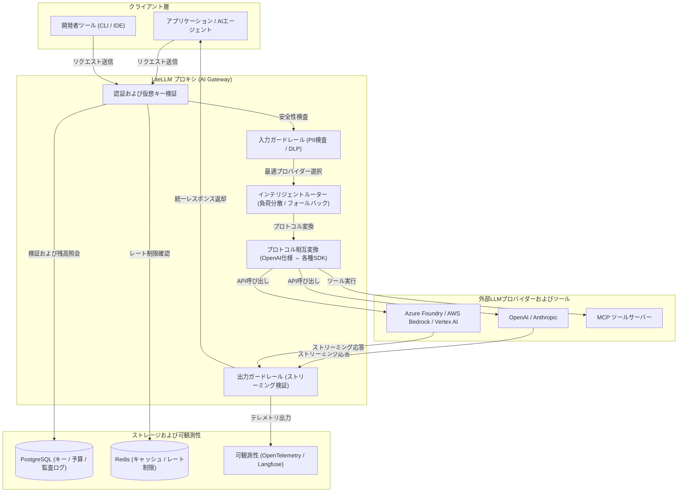

# **LiteLLM 調査レポート**

## **1. 基本情報**

* **ツール名**: LiteLLM
* **ツールの読み方**: ライトエルエルエム
* **開発元**: BerriAI
* **公式サイト**: [https://www.litellm.ai/](https://www.litellm.ai/)
* **関連リンク**:
  * GitHub: [https://github.com/BerriAI/litellm](https://github.com/BerriAI/litellm)
  * DeepWiki: [https://deepwiki.com/BerriAI/litellm](https://deepwiki.com/BerriAI/litellm)
  * CodeWiki: [https://codewiki.google/github.com/BerriAI/litellm](https://codewiki.google/github.com/BerriAI/litellm)
  * ドキュメント: [https://docs.litellm.ai/docs/](https://docs.litellm.ai/docs/)
* **カテゴリ**: AIゲートウェイ
* **概要**: LiteLLMは、OpenAIのAPI仕様をデファクトスタンダードとして利用し、Anthropic、Google Gemini、AWS Bedrock、Azure AI Foundry、Vertex AI、ローカルモデル（Ollama, vLLM）など100以上のLLMプロバイダーを統合呼び出しできるPython SDKおよびAIゲートウェイプロキシサーバーです。Rustベースの高速コアエンジンを内包し、マルチモデル環境におけるコスト追跡、仮想キー管理、ロードバランシング、自動フォールバック、MCP（Model Context Protocol）連携、リアルタイムガードレールなどのエンタープライズ機能を提供します。

## **2. 目的と主な利用シーン**

* **解決する課題**:
  * LLMプロバイダーごとに異なるSDK、認証方式、リクエスト/レスポンス形式、エラーハンドリングを使い分けることによる実装とメンテナンスの肥大化。
  * 複数チームやプロジェクトでLLMを利用する際のAPIキーの散乱、予算超過、レート制限（429 Too Many Requests）エラーによるサービス停止リスク。
  * 機密情報（PII）の流出防止やプロンプトインジェクション対策、コンプライアンス順守のための統一的なセキュリティ基盤の欠如。
  * AIエージェント（MCPやAgent-to-Agent）の普及に伴うツール呼び出しや外部API連携のガバナンス不足。
* **想定利用者**:
  * アプリケーションにLLM機能を組み込むソフトウェアエンジニア・AIアプリ開発者
  * 組織全体のLLMアクセス、セキュリティポリシー、API利用コストを集中管理するAI/MLプラットフォームチーム・FinOpsチーム
  * 高可用性と低レイテンシが要求されるミッションクリティカルなAIサービスを運用するSRE・インフラエンジニア
* **利用シーン**:
  * **マルチプロバイダーのシームレス切り替え**: コードを変更することなく、OpenAIからAnthropicやGemini、オープンソースモデルへ即座にリクエストを切り替えてテスト・本番運用。
  * **組織内の集中APIゲートウェイ**: チームや部署ごとに仮想キーを発行し、月次予算の上限設定やRPM/TPMのレート制限を適用してコスト超過を防止。
  * **高可用性ロードバランシングとフォールバック**: 複数リージョン（Azure OpenAI、AWS Bedrock等）にリクエストを分散させ、特定エンドポイント障害時に別プロバイダーへ自動フォールバック。
  * **AIエージェントとMCPの統制**: Claude CodeやCodex、LangGraphなどのエージェントクライアントと社内MCPサーバーの中継・アクセス制御。

### **2.1 代表的な利用フロー**

```mermaid
swimlane-beta TB
  subgraph Client["クライアント (アプリ / エージェント)"]
    Req["LLMリクエスト送信 (OpenAI形式)"]
    Res["統一形式レスポンスを受信"]
  end

  subgraph Gateway["LiteLLM ゲートウェイ"]
    Verify["仮想キー認証・レート制限チェック"]
    Route["最適プロバイダー選択・フォールバック判定"]
    Convert["プロトコル変換・コスト集計"]
  end

  subgraph Policy["ガバナンス・セキュリティ層"]
    InputCheck["入力PII検知・機密情報マスキング"]
    OutputCheck["出力ガードレール・DLPリアルタイム検査"]
  end

  subgraph Provider["外部LLMプロバイダー"]
    Exec["モデル推論実行 (ストリーミング生成)"]
  end

  Req --> Verify
  Verify --> InputCheck
  InputCheck --> Route
  Route --> Exec
  Exec --> OutputCheck
  OutputCheck --> Convert
  Convert --> Res
```

* **代表的な流れ**: クライアント（アプリやAIエージェント）がOpenAI互換の形式でリクエストを送信すると、LiteLLMゲートウェイが仮想キーの権限と予算・レート制限を検証します。続いてセキュリティ層でPIIや禁止語句を検査した上で最適なLLMプロバイダーへルーティングし、ストリーミング出力の安全性をリアルタイム検証しながらコストを集計して統一フォーマットでクライアントへ返却します。

## **3. 主要機能**

* **統一API (OpenAI互換インターフェース)**: OpenAIの`/chat/completions`、`/embeddings`、`/responses`などのフォーマットで、Anthropic、Gemini、Bedrock、Azure、Vertex AI、Cohere、Groqなど100以上のLLMプロバイダーを同一コードで呼び出し可能。
* **Rustコアによる超高速ルーティング**: Rustで記述されたネイティブコアエンジンにより、Pythonレイヤーのオーバーヘッドを大幅に削減し、高トラフィック環境でもマイクロ秒〜数ミリ秒レベルの低レイテンシ転送を実現。
* **動的ロードバランシングと自動フォールバック**: 複数リージョン・複数デプロイメント間での重み付け負荷分散（ラウンドロビン、レイテンシ最小化等）に加え、特定プロバイダーのタイムアウトやレート制限（429）発生時に代替モデルへ自動フォールバック。
* **仮想キー (Virtual Keys) と予算・レート制限管理**: ユーザーやチームごとに仮想APIキーを発行し、月次/日次予算の上限（ソフト/ハードリミット）、プロバイダー/モデル別のRPM（リクエスト/分）およびTPM（トークン/分）を厳格に制御。
* **リアルタイムLLMガードレール**: 入力プロンプトのPIIマスキング、Microsoft Purview DLP連携、禁止キーワード検知に加え、ストリーミング出力に対してもチャンク単位でPost-callガードレールパイプラインをリアルタイム実行。
* **MCP (Model Context Protocol) ツールゲートウェイ & A2Aルーティング**: 複数のMCPサーバーを一元登録し、仮想キーごとにツールへのアクセス権限を制御。Agent-to-Agent（A2A）仕様に基づき、エージェント間通信のセッションブリッジングやプロトコル正規化を支援。
* **包括的な可観測性とOpenTelemetry (OTel) 準拠**: OpenTelemetry GenAI標準セマンティック規約（semconv）に準拠したトレース出力に対応し、Langfuse、LangSmith、Datadog、Prometheus、MLflowへ詳細なログ・メトリクスを自動連携。
* **エンタープライズ認証・セキュリティ統制**: SAML/OIDC（Okta、Azure AD/Entra ID）によるSSO連携、漏洩パスワード検知（Breached Password Detection）、未設定マスターキーでの起動拒否機能など、企業利用に耐えうる堅牢なセキュリティを提供。

## **4. 動作原理・システム構成**

* **アーキテクチャ**:
  LiteLLMは、アプリケーションに組み込んで動作する軽量な「Python SDK」と、中央集権的にリクエストを中継する「コンテナ型AIゲートウェイプロキシ」の双方を提供します。プロキシ構成では、Rustで実装された高スループットなルーティングコアとPythonの拡張性が融合されており、ステート管理にPostgreSQL、分散キャッシュ・レート制限にRedisを利用するマイクロサービス構成を採用しています。
* **主要コンポーネントとデータフロー**:
  * **Client Layer**: 各種Webアプリ、モバイルバックエンド、AIエージェントフレームワーク（LangGraph、OpenHands等）、およびコーディングエージェント（Claude Code等）がOpenAI互換のHTTP/RESTまたはSDK経由でリクエストを発行。
  * **LiteLLM Gateway Core**: リクエストを受け取り、ヘッダー内の仮想キーをPostgreSQL/Redisのインメモリキャッシュで高速検証。チームごとの予算残高やレート制限枠（RPM/TPM）を即座に判定。
  * **Policy & Guardrails Engine**: 入力プロンプトを事前検査パイプライン（PIIマスキング、Microsoft Purview DLP、Cato/AIM連携）に通し、コンプライアンス違反を未然に遮断。
  * **Intelligent Router**: 設定ファイル（YAML）やAdmin UIで定義されたルーティングルールに基づき、負荷状況・健全性（ヘルスチェック）・コスト・レイテンシを考慮して最適なプロバイダーエンドポイントを選択。
  * **Protocol Transformer**: OpenAIフォーマットのリクエストペイロードを、対象プロバイダー（AWS Bedrock Converse API、Vertex AI API等）のネイティブフォーマットへ高速変換して送信。
  * **Streaming & Post-call Pipeline**: プロバイダーからのServer-Sent Events（SSE）ストリーミングを受信しながら、リアルタイムで出力ガードレールを適用。トークン数を計算して利用コストをPostgreSQLに永続化し、OpenTelemetry互換のテレメトリを外部可観測性基盤へ非同期送信。
* **特筆すべき要素技術**:
  * **Rust Core**: リクエストのパース、バリデーション、ストリーミングチャンクの転送処理をRustで行うことで、Pythonプロキシ特有のGIL（グローバルインタプリタロック）競合やレイテンシ遅延を排除。
  * **OpenTelemetry GenAI Semconv**: 生成AIに特化した標準化メトリクス（プロンプトトークン数、補完トークン数、モデル名、レイテンシ等）を統一スパンとして伝搬。
  * **Cosignによる暗号署名**: 公式Dockerイメージはcosignを用いて暗号署名されており、サプライチェーン攻撃を防ぐ厳格な検証環境に対応。



## **5. 開始手順・セットアップ**

* **前提条件**:
  * Python環境（3.9以上、Python SDK利用時）またはDocker環境（プロキシサーバー利用時）。
  * 利用対象となる各種LLMプロバイダーのAPIキーやクラウド認証情報（AWS、Azure、GCP等）。
* **インストール/導入**:

  Python SDKのインストール:

  ```bash
  uv add litellm
  # または pip を使用する場合:
  # pip install litellm
  ```

  AIゲートウェイ（プロキシサーバー）の導入:

  ```bash
  # 1コマンドでGateway、PostgreSQL、Admin UIをまとめて起動する場合（推奨）
  docker run -d -p 4000:4000 ghcr.io/berriai/litellm:main-latest
  ```

  またはCLIツールとしてローカルインストール:

  ```bash
  uv tool install 'litellm[proxy]'
  ```

* **初期設定**:
  設定ファイル（`litellm_config.yaml`）を作成し、利用するモデルとルーティングルールを定義します。

  ```yaml
  model_list:
    - model_name: gpt-4o
      litellm_params:
        model: openai/gpt-4o
        api_key: os.environ/OPENAI_API_KEY
    - model_name: claude-sonnet
      litellm_params:
        model: anthropic/claude-3-5-sonnet-20241022
        api_key: os.environ/ANTHROPIC_API_KEY

  general_settings:
    master_key: os.environ/LITELLM_MASTER_KEY
  ```

* **クイックスタート**:

  **1. Python SDKでの呼び出し例**:

  ```python
  import os
  from litellm import completion

  # 認証情報は環境変数から安全に取得
  os.environ["OPENAI_API_KEY"] = os.environ.get("OPENAI_API_KEY", "<YOUR_OPENAI_API_KEY>")
  os.environ["ANTHROPIC_API_KEY"] = os.environ.get("ANTHROPIC_API_KEY", "<YOUR_ANTHROPIC_API_KEY>")

  # OpenAIモデルへのリクエスト
  res_openai = completion(
      model="openai/gpt-4o",
      messages=[{"role": "user", "content": "Hello LiteLLM!"}]
  )
  print(res_openai.choices[0].message.content)

  # 全く同じコードインターフェースでAnthropicモデルへリクエスト
  res_claude = completion(
      model="anthropic/claude-3-5-sonnet-20241022",
      messages=[{"role": "user", "content": "Hello LiteLLM!"}]
  )
  print(res_claude.choices[0].message.content)
  ```

  **2. プロキシサーバーの起動とOpenAI SDKからのアクセス**:

  ```bash
  # 環境変数をセットしてプロキシを起動
  export OPENAI_API_KEY="<YOUR_OPENAI_API_KEY>"
  export LITELLM_MASTER_KEY="<YOUR_SECURE_MASTER_KEY>"
  litellm --config litellm_config.yaml --port 4000
  ```

  起動後は、OpenAI SDKの `base_url` を `http://localhost:4000`、`api_key` にマスターキーまたは仮想キーを指定するだけで、既存アプリケーションを一切書き換えることなくアクセスできます。

## **6. 特徴・強み (Pros)**

* **圧倒的なプロバイダー対応数と業界標準互換**: OpenAI、Anthropic、Google、AWS Bedrock、Azure AI Foundry、Vertex AI、Cohere、Ollamaなど100以上のモデルをOpenAI API仕様の単一インターフェースで統合。ベンダーロックインを完全に回避できる。
* **Rustコア採用による高スループット・低レイテンシ**: プロキシのルーティング基盤にRustコアを統合し、大規模な本番運用環境でもマイクロ秒〜数ミリ秒台のオーバーヘッドで安定動作。
* **実務に直結するコスト統制・予算管理**: 仮想キーごとの利用予算、レート制限（RPM/TPM）、ユーザー・チーム別のコスト可視化により、LLM運用のFinOps体制を容易に構築可能。
* **強固なエンタープライズセキュリティ**: SAML/OIDCによるSSO、Microsoft Purview連携、漏洩パスワード検知、cosign署名済みDockerイメージなど、企業の厳格なセキュリティ監査に対応。
* **最新AIトレンドへの即応性**: MCP（Model Context Protocol）ツールサーバー統合、Agent-to-Agent（A2A）ルーティング、マルチモーダル動画生成（fal.ai等）への対応など、新規格やプロバイダーアップデートへの追従速度が極めて速い。

## **7. 弱み・注意点 (Cons)**

* **設定ファイルの複雑さと学習コスト**: 動的ルーティング、ロードバランシング、ストリーミングガードレール、SSO連携など多機能である反面、`litellm_config.yaml` の記述や環境変数の設計が複雑化しやすく、運用設計に一定の習熟が必要。
* **日本語ドキュメントおよび管理UIローカライズの不足**: 公式ドキュメント、エラーメッセージ、Admin UIダッシュボードはすべて英語で提供されており、日本語による公式サポートや解説リソースは限られている。
* **高頻度なリリースに伴うバージョン管理コスト**: 週に数回以上のペースで新機能や修正がリリースされる活発なOSSであるため、本番運用においてはLTS（長期サポート）ブランチの選定や、ステージング環境での破壊的変更チェックを伴うバージョン管理が推奨される。

## **8. 料金プラン**

LiteLLMはオープンソースソフトウェアとしてコア機能が無料で提供されており、セルフホストまたはクラウド版を選択できます。

| プラン名 | 料金 | 主な特徴 | 対象ユーザー |
|---------|------|---------|-------------|
| **Open Source** | 無料 | 100以上のLLM統合、オープンソースプロキシ、ロードバランシング、自動フォールバック、仮想キー管理、基本Admin UI、Langfuse/Prometheusロギング（セルフホスト） | 個人開発者、スタートアップ、自社インフラでセルフホストしたいチーム |
| **Hosted Cloud** | 従量課金または定額（要問い合わせ） | サーバー構築不要のフルマネージドAIゲートウェイ、マネージドPostgreSQL/Redis、SOC 2 Type 2準拠のクラウドインフラ | インフラ保守コストを削減したい開発チーム・急成長スタートアップ |
| **Enterprise** | 要問い合わせ（年額個別見積もり） | OSSの全機能に加え、SSO（SAML/OIDC）、詳細監査ログ、RBAC権限管理、専用SLAサポート（Sev 0対応）、専用Slack/Teamsサポート、カスタムガードレール連携 | 大企業、金融・ヘルスケア等の規制産業、全社規模のAIプラットフォーム基盤 |

* **課金体系**: オープンソース版は完全無料（Apache 2.0相当/商用利用可）。Enterprise版は年間シート数またはデプロイ規模に応じたライセンス契約。
* **無料トライアル**: Enterprise機能（SSO、監査ログ等）は7日間の無料トライアルライセンスが提供されており、SSO機能は5ユーザーまで無償検証可能。

## **9. 導入実績・事例**

* **導入企業**: Netflix、Stripe、Lemonade、Greptile、OpenHands、Basetenなど
* **導入事例**:
  * **Netflix**: 全社の開発者に対して新しいLLMモデルの「Day 0アクセス（リリース当日の即時利用）」を提供。プロバイダーごとの入出力フォーマット変換やSDK更新作業を削減し、数ヶ月分のエンジニアリング工数を節約。
  * **Lemonade**: 多数のAIモデルとLangfuseを統合し、カスタマーサービスや査定業務でのプロキシルーティング・コスト追跡を自動化。
  * **OpenHands**: オープンソースの自律型ソフトウェア開発エージェントにおいて、ユーザーが任意のLLMプロバイダーを選択して実行できる標準バックエンドとしてLiteLLMを採用。
* **対象業界**: テクノロジー、フィンテック、保険、メディア、AIスタートアップ、および社内AIプラットフォームを整備するエンタープライズIT部門。

## **10. サポート体制**

* **ドキュメント**: [https://docs.litellm.ai/docs/](https://docs.litellm.ai/docs/) にて、プロバイダー別の設定例、ロードバランシング設定、ガードレール実装、Dockerクイックスタートなどの網羅的なドキュメントが提供されている。
* **コミュニティ**: Discordコミュニティ（数千人規模）およびGitHub Discussions/Issuesが非常に活発で、メンテナーやファウンダーが頻繁に直接回答を行っている。
* **公式サポート**: Enterpriseプラン契約者向けに、専用のSlack/Microsoft Teamsコネクトチャネル、優先バグ修正、および障害重要度（Sev 0〜Sev 3）に応じたSLA付きテクニカルサポートが提供される。

## **11. エコシステムと連携**

### **11.1 API・外部サービス連携**

* **API**: OpenAI互換のREST API（`/chat/completions`, `/embeddings`, `/responses`, `/v1/models`, `/v1/rag/ingest` など）およびPython SDK。
* **外部サービス連携**:
  * **可観測性（Observability）**: OpenTelemetry（OTel GenAI semconv準拠）、Langfuse、LangSmith、Datadog、Prometheus、MLflow、Helicone、AWS CloudWatch。
  * **シークレット管理・クラウド認証**: AWS KMS、Azure Key Vault、Google Secret Manager、HashiCorp Vault、OpenAI Workload Identity Federation（OIDC）。
  * **ID管理・SSO**: Okta、Microsoft Entra ID（Azure AD）、Google Workspace、Auth0などのOIDC/SAMLプロバイダー。
  * **セキュリティ・DLP**: Microsoft Purview DLP、Lasso Security、Cato Networks、AIM。

### **11.2 技術スタックとの相性**

| 技術スタック | 相性 | メリット・推奨理由 | 懸念点・注意点 |
|:---|:---:|:---|:---|
| **Python (FastAPI / LangChain)** | ◎ | ネイティブPython SDKが提供され、OpenAIクライアントの代替として数行で導入可能。 | 特になし |
| **Node.js / TypeScript** | ◎ | OpenAI公式Node.js SDKの `baseURL` をLiteLLMプロキシに向けるだけで完全互換動作。 | プロキシサーバー（Docker等）の常駐が必要 |
| **Go / Rust / Java / C#** | ◯ | 標準的なOpenAI互換HTTPエンドポイントとして動作するため、言語を問わず利用可能。 | 言語専用の高水準SDKではなくREST API直接呼び出しとなる |
| **AIエージェントフレームワーク** | ◎ | LangGraph、CrewAI、OpenHands、Claude Code、Codex等と完全互換。MCPゲートウェイ機能も完備。 | エージェントの過剰なツール呼び出しに伴うレート制限設計に注意 |

## **12. セキュリティとコンプライアンス**

* **認証**: 仮想キー（Virtual Keys）によるきめ細やかなアクセス制御に加え、JWT連携、Azure Entra ID / OAuth、SAML 2.0によるSSO認証をサポート。
* **データ管理**: セルフホスト構成により、機密データやプロンプト履歴が外部サーバーを経由せず自社のVPC/プライベートネットワーク内に完全に留まる。
* **サプライチェーン＆イメージ署名**: Dockerコンテナイメージはcosignによって暗号署名されており、KubernetesやCI/CD上での改ざん検知・署名検証に対応。
* **準拠規格**: ホステッドクラウド版はSOC 2 Type 2およびISO 27001に準拠。マスターキーのデフォルト起動遮断や、パスワード漏洩検知など最新のセキュリティポリシーを標準装備。

## **13. 操作性 (UI/UX) と学習コスト**

* **UI/UX**: プロキシサーバーに統合されたAdmin UI（ダッシュボード）により、仮想キーの発行、モデル一覧の確認、リアルタイムコスト・利用統計グラフ、チーム別の予算設定、Playgroundでのプロンプトテストを直感的に操作可能。
* **学習コスト**: 単純なPython SDKの利用や基本プロキシの起動は数分で完了するが、複数プロバイダーの加重ロードバランシング、ストリーミングガードレール、SSO連携を本番規模で設計する場合は、設定ファイル（YAML）の仕様理解と運用検証が必要。

## **14. ベストプラクティス**

* **効果的な活用法 (Modern Practices)**:
  * **仮想キーによる最小権限の原則**: アプリケーションや開発チームごとに個別仮想キーを発行し、許可モデルのホワイトリストと月額予算リミットを設定して想定外の課金を防止する。
  * **マルチリージョン・ロードバランシング**: Azure OpenAIやAWS Bedrockの複数リージョンエンドポイントを登録し、レイテンシ最小化ルーティングを設定して局所的な429エラーを回避する。
  * **OpenTelemetryによるエンドツーエンド可観測性**: OTel GenAIセマンティクスを有効化し、プロキシからバックエンドサービスまで一連のトレーススパンを繋ぐことで、ボトルネックやエラー箇所を即座に特定する。
* **陥りやすい罠 (Antipatterns)**:
  * **デフォルトマスターキーでの本番起動**: 初期値や平文のままマスターキーを運用すること（最新版では危険なキーでの起動が拒否されるため、必ず環境変数から強固なキーを注入すること）。
  * **Post-callガードレールなしのストリーミング運用**: ストリーミングレスポンスにおいて出力検査を怠り、機密情報や不適切な出力がクライアントにそのまま流出すること。
  * **キャッシュ未設定による同一クエリの無駄な課金**: 類似検索や頻出プロンプトに対してRedisセマンティックキャッシュを有効化せず、不要なAPIコストと遅延を発生させること。

## **15. ユーザーの声（レビュー分析）**

* **調査対象**: GitHub（Star数 約62,800）、X (Twitter)、Reddit、Hacker News、公式導入事例
* **総合評価**: マルチプロバイダー対応の網羅性と、OpenAI互換プロキシとしての導入の容易さから、開発者コミュニティおよびエンタープライズプラットフォームエンジニアから圧倒的な支持を集めている。
* **ポジティブな評価**:
  * 「OpenAI、Anthropic、Geminiを全く同じコードで呼び出せるため、モデルの比較検証や移行が劇的に容易になった。」
  * 「プロキシサーバーを社内に立てるだけで、各チームの利用コストやトークン数をダッシュボードで一元管理できるようになり、FinOpsが大幅に前進した。」
  * 「Rustコアへの進化によってレイテンシが極めて小さくなり、大規模な本番トラフィックでも安心して任せられる。」
* **ネガティブな評価 / 改善要望**:
  * 「機能追加のスピードが非常に速い反面、アップデート時に設定YAMLの記述方法や挙動が細かく変わることがあり、バージョン固定が欠かせない。」
  * 「公式ドキュメントの情報量が膨大で、探している高度な設定例にたどり着くのに時間がかかることがある。」
  * 「管理UIやエラーメッセージの日本語対応がなく、英語ドキュメントを読み解く必要がある。」
* **特徴的なユースケース**:
  * **Day 0モデル即時評価プラットフォーム**: 新しいLLMモデル（Claude新世代、Gemini最新版等）が発表されたその日に、アプリケーション側のコード修正なしで社内全体へ安全にアクセスを提供する共通基盤としての運用。

## **16. 直近半年のアップデート情報**

* **2026-11-05**: v1.108.1リリース。cosignによるDockerイメージ署名検証の強化、LTSブランチのOSV脆弱性スキャン・セキュリティ修正、プロキシ全体のパススルー認証を修正。
* **2026-11-04**: v1.108.0リリース。Azure AI Foundryの全ルートに対するEntra ID / OAuth認証のサポート、Gemini Family auto-router presetの追加、`/v1/rag/ingest`におけるベクターストアアップロードのセキュリティ制御を導入。
* **2026-10-18**: v1.106.0リリース。ゲートウェイ・PostgreSQL・Admin UIを1コマンドで同時起動するDockerクイックスタートの提供、セキュリティ強化のためstdio経由のMCPサーバーをデフォルト無効化、JWTを既存仮想キーに自動マッピングする`auto_register_map_existing_key`を追加。
* **2026-10-11**: v1.105.0リリース。MCP (Model Context Protocol) のプロトコルバージョン設定およびケーパビリティ自動検出機能、Claude Code / Codex / opencode向けエージェントクライアント対応を拡充。
* **2026-10-03**: v1.104.0リリース。パスワードポリシーにおける漏洩パスワード検知（Breached Password Detection）、未設定・空・既知のデフォルトマスターキーでの起動拒否機能、fal.ai経由の動画生成（Seedance 2.5 / 2.0等）サポート。
* **2026-09-22**: v1.102.0リリース。ストリーミングレスポンスに対するPost-callガードレールパイプラインのリアルタイム実行サポート、AWS Bedrock GovCloud対応、MCPのOAuthリレー検出機能を追加。
* **2026-09-15**: v1.101.0リリース。OpenAIワークロードアイデンティティ連携（OIDCトークン交換）のサポート、内部ルーターモデル向け消費追跡メタデータの永続化。
* **2026-07-12**: v1.92.0リリース。Interactions API（SSEストリーミング）のPlayground統合、OpenTelemetry GenAI標準セマンティック規約（semconv）への準拠対応。
* **2026-05-26**: v1.86.1リリース。Azure ADトークンの更新ロジック修正、EU/USデータレジデンシー向けの地域別コスト設定（uplift）を導入。

(出典: [GitHub Releases - BerriAI/litellm](https://github.com/BerriAI/litellm/releases))

## **17. 類似ツールとの比較**

### **17.1 機能比較表 (星取表)**

| 機能カテゴリ | 機能項目 | LiteLLM | Portkey | Kong AI Gateway | LangChain |
|:---:|:---|:---:|:---:|:---:|:---:|
| **基本機能** | 複数LLMへの統一アクセス | ◎<br><small>OpenAI互換APIで100以上に対応</small> | ◎<br><small>250以上のモデルに対応</small> | ◯<br><small>主要クラウドLLMに対応</small> | ◎<br><small>多数のプロバイダーを統合</small> |
| **性能・基盤** | 高速ゲートウェイプロキシ | ◎<br><small>Rustコア搭載の低遅延プロキシ</small> | ◯<br><small>クラウドSaaS / Node.jsゲートウェイ</small> | ◎<br><small>KongのC/Nginxエンジンで超高スループット</small> | △<br><small>LangServe提供だがゲートウェイ専門ではない</small> |
| **コスト管理** | 仮想キー・予算・レート制限 | ◎<br><small>仮想キーごとの予算上限・RPM/TPM詳細制御</small> | ◎<br><small>FinOps分析・リッチなダッシュボード</small> | ◯<br><small>Kongプラグインでレート制限・利用量制御</small> | △<br><small>LangSmithで可視化可能だがインライン制御は限定的</small> |
| **安全性** | ガードレール・コンプライアンス | ◎<br><small>リアルタイムストリーミング検査・DLP連携</small> | ◎<br><small>60種以上の事前定義ルール・Palo Alto連携</small> | ◯<br><small>プロンプト検査・ポリシー適用プラグイン</small> | ◯<br><small>NeMo Guardrails等のライブラリ連携</small> |
| **エージェント** | MCP / A2A 対応 | ◎<br><small>MCPツールゲートウェイ・A2A標準対応</small> | ◎<br><small>MCP Gateway・RBAC管理</small> | ◯<br><small>A2A/MCPトラフィック制御をサポート</small> | ◎<br><small>LangGraphによる高度なエージェント構築</small> |
| **アプリ構築** | プロンプト管理・ワークフロー | △<br><small>プロキシ中心のため高度なチェーン機能なし</small> | ◎<br><small>プロンプトバージョン管理・横断テスト</small> | ×<br><small>インフラレイヤーのため機能外</small> | ◎<br><small>プロンプトチェーン・RAG・マルチエージェント</small> |

### **17.2 詳細比較**

| ツール名 | 特徴 | 強み | 弱み | 選択肢となるケース |
|---------|------|------|------|------------------|
| **LiteLLM** | OpenAI互換のAIゲートウェイ兼Python SDK | 100以上のプロバイダー対応、Rustコアによる超低レイテンシ、仮想キーによる柔軟な予算・レート制限、OSSとしての自由度 | プロンプトチェーンやRAGなどのアプリケーション構築機能は持たない | 組織全体のLLMアクセスとコストを一元管理し、既存のOpenAI SDKアプリをそのままマルチモデル化したい場合 |
| **Portkey** | エンタープライズ向けLLMOps・AIゲートウェイ基盤 | 250以上のLLM統合、プロンプト管理、高度な可観測性・分析UI、Palo Alto Networksのセキュリティ基盤 | フル機能を活用するにはSaaSプランの利用が前提となる | 包括的なLLMOps（プロンプト管理、ガードレール、詳細分析）をSaaSとして迅速に導入したい企業 |
| **Kong AI Gateway** | 既存API管理と一体化したエンタープライズAIゲートウェイ | 既存のKongエコシステムとの親和性、圧倒的なスループット、Kubernetesネイティブな運用 | AI特化のプロンプト管理やSDK機能は薄く、Kongのインフラ知識が必須 | 既にKongを導入している企業で、通常のREST APIとLLMトラフィックを統合管理したい場合 |
| **LangChain** | LLMアプリケーション開発フレームワーク | エージェント構築、RAG、プロンプト管理、多様なツール統合 | 抽象化レイヤーが厚く学習コストが高い。純粋なプロキシ・インフラ用途には不向き | 複雑な自律型エージェントやRAGパイプラインをアプリケーションロジックとして構築したい場合 |

## **18. 総評**

* **総合的な評価**:
  LiteLLMは、急増する多様なLLMプロバイダーへのアクセスを「OpenAIフォーマット」という業界のデファクトスタンダードで美しく抽象化する、現代のAIアプリケーション開発に欠かせないAIゲートウェイです。軽量なPythonライブラリとしての利便性を維持しながら、Rustコアの採用によりマイクロ秒級の低レイテンシプロキシへと進化しており、仮想キー管理、詳細な予算統制、リアルタイムストリーミングガードレール、MCPツールゲートウェイなど、エンタープライズの本番運用に求められる要件を高いレベルで充足しています。
* **推奨されるチームやプロジェクト**:
  * 複数のLLM（OpenAI、Claude、Gemini、ローカルLLM）を用途に応じて使い分けたいAI開発チーム。
  * 社内の複数部門・プロジェクトにLLMアクセスを提供し、APIキーの乱立防止と予算・利用コストの厳格な中央統制を行いたいAI/MLプラットフォームチーム。
  * Claude CodeやCodex、LangGraphなどのAIエージェント向けに、安全で統制されたMCPツールアクセス環境を構築したいエンジニアリング組織。
* **選択時のポイント**:
  アプリケーション内部のワークフローやRAGパイプライン構築にはLangChainなどのフレームワークを使用し、その背後にあるプロバイダー接続・ルーティング・コスト統制・セキュリティゲートウェイとしてLiteLLMを組み合わせる構成が業界のデファクト構成となっています。純粋なAPIゲートウェイとしてのパフォーマンスとOSSの柔軟性を重視する場合、LiteLLMは最も有力な第1選択肢となります。
